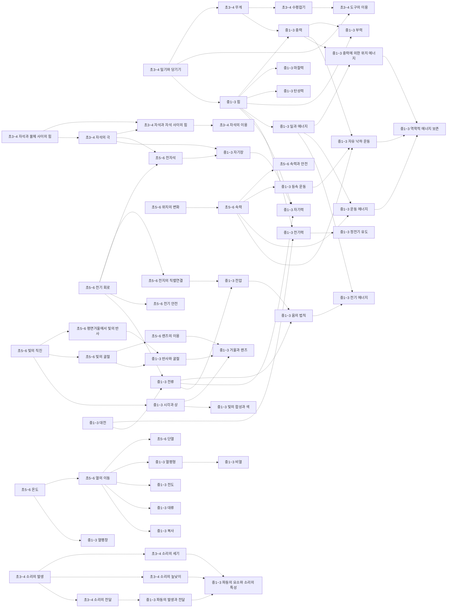
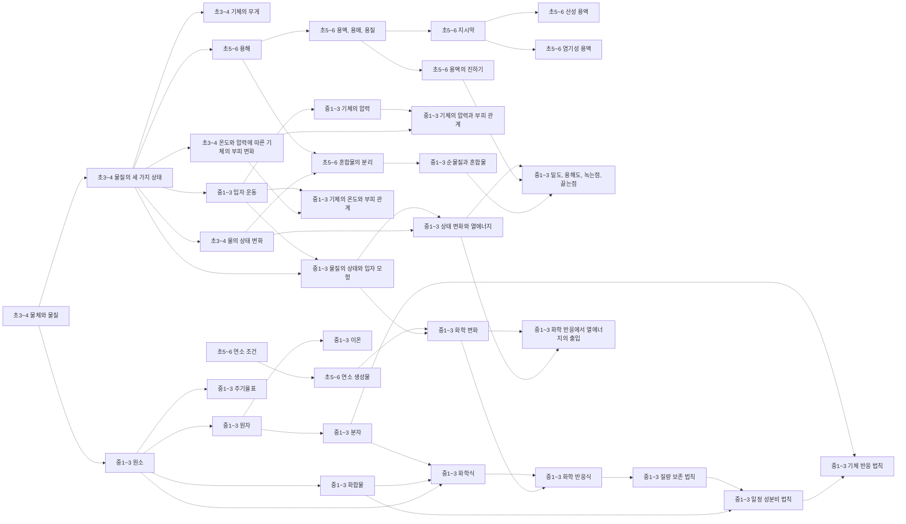
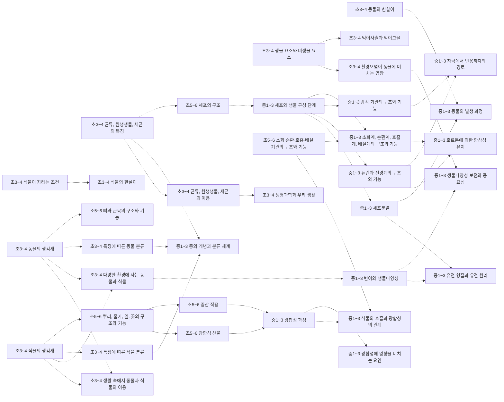
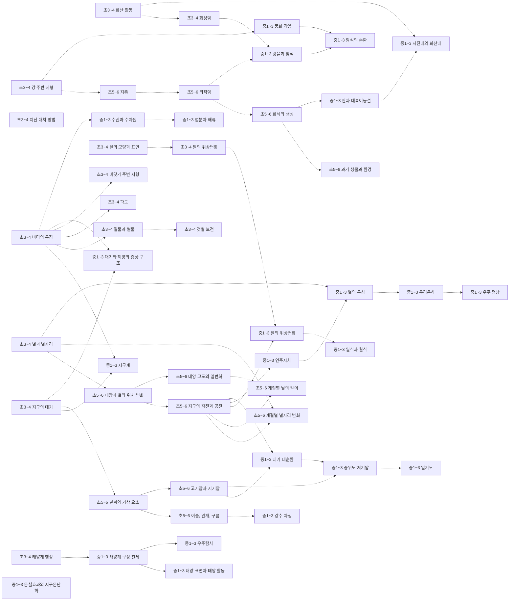
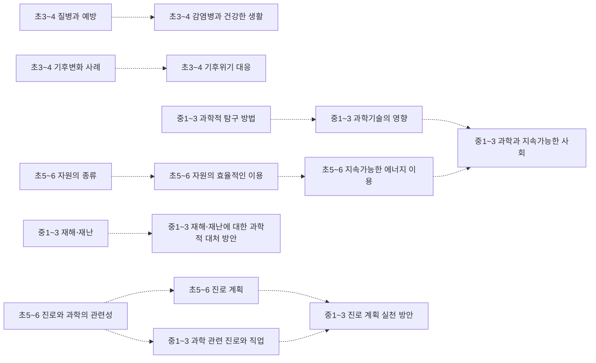

# 과학 개념 지도 (초3~중3)

개념 194개 = 고시문 과학과 「내용 체계」의 지식⋅이해 항목(원문 낱말 그대로). 선수관계 241개 — **원문 0** (고시문 문장이 밝힌 것, 실선) · **제안 241** (원문에 없어 Claude 가 제안하고 Gemini 가 반박 심사한 것, 점선 · 제안).

> 원문: 과학 내용 체계는 영역 → 범주(힘과 에너지 …) × 학년군 칸이다 — 같은 범주 행이 학년군을 가로지르는 사다리는 원문이지만, 요소 사이 화살표는 원문에 없다(원문 연계는 단원 단위 → 교과 문서의 ⬅️ 먼저). 제안 간선의 이유와 심사 기록은 [concept_proposals.json](../data/kr/concept_proposals.json).

□ 셀프 체크는 그 개념 성취기준 문장을 물음으로만 바꾼 것이다. MCP 에서는 `concept_path` 로 묻고, 「예」인 개념은 `known` 에 넣는다.

목차: [운동과 에너지](#운동과-에너지) · [물질](#물질) · [생명](#생명) · [지구와 우주](#지구와-우주) · [과학과 사회](#과학과-사회)

## 운동과 에너지

### 초3~4 밀기와 당기기

힘과 에너지 · 성취기준 4과01-02, 4과01-03, 4과15-01  
➡️ 이어서: [초3~4 무게](#초3-4-무게)제안 · [초3~4 도구의 이용](#초3-4-도구의-이용)제안 · [중1~3 힘](#중1-3-힘)제안  

- □ 수평잡기 활동을 통해 물체의 무게를 비교할 수 있나요?
- □ 무게를 정확히 비교하기 위해서는 저울이 필요함을 알고, 저울을 사용해 무게를 비교할 수 있나요?
- □ 실험을 통해 기체가 무게가 있음을 설명할 수 있나요?

### 초3~4 무게

힘과 에너지 · 성취기준 4과01-02, 4과01-03, 4과15-01  
⬅️ 먼저: [초3~4 밀기와 당기기](#초3-4-밀기와-당기기)제안  
➡️ 이어서: [초3~4 수평잡기](#초3-4-수평잡기)제안 · [중1~3 중력](#중1-3-중력)제안 · [초3~4 기체의 무게](#초3-4-기체의-무게)제안  

- □ 수평잡기 활동을 통해 물체의 무게를 비교할 수 있나요?
- □ 무게를 정확히 비교하기 위해서는 저울이 필요함을 알고, 저울을 사용해 무게를 비교할 수 있나요?
- □ 실험을 통해 기체가 무게가 있음을 설명할 수 있나요?

### 초3~4 수평잡기

힘과 에너지 · 성취기준 4과01-02  
⬅️ 먼저: [초3~4 무게](#초3-4-무게)제안  
➡️ 이어서: [초3~4 도구의 이용](#초3-4-도구의-이용)제안  

- □ 수평잡기 활동을 통해 물체의 무게를 비교할 수 있나요?

### 초3~4 도구의 이용

힘과 에너지 · 성취기준 4과01-04  
⬅️ 먼저: [초3~4 수평잡기](#초3-4-수평잡기)제안 · [초3~4 밀기와 당기기](#초3-4-밀기와-당기기)제안  

- □ 지레, 빗면과 같은 도구를 이용하면 물체를 들어 올릴 때 드는 힘의 크기가 달라짐을 알고, 도구가 일상생활에서 어떻게 쓰이는지 조사하여 공유할 수 있나요?

### 초3~4 자석과 물체 사이의 힘

전기와 자기 · 성취기준 4과09-01  
➡️ 이어서: [초3~4 자석과 자석 사이의 힘](#초3-4-자석과-자석-사이의-힘)제안 · [초3~4 자석의 극](#초3-4-자석의-극)제안  

- □ 자석과 여러 가지 물체를 가까이했을 때 나타나는 현상을 관찰하고, 자석과 자석에 붙는 물체 사이에 작용하는 힘의 특징을 말할 수 있나요?

### 초3~4 자석과 자석 사이의 힘

전기와 자기 · 성취기준 4과09-01  
⬅️ 먼저: [초3~4 자석과 물체 사이의 힘](#초3-4-자석과-물체-사이의-힘)제안 · [초3~4 자석의 극](#초3-4-자석의-극)제안  
➡️ 이어서: [초3~4 자석의 이용](#초3-4-자석의-이용)제안  

- □ 자석과 여러 가지 물체를 가까이했을 때 나타나는 현상을 관찰하고, 자석과 자석에 붙는 물체 사이에 작용하는 힘의 특징을 말할 수 있나요?

### 초3~4 자석의 극

전기와 자기 · 성취기준 4과09-01, 4과09-02, 4과09-03  
⬅️ 먼저: [초3~4 자석과 물체 사이의 힘](#초3-4-자석과-물체-사이의-힘)제안  
➡️ 이어서: [초3~4 자석과 자석 사이의 힘](#초3-4-자석과-자석-사이의-힘)제안 · [초5~6 전자석](#초5-6-전자석)제안 · [중1~3 자기장](#중1-3-자기장)제안  

- □ 자석과 여러 가지 물체를 가까이했을 때 나타나는 현상을 관찰하고, 자석과 자석에 붙는 물체 사이에 작용하는 힘의 특징을 말할 수 있나요?
- □ 자석과 자석을 가까이했을 때 나타나는 현상을 관찰하여 그 특징을 자석의 극과 관련지어 설명할 수 있나요?
- □ 자석을 이용하여 일상생활을 편리하게 하는 장치를 설계할 수 있나요?

### 초3~4 자석의 이용

전기와 자기 · 성취기준 4과09-01, 4과09-02, 4과09-03  
⬅️ 먼저: [초3~4 자석과 자석 사이의 힘](#초3-4-자석과-자석-사이의-힘)제안  

- □ 자석과 여러 가지 물체를 가까이했을 때 나타나는 현상을 관찰하고, 자석과 자석에 붙는 물체 사이에 작용하는 힘의 특징을 말할 수 있나요?
- □ 자석과 자석을 가까이했을 때 나타나는 현상을 관찰하여 그 특징을 자석의 극과 관련지어 설명할 수 있나요?
- □ 자석을 이용하여 일상생활을 편리하게 하는 장치를 설계할 수 있나요?

### 초3~4 소리의 발생

빛과 파동 · 성취기준 4과07-01, 4과07-02, 4과07-03  
➡️ 이어서: [초3~4 소리의 세기](#초3-4-소리의-세기)제안 · [초3~4 소리의 높낮이](#초3-4-소리의-높낮이)제안 · [초3~4 소리의 전달](#초3-4-소리의-전달)제안  

- □ 여러 가지 물체를 이용하여 소리를 내보고, 소리가 나는 물체는 떨림이 있음을 설명할 수 있나요?
- □ 큰 소리와 작은 소리, 높은 소리와 낮은 소리를 구분하고, 세기와 높낮이가 다른 소리를 낼 수 있나요?
- □ 여러 가지 물질을 통하여 소리가 전달되는 것을 관찰하고, 소음을 줄이는 방법을 찾아 일상생활에서 실천할 수 있나요?

### 초3~4 소리의 세기

빛과 파동 · 성취기준 4과07-02  
⬅️ 먼저: [초3~4 소리의 발생](#초3-4-소리의-발생)제안  
➡️ 이어서: [중1~3 파동의 요소와 소리의 특성](#중1-3-파동의-요소와-소리의-특성)제안  

- □ 큰 소리와 작은 소리, 높은 소리와 낮은 소리를 구분하고, 세기와 높낮이가 다른 소리를 낼 수 있나요?

### 초3~4 소리의 높낮이

빛과 파동 · 성취기준 4과07-02  
⬅️ 먼저: [초3~4 소리의 발생](#초3-4-소리의-발생)제안  
➡️ 이어서: [중1~3 파동의 요소와 소리의 특성](#중1-3-파동의-요소와-소리의-특성)제안  

- □ 큰 소리와 작은 소리, 높은 소리와 낮은 소리를 구분하고, 세기와 높낮이가 다른 소리를 낼 수 있나요?

### 초3~4 소리의 전달

빛과 파동 · 성취기준 4과07-03  
⬅️ 먼저: [초3~4 소리의 발생](#초3-4-소리의-발생)제안  
➡️ 이어서: [중1~3 파동의 발생과 전달](#중1-3-파동의-발생과-전달)제안  

- □ 여러 가지 물질을 통하여 소리가 전달되는 것을 관찰하고, 소음을 줄이는 방법을 찾아 일상생활에서 실천할 수 있나요?

### 초5~6 위치의 변화

힘과 에너지 · 성취기준 6과10-01, 6과12-01  
➡️ 이어서: [초5~6 속력](#초5-6-속력)제안  

- □ 운동하는 물체는 시간에 따라 위치가 변화함을 알고 그 변화를 표현할 수 있나요?
- □ 하루 동안 태양과 별을 관찰하여 위치 변화의 규칙성을 찾을 수 있나요?

### 초5~6 속력

힘과 에너지 · 성취기준 6과10-02, 6과10-03  
⬅️ 먼저: [초5~6 위치의 변화](#초5-6-위치의-변화)제안 · [수학 초5~6 비와 비율](%EC%88%98%ED%95%99-%EA%B0%9C%EB%85%90-%EC%A7%80%EB%8F%84.md#초5-6-비와-비율)제안  
➡️ 이어서: [초5~6 속력과 안전](#초5-6-속력과-안전)제안 · [중1~3 등속 운동](#중1-3-등속-운동)제안 · [중1~3 운동 에너지](#중1-3-운동-에너지)제안 · [중1~3 자유 낙하 운동](#중1-3-자유-낙하-운동)제안  

- □ 물체의 이동 거리와 걸린 시간을 측정하여 속력을 구하고 빠르기를 비교할 수 있나요?
- □ 속력과 관련된 안전 수칙과 안전장치를 조사한 결과를 공유하고 일상생활에서 교통안전을 실천할 수 있나요?

### 초5~6 속력과 안전

힘과 에너지 · 성취기준 6과10-03  
⬅️ 먼저: [초5~6 속력](#초5-6-속력)제안  

- □ 속력과 관련된 안전 수칙과 안전장치를 조사한 결과를 공유하고 일상생활에서 교통안전을 실천할 수 있나요?

### 초5~6 전기 회로

전기와 자기 · 성취기준 6과15-01, 6과15-02  
➡️ 이어서: [초5~6 전지의 직렬연결](#초5-6-전지의-직렬연결)제안 · [초5~6 전자석](#초5-6-전자석)제안 · [초5~6 전기 안전](#초5-6-전기-안전)제안 · [중1~3 전류](#중1-3-전류)제안  

- □ 전지와 전구, 전선을 연결하여 전구에 불을 켜보고, 불이 켜지는 전기 회로의 특징을 말할 수 있나요?
- □ 전지 한 개를 연결한 전기 회로와 전지 두 개를 직렬연결한 전기 회로의 특징을 비교할 수 있나요?

### 초5~6 전지의 직렬연결

전기와 자기 · 성취기준 6과15-02  
⬅️ 먼저: [초5~6 전기 회로](#초5-6-전기-회로)제안  
➡️ 이어서: [중1~3 전압](#중1-3-전압)제안  

- □ 전지 한 개를 연결한 전기 회로와 전지 두 개를 직렬연결한 전기 회로의 특징을 비교할 수 있나요?

### 초5~6 전자석

전기와 자기 · 성취기준 6과15-03  
⬅️ 먼저: [초5~6 전기 회로](#초5-6-전기-회로)제안 · [초3~4 자석의 극](#초3-4-자석의-극)제안  
➡️ 이어서: [중1~3 자기장](#중1-3-자기장)제안  

- □ 전자석을 만들어 전자석의 성질을 탐색하고 전자석이 사용되는 예를 조사할 수 있나요?

### 초5~6 전기 안전

전기와 자기 · 성취기준 6과15-04  
⬅️ 먼저: [초5~6 전기 회로](#초5-6-전기-회로)제안  

- □ 전기를 효율적이고 안전하게 사용하는 방법을 조사하여 실천 계획을 세우고 일상생활에서 실천할 수 있나요?

### 초5~6 온도

열 · 성취기준 6과03-01, 6과07-01, 6과07-02, 6과07-04  
➡️ 이어서: [초5~6 열의 이동](#초5-6-열의-이동)제안 · [중1~3 열팽창](#중1-3-열팽창)제안  

- □ 용해 현상의 의미를 알고, 용질의 종류와 물의 온도에 따라 물에 녹는 용질의 양이 달라짐을 비교할 수 있나요?
- □ 물체의 따뜻하고 차가운 정도를 온도로 표현함을 알고, 온도계를 이용하여 온도를 측정할 수 있나요?
- □ 온도가 다른 두 물체가 접촉했을 때 두 물체의 온도 변화를 관찰하고 그 원인을 추리할 수 있나요?
- … 외 1개

### 초5~6 열의 이동

열 · 성취기준 6과07-03, 6과10-02  
⬅️ 먼저: [초5~6 온도](#초5-6-온도)제안  
➡️ 이어서: [초5~6 단열](#초5-6-단열)제안 · [중1~3 열평형](#중1-3-열평형)제안 · [중1~3 전도](#중1-3-전도)제안 · [중1~3 대류](#중1-3-대류)제안 · [중1~3 복사](#중1-3-복사)제안 · [중1~3 상태 변화와 열에너지](#중1-3-상태-변화와-열에너지)제안  

- □ 주위에서 열의 이동으로 나타나는 현상을 관찰하여 열의 이동 방식이 다양함을 설명할 수 있나요?
- □ 물체의 이동 거리와 걸린 시간을 측정하여 속력을 구하고 빠르기를 비교할 수 있나요?

### 초5~6 단열

열 · 성취기준 6과07-04  
⬅️ 먼저: [초5~6 열의 이동](#초5-6-열의-이동)제안  

- □ 일상생활에서 단열을 이용하는 사례를 조사하고, 온도를 오랫동안 일정하게 유지할 수 있는 장치를 창의적으로 만들 수 있나요?

### 초5~6 빛의 직진

빛과 파동 · 성취기준 6과02-02  
➡️ 이어서: [초5~6 평면거울에서 빛의 반사](#초5-6-평면거울에서-빛의-반사)제안 · [초5~6 빛의 굴절](#초5-6-빛의-굴절)제안 · [중1~3 시각과 상](#중1-3-시각과-상)제안 · [중1~3 일식과 월식](#중1-3-일식과-월식)제안  

- □ 빛이 나아가는 현상을 관찰하여 빛이 직진, 반사, 굴절하는 성질이 있음을 말할 수 있나요?

### 초5~6 평면거울에서 빛의 반사

빛과 파동 · 성취기준 6과02-02  
⬅️ 먼저: [초5~6 빛의 직진](#초5-6-빛의-직진)제안  
➡️ 이어서: [중1~3 반사와 굴절](#중1-3-반사와-굴절)제안  

- □ 빛이 나아가는 현상을 관찰하여 빛이 직진, 반사, 굴절하는 성질이 있음을 말할 수 있나요?

### 초5~6 빛의 굴절

빛과 파동 · 성취기준 6과02-02  
⬅️ 먼저: [초5~6 빛의 직진](#초5-6-빛의-직진)제안  
➡️ 이어서: [초5~6 렌즈의 이용](#초5-6-렌즈의-이용)제안 · [중1~3 반사와 굴절](#중1-3-반사와-굴절)제안  

- □ 빛이 나아가는 현상을 관찰하여 빛이 직진, 반사, 굴절하는 성질이 있음을 말할 수 있나요?

### 초5~6 렌즈의 이용

빛과 파동 · 성취기준 6과02-03  
⬅️ 먼저: [초5~6 빛의 굴절](#초5-6-빛의-굴절)제안  
➡️ 이어서: [중1~3 거울과 렌즈](#중1-3-거울과-렌즈)제안  

- □ 거울과 렌즈의 쓰임새를 조사하고 거울이나 렌즈를 이용한 장치를 창의적으로 만들 수 있나요?

### 중1~3 힘

힘과 에너지 · 성취기준 9과05-01, 9과05-02, 9과05-03, 9과05-04, 9과14-04  
⬅️ 먼저: [초3~4 밀기와 당기기](#초3-4-밀기와-당기기)제안  
➡️ 이어서: [중1~3 중력](#중1-3-중력)제안 · [중1~3 마찰력](#중1-3-마찰력)제안 · [중1~3 탄성력](#중1-3-탄성력)제안 · [중1~3 부력](#중1-3-부력)제안 · [중1~3 일과 에너지](#중1-3-일과-에너지)제안 · [중1~3 전기력](#중1-3-전기력)제안 · [중1~3 자기력](#중1-3-자기력)제안  

- □ 물체에 작용하는 힘을 화살표를 이용하여 나타내고, 힘의 평형을 이루는 조건을 설명할 수 있나요?
- □ 중력, 탄성력, 마찰력, 부력을 이해하고, 각 힘의 특징을 크기와 방향으로 설명할 수 있나요?
- □ 알짜힘이 0이 아닐 때 물체의 운동 상태가 변함을 알고, 그 예를 조사하여 분류할 수 있나요?
- … 외 2개

### 중1~3 중력

힘과 에너지 · 성취기준 9과05-02, 9과19-03  
⬅️ 먼저: [초3~4 무게](#초3-4-무게)제안 · [중1~3 힘](#중1-3-힘)제안  
➡️ 이어서: [중1~3 부력](#중1-3-부력)제안 · [중1~3 자유 낙하 운동](#중1-3-자유-낙하-운동)제안 · [중1~3 중력에 의한 위치 에너지](#중1-3-중력에-의한-위치-에너지)제안  

- □ 중력, 탄성력, 마찰력, 부력을 이해하고, 각 힘의 특징을 크기와 방향으로 설명할 수 있나요?
- □ 일의 정의를 알고, 자유 낙하하는 물체의 운동에서 중력이 한 일을 위치 에너지와 운동 에너지로 표현할 수 있나요?

### 중1~3 마찰력

힘과 에너지 · 성취기준 9과05-02  
⬅️ 먼저: [중1~3 힘](#중1-3-힘)제안  

- □ 중력, 탄성력, 마찰력, 부력을 이해하고, 각 힘의 특징을 크기와 방향으로 설명할 수 있나요?

### 중1~3 탄성력

힘과 에너지 · 성취기준 9과05-02  
⬅️ 먼저: [중1~3 힘](#중1-3-힘)제안  

- □ 중력, 탄성력, 마찰력, 부력을 이해하고, 각 힘의 특징을 크기와 방향으로 설명할 수 있나요?

### 중1~3 부력

힘과 에너지 · 성취기준 9과05-02  
⬅️ 먼저: [중1~3 힘](#중1-3-힘)제안 · [중1~3 중력](#중1-3-중력)제안  

- □ 중력, 탄성력, 마찰력, 부력을 이해하고, 각 힘의 특징을 크기와 방향으로 설명할 수 있나요?

### 중1~3 등속 운동

힘과 에너지 · 성취기준 9과04-01, 9과05-03, 9과06-01, 9과07-03, 9과13-03, 9과19-01, 9과19-02, 9과19-03, 9과19-04  
⬅️ 먼저: [초5~6 속력](#초5-6-속력)제안 · [수학 중1 좌표평면과 그래프](%EC%88%98%ED%95%99-%EA%B0%9C%EB%85%90-%EC%A7%80%EB%8F%84.md#중1-좌표평면과-그래프)제안  
➡️ 이어서: [중1~3 자유 낙하 운동](#중1-3-자유-낙하-운동)제안  

- □ 확산 및 증발 현상을 관찰하여 물질을 구성하는 입자가 운동하고 있음을 추론할 수 있나요?
- □ 알짜힘이 0이 아닐 때 물체의 운동 상태가 변함을 알고, 그 예를 조사하여 분류할 수 있나요?
- □ 압력의 의미를 알고, 기체의 압력을 입자의 운동으로 설명할 수 있나요?
- … 외 6개

### 중1~3 자유 낙하 운동

힘과 에너지 · 성취기준 9과19-02, 9과19-03  
⬅️ 먼저: [중1~3 중력](#중1-3-중력)제안 · [중1~3 등속 운동](#중1-3-등속-운동)제안 · [초5~6 속력](#초5-6-속력)제안  
➡️ 이어서: [중1~3 역학적 에너지 보존](#중1-3-역학적-에너지-보존)제안  

- □ 자유 낙하하는 물체의 운동에서 시간에 따른 속력의 변화가 일정함을 분석할 수 있나요?
- □ 일의 정의를 알고, 자유 낙하하는 물체의 운동에서 중력이 한 일을 위치 에너지와 운동 에너지로 표현할 수 있나요?

### 중1~3 일과 에너지

힘과 에너지 · 성취기준 9과04-04, 9과12-01, 9과12-02, 9과12-03, 9과13-01, 9과13-02, 9과13-03, 9과13-04, 9과13-05, 9과14-03, 9과16-06, 9과19-01, 9과19-02, 9과19-03, 9과19-04  
⬅️ 먼저: [중1~3 힘](#중1-3-힘)제안  
➡️ 이어서: [중1~3 중력에 의한 위치 에너지](#중1-3-중력에-의한-위치-에너지)제안 · [중1~3 운동 에너지](#중1-3-운동-에너지)제안 · [중1~3 전기 에너지](#중1-3-전기-에너지)제안  

- □ 물질의 상태 변화와 열에너지 출입 관계를 이해하고, 이를 실생활에 적용하여 과학의 유용성을 인식할 수 있나요?
- □ 광합성 과정을 이해하고, 환경 요인과 광합성의 관계를 탐구하는 실험을 설계할 수 있나요?
- □ 식물의 호흡과 광합성의 관계를 이해하고, 호흡과 광합성 과정에서 출입하는 에너지와 물질의 변화를 분석할 수 있나요?
- … 외 12개

### 중1~3 중력에 의한 위치 에너지

힘과 에너지 · 성취기준 9과19-03  
⬅️ 먼저: [중1~3 일과 에너지](#중1-3-일과-에너지)제안 · [중1~3 중력](#중1-3-중력)제안  
➡️ 이어서: [중1~3 역학적 에너지 보존](#중1-3-역학적-에너지-보존)제안  

- □ 일의 정의를 알고, 자유 낙하하는 물체의 운동에서 중력이 한 일을 위치 에너지와 운동 에너지로 표현할 수 있나요?

### 중1~3 운동 에너지

힘과 에너지 · 성취기준 9과13-03, 9과19-01, 9과19-02, 9과19-03, 9과19-04  
⬅️ 먼저: [중1~3 일과 에너지](#중1-3-일과-에너지)제안 · [초5~6 속력](#초5-6-속력)제안  
➡️ 이어서: [중1~3 역학적 에너지 보존](#중1-3-역학적-에너지-보존)제안  

- □ 호흡계의 구조와 기능을 이해하고, 호흡 운동의 원리를 나타내는 모형을 만들 수 있나요?
- □ 직선상에서 움직이는 물체의 운동을 그래프로 나타내고 해석할 수 있나요?
- □ 자유 낙하하는 물체의 운동에서 시간에 따른 속력의 변화가 일정함을 분석할 수 있나요?
- … 외 2개

### 중1~3 역학적 에너지 보존

힘과 에너지 · 성취기준 9과19-04  
⬅️ 먼저: [중1~3 중력에 의한 위치 에너지](#중1-3-중력에-의한-위치-에너지)제안 · [중1~3 운동 에너지](#중1-3-운동-에너지)제안 · [중1~3 자유 낙하 운동](#중1-3-자유-낙하-운동)제안  

- □ 물체의 운동에서 역학적 에너지의 전환과 보존을 이해하고, 이를 활용하여 일상생활 속 물체의 운동을 예측할 수 있나요?

### 중1~3 전기력

전기와 자기 · 성취기준 9과14-01  
⬅️ 먼저: [중1~3 대전](#중1-3-대전)제안 · [중1~3 힘](#중1-3-힘)제안  
➡️ 이어서: [중1~3 정전기 유도](#중1-3-정전기-유도)제안  

- □ 마찰 전기, 정전기 유도 현상을 관찰하고, 이를 전기력과 원자 모형을 이용하여 설명할 수 있나요?

### 중1~3 대전

전기와 자기 · 성취기준 9과14-01  
➡️ 이어서: [중1~3 전기력](#중1-3-전기력)제안 · [중1~3 전류](#중1-3-전류)제안 · [중1~3 이온](#중1-3-이온)제안  

- □ 마찰 전기, 정전기 유도 현상을 관찰하고, 이를 전기력과 원자 모형을 이용하여 설명할 수 있나요?

### 중1~3 정전기 유도

전기와 자기 · 성취기준 9과14-01  
⬅️ 먼저: [중1~3 전기력](#중1-3-전기력)제안  

- □ 마찰 전기, 정전기 유도 현상을 관찰하고, 이를 전기력과 원자 모형을 이용하여 설명할 수 있나요?

### 중1~3 전압

전기와 자기 · 성취기준 9과14-02  
⬅️ 먼저: [초5~6 전지의 직렬연결](#초5-6-전지의-직렬연결)제안 · [중1~3 전류](#중1-3-전류)제안  
➡️ 이어서: [중1~3 옴의 법칙](#중1-3-옴의-법칙)제안  

- □ 전기 회로에서 전류를 모형으로 설명하고, 실험을 통해 저항, 전류, 전압 사이의 관계를 이끌어낼 수 있나요?

### 중1~3 전류

전기와 자기 · 성취기준 9과14-02, 9과14-04  
⬅️ 먼저: [초5~6 전기 회로](#초5-6-전기-회로)제안 · [중1~3 대전](#중1-3-대전)제안  
➡️ 이어서: [중1~3 옴의 법칙](#중1-3-옴의-법칙)제안 · [중1~3 자기력](#중1-3-자기력)제안 · [중1~3 전압](#중1-3-전압)제안  

- □ 전기 회로에서 전류를 모형으로 설명하고, 실험을 통해 저항, 전류, 전압 사이의 관계를 이끌어낼 수 있나요?
- □ 자기장 안에 놓인 전류가 흐르는 코일이 받는 힘의 특성을 추리하고, 전동기 등 일상생활에서 활용한 예를 찾을 수 있나요?

### 중1~3 옴의 법칙

전기와 자기 · 성취기준 9과14-02, 9과14-04  
⬅️ 먼저: [중1~3 전압](#중1-3-전압)제안 · [중1~3 전류](#중1-3-전류)제안 · [수학 중1 좌표평면과 그래프](%EC%88%98%ED%95%99-%EA%B0%9C%EB%85%90-%EC%A7%80%EB%8F%84.md#중1-좌표평면과-그래프)제안  
➡️ 이어서: [중1~3 전기 에너지](#중1-3-전기-에너지)제안  

- □ 전기 회로에서 전류를 모형으로 설명하고, 실험을 통해 저항, 전류, 전압 사이의 관계를 이끌어낼 수 있나요?
- □ 자기장 안에 놓인 전류가 흐르는 코일이 받는 힘의 특성을 추리하고, 전동기 등 일상생활에서 활용한 예를 찾을 수 있나요?

### 중1~3 전기 에너지

전기와 자기 · 성취기준 9과14-03  
⬅️ 먼저: [중1~3 옴의 법칙](#중1-3-옴의-법칙)제안 · [중1~3 일과 에너지](#중1-3-일과-에너지)제안  

- □ 저항의 직렬연결과 병렬연결의 특징을 비교하고, 일상생활에서 전기 에너지가 다양한 형태의 에너지로 전환됨을 소비 전력과 관련지어 설명할 수 있나요?

### 중1~3 자기력

전기와 자기 · 성취기준 9과14-03  
⬅️ 먼저: [중1~3 자기장](#중1-3-자기장)제안 · [중1~3 전류](#중1-3-전류)제안 · [중1~3 힘](#중1-3-힘)제안  

- □ 저항의 직렬연결과 병렬연결의 특징을 비교하고, 일상생활에서 전기 에너지가 다양한 형태의 에너지로 전환됨을 소비 전력과 관련지어 설명할 수 있나요?

### 중1~3 자기장

전기와 자기 · 성취기준 9과14-04  
⬅️ 먼저: [초3~4 자석의 극](#초3-4-자석의-극)제안 · [초5~6 전자석](#초5-6-전자석)제안  
➡️ 이어서: [중1~3 자기력](#중1-3-자기력)제안  

- □ 자기장 안에 놓인 전류가 흐르는 코일이 받는 힘의 특성을 추리하고, 전동기 등 일상생활에서 활용한 예를 찾을 수 있나요?

### 중1~3 열평형

열 · 성취기준 9과03-01  
⬅️ 먼저: [초5~6 열의 이동](#초5-6-열의-이동)제안  
➡️ 이어서: [중1~3 비열](#중1-3-비열)제안  

- □ 온도와 열평형 과정을 물질을 구성하는 입자들의 배치나 움직임 등으로 설명할 수 있나요?

### 중1~3 전도

열 · 성취기준 9과03-02  
⬅️ 먼저: [초5~6 열의 이동](#초5-6-열의-이동)제안  

- □ 열은 전도, 대류, 복사로 전달됨을 알고, 열전달 과정을 모형 등을 사용하여 다양하게 표현할 수 있나요?

### 중1~3 대류

열 · 성취기준 9과03-02  
⬅️ 먼저: [초5~6 열의 이동](#초5-6-열의-이동)제안  
➡️ 이어서: [중1~3 대기 대순환](#중1-3-대기-대순환)제안  

- □ 열은 전도, 대류, 복사로 전달됨을 알고, 열전달 과정을 모형 등을 사용하여 다양하게 표현할 수 있나요?

### 중1~3 복사

열 · 성취기준 9과03-02, 9과17-01  
⬅️ 먼저: [초5~6 열의 이동](#초5-6-열의-이동)제안  
➡️ 이어서: [중1~3 온실효과와 지구온난화](#중1-3-온실효과와-지구온난화)제안  

- □ 열은 전도, 대류, 복사로 전달됨을 알고, 열전달 과정을 모형 등을 사용하여 다양하게 표현할 수 있나요?
- □ 지구 대기권을 4개 권역으로 구분하며, 온실효과와 지구온난화를 복사 평형의 관점으로 설명할 수 있나요?

### 중1~3 비열

열 · 성취기준 9과03-03  
⬅️ 먼저: [중1~3 열평형](#중1-3-열평형)제안  

- □ 물질에 따라 비열과 열팽창 정도가 다름을 알고, 이러한 성질이 일상생활에서 유용하게 활용됨을 인식할 수 있나요?

### 중1~3 열팽창

열 · 성취기준 9과03-03  
⬅️ 먼저: [초5~6 온도](#초5-6-온도)제안 · [중1~3 입자 운동](#중1-3-입자-운동)제안  

- □ 물질에 따라 비열과 열팽창 정도가 다름을 알고, 이러한 성질이 일상생활에서 유용하게 활용됨을 인식할 수 있나요?

### 중1~3 시각과 상

빛과 파동 · 성취기준 9과10-01  
⬅️ 먼저: [초5~6 빛의 직진](#초5-6-빛의-직진)제안  
➡️ 이어서: [중1~3 거울과 렌즈](#중1-3-거울과-렌즈)제안 · [중1~3 빛의 합성과 색](#중1-3-빛의-합성과-색)제안  

- □ 빛의 반사와 굴절의 원리를 이해하고, 물체를 보는 과정을 빛의 경로를 이용하여 표현할 수 있나요?

### 중1~3 반사와 굴절

빛과 파동 · 성취기준 9과10-01  
⬅️ 먼저: [초5~6 평면거울에서 빛의 반사](#초5-6-평면거울에서-빛의-반사)제안 · [초5~6 빛의 굴절](#초5-6-빛의-굴절)제안  
➡️ 이어서: [중1~3 거울과 렌즈](#중1-3-거울과-렌즈)제안  

- □ 빛의 반사와 굴절의 원리를 이해하고, 물체를 보는 과정을 빛의 경로를 이용하여 표현할 수 있나요?

### 중1~3 거울과 렌즈

빛과 파동 · 성취기준 9과10-02  
⬅️ 먼저: [중1~3 반사와 굴절](#중1-3-반사와-굴절)제안 · [초5~6 렌즈의 이용](#초5-6-렌즈의-이용)제안 · [중1~3 시각과 상](#중1-3-시각과-상)제안  

- □ 평면거울에서 상이 생기는 원리를 설명하고, 일상생활에서 사용되는 거울과 렌즈의 종류를 분류하고 상의 특징을 비교할 수 있나요?

### 중1~3 빛의 합성과 색

빛과 파동 · 성취기준 9과10-03, 9과12-01, 9과12-02, 9과12-03  
⬅️ 먼저: [중1~3 시각과 상](#중1-3-시각과-상)제안  

- □ 물체의 색을 빛의 반사와 관련지어 설명하고, 영상 장치에서 빛의 합성을 이용하여 다양한 색이 표현되는 원리를 이해할 수 있나요?
- □ 광합성 과정을 이해하고, 환경 요인과 광합성의 관계를 탐구하는 실험을 설계할 수 있나요?
- □ 식물의 호흡과 광합성의 관계를 이해하고, 호흡과 광합성 과정에서 출입하는 에너지와 물질의 변화를 분석할 수 있나요?
- … 외 1개

### 중1~3 파동의 발생과 전달

빛과 파동 · 성취기준 9과10-04  
⬅️ 먼저: [초3~4 소리의 전달](#초3-4-소리의-전달)제안  
➡️ 이어서: [중1~3 파동의 요소와 소리의 특성](#중1-3-파동의-요소와-소리의-특성)제안  

- □ 파동의 발생과 전달 과정을 이해하고, 소리의 특성을 진폭, 진동수, 파형 등의 과학적 용어로 표현할 수 있나요?

### 중1~3 파동의 요소와 소리의 특성

빛과 파동 · 성취기준 9과10-04  
⬅️ 먼저: [중1~3 파동의 발생과 전달](#중1-3-파동의-발생과-전달)제안 · [초3~4 소리의 세기](#초3-4-소리의-세기)제안 · [초3~4 소리의 높낮이](#초3-4-소리의-높낮이)제안  

- □ 파동의 발생과 전달 과정을 이해하고, 소리의 특성을 진폭, 진동수, 파형 등의 과학적 용어로 표현할 수 있나요?

## 물질

### 초3~4 물체와 물질

물질의 성질 · 성취기준 4과05-01, 4과05-02, 4과05-03  
➡️ 이어서: [초3~4 물질의 세 가지 상태](#초3-4-물질의-세-가지-상태)제안 · [중1~3 원소](#중1-3-원소)제안  

- □ 물체를 이루는 여러 가지 물질의 성질을 비교하고, 물질의 종류에 따라 물체를 분류할 수 있나요?
- □ 물질의 세 가지 상태인 고체, 액체, 기체의 성질을 관찰하여 비교할 수 있나요?
- □ 다양한 물질의 성질을 이용하여 쓰임새 있는 물체를 설계할 수 있나요?

### 초3~4 물질의 세 가지 상태

물질의 성질 · 성취기준 4과05-02  
⬅️ 먼저: [초3~4 물체와 물질](#초3-4-물체와-물질)제안  
➡️ 이어서: [초3~4 기체의 무게](#초3-4-기체의-무게)제안 · [초3~4 온도와 압력에 따른 기체의 부피 변화](#초3-4-온도와-압력에-따른-기체의-부피-변화)제안 · [초3~4 물의 상태 변화](#초3-4-물의-상태-변화)제안 · [초5~6 용해](#초5-6-용해)제안 · [중1~3 입자 운동](#중1-3-입자-운동)제안 · [중1~3 물질의 상태와 입자 모형](#중1-3-물질의-상태와-입자-모형)제안  

- □ 물질의 세 가지 상태인 고체, 액체, 기체의 성질을 관찰하여 비교할 수 있나요?

### 초3~4 기체의 무게

물질의 성질 · 성취기준 4과15-01  
⬅️ 먼저: [초3~4 물질의 세 가지 상태](#초3-4-물질의-세-가지-상태)제안 · [초3~4 무게](#초3-4-무게)제안  
➡️ 이어서: [초5~6 고기압과 저기압](#초5-6-고기압과-저기압)제안  

- □ 실험을 통해 기체가 무게가 있음을 설명할 수 있나요?

### 초3~4 온도와 압력에 따른 기체의 부피 변화

물질의 성질 · 성취기준 4과15-02  
⬅️ 먼저: [초3~4 물질의 세 가지 상태](#초3-4-물질의-세-가지-상태)제안  
➡️ 이어서: [중1~3 기체의 압력과 부피 관계](#중1-3-기체의-압력과-부피-관계)제안 · [중1~3 기체의 온도와 부피 관계](#중1-3-기체의-온도와-부피-관계)제안  

- □ 온도나 압력에 따라 기체의 부피가 달라지는 현상을 관찰하고, 우리 주변에서 예를 찾을 수 있나요?

### 초3~4 물의 상태 변화

물질의 성질 · 성취기준 4과10-01, 4과10-02, 4과10-03  
⬅️ 먼저: [초3~4 물질의 세 가지 상태](#초3-4-물질의-세-가지-상태)제안  
➡️ 이어서: [초5~6 혼합물의 분리](#초5-6-혼합물의-분리)제안 · [중1~3 상태 변화와 열에너지](#중1-3-상태-변화와-열에너지)제안 · [초5~6 이슬, 안개, 구름](#초5-6-이슬-안개-구름)제안  

- □ 물이 세 가지 상태로 변할 수 있음을 알고, 우리 주변에서 예를 찾을 수 있나요?
- □ 물이 얼 때, 얼음이 녹을 때, 물이 증발할 때와 끓을 때, 수증기가 응결할 때의 변화를 관찰할 수 있나요?
- □ 물의 상태 변화를 이용하여 물을 얻을 수 있는 장치를 설계하고 만들 수 있나요?

### 초5~6 용액, 용매, 용질

물질의 성질 · 성취기준 6과03-02  
⬅️ 먼저: [초5~6 용해](#초5-6-용해)제안  
➡️ 이어서: [초5~6 용액의 진하기](#초5-6-용액의-진하기)제안 · [초5~6 지시약](#초5-6-지시약)제안  

- □ 용질이나 용매의 양에 따라 용액의 진하기가 달라짐을 관찰하고, 용액의 상대적인 진하기를 비교할 수 있나요?

### 초5~6 용해

물질의 성질 · 성취기준 6과03-01, 6과03-02, 6과03-03, 6과05-02  
⬅️ 먼저: [초3~4 물질의 세 가지 상태](#초3-4-물질의-세-가지-상태)제안  
➡️ 이어서: [초5~6 용액, 용매, 용질](#초5-6-용액-용매-용질)제안 · [초5~6 혼합물의 분리](#초5-6-혼합물의-분리)제안  

- □ 용해 현상의 의미를 알고, 용질의 종류와 물의 온도에 따라 물에 녹는 용질의 양이 달라짐을 비교할 수 있나요?
- □ 용질이나 용매의 양에 따라 용액의 진하기가 달라짐을 관찰하고, 용액의 상대적인 진하기를 비교할 수 있나요?
- □ 일상생활에서 용액이 쓰이는 사례를 조사하여 용액의 필요성을 알리는 자료를 만들고 공유할 수 있나요?
- … 외 1개

### 초5~6 용액의 진하기

물질의 성질 · 성취기준 6과03-02  
⬅️ 먼저: [초5~6 용액, 용매, 용질](#초5-6-용액-용매-용질)제안  
➡️ 이어서: [중1~3 밀도, 용해도, 녹는점, 끓는점](#중1-3-밀도-용해도-녹는점-끓는점)제안  

- □ 용질이나 용매의 양에 따라 용액의 진하기가 달라짐을 관찰하고, 용액의 상대적인 진하기를 비교할 수 있나요?

### 초5~6 혼합물의 분리

물질의 성질 · 성취기준 6과05-01, 6과05-02, 6과05-03  
⬅️ 먼저: [초5~6 용해](#초5-6-용해)제안 · [초3~4 물의 상태 변화](#초3-4-물의-상태-변화)제안  
➡️ 이어서: [중1~3 순물질과 혼합물](#중1-3-순물질과-혼합물)제안  

- □ 알갱이의 크기가 다른 고체 혼합물과 골고루 섞이지 않는 액체 혼합물을 분리할 수 있나요?
- □ 물에 용해되는 성질을 이용하여 고체 혼합물을 분리하고, 물을 증발시켜 물에 용해된 고체 물질을 분리할 수 있나요?
- □ 지속가능한 삶을 위한 과학기술 사례 중 혼합물의 분리를 이용한 장치를 조사하여 공유할 수 있나요?

### 초5~6 지시약

물질의 변화 · 성취기준 6과09-01  
⬅️ 먼저: [초5~6 용액, 용매, 용질](#초5-6-용액-용매-용질)제안  
➡️ 이어서: [초5~6 산성 용액](#초5-6-산성-용액)제안 · [초5~6 염기성 용액](#초5-6-염기성-용액)제안  

- □ 여러 가지 용액에 지시약을 넣었을 때의 변화를 관찰하여 용액을 산성 용액과 염기성 용액으로 분류할 수 있나요?

### 초5~6 산성 용액

물질의 변화 · 성취기준 6과09-01, 6과09-02, 6과09-03  
⬅️ 먼저: [초5~6 지시약](#초5-6-지시약)제안  

- □ 여러 가지 용액에 지시약을 넣었을 때의 변화를 관찰하여 용액을 산성 용액과 염기성 용액으로 분류할 수 있나요?
- □ 산성 용액과 염기성 용액의 성질을 관찰하고, 산성 용액과 염기성 용액을 섞을 때 용액의 성질 변화를 실험을 통해 추론할 수 있나요?
- □ 우리 주변에서 산성 용액과 염기성 용액을 이용하는 예를 찾아서 설명할 수 있나요?

### 초5~6 염기성 용액

물질의 변화 · 성취기준 6과09-01, 6과09-02, 6과09-03  
⬅️ 먼저: [초5~6 지시약](#초5-6-지시약)제안  

- □ 여러 가지 용액에 지시약을 넣었을 때의 변화를 관찰하여 용액을 산성 용액과 염기성 용액으로 분류할 수 있나요?
- □ 산성 용액과 염기성 용액의 성질을 관찰하고, 산성 용액과 염기성 용액을 섞을 때 용액의 성질 변화를 실험을 통해 추론할 수 있나요?
- □ 우리 주변에서 산성 용액과 염기성 용액을 이용하는 예를 찾아서 설명할 수 있나요?

### 초5~6 연소 조건

물질의 변화 · 성취기준 6과14-02  
➡️ 이어서: [초5~6 연소 생성물](#초5-6-연소-생성물)제안  

- □ 물질이 연소할 때 나타나는 공통적인 현상을 관찰하고, 연소의 조건을 찾을 수 있나요?

### 초5~6 연소 생성물

물질의 변화 · 성취기준 6과14-01, 6과14-02, 6과14-03, 6과14-04  
⬅️ 먼저: [초5~6 연소 조건](#초5-6-연소-조건)제안  
➡️ 이어서: [중1~3 화학 변화](#중1-3-화학-변화)제안  

- □ 물질의 성질이 달라지는 변화와 달라지지 않는 변화를 관찰하여 비교할 수 있나요?
- □ 물질이 연소할 때 나타나는 공통적인 현상을 관찰하고, 연소의 조건을 찾을 수 있나요?
- □ 연소 전과 후의 물질을 비교하여 연소 과정에서 물질의 성질이 달라짐을 설명할 수 있나요?
- … 외 1개

### 중1~3 입자 운동

물질의 성질 · 성취기준 9과04-01, 9과06-01  
⬅️ 먼저: [초3~4 물질의 세 가지 상태](#초3-4-물질의-세-가지-상태)제안  
➡️ 이어서: [중1~3 열팽창](#중1-3-열팽창)제안 · [중1~3 기체의 압력](#중1-3-기체의-압력)제안 · [중1~3 기체의 온도와 부피 관계](#중1-3-기체의-온도와-부피-관계)제안 · [중1~3 물질의 상태와 입자 모형](#중1-3-물질의-상태와-입자-모형)제안  

- □ 확산 및 증발 현상을 관찰하여 물질을 구성하는 입자가 운동하고 있음을 추론할 수 있나요?
- □ 압력의 의미를 알고, 기체의 압력을 입자의 운동으로 설명할 수 있나요?

### 중1~3 기체의 압력

물질의 성질 · 성취기준 9과06-01, 9과06-02  
⬅️ 먼저: [중1~3 입자 운동](#중1-3-입자-운동)제안  
➡️ 이어서: [중1~3 기체의 압력과 부피 관계](#중1-3-기체의-압력과-부피-관계)제안  

- □ 압력의 의미를 알고, 기체의 압력을 입자의 운동으로 설명할 수 있나요?
- □ 기체의 압력과 부피 관계를 실험 결과로부터 알아내고, 이를 입자 모형으로 해석할 수 있나요?

### 중1~3 기체의 압력과 부피 관계

물질의 성질 · 성취기준 9과06-02  
⬅️ 먼저: [중1~3 기체의 압력](#중1-3-기체의-압력)제안 · [초3~4 온도와 압력에 따른 기체의 부피 변화](#초3-4-온도와-압력에-따른-기체의-부피-변화)제안 · [수학 중1 좌표평면과 그래프](%EC%88%98%ED%95%99-%EA%B0%9C%EB%85%90-%EC%A7%80%EB%8F%84.md#중1-좌표평면과-그래프)제안  

- □ 기체의 압력과 부피 관계를 실험 결과로부터 알아내고, 이를 입자 모형으로 해석할 수 있나요?

### 중1~3 기체의 온도와 부피 관계

물질의 성질 · 성취기준 9과06-03  
⬅️ 먼저: [중1~3 입자 운동](#중1-3-입자-운동)제안 · [초3~4 온도와 압력에 따른 기체의 부피 변화](#초3-4-온도와-압력에-따른-기체의-부피-변화)제안  

- □ 기체의 온도와 부피 관계를 실험 결과로부터 알아내고, 이를 입자 모형으로 해석할 수 있나요?

### 중1~3 물질의 상태와 입자 모형

물질의 성질 · 성취기준 9과04-02, 9과04-03  
⬅️ 먼저: [중1~3 입자 운동](#중1-3-입자-운동)제안 · [초3~4 물질의 세 가지 상태](#초3-4-물질의-세-가지-상태)제안  
➡️ 이어서: [중1~3 상태 변화와 열에너지](#중1-3-상태-변화와-열에너지)제안 · [중1~3 화학 변화](#중1-3-화학-변화)제안  

- □ 물질의 세 가지 상태의 특징을 설명하고, 이를 입자 모형으로 표현할 수 있나요?
- □ 여러 가지 물질의 상태 변화를 관찰하고, 이를 입자 모형으로 설명할 수 있나요?

### 중1~3 상태 변화와 열에너지

물질의 성질 · 성취기준 9과04-04  
⬅️ 먼저: [중1~3 물질의 상태와 입자 모형](#중1-3-물질의-상태와-입자-모형)제안 · [초3~4 물의 상태 변화](#초3-4-물의-상태-변화)제안 · [초5~6 열의 이동](#초5-6-열의-이동)제안  
➡️ 이어서: [중1~3 밀도, 용해도, 녹는점, 끓는점](#중1-3-밀도-용해도-녹는점-끓는점)제안 · [중1~3 화학 반응에서 열에너지의 출입](#중1-3-화학-반응에서-열에너지의-출입)제안  

- □ 물질의 상태 변화와 열에너지 출입 관계를 이해하고, 이를 실생활에 적용하여 과학의 유용성을 인식할 수 있나요?

### 중1~3 밀도, 용해도, 녹는점, 끓는점

물질의 성질 · 성취기준 9과08-01  
⬅️ 먼저: [중1~3 상태 변화와 열에너지](#중1-3-상태-변화와-열에너지)제안 · [초5~6 용액의 진하기](#초5-6-용액의-진하기)제안 · [수학 초5~6 비와 비율](%EC%88%98%ED%95%99-%EA%B0%9C%EB%85%90-%EC%A7%80%EB%8F%84.md#초5-6-비와-비율)제안 · [중1~3 순물질과 혼합물](#중1-3-순물질과-혼합물)제안  

- □ 물질의 특성의 의미를 알고, 실험을 통해 밀도, 용해도, 녹는점, 끓는점 등을 설명할 수 있나요?

### 중1~3 순물질과 혼합물

물질의 성질 · 성취기준 9과08-02  
⬅️ 먼저: [초5~6 혼합물의 분리](#초5-6-혼합물의-분리)제안  
➡️ 이어서: [중1~3 밀도, 용해도, 녹는점, 끓는점](#중1-3-밀도-용해도-녹는점-끓는점)제안  

- □ 물질의 특성을 근거로 우리 주변의 물질을 순물질과 혼합물로 분류할 수 있나요?

### 중1~3 화학 변화

물질의 변화 · 성취기준 9과16-01  
⬅️ 먼저: [초5~6 연소 생성물](#초5-6-연소-생성물)제안 · [중1~3 물질의 상태와 입자 모형](#중1-3-물질의-상태와-입자-모형)제안  
➡️ 이어서: [중1~3 화학 반응식](#중1-3-화학-반응식)제안 · [중1~3 화학 반응에서 열에너지의 출입](#중1-3-화학-반응에서-열에너지의-출입)제안  

- □ 물리 변화와 화학 변화의 의미를 알고, 화학 변화에서 새로운 물질이 생성됨을 관찰할 수 있나요?

### 중1~3 화학 반응식

물질의 변화 · 성취기준 9과16-02  
⬅️ 먼저: [중1~3 화학식](#중1-3-화학식)제안 · [중1~3 화학 변화](#중1-3-화학-변화)제안  
➡️ 이어서: [중1~3 질량 보존 법칙](#중1-3-질량-보존-법칙)제안  

- □ 간단한 화학 반응을 화학 반응식으로 표현하고, 화학 반응식에서 계수의 비를 입자 수의 비로 해석할 수 있나요?

### 중1~3 질량 보존 법칙

물질의 변화 · 성취기준 9과16-03  
⬅️ 먼저: [중1~3 화학 반응식](#중1-3-화학-반응식)제안  
➡️ 이어서: [중1~3 일정 성분비 법칙](#중1-3-일정-성분비-법칙)제안  

- □ 화학 반응에서 질량이 보존됨을 실험을 통해 추론할 수 있나요?

### 중1~3 일정 성분비 법칙

물질의 변화 · 성취기준 9과16-04, 9과16-05, 9과19-02  
⬅️ 먼저: [중1~3 질량 보존 법칙](#중1-3-질량-보존-법칙)제안 · [중1~3 화합물](#중1-3-화합물)제안  
➡️ 이어서: [중1~3 기체 반응 법칙](#중1-3-기체-반응-법칙)제안  

- □ 화합물을 구성하는 성분 원소의 질량비가 일정함을 실험 자료를 해석하여 설명할 수 있나요?
- □ 기체 반응에서 기체 부피 사이의 비가 일정함을 실험 자료를 해석하여 설명할 수 있나요?
- □ 자유 낙하하는 물체의 운동에서 시간에 따른 속력의 변화가 일정함을 분석할 수 있나요?

### 중1~3 기체 반응 법칙

물질의 변화 · 성취기준 9과16-05  
⬅️ 먼저: [중1~3 분자](#중1-3-분자)제안 · [중1~3 일정 성분비 법칙](#중1-3-일정-성분비-법칙)제안  

- □ 기체 반응에서 기체 부피 사이의 비가 일정함을 실험 자료를 해석하여 설명할 수 있나요?

### 중1~3 화학 반응에서 열에너지의 출입

물질의 변화 · 성취기준 9과16-06  
⬅️ 먼저: [중1~3 화학 변화](#중1-3-화학-변화)제안 · [중1~3 상태 변화와 열에너지](#중1-3-상태-변화와-열에너지)제안  

- □ 화학 반응에서 열에너지가 출입함을 알고, 생활 속 사례를 조사하여 발표할 수 있나요?

### 중1~3 원소

물질의 구조 · 성취기준 9과11-01, 9과11-02, 9과11-03, 9과16-04  
⬅️ 먼저: [초3~4 물체와 물질](#초3-4-물체와-물질)제안  
➡️ 이어서: [중1~3 원자](#중1-3-원자)제안 · [중1~3 화합물](#중1-3-화합물)제안 · [중1~3 주기율표](#중1-3-주기율표)제안 · [중1~3 화학식](#중1-3-화학식)제안  

- □ 원소와 화합물의 정의를 알고, 원소와 화합물을 화학식으로 표현할 수 있나요?
- □ 원소를 구성하는 입자인 원자는 양성자, 중성자, 전자로 구성되며, 양성자의 수에 따라 원소의 종류가 달라짐을 입자 모형을 활용하여 설명할 수 있나요?
- □ 원소는 양성자의 수에 따라 주기율표에 배치됨을 알고, 주기율표에서 성질이 유사한 원소를 찾을 수 있나요?
- … 외 1개

### 중1~3 원자

물질의 구조 · 성취기준 9과11-02, 9과11-04, 9과14-01  
⬅️ 먼저: [중1~3 원소](#중1-3-원소)제안  
➡️ 이어서: [중1~3 분자](#중1-3-분자)제안 · [중1~3 이온](#중1-3-이온)제안  

- □ 원소를 구성하는 입자인 원자는 양성자, 중성자, 전자로 구성되며, 양성자의 수에 따라 원소의 종류가 달라짐을 입자 모형을 활용하여 설명할 수 있나요?
- □ 물질을 이루는 입자는 원자, 분자, 이온 등으로 존재할 수 있음을 알고, 이온은 전하를 띠고 있음을 설명할 수 있나요?
- □ 마찰 전기, 정전기 유도 현상을 관찰하고, 이를 전기력과 원자 모형을 이용하여 설명할 수 있나요?

### 중1~3 분자

물질의 구조 · 성취기준 9과11-04  
⬅️ 먼저: [중1~3 원자](#중1-3-원자)제안  
➡️ 이어서: [중1~3 기체 반응 법칙](#중1-3-기체-반응-법칙)제안 · [중1~3 화학식](#중1-3-화학식)제안  

- □ 물질을 이루는 입자는 원자, 분자, 이온 등으로 존재할 수 있음을 알고, 이온은 전하를 띠고 있음을 설명할 수 있나요?

### 중1~3 이온

물질의 구조 · 성취기준 9과11-04  
⬅️ 먼저: [중1~3 원자](#중1-3-원자)제안 · [중1~3 대전](#중1-3-대전)제안  

- □ 물질을 이루는 입자는 원자, 분자, 이온 등으로 존재할 수 있음을 알고, 이온은 전하를 띠고 있음을 설명할 수 있나요?

### 중1~3 화합물

물질의 구조 · 성취기준 9과11-01, 9과16-04  
⬅️ 먼저: [중1~3 원소](#중1-3-원소)제안  
➡️ 이어서: [중1~3 일정 성분비 법칙](#중1-3-일정-성분비-법칙)제안 · [중1~3 화학식](#중1-3-화학식)제안  

- □ 원소와 화합물의 정의를 알고, 원소와 화합물을 화학식으로 표현할 수 있나요?
- □ 화합물을 구성하는 성분 원소의 질량비가 일정함을 실험 자료를 해석하여 설명할 수 있나요?

### 중1~3 화학식

물질의 구조 · 성취기준 9과11-01  
⬅️ 먼저: [중1~3 분자](#중1-3-분자)제안 · [중1~3 화합물](#중1-3-화합물)제안 · [중1~3 원소](#중1-3-원소)제안  
➡️ 이어서: [중1~3 화학 반응식](#중1-3-화학-반응식)제안  

- □ 원소와 화합물의 정의를 알고, 원소와 화합물을 화학식으로 표현할 수 있나요?

### 중1~3 주기율표

물질의 구조 · 성취기준 9과11-03  
⬅️ 먼저: [중1~3 원소](#중1-3-원소)제안  

- □ 원소는 양성자의 수에 따라 주기율표에 배치됨을 알고, 주기율표에서 성질이 유사한 원소를 찾을 수 있나요?

## 생명

### 초3~4 동물의 생김새

생물의 구조와 에너지 · 성취기준 4과02-02  
➡️ 이어서: [초5~6 뼈와 근육의 구조와 기능](#초5-6-뼈와-근육의-구조와-기능)제안 · [초3~4 특징에 따른 동물 분류](#초3-4-특징에-따른-동물-분류)제안 · [초3~4 다양한 환경에 사는 동물과 식물](#초3-4-다양한-환경에-사는-동물과-식물)제안 · [초3~4 생활 속에서 동물과 식물의 이용](#초3-4-생활-속에서-동물과-식물의-이용)제안  

- □ 다양한 환경에 서식하는 동물을 조사하여 동물의 생김새와 생활 방식이 환경과 관련되어 있음을 설명할 수 있나요?

### 초3~4 식물의 생김새

생물의 구조와 에너지 · 성취기준 4과03-02  
➡️ 이어서: [초5~6 뿌리, 줄기, 잎, 꽃의 구조와 기능](#초5-6-뿌리-줄기-잎-꽃의-구조와-기능)제안 · [초3~4 특징에 따른 식물 분류](#초3-4-특징에-따른-식물-분류)제안 · [초3~4 다양한 환경에 사는 동물과 식물](#초3-4-다양한-환경에-사는-동물과-식물)제안 · [초3~4 생활 속에서 동물과 식물의 이용](#초3-4-생활-속에서-동물과-식물의-이용)제안  

- □ 다양한 환경에 서식하는 식물을 조사하여 식물의 생김새와 생활 방식이 환경과 관련되어 있음을 설명할 수 있나요?

### 초3~4 균류, 원생생물, 세균의 특징

생물의 구조와 에너지 · 성취기준 4과12-01  
➡️ 이어서: [초5~6 세포의 구조](#초5-6-세포의-구조)제안 · [중1~3 종의 개념과 분류 체계](#중1-3-종의-개념과-분류-체계)제안 · [초3~4 균류, 원생생물, 세균의 이용](#초3-4-균류-원생생물-세균의-이용)제안  

- □ 균류⋅원생생물⋅세균을 관찰하여 특징과 사는 곳을 설명할 수 있나요?

### 초3~4 동물의 한살이

생명의 연속성 · 성취기준 4과04-01  
➡️ 이어서: [중1~3 동물의 발생 과정](#중1-3-동물의-발생-과정)제안  

- □ 동물의 한살이를 직접 관찰하고, 관찰한 내용을 글과 그림으로 표현할 수 있나요?

### 초3~4 식물의 한살이

생명의 연속성 · 성취기준 4과04-02  
⬅️ 먼저: [초3~4 식물이 자라는 조건](#초3-4-식물이-자라는-조건)제안  

- □ 식물이 자라는 데 필요한 조건을 찾는 실험을 설계하여 수행할 수 있나요?

### 초3~4 식물이 자라는 조건

생명의 연속성 · 성취기준 4과04-02  
➡️ 이어서: [초3~4 식물의 한살이](#초3-4-식물의-한살이)제안  

- □ 식물이 자라는 데 필요한 조건을 찾는 실험을 설계하여 수행할 수 있나요?

### 초3~4 다양한 환경에 사는 동물과 식물

생명의 연속성 · 성취기준 4과02-02, 4과03-02  
⬅️ 먼저: [초3~4 동물의 생김새](#초3-4-동물의-생김새)제안 · [초3~4 식물의 생김새](#초3-4-식물의-생김새)제안  
➡️ 이어서: [중1~3 변이와 생물다양성](#중1-3-변이와-생물다양성)제안  

- □ 다양한 환경에 서식하는 동물을 조사하여 동물의 생김새와 생활 방식이 환경과 관련되어 있음을 설명할 수 있나요?
- □ 다양한 환경에 서식하는 식물을 조사하여 식물의 생김새와 생활 방식이 환경과 관련되어 있음을 설명할 수 있나요?

### 초3~4 특징에 따른 동물 분류

생명의 연속성 · 성취기준 4과02-01  
⬅️ 먼저: [초3~4 동물의 생김새](#초3-4-동물의-생김새)제안  
➡️ 이어서: [중1~3 종의 개념과 분류 체계](#중1-3-종의-개념과-분류-체계)제안  

- □ 여러 가지 동물을 관찰하여 특징에 따라 동물을 분류할 수 있나요?

### 초3~4 특징에 따른 식물 분류

생명의 연속성 · 성취기준 4과03-01  
⬅️ 먼저: [초3~4 식물의 생김새](#초3-4-식물의-생김새)제안  
➡️ 이어서: [중1~3 종의 개념과 분류 체계](#중1-3-종의-개념과-분류-체계)제안  

- □ 여러 가지 식물을 관찰하여 특징에 따라 식물을 분류할 수 있나요?

### 초3~4 생물 요소와 비생물 요소

환경과 생태계 · 성취기준 4과14-01  
➡️ 이어서: [초3~4 먹이사슬과 먹이그물](#초3-4-먹이사슬과-먹이그물)제안 · [초3~4 환경오염이 생물에 미치는 영향](#초3-4-환경오염이-생물에-미치는-영향)제안  

- □ 생태계의 구성 요소를 조사하여 생물 요소와 비생물 요소로 분류할 수 있나요?

### 초3~4 환경오염이 생물에 미치는 영향

환경과 생태계 · 성취기준 4과12-02, 4과14-03  
⬅️ 먼저: [초3~4 생물 요소와 비생물 요소](#초3-4-생물-요소와-비생물-요소)제안  
➡️ 이어서: [중1~3 생물다양성 보전의 중요성](#중1-3-생물다양성-보전의-중요성)제안  

- □ 균류⋅원생생물⋅세균이 우리 생활에 미치는 영향을 조사하여 발표할 수 있나요?
- □ 인간 활동이 생태계에 미치는 영향을 조사하고, 생태계 보전을 위해 우리가 할 수 있는 일을 토의하여 실천할 수 있나요?

### 초3~4 먹이사슬과 먹이그물

환경과 생태계 · 성취기준 4과14-02  
⬅️ 먼저: [초3~4 생물 요소와 비생물 요소](#초3-4-생물-요소와-비생물-요소)제안  

- □ 생물 요소들의 먹고 먹히는 관계를 조사하여 먹이그물로 표현할 수 있나요?

### 초3~4 생활 속에서 동물과 식물의 이용

생명과학과 인간의 생활 · 성취기준 4과02-03, 4과03-03  
⬅️ 먼저: [초3~4 동물의 생김새](#초3-4-동물의-생김새)제안 · [초3~4 식물의 생김새](#초3-4-식물의-생김새)제안  

- □ 동물의 특징을 이용하여 일상생활에서 활용할 수 있는 생활용품을 설계하여 협력적으로 소통할 수 있나요?
- □ 식물의 특징을 이용하여 일상생활에서 활용할 수 있는 생활용품을 설계하여 협력적으로 소통할 수 있나요?

### 초3~4 균류, 원생생물, 세균의 이용

생명과학과 인간의 생활 · 성취기준 4과12-01, 4과12-02  
⬅️ 먼저: [초3~4 균류, 원생생물, 세균의 특징](#초3-4-균류-원생생물-세균의-특징)제안  
➡️ 이어서: [초3~4 생명과학과 우리 생활](#초3-4-생명과학과-우리-생활)제안  

- □ 균류⋅원생생물⋅세균을 관찰하여 특징과 사는 곳을 설명할 수 있나요?
- □ 균류⋅원생생물⋅세균이 우리 생활에 미치는 영향을 조사하여 발표할 수 있나요?

### 초3~4 생명과학과 우리 생활

생명과학과 인간의 생활 · 성취기준 4과12-03  
⬅️ 먼저: [초3~4 균류, 원생생물, 세균의 이용](#초3-4-균류-원생생물-세균의-이용)제안  

- □ 우리 생활에 생명과학이 이용되는 사례를 소개하는 자료를 만들어 공유할 수 있나요?

### 초5~6 세포의 구조

생물의 구조와 에너지 · 성취기준 6과11-01  
⬅️ 먼저: [초3~4 균류, 원생생물, 세균의 특징](#초3-4-균류-원생생물-세균의-특징)제안  
➡️ 이어서: [중1~3 세포와 생물 구성 단계](#중1-3-세포와-생물-구성-단계)제안  

- □ 생물을 이루고 있는 기본 단위인 세포를 현미경으로 관찰할 수 있나요?

### 초5~6 뼈와 근육의 구조와 기능

생물의 구조와 에너지 · 성취기준 6과04-01  
⬅️ 먼저: [초3~4 동물의 생김새](#초3-4-동물의-생김새)제안  

- □ 뼈와 근육의 생김새를 관찰하고 모형을 만들어 몸이 움직이는 원리를 설명할 수 있나요?

### 초5~6 소화⋅순환⋅호흡⋅배설 기관의 구조와 기능

생물의 구조와 에너지 · 성취기준 6과04-02  
➡️ 이어서: [중1~3 소화계, 순환계, 호흡계, 배설계의 구조와 기능](#중1-3-소화계-순환계-호흡계-배설계의-구조와-기능)제안 · [중1~3 식물의 호흡과 광합성의 관계](#중1-3-식물의-호흡과-광합성의-관계)제안  

- □ 소화, 순환, 호흡, 배설 기관의 구조와 기능을 알아보고, 우리 몸의 여러 기관이 서로 관련되어 있음을 설명할 수 있나요?

### 초5~6 뿌리, 줄기, 잎, 꽃의 구조와 기능

생물의 구조와 에너지 · 성취기준 6과04-01, 6과04-02, 6과04-03, 6과11-01, 6과11-02, 6과11-03  
⬅️ 먼저: [초3~4 식물의 생김새](#초3-4-식물의-생김새)제안  
➡️ 이어서: [초5~6 증산 작용](#초5-6-증산-작용)제안 · [초5~6 광합성 산물](#초5-6-광합성-산물)제안  

- □ 뼈와 근육의 생김새를 관찰하고 모형을 만들어 몸이 움직이는 원리를 설명할 수 있나요?
- □ 소화, 순환, 호흡, 배설 기관의 구조와 기능을 알아보고, 우리 몸의 여러 기관이 서로 관련되어 있음을 설명할 수 있나요?
- □ 우리 몸의 여러 기관과 관련된 질병을 조사하고, 건강을 유지하기 위한 생활 방식을 실천할 수 있나요?
- … 외 3개

### 초5~6 증산 작용

생물의 구조와 에너지 · 성취기준 6과04-01, 6과04-02, 6과04-03, 6과11-01, 6과11-02, 6과11-03  
⬅️ 먼저: [초5~6 뿌리, 줄기, 잎, 꽃의 구조와 기능](#초5-6-뿌리-줄기-잎-꽃의-구조와-기능)제안  
➡️ 이어서: [중1~3 광합성 과정](#중1-3-광합성-과정)제안  

- □ 뼈와 근육의 생김새를 관찰하고 모형을 만들어 몸이 움직이는 원리를 설명할 수 있나요?
- □ 소화, 순환, 호흡, 배설 기관의 구조와 기능을 알아보고, 우리 몸의 여러 기관이 서로 관련되어 있음을 설명할 수 있나요?
- □ 우리 몸의 여러 기관과 관련된 질병을 조사하고, 건강을 유지하기 위한 생활 방식을 실천할 수 있나요?
- … 외 3개

### 초5~6 광합성 산물

생물의 구조와 에너지 · 성취기준 6과04-01, 6과04-02, 6과04-03, 6과11-01, 6과11-02, 6과11-03  
⬅️ 먼저: [초5~6 뿌리, 줄기, 잎, 꽃의 구조와 기능](#초5-6-뿌리-줄기-잎-꽃의-구조와-기능)제안  
➡️ 이어서: [중1~3 광합성 과정](#중1-3-광합성-과정)제안  

- □ 뼈와 근육의 생김새를 관찰하고 모형을 만들어 몸이 움직이는 원리를 설명할 수 있나요?
- □ 소화, 순환, 호흡, 배설 기관의 구조와 기능을 알아보고, 우리 몸의 여러 기관이 서로 관련되어 있음을 설명할 수 있나요?
- □ 우리 몸의 여러 기관과 관련된 질병을 조사하고, 건강을 유지하기 위한 생활 방식을 실천할 수 있나요?
- … 외 3개

### 중1~3 세포와 생물 구성 단계

생물의 구조와 에너지 · 성취기준 9과02-01, 9과02-02  
⬅️ 먼저: [초5~6 세포의 구조](#초5-6-세포의-구조)제안  
➡️ 이어서: [중1~3 소화계, 순환계, 호흡계, 배설계의 구조와 기능](#중1-3-소화계-순환계-호흡계-배설계의-구조와-기능)제안 · [중1~3 감각 기관의 구조와 기능](#중1-3-감각-기관의-구조와-기능)제안 · [중1~3 뉴런과 신경계의 구조와 기능](#중1-3-뉴런과-신경계의-구조와-기능)제안 · [중1~3 세포분열](#중1-3-세포분열)제안  

- □ 세포는 생명 활동이 일어나는 기본 단위임을 이해하고, 세포의 구조와 기능의 관계를 추론할 수 있나요?
- □ 생물의 유기적 구성 단계를 이해하고, 동물과 식물을 비교하여 분석할 수 있나요?

### 중1~3 소화계, 순환계, 호흡계, 배설계의 구조와 기능

생물의 구조와 에너지 · 성취기준 9과13-01, 9과13-02, 9과13-03, 9과13-04  
⬅️ 먼저: [초5~6 소화⋅순환⋅호흡⋅배설 기관의 구조와 기능](#초5-6-소화-순환-호흡-배설-기관의-구조와-기능)제안 · [중1~3 세포와 생물 구성 단계](#중1-3-세포와-생물-구성-단계)제안  
➡️ 이어서: [중1~3 호르몬에 의한 항상성 유지](#중1-3-호르몬에-의한-항상성-유지)제안  

- □ 소화계의 구조와 기능을 이해하고, 소화 과정을 소화 효소의 작용과 관련지어 추론할 수 있나요?
- □ 순환계의 구조와 기능을 이해하고, 혈액의 순환 경로를 종합하여 발표할 수 있나요?
- □ 호흡계의 구조와 기능을 이해하고, 호흡 운동의 원리를 나타내는 모형을 만들 수 있나요?
- … 외 1개

### 중1~3 광합성 과정

생물의 구조와 에너지 · 성취기준 9과12-01, 9과12-02, 9과12-03  
⬅️ 먼저: [초5~6 광합성 산물](#초5-6-광합성-산물)제안 · [초5~6 증산 작용](#초5-6-증산-작용)제안  
➡️ 이어서: [중1~3 광합성에 영향을 미치는 요인](#중1-3-광합성에-영향을-미치는-요인)제안 · [중1~3 식물의 호흡과 광합성의 관계](#중1-3-식물의-호흡과-광합성의-관계)제안  

- □ 광합성 과정을 이해하고, 환경 요인과 광합성의 관계를 탐구하는 실험을 설계할 수 있나요?
- □ 식물의 호흡과 광합성의 관계를 이해하고, 호흡과 광합성 과정에서 출입하는 에너지와 물질의 변화를 분석할 수 있나요?
- □ 광합성 산물의 저장과 이용 과정을 이해하고, 모형으로 설명할 수 있나요?

### 중1~3 광합성에 영향을 미치는 요인

생물의 구조와 에너지 · 성취기준 9과12-01  
⬅️ 먼저: [중1~3 광합성 과정](#중1-3-광합성-과정)제안  

- □ 광합성 과정을 이해하고, 환경 요인과 광합성의 관계를 탐구하는 실험을 설계할 수 있나요?

### 중1~3 식물의 호흡과 광합성의 관계

생물의 구조와 에너지 · 성취기준 9과12-02  
⬅️ 먼저: [중1~3 광합성 과정](#중1-3-광합성-과정)제안 · [초5~6 소화⋅순환⋅호흡⋅배설 기관의 구조와 기능](#초5-6-소화-순환-호흡-배설-기관의-구조와-기능)제안  

- □ 식물의 호흡과 광합성의 관계를 이해하고, 호흡과 광합성 과정에서 출입하는 에너지와 물질의 변화를 분석할 수 있나요?

### 중1~3 감각 기관의 구조와 기능

항상성과 몸의 조절 · 성취기준 9과20-01  
⬅️ 먼저: [중1~3 세포와 생물 구성 단계](#중1-3-세포와-생물-구성-단계)제안  
➡️ 이어서: [중1~3 자극에서 반응까지의 경로](#중1-3-자극에서-반응까지의-경로)제안  

- □ 감각기관의 구조와 기능을 이해하고, 실험을 통해 자극이 뇌로 전달되는 과정을 추론할 수 있나요?

### 중1~3 뉴런과 신경계의 구조와 기능

항상성과 몸의 조절 · 성취기준 9과20-02  
⬅️ 먼저: [중1~3 세포와 생물 구성 단계](#중1-3-세포와-생물-구성-단계)제안  
➡️ 이어서: [중1~3 자극에서 반응까지의 경로](#중1-3-자극에서-반응까지의-경로)제안 · [중1~3 호르몬에 의한 항상성 유지](#중1-3-호르몬에-의한-항상성-유지)제안  

- □ 뉴런과 신경계의 구조와 기능을 이해하고, 자극에서 반응이 일어나기까지의 과정을 모형으로 설명할 수 있나요?

### 중1~3 자극에서 반응까지의 경로

항상성과 몸의 조절 · 성취기준 9과10-01, 9과13-02, 9과20-01, 9과20-02, 9과20-03  
⬅️ 먼저: [중1~3 감각 기관의 구조와 기능](#중1-3-감각-기관의-구조와-기능)제안 · [중1~3 뉴런과 신경계의 구조와 기능](#중1-3-뉴런과-신경계의-구조와-기능)제안  

- □ 빛의 반사와 굴절의 원리를 이해하고, 물체를 보는 과정을 빛의 경로를 이용하여 표현할 수 있나요?
- □ 순환계의 구조와 기능을 이해하고, 혈액의 순환 경로를 종합하여 발표할 수 있나요?
- □ 감각기관의 구조와 기능을 이해하고, 실험을 통해 자극이 뇌로 전달되는 과정을 추론할 수 있나요?
- … 외 2개

### 중1~3 호르몬에 의한 항상성 유지

항상성과 몸의 조절 · 성취기준 9과20-03  
⬅️ 먼저: [중1~3 뉴런과 신경계의 구조와 기능](#중1-3-뉴런과-신경계의-구조와-기능)제안 · [중1~3 소화계, 순환계, 호흡계, 배설계의 구조와 기능](#중1-3-소화계-순환계-호흡계-배설계의-구조와-기능)제안  

- □ 우리 몸의 기능 조절에 호르몬이 관여함을 알고, 관련 자료를 조사하여 발표할 수 있나요?

### 중1~3 세포분열

생명의 연속성 · 성취기준 9과21-01, 9과21-02  
⬅️ 먼저: [중1~3 세포와 생물 구성 단계](#중1-3-세포와-생물-구성-단계)제안  
➡️ 이어서: [중1~3 동물의 발생 과정](#중1-3-동물의-발생-과정)제안 · [중1~3 유전 형질과 유전 원리](#중1-3-유전-형질과-유전-원리)제안  

- □ 개체의 생장에 세포분열이 필요한 이유를 세포의 표면적과 부피의 관계로 추론할 수 있나요?
- □ 염색체와 유전자의 관계를 이해하고, 체세포분열과 생식세포 형성과정의 특징을 염색체 행동을 중심으로 해석할 수 있나요?

### 중1~3 동물의 발생 과정

생명의 연속성 · 성취기준 9과10-04, 9과13-01, 9과13-04, 9과13-05, 9과21-03  
⬅️ 먼저: [중1~3 세포분열](#중1-3-세포분열)제안 · [초3~4 동물의 한살이](#초3-4-동물의-한살이)제안  

- □ 파동의 발생과 전달 과정을 이해하고, 소리의 특성을 진폭, 진동수, 파형 등의 과학적 용어로 표현할 수 있나요?
- □ 소화계의 구조와 기능을 이해하고, 소화 과정을 소화 효소의 작용과 관련지어 추론할 수 있나요?
- □ 배설계의 구조와 기능을 이해하고, 노폐물이 배설되는 과정을 모식도로 표현할 수 있나요?
- … 외 2개

### 중1~3 유전 형질과 유전 원리

생명의 연속성 · 성취기준 9과21-04, 9과21-05  
⬅️ 먼저: [중1~3 세포분열](#중1-3-세포분열)제안 · [중1~3 변이와 생물다양성](#중1-3-변이와-생물다양성)제안  

- □ 멘델 유전 실험의 의의와 원리를 이해하고, 멘델 유전 원리가 적용되는 유전 현상을 조사하여 협력적으로 소통할 수 있나요?
- □ 사람의 유전 형질과 유전 연구 방법을 알고, 가계도를 분석하여 사람의 유전 현상을 설명할 수 있나요?

### 중1~3 변이와 생물다양성

생명의 연속성 · 성취기준 9과02-03  
⬅️ 먼저: [초3~4 다양한 환경에 사는 동물과 식물](#초3-4-다양한-환경에-사는-동물과-식물)제안  
➡️ 이어서: [중1~3 생물다양성 보전의 중요성](#중1-3-생물다양성-보전의-중요성)제안 · [중1~3 유전 형질과 유전 원리](#중1-3-유전-형질과-유전-원리)제안  

- □ 생물다양성을 이해하고, 변이와 생물다양성의 관계를 추론할 수 있나요?

### 중1~3 종의 개념과 분류 체계

생명의 연속성 · 성취기준 9과02-04  
⬅️ 먼저: [초3~4 특징에 따른 동물 분류](#초3-4-특징에-따른-동물-분류)제안 · [초3~4 특징에 따른 식물 분류](#초3-4-특징에-따른-식물-분류)제안 · [초3~4 균류, 원생생물, 세균의 특징](#초3-4-균류-원생생물-세균의-특징)제안  

- □ 종의 개념과 분류 체계를 이해하고, 생물을 계 수준에서 분류할 수 있나요?

### 중1~3 생물다양성 보전의 중요성

생명의 연속성 · 성취기준 9과02-05  
⬅️ 먼저: [중1~3 변이와 생물다양성](#중1-3-변이와-생물다양성)제안 · [초3~4 환경오염이 생물에 미치는 영향](#초3-4-환경오염이-생물에-미치는-영향)제안  

- □ 생물다양성 보전의 필요성을 이해하고, 생물다양성 유지를 위한 방안을 조사하고 실천할 수 있나요?

## 지구와 우주

### 초3~4 강 주변 지형

고체 지구 · 성취기준 4과11-01  
➡️ 이어서: [초5~6 지층](#초5-6-지층)제안 · [중1~3 풍화 작용](#중1-3-풍화-작용)제안  

- □ 흐르는 물의 작용과 강 주변 지형의 특징을 관련지을 수 있나요?

### 초3~4 화산 활동

고체 지구 · 성취기준 4과11-02, 4과11-04  
➡️ 이어서: [초3~4 화성암](#초3-4-화성암)제안 · [중1~3 지진대와 화산대](#중1-3-지진대와-화산대)제안  

- □ 화산의 의미와 화산 활동으로 나오는 물질을 알고, 화산 활동을 모형으로 표현할 수 있나요?
- □ 화산 활동과 지진이 우리 생활에 미치는 영향을 조사하여, 대처 방법을 실천할 수 있나요?

### 초3~4 화성암

고체 지구 · 성취기준 4과11-03  
⬅️ 먼저: [초3~4 화산 활동](#초3-4-화산-활동)제안  
➡️ 이어서: [중1~3 광물과 암석](#중1-3-광물과-암석)제안  

- □ 화성암을 관찰하고 분류할 수 있나요?

### 초3~4 지진 대처 방법

고체 지구 · 성취기준 4과11-04  
➡️ 이어서: [중1~3 재해⋅재난](#중1-3-재해-재난)제안  

- □ 화산 활동과 지진이 우리 생활에 미치는 영향을 조사하여, 대처 방법을 실천할 수 있나요?

### 초3~4 바다의 특징

유체 지구 · 성취기준 4과06-01, 4과06-02  
➡️ 이어서: [중1~3 지구계](#중1-3-지구계)제안 · [초3~4 밀물과 썰물](#초3-4-밀물과-썰물)제안 · [초3~4 파도](#초3-4-파도)제안 · [초3~4 바닷가 주변 지형](#초3-4-바닷가-주변-지형)제안 · [중1~3 대기와 해양의 층상 구조](#중1-3-대기와-해양의-층상-구조)제안 · [중1~3 수권과 수자원](#중1-3-수권과-수자원)제안  

- □ 지구가 대기로 둘러싸여 있음을 알고, 지구 표면을 구성하는 육지와 바다의 특징을 비교할 수 있나요?
- □ 바닷물의 특징을 육지의 물과 비교하고, 바닷가에서 볼 수 있는 다양한 지형을 조사할 수 있나요?

### 초3~4 밀물과 썰물

유체 지구 · 성취기준 4과06-03  
⬅️ 먼저: [초3~4 바다의 특징](#초3-4-바다의-특징)제안  
➡️ 이어서: [초3~4 갯벌 보전](#초3-4-갯벌-보전)제안  

- □ 밀물과 썰물의 차이를 알고, 갯벌의 가치와 보전의 필요성을 설득⋅홍보할 수 있나요?

### 초3~4 파도

유체 지구 · 성취기준 4과06-03  
⬅️ 먼저: [초3~4 바다의 특징](#초3-4-바다의-특징)제안  

- □ 밀물과 썰물의 차이를 알고, 갯벌의 가치와 보전의 필요성을 설득⋅홍보할 수 있나요?

### 초3~4 바닷가 주변 지형

유체 지구 · 성취기준 4과06-02, 4과11-01  
⬅️ 먼저: [초3~4 바다의 특징](#초3-4-바다의-특징)제안  

- □ 바닷물의 특징을 육지의 물과 비교하고, 바닷가에서 볼 수 있는 다양한 지형을 조사할 수 있나요?
- □ 흐르는 물의 작용과 강 주변 지형의 특징을 관련지을 수 있나요?

### 초3~4 갯벌 보전

유체 지구 · 성취기준 4과06-03  
⬅️ 먼저: [초3~4 밀물과 썰물](#초3-4-밀물과-썰물)제안  

- □ 밀물과 썰물의 차이를 알고, 갯벌의 가치와 보전의 필요성을 설득⋅홍보할 수 있나요?

### 초3~4 지구의 대기

유체 지구 · 성취기준 4과06-01  
➡️ 이어서: [중1~3 지구계](#중1-3-지구계)제안 · [초5~6 날씨와 기상 요소](#초5-6-날씨와-기상-요소)제안 · [중1~3 대기와 해양의 층상 구조](#중1-3-대기와-해양의-층상-구조)제안  

- □ 지구가 대기로 둘러싸여 있음을 알고, 지구 표면을 구성하는 육지와 바다의 특징을 비교할 수 있나요?

### 초3~4 달의 모양과 표면

천체 · 성취기준 4과13-01  
➡️ 이어서: [초3~4 달의 위상변화](#초3-4-달의-위상변화)제안  

- □ 달의 모양과 표면, 달의 위상변화를 관찰하여 밤하늘 관찰에 흥미를 가질 수 있나요?

### 초3~4 달의 위상변화

천체 · 성취기준 4과13-01  
⬅️ 먼저: [초3~4 달의 모양과 표면](#초3-4-달의-모양과-표면)제안  
➡️ 이어서: [중1~3 달의 위상변화](#중1-3-달의-위상변화)제안  

- □ 달의 모양과 표면, 달의 위상변화를 관찰하여 밤하늘 관찰에 흥미를 가질 수 있나요?

### 초3~4 태양계 행성

천체 · 성취기준 4과13-02  
➡️ 이어서: [중1~3 태양계 구성 천체](#중1-3-태양계-구성-천체)제안  

- □ 태양계 구성원을 알고, 태양과 행성을 조사할 수 있나요?

### 초3~4 별과 별자리

천체 · 성취기준 4과13-03  
➡️ 이어서: [초5~6 태양과 별의 위치 변화](#초5-6-태양과-별의-위치-변화)제안 · [초5~6 계절별 별자리 변화](#초5-6-계절별-별자리-변화)제안 · [중1~3 별의 특성](#중1-3-별의-특성)제안  

- □ 별의 정의를 알고, 북극성 주변의 별자리를 관찰할 수 있나요?

### 초5~6 지층

고체 지구 · 성취기준 6과01-01, 6과01-02, 6과01-03  
⬅️ 먼저: [초3~4 강 주변 지형](#초3-4-강-주변-지형)제안  
➡️ 이어서: [초5~6 퇴적암](#초5-6-퇴적암)제안  

- □ 지층의 특징을 알고, 지층의 형성 과정을 모형으로 표현할 수 있나요?
- □ 지층이 퇴적암으로 이루어짐을 알고, 퇴적암을 알갱이의 크기에 따라 분류할 수 있나요?
- □ 화석의 생성 과정을 모형으로 설명하고, 지구의 과거 생물과 환경을 추리하는 활동을 통해 화석의 가치를 인식할 수 있나요?

### 초5~6 퇴적암

고체 지구 · 성취기준 6과01-02  
⬅️ 먼저: [초5~6 지층](#초5-6-지층)제안  
➡️ 이어서: [초5~6 화석의 생성](#초5-6-화석의-생성)제안 · [중1~3 광물과 암석](#중1-3-광물과-암석)제안  

- □ 지층이 퇴적암으로 이루어짐을 알고, 퇴적암을 알갱이의 크기에 따라 분류할 수 있나요?

### 초5~6 화석의 생성

고체 지구 · 성취기준 6과01-03  
⬅️ 먼저: [초5~6 퇴적암](#초5-6-퇴적암)제안  
➡️ 이어서: [초5~6 과거 생물과 환경](#초5-6-과거-생물과-환경)제안 · [중1~3 판과 대륙이동설](#중1-3-판과-대륙이동설)제안  

- □ 화석의 생성 과정을 모형으로 설명하고, 지구의 과거 생물과 환경을 추리하는 활동을 통해 화석의 가치를 인식할 수 있나요?

### 초5~6 과거 생물과 환경

고체 지구 · 성취기준 6과01-03  
⬅️ 먼저: [초5~6 화석의 생성](#초5-6-화석의-생성)제안  

- □ 화석의 생성 과정을 모형으로 설명하고, 지구의 과거 생물과 환경을 추리하는 활동을 통해 화석의 가치를 인식할 수 있나요?

### 초5~6 날씨와 기상 요소

유체 지구 · 성취기준 6과06-01, 6과06-03  
⬅️ 먼저: [초3~4 지구의 대기](#초3-4-지구의-대기)제안  
➡️ 이어서: [초5~6 이슬, 안개, 구름](#초5-6-이슬-안개-구름)제안 · [초5~6 고기압과 저기압](#초5-6-고기압과-저기압)제안  

- □ 기상 요소를 조사하고, 날씨가 우리 생활에 주는 영향을 인식할 수 있나요?
- □ 고기압과 저기압의 분포에 따른 날씨의 특징을 기상 요소로 표현할 수 있나요?

### 초5~6 이슬, 안개, 구름

유체 지구 · 성취기준 6과06-02  
⬅️ 먼저: [초3~4 물의 상태 변화](#초3-4-물의-상태-변화)제안 · [초5~6 날씨와 기상 요소](#초5-6-날씨와-기상-요소)제안  
➡️ 이어서: [중1~3 강수 과정](#중1-3-강수-과정)제안  

- □ 이슬, 안개, 구름을 관찰하고, 공통점과 차이점을 찾을 수 있나요?

### 초5~6 고기압과 저기압

유체 지구 · 성취기준 6과06-03  
⬅️ 먼저: [초5~6 날씨와 기상 요소](#초5-6-날씨와-기상-요소)제안 · [초3~4 기체의 무게](#초3-4-기체의-무게)제안  
➡️ 이어서: [중1~3 대기 대순환](#중1-3-대기-대순환)제안 · [중1~3 중위도 저기압](#중1-3-중위도-저기압)제안  

- □ 고기압과 저기압의 분포에 따른 날씨의 특징을 기상 요소로 표현할 수 있나요?

### 초5~6 태양과 별의 위치 변화

천체 · 성취기준 6과12-01  
⬅️ 먼저: [초3~4 별과 별자리](#초3-4-별과-별자리)제안  
➡️ 이어서: [초5~6 지구의 자전과 공전](#초5-6-지구의-자전과-공전)제안 · [초5~6 태양 고도의 일변화](#초5-6-태양-고도의-일변화)제안  

- □ 하루 동안 태양과 별을 관찰하여 위치 변화의 규칙성을 찾을 수 있나요?

### 초5~6 지구의 자전과 공전

천체 · 성취기준 6과13-03  
⬅️ 먼저: [초5~6 태양과 별의 위치 변화](#초5-6-태양과-별의-위치-변화)제안  
➡️ 이어서: [초5~6 계절별 별자리 변화](#초5-6-계절별-별자리-변화)제안 · [초5~6 계절별 낮의 길이](#초5-6-계절별-낮의-길이)제안 · [중1~3 달의 위상변화](#중1-3-달의-위상변화)제안 · [중1~3 연주시차](#중1-3-연주시차)제안 · [중1~3 대기 대순환](#중1-3-대기-대순환)제안  

- □ 계절 변화의 원인을 지구의 자전축이 기울어진 채 공전하는 것으로 설명할 수 있나요?

### 초5~6 계절별 별자리 변화

천체 · 성취기준 6과12-03  
⬅️ 먼저: [초5~6 지구의 자전과 공전](#초5-6-지구의-자전과-공전)제안 · [초3~4 별과 별자리](#초3-4-별과-별자리)제안  

- □ 지구의 공전을 알고, 계절에 따라 달라지는 별자리를 관찰할 수 있나요?

### 초5~6 태양 고도의 일변화

천체 · 성취기준 6과13-01, 6과13-02  
⬅️ 먼저: [초5~6 태양과 별의 위치 변화](#초5-6-태양과-별의-위치-변화)제안  
➡️ 이어서: [초5~6 계절별 낮의 길이](#초5-6-계절별-낮의-길이)제안  

- □ 태양 고도 측정기로 하루 동안 태양 고도, 그림자 길이, 기온을 측정하여 이들의 관계를 찾을 수 있나요?
- □ 계절에 따른 태양의 남중 고도와 낮의 길이 사이의 관계를 자료에 근거하여 추론할 수 있나요?

### 초5~6 계절별 낮의 길이

천체 · 성취기준 6과13-01, 6과13-02  
⬅️ 먼저: [초5~6 태양 고도의 일변화](#초5-6-태양-고도의-일변화)제안 · [초5~6 지구의 자전과 공전](#초5-6-지구의-자전과-공전)제안  

- □ 태양 고도 측정기로 하루 동안 태양 고도, 그림자 길이, 기온을 측정하여 이들의 관계를 찾을 수 있나요?
- □ 계절에 따른 태양의 남중 고도와 낮의 길이 사이의 관계를 자료에 근거하여 추론할 수 있나요?

### 중1~3 지구계

고체 지구 · 성취기준 9과09-01  
⬅️ 먼저: [초3~4 지구의 대기](#초3-4-지구의-대기)제안 · [초3~4 바다의 특징](#초3-4-바다의-특징)제안  

- □ 지구계의 구성 요소를 알고, 지권의 층상 구조와 그 특징을 조사⋅발표할 수 있나요?

### 중1~3 광물과 암석

고체 지구 · 성취기준 9과09-02  
⬅️ 먼저: [초3~4 화성암](#초3-4-화성암)제안 · [초5~6 퇴적암](#초5-6-퇴적암)제안  
➡️ 이어서: [중1~3 암석의 순환](#중1-3-암석의-순환)제안  

- □ 조암 광물의 주요 특성을 관찰하고, 암석과 광물의 활용 방안 및 자원으로서 가치에 대해 조사할 수 있나요?

### 중1~3 암석의 순환

고체 지구 · 성취기준 9과09-03  
⬅️ 먼저: [중1~3 광물과 암석](#중1-3-광물과-암석)제안 · [중1~3 풍화 작용](#중1-3-풍화-작용)제안  

- □ 지각을 이루는 암석을 생성 과정에 따라 분류하고, 암석의 순환 과정을 설명할 수 있나요?

### 중1~3 풍화 작용

고체 지구 · 성취기준 9과09-04  
⬅️ 먼저: [초3~4 강 주변 지형](#초3-4-강-주변-지형)제안  
➡️ 이어서: [중1~3 암석의 순환](#중1-3-암석의-순환)제안  

- □ 풍화 과정을 이해하고, 토양 생성 과정을 풍화 작용의 예로 설명할 수 있나요?

### 중1~3 판과 대륙이동설

고체 지구 · 성취기준 9과09-05  
⬅️ 먼저: [초5~6 화석의 생성](#초5-6-화석의-생성)제안  
➡️ 이어서: [중1~3 지진대와 화산대](#중1-3-지진대와-화산대)제안  

- □ 대륙이동설을 이해하고, 지진과 화산이 발생하는 지역의 분포를 판의 경계와 관련지어 설명할 수 있나요?

### 중1~3 지진대와 화산대

고체 지구 · 성취기준 9과09-05  
⬅️ 먼저: [중1~3 판과 대륙이동설](#중1-3-판과-대륙이동설)제안 · [초3~4 화산 활동](#초3-4-화산-활동)제안  

- □ 대륙이동설을 이해하고, 지진과 화산이 발생하는 지역의 분포를 판의 경계와 관련지어 설명할 수 있나요?

### 중1~3 대기와 해양의 층상 구조

유체 지구 · 성취기준 9과09-01, 9과18-03  
⬅️ 먼저: [초3~4 지구의 대기](#초3-4-지구의-대기)제안 · [초3~4 바다의 특징](#초3-4-바다의-특징)제안  

- □ 지구계의 구성 요소를 알고, 지권의 층상 구조와 그 특징을 조사⋅발표할 수 있나요?
- □ 대기 대순환과 해양 표층 순환과의 관계를 이해하고, 기후변화에 영향을 미치는 해류의 역할을 설명할 수 있나요?

### 중1~3 수권과 수자원

유체 지구 · 성취기준 9과18-01, 9과18-02, 9과18-03  
⬅️ 먼저: [초3~4 바다의 특징](#초3-4-바다의-특징)제안  
➡️ 이어서: [중1~3 염분과 해류](#중1-3-염분과-해류)제안  

- □ 수권에서 해수, 담수, 빙하의 분포와 활용 사례를 조사하고, 자원으로서 물의 가치에 대해 토론할 수 있나요?
- □ 해수의 수온과 염분의 분포 및 변화를 해석하여 해수의 특성을 설명할 수 있나요?
- □ 대기 대순환과 해양 표층 순환과의 관계를 이해하고, 기후변화에 영향을 미치는 해류의 역할을 설명할 수 있나요?

### 중1~3 염분과 해류

유체 지구 · 성취기준 9과18-02, 9과18-03  
⬅️ 먼저: [중1~3 수권과 수자원](#중1-3-수권과-수자원)제안  

- □ 해수의 수온과 염분의 분포 및 변화를 해석하여 해수의 특성을 설명할 수 있나요?
- □ 대기 대순환과 해양 표층 순환과의 관계를 이해하고, 기후변화에 영향을 미치는 해류의 역할을 설명할 수 있나요?

### 중1~3 온실효과와 지구온난화

유체 지구 · 성취기준 9과17-01  
⬅️ 먼저: [중1~3 복사](#중1-3-복사)제안 · [초3~4 기후변화 사례](#초3-4-기후변화-사례)제안  

- □ 지구 대기권을 4개 권역으로 구분하며, 온실효과와 지구온난화를 복사 평형의 관점으로 설명할 수 있나요?

### 중1~3 대기 대순환

유체 지구 · 성취기준 9과17-02, 9과18-03  
⬅️ 먼저: [중1~3 대류](#중1-3-대류)제안 · [초5~6 고기압과 저기압](#초5-6-고기압과-저기압)제안 · [초5~6 지구의 자전과 공전](#초5-6-지구의-자전과-공전)제안  
➡️ 이어서: [중1~3 중위도 저기압](#중1-3-중위도-저기압)제안  

- □ 대기 대순환에서 위도별 바람의 특성을 파악하고, 대기 대순환의 역할을 설명할 수 있나요?
- □ 대기 대순환과 해양 표층 순환과의 관계를 이해하고, 기후변화에 영향을 미치는 해류의 역할을 설명할 수 있나요?

### 중1~3 강수 과정

유체 지구 · 성취기준 9과17-03  
⬅️ 먼저: [초5~6 이슬, 안개, 구름](#초5-6-이슬-안개-구름)제안  

- □ 상대습도, 단열 팽창 및 응결 현상의 관계를 이해하고, 구름의 생성과 강수 과정을 설명할 수 있나요?

### 중1~3 중위도 저기압

유체 지구 · 성취기준 9과17-04  
⬅️ 먼저: [초5~6 고기압과 저기압](#초5-6-고기압과-저기압)제안 · [중1~3 대기 대순환](#중1-3-대기-대순환)제안  
➡️ 이어서: [중1~3 일기도](#중1-3-일기도)제안  

- □ 기압, 기단, 전선의 개념을 이해하고, 일기도에서 저기압과 고기압의 분포에 따른 날씨를 해석할 수 있나요?

### 중1~3 일기도

유체 지구 · 성취기준 9과17-04  
⬅️ 먼저: [중1~3 중위도 저기압](#중1-3-중위도-저기압)제안  

- □ 기압, 기단, 전선의 개념을 이해하고, 일기도에서 저기압과 고기압의 분포에 따른 날씨를 해석할 수 있나요?

### 중1~3 태양계 구성 천체

천체 · 성취기준 9과07-01  
⬅️ 먼저: [초3~4 태양계 행성](#초3-4-태양계-행성)제안  
➡️ 이어서: [중1~3 태양 표면과 태양 활동](#중1-3-태양-표면과-태양-활동)제안 · [중1~3 우주탐사](#중1-3-우주탐사)제안  

- □ 태양계를 구성하는 천체의 특징을 알고, 행성을 목성형 행성과 지구형 행성으로 구분할 수 있나요?

### 중1~3 태양 표면과 태양 활동

천체 · 성취기준 9과07-02  
⬅️ 먼저: [중1~3 태양계 구성 천체](#중1-3-태양계-구성-천체)제안  

- □ 태양의 표면과 대기에서 일어나는 현상을 알고, 태양의 활동이 지구에 미치는 영향을 추론할 수 있나요?

### 중1~3 달의 위상변화

천체 · 성취기준 9과07-04  
⬅️ 먼저: [초3~4 달의 위상변화](#초3-4-달의-위상변화)제안 · [초5~6 지구의 자전과 공전](#초5-6-지구의-자전과-공전)제안  
➡️ 이어서: [중1~3 일식과 월식](#중1-3-일식과-월식)제안  

- □ 달을 관측하여 달의 위상변화 원리를 이해하고, 일식과 월식을 설명할 수 있나요?

### 중1~3 일식과 월식

천체 · 성취기준 9과07-04  
⬅️ 먼저: [중1~3 달의 위상변화](#중1-3-달의-위상변화)제안 · [초5~6 빛의 직진](#초5-6-빛의-직진)제안  

- □ 달을 관측하여 달의 위상변화 원리를 이해하고, 일식과 월식을 설명할 수 있나요?

### 중1~3 연주시차

천체 · 성취기준 9과15-01  
⬅️ 먼저: [초5~6 지구의 자전과 공전](#초5-6-지구의-자전과-공전)제안  
➡️ 이어서: [중1~3 별의 특성](#중1-3-별의-특성)제안  

- □ 연주시차를 이용하여 별까지의 거리를 구할 수 있고, 별의 등급과 밝기의 관계 및 표면 온도와 색의 관계를 설명할 수 있나요?

### 중1~3 별의 특성

천체 · 성취기준 9과08-01, 9과08-02, 9과08-03, 9과09-02, 9과10-04, 9과14-04, 9과17-02, 9과18-02  
⬅️ 먼저: [중1~3 연주시차](#중1-3-연주시차)제안 · [초3~4 별과 별자리](#초3-4-별과-별자리)제안  
➡️ 이어서: [중1~3 우리은하](#중1-3-우리은하)제안  

- □ 물질의 특성의 의미를 알고, 실험을 통해 밀도, 용해도, 녹는점, 끓는점 등을 설명할 수 있나요?
- □ 물질의 특성을 근거로 우리 주변의 물질을 순물질과 혼합물로 분류할 수 있나요?
- □ 물질의 특성을 이용하여 혼합물이 분리되는 원리를 이해하고, 이를 이용한 사례를 주변에서 찾을 수 있나요?
- … 외 5개

### 중1~3 우리은하

천체 · 성취기준 9과15-02  
⬅️ 먼저: [중1~3 별의 특성](#중1-3-별의-특성)제안  
➡️ 이어서: [중1~3 우주 팽창](#중1-3-우주-팽창)제안  

- □ 우리은하의 구조와 크기를 이해하고, 성운과 성단의 특징을 비교할 수 있나요?

### 중1~3 우주 팽창

천체 · 성취기준 9과15-03  
⬅️ 먼저: [중1~3 우리은하](#중1-3-우리은하)제안  

- □ 모형을 이용하여 우주가 팽창하고 있음을 설명할 수 있나요?

### 중1~3 우주탐사

천체 · 성취기준 9과15-04  
⬅️ 먼저: [중1~3 태양계 구성 천체](#중1-3-태양계-구성-천체)제안  

- □ 우주탐사의 의의와 인류에게 미치는 영향을 조사하여 과학의 유용성을 인식할 수 있나요?

## 과학과 사회

### 초3~4 질병과 예방

과학과 안전 · 성취기준 4과08-01, 4과08-03  
➡️ 이어서: [초3~4 감염병과 건강한 생활](#초3-4-감염병과-건강한-생활)제안  

- □ 생활 속 감염병의 사례를 알고, 다양한 질병과 그 위험성에 대해 토의할 수 있나요?
- □ 건강한 생활을 위해 필요한 감염병 예방 수칙을 공유하고, 생활 속에서 실천할 수 있나요?

### 초3~4 감염병과 건강한 생활

과학과 안전 · 성취기준 4과08-01, 4과08-02, 4과08-03  
⬅️ 먼저: [초3~4 질병과 예방](#초3-4-질병과-예방)제안  

- □ 생활 속 감염병의 사례를 알고, 다양한 질병과 그 위험성에 대해 토의할 수 있나요?
- □ 감염병으로부터 안전한 사회에 관심을 가지고, 여러 감염 과정을 통해 생활 습관과 감염병 유행과의 연관성을 설명할 수 있나요?
- □ 건강한 생활을 위해 필요한 감염병 예방 수칙을 공유하고, 생활 속에서 실천할 수 있나요?

### 초3~4 기후변화 사례

과학과 지속가능한 사회 · 성취기준 4과16-01, 4과16-02, 4과16-03  
➡️ 이어서: [중1~3 온실효과와 지구온난화](#중1-3-온실효과와-지구온난화)제안 · [초3~4 기후위기 대응](#초3-4-기후위기-대응)제안  

- □ 기후변화 현상의 예를 알고, 기후변화가 인간의 활동과 관련되어 있음을 토의할 수 있나요?
- □ 기후변화의 심각성에 관심을 가지고, 기후변화가 우리 생활과 환경에 미치는 영향을 설명할 수 있나요?
- □ 기후변화 대응 방법을 조사하고, 생활 속에서 기후변화 대응 방법을 실천할 수 있나요?

### 초3~4 기후위기 대응

과학과 지속가능한 사회 · 성취기준 4과16-03  
⬅️ 먼저: [초3~4 기후변화 사례](#초3-4-기후변화-사례)제안  

- □ 기후변화 대응 방법을 조사하고, 생활 속에서 기후변화 대응 방법을 실천할 수 있나요?

### 초5~6 자원의 종류

과학과 지속가능한 사회 · 성취기준 6과08-02  
➡️ 이어서: [초5~6 자원의 효율적인 이용](#초5-6-자원의-효율적인-이용)제안  

- □ 재생에너지의 종류를 조사하고, 에너지를 지속가능하게 이용하는 방법에 관심을 갖는다.

### 초5~6 자원의 효율적인 이용

과학과 지속가능한 사회 · 성취기준 6과08-03  
⬅️ 먼저: [초5~6 자원의 종류](#초5-6-자원의-종류)제안  
➡️ 이어서: [초5~6 지속가능한 에너지 이용](#초5-6-지속가능한-에너지-이용)제안  

- □ 자원과 에너지의 효율적인 이용 방법에 대해 탐색하고, 생활 속에서 실천할 수 있는 다양한 사례를 공유할 수 있나요?

### 초5~6 지속가능한 에너지 이용

과학과 지속가능한 사회 · 성취기준 6과05-03  
⬅️ 먼저: [초5~6 자원의 효율적인 이용](#초5-6-자원의-효율적인-이용)제안  
➡️ 이어서: [중1~3 과학과 지속가능한 사회](#중1-3-과학과-지속가능한-사회)제안  

- □ 지속가능한 삶을 위한 과학기술 사례 중 혼합물의 분리를 이용한 장치를 조사하여 공유할 수 있나요?

### 초5~6 진로와 과학의 관련성

과학과 진로 · 성취기준 6과16-01, 6과16-02  
➡️ 이어서: [초5~6 진로 계획](#초5-6-진로-계획)제안 · [중1~3 과학 관련 진로와 직업](#중1-3-과학-관련-진로와-직업)제안  

- □ 미래 사회에 일어날 수 있는 문제를 조사하고, 문제를 해결하는 데 과학이 기여할 수 있는 방법을 토의할 수 있나요?
- □ 다양한 진로가 과학과 관련됨을 알고, 자신의 진로를 과학과 관련지어 설명할 수 있나요?

### 초5~6 진로 계획

과학과 진로 · 성취기준 6과15-04, 6과16-01, 6과16-02  
⬅️ 먼저: [초5~6 진로와 과학의 관련성](#초5-6-진로와-과학의-관련성)제안  
➡️ 이어서: [중1~3 진로 계획 실천 방안](#중1-3-진로-계획-실천-방안)제안  

- □ 전기를 효율적이고 안전하게 사용하는 방법을 조사하여 실천 계획을 세우고 일상생활에서 실천할 수 있나요?
- □ 미래 사회에 일어날 수 있는 문제를 조사하고, 문제를 해결하는 데 과학이 기여할 수 있는 방법을 토의할 수 있나요?
- □ 다양한 진로가 과학과 관련됨을 알고, 자신의 진로를 과학과 관련지어 설명할 수 있나요?

### 중1~3 재해⋅재난

과학과 안전 · 성취기준 9과22-01, 9과22-02  
⬅️ 먼저: [초3~4 지진 대처 방법](#초3-4-지진-대처-방법)제안  
➡️ 이어서: [중1~3 재해⋅재난에 대한 과학적 대처 방안](#중1-3-재해-재난에-대한-과학적-대처-방안)제안  

- □ 재해⋅재난 사례와 관련된 자료를 조사하고, 그 발생 원인과 피해에 대해 과학적으로 분석할 수 있나요?
- □ 과학적 원리를 이용하여 재해⋅재난에 대한 대비 및 대처 방안을 세울 수 있나요?

### 중1~3 재해⋅재난에 대한 과학적 대처 방안

과학과 안전 · 성취기준 9과22-02  
⬅️ 먼저: [중1~3 재해⋅재난](#중1-3-재해-재난)제안  

- □ 과학적 원리를 이용하여 재해⋅재난에 대한 대비 및 대처 방안을 세울 수 있나요?

### 중1~3 과학적 탐구 방법

과학과 지속가능한 사회 · 성취기준 9과01-01  
➡️ 이어서: [중1~3 과학기술의 영향](#중1-3-과학기술의-영향)제안  

- □ 과학적 탐구 방법을 이해하고, 일상생활의 문제에 대한 과학적 해결 방안을 제안할 수 있나요?

### 중1~3 과학기술의 영향

과학과 지속가능한 사회 · 성취기준 9과01-02  
⬅️ 먼저: [중1~3 과학적 탐구 방법](#중1-3-과학적-탐구-방법)제안  
➡️ 이어서: [중1~3 과학과 지속가능한 사회](#중1-3-과학과-지속가능한-사회)제안  

- □ 과학의 발전이 인류 문명에 미친 영향을 이해하고, 인공지능 등 첨단 과학기술이 가져올 미래 사회의 변화를 조사하여 발표할 수 있나요?

### 중1~3 과학과 지속가능한 사회

과학과 지속가능한 사회 · 성취기준 9과01-02, 9과01-03  
⬅️ 먼저: [중1~3 과학기술의 영향](#중1-3-과학기술의-영향)제안 · [초5~6 지속가능한 에너지 이용](#초5-6-지속가능한-에너지-이용)제안  

- □ 과학의 발전이 인류 문명에 미친 영향을 이해하고, 인공지능 등 첨단 과학기술이 가져올 미래 사회의 변화를 조사하여 발표할 수 있나요?
- □ 인류의 지속가능한 삶을 위한 과학기술의 중요성과 역할에 대해 토의하고, 개인과 사회 차원의 활동 방안을 찾아 실천할 수 있나요?

### 중1~3 과학 관련 진로와 직업

과학과 진로 · 성취기준 9과23-01, 9과23-02  
⬅️ 먼저: [초5~6 진로와 과학의 관련성](#초5-6-진로와-과학의-관련성)제안  
➡️ 이어서: [중1~3 진로 계획 실천 방안](#중1-3-진로-계획-실천-방안)제안  

- □ 과학과 관련된 직업의 종류와 하는 일을 조사하고, 과학기술의 발달로 생기는 미래 사회의 직업 변화를 예상할 수 있나요?
- □ 자신의 진로와 관련 있는 과학 분야를 조사하고, 진로 선택을 위하여 필요한 과학 학습을 계획할 수 있나요?

### 중1~3 진로 계획 실천 방안

과학과 진로 · 성취기준 9과01-03, 9과02-05, 9과23-02  
⬅️ 먼저: [초5~6 진로 계획](#초5-6-진로-계획)제안 · [중1~3 과학 관련 진로와 직업](#중1-3-과학-관련-진로와-직업)제안  

- □ 인류의 지속가능한 삶을 위한 과학기술의 중요성과 역할에 대해 토의하고, 개인과 사회 차원의 활동 방안을 찾아 실천할 수 있나요?
- □ 생물다양성 보전의 필요성을 이해하고, 생물다양성 유지를 위한 방안을 조사하고 실천할 수 있나요?
- □ 자신의 진로와 관련 있는 과학 분야를 조사하고, 진로 선택을 위하여 필요한 과학 학습을 계획할 수 있나요?
