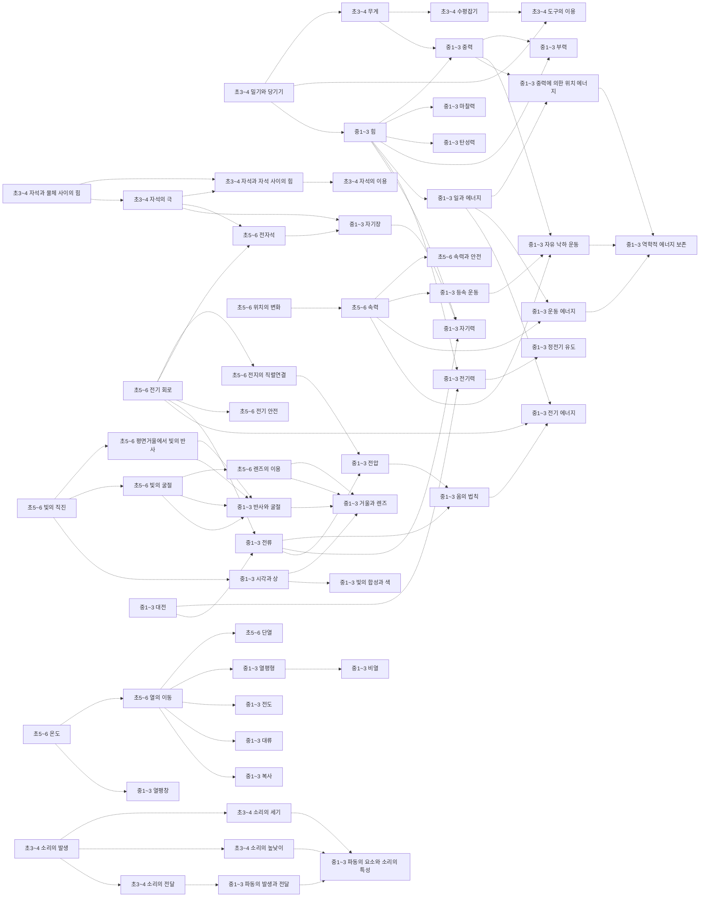
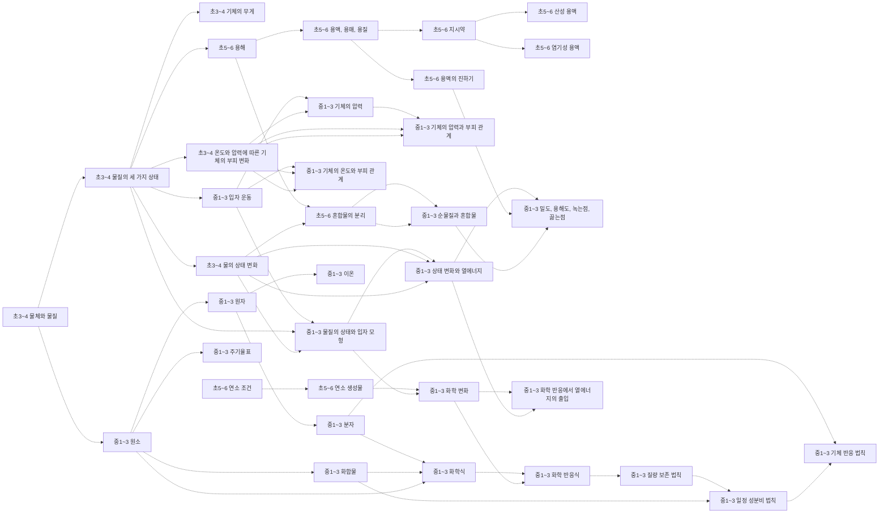
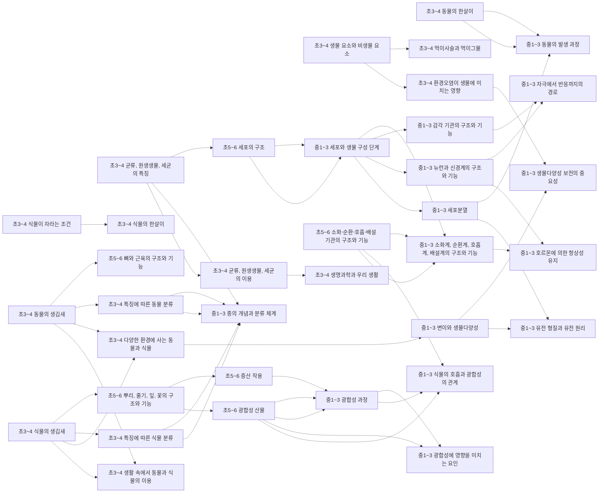
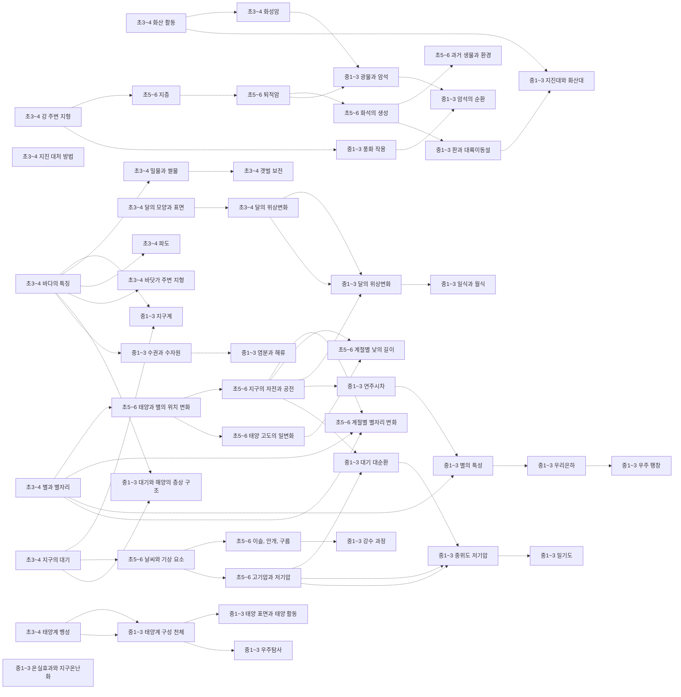
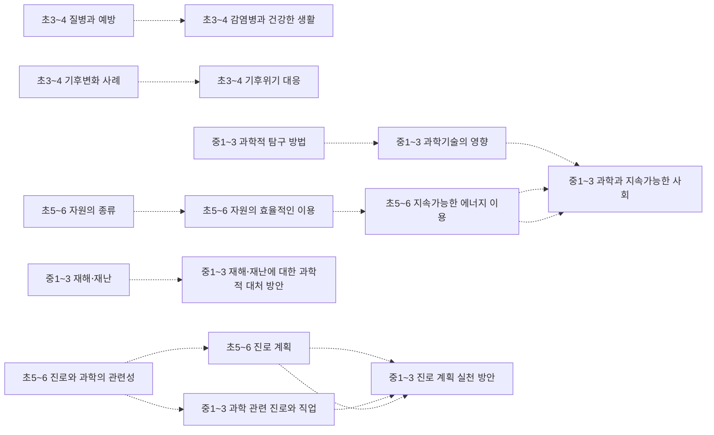

# 과학 개념 지도 (초3~고2~3)

개념 508개 = 고시문 「내용 체계」의 지식⋅이해 항목(원문 낱말 그대로). 선수관계 337개 — **제안 241** (원문에 없어 Claude 가 제안하고 Gemini 가 반박 심사한 것) · **구조 11** (내용 체계 같은 범주 행의 바로 앞 학년 칸 — 규칙으로 뽑아 Gemini 가 「타당」이라 한 것) · **단원 85** (고시문이 밝힌 단원 연계 안의 개념 쌍 — 규칙으로 뽑아 Gemini 가 「타당」이라 한 것). 원문이 아닌 간선은 그림에서 점선, 목록에서 표시.

> 과학 내용 체계는 영역 → 범주(힘과 에너지 …) × 학년군 칸이다 — 같은 범주 행이 학년군을 가로지르는 사다리는 원문이지만, 요소 사이 화살표는 원문에 없다(원문 연계는 단원 단위 → 교과 문서의 ⬅️ 먼저). 간선별 이유·심사 기록은 [concept_proposals.json](../data/kr/concept_proposals.json) · [concept_structure.json](../data/kr/concept_structure.json).

□ 셀프 체크는 그 개념 성취기준 문장을 물음으로만 바꾼 것이다. MCP 에서는 `concept_path` 로 묻고, 「예」인 개념은 `known` 에 넣는다. 먼저/이어서가 없는 개념은 교과 문서의 단원 연계를 본다.

목차: [운동과 에너지](#운동과-에너지) · [물질](#물질) · [생명](#생명) · [지구와 우주](#지구와-우주) · [과학과 사회](#과학과-사회) · [고1 · 통합과학1](#고1-통합과학1) · [고1 · 통합과학2](#고1-통합과학2) · [고1 · 과학탐구실험1](#고1-과학탐구실험1) · [고1 · 과학탐구실험2](#고1-과학탐구실험2) · [고2~3 · 물리학](#고2-3-물리학) · [고2~3 · 화학](#고2-3-화학) · [고2~3 · 생명과학](#고2-3-생명과학) · [고2~3 · 지구과학](#고2-3-지구과학) · [고2~3 · 역학과 에너지](#고2-3-역학과-에너지) · [고2~3 · 전자기와 양자](#고2-3-전자기와-양자) · [고2~3 · 물질과 에너지](#고2-3-물질과-에너지) · [고2~3 · 화학 반응의 세계](#고2-3-화학-반응의-세계) · [고2~3 · 세포와 물질대사](#고2-3-세포와-물질대사) · [고2~3 · 생물의 유전](#고2-3-생물의-유전) · [고2~3 · 지구시스템과학](#고2-3-지구시스템과학) · [고2~3 · 행성우주과학](#고2-3-행성우주과학) · [고2~3 · 과학의 역사와 문화](#고2-3-과학의-역사와-문화) · [고2~3 · 기후변화와 환경생태](#고2-3-기후변화와-환경생태) · [고2~3 · 융합과학 탐구](#고2-3-융합과학-탐구)

## 운동과 에너지

### 초3~4 밀기와 당기기

힘과 에너지 · 성취기준 4과01-02, 4과01-03, 4과15-01  
➡️ 이어서: [초3~4 무게](#초3-4-무게)제안 · [초3~4 도구의 이용](#초3-4-도구의-이용)제안 · [중1~3 힘](#중1-3-힘)제안  

- □ 수평잡기 활동을 통해 물체의 무게를 비교할 수 있나요?
- □ 무게를 정확히 비교하기 위해서는 저울이 필요함을 알고, 저울을 사용해 무게를 비교할 수 있나요?
- □ 실험을 통해 기체가 무게가 있음을 설명할 수 있나요?

### 초3~4 무게

힘과 에너지 · 성취기준 4과01-02, 4과01-03, 4과15-01  
⬅️ 먼저: [초3~4 밀기와 당기기](#초3-4-밀기와-당기기)제안  
➡️ 이어서: [초3~4 수평잡기](#초3-4-수평잡기)제안 · [중1~3 중력](#중1-3-중력)제안 · [초3~4 기체의 무게](#초3-4-기체의-무게)제안  

- □ 수평잡기 활동을 통해 물체의 무게를 비교할 수 있나요?
- □ 무게를 정확히 비교하기 위해서는 저울이 필요함을 알고, 저울을 사용해 무게를 비교할 수 있나요?
- □ 실험을 통해 기체가 무게가 있음을 설명할 수 있나요?

### 초3~4 수평잡기

힘과 에너지 · 성취기준 4과01-02  
⬅️ 먼저: [초3~4 무게](#초3-4-무게)제안  
➡️ 이어서: [초3~4 도구의 이용](#초3-4-도구의-이용)제안  

- □ 수평잡기 활동을 통해 물체의 무게를 비교할 수 있나요?

### 초3~4 도구의 이용

힘과 에너지 · 성취기준 4과01-04  
⬅️ 먼저: [초3~4 수평잡기](#초3-4-수평잡기)제안 · [초3~4 밀기와 당기기](#초3-4-밀기와-당기기)제안  

- □ 지레, 빗면과 같은 도구를 이용하면 물체를 들어 올릴 때 드는 힘의 크기가 달라짐을 알고, 도구가 일상생활에서 어떻게 쓰이는지 조사하여 공유할 수 있나요?

### 초3~4 자석과 물체 사이의 힘

전기와 자기 · 성취기준 4과09-01  
➡️ 이어서: [초3~4 자석과 자석 사이의 힘](#초3-4-자석과-자석-사이의-힘)제안 · [초3~4 자석의 극](#초3-4-자석의-극)제안  

- □ 자석과 여러 가지 물체를 가까이했을 때 나타나는 현상을 관찰하고, 자석과 자석에 붙는 물체 사이에 작용하는 힘의 특징을 말할 수 있나요?

### 초3~4 자석과 자석 사이의 힘

전기와 자기 · 성취기준 4과09-01  
⬅️ 먼저: [초3~4 자석과 물체 사이의 힘](#초3-4-자석과-물체-사이의-힘)제안 · [초3~4 자석의 극](#초3-4-자석의-극)제안  
➡️ 이어서: [초3~4 자석의 이용](#초3-4-자석의-이용)제안  

- □ 자석과 여러 가지 물체를 가까이했을 때 나타나는 현상을 관찰하고, 자석과 자석에 붙는 물체 사이에 작용하는 힘의 특징을 말할 수 있나요?

### 초3~4 자석의 극

전기와 자기 · 성취기준 4과09-01, 4과09-02, 4과09-03  
⬅️ 먼저: [초3~4 자석과 물체 사이의 힘](#초3-4-자석과-물체-사이의-힘)제안  
➡️ 이어서: [초3~4 자석과 자석 사이의 힘](#초3-4-자석과-자석-사이의-힘)제안 · [초5~6 전자석](#초5-6-전자석)제안 · [중1~3 자기장](#중1-3-자기장)제안  

- □ 자석과 여러 가지 물체를 가까이했을 때 나타나는 현상을 관찰하고, 자석과 자석에 붙는 물체 사이에 작용하는 힘의 특징을 말할 수 있나요?
- □ 자석과 자석을 가까이했을 때 나타나는 현상을 관찰하여 그 특징을 자석의 극과 관련지어 설명할 수 있나요?
- □ 자석을 이용하여 일상생활을 편리하게 하는 장치를 설계할 수 있나요?

### 초3~4 자석의 이용

전기와 자기 · 성취기준 4과09-01, 4과09-02, 4과09-03  
⬅️ 먼저: [초3~4 자석과 자석 사이의 힘](#초3-4-자석과-자석-사이의-힘)제안  

- □ 자석과 여러 가지 물체를 가까이했을 때 나타나는 현상을 관찰하고, 자석과 자석에 붙는 물체 사이에 작용하는 힘의 특징을 말할 수 있나요?
- □ 자석과 자석을 가까이했을 때 나타나는 현상을 관찰하여 그 특징을 자석의 극과 관련지어 설명할 수 있나요?
- □ 자석을 이용하여 일상생활을 편리하게 하는 장치를 설계할 수 있나요?

### 초3~4 소리의 발생

빛과 파동 · 성취기준 4과07-01, 4과07-02, 4과07-03  
➡️ 이어서: [초3~4 소리의 세기](#초3-4-소리의-세기)제안 · [초3~4 소리의 높낮이](#초3-4-소리의-높낮이)제안 · [초3~4 소리의 전달](#초3-4-소리의-전달)제안  

- □ 여러 가지 물체를 이용하여 소리를 내보고, 소리가 나는 물체는 떨림이 있음을 설명할 수 있나요?
- □ 큰 소리와 작은 소리, 높은 소리와 낮은 소리를 구분하고, 세기와 높낮이가 다른 소리를 낼 수 있나요?
- □ 여러 가지 물질을 통하여 소리가 전달되는 것을 관찰하고, 소음을 줄이는 방법을 찾아 일상생활에서 실천할 수 있나요?

### 초3~4 소리의 세기

빛과 파동 · 성취기준 4과07-02  
⬅️ 먼저: [초3~4 소리의 발생](#초3-4-소리의-발생)제안  
➡️ 이어서: [중1~3 파동의 요소와 소리의 특성](#중1-3-파동의-요소와-소리의-특성)제안  

- □ 큰 소리와 작은 소리, 높은 소리와 낮은 소리를 구분하고, 세기와 높낮이가 다른 소리를 낼 수 있나요?

### 초3~4 소리의 높낮이

빛과 파동 · 성취기준 4과07-02  
⬅️ 먼저: [초3~4 소리의 발생](#초3-4-소리의-발생)제안  
➡️ 이어서: [중1~3 파동의 요소와 소리의 특성](#중1-3-파동의-요소와-소리의-특성)제안  

- □ 큰 소리와 작은 소리, 높은 소리와 낮은 소리를 구분하고, 세기와 높낮이가 다른 소리를 낼 수 있나요?

### 초3~4 소리의 전달

빛과 파동 · 성취기준 4과07-03  
⬅️ 먼저: [초3~4 소리의 발생](#초3-4-소리의-발생)제안  
➡️ 이어서: [중1~3 파동의 발생과 전달](#중1-3-파동의-발생과-전달)제안  

- □ 여러 가지 물질을 통하여 소리가 전달되는 것을 관찰하고, 소음을 줄이는 방법을 찾아 일상생활에서 실천할 수 있나요?

### 초5~6 위치의 변화

힘과 에너지 · 성취기준 6과10-01, 6과12-01  
➡️ 이어서: [초5~6 속력](#초5-6-속력)제안  

- □ 운동하는 물체는 시간에 따라 위치가 변화함을 알고 그 변화를 표현할 수 있나요?
- □ 하루 동안 태양과 별을 관찰하여 위치 변화의 규칙성을 찾을 수 있나요?

### 초5~6 속력

힘과 에너지 · 성취기준 6과10-02, 6과10-03  
⬅️ 먼저: [초5~6 위치의 변화](#초5-6-위치의-변화)제안 · [수학 초5~6 비와 비율](%EC%88%98%ED%95%99-%EA%B0%9C%EB%85%90-%EC%A7%80%EB%8F%84.md#초5-6-비와-비율)제안  
➡️ 이어서: [초5~6 속력과 안전](#초5-6-속력과-안전)제안 · [중1~3 등속 운동](#중1-3-등속-운동)제안 · [중1~3 운동 에너지](#중1-3-운동-에너지)제안 · [중1~3 자유 낙하 운동](#중1-3-자유-낙하-운동)제안  

- □ 물체의 이동 거리와 걸린 시간을 측정하여 속력을 구하고 빠르기를 비교할 수 있나요?
- □ 속력과 관련된 안전 수칙과 안전장치를 조사한 결과를 공유하고 일상생활에서 교통안전을 실천할 수 있나요?

### 초5~6 속력과 안전

힘과 에너지 · 성취기준 6과10-03  
⬅️ 먼저: [초5~6 속력](#초5-6-속력)제안  

- □ 속력과 관련된 안전 수칙과 안전장치를 조사한 결과를 공유하고 일상생활에서 교통안전을 실천할 수 있나요?

### 초5~6 전기 회로

전기와 자기 · 성취기준 6과15-01, 6과15-02  
➡️ 이어서: [초5~6 전지의 직렬연결](#초5-6-전지의-직렬연결)제안 · [초5~6 전자석](#초5-6-전자석)제안 · [초5~6 전기 안전](#초5-6-전기-안전)제안 · [중1~3 전류](#중1-3-전류)제안 · [중1~3 전기 에너지](#중1-3-전기-에너지)구조  

- □ 전지와 전구, 전선을 연결하여 전구에 불을 켜보고, 불이 켜지는 전기 회로의 특징을 말할 수 있나요?
- □ 전지 한 개를 연결한 전기 회로와 전지 두 개를 직렬연결한 전기 회로의 특징을 비교할 수 있나요?

### 초5~6 전지의 직렬연결

전기와 자기 · 성취기준 6과15-02  
⬅️ 먼저: [초5~6 전기 회로](#초5-6-전기-회로)제안  
➡️ 이어서: [중1~3 전압](#중1-3-전압)제안  

- □ 전지 한 개를 연결한 전기 회로와 전지 두 개를 직렬연결한 전기 회로의 특징을 비교할 수 있나요?

### 초5~6 전자석

전기와 자기 · 성취기준 6과15-03  
⬅️ 먼저: [초5~6 전기 회로](#초5-6-전기-회로)제안 · [초3~4 자석의 극](#초3-4-자석의-극)제안  
➡️ 이어서: [중1~3 자기장](#중1-3-자기장)제안  

- □ 전자석을 만들어 전자석의 성질을 탐색하고 전자석이 사용되는 예를 조사할 수 있나요?

### 초5~6 전기 안전

전기와 자기 · 성취기준 6과15-04  
⬅️ 먼저: [초5~6 전기 회로](#초5-6-전기-회로)제안  

- □ 전기를 효율적이고 안전하게 사용하는 방법을 조사하여 실천 계획을 세우고 일상생활에서 실천할 수 있나요?

### 초5~6 온도

열 · 성취기준 6과03-01, 6과07-01, 6과07-02, 6과07-04  
➡️ 이어서: [초5~6 열의 이동](#초5-6-열의-이동)제안 · [중1~3 열팽창](#중1-3-열팽창)제안  

- □ 용해 현상의 의미를 알고, 용질의 종류와 물의 온도에 따라 물에 녹는 용질의 양이 달라짐을 비교할 수 있나요?
- □ 물체의 따뜻하고 차가운 정도를 온도로 표현함을 알고, 온도계를 이용하여 온도를 측정할 수 있나요?
- □ 온도가 다른 두 물체가 접촉했을 때 두 물체의 온도 변화를 관찰하고 그 원인을 추리할 수 있나요?
- … 외 1개

### 초5~6 열의 이동

열 · 성취기준 6과07-03, 6과10-02  
⬅️ 먼저: [초5~6 온도](#초5-6-온도)제안  
➡️ 이어서: [초5~6 단열](#초5-6-단열)제안 · [중1~3 열평형](#중1-3-열평형)제안 · [중1~3 전도](#중1-3-전도)제안 · [중1~3 대류](#중1-3-대류)제안 · [중1~3 복사](#중1-3-복사)제안 · [중1~3 상태 변화와 열에너지](#중1-3-상태-변화와-열에너지)제안  

- □ 주위에서 열의 이동으로 나타나는 현상을 관찰하여 열의 이동 방식이 다양함을 설명할 수 있나요?
- □ 물체의 이동 거리와 걸린 시간을 측정하여 속력을 구하고 빠르기를 비교할 수 있나요?

### 초5~6 단열

열 · 성취기준 6과07-04  
⬅️ 먼저: [초5~6 열의 이동](#초5-6-열의-이동)제안  

- □ 일상생활에서 단열을 이용하는 사례를 조사하고, 온도를 오랫동안 일정하게 유지할 수 있는 장치를 창의적으로 만들 수 있나요?

### 초5~6 빛의 직진

빛과 파동 · 성취기준 6과02-02  
➡️ 이어서: [초5~6 평면거울에서 빛의 반사](#초5-6-평면거울에서-빛의-반사)제안 · [초5~6 빛의 굴절](#초5-6-빛의-굴절)제안 · [중1~3 시각과 상](#중1-3-시각과-상)제안 · [중1~3 일식과 월식](#중1-3-일식과-월식)제안  

- □ 빛이 나아가는 현상을 관찰하여 빛이 직진, 반사, 굴절하는 성질이 있음을 말할 수 있나요?

### 초5~6 평면거울에서 빛의 반사

빛과 파동 · 성취기준 6과02-02  
⬅️ 먼저: [초5~6 빛의 직진](#초5-6-빛의-직진)제안  
➡️ 이어서: [중1~3 반사와 굴절](#중1-3-반사와-굴절)제안 · [중1~3 반사와 굴절](#중1-3-반사와-굴절)단원 · [고2~3 역학과 에너지 투과와 반사](#고2-3-역학과-에너지-투과와-반사)단원  

- □ 빛이 나아가는 현상을 관찰하여 빛이 직진, 반사, 굴절하는 성질이 있음을 말할 수 있나요?

### 초5~6 빛의 굴절

빛과 파동 · 성취기준 6과02-02  
⬅️ 먼저: [초5~6 빛의 직진](#초5-6-빛의-직진)제안  
➡️ 이어서: [초5~6 렌즈의 이용](#초5-6-렌즈의-이용)제안 · [중1~3 반사와 굴절](#중1-3-반사와-굴절)제안 · [중1~3 반사와 굴절](#중1-3-반사와-굴절)단원  

- □ 빛이 나아가는 현상을 관찰하여 빛이 직진, 반사, 굴절하는 성질이 있음을 말할 수 있나요?

### 초5~6 렌즈의 이용

빛과 파동 · 성취기준 6과02-03  
⬅️ 먼저: [초5~6 빛의 굴절](#초5-6-빛의-굴절)제안  
➡️ 이어서: [중1~3 거울과 렌즈](#중1-3-거울과-렌즈)제안 · [중1~3 거울과 렌즈](#중1-3-거울과-렌즈)구조  

- □ 거울과 렌즈의 쓰임새를 조사하고 거울이나 렌즈를 이용한 장치를 창의적으로 만들 수 있나요?

### 중1~3 힘

힘과 에너지 · 성취기준 9과05-01, 9과05-02, 9과05-03, 9과05-04, 9과14-04  
⬅️ 먼저: [초3~4 밀기와 당기기](#초3-4-밀기와-당기기)제안  
➡️ 이어서: [중1~3 중력](#중1-3-중력)제안 · [중1~3 마찰력](#중1-3-마찰력)제안 · [중1~3 탄성력](#중1-3-탄성력)제안 · [중1~3 부력](#중1-3-부력)제안 · [중1~3 일과 에너지](#중1-3-일과-에너지)제안 · [중1~3 전기력](#중1-3-전기력)제안 · [중1~3 자기력](#중1-3-자기력)제안  

- □ 물체에 작용하는 힘을 화살표를 이용하여 나타내고, 힘의 평형을 이루는 조건을 설명할 수 있나요?
- □ 중력, 탄성력, 마찰력, 부력을 이해하고, 각 힘의 특징을 크기와 방향으로 설명할 수 있나요?
- □ 알짜힘이 0이 아닐 때 물체의 운동 상태가 변함을 알고, 그 예를 조사하여 분류할 수 있나요?
- … 외 2개

### 중1~3 중력

힘과 에너지 · 성취기준 9과05-02, 9과19-03  
⬅️ 먼저: [초3~4 무게](#초3-4-무게)제안 · [중1~3 힘](#중1-3-힘)제안  
➡️ 이어서: [중1~3 부력](#중1-3-부력)제안 · [중1~3 자유 낙하 운동](#중1-3-자유-낙하-운동)제안 · [중1~3 중력에 의한 위치 에너지](#중1-3-중력에-의한-위치-에너지)제안 · [과학 계열 선택 고2~3 물리학 실험 중력 가속도 측정](%EA%B3%BC%ED%95%99%20%EA%B3%84%EC%97%B4%20%EC%84%A0%ED%83%9D-%EA%B0%9C%EB%85%90-%EC%A7%80%EB%8F%84.md#고2-3-물리학-실험-중력-가속도-측정)단원 · [고2~3 역학과 에너지 중력과 천체 운동](#고2-3-역학과-에너지-중력과-천체-운동)단원  

- □ 중력, 탄성력, 마찰력, 부력을 이해하고, 각 힘의 특징을 크기와 방향으로 설명할 수 있나요?
- □ 일의 정의를 알고, 자유 낙하하는 물체의 운동에서 중력이 한 일을 위치 에너지와 운동 에너지로 표현할 수 있나요?

### 중1~3 마찰력

힘과 에너지 · 성취기준 9과05-02  
⬅️ 먼저: [중1~3 힘](#중1-3-힘)제안  
➡️ 이어서: [과학 계열 선택 고2~3 물리학 실험 마찰력 측정](%EA%B3%BC%ED%95%99%20%EA%B3%84%EC%97%B4%20%EC%84%A0%ED%83%9D-%EA%B0%9C%EB%85%90-%EC%A7%80%EB%8F%84.md#고2-3-물리학-실험-마찰력-측정)단원  

- □ 중력, 탄성력, 마찰력, 부력을 이해하고, 각 힘의 특징을 크기와 방향으로 설명할 수 있나요?

### 중1~3 탄성력

힘과 에너지 · 성취기준 9과05-02  
⬅️ 먼저: [중1~3 힘](#중1-3-힘)제안  

- □ 중력, 탄성력, 마찰력, 부력을 이해하고, 각 힘의 특징을 크기와 방향으로 설명할 수 있나요?

### 중1~3 부력

힘과 에너지 · 성취기준 9과05-02  
⬅️ 먼저: [중1~3 힘](#중1-3-힘)제안 · [중1~3 중력](#중1-3-중력)제안  

- □ 중력, 탄성력, 마찰력, 부력을 이해하고, 각 힘의 특징을 크기와 방향으로 설명할 수 있나요?

### 중1~3 등속 운동

힘과 에너지 · 성취기준 9과04-01, 9과05-03, 9과06-01, 9과07-03, 9과13-03, 9과19-01, 9과19-02, 9과19-03, 9과19-04  
⬅️ 먼저: [초5~6 속력](#초5-6-속력)제안 · [수학 중1 좌표평면과 그래프](%EC%88%98%ED%95%99-%EA%B0%9C%EB%85%90-%EC%A7%80%EB%8F%84.md#중1-좌표평면과-그래프)제안  
➡️ 이어서: [중1~3 자유 낙하 운동](#중1-3-자유-낙하-운동)제안  

- □ 확산 및 증발 현상을 관찰하여 물질을 구성하는 입자가 운동하고 있음을 추론할 수 있나요?
- □ 알짜힘이 0이 아닐 때 물체의 운동 상태가 변함을 알고, 그 예를 조사하여 분류할 수 있나요?
- □ 압력의 의미를 알고, 기체의 압력을 입자의 운동으로 설명할 수 있나요?
- … 외 6개

### 중1~3 자유 낙하 운동

힘과 에너지 · 성취기준 9과19-02, 9과19-03  
⬅️ 먼저: [중1~3 중력](#중1-3-중력)제안 · [중1~3 등속 운동](#중1-3-등속-운동)제안 · [초5~6 속력](#초5-6-속력)제안  
➡️ 이어서: [중1~3 역학적 에너지 보존](#중1-3-역학적-에너지-보존)제안  

- □ 자유 낙하하는 물체의 운동에서 시간에 따른 속력의 변화가 일정함을 분석할 수 있나요?
- □ 일의 정의를 알고, 자유 낙하하는 물체의 운동에서 중력이 한 일을 위치 에너지와 운동 에너지로 표현할 수 있나요?

### 중1~3 일과 에너지

힘과 에너지 · 성취기준 9과04-04, 9과12-01, 9과12-02, 9과12-03, 9과13-01, 9과13-02, 9과13-03, 9과13-04, 9과13-05, 9과14-03, 9과16-06, 9과19-01, 9과19-02, 9과19-03, 9과19-04  
⬅️ 먼저: [중1~3 힘](#중1-3-힘)제안  
➡️ 이어서: [중1~3 중력에 의한 위치 에너지](#중1-3-중력에-의한-위치-에너지)제안 · [중1~3 운동 에너지](#중1-3-운동-에너지)제안 · [중1~3 전기 에너지](#중1-3-전기-에너지)제안  

- □ 물질의 상태 변화와 열에너지 출입 관계를 이해하고, 이를 실생활에 적용하여 과학의 유용성을 인식할 수 있나요?
- □ 광합성 과정을 이해하고, 환경 요인과 광합성의 관계를 탐구하는 실험을 설계할 수 있나요?
- □ 식물의 호흡과 광합성의 관계를 이해하고, 호흡과 광합성 과정에서 출입하는 에너지와 물질의 변화를 분석할 수 있나요?
- … 외 12개

### 중1~3 중력에 의한 위치 에너지

힘과 에너지 · 성취기준 9과19-03  
⬅️ 먼저: [중1~3 일과 에너지](#중1-3-일과-에너지)제안 · [중1~3 중력](#중1-3-중력)제안  
➡️ 이어서: [중1~3 역학적 에너지 보존](#중1-3-역학적-에너지-보존)제안  

- □ 일의 정의를 알고, 자유 낙하하는 물체의 운동에서 중력이 한 일을 위치 에너지와 운동 에너지로 표현할 수 있나요?

### 중1~3 운동 에너지

힘과 에너지 · 성취기준 9과13-03, 9과19-01, 9과19-02, 9과19-03, 9과19-04  
⬅️ 먼저: [중1~3 일과 에너지](#중1-3-일과-에너지)제안 · [초5~6 속력](#초5-6-속력)제안  
➡️ 이어서: [중1~3 역학적 에너지 보존](#중1-3-역학적-에너지-보존)제안  

- □ 호흡계의 구조와 기능을 이해하고, 호흡 운동의 원리를 나타내는 모형을 만들 수 있나요?
- □ 직선상에서 움직이는 물체의 운동을 그래프로 나타내고 해석할 수 있나요?
- □ 자유 낙하하는 물체의 운동에서 시간에 따른 속력의 변화가 일정함을 분석할 수 있나요?
- … 외 2개

### 중1~3 역학적 에너지 보존

힘과 에너지 · 성취기준 9과19-04  
⬅️ 먼저: [중1~3 중력에 의한 위치 에너지](#중1-3-중력에-의한-위치-에너지)제안 · [중1~3 운동 에너지](#중1-3-운동-에너지)제안 · [중1~3 자유 낙하 운동](#중1-3-자유-낙하-운동)제안  
➡️ 이어서: [고2~3 물리학 역학적 에너지 보존](#고2-3-물리학-역학적-에너지-보존)단원 · [고2~3 역학과 에너지 역학적 에너지](#고2-3-역학과-에너지-역학적-에너지)단원  

- □ 물체의 운동에서 역학적 에너지의 전환과 보존을 이해하고, 이를 활용하여 일상생활 속 물체의 운동을 예측할 수 있나요?

### 중1~3 전기력

전기와 자기 · 성취기준 9과14-01  
⬅️ 먼저: [중1~3 대전](#중1-3-대전)제안 · [중1~3 힘](#중1-3-힘)제안  
➡️ 이어서: [중1~3 정전기 유도](#중1-3-정전기-유도)제안  

- □ 마찰 전기, 정전기 유도 현상을 관찰하고, 이를 전기력과 원자 모형을 이용하여 설명할 수 있나요?

### 중1~3 대전

전기와 자기 · 성취기준 9과14-01  
➡️ 이어서: [중1~3 전기력](#중1-3-전기력)제안 · [중1~3 전류](#중1-3-전류)제안 · [중1~3 이온](#중1-3-이온)제안  

- □ 마찰 전기, 정전기 유도 현상을 관찰하고, 이를 전기력과 원자 모형을 이용하여 설명할 수 있나요?

### 중1~3 정전기 유도

전기와 자기 · 성취기준 9과14-01  
⬅️ 먼저: [중1~3 전기력](#중1-3-전기력)제안  

- □ 마찰 전기, 정전기 유도 현상을 관찰하고, 이를 전기력과 원자 모형을 이용하여 설명할 수 있나요?

### 중1~3 전압

전기와 자기 · 성취기준 9과14-02  
⬅️ 먼저: [초5~6 전지의 직렬연결](#초5-6-전지의-직렬연결)제안 · [중1~3 전류](#중1-3-전류)제안  
➡️ 이어서: [중1~3 옴의 법칙](#중1-3-옴의-법칙)제안  

- □ 전기 회로에서 전류를 모형으로 설명하고, 실험을 통해 저항, 전류, 전압 사이의 관계를 이끌어낼 수 있나요?

### 중1~3 전류

전기와 자기 · 성취기준 9과14-02, 9과14-04  
⬅️ 먼저: [초5~6 전기 회로](#초5-6-전기-회로)제안 · [중1~3 대전](#중1-3-대전)제안  
➡️ 이어서: [중1~3 옴의 법칙](#중1-3-옴의-법칙)제안 · [중1~3 자기력](#중1-3-자기력)제안 · [중1~3 전압](#중1-3-전압)제안 · [과학 계열 선택 고2~3 고급 물리학 전류의 자기 작용과 전자기 유도](%EA%B3%BC%ED%95%99%20%EA%B3%84%EC%97%B4%20%EC%84%A0%ED%83%9D-%EA%B0%9C%EB%85%90-%EC%A7%80%EB%8F%84.md#고2-3-고급-물리학-전류의-자기-작용과-전자기-유도)단원 · [고2~3 물리학 전류의 자기 작용](#고2-3-물리학-전류의-자기-작용)단원 · [과학 계열 선택 고2~3 물리학 실험 자기장 속에서 전류가 받는 힘](%EA%B3%BC%ED%95%99%20%EA%B3%84%EC%97%B4%20%EC%84%A0%ED%83%9D-%EA%B0%9C%EB%85%90-%EC%A7%80%EB%8F%84.md#고2-3-물리학-실험-자기장-속에서-전류가-받는-힘)단원  

- □ 전기 회로에서 전류를 모형으로 설명하고, 실험을 통해 저항, 전류, 전압 사이의 관계를 이끌어낼 수 있나요?
- □ 자기장 안에 놓인 전류가 흐르는 코일이 받는 힘의 특성을 추리하고, 전동기 등 일상생활에서 활용한 예를 찾을 수 있나요?

### 중1~3 옴의 법칙

전기와 자기 · 성취기준 9과14-02, 9과14-04  
⬅️ 먼저: [중1~3 전압](#중1-3-전압)제안 · [중1~3 전류](#중1-3-전류)제안 · [수학 중1 좌표평면과 그래프](%EC%88%98%ED%95%99-%EA%B0%9C%EB%85%90-%EC%A7%80%EB%8F%84.md#중1-좌표평면과-그래프)제안  
➡️ 이어서: [중1~3 전기 에너지](#중1-3-전기-에너지)제안  

- □ 전기 회로에서 전류를 모형으로 설명하고, 실험을 통해 저항, 전류, 전압 사이의 관계를 이끌어낼 수 있나요?
- □ 자기장 안에 놓인 전류가 흐르는 코일이 받는 힘의 특성을 추리하고, 전동기 등 일상생활에서 활용한 예를 찾을 수 있나요?

### 중1~3 전기 에너지

전기와 자기 · 성취기준 9과14-03  
⬅️ 먼저: [중1~3 옴의 법칙](#중1-3-옴의-법칙)제안 · [중1~3 일과 에너지](#중1-3-일과-에너지)제안 · [초5~6 전기 회로](#초5-6-전기-회로)구조  

- □ 저항의 직렬연결과 병렬연결의 특징을 비교하고, 일상생활에서 전기 에너지가 다양한 형태의 에너지로 전환됨을 소비 전력과 관련지어 설명할 수 있나요?

### 중1~3 자기력

전기와 자기 · 성취기준 9과14-03  
⬅️ 먼저: [중1~3 자기장](#중1-3-자기장)제안 · [중1~3 전류](#중1-3-전류)제안 · [중1~3 힘](#중1-3-힘)제안  

- □ 저항의 직렬연결과 병렬연결의 특징을 비교하고, 일상생활에서 전기 에너지가 다양한 형태의 에너지로 전환됨을 소비 전력과 관련지어 설명할 수 있나요?

### 중1~3 자기장

전기와 자기 · 성취기준 9과14-04  
⬅️ 먼저: [초3~4 자석의 극](#초3-4-자석의-극)제안 · [초5~6 전자석](#초5-6-전자석)제안  
➡️ 이어서: [중1~3 자기력](#중1-3-자기력)제안 · [과학 계열 선택 고2~3 물리학 실험 자기장 속에서 전류가 받는 힘](%EA%B3%BC%ED%95%99%20%EA%B3%84%EC%97%B4%20%EC%84%A0%ED%83%9D-%EA%B0%9C%EB%85%90-%EC%A7%80%EB%8F%84.md#고2-3-물리학-실험-자기장-속에서-전류가-받는-힘)단원  

- □ 자기장 안에 놓인 전류가 흐르는 코일이 받는 힘의 특성을 추리하고, 전동기 등 일상생활에서 활용한 예를 찾을 수 있나요?

### 중1~3 열평형

열 · 성취기준 9과03-01  
⬅️ 먼저: [초5~6 열의 이동](#초5-6-열의-이동)제안  
➡️ 이어서: [중1~3 비열](#중1-3-비열)제안  

- □ 온도와 열평형 과정을 물질을 구성하는 입자들의 배치나 움직임 등으로 설명할 수 있나요?

### 중1~3 전도

열 · 성취기준 9과03-02  
⬅️ 먼저: [초5~6 열의 이동](#초5-6-열의-이동)제안  

- □ 열은 전도, 대류, 복사로 전달됨을 알고, 열전달 과정을 모형 등을 사용하여 다양하게 표현할 수 있나요?

### 중1~3 대류

열 · 성취기준 9과03-02  
⬅️ 먼저: [초5~6 열의 이동](#초5-6-열의-이동)제안  
➡️ 이어서: [중1~3 대기 대순환](#중1-3-대기-대순환)제안  

- □ 열은 전도, 대류, 복사로 전달됨을 알고, 열전달 과정을 모형 등을 사용하여 다양하게 표현할 수 있나요?

### 중1~3 복사

열 · 성취기준 9과03-02, 9과17-01  
⬅️ 먼저: [초5~6 열의 이동](#초5-6-열의-이동)제안  
➡️ 이어서: [중1~3 온실효과와 지구온난화](#중1-3-온실효과와-지구온난화)제안  

- □ 열은 전도, 대류, 복사로 전달됨을 알고, 열전달 과정을 모형 등을 사용하여 다양하게 표현할 수 있나요?
- □ 지구 대기권을 4개 권역으로 구분하며, 온실효과와 지구온난화를 복사 평형의 관점으로 설명할 수 있나요?

### 중1~3 비열

열 · 성취기준 9과03-03  
⬅️ 먼저: [중1~3 열평형](#중1-3-열평형)제안  

- □ 물질에 따라 비열과 열팽창 정도가 다름을 알고, 이러한 성질이 일상생활에서 유용하게 활용됨을 인식할 수 있나요?

### 중1~3 열팽창

열 · 성취기준 9과03-03  
⬅️ 먼저: [초5~6 온도](#초5-6-온도)제안 · [중1~3 입자 운동](#중1-3-입자-운동)제안  

- □ 물질에 따라 비열과 열팽창 정도가 다름을 알고, 이러한 성질이 일상생활에서 유용하게 활용됨을 인식할 수 있나요?

### 중1~3 시각과 상

빛과 파동 · 성취기준 9과10-01  
⬅️ 먼저: [초5~6 빛의 직진](#초5-6-빛의-직진)제안  
➡️ 이어서: [중1~3 거울과 렌즈](#중1-3-거울과-렌즈)제안 · [중1~3 빛의 합성과 색](#중1-3-빛의-합성과-색)제안  

- □ 빛의 반사와 굴절의 원리를 이해하고, 물체를 보는 과정을 빛의 경로를 이용하여 표현할 수 있나요?

### 중1~3 반사와 굴절

빛과 파동 · 성취기준 9과10-01  
⬅️ 먼저: [초5~6 평면거울에서 빛의 반사](#초5-6-평면거울에서-빛의-반사)제안 · [초5~6 빛의 굴절](#초5-6-빛의-굴절)제안 · [초5~6 평면거울에서 빛의 반사](#초5-6-평면거울에서-빛의-반사)단원 · [초5~6 빛의 굴절](#초5-6-빛의-굴절)단원  
➡️ 이어서: [중1~3 거울과 렌즈](#중1-3-거울과-렌즈)제안 · [고2~3 역학과 에너지 투과와 반사](#고2-3-역학과-에너지-투과와-반사)단원 · [고2~3 물리학 굴절](#고2-3-물리학-굴절)단원 · [과학 계열 선택 고2~3 물리학 실험 빛의 굴절과 전반사](%EA%B3%BC%ED%95%99%20%EA%B3%84%EC%97%B4%20%EC%84%A0%ED%83%9D-%EA%B0%9C%EB%85%90-%EC%A7%80%EB%8F%84.md#고2-3-물리학-실험-빛의-굴절과-전반사)단원  

- □ 빛의 반사와 굴절의 원리를 이해하고, 물체를 보는 과정을 빛의 경로를 이용하여 표현할 수 있나요?

### 중1~3 거울과 렌즈

빛과 파동 · 성취기준 9과10-02  
⬅️ 먼저: [중1~3 반사와 굴절](#중1-3-반사와-굴절)제안 · [초5~6 렌즈의 이용](#초5-6-렌즈의-이용)제안 · [중1~3 시각과 상](#중1-3-시각과-상)제안 · [초5~6 렌즈의 이용](#초5-6-렌즈의-이용)구조  
➡️ 이어서: [과학 계열 선택 고2~3 고급 물리학 거울과 렌즈에 의한 상](%EA%B3%BC%ED%95%99%20%EA%B3%84%EC%97%B4%20%EC%84%A0%ED%83%9D-%EA%B0%9C%EB%85%90-%EC%A7%80%EB%8F%84.md#고2-3-고급-물리학-거울과-렌즈에-의한-상)단원 · [과학 계열 선택 고2~3 물리학 실험 거울과 렌즈에 의한 상](%EA%B3%BC%ED%95%99%20%EA%B3%84%EC%97%B4%20%EC%84%A0%ED%83%9D-%EA%B0%9C%EB%85%90-%EC%A7%80%EB%8F%84.md#고2-3-물리학-실험-거울과-렌즈에-의한-상)단원 · [고2~3 전자기와 양자 렌즈와 수차](#고2-3-전자기와-양자-렌즈와-수차)단원  

- □ 평면거울에서 상이 생기는 원리를 설명하고, 일상생활에서 사용되는 거울과 렌즈의 종류를 분류하고 상의 특징을 비교할 수 있나요?

### 중1~3 빛의 합성과 색

빛과 파동 · 성취기준 9과10-03, 9과12-01, 9과12-02, 9과12-03  
⬅️ 먼저: [중1~3 시각과 상](#중1-3-시각과-상)제안  

- □ 물체의 색을 빛의 반사와 관련지어 설명하고, 영상 장치에서 빛의 합성을 이용하여 다양한 색이 표현되는 원리를 이해할 수 있나요?
- □ 광합성 과정을 이해하고, 환경 요인과 광합성의 관계를 탐구하는 실험을 설계할 수 있나요?
- □ 식물의 호흡과 광합성의 관계를 이해하고, 호흡과 광합성 과정에서 출입하는 에너지와 물질의 변화를 분석할 수 있나요?
- … 외 1개

### 중1~3 파동의 발생과 전달

빛과 파동 · 성취기준 9과10-04  
⬅️ 먼저: [초3~4 소리의 전달](#초3-4-소리의-전달)제안  
➡️ 이어서: [중1~3 파동의 요소와 소리의 특성](#중1-3-파동의-요소와-소리의-특성)제안 · [고2~3 전자기와 양자 입자-파동 이중성](#고2-3-전자기와-양자-입자-파동-이중성)단원 · [고2~3 전자기와 양자 확률 파동](#고2-3-전자기와-양자-확률-파동)단원  

- □ 파동의 발생과 전달 과정을 이해하고, 소리의 특성을 진폭, 진동수, 파형 등의 과학적 용어로 표현할 수 있나요?

### 중1~3 파동의 요소와 소리의 특성

빛과 파동 · 성취기준 9과10-04  
⬅️ 먼저: [중1~3 파동의 발생과 전달](#중1-3-파동의-발생과-전달)제안 · [초3~4 소리의 세기](#초3-4-소리의-세기)제안 · [초3~4 소리의 높낮이](#초3-4-소리의-높낮이)제안  
➡️ 이어서: [고2~3 전자기와 양자 입자-파동 이중성](#고2-3-전자기와-양자-입자-파동-이중성)단원 · [고2~3 전자기와 양자 확률 파동](#고2-3-전자기와-양자-확률-파동)단원  

- □ 파동의 발생과 전달 과정을 이해하고, 소리의 특성을 진폭, 진동수, 파형 등의 과학적 용어로 표현할 수 있나요?

## 물질

### 초3~4 물체와 물질

물질의 성질 · 성취기준 4과05-01, 4과05-02, 4과05-03  
➡️ 이어서: [초3~4 물질의 세 가지 상태](#초3-4-물질의-세-가지-상태)제안 · [중1~3 원소](#중1-3-원소)제안  

- □ 물체를 이루는 여러 가지 물질의 성질을 비교하고, 물질의 종류에 따라 물체를 분류할 수 있나요?
- □ 물질의 세 가지 상태인 고체, 액체, 기체의 성질을 관찰하여 비교할 수 있나요?
- □ 다양한 물질의 성질을 이용하여 쓰임새 있는 물체를 설계할 수 있나요?

### 초3~4 물질의 세 가지 상태

물질의 성질 · 성취기준 4과05-02  
⬅️ 먼저: [초3~4 물체와 물질](#초3-4-물체와-물질)제안  
➡️ 이어서: [초3~4 기체의 무게](#초3-4-기체의-무게)제안 · [초3~4 온도와 압력에 따른 기체의 부피 변화](#초3-4-온도와-압력에-따른-기체의-부피-변화)제안 · [초3~4 물의 상태 변화](#초3-4-물의-상태-변화)제안 · [초5~6 용해](#초5-6-용해)제안 · [중1~3 입자 운동](#중1-3-입자-운동)제안 · [중1~3 물질의 상태와 입자 모형](#중1-3-물질의-상태와-입자-모형)제안  

- □ 물질의 세 가지 상태인 고체, 액체, 기체의 성질을 관찰하여 비교할 수 있나요?

### 초3~4 기체의 무게

물질의 성질 · 성취기준 4과15-01  
⬅️ 먼저: [초3~4 물질의 세 가지 상태](#초3-4-물질의-세-가지-상태)제안 · [초3~4 무게](#초3-4-무게)제안  
➡️ 이어서: [초5~6 고기압과 저기압](#초5-6-고기압과-저기압)제안  

- □ 실험을 통해 기체가 무게가 있음을 설명할 수 있나요?

### 초3~4 온도와 압력에 따른 기체의 부피 변화

물질의 성질 · 성취기준 4과15-02  
⬅️ 먼저: [초3~4 물질의 세 가지 상태](#초3-4-물질의-세-가지-상태)제안  
➡️ 이어서: [중1~3 기체의 압력과 부피 관계](#중1-3-기체의-압력과-부피-관계)제안 · [중1~3 기체의 온도와 부피 관계](#중1-3-기체의-온도와-부피-관계)제안 · [중1~3 기체의 온도와 부피 관계](#중1-3-기체의-온도와-부피-관계)단원 · [중1~3 기체의 압력과 부피 관계](#중1-3-기체의-압력과-부피-관계)단원 · [중1~3 기체의 압력](#중1-3-기체의-압력)단원  

- □ 온도나 압력에 따라 기체의 부피가 달라지는 현상을 관찰하고, 우리 주변에서 예를 찾을 수 있나요?

### 초3~4 물의 상태 변화

물질의 성질 · 성취기준 4과10-01, 4과10-02, 4과10-03  
⬅️ 먼저: [초3~4 물질의 세 가지 상태](#초3-4-물질의-세-가지-상태)제안  
➡️ 이어서: [초5~6 혼합물의 분리](#초5-6-혼합물의-분리)제안 · [중1~3 상태 변화와 열에너지](#중1-3-상태-변화와-열에너지)제안 · [초5~6 이슬, 안개, 구름](#초5-6-이슬-안개-구름)제안 · [중1~3 상태 변화와 열에너지](#중1-3-상태-변화와-열에너지)단원 · [중1~3 물질의 상태와 입자 모형](#중1-3-물질의-상태와-입자-모형)단원  

- □ 물이 세 가지 상태로 변할 수 있음을 알고, 우리 주변에서 예를 찾을 수 있나요?
- □ 물이 얼 때, 얼음이 녹을 때, 물이 증발할 때와 끓을 때, 수증기가 응결할 때의 변화를 관찰할 수 있나요?
- □ 물의 상태 변화를 이용하여 물을 얻을 수 있는 장치를 설계하고 만들 수 있나요?

### 초5~6 용액, 용매, 용질

물질의 성질 · 성취기준 6과03-02  
⬅️ 먼저: [초5~6 용해](#초5-6-용해)제안  
➡️ 이어서: [초5~6 용액의 진하기](#초5-6-용액의-진하기)제안 · [초5~6 지시약](#초5-6-지시약)제안  

- □ 용질이나 용매의 양에 따라 용액의 진하기가 달라짐을 관찰하고, 용액의 상대적인 진하기를 비교할 수 있나요?

### 초5~6 용해

물질의 성질 · 성취기준 6과03-01, 6과03-02, 6과03-03, 6과05-02  
⬅️ 먼저: [초3~4 물질의 세 가지 상태](#초3-4-물질의-세-가지-상태)제안  
➡️ 이어서: [초5~6 용액, 용매, 용질](#초5-6-용액-용매-용질)제안 · [초5~6 혼합물의 분리](#초5-6-혼합물의-분리)제안  

- □ 용해 현상의 의미를 알고, 용질의 종류와 물의 온도에 따라 물에 녹는 용질의 양이 달라짐을 비교할 수 있나요?
- □ 용질이나 용매의 양에 따라 용액의 진하기가 달라짐을 관찰하고, 용액의 상대적인 진하기를 비교할 수 있나요?
- □ 일상생활에서 용액이 쓰이는 사례를 조사하여 용액의 필요성을 알리는 자료를 만들고 공유할 수 있나요?
- … 외 1개

### 초5~6 용액의 진하기

물질의 성질 · 성취기준 6과03-02  
⬅️ 먼저: [초5~6 용액, 용매, 용질](#초5-6-용액-용매-용질)제안  
➡️ 이어서: [중1~3 밀도, 용해도, 녹는점, 끓는점](#중1-3-밀도-용해도-녹는점-끓는점)제안  

- □ 용질이나 용매의 양에 따라 용액의 진하기가 달라짐을 관찰하고, 용액의 상대적인 진하기를 비교할 수 있나요?

### 초5~6 혼합물의 분리

물질의 성질 · 성취기준 6과05-01, 6과05-02, 6과05-03  
⬅️ 먼저: [초5~6 용해](#초5-6-용해)제안 · [초3~4 물의 상태 변화](#초3-4-물의-상태-변화)제안  
➡️ 이어서: [중1~3 순물질과 혼합물](#중1-3-순물질과-혼합물)제안 · [중1~3 순물질과 혼합물](#중1-3-순물질과-혼합물)단원  

- □ 알갱이의 크기가 다른 고체 혼합물과 골고루 섞이지 않는 액체 혼합물을 분리할 수 있나요?
- □ 물에 용해되는 성질을 이용하여 고체 혼합물을 분리하고, 물을 증발시켜 물에 용해된 고체 물질을 분리할 수 있나요?
- □ 지속가능한 삶을 위한 과학기술 사례 중 혼합물의 분리를 이용한 장치를 조사하여 공유할 수 있나요?

### 초5~6 지시약

물질의 변화 · 성취기준 6과09-01  
⬅️ 먼저: [초5~6 용액, 용매, 용질](#초5-6-용액-용매-용질)제안  
➡️ 이어서: [초5~6 산성 용액](#초5-6-산성-용액)제안 · [초5~6 염기성 용액](#초5-6-염기성-용액)제안  

- □ 여러 가지 용액에 지시약을 넣었을 때의 변화를 관찰하여 용액을 산성 용액과 염기성 용액으로 분류할 수 있나요?

### 초5~6 산성 용액

물질의 변화 · 성취기준 6과09-01, 6과09-02, 6과09-03  
⬅️ 먼저: [초5~6 지시약](#초5-6-지시약)제안  

- □ 여러 가지 용액에 지시약을 넣었을 때의 변화를 관찰하여 용액을 산성 용액과 염기성 용액으로 분류할 수 있나요?
- □ 산성 용액과 염기성 용액의 성질을 관찰하고, 산성 용액과 염기성 용액을 섞을 때 용액의 성질 변화를 실험을 통해 추론할 수 있나요?
- □ 우리 주변에서 산성 용액과 염기성 용액을 이용하는 예를 찾아서 설명할 수 있나요?

### 초5~6 염기성 용액

물질의 변화 · 성취기준 6과09-01, 6과09-02, 6과09-03  
⬅️ 먼저: [초5~6 지시약](#초5-6-지시약)제안  

- □ 여러 가지 용액에 지시약을 넣었을 때의 변화를 관찰하여 용액을 산성 용액과 염기성 용액으로 분류할 수 있나요?
- □ 산성 용액과 염기성 용액의 성질을 관찰하고, 산성 용액과 염기성 용액을 섞을 때 용액의 성질 변화를 실험을 통해 추론할 수 있나요?
- □ 우리 주변에서 산성 용액과 염기성 용액을 이용하는 예를 찾아서 설명할 수 있나요?

### 초5~6 연소 조건

물질의 변화 · 성취기준 6과14-02  
➡️ 이어서: [초5~6 연소 생성물](#초5-6-연소-생성물)제안  

- □ 물질이 연소할 때 나타나는 공통적인 현상을 관찰하고, 연소의 조건을 찾을 수 있나요?

### 초5~6 연소 생성물

물질의 변화 · 성취기준 6과14-01, 6과14-02, 6과14-03, 6과14-04  
⬅️ 먼저: [초5~6 연소 조건](#초5-6-연소-조건)제안  
➡️ 이어서: [중1~3 화학 변화](#중1-3-화학-변화)제안  

- □ 물질의 성질이 달라지는 변화와 달라지지 않는 변화를 관찰하여 비교할 수 있나요?
- □ 물질이 연소할 때 나타나는 공통적인 현상을 관찰하고, 연소의 조건을 찾을 수 있나요?
- □ 연소 전과 후의 물질을 비교하여 연소 과정에서 물질의 성질이 달라짐을 설명할 수 있나요?
- … 외 1개

### 중1~3 입자 운동

물질의 성질 · 성취기준 9과04-01, 9과06-01  
⬅️ 먼저: [초3~4 물질의 세 가지 상태](#초3-4-물질의-세-가지-상태)제안  
➡️ 이어서: [중1~3 열팽창](#중1-3-열팽창)제안 · [중1~3 기체의 압력](#중1-3-기체의-압력)제안 · [중1~3 기체의 온도와 부피 관계](#중1-3-기체의-온도와-부피-관계)제안 · [중1~3 물질의 상태와 입자 모형](#중1-3-물질의-상태와-입자-모형)제안 · [고2~3 물질과 에너지 입자 배열에 따른 고체의 분류](#고2-3-물질과-에너지-입자-배열에-따른-고체의-분류)단원  

- □ 확산 및 증발 현상을 관찰하여 물질을 구성하는 입자가 운동하고 있음을 추론할 수 있나요?
- □ 압력의 의미를 알고, 기체의 압력을 입자의 운동으로 설명할 수 있나요?

### 중1~3 기체의 압력

물질의 성질 · 성취기준 9과06-01, 9과06-02  
⬅️ 먼저: [중1~3 입자 운동](#중1-3-입자-운동)제안 · [초3~4 온도와 압력에 따른 기체의 부피 변화](#초3-4-온도와-압력에-따른-기체의-부피-변화)단원  
➡️ 이어서: [중1~3 기체의 압력과 부피 관계](#중1-3-기체의-압력과-부피-관계)제안 · [과학 계열 선택 고2~3 고급 화학 부분 압력의 법칙](%EA%B3%BC%ED%95%99%20%EA%B3%84%EC%97%B4%20%EC%84%A0%ED%83%9D-%EA%B0%9C%EB%85%90-%EC%A7%80%EB%8F%84.md#고2-3-고급-화학-부분-압력의-법칙)단원  

- □ 압력의 의미를 알고, 기체의 압력을 입자의 운동으로 설명할 수 있나요?
- □ 기체의 압력과 부피 관계를 실험 결과로부터 알아내고, 이를 입자 모형으로 해석할 수 있나요?

### 중1~3 기체의 압력과 부피 관계

물질의 성질 · 성취기준 9과06-02  
⬅️ 먼저: [중1~3 기체의 압력](#중1-3-기체의-압력)제안 · [초3~4 온도와 압력에 따른 기체의 부피 변화](#초3-4-온도와-압력에-따른-기체의-부피-변화)제안 · [수학 중1 좌표평면과 그래프](%EC%88%98%ED%95%99-%EA%B0%9C%EB%85%90-%EC%A7%80%EB%8F%84.md#중1-좌표평면과-그래프)제안 · [초3~4 온도와 압력에 따른 기체의 부피 변화](#초3-4-온도와-압력에-따른-기체의-부피-변화)단원  
➡️ 이어서: [과학 계열 선택 고2~3 고급 화학 부분 압력의 법칙](%EA%B3%BC%ED%95%99%20%EA%B3%84%EC%97%B4%20%EC%84%A0%ED%83%9D-%EA%B0%9C%EB%85%90-%EC%A7%80%EB%8F%84.md#고2-3-고급-화학-부분-압력의-법칙)단원  

- □ 기체의 압력과 부피 관계를 실험 결과로부터 알아내고, 이를 입자 모형으로 해석할 수 있나요?

### 중1~3 기체의 온도와 부피 관계

물질의 성질 · 성취기준 9과06-03  
⬅️ 먼저: [중1~3 입자 운동](#중1-3-입자-운동)제안 · [초3~4 온도와 압력에 따른 기체의 부피 변화](#초3-4-온도와-압력에-따른-기체의-부피-변화)제안 · [초3~4 온도와 압력에 따른 기체의 부피 변화](#초3-4-온도와-압력에-따른-기체의-부피-변화)단원  

- □ 기체의 온도와 부피 관계를 실험 결과로부터 알아내고, 이를 입자 모형으로 해석할 수 있나요?

### 중1~3 물질의 상태와 입자 모형

물질의 성질 · 성취기준 9과04-02, 9과04-03  
⬅️ 먼저: [중1~3 입자 운동](#중1-3-입자-운동)제안 · [초3~4 물질의 세 가지 상태](#초3-4-물질의-세-가지-상태)제안 · [초3~4 물의 상태 변화](#초3-4-물의-상태-변화)단원  
➡️ 이어서: [중1~3 상태 변화와 열에너지](#중1-3-상태-변화와-열에너지)제안 · [중1~3 화학 변화](#중1-3-화학-변화)제안 · [과학 계열 선택 고2~3 화학 실험 물질의 세 가지 상태와 특징](%EA%B3%BC%ED%95%99%20%EA%B3%84%EC%97%B4%20%EC%84%A0%ED%83%9D-%EA%B0%9C%EB%85%90-%EC%A7%80%EB%8F%84.md#고2-3-화학-실험-물질의-세-가지-상태와-특징)단원 · [고2~3 물질과 에너지 입자 배열에 따른 고체의 분류](#고2-3-물질과-에너지-입자-배열에-따른-고체의-분류)단원  

- □ 물질의 세 가지 상태의 특징을 설명하고, 이를 입자 모형으로 표현할 수 있나요?
- □ 여러 가지 물질의 상태 변화를 관찰하고, 이를 입자 모형으로 설명할 수 있나요?

### 중1~3 상태 변화와 열에너지

물질의 성질 · 성취기준 9과04-04  
⬅️ 먼저: [중1~3 물질의 상태와 입자 모형](#중1-3-물질의-상태와-입자-모형)제안 · [초3~4 물의 상태 변화](#초3-4-물의-상태-변화)제안 · [초5~6 열의 이동](#초5-6-열의-이동)제안 · [초3~4 물의 상태 변화](#초3-4-물의-상태-변화)단원  
➡️ 이어서: [중1~3 밀도, 용해도, 녹는점, 끓는점](#중1-3-밀도-용해도-녹는점-끓는점)제안 · [중1~3 화학 반응에서 열에너지의 출입](#중1-3-화학-반응에서-열에너지의-출입)제안 · [과학 계열 선택 고2~3 화학 실험 물질의 세 가지 상태와 특징](%EA%B3%BC%ED%95%99%20%EA%B3%84%EC%97%B4%20%EC%84%A0%ED%83%9D-%EA%B0%9C%EB%85%90-%EC%A7%80%EB%8F%84.md#고2-3-화학-실험-물질의-세-가지-상태와-특징)단원  

- □ 물질의 상태 변화와 열에너지 출입 관계를 이해하고, 이를 실생활에 적용하여 과학의 유용성을 인식할 수 있나요?

### 중1~3 밀도, 용해도, 녹는점, 끓는점

물질의 성질 · 성취기준 9과08-01  
⬅️ 먼저: [중1~3 상태 변화와 열에너지](#중1-3-상태-변화와-열에너지)제안 · [초5~6 용액의 진하기](#초5-6-용액의-진하기)제안 · [수학 초5~6 비와 비율](%EC%88%98%ED%95%99-%EA%B0%9C%EB%85%90-%EC%A7%80%EB%8F%84.md#초5-6-비와-비율)제안 · [중1~3 순물질과 혼합물](#중1-3-순물질과-혼합물)제안  
➡️ 이어서: [과학 계열 선택 고2~3 고급 화학 용해도에 영향 주는 요인](%EA%B3%BC%ED%95%99%20%EA%B3%84%EC%97%B4%20%EC%84%A0%ED%83%9D-%EA%B0%9C%EB%85%90-%EC%A7%80%EB%8F%84.md#고2-3-고급-화학-용해도에-영향-주는-요인)단원 · [고2~3 물질과 에너지 용액의 농도에 따른 증기압, 끓는점, 어는점 변화](#고2-3-물질과-에너지-용액의-농도에-따른-증기압-끓는점-어는점-변화)단원  

- □ 물질의 특성의 의미를 알고, 실험을 통해 밀도, 용해도, 녹는점, 끓는점 등을 설명할 수 있나요?

### 중1~3 순물질과 혼합물

물질의 성질 · 성취기준 9과08-02  
⬅️ 먼저: [초5~6 혼합물의 분리](#초5-6-혼합물의-분리)제안 · [초5~6 혼합물의 분리](#초5-6-혼합물의-분리)단원  
➡️ 이어서: [중1~3 밀도, 용해도, 녹는점, 끓는점](#중1-3-밀도-용해도-녹는점-끓는점)제안  

- □ 물질의 특성을 근거로 우리 주변의 물질을 순물질과 혼합물로 분류할 수 있나요?

### 중1~3 화학 변화

물질의 변화 · 성취기준 9과16-01  
⬅️ 먼저: [초5~6 연소 생성물](#초5-6-연소-생성물)제안 · [중1~3 물질의 상태와 입자 모형](#중1-3-물질의-상태와-입자-모형)제안  
➡️ 이어서: [중1~3 화학 반응식](#중1-3-화학-반응식)제안 · [중1~3 화학 반응에서 열에너지의 출입](#중1-3-화학-반응에서-열에너지의-출입)제안 · [과학 계열 선택 고2~3 화학 실험 화학 변화와 반응열 측정](%EA%B3%BC%ED%95%99%20%EA%B3%84%EC%97%B4%20%EC%84%A0%ED%83%9D-%EA%B0%9C%EB%85%90-%EC%A7%80%EB%8F%84.md#고2-3-화학-실험-화학-변화와-반응열-측정)단원  

- □ 물리 변화와 화학 변화의 의미를 알고, 화학 변화에서 새로운 물질이 생성됨을 관찰할 수 있나요?

### 중1~3 화학 반응식

물질의 변화 · 성취기준 9과16-02  
⬅️ 먼저: [중1~3 화학식](#중1-3-화학식)제안 · [중1~3 화학 변화](#중1-3-화학-변화)제안  
➡️ 이어서: [중1~3 질량 보존 법칙](#중1-3-질량-보존-법칙)제안 · [과학 계열 선택 고2~3 고급 화학 산화수와 산화･환원 반응식](%EA%B3%BC%ED%95%99%20%EA%B3%84%EC%97%B4%20%EC%84%A0%ED%83%9D-%EA%B0%9C%EB%85%90-%EC%A7%80%EB%8F%84.md#고2-3-고급-화학-산화수와-산화-환원-반응식)단원 · [고2~3 물질과 에너지 엔탈피와 열화학 반응식](#고2-3-물질과-에너지-엔탈피와-열화학-반응식)단원 · [고2~3 화학 반응의 세계 산화⋅환원 반응식](#고2-3-화학-반응의-세계-산화-환원-반응식)단원  

- □ 간단한 화학 반응을 화학 반응식으로 표현하고, 화학 반응식에서 계수의 비를 입자 수의 비로 해석할 수 있나요?

### 중1~3 질량 보존 법칙

물질의 변화 · 성취기준 9과16-03  
⬅️ 먼저: [중1~3 화학 반응식](#중1-3-화학-반응식)제안  
➡️ 이어서: [중1~3 일정 성분비 법칙](#중1-3-일정-성분비-법칙)제안  

- □ 화학 반응에서 질량이 보존됨을 실험을 통해 추론할 수 있나요?

### 중1~3 일정 성분비 법칙

물질의 변화 · 성취기준 9과16-04, 9과16-05, 9과19-02  
⬅️ 먼저: [중1~3 질량 보존 법칙](#중1-3-질량-보존-법칙)제안 · [중1~3 화합물](#중1-3-화합물)제안  
➡️ 이어서: [중1~3 기체 반응 법칙](#중1-3-기체-반응-법칙)제안  

- □ 화합물을 구성하는 성분 원소의 질량비가 일정함을 실험 자료를 해석하여 설명할 수 있나요?
- □ 기체 반응에서 기체 부피 사이의 비가 일정함을 실험 자료를 해석하여 설명할 수 있나요?
- □ 자유 낙하하는 물체의 운동에서 시간에 따른 속력의 변화가 일정함을 분석할 수 있나요?

### 중1~3 기체 반응 법칙

물질의 변화 · 성취기준 9과16-05  
⬅️ 먼저: [중1~3 분자](#중1-3-분자)제안 · [중1~3 일정 성분비 법칙](#중1-3-일정-성분비-법칙)제안  

- □ 기체 반응에서 기체 부피 사이의 비가 일정함을 실험 자료를 해석하여 설명할 수 있나요?

### 중1~3 화학 반응에서 열에너지의 출입

물질의 변화 · 성취기준 9과16-06  
⬅️ 먼저: [중1~3 화학 변화](#중1-3-화학-변화)제안 · [중1~3 상태 변화와 열에너지](#중1-3-상태-변화와-열에너지)제안  
➡️ 이어서: [고1 통합과학2 물질 변화에서 에너지 출입](#고1-통합과학2-물질-변화에서-에너지-출입)단원  

- □ 화학 반응에서 열에너지가 출입함을 알고, 생활 속 사례를 조사하여 발표할 수 있나요?

### 중1~3 원소

물질의 구조 · 성취기준 9과11-01, 9과11-02, 9과11-03, 9과16-04  
⬅️ 먼저: [초3~4 물체와 물질](#초3-4-물체와-물질)제안  
➡️ 이어서: [중1~3 원자](#중1-3-원자)제안 · [중1~3 화합물](#중1-3-화합물)제안 · [중1~3 주기율표](#중1-3-주기율표)제안 · [중1~3 화학식](#중1-3-화학식)제안 · [고1 통합과학1 원소 형성](#고1-통합과학1-원소-형성)단원 · [고1 통합과학1 원소의 주기성](#고1-통합과학1-원소의-주기성)단원 · [과학 계열 선택 고2~3 고급 화학 원소의 주기적 성질](%EA%B3%BC%ED%95%99%20%EA%B3%84%EC%97%B4%20%EC%84%A0%ED%83%9D-%EA%B0%9C%EB%85%90-%EC%A7%80%EB%8F%84.md#고2-3-고급-화학-원소의-주기적-성질)단원  

- □ 원소와 화합물의 정의를 알고, 원소와 화합물을 화학식으로 표현할 수 있나요?
- □ 원소를 구성하는 입자인 원자는 양성자, 중성자, 전자로 구성되며, 양성자의 수에 따라 원소의 종류가 달라짐을 입자 모형을 활용하여 설명할 수 있나요?
- □ 원소는 양성자의 수에 따라 주기율표에 배치됨을 알고, 주기율표에서 성질이 유사한 원소를 찾을 수 있나요?
- … 외 1개

### 중1~3 원자

물질의 구조 · 성취기준 9과11-02, 9과11-04, 9과14-01  
⬅️ 먼저: [중1~3 원소](#중1-3-원소)제안  
➡️ 이어서: [중1~3 분자](#중1-3-분자)제안 · [중1~3 이온](#중1-3-이온)제안 · [과학 계열 선택 고2~3 고급 화학 원자 오비탈](%EA%B3%BC%ED%95%99%20%EA%B3%84%EC%97%B4%20%EC%84%A0%ED%83%9D-%EA%B0%9C%EB%85%90-%EC%A7%80%EB%8F%84.md#고2-3-고급-화학-원자-오비탈)단원 · [과학 계열 선택 고2~3 고급 화학 원자가 결합 이론](%EA%B3%BC%ED%95%99%20%EA%B3%84%EC%97%B4%20%EC%84%A0%ED%83%9D-%EA%B0%9C%EB%85%90-%EC%A7%80%EB%8F%84.md#고2-3-고급-화학-원자가-결합-이론)단원  

- □ 원소를 구성하는 입자인 원자는 양성자, 중성자, 전자로 구성되며, 양성자의 수에 따라 원소의 종류가 달라짐을 입자 모형을 활용하여 설명할 수 있나요?
- □ 물질을 이루는 입자는 원자, 분자, 이온 등으로 존재할 수 있음을 알고, 이온은 전하를 띠고 있음을 설명할 수 있나요?
- □ 마찰 전기, 정전기 유도 현상을 관찰하고, 이를 전기력과 원자 모형을 이용하여 설명할 수 있나요?

### 중1~3 분자

물질의 구조 · 성취기준 9과11-04  
⬅️ 먼저: [중1~3 원자](#중1-3-원자)제안  
➡️ 이어서: [중1~3 기체 반응 법칙](#중1-3-기체-반응-법칙)제안 · [중1~3 화학식](#중1-3-화학식)제안 · [고2~3 화학 분자의 구조](#고2-3-화학-분자의-구조)단원  

- □ 물질을 이루는 입자는 원자, 분자, 이온 등으로 존재할 수 있음을 알고, 이온은 전하를 띠고 있음을 설명할 수 있나요?

### 중1~3 이온

물질의 구조 · 성취기준 9과11-04  
⬅️ 먼저: [중1~3 원자](#중1-3-원자)제안 · [중1~3 대전](#중1-3-대전)제안  
➡️ 이어서: [고1 통합과학1 이온 결합](#고1-통합과학1-이온-결합)단원  

- □ 물질을 이루는 입자는 원자, 분자, 이온 등으로 존재할 수 있음을 알고, 이온은 전하를 띠고 있음을 설명할 수 있나요?

### 중1~3 화합물

물질의 구조 · 성취기준 9과11-01, 9과16-04  
⬅️ 먼저: [중1~3 원소](#중1-3-원소)제안  
➡️ 이어서: [중1~3 일정 성분비 법칙](#중1-3-일정-성분비-법칙)제안 · [중1~3 화학식](#중1-3-화학식)제안  

- □ 원소와 화합물의 정의를 알고, 원소와 화합물을 화학식으로 표현할 수 있나요?
- □ 화합물을 구성하는 성분 원소의 질량비가 일정함을 실험 자료를 해석하여 설명할 수 있나요?

### 중1~3 화학식

물질의 구조 · 성취기준 9과11-01  
⬅️ 먼저: [중1~3 분자](#중1-3-분자)제안 · [중1~3 화합물](#중1-3-화합물)제안 · [중1~3 원소](#중1-3-원소)제안  
➡️ 이어서: [중1~3 화학 반응식](#중1-3-화학-반응식)제안  

- □ 원소와 화합물의 정의를 알고, 원소와 화합물을 화학식으로 표현할 수 있나요?

### 중1~3 주기율표

물질의 구조 · 성취기준 9과11-03  
⬅️ 먼저: [중1~3 원소](#중1-3-원소)제안  

- □ 원소는 양성자의 수에 따라 주기율표에 배치됨을 알고, 주기율표에서 성질이 유사한 원소를 찾을 수 있나요?

## 생명

### 초3~4 동물의 생김새

생물의 구조와 에너지 · 성취기준 4과02-02  
➡️ 이어서: [초5~6 뼈와 근육의 구조와 기능](#초5-6-뼈와-근육의-구조와-기능)제안 · [초3~4 특징에 따른 동물 분류](#초3-4-특징에-따른-동물-분류)제안 · [초3~4 다양한 환경에 사는 동물과 식물](#초3-4-다양한-환경에-사는-동물과-식물)제안 · [초3~4 생활 속에서 동물과 식물의 이용](#초3-4-생활-속에서-동물과-식물의-이용)제안  

- □ 다양한 환경에 서식하는 동물을 조사하여 동물의 생김새와 생활 방식이 환경과 관련되어 있음을 설명할 수 있나요?

### 초3~4 식물의 생김새

생물의 구조와 에너지 · 성취기준 4과03-02  
➡️ 이어서: [초5~6 뿌리, 줄기, 잎, 꽃의 구조와 기능](#초5-6-뿌리-줄기-잎-꽃의-구조와-기능)제안 · [초3~4 특징에 따른 식물 분류](#초3-4-특징에-따른-식물-분류)제안 · [초3~4 다양한 환경에 사는 동물과 식물](#초3-4-다양한-환경에-사는-동물과-식물)제안 · [초3~4 생활 속에서 동물과 식물의 이용](#초3-4-생활-속에서-동물과-식물의-이용)제안  

- □ 다양한 환경에 서식하는 식물을 조사하여 식물의 생김새와 생활 방식이 환경과 관련되어 있음을 설명할 수 있나요?

### 초3~4 균류, 원생생물, 세균의 특징

생물의 구조와 에너지 · 성취기준 4과12-01  
➡️ 이어서: [초5~6 세포의 구조](#초5-6-세포의-구조)제안 · [중1~3 종의 개념과 분류 체계](#중1-3-종의-개념과-분류-체계)제안 · [초3~4 균류, 원생생물, 세균의 이용](#초3-4-균류-원생생물-세균의-이용)제안  

- □ 균류⋅원생생물⋅세균을 관찰하여 특징과 사는 곳을 설명할 수 있나요?

### 초3~4 동물의 한살이

생명의 연속성 · 성취기준 4과04-01  
➡️ 이어서: [중1~3 동물의 발생 과정](#중1-3-동물의-발생-과정)제안 · [중1~3 동물의 발생 과정](#중1-3-동물의-발생-과정)구조  

- □ 동물의 한살이를 직접 관찰하고, 관찰한 내용을 글과 그림으로 표현할 수 있나요?

### 초3~4 식물의 한살이

생명의 연속성 · 성취기준 4과04-02  
⬅️ 먼저: [초3~4 식물이 자라는 조건](#초3-4-식물이-자라는-조건)제안  

- □ 식물이 자라는 데 필요한 조건을 찾는 실험을 설계하여 수행할 수 있나요?

### 초3~4 식물이 자라는 조건

생명의 연속성 · 성취기준 4과04-02  
➡️ 이어서: [초3~4 식물의 한살이](#초3-4-식물의-한살이)제안  

- □ 식물이 자라는 데 필요한 조건을 찾는 실험을 설계하여 수행할 수 있나요?

### 초3~4 다양한 환경에 사는 동물과 식물

생명의 연속성 · 성취기준 4과02-02, 4과03-02  
⬅️ 먼저: [초3~4 동물의 생김새](#초3-4-동물의-생김새)제안 · [초3~4 식물의 생김새](#초3-4-식물의-생김새)제안  
➡️ 이어서: [중1~3 변이와 생물다양성](#중1-3-변이와-생물다양성)제안  

- □ 다양한 환경에 서식하는 동물을 조사하여 동물의 생김새와 생활 방식이 환경과 관련되어 있음을 설명할 수 있나요?
- □ 다양한 환경에 서식하는 식물을 조사하여 식물의 생김새와 생활 방식이 환경과 관련되어 있음을 설명할 수 있나요?

### 초3~4 특징에 따른 동물 분류

생명의 연속성 · 성취기준 4과02-01  
⬅️ 먼저: [초3~4 동물의 생김새](#초3-4-동물의-생김새)제안  
➡️ 이어서: [중1~3 종의 개념과 분류 체계](#중1-3-종의-개념과-분류-체계)제안 · [중1~3 종의 개념과 분류 체계](#중1-3-종의-개념과-분류-체계)구조  

- □ 여러 가지 동물을 관찰하여 특징에 따라 동물을 분류할 수 있나요?

### 초3~4 특징에 따른 식물 분류

생명의 연속성 · 성취기준 4과03-01  
⬅️ 먼저: [초3~4 식물의 생김새](#초3-4-식물의-생김새)제안  
➡️ 이어서: [중1~3 종의 개념과 분류 체계](#중1-3-종의-개념과-분류-체계)제안 · [중1~3 종의 개념과 분류 체계](#중1-3-종의-개념과-분류-체계)구조  

- □ 여러 가지 식물을 관찰하여 특징에 따라 식물을 분류할 수 있나요?

### 초3~4 생물 요소와 비생물 요소

환경과 생태계 · 성취기준 4과14-01  
➡️ 이어서: [초3~4 먹이사슬과 먹이그물](#초3-4-먹이사슬과-먹이그물)제안 · [초3~4 환경오염이 생물에 미치는 영향](#초3-4-환경오염이-생물에-미치는-영향)제안  

- □ 생태계의 구성 요소를 조사하여 생물 요소와 비생물 요소로 분류할 수 있나요?

### 초3~4 환경오염이 생물에 미치는 영향

환경과 생태계 · 성취기준 4과12-02, 4과14-03  
⬅️ 먼저: [초3~4 생물 요소와 비생물 요소](#초3-4-생물-요소와-비생물-요소)제안  
➡️ 이어서: [중1~3 생물다양성 보전의 중요성](#중1-3-생물다양성-보전의-중요성)제안  

- □ 균류⋅원생생물⋅세균이 우리 생활에 미치는 영향을 조사하여 발표할 수 있나요?
- □ 인간 활동이 생태계에 미치는 영향을 조사하고, 생태계 보전을 위해 우리가 할 수 있는 일을 토의하여 실천할 수 있나요?

### 초3~4 먹이사슬과 먹이그물

환경과 생태계 · 성취기준 4과14-02  
⬅️ 먼저: [초3~4 생물 요소와 비생물 요소](#초3-4-생물-요소와-비생물-요소)제안  

- □ 생물 요소들의 먹고 먹히는 관계를 조사하여 먹이그물로 표현할 수 있나요?

### 초3~4 생활 속에서 동물과 식물의 이용

생명과학과 인간의 생활 · 성취기준 4과02-03, 4과03-03  
⬅️ 먼저: [초3~4 동물의 생김새](#초3-4-동물의-생김새)제안 · [초3~4 식물의 생김새](#초3-4-식물의-생김새)제안  

- □ 동물의 특징을 이용하여 일상생활에서 활용할 수 있는 생활용품을 설계하여 협력적으로 소통할 수 있나요?
- □ 식물의 특징을 이용하여 일상생활에서 활용할 수 있는 생활용품을 설계하여 협력적으로 소통할 수 있나요?

### 초3~4 균류, 원생생물, 세균의 이용

생명과학과 인간의 생활 · 성취기준 4과12-01, 4과12-02  
⬅️ 먼저: [초3~4 균류, 원생생물, 세균의 특징](#초3-4-균류-원생생물-세균의-특징)제안  
➡️ 이어서: [초3~4 생명과학과 우리 생활](#초3-4-생명과학과-우리-생활)제안  

- □ 균류⋅원생생물⋅세균을 관찰하여 특징과 사는 곳을 설명할 수 있나요?
- □ 균류⋅원생생물⋅세균이 우리 생활에 미치는 영향을 조사하여 발표할 수 있나요?

### 초3~4 생명과학과 우리 생활

생명과학과 인간의 생활 · 성취기준 4과12-03  
⬅️ 먼저: [초3~4 균류, 원생생물, 세균의 이용](#초3-4-균류-원생생물-세균의-이용)제안  

- □ 우리 생활에 생명과학이 이용되는 사례를 소개하는 자료를 만들어 공유할 수 있나요?

### 초5~6 세포의 구조

생물의 구조와 에너지 · 성취기준 6과11-01  
⬅️ 먼저: [초3~4 균류, 원생생물, 세균의 특징](#초3-4-균류-원생생물-세균의-특징)제안  
➡️ 이어서: [중1~3 세포와 생물 구성 단계](#중1-3-세포와-생물-구성-단계)제안 · [중1~3 세포와 생물 구성 단계](#중1-3-세포와-생물-구성-단계)구조  

- □ 생물을 이루고 있는 기본 단위인 세포를 현미경으로 관찰할 수 있나요?

### 초5~6 뼈와 근육의 구조와 기능

생물의 구조와 에너지 · 성취기준 6과04-01  
⬅️ 먼저: [초3~4 동물의 생김새](#초3-4-동물의-생김새)제안  

- □ 뼈와 근육의 생김새를 관찰하고 모형을 만들어 몸이 움직이는 원리를 설명할 수 있나요?

### 초5~6 소화⋅순환⋅호흡⋅배설 기관의 구조와 기능

생물의 구조와 에너지 · 성취기준 6과04-02  
➡️ 이어서: [중1~3 소화계, 순환계, 호흡계, 배설계의 구조와 기능](#중1-3-소화계-순환계-호흡계-배설계의-구조와-기능)제안 · [중1~3 식물의 호흡과 광합성의 관계](#중1-3-식물의-호흡과-광합성의-관계)제안 · [중1~3 소화계, 순환계, 호흡계, 배설계의 구조와 기능](#중1-3-소화계-순환계-호흡계-배설계의-구조와-기능)단원  

- □ 소화, 순환, 호흡, 배설 기관의 구조와 기능을 알아보고, 우리 몸의 여러 기관이 서로 관련되어 있음을 설명할 수 있나요?

### 초5~6 뿌리, 줄기, 잎, 꽃의 구조와 기능

생물의 구조와 에너지 · 성취기준 6과04-01, 6과04-02, 6과04-03, 6과11-01, 6과11-02, 6과11-03  
⬅️ 먼저: [초3~4 식물의 생김새](#초3-4-식물의-생김새)제안  
➡️ 이어서: [초5~6 증산 작용](#초5-6-증산-작용)제안 · [초5~6 광합성 산물](#초5-6-광합성-산물)제안  

- □ 뼈와 근육의 생김새를 관찰하고 모형을 만들어 몸이 움직이는 원리를 설명할 수 있나요?
- □ 소화, 순환, 호흡, 배설 기관의 구조와 기능을 알아보고, 우리 몸의 여러 기관이 서로 관련되어 있음을 설명할 수 있나요?
- □ 우리 몸의 여러 기관과 관련된 질병을 조사하고, 건강을 유지하기 위한 생활 방식을 실천할 수 있나요?
- … 외 3개

### 초5~6 증산 작용

생물의 구조와 에너지 · 성취기준 6과04-01, 6과04-02, 6과04-03, 6과11-01, 6과11-02, 6과11-03  
⬅️ 먼저: [초5~6 뿌리, 줄기, 잎, 꽃의 구조와 기능](#초5-6-뿌리-줄기-잎-꽃의-구조와-기능)제안  
➡️ 이어서: [중1~3 광합성 과정](#중1-3-광합성-과정)제안  

- □ 뼈와 근육의 생김새를 관찰하고 모형을 만들어 몸이 움직이는 원리를 설명할 수 있나요?
- □ 소화, 순환, 호흡, 배설 기관의 구조와 기능을 알아보고, 우리 몸의 여러 기관이 서로 관련되어 있음을 설명할 수 있나요?
- □ 우리 몸의 여러 기관과 관련된 질병을 조사하고, 건강을 유지하기 위한 생활 방식을 실천할 수 있나요?
- … 외 3개

### 초5~6 광합성 산물

생물의 구조와 에너지 · 성취기준 6과04-01, 6과04-02, 6과04-03, 6과11-01, 6과11-02, 6과11-03  
⬅️ 먼저: [초5~6 뿌리, 줄기, 잎, 꽃의 구조와 기능](#초5-6-뿌리-줄기-잎-꽃의-구조와-기능)제안  
➡️ 이어서: [중1~3 광합성 과정](#중1-3-광합성-과정)제안 · [중1~3 광합성 과정](#중1-3-광합성-과정)구조 · [중1~3 광합성에 영향을 미치는 요인](#중1-3-광합성에-영향을-미치는-요인)구조 · [중1~3 식물의 호흡과 광합성의 관계](#중1-3-식물의-호흡과-광합성의-관계)구조  

- □ 뼈와 근육의 생김새를 관찰하고 모형을 만들어 몸이 움직이는 원리를 설명할 수 있나요?
- □ 소화, 순환, 호흡, 배설 기관의 구조와 기능을 알아보고, 우리 몸의 여러 기관이 서로 관련되어 있음을 설명할 수 있나요?
- □ 우리 몸의 여러 기관과 관련된 질병을 조사하고, 건강을 유지하기 위한 생활 방식을 실천할 수 있나요?
- … 외 3개

### 중1~3 세포와 생물 구성 단계

생물의 구조와 에너지 · 성취기준 9과02-01, 9과02-02  
⬅️ 먼저: [초5~6 세포의 구조](#초5-6-세포의-구조)제안 · [초5~6 세포의 구조](#초5-6-세포의-구조)구조  
➡️ 이어서: [중1~3 소화계, 순환계, 호흡계, 배설계의 구조와 기능](#중1-3-소화계-순환계-호흡계-배설계의-구조와-기능)제안 · [중1~3 감각 기관의 구조와 기능](#중1-3-감각-기관의-구조와-기능)제안 · [중1~3 뉴런과 신경계의 구조와 기능](#중1-3-뉴런과-신경계의-구조와-기능)제안 · [중1~3 세포분열](#중1-3-세포분열)제안 · [고2~3 생명과학 생명의 구성 단계](#고2-3-생명과학-생명의-구성-단계)단원 · [고2~3 세포와 물질대사 세포의 연구방법](#고2-3-세포와-물질대사-세포의-연구방법)단원 · [고2~3 세포와 물질대사 세포 소기관의 유기적 관계](#고2-3-세포와-물질대사-세포-소기관의-유기적-관계)단원  

- □ 세포는 생명 활동이 일어나는 기본 단위임을 이해하고, 세포의 구조와 기능의 관계를 추론할 수 있나요?
- □ 생물의 유기적 구성 단계를 이해하고, 동물과 식물을 비교하여 분석할 수 있나요?

### 중1~3 소화계, 순환계, 호흡계, 배설계의 구조와 기능

생물의 구조와 에너지 · 성취기준 9과13-01, 9과13-02, 9과13-03, 9과13-04  
⬅️ 먼저: [초5~6 소화⋅순환⋅호흡⋅배설 기관의 구조와 기능](#초5-6-소화-순환-호흡-배설-기관의-구조와-기능)제안 · [중1~3 세포와 생물 구성 단계](#중1-3-세포와-생물-구성-단계)제안 · [초5~6 소화⋅순환⋅호흡⋅배설 기관의 구조와 기능](#초5-6-소화-순환-호흡-배설-기관의-구조와-기능)단원  
➡️ 이어서: [중1~3 호르몬에 의한 항상성 유지](#중1-3-호르몬에-의한-항상성-유지)제안  

- □ 소화계의 구조와 기능을 이해하고, 소화 과정을 소화 효소의 작용과 관련지어 추론할 수 있나요?
- □ 순환계의 구조와 기능을 이해하고, 혈액의 순환 경로를 종합하여 발표할 수 있나요?
- □ 호흡계의 구조와 기능을 이해하고, 호흡 운동의 원리를 나타내는 모형을 만들 수 있나요?
- … 외 1개

### 중1~3 광합성 과정

생물의 구조와 에너지 · 성취기준 9과12-01, 9과12-02, 9과12-03  
⬅️ 먼저: [초5~6 광합성 산물](#초5-6-광합성-산물)제안 · [초5~6 증산 작용](#초5-6-증산-작용)제안 · [초5~6 광합성 산물](#초5-6-광합성-산물)구조  
➡️ 이어서: [중1~3 광합성에 영향을 미치는 요인](#중1-3-광합성에-영향을-미치는-요인)제안 · [중1~3 식물의 호흡과 광합성의 관계](#중1-3-식물의-호흡과-광합성의-관계)제안 · [고2~3 세포와 물질대사 광합성과 세포호흡의 관계](#고2-3-세포와-물질대사-광합성과-세포호흡의-관계)단원  

- □ 광합성 과정을 이해하고, 환경 요인과 광합성의 관계를 탐구하는 실험을 설계할 수 있나요?
- □ 식물의 호흡과 광합성의 관계를 이해하고, 호흡과 광합성 과정에서 출입하는 에너지와 물질의 변화를 분석할 수 있나요?
- □ 광합성 산물의 저장과 이용 과정을 이해하고, 모형으로 설명할 수 있나요?

### 중1~3 광합성에 영향을 미치는 요인

생물의 구조와 에너지 · 성취기준 9과12-01  
⬅️ 먼저: [중1~3 광합성 과정](#중1-3-광합성-과정)제안 · [초5~6 광합성 산물](#초5-6-광합성-산물)구조  

- □ 광합성 과정을 이해하고, 환경 요인과 광합성의 관계를 탐구하는 실험을 설계할 수 있나요?

### 중1~3 식물의 호흡과 광합성의 관계

생물의 구조와 에너지 · 성취기준 9과12-02  
⬅️ 먼저: [중1~3 광합성 과정](#중1-3-광합성-과정)제안 · [초5~6 소화⋅순환⋅호흡⋅배설 기관의 구조와 기능](#초5-6-소화-순환-호흡-배설-기관의-구조와-기능)제안 · [초5~6 광합성 산물](#초5-6-광합성-산물)구조  
➡️ 이어서: [고2~3 세포와 물질대사 광합성과 세포호흡의 관계](#고2-3-세포와-물질대사-광합성과-세포호흡의-관계)단원  

- □ 식물의 호흡과 광합성의 관계를 이해하고, 호흡과 광합성 과정에서 출입하는 에너지와 물질의 변화를 분석할 수 있나요?

### 중1~3 감각 기관의 구조와 기능

항상성과 몸의 조절 · 성취기준 9과20-01  
⬅️ 먼저: [중1~3 세포와 생물 구성 단계](#중1-3-세포와-생물-구성-단계)제안  
➡️ 이어서: [중1~3 자극에서 반응까지의 경로](#중1-3-자극에서-반응까지의-경로)제안 · [고2~3 생명과학 뉴런의 구조와 기능](#고2-3-생명과학-뉴런의-구조와-기능)단원 · [고2~3 생명과학 신경계의 구조와 기능](#고2-3-생명과학-신경계의-구조와-기능)단원  

- □ 감각기관의 구조와 기능을 이해하고, 실험을 통해 자극이 뇌로 전달되는 과정을 추론할 수 있나요?

### 중1~3 뉴런과 신경계의 구조와 기능

항상성과 몸의 조절 · 성취기준 9과20-02  
⬅️ 먼저: [중1~3 세포와 생물 구성 단계](#중1-3-세포와-생물-구성-단계)제안  
➡️ 이어서: [중1~3 자극에서 반응까지의 경로](#중1-3-자극에서-반응까지의-경로)제안 · [중1~3 호르몬에 의한 항상성 유지](#중1-3-호르몬에-의한-항상성-유지)제안 · [고2~3 생명과학 뉴런의 구조와 기능](#고2-3-생명과학-뉴런의-구조와-기능)단원 · [고2~3 생명과학 신경계의 구조와 기능](#고2-3-생명과학-신경계의-구조와-기능)단원  

- □ 뉴런과 신경계의 구조와 기능을 이해하고, 자극에서 반응이 일어나기까지의 과정을 모형으로 설명할 수 있나요?

### 중1~3 자극에서 반응까지의 경로

항상성과 몸의 조절 · 성취기준 9과10-01, 9과13-02, 9과20-01, 9과20-02, 9과20-03  
⬅️ 먼저: [중1~3 감각 기관의 구조와 기능](#중1-3-감각-기관의-구조와-기능)제안 · [중1~3 뉴런과 신경계의 구조와 기능](#중1-3-뉴런과-신경계의-구조와-기능)제안  
➡️ 이어서: [고2~3 생명과학 신경 자극의 전도와 시냅스 전달](#고2-3-생명과학-신경-자극의-전도와-시냅스-전달)단원  

- □ 빛의 반사와 굴절의 원리를 이해하고, 물체를 보는 과정을 빛의 경로를 이용하여 표현할 수 있나요?
- □ 순환계의 구조와 기능을 이해하고, 혈액의 순환 경로를 종합하여 발표할 수 있나요?
- □ 감각기관의 구조와 기능을 이해하고, 실험을 통해 자극이 뇌로 전달되는 과정을 추론할 수 있나요?
- … 외 2개

### 중1~3 호르몬에 의한 항상성 유지

항상성과 몸의 조절 · 성취기준 9과20-03  
⬅️ 먼저: [중1~3 뉴런과 신경계의 구조와 기능](#중1-3-뉴런과-신경계의-구조와-기능)제안 · [중1~3 소화계, 순환계, 호흡계, 배설계의 구조와 기능](#중1-3-소화계-순환계-호흡계-배설계의-구조와-기능)제안  
➡️ 이어서: [고2~3 생명과학 항상성 유지 원리](#고2-3-생명과학-항상성-유지-원리)단원 · [과학 계열 선택 고2~3 고급 생명과학 신경과 호르몬에 의한 조절](%EA%B3%BC%ED%95%99%20%EA%B3%84%EC%97%B4%20%EC%84%A0%ED%83%9D-%EA%B0%9C%EB%85%90-%EC%A7%80%EB%8F%84.md#고2-3-고급-생명과학-신경과-호르몬에-의한-조절)단원  

- □ 우리 몸의 기능 조절에 호르몬이 관여함을 알고, 관련 자료를 조사하여 발표할 수 있나요?

### 중1~3 세포분열

생명의 연속성 · 성취기준 9과21-01, 9과21-02  
⬅️ 먼저: [중1~3 세포와 생물 구성 단계](#중1-3-세포와-생물-구성-단계)제안  
➡️ 이어서: [중1~3 동물의 발생 과정](#중1-3-동물의-발생-과정)제안 · [중1~3 유전 형질과 유전 원리](#중1-3-유전-형질과-유전-원리)제안  

- □ 개체의 생장에 세포분열이 필요한 이유를 세포의 표면적과 부피의 관계로 추론할 수 있나요?
- □ 염색체와 유전자의 관계를 이해하고, 체세포분열과 생식세포 형성과정의 특징을 염색체 행동을 중심으로 해석할 수 있나요?

### 중1~3 동물의 발생 과정

생명의 연속성 · 성취기준 9과10-04, 9과13-01, 9과13-04, 9과13-05, 9과21-03  
⬅️ 먼저: [중1~3 세포분열](#중1-3-세포분열)제안 · [초3~4 동물의 한살이](#초3-4-동물의-한살이)제안 · [초3~4 동물의 한살이](#초3-4-동물의-한살이)구조  

- □ 파동의 발생과 전달 과정을 이해하고, 소리의 특성을 진폭, 진동수, 파형 등의 과학적 용어로 표현할 수 있나요?
- □ 소화계의 구조와 기능을 이해하고, 소화 과정을 소화 효소의 작용과 관련지어 추론할 수 있나요?
- □ 배설계의 구조와 기능을 이해하고, 노폐물이 배설되는 과정을 모식도로 표현할 수 있나요?
- … 외 2개

### 중1~3 유전 형질과 유전 원리

생명의 연속성 · 성취기준 9과21-04, 9과21-05  
⬅️ 먼저: [중1~3 세포분열](#중1-3-세포분열)제안 · [중1~3 변이와 생물다양성](#중1-3-변이와-생물다양성)제안  
➡️ 이어서: [고2~3 생물의 유전 유전자와 유전 형질](#고2-3-생물의-유전-유전자와-유전-형질)단원 · [고2~3 생물의 유전 상염색체 유전과 성염색체 유전](#고2-3-생물의-유전-상염색체-유전과-성염색체-유전)단원  

- □ 멘델 유전 실험의 의의와 원리를 이해하고, 멘델 유전 원리가 적용되는 유전 현상을 조사하여 협력적으로 소통할 수 있나요?
- □ 사람의 유전 형질과 유전 연구 방법을 알고, 가계도를 분석하여 사람의 유전 현상을 설명할 수 있나요?

### 중1~3 변이와 생물다양성

생명의 연속성 · 성취기준 9과02-03  
⬅️ 먼저: [초3~4 다양한 환경에 사는 동물과 식물](#초3-4-다양한-환경에-사는-동물과-식물)제안  
➡️ 이어서: [중1~3 생물다양성 보전의 중요성](#중1-3-생물다양성-보전의-중요성)제안 · [중1~3 유전 형질과 유전 원리](#중1-3-유전-형질과-유전-원리)제안 · [고1 통합과학2 생물다양성](#고1-통합과학2-생물다양성)단원  

- □ 생물다양성을 이해하고, 변이와 생물다양성의 관계를 추론할 수 있나요?

### 중1~3 종의 개념과 분류 체계

생명의 연속성 · 성취기준 9과02-04  
⬅️ 먼저: [초3~4 특징에 따른 동물 분류](#초3-4-특징에-따른-동물-분류)제안 · [초3~4 특징에 따른 식물 분류](#초3-4-특징에-따른-식물-분류)제안 · [초3~4 균류, 원생생물, 세균의 특징](#초3-4-균류-원생생물-세균의-특징)제안 · [초3~4 특징에 따른 동물 분류](#초3-4-특징에-따른-동물-분류)구조 · [초3~4 특징에 따른 식물 분류](#초3-4-특징에-따른-식물-분류)구조  
➡️ 이어서: [고2~3 생명과학 생물 분류 체계](#고2-3-생명과학-생물-분류-체계)단원  

- □ 종의 개념과 분류 체계를 이해하고, 생물을 계 수준에서 분류할 수 있나요?

### 중1~3 생물다양성 보전의 중요성

생명의 연속성 · 성취기준 9과02-05  
⬅️ 먼저: [중1~3 변이와 생물다양성](#중1-3-변이와-생물다양성)제안 · [초3~4 환경오염이 생물에 미치는 영향](#초3-4-환경오염이-생물에-미치는-영향)제안  
➡️ 이어서: [고1 통합과학2 생물다양성](#고1-통합과학2-생물다양성)단원  

- □ 생물다양성 보전의 필요성을 이해하고, 생물다양성 유지를 위한 방안을 조사하고 실천할 수 있나요?

## 지구와 우주

### 초3~4 강 주변 지형

고체 지구 · 성취기준 4과11-01  
➡️ 이어서: [초5~6 지층](#초5-6-지층)제안 · [중1~3 풍화 작용](#중1-3-풍화-작용)제안  

- □ 흐르는 물의 작용과 강 주변 지형의 특징을 관련지을 수 있나요?

### 초3~4 화산 활동

고체 지구 · 성취기준 4과11-02, 4과11-04  
➡️ 이어서: [초3~4 화성암](#초3-4-화성암)제안 · [중1~3 지진대와 화산대](#중1-3-지진대와-화산대)제안  

- □ 화산의 의미와 화산 활동으로 나오는 물질을 알고, 화산 활동을 모형으로 표현할 수 있나요?
- □ 화산 활동과 지진이 우리 생활에 미치는 영향을 조사하여, 대처 방법을 실천할 수 있나요?

### 초3~4 화성암

고체 지구 · 성취기준 4과11-03  
⬅️ 먼저: [초3~4 화산 활동](#초3-4-화산-활동)제안  
➡️ 이어서: [중1~3 광물과 암석](#중1-3-광물과-암석)제안  

- □ 화성암을 관찰하고 분류할 수 있나요?

### 초3~4 지진 대처 방법

고체 지구 · 성취기준 4과11-04  
➡️ 이어서: [중1~3 재해⋅재난](#중1-3-재해-재난)제안  

- □ 화산 활동과 지진이 우리 생활에 미치는 영향을 조사하여, 대처 방법을 실천할 수 있나요?

### 초3~4 바다의 특징

유체 지구 · 성취기준 4과06-01, 4과06-02  
➡️ 이어서: [중1~3 지구계](#중1-3-지구계)제안 · [초3~4 밀물과 썰물](#초3-4-밀물과-썰물)제안 · [초3~4 파도](#초3-4-파도)제안 · [초3~4 바닷가 주변 지형](#초3-4-바닷가-주변-지형)제안 · [중1~3 대기와 해양의 층상 구조](#중1-3-대기와-해양의-층상-구조)제안 · [중1~3 수권과 수자원](#중1-3-수권과-수자원)제안  

- □ 지구가 대기로 둘러싸여 있음을 알고, 지구 표면을 구성하는 육지와 바다의 특징을 비교할 수 있나요?
- □ 바닷물의 특징을 육지의 물과 비교하고, 바닷가에서 볼 수 있는 다양한 지형을 조사할 수 있나요?

### 초3~4 밀물과 썰물

유체 지구 · 성취기준 4과06-03  
⬅️ 먼저: [초3~4 바다의 특징](#초3-4-바다의-특징)제안  
➡️ 이어서: [초3~4 갯벌 보전](#초3-4-갯벌-보전)제안  

- □ 밀물과 썰물의 차이를 알고, 갯벌의 가치와 보전의 필요성을 설득⋅홍보할 수 있나요?

### 초3~4 파도

유체 지구 · 성취기준 4과06-03  
⬅️ 먼저: [초3~4 바다의 특징](#초3-4-바다의-특징)제안  

- □ 밀물과 썰물의 차이를 알고, 갯벌의 가치와 보전의 필요성을 설득⋅홍보할 수 있나요?

### 초3~4 바닷가 주변 지형

유체 지구 · 성취기준 4과06-02, 4과11-01  
⬅️ 먼저: [초3~4 바다의 특징](#초3-4-바다의-특징)제안  

- □ 바닷물의 특징을 육지의 물과 비교하고, 바닷가에서 볼 수 있는 다양한 지형을 조사할 수 있나요?
- □ 흐르는 물의 작용과 강 주변 지형의 특징을 관련지을 수 있나요?

### 초3~4 갯벌 보전

유체 지구 · 성취기준 4과06-03  
⬅️ 먼저: [초3~4 밀물과 썰물](#초3-4-밀물과-썰물)제안  

- □ 밀물과 썰물의 차이를 알고, 갯벌의 가치와 보전의 필요성을 설득⋅홍보할 수 있나요?

### 초3~4 지구의 대기

유체 지구 · 성취기준 4과06-01  
➡️ 이어서: [중1~3 지구계](#중1-3-지구계)제안 · [초5~6 날씨와 기상 요소](#초5-6-날씨와-기상-요소)제안 · [중1~3 대기와 해양의 층상 구조](#중1-3-대기와-해양의-층상-구조)제안  

- □ 지구가 대기로 둘러싸여 있음을 알고, 지구 표면을 구성하는 육지와 바다의 특징을 비교할 수 있나요?

### 초3~4 달의 모양과 표면

천체 · 성취기준 4과13-01  
➡️ 이어서: [초3~4 달의 위상변화](#초3-4-달의-위상변화)제안  

- □ 달의 모양과 표면, 달의 위상변화를 관찰하여 밤하늘 관찰에 흥미를 가질 수 있나요?

### 초3~4 달의 위상변화

천체 · 성취기준 4과13-01  
⬅️ 먼저: [초3~4 달의 모양과 표면](#초3-4-달의-모양과-표면)제안  
➡️ 이어서: [중1~3 달의 위상변화](#중1-3-달의-위상변화)제안 · [중1~3 달의 위상변화](#중1-3-달의-위상변화)단원  

- □ 달의 모양과 표면, 달의 위상변화를 관찰하여 밤하늘 관찰에 흥미를 가질 수 있나요?

### 초3~4 태양계 행성

천체 · 성취기준 4과13-02  
➡️ 이어서: [중1~3 태양계 구성 천체](#중1-3-태양계-구성-천체)제안 · [중1~3 태양계 구성 천체](#중1-3-태양계-구성-천체)단원  

- □ 태양계 구성원을 알고, 태양과 행성을 조사할 수 있나요?

### 초3~4 별과 별자리

천체 · 성취기준 4과13-03  
➡️ 이어서: [초5~6 태양과 별의 위치 변화](#초5-6-태양과-별의-위치-변화)제안 · [초5~6 계절별 별자리 변화](#초5-6-계절별-별자리-변화)제안 · [중1~3 별의 특성](#중1-3-별의-특성)제안 · [초5~6 계절별 별자리 변화](#초5-6-계절별-별자리-변화)단원  

- □ 별의 정의를 알고, 북극성 주변의 별자리를 관찰할 수 있나요?

### 초5~6 지층

고체 지구 · 성취기준 6과01-01, 6과01-02, 6과01-03  
⬅️ 먼저: [초3~4 강 주변 지형](#초3-4-강-주변-지형)제안  
➡️ 이어서: [초5~6 퇴적암](#초5-6-퇴적암)제안  

- □ 지층의 특징을 알고, 지층의 형성 과정을 모형으로 표현할 수 있나요?
- □ 지층이 퇴적암으로 이루어짐을 알고, 퇴적암을 알갱이의 크기에 따라 분류할 수 있나요?
- □ 화석의 생성 과정을 모형으로 설명하고, 지구의 과거 생물과 환경을 추리하는 활동을 통해 화석의 가치를 인식할 수 있나요?

### 초5~6 퇴적암

고체 지구 · 성취기준 6과01-02  
⬅️ 먼저: [초5~6 지층](#초5-6-지층)제안  
➡️ 이어서: [초5~6 화석의 생성](#초5-6-화석의-생성)제안 · [중1~3 광물과 암석](#중1-3-광물과-암석)제안  

- □ 지층이 퇴적암으로 이루어짐을 알고, 퇴적암을 알갱이의 크기에 따라 분류할 수 있나요?

### 초5~6 화석의 생성

고체 지구 · 성취기준 6과01-03  
⬅️ 먼저: [초5~6 퇴적암](#초5-6-퇴적암)제안  
➡️ 이어서: [초5~6 과거 생물과 환경](#초5-6-과거-생물과-환경)제안 · [중1~3 판과 대륙이동설](#중1-3-판과-대륙이동설)제안  

- □ 화석의 생성 과정을 모형으로 설명하고, 지구의 과거 생물과 환경을 추리하는 활동을 통해 화석의 가치를 인식할 수 있나요?

### 초5~6 과거 생물과 환경

고체 지구 · 성취기준 6과01-03  
⬅️ 먼저: [초5~6 화석의 생성](#초5-6-화석의-생성)제안  

- □ 화석의 생성 과정을 모형으로 설명하고, 지구의 과거 생물과 환경을 추리하는 활동을 통해 화석의 가치를 인식할 수 있나요?

### 초5~6 날씨와 기상 요소

유체 지구 · 성취기준 6과06-01, 6과06-03  
⬅️ 먼저: [초3~4 지구의 대기](#초3-4-지구의-대기)제안  
➡️ 이어서: [초5~6 이슬, 안개, 구름](#초5-6-이슬-안개-구름)제안 · [초5~6 고기압과 저기압](#초5-6-고기압과-저기압)제안  

- □ 기상 요소를 조사하고, 날씨가 우리 생활에 주는 영향을 인식할 수 있나요?
- □ 고기압과 저기압의 분포에 따른 날씨의 특징을 기상 요소로 표현할 수 있나요?

### 초5~6 이슬, 안개, 구름

유체 지구 · 성취기준 6과06-02  
⬅️ 먼저: [초3~4 물의 상태 변화](#초3-4-물의-상태-변화)제안 · [초5~6 날씨와 기상 요소](#초5-6-날씨와-기상-요소)제안  
➡️ 이어서: [중1~3 강수 과정](#중1-3-강수-과정)제안  

- □ 이슬, 안개, 구름을 관찰하고, 공통점과 차이점을 찾을 수 있나요?

### 초5~6 고기압과 저기압

유체 지구 · 성취기준 6과06-03  
⬅️ 먼저: [초5~6 날씨와 기상 요소](#초5-6-날씨와-기상-요소)제안 · [초3~4 기체의 무게](#초3-4-기체의-무게)제안  
➡️ 이어서: [중1~3 대기 대순환](#중1-3-대기-대순환)제안 · [중1~3 중위도 저기압](#중1-3-중위도-저기압)제안 · [중1~3 중위도 저기압](#중1-3-중위도-저기압)단원  

- □ 고기압과 저기압의 분포에 따른 날씨의 특징을 기상 요소로 표현할 수 있나요?

### 초5~6 태양과 별의 위치 변화

천체 · 성취기준 6과12-01  
⬅️ 먼저: [초3~4 별과 별자리](#초3-4-별과-별자리)제안  
➡️ 이어서: [초5~6 지구의 자전과 공전](#초5-6-지구의-자전과-공전)제안 · [초5~6 태양 고도의 일변화](#초5-6-태양-고도의-일변화)제안  

- □ 하루 동안 태양과 별을 관찰하여 위치 변화의 규칙성을 찾을 수 있나요?

### 초5~6 지구의 자전과 공전

천체 · 성취기준 6과13-03  
⬅️ 먼저: [초5~6 태양과 별의 위치 변화](#초5-6-태양과-별의-위치-변화)제안  
➡️ 이어서: [초5~6 계절별 별자리 변화](#초5-6-계절별-별자리-변화)제안 · [초5~6 계절별 낮의 길이](#초5-6-계절별-낮의-길이)제안 · [중1~3 달의 위상변화](#중1-3-달의-위상변화)제안 · [중1~3 연주시차](#중1-3-연주시차)제안 · [중1~3 대기 대순환](#중1-3-대기-대순환)제안  

- □ 계절 변화의 원인을 지구의 자전축이 기울어진 채 공전하는 것으로 설명할 수 있나요?

### 초5~6 계절별 별자리 변화

천체 · 성취기준 6과12-03  
⬅️ 먼저: [초5~6 지구의 자전과 공전](#초5-6-지구의-자전과-공전)제안 · [초3~4 별과 별자리](#초3-4-별과-별자리)제안 · [초3~4 별과 별자리](#초3-4-별과-별자리)단원  

- □ 지구의 공전을 알고, 계절에 따라 달라지는 별자리를 관찰할 수 있나요?

### 초5~6 태양 고도의 일변화

천체 · 성취기준 6과13-01, 6과13-02  
⬅️ 먼저: [초5~6 태양과 별의 위치 변화](#초5-6-태양과-별의-위치-변화)제안  
➡️ 이어서: [초5~6 계절별 낮의 길이](#초5-6-계절별-낮의-길이)제안  

- □ 태양 고도 측정기로 하루 동안 태양 고도, 그림자 길이, 기온을 측정하여 이들의 관계를 찾을 수 있나요?
- □ 계절에 따른 태양의 남중 고도와 낮의 길이 사이의 관계를 자료에 근거하여 추론할 수 있나요?

### 초5~6 계절별 낮의 길이

천체 · 성취기준 6과13-01, 6과13-02  
⬅️ 먼저: [초5~6 태양 고도의 일변화](#초5-6-태양-고도의-일변화)제안 · [초5~6 지구의 자전과 공전](#초5-6-지구의-자전과-공전)제안  

- □ 태양 고도 측정기로 하루 동안 태양 고도, 그림자 길이, 기온을 측정하여 이들의 관계를 찾을 수 있나요?
- □ 계절에 따른 태양의 남중 고도와 낮의 길이 사이의 관계를 자료에 근거하여 추론할 수 있나요?

### 중1~3 지구계

고체 지구 · 성취기준 9과09-01  
⬅️ 먼저: [초3~4 지구의 대기](#초3-4-지구의-대기)제안 · [초3~4 바다의 특징](#초3-4-바다의-특징)제안  

- □ 지구계의 구성 요소를 알고, 지권의 층상 구조와 그 특징을 조사⋅발표할 수 있나요?

### 중1~3 광물과 암석

고체 지구 · 성취기준 9과09-02  
⬅️ 먼저: [초3~4 화성암](#초3-4-화성암)제안 · [초5~6 퇴적암](#초5-6-퇴적암)제안  
➡️ 이어서: [중1~3 암석의 순환](#중1-3-암석의-순환)제안 · [고2~3 지구시스템과학 규산염 광물의 성질](#고2-3-지구시스템과학-규산염-광물의-성질)단원  

- □ 조암 광물의 주요 특성을 관찰하고, 암석과 광물의 활용 방안 및 자원으로서 가치에 대해 조사할 수 있나요?

### 중1~3 암석의 순환

고체 지구 · 성취기준 9과09-03  
⬅️ 먼저: [중1~3 광물과 암석](#중1-3-광물과-암석)제안 · [중1~3 풍화 작용](#중1-3-풍화-작용)제안  

- □ 지각을 이루는 암석을 생성 과정에 따라 분류하고, 암석의 순환 과정을 설명할 수 있나요?

### 중1~3 풍화 작용

고체 지구 · 성취기준 9과09-04  
⬅️ 먼저: [초3~4 강 주변 지형](#초3-4-강-주변-지형)제안  
➡️ 이어서: [중1~3 암석의 순환](#중1-3-암석의-순환)제안  

- □ 풍화 과정을 이해하고, 토양 생성 과정을 풍화 작용의 예로 설명할 수 있나요?

### 중1~3 판과 대륙이동설

고체 지구 · 성취기준 9과09-05  
⬅️ 먼저: [초5~6 화석의 생성](#초5-6-화석의-생성)제안  
➡️ 이어서: [중1~3 지진대와 화산대](#중1-3-지진대와-화산대)제안  

- □ 대륙이동설을 이해하고, 지진과 화산이 발생하는 지역의 분포를 판의 경계와 관련지어 설명할 수 있나요?

### 중1~3 지진대와 화산대

고체 지구 · 성취기준 9과09-05  
⬅️ 먼저: [중1~3 판과 대륙이동설](#중1-3-판과-대륙이동설)제안 · [초3~4 화산 활동](#초3-4-화산-활동)제안  

- □ 대륙이동설을 이해하고, 지진과 화산이 발생하는 지역의 분포를 판의 경계와 관련지어 설명할 수 있나요?

### 중1~3 대기와 해양의 층상 구조

유체 지구 · 성취기준 9과09-01, 9과18-03  
⬅️ 먼저: [초3~4 지구의 대기](#초3-4-지구의-대기)제안 · [초3~4 바다의 특징](#초3-4-바다의-특징)제안  
➡️ 이어서: [고1 통합과학2 대기와 해양의 상호작용](#고1-통합과학2-대기와-해양의-상호작용)단원  

- □ 지구계의 구성 요소를 알고, 지권의 층상 구조와 그 특징을 조사⋅발표할 수 있나요?
- □ 대기 대순환과 해양 표층 순환과의 관계를 이해하고, 기후변화에 영향을 미치는 해류의 역할을 설명할 수 있나요?

### 중1~3 수권과 수자원

유체 지구 · 성취기준 9과18-01, 9과18-02, 9과18-03  
⬅️ 먼저: [초3~4 바다의 특징](#초3-4-바다의-특징)제안  
➡️ 이어서: [중1~3 염분과 해류](#중1-3-염분과-해류)제안  

- □ 수권에서 해수, 담수, 빙하의 분포와 활용 사례를 조사하고, 자원으로서 물의 가치에 대해 토론할 수 있나요?
- □ 해수의 수온과 염분의 분포 및 변화를 해석하여 해수의 특성을 설명할 수 있나요?
- □ 대기 대순환과 해양 표층 순환과의 관계를 이해하고, 기후변화에 영향을 미치는 해류의 역할을 설명할 수 있나요?

### 중1~3 염분과 해류

유체 지구 · 성취기준 9과18-02, 9과18-03  
⬅️ 먼저: [중1~3 수권과 수자원](#중1-3-수권과-수자원)제안  
➡️ 이어서: [고2~3 지구과학 수온과 염분](#고2-3-지구과학-수온과-염분)단원  

- □ 해수의 수온과 염분의 분포 및 변화를 해석하여 해수의 특성을 설명할 수 있나요?
- □ 대기 대순환과 해양 표층 순환과의 관계를 이해하고, 기후변화에 영향을 미치는 해류의 역할을 설명할 수 있나요?

### 중1~3 온실효과와 지구온난화

유체 지구 · 성취기준 9과17-01  
⬅️ 먼저: [중1~3 복사](#중1-3-복사)제안 · [초3~4 기후변화 사례](#초3-4-기후변화-사례)제안  
➡️ 이어서: [고1 통합과학2 온실기체와 지구온난화](#고1-통합과학2-온실기체와-지구온난화)단원 · [고2~3 지구과학 지구온난화](#고2-3-지구과학-지구온난화)단원  

- □ 지구 대기권을 4개 권역으로 구분하며, 온실효과와 지구온난화를 복사 평형의 관점으로 설명할 수 있나요?

### 중1~3 대기 대순환

유체 지구 · 성취기준 9과17-02, 9과18-03  
⬅️ 먼저: [중1~3 대류](#중1-3-대류)제안 · [초5~6 고기압과 저기압](#초5-6-고기압과-저기압)제안 · [초5~6 지구의 자전과 공전](#초5-6-지구의-자전과-공전)제안  
➡️ 이어서: [중1~3 중위도 저기압](#중1-3-중위도-저기압)제안  

- □ 대기 대순환에서 위도별 바람의 특성을 파악하고, 대기 대순환의 역할을 설명할 수 있나요?
- □ 대기 대순환과 해양 표층 순환과의 관계를 이해하고, 기후변화에 영향을 미치는 해류의 역할을 설명할 수 있나요?

### 중1~3 강수 과정

유체 지구 · 성취기준 9과17-03  
⬅️ 먼저: [초5~6 이슬, 안개, 구름](#초5-6-이슬-안개-구름)제안  

- □ 상대습도, 단열 팽창 및 응결 현상의 관계를 이해하고, 구름의 생성과 강수 과정을 설명할 수 있나요?

### 중1~3 중위도 저기압

유체 지구 · 성취기준 9과17-04  
⬅️ 먼저: [초5~6 고기압과 저기압](#초5-6-고기압과-저기압)제안 · [중1~3 대기 대순환](#중1-3-대기-대순환)제안 · [초5~6 고기압과 저기압](#초5-6-고기압과-저기압)단원  
➡️ 이어서: [중1~3 일기도](#중1-3-일기도)제안 · [고2~3 지구과학 이동성 고기압과 저기압](#고2-3-지구과학-이동성-고기압과-저기압)단원  

- □ 기압, 기단, 전선의 개념을 이해하고, 일기도에서 저기압과 고기압의 분포에 따른 날씨를 해석할 수 있나요?

### 중1~3 일기도

유체 지구 · 성취기준 9과17-04  
⬅️ 먼저: [중1~3 중위도 저기압](#중1-3-중위도-저기압)제안  

- □ 기압, 기단, 전선의 개념을 이해하고, 일기도에서 저기압과 고기압의 분포에 따른 날씨를 해석할 수 있나요?

### 중1~3 태양계 구성 천체

천체 · 성취기준 9과07-01  
⬅️ 먼저: [초3~4 태양계 행성](#초3-4-태양계-행성)제안 · [초3~4 태양계 행성](#초3-4-태양계-행성)단원  
➡️ 이어서: [중1~3 태양 표면과 태양 활동](#중1-3-태양-표면과-태양-활동)제안 · [중1~3 우주탐사](#중1-3-우주탐사)제안 · [고2~3 행성우주과학 태양계의 구성 천체](#고2-3-행성우주과학-태양계의-구성-천체)단원 · [고2~3 지구과학 태양계 모형](#고2-3-지구과학-태양계-모형)단원 · [고2~3 행성우주과학 태양 및 천체 관측](#고2-3-행성우주과학-태양-및-천체-관측)단원  

- □ 태양계를 구성하는 천체의 특징을 알고, 행성을 목성형 행성과 지구형 행성으로 구분할 수 있나요?

### 중1~3 태양 표면과 태양 활동

천체 · 성취기준 9과07-02  
⬅️ 먼저: [중1~3 태양계 구성 천체](#중1-3-태양계-구성-천체)제안  
➡️ 이어서: [고2~3 행성우주과학 태양 활동](#고2-3-행성우주과학-태양-활동)단원 · [고2~3 행성우주과학 태양 및 천체 관측](#고2-3-행성우주과학-태양-및-천체-관측)단원  

- □ 태양의 표면과 대기에서 일어나는 현상을 알고, 태양의 활동이 지구에 미치는 영향을 추론할 수 있나요?

### 중1~3 달의 위상변화

천체 · 성취기준 9과07-04  
⬅️ 먼저: [초3~4 달의 위상변화](#초3-4-달의-위상변화)제안 · [초5~6 지구의 자전과 공전](#초5-6-지구의-자전과-공전)제안 · [초3~4 달의 위상변화](#초3-4-달의-위상변화)단원  
➡️ 이어서: [중1~3 일식과 월식](#중1-3-일식과-월식)제안  

- □ 달을 관측하여 달의 위상변화 원리를 이해하고, 일식과 월식을 설명할 수 있나요?

### 중1~3 일식과 월식

천체 · 성취기준 9과07-04  
⬅️ 먼저: [중1~3 달의 위상변화](#중1-3-달의-위상변화)제안 · [초5~6 빛의 직진](#초5-6-빛의-직진)제안  
➡️ 이어서: [고2~3 지구과학 일식과 월식](#고2-3-지구과학-일식과-월식)단원  

- □ 달을 관측하여 달의 위상변화 원리를 이해하고, 일식과 월식을 설명할 수 있나요?

### 중1~3 연주시차

천체 · 성취기준 9과15-01  
⬅️ 먼저: [초5~6 지구의 자전과 공전](#초5-6-지구의-자전과-공전)제안  
➡️ 이어서: [중1~3 별의 특성](#중1-3-별의-특성)제안  

- □ 연주시차를 이용하여 별까지의 거리를 구할 수 있고, 별의 등급과 밝기의 관계 및 표면 온도와 색의 관계를 설명할 수 있나요?

### 중1~3 별의 특성

천체 · 성취기준 9과08-01, 9과08-02, 9과08-03, 9과09-02, 9과10-04, 9과14-04, 9과17-02, 9과18-02  
⬅️ 먼저: [중1~3 연주시차](#중1-3-연주시차)제안 · [초3~4 별과 별자리](#초3-4-별과-별자리)제안  
➡️ 이어서: [중1~3 우리은하](#중1-3-우리은하)제안  

- □ 물질의 특성의 의미를 알고, 실험을 통해 밀도, 용해도, 녹는점, 끓는점 등을 설명할 수 있나요?
- □ 물질의 특성을 근거로 우리 주변의 물질을 순물질과 혼합물로 분류할 수 있나요?
- □ 물질의 특성을 이용하여 혼합물이 분리되는 원리를 이해하고, 이를 이용한 사례를 주변에서 찾을 수 있나요?
- … 외 5개

### 중1~3 우리은하

천체 · 성취기준 9과15-02  
⬅️ 먼저: [중1~3 별의 특성](#중1-3-별의-특성)제안  
➡️ 이어서: [중1~3 우주 팽창](#중1-3-우주-팽창)제안  

- □ 우리은하의 구조와 크기를 이해하고, 성운과 성단의 특징을 비교할 수 있나요?

### 중1~3 우주 팽창

천체 · 성취기준 9과15-03  
⬅️ 먼저: [중1~3 우리은하](#중1-3-우리은하)제안  
➡️ 이어서: [고2~3 지구과학 우주의 팽창](#고2-3-지구과학-우주의-팽창)단원 · [고2~3 행성우주과학 우주 거대 구조](#고2-3-행성우주과학-우주-거대-구조)단원  

- □ 모형을 이용하여 우주가 팽창하고 있음을 설명할 수 있나요?

### 중1~3 우주탐사

천체 · 성취기준 9과15-04  
⬅️ 먼저: [중1~3 태양계 구성 천체](#중1-3-태양계-구성-천체)제안  
➡️ 이어서: [고2~3 행성우주과학 우주탐사](#고2-3-행성우주과학-우주탐사)단원  

- □ 우주탐사의 의의와 인류에게 미치는 영향을 조사하여 과학의 유용성을 인식할 수 있나요?

## 과학과 사회

### 초3~4 질병과 예방

과학과 안전 · 성취기준 4과08-01, 4과08-03  
➡️ 이어서: [초3~4 감염병과 건강한 생활](#초3-4-감염병과-건강한-생활)제안  

- □ 생활 속 감염병의 사례를 알고, 다양한 질병과 그 위험성에 대해 토의할 수 있나요?
- □ 건강한 생활을 위해 필요한 감염병 예방 수칙을 공유하고, 생활 속에서 실천할 수 있나요?

### 초3~4 감염병과 건강한 생활

과학과 안전 · 성취기준 4과08-01, 4과08-02, 4과08-03  
⬅️ 먼저: [초3~4 질병과 예방](#초3-4-질병과-예방)제안  

- □ 생활 속 감염병의 사례를 알고, 다양한 질병과 그 위험성에 대해 토의할 수 있나요?
- □ 감염병으로부터 안전한 사회에 관심을 가지고, 여러 감염 과정을 통해 생활 습관과 감염병 유행과의 연관성을 설명할 수 있나요?
- □ 건강한 생활을 위해 필요한 감염병 예방 수칙을 공유하고, 생활 속에서 실천할 수 있나요?

### 초3~4 기후변화 사례

과학과 지속가능한 사회 · 성취기준 4과16-01, 4과16-02, 4과16-03  
➡️ 이어서: [중1~3 온실효과와 지구온난화](#중1-3-온실효과와-지구온난화)제안 · [초3~4 기후위기 대응](#초3-4-기후위기-대응)제안  

- □ 기후변화 현상의 예를 알고, 기후변화가 인간의 활동과 관련되어 있음을 토의할 수 있나요?
- □ 기후변화의 심각성에 관심을 가지고, 기후변화가 우리 생활과 환경에 미치는 영향을 설명할 수 있나요?
- □ 기후변화 대응 방법을 조사하고, 생활 속에서 기후변화 대응 방법을 실천할 수 있나요?

### 초3~4 기후위기 대응

과학과 지속가능한 사회 · 성취기준 4과16-03  
⬅️ 먼저: [초3~4 기후변화 사례](#초3-4-기후변화-사례)제안  

- □ 기후변화 대응 방법을 조사하고, 생활 속에서 기후변화 대응 방법을 실천할 수 있나요?

### 초5~6 자원의 종류

과학과 지속가능한 사회 · 성취기준 6과08-02  
➡️ 이어서: [초5~6 자원의 효율적인 이용](#초5-6-자원의-효율적인-이용)제안  

- □ 재생에너지의 종류를 조사하고, 에너지를 지속가능하게 이용하는 방법에 관심을 갖는다.

### 초5~6 자원의 효율적인 이용

과학과 지속가능한 사회 · 성취기준 6과08-03  
⬅️ 먼저: [초5~6 자원의 종류](#초5-6-자원의-종류)제안  
➡️ 이어서: [초5~6 지속가능한 에너지 이용](#초5-6-지속가능한-에너지-이용)제안  

- □ 자원과 에너지의 효율적인 이용 방법에 대해 탐색하고, 생활 속에서 실천할 수 있는 다양한 사례를 공유할 수 있나요?

### 초5~6 지속가능한 에너지 이용

과학과 지속가능한 사회 · 성취기준 6과05-03  
⬅️ 먼저: [초5~6 자원의 효율적인 이용](#초5-6-자원의-효율적인-이용)제안  
➡️ 이어서: [중1~3 과학과 지속가능한 사회](#중1-3-과학과-지속가능한-사회)제안 · [중1~3 과학과 지속가능한 사회](#중1-3-과학과-지속가능한-사회)구조  

- □ 지속가능한 삶을 위한 과학기술 사례 중 혼합물의 분리를 이용한 장치를 조사하여 공유할 수 있나요?

### 초5~6 진로와 과학의 관련성

과학과 진로 · 성취기준 6과16-01, 6과16-02  
➡️ 이어서: [초5~6 진로 계획](#초5-6-진로-계획)제안 · [중1~3 과학 관련 진로와 직업](#중1-3-과학-관련-진로와-직업)제안  

- □ 미래 사회에 일어날 수 있는 문제를 조사하고, 문제를 해결하는 데 과학이 기여할 수 있는 방법을 토의할 수 있나요?
- □ 다양한 진로가 과학과 관련됨을 알고, 자신의 진로를 과학과 관련지어 설명할 수 있나요?

### 초5~6 진로 계획

과학과 진로 · 성취기준 6과15-04, 6과16-01, 6과16-02  
⬅️ 먼저: [초5~6 진로와 과학의 관련성](#초5-6-진로와-과학의-관련성)제안  
➡️ 이어서: [중1~3 진로 계획 실천 방안](#중1-3-진로-계획-실천-방안)제안 · [중1~3 진로 계획 실천 방안](#중1-3-진로-계획-실천-방안)구조  

- □ 전기를 효율적이고 안전하게 사용하는 방법을 조사하여 실천 계획을 세우고 일상생활에서 실천할 수 있나요?
- □ 미래 사회에 일어날 수 있는 문제를 조사하고, 문제를 해결하는 데 과학이 기여할 수 있는 방법을 토의할 수 있나요?
- □ 다양한 진로가 과학과 관련됨을 알고, 자신의 진로를 과학과 관련지어 설명할 수 있나요?

### 중1~3 재해⋅재난

과학과 안전 · 성취기준 9과22-01, 9과22-02  
⬅️ 먼저: [초3~4 지진 대처 방법](#초3-4-지진-대처-방법)제안  
➡️ 이어서: [중1~3 재해⋅재난에 대한 과학적 대처 방안](#중1-3-재해-재난에-대한-과학적-대처-방안)제안  

- □ 재해⋅재난 사례와 관련된 자료를 조사하고, 그 발생 원인과 피해에 대해 과학적으로 분석할 수 있나요?
- □ 과학적 원리를 이용하여 재해⋅재난에 대한 대비 및 대처 방안을 세울 수 있나요?

### 중1~3 재해⋅재난에 대한 과학적 대처 방안

과학과 안전 · 성취기준 9과22-02  
⬅️ 먼저: [중1~3 재해⋅재난](#중1-3-재해-재난)제안  

- □ 과학적 원리를 이용하여 재해⋅재난에 대한 대비 및 대처 방안을 세울 수 있나요?

### 중1~3 과학적 탐구 방법

과학과 지속가능한 사회 · 성취기준 9과01-01  
➡️ 이어서: [중1~3 과학기술의 영향](#중1-3-과학기술의-영향)제안  

- □ 과학적 탐구 방법을 이해하고, 일상생활의 문제에 대한 과학적 해결 방안을 제안할 수 있나요?

### 중1~3 과학기술의 영향

과학과 지속가능한 사회 · 성취기준 9과01-02  
⬅️ 먼저: [중1~3 과학적 탐구 방법](#중1-3-과학적-탐구-방법)제안  
➡️ 이어서: [중1~3 과학과 지속가능한 사회](#중1-3-과학과-지속가능한-사회)제안  

- □ 과학의 발전이 인류 문명에 미친 영향을 이해하고, 인공지능 등 첨단 과학기술이 가져올 미래 사회의 변화를 조사하여 발표할 수 있나요?

### 중1~3 과학과 지속가능한 사회

과학과 지속가능한 사회 · 성취기준 9과01-02, 9과01-03  
⬅️ 먼저: [중1~3 과학기술의 영향](#중1-3-과학기술의-영향)제안 · [초5~6 지속가능한 에너지 이용](#초5-6-지속가능한-에너지-이용)제안 · [초5~6 지속가능한 에너지 이용](#초5-6-지속가능한-에너지-이용)구조  

- □ 과학의 발전이 인류 문명에 미친 영향을 이해하고, 인공지능 등 첨단 과학기술이 가져올 미래 사회의 변화를 조사하여 발표할 수 있나요?
- □ 인류의 지속가능한 삶을 위한 과학기술의 중요성과 역할에 대해 토의하고, 개인과 사회 차원의 활동 방안을 찾아 실천할 수 있나요?

### 중1~3 과학 관련 진로와 직업

과학과 진로 · 성취기준 9과23-01, 9과23-02  
⬅️ 먼저: [초5~6 진로와 과학의 관련성](#초5-6-진로와-과학의-관련성)제안  
➡️ 이어서: [중1~3 진로 계획 실천 방안](#중1-3-진로-계획-실천-방안)제안  

- □ 과학과 관련된 직업의 종류와 하는 일을 조사하고, 과학기술의 발달로 생기는 미래 사회의 직업 변화를 예상할 수 있나요?
- □ 자신의 진로와 관련 있는 과학 분야를 조사하고, 진로 선택을 위하여 필요한 과학 학습을 계획할 수 있나요?

### 중1~3 진로 계획 실천 방안

과학과 진로 · 성취기준 9과01-03, 9과02-05, 9과23-02  
⬅️ 먼저: [초5~6 진로 계획](#초5-6-진로-계획)제안 · [중1~3 과학 관련 진로와 직업](#중1-3-과학-관련-진로와-직업)제안 · [초5~6 진로 계획](#초5-6-진로-계획)구조  

- □ 인류의 지속가능한 삶을 위한 과학기술의 중요성과 역할에 대해 토의하고, 개인과 사회 차원의 활동 방안을 찾아 실천할 수 있나요?
- □ 생물다양성 보전의 필요성을 이해하고, 생물다양성 유지를 위한 방안을 조사하고 실천할 수 있나요?
- □ 자신의 진로와 관련 있는 과학 분야를 조사하고, 진로 선택을 위하여 필요한 과학 학습을 계획할 수 있나요?

## 고1 · 통합과학1

### 고1 기본량과 단위

과학의 기초 · 성취기준 10통과1-01-02  

- □ 과학 탐구에서 중요한 기본량의 의미를 알고, 자연 현상을 기술하는 데 단위가 가지는 의미와 적용사례를 설명할 수 있나요?

### 고1 측정과 어림

과학의 기초 · 성취기준 10통과1-01-03  

- □ 과학 탐구에서 측정과 어림의 의미를 알고, 일상생활의 여러 가지 상황에서 측정 표준의 유용성과 필요성을 논증할 수 있나요?

### 고1 정보와 신호

과학의 기초 · 성취기준 10통과1-01-04, 10통과1-03-06  

- □ 자연에서 일어나는 다양한 변화를 측정⋅분석하여 정보를 산출함을 알고, 이러한 정보를 디지털로 변환하는 기술을 정보 통신에 활용하여 현대 문명에 미친 영향을 인식한다.
- □ 생명 시스템의 유지에 필요한 세포 내 정보의 흐름을 유전자로부터 단백질이 만들어지는 과정을 중심으로 설명할 수 있나요?

### 고1 원소 형성

물질과 규칙성 · 성취기준 10통과1-02-01, 10통과1-02-02, 10통과1-02-03  
⬅️ 먼저: [중1~3 원소](#중1-3-원소)단원  

- □ 천체에서 방출되는 빛의 스펙트럼을 분석하여 우주 초기에 형성된 원소와 천체의 구성 물질을 추론할 수 있나요?
- □ 우주 초기의 원소들로부터 태양계의 재료이면서 생명체를 구성하는 원소들이 형성되는 과정을 통해 지구와 생명의 역사가 우주 역사의 일부분임을 해석할 수 있나요?
- □ 세상을 구성하는 원소들의 성질이 주기성을 나타내는 현상을 통해 자연의 규칙성을 도출하고, 지구와 생명체를 구성하는 주요 원소들이 결합을 형성하는 이유를 해석할 수 있나요?

### 고1 별의 진화

물질과 규칙성 · 성취기준 10통과1-02-01, 10통과1-02-02, 10통과1-02-03  
➡️ 이어서: [고2~3 지구과학 별의 진화와 H-R도](#고2-3-지구과학-별의-진화와-H-R도)단원  

- □ 천체에서 방출되는 빛의 스펙트럼을 분석하여 우주 초기에 형성된 원소와 천체의 구성 물질을 추론할 수 있나요?
- □ 우주 초기의 원소들로부터 태양계의 재료이면서 생명체를 구성하는 원소들이 형성되는 과정을 통해 지구와 생명의 역사가 우주 역사의 일부분임을 해석할 수 있나요?
- □ 세상을 구성하는 원소들의 성질이 주기성을 나타내는 현상을 통해 자연의 규칙성을 도출하고, 지구와 생명체를 구성하는 주요 원소들이 결합을 형성하는 이유를 해석할 수 있나요?

### 고1 원소의 주기성

물질과 규칙성 · 성취기준 10통과1-02-03  
⬅️ 먼저: [중1~3 원소](#중1-3-원소)단원  
➡️ 이어서: [과학 계열 선택 고2~3 고급 화학 원소의 주기적 성질](%EA%B3%BC%ED%95%99%20%EA%B3%84%EC%97%B4%20%EC%84%A0%ED%83%9D-%EA%B0%9C%EB%85%90-%EC%A7%80%EB%8F%84.md#고2-3-고급-화학-원소의-주기적-성질)단원  

- □ 세상을 구성하는 원소들의 성질이 주기성을 나타내는 현상을 통해 자연의 규칙성을 도출하고, 지구와 생명체를 구성하는 주요 원소들이 결합을 형성하는 이유를 해석할 수 있나요?

### 고1 이온 결합

물질과 규칙성 · 성취기준 10통과1-02-03, 10통과1-02-04, 10통과1-02-05  
⬅️ 먼저: [중1~3 이온](#중1-3-이온)단원  

- □ 세상을 구성하는 원소들의 성질이 주기성을 나타내는 현상을 통해 자연의 규칙성을 도출하고, 지구와 생명체를 구성하는 주요 원소들이 결합을 형성하는 이유를 해석할 수 있나요?
- □ 인류의 생존에 필수적인 물, 산소, 소금 등이 만들어지는 결합의 차이를 이해하고 각 물질의 성질과 관련지어 설명할 수 있나요?
- □ 지각과 생명체를 구성하는 물질들이 기본 단위체의 결합을 통해서 형성된다는 것을 규산염 광물, 단백질과 핵산의 예를 통해 설명할 수 있나요?

### 고1 공유 결합

물질과 규칙성 · 성취기준 10통과1-02-03, 10통과1-02-04, 10통과1-02-05  
➡️ 이어서: [고2~3 화학 공유 결합의 극성](#고2-3-화학-공유-결합의-극성)단원 · [과학 계열 선택 고2~3 고급 화학 화학 결합과 에너지](%EA%B3%BC%ED%95%99%20%EA%B3%84%EC%97%B4%20%EC%84%A0%ED%83%9D-%EA%B0%9C%EB%85%90-%EC%A7%80%EB%8F%84.md#고2-3-고급-화학-화학-결합과-에너지)단원 · [과학 계열 선택 고2~3 고급 화학 원자가 결합 이론](%EA%B3%BC%ED%95%99%20%EA%B3%84%EC%97%B4%20%EC%84%A0%ED%83%9D-%EA%B0%9C%EB%85%90-%EC%A7%80%EB%8F%84.md#고2-3-고급-화학-원자가-결합-이론)단원  

- □ 세상을 구성하는 원소들의 성질이 주기성을 나타내는 현상을 통해 자연의 규칙성을 도출하고, 지구와 생명체를 구성하는 주요 원소들이 결합을 형성하는 이유를 해석할 수 있나요?
- □ 인류의 생존에 필수적인 물, 산소, 소금 등이 만들어지는 결합의 차이를 이해하고 각 물질의 성질과 관련지어 설명할 수 있나요?
- □ 지각과 생명체를 구성하는 물질들이 기본 단위체의 결합을 통해서 형성된다는 것을 규산염 광물, 단백질과 핵산의 예를 통해 설명할 수 있나요?

### 고1 지각과 생명체 구성 물질의 규칙성

물질과 규칙성 · 성취기준 10통과1-02-05  

- □ 지각과 생명체를 구성하는 물질들이 기본 단위체의 결합을 통해서 형성된다는 것을 규산염 광물, 단백질과 핵산의 예를 통해 설명할 수 있나요?

### 고1 물질의 전기적 성질

물질과 규칙성 · 성취기준 10통과1-02-06  

- □ 지구를 구성하는 물질을 전기적 성질에 따라 구분할 수 있고, 물질의 전기적 성질을 응용하여 일상생활과 첨단기술에서 다양한 소재로 활용됨을 인식한다.

### 고1 지구시스템의 구성과 상호작용

시스템과 상호작용 · 성취기준 10통과1-03-01  

- □ 지구시스템은 태양계라는 시스템의 구성요소임을 알고, 지구시스템을 구성하는 권역들 간의 물질 순환과 에너지 흐름의 결과로 나타나는 현상을 논증할 수 있나요?

### 고1 판구조론과 지각 변동

시스템과 상호작용 · 성취기준 10통과1-03-02  

- □ 지권의 변화를 판구조론 관점에서 해석하고, 에너지 흐름의 결과로 발생하는 지권의 변화가 지구시스템에 미치는 영향을 추론할 수 있나요?

### 고1 중력장 내의 운동

시스템과 상호작용 · 성취기준 10통과1-03-03, 10통과1-03-04  

- □ 중력의 작용으로 인한 지구 표면과 지구 주위의 다양한 운동을 설명할 수 있나요?
- □ 상호작용이 없을 때 물체가 가속되지 않음을 알고, 충격량과 운동량의 관계를 충돌 관련 안전장치와 스포츠에 적용할 수 있나요?

### 고1 충격량과 운동량

시스템과 상호작용 · 성취기준 10통과1-03-04  
➡️ 이어서: [과학 계열 선택 고2~3 물리학 실험 운동량 보존](%EA%B3%BC%ED%95%99%20%EA%B3%84%EC%97%B4%20%EC%84%A0%ED%83%9D-%EA%B0%9C%EB%85%90-%EC%A7%80%EB%8F%84.md#고2-3-물리학-실험-운동량-보존)단원  

- □ 상호작용이 없을 때 물체가 가속되지 않음을 알고, 충격량과 운동량의 관계를 충돌 관련 안전장치와 스포츠에 적용할 수 있나요?

### 고1 생명 시스템의 기본 단위

시스템과 상호작용 · 성취기준 10통과1-02-05  

- □ 지각과 생명체를 구성하는 물질들이 기본 단위체의 결합을 통해서 형성된다는 것을 규산염 광물, 단백질과 핵산의 예를 통해 설명할 수 있나요?

### 고1 물질대사

시스템과 상호작용 · 성취기준 10통과1-02-05  
➡️ 이어서: [고2~3 생명과학 물질대사와 에너지](#고2-3-생명과학-물질대사와-에너지)단원  

- □ 지각과 생명체를 구성하는 물질들이 기본 단위체의 결합을 통해서 형성된다는 것을 규산염 광물, 단백질과 핵산의 예를 통해 설명할 수 있나요?

### 고1 유전자와 단백질

시스템과 상호작용 · 성취기준 10통과1-03-06  

- □ 생명 시스템의 유지에 필요한 세포 내 정보의 흐름을 유전자로부터 단백질이 만들어지는 과정을 중심으로 설명할 수 있나요?

## 고1 · 통합과학2

### 고1 지질시대의 생물과 화석

변화와 다양성 · 성취기준 10통과2-01-01  
➡️ 이어서: [고2~3 지구과학 지질시대의 환경과 생물](#고2-3-지구과학-지질시대의-환경과-생물)단원  

- □ 지질시대를 통해 지구 환경이 끊임없이 변화해 왔으며 이러한 환경 변화가 생물다양성에 미치는 영향을 추론할 수 있나요?

### 고1 지질시대 환경 변화와 대멸종

변화와 다양성 · 성취기준 10통과2-01-01  
➡️ 이어서: [고2~3 지구과학 지질시대의 환경과 생물](#고2-3-지구과학-지질시대의-환경과-생물)단원  

- □ 지질시대를 통해 지구 환경이 끊임없이 변화해 왔으며 이러한 환경 변화가 생물다양성에 미치는 영향을 추론할 수 있나요?

### 고1 자연선택

변화와 다양성 · 성취기준 10통과2-01-02  

- □ 변이의 발생과 자연선택 과정을 통해 생물의 진화가 일어나고, 진화의 과정을 통해 생물다양성이 형성되었음을 추론할 수 있나요?

### 고1 생물다양성

변화와 다양성 · 성취기준 10통과2-01-01, 10통과2-01-02  
⬅️ 먼저: [중1~3 변이와 생물다양성](#중1-3-변이와-생물다양성)단원 · [중1~3 생물다양성 보전의 중요성](#중1-3-생물다양성-보전의-중요성)단원  

- □ 지질시대를 통해 지구 환경이 끊임없이 변화해 왔으며 이러한 환경 변화가 생물다양성에 미치는 영향을 추론할 수 있나요?
- □ 변이의 발생과 자연선택 과정을 통해 생물의 진화가 일어나고, 진화의 과정을 통해 생물다양성이 형성되었음을 추론할 수 있나요?

### 고1 산화와 환원

변화와 다양성 · 성취기준 10통과2-01-03  
➡️ 이어서: [고2~3 화학 반응의 세계 산화⋅환원 반응과 산화수](#고2-3-화학-반응의-세계-산화-환원-반응과-산화수)단원 · [고2~3 화학 반응의 세계 산화⋅환원 반응식](#고2-3-화학-반응의-세계-산화-환원-반응식)단원 · [과학 계열 선택 고2~3 고급 화학 표준 환원 전위와 화학 전지의 전위차](%EA%B3%BC%ED%95%99%20%EA%B3%84%EC%97%B4%20%EC%84%A0%ED%83%9D-%EA%B0%9C%EB%85%90-%EC%A7%80%EB%8F%84.md#고2-3-고급-화학-표준-환원-전위와-화학-전지의-전위차)단원 · [고2~3 화학 반응의 세계 표준 환원 전위](#고2-3-화학-반응의-세계-표준-환원-전위)단원  

- □ 자연과 인류의 역사에 큰 변화를 가져온 광합성, 화석 연료 사용, 철의 제련 등에서 공통점을 찾아 산화와 환원을 이해하고, 생활 주변의 다양한 변화를 산화와 환원의 특징과 규칙성으로 분석할 수 있나요?

### 고1 산성과 염기성

변화와 다양성 · 성취기준 10통과2-01-03  

- □ 자연과 인류의 역사에 큰 변화를 가져온 광합성, 화석 연료 사용, 철의 제련 등에서 공통점을 찾아 산화와 환원을 이해하고, 생활 주변의 다양한 변화를 산화와 환원의 특징과 규칙성으로 분석할 수 있나요?

### 고1 중화 반응

변화와 다양성 · 성취기준 10통과2-01-04  
➡️ 이어서: [고2~3 화학 중화 반응의 양적 관계](#고2-3-화학-중화-반응의-양적-관계)단원 · [과학 계열 선택 고2~3 고급 화학 중화 적정](%EA%B3%BC%ED%95%99%20%EA%B3%84%EC%97%B4%20%EC%84%A0%ED%83%9D-%EA%B0%9C%EB%85%90-%EC%A7%80%EB%8F%84.md#고2-3-고급-화학-중화-적정)단원 · [고2~3 화학 반응의 세계 중화 적정 곡선](#고2-3-화학-반응의-세계-중화-적정-곡선)단원  

- □ 대표적인 산⋅염기 물질의 특징을 알고, 산과 염기를 혼합할 때 나타나는 중화 반응을 생활 속에서 이용할 수 있나요?

### 고1 물질 변화에서 에너지 출입

변화와 다양성 · 성취기준 10통과2-01-05, 10통과2-02-02  
⬅️ 먼저: [중1~3 화학 반응에서 열에너지의 출입](#중1-3-화학-반응에서-열에너지의-출입)단원  

- □ 생활 주변에서 에너지를 흡수하거나 방출하는 현상을 찾아 에너지의 흡수 방출이 우리 생활에 어떻게 이용되는지 토의할 수 있나요?
- □ 먹이 관계와 생태 피라미드를 중심으로 생태계 평형이 유지되는 과정을 이해하고, 환경의 변화가 생태계에 미칠 수 있는 영향에 대해 협력적으로 소통할 수 있나요?

### 고1 생태계 구성 요소

환경과 에너지 · 성취기준 10통과2-02-01  

- □ 생태계 구성요소를 이해하고 생물과 환경 사이의 상호 관계를 설명할 수 있나요?

### 고1 생태계 평형

환경과 에너지 · 성취기준 10통과2-02-02  

- □ 먹이 관계와 생태 피라미드를 중심으로 생태계 평형이 유지되는 과정을 이해하고, 환경의 변화가 생태계에 미칠 수 있는 영향에 대해 협력적으로 소통할 수 있나요?

### 고1 대기와 해양의 상호작용

환경과 에너지 · 성취기준 10통과2-02-02  
⬅️ 먼저: [중1~3 대기와 해양의 층상 구조](#중1-3-대기와-해양의-층상-구조)단원  

- □ 먹이 관계와 생태 피라미드를 중심으로 생태계 평형이 유지되는 과정을 이해하고, 환경의 변화가 생태계에 미칠 수 있는 영향에 대해 협력적으로 소통할 수 있나요?

### 고1 온실기체와 지구온난화

환경과 에너지 · 성취기준 10통과2-02-03  
⬅️ 먼저: [중1~3 온실효과와 지구온난화](#중1-3-온실효과와-지구온난화)단원  
➡️ 이어서: [고2~3 지구과학 지구온난화](#고2-3-지구과학-지구온난화)단원  

- □ 온실효과 강화로 인한 지구온난화의 메커니즘을 이해하고, 엘니뇨, 사막화 등과 같은 현상이 지구 환경과 인간 생활에 미치는 영향과 대처 방안을 분석할 수 있나요?

### 고1 핵융합

환경과 에너지 · 성취기준 10통과2-02-04  
➡️ 이어서: [과학 계열 선택 고2~3 고급 물리학 핵분열과 핵융합의 기본 과정](%EA%B3%BC%ED%95%99%20%EA%B3%84%EC%97%B4%20%EC%84%A0%ED%83%9D-%EA%B0%9C%EB%85%90-%EC%A7%80%EB%8F%84.md#고2-3-고급-물리학-핵분열과-핵융합의-기본-과정)단원 · [고2~3 전자기와 양자 핵융합](#고2-3-전자기와-양자-핵융합)단원  

- □ 태양에서 수소 핵융합 반응을 통해 질량 일부가 에너지로 바뀌고, 그중 일부가 지구에서 에너지 흐름을 일으키며 다양한 에너지로 전환되는 과정을 추론할 수 있나요?

### 고1 발전

환경과 에너지 · 성취기준 10통과2-02-05, 10통과2-02-06, 10통과2-03-03, 10통과2-03-04  

- □ 발전기에서 운동 에너지가 전기 에너지로 전환되는 과정을 이해하고, 열원으로서 화석 연료, 핵에너지를 이용하는 발전소가 인간 생활에 미치는 영향을 조사⋅발표할 수 있나요?
- □ 에너지 효율의 의미와 중요성을 이해하고, 지속가능한 발전과 지구 환경 문제 해결에 신재생 에너지 기술을 활용하는 방안을 탐색할 수 있나요?
- □ 인공지능 로봇, 사물인터넷 등과 같이 과학기술의 발전을 인간 삶과 환경 개선에 활용하는 사례를 찾고, 이러한 과학기술의 발전이 미래 사회에 미치는 유용성과 한계를 예측할 수 있나요?
- … 외 1개

### 고1 에너지 전환과 효율

환경과 에너지 · 성취기준 10통과2-02-04, 10통과2-02-05, 10통과2-02-06  
➡️ 이어서: [고2~3 물리학 열과 에너지 전환](#고2-3-물리학-열과-에너지-전환)단원  

- □ 태양에서 수소 핵융합 반응을 통해 질량 일부가 에너지로 바뀌고, 그중 일부가 지구에서 에너지 흐름을 일으키며 다양한 에너지로 전환되는 과정을 추론할 수 있나요?
- □ 발전기에서 운동 에너지가 전기 에너지로 전환되는 과정을 이해하고, 열원으로서 화석 연료, 핵에너지를 이용하는 발전소가 인간 생활에 미치는 영향을 조사⋅발표할 수 있나요?
- □ 에너지 효율의 의미와 중요성을 이해하고, 지속가능한 발전과 지구 환경 문제 해결에 신재생 에너지 기술을 활용하는 방안을 탐색할 수 있나요?

### 고1 감염병과 병원체

과학과 미래 사회 · 성취기준 10통과2-03-01  

- □ 감염병의 진단, 추적 등을 사례로 과학의 유용성을 설명하고, 미래 사회 문제 해결에서 과학의 필요성에 대해 논증할 수 있나요?

### 고1 인공지능과 과학 탐구

과학과 미래 사회 · 성취기준 10통과2-03-03  

- □ 인공지능 로봇, 사물인터넷 등과 같이 과학기술의 발전을 인간 삶과 환경 개선에 활용하는 사례를 찾고, 이러한 과학기술의 발전이 미래 사회에 미치는 유용성과 한계를 예측할 수 있나요?

### 고1 로봇

과학과 미래 사회 · 성취기준 10통과2-03-03  

- □ 인공지능 로봇, 사물인터넷 등과 같이 과학기술의 발전을 인간 삶과 환경 개선에 활용하는 사례를 찾고, 이러한 과학기술의 발전이 미래 사회에 미치는 유용성과 한계를 예측할 수 있나요?

### 고1 과학기술과 윤리

과학과 미래 사회 · 성취기준 10통과2-03-04  

- □ 과학기술의 발전 과정에서 발생할 수 있는 과학 관련 사회적 쟁점(SSI)과 과학기술 이용에서 과학 윤리의 중요성에 대해 논증할 수 있나요?

## 고1 · 과학탐구실험1

### 고1 패러다임의 전환을 가져온 결정적 실험

과학의 본성과 역사 속의 과학 탐구 · 성취기준 10과탐1-01-01  

- □ 과학사에서 패러다임의 전환을 가져온 결정적 실험을 따라 해보고, 과학의 발전 과정에 관해 설명할 수 있나요?

### 고1 과학의 본성

과학의 본성과 역사 속의 과학 탐구 · 성취기준 10과탐1-01-01, 10과탐1-01-02  

- □ 과학사에서 패러다임의 전환을 가져온 결정적 실험을 따라 해보고, 과학의 발전 과정에 관해 설명할 수 있나요?
- □ 과학사의 다양한 사례들로부터 과학의 본성을 추론할 수 있나요?

### 고1 선조들의 과학

과학의 본성과 역사 속의 과학 탐구 · 성취기준 10과탐1-01-01, 10과탐1-01-02, 10과탐1-02-01, 10과탐1-02-02, 10과탐1-02-03, 10과탐1-02-04  

- □ 과학사에서 패러다임의 전환을 가져온 결정적 실험을 따라 해보고, 과학의 발전 과정에 관해 설명할 수 있나요?
- □ 과학사의 다양한 사례들로부터 과학의 본성을 추론할 수 있나요?
- □ 직접적인 관찰을 통한 탐구를 수행하고, 귀납적 탐구 방법을 설명할 수 있나요?
- … 외 3개

### 고1 귀납적 탐구

과학 탐구의 과정과 절차 · 성취기준 10과탐1-02-01  

- □ 직접적인 관찰을 통한 탐구를 수행하고, 귀납적 탐구 방법을 설명할 수 있나요?

### 고1 연역적 탐구

과학 탐구의 과정과 절차 · 성취기준 10과탐1-02-02  

- □ 가설 설정을 포함한 과학사의 대표적인 탐구실험을 수행하고, 연역적 탐구 방법의 특징을 예증할 수 있나요?

### 고1 탐구 과정과 절차

과학 탐구의 과정과 절차 · 성취기준 10과탐1-02-01, 10과탐1-02-02, 10과탐1-02-03, 10과탐1-02-04  

- □ 직접적인 관찰을 통한 탐구를 수행하고, 귀납적 탐구 방법을 설명할 수 있나요?
- □ 가설 설정을 포함한 과학사의 대표적인 탐구실험을 수행하고, 연역적 탐구 방법의 특징을 예증할 수 있나요?
- □ 탐구 수행에서 얻은 정성적 혹은 정량적 데이터를 분석하고 그 결과를 다양하게 표상하고 소통할 수 있나요?
- … 외 1개

## 고1 · 과학탐구실험2

### 고1 제품 속 과학

생활 속의 과학 탐구 · 성취기준 10과탐2-01-01, 10과탐2-01-02, 10과탐2-01-03, 10과탐2-02-01, 10과탐2-02-02, 10과탐2-02-03  

- □ 영화, 건축, 요리, 스포츠, 미디어 등 생활 속의 과학 원리를 실험 등을 통해 탐구하고, 과학 원리를 활용한 놀이 체험을 통해 과학의 즐거움과 유용성을 느낄 수 있나요?
- □ 사회적 이슈나 생활 속에서 과학 탐구 문제를 발견하고, 이를 해결하기 위한 과학 탐구 활동을 계획하고 수행할 수 있나요?
- □ 과학 개념을 적용하여 실생활 문제의 해결방안을 창의적으로 고안하고, 필요한 도구를 설계⋅제작할 수 있나요?
- … 외 3개

### 고1 놀이 속 과학

생활 속의 과학 탐구 · 성취기준 10과탐2-01-01, 10과탐2-01-02, 10과탐2-01-03, 10과탐2-02-01, 10과탐2-02-02, 10과탐2-02-03  

- □ 영화, 건축, 요리, 스포츠, 미디어 등 생활 속의 과학 원리를 실험 등을 통해 탐구하고, 과학 원리를 활용한 놀이 체험을 통해 과학의 즐거움과 유용성을 느낄 수 있나요?
- □ 사회적 이슈나 생활 속에서 과학 탐구 문제를 발견하고, 이를 해결하기 위한 과학 탐구 활동을 계획하고 수행할 수 있나요?
- □ 과학 개념을 적용하여 실생활 문제의 해결방안을 창의적으로 고안하고, 필요한 도구를 설계⋅제작할 수 있나요?
- … 외 3개

### 고1 스포츠 속 과학

생활 속의 과학 탐구 · 성취기준 10과탐2-01-01  

- □ 영화, 건축, 요리, 스포츠, 미디어 등 생활 속의 과학 원리를 실험 등을 통해 탐구하고, 과학 원리를 활용한 놀이 체험을 통해 과학의 즐거움과 유용성을 느낄 수 있나요?

### 고1 문화예술 속 과학

생활 속의 과학 탐구 · 성취기준 10과탐2-01-01, 10과탐2-01-02, 10과탐2-01-03, 10과탐2-02-01, 10과탐2-02-02, 10과탐2-02-03  

- □ 영화, 건축, 요리, 스포츠, 미디어 등 생활 속의 과학 원리를 실험 등을 통해 탐구하고, 과학 원리를 활용한 놀이 체험을 통해 과학의 즐거움과 유용성을 느낄 수 있나요?
- □ 사회적 이슈나 생활 속에서 과학 탐구 문제를 발견하고, 이를 해결하기 위한 과학 탐구 활동을 계획하고 수행할 수 있나요?
- □ 과학 개념을 적용하여 실생활 문제의 해결방안을 창의적으로 고안하고, 필요한 도구를 설계⋅제작할 수 있나요?
- … 외 3개

### 고1 첨단 과학기술

미래 사회와 첨단 과학 탐구 · 성취기준 10과탐2-02-01, 10과탐2-02-02, 10과탐2-02-03  

- □ 첨단 과학기술 속의 과학 원리를 찾아내는 탐구 활동을 통해 과학 지식이 활용된 사례를 추론할 수 있나요?
- □ 과학 원리가 적용된 첨단 과학기술 및 탐구 산출물을 발표하고 공유하며, 이를 확산할 수 있나요?
- □ 탐구 활동 과정에서 지켜야 할 생명 존중, 연구 진실성, 지식 재산권 존중 등과 같은 연구 윤리와 함께, 과학기술 이용과 관련된 과학 윤리 및 안전 사항을 준수할 수 있나요?

### 고1 탐구 산출물

미래 사회와 첨단 과학 탐구 · 성취기준 10과탐2-02-02  

- □ 과학 원리가 적용된 첨단 과학기술 및 탐구 산출물을 발표하고 공유하며, 이를 확산할 수 있나요?

### 고1 안전 사항

미래 사회와 첨단 과학 탐구 · 성취기준 10과탐2-02-03  

- □ 탐구 활동 과정에서 지켜야 할 생명 존중, 연구 진실성, 지식 재산권 존중 등과 같은 연구 윤리와 함께, 과학기술 이용과 관련된 과학 윤리 및 안전 사항을 준수할 수 있나요?

### 고1 연구 윤리

미래 사회와 첨단 과학 탐구 · 성취기준 10과탐2-02-03  
➡️ 이어서: [과학 계열 선택 고2~3 과학과제 연구 과학 연구 방법론 및 연구 윤리](%EA%B3%BC%ED%95%99%20%EA%B3%84%EC%97%B4%20%EC%84%A0%ED%83%9D-%EA%B0%9C%EB%85%90-%EC%A7%80%EB%8F%84.md#고2-3-과학과제-연구-과학-연구-방법론-및-연구-윤리)단원  

- □ 탐구 활동 과정에서 지켜야 할 생명 존중, 연구 진실성, 지식 재산권 존중 등과 같은 연구 윤리와 함께, 과학기술 이용과 관련된 과학 윤리 및 안전 사항을 준수할 수 있나요?

## 고2~3 · 물리학

### 고2~3 평형과 안정성

힘과 에너지 · 성취기준 12물리01-01  

- □ 물체에 작용하는 알짜힘과 돌림힘이 0일 때 평형을 이룸을 알고, 다양한 구조물의 안정성을 분석할 수 있나요?

### 고2~3 뉴턴 운동 법칙

힘과 에너지 · 성취기준 12물리01-02  

- □ 뉴턴 운동 법칙으로 등가속도 운동을 설명하고, 교통안전 사고 예방에 적용할 수 있나요?

### 고2~3 일-에너지 정리

힘과 에너지 · 성취기준 12물리01-02  

- □ 뉴턴 운동 법칙으로 등가속도 운동을 설명하고, 교통안전 사고 예방에 적용할 수 있나요?

### 고2~3 역학적 에너지 보존

힘과 에너지 · 성취기준 12물리01-04  
⬅️ 먼저: [중1~3 역학적 에너지 보존](#중1-3-역학적-에너지-보존)단원  

- □ 일과 운동 에너지의 관계를 이해하고, 위치 에너지와 역학적 에너지 보존 법칙을 설명할 수 있나요?

### 고2~3 열과 에너지 전환

힘과 에너지 · 성취기준 12물리01-05, 12물리01-06, 12물리02-05  
⬅️ 먼저: [고1 통합과학2 에너지 전환과 효율](#고1-통합과학2-에너지-전환과-효율)단원  

- □ 역학적 에너지가 열의 형태로 전환될 때 에너지 총량이 변하지 않음을 설명할 수 있나요?
- □ 열이 역학적 에너지로 전환되는 과정의 효율을 정성적으로 이해하고, 영구기관이 불가능함을 사례를 통해 논증할 수 있나요?
- □ 전류의 자기 작용을 이용하여 에너지를 전환하는 장치의 원리를 알고, 스피커와 전동기 등을 설계할 수 있나요?

### 고2~3 전기장과 전위차

전기와 자기 · 성취기준 12물리02-01  

- □ 전하를 띤 입자들이 전기장과 전위차를 형성하여 서로 전기적으로 상호작용함을 설명할 수 있나요?

### 고2~3 축전기

전기와 자기 · 성취기준 12물리02-03  

- □ 축전기에서 전기 에너지를 저장하는 원리가 각종 센서와 전기 신호 입력 장치 등 실생활 제품에서 활용됨을 설명할 수 있나요?

### 고2~3 자성체

전기와 자기 · 성취기준 12물리02-04  

- □ 자성체의 종류를 알고 일상생활과 산업 기술에서 자성체가 활용되는 예를 찾을 수 있나요?

### 고2~3 전류의 자기 작용

전기와 자기 · 성취기준 12물리02-05  
⬅️ 먼저: [중1~3 전류](#중1-3-전류)단원  

- □ 전류의 자기 작용을 이용하여 에너지를 전환하는 장치의 원리를 알고, 스피커와 전동기 등을 설계할 수 있나요?

### 고2~3 전자기 유도

전기와 자기 · 성취기준 12물리02-06  

- □ 전자기 유도 현상이 센서, 무선통신, 무선충전 등 에너지 전달 기술에 적용되어 현대 문명에 미친 영향을 인식할 수 있나요?

### 고2~3 중첩과 간섭

빛과 물질 · 성취기준 12물리03-01  

- □ 빛의 중첩과 간섭을 통해 빛의 파동성을 알고, 이를 이용한 기술과 현상을 예를 들어 설명할 수 있나요?

### 고2~3 굴절

빛과 물질 · 성취기준 12물리03-02  
⬅️ 먼저: [중1~3 반사와 굴절](#중1-3-반사와-굴절)단원  

- □ 빛의 굴절을 이용하여 볼록렌즈에서 상이 맺히는 과정을 설명하고, 반도체와 디스플레이 제작 공정에서 중요하게 활용됨을 인식할 수 있나요?

### 고2~3 빛과 물질의 이중성

빛과 물질 · 성취기준 12물리03-03  

- □ 빛과 물질의 이중성이 전자 현미경과 영상 정보 저장 등 다양한 분야에 활용됨을 설명할 수 있나요?

### 고2~3 에너지띠와 반도체

빛과 물질 · 성취기준 12물리03-05  

- □ 고체의 에너지띠 구조로부터 도체와 부도체의 차이를 알고, 반도체 소자의 원리를 설명할 수 있나요?

### 고2~3 광속 불변

빛과 물질 · 성취기준 12물리03-05  

- □ 고체의 에너지띠 구조로부터 도체와 부도체의 차이를 알고, 반도체 소자의 원리를 설명할 수 있나요?

## 고2~3 · 화학

### 고2~3 화학의 유용성

화학의 언어 · 성취기준 12화학01-01, 12화학01-02, 12화학01-03, 12화학02-01, 12화학02-04, 12화학03-01, 12화학03-02, 12화학03-03, 12화학03-04, 12화학04-01, 12화학04-02, 12화학04-03, 12화학04-04  

- □ 화학이 현대 과학⋅기술⋅사회의 발전에 기여한 사례를 조사⋅발표하며 화학에 흥미와 호기심을 가질 수 있나요?
- □ 다양한 단위를 몰로 환산할 수 있음을 이해하고, 물질의 양을 몰 단위로 표현할 수 있나요?
- □ 여러 가지 반응을 화학 반응식으로 나타내고, 화학 반응에서 물질의 양적 관계를 설명할 수 있나요?
- … 외 10개

### 고2~3 몰

화학의 언어 · 성취기준 12화학01-02, 12화학04-02  

- □ 다양한 단위를 몰로 환산할 수 있음을 이해하고, 물질의 양을 몰 단위로 표현할 수 있나요?
- □ 몰 농도의 의미를 이해하고, 원하는 몰 농도의 용액을 만들 수 있나요?

### 고2~3 화학 반응의 양적 관계

화학의 언어 · 성취기준 12화학01-03, 12화학04-03  
➡️ 이어서: [과학 계열 선택 고2~3 고급 화학 전기 분해의 양적 관계](%EA%B3%BC%ED%95%99%20%EA%B3%84%EC%97%B4%20%EC%84%A0%ED%83%9D-%EA%B0%9C%EB%85%90-%EC%A7%80%EB%8F%84.md#고2-3-고급-화학-전기-분해의-양적-관계)단원  

- □ 여러 가지 반응을 화학 반응식으로 나타내고, 화학 반응에서 물질의 양적 관계를 설명할 수 있나요?
- □ 중화 반응을 이해하고, 중화 반응에서의 양적 관계를 설명할 수 있나요?

### 고2~3 전기 음성도

물질의 구조와 성질 · 성취기준 12화학02-02  

- □ 전기 음성도의 주기적 변화를 이해하고, 결합한 원소들의 전기 음성도 차이와 쌍극자 모멘트를 이용하여 결합의 극성을 판단할 수 있나요?

### 고2~3 공유 결합의 극성

물질의 구조와 성질 · 성취기준 12화학02-02  
⬅️ 먼저: [고1 통합과학1 공유 결합](#고1-통합과학1-공유-결합)단원  
➡️ 이어서: [과학 계열 선택 고2~3 고급 화학 화학 결합과 에너지](%EA%B3%BC%ED%95%99%20%EA%B3%84%EC%97%B4%20%EC%84%A0%ED%83%9D-%EA%B0%9C%EB%85%90-%EC%A7%80%EB%8F%84.md#고2-3-고급-화학-화학-결합과-에너지)단원  

- □ 전기 음성도의 주기적 변화를 이해하고, 결합한 원소들의 전기 음성도 차이와 쌍극자 모멘트를 이용하여 결합의 극성을 판단할 수 있나요?

### 고2~3 루이스 전자점식

물질의 구조와 성질 · 성취기준 12화학02-03  
➡️ 이어서: [과학 계열 선택 고2~3 고급 화학 루이스 구조](%EA%B3%BC%ED%95%99%20%EA%B3%84%EC%97%B4%20%EC%84%A0%ED%83%9D-%EA%B0%9C%EB%85%90-%EC%A7%80%EB%8F%84.md#고2-3-고급-화학-루이스-구조)단원 · [과학 계열 선택 고2~3 고급 화학 루이스 산 염기의 정의](%EA%B3%BC%ED%95%99%20%EA%B3%84%EC%97%B4%20%EC%84%A0%ED%83%9D-%EA%B0%9C%EB%85%90-%EC%A7%80%EB%8F%84.md#고2-3-고급-화학-루이스-산-염기의-정의)단원  

- □ 원자와 분자를 루이스 전자점식으로 표현하고, 전자쌍 반발 이론을 근거로 분자의 구조를 추론하여 모형으로 나타낼 수 있나요?

### 고2~3 전자쌍 반발 이론

물질의 구조와 성질 · 성취기준 12화학02-03  

- □ 원자와 분자를 루이스 전자점식으로 표현하고, 전자쌍 반발 이론을 근거로 분자의 구조를 추론하여 모형으로 나타낼 수 있나요?

### 고2~3 분자의 구조

물질의 구조와 성질 · 성취기준 12화학02-03, 12화학02-04  
⬅️ 먼저: [중1~3 분자](#중1-3-분자)단원  
➡️ 이어서: [과학 계열 선택 고2~3 고급 화학 혼성 오비탈과 분자 구조](%EA%B3%BC%ED%95%99%20%EA%B3%84%EC%97%B4%20%EC%84%A0%ED%83%9D-%EA%B0%9C%EB%85%90-%EC%A7%80%EB%8F%84.md#고2-3-고급-화학-혼성-오비탈과-분자-구조)단원 · [과학 계열 선택 고2~3 고급 화학 분자 간 상호 작용](%EA%B3%BC%ED%95%99%20%EA%B3%84%EC%97%B4%20%EC%84%A0%ED%83%9D-%EA%B0%9C%EB%85%90-%EC%A7%80%EB%8F%84.md#고2-3-고급-화학-분자-간-상호-작용)단원  

- □ 원자와 분자를 루이스 전자점식으로 표현하고, 전자쌍 반발 이론을 근거로 분자의 구조를 추론하여 모형으로 나타낼 수 있나요?
- □ 물질의 물리적, 화학적 성질을 분자의 구조와 연관 짓고, 이에 대한 호기심을 가질 수 있나요?

### 고2~3 가역 반응과 동적 평형

화학 평형 · 성취기준 12화학03-01  

- □ 가역 반응에서 나타나는 화학 평형 상태의 특징을 설명할 수 있나요?

### 고2~3 평형 상수

화학 평형 · 성취기준 12화학03-02, 12화학03-03  
➡️ 이어서: [과학 계열 선택 고2~3 고급 화학 질량 작용 법칙과 평형 상수](%EA%B3%BC%ED%95%99%20%EA%B3%84%EC%97%B4%20%EC%84%A0%ED%83%9D-%EA%B0%9C%EB%85%90-%EC%A7%80%EB%8F%84.md#고2-3-고급-화학-질량-작용-법칙과-평형-상수)단원 · [과학 계열 선택 고2~3 고급 화학 용해도곱 상수](%EA%B3%BC%ED%95%99%20%EA%B3%84%EC%97%B4%20%EC%84%A0%ED%83%9D-%EA%B0%9C%EB%85%90-%EC%A7%80%EB%8F%84.md#고2-3-고급-화학-용해도곱-상수)단원  

- □ 화학 반응에서 반응물과 생성물의 농도 자료를 통해 평형 상수의 의미를 설명할 수 있나요?
- □ 반응 지수의 의미를 알고, 이를 평형 상수와 비교하여 반응의 진행 방향을 예측할 수 있나요?

### 고2~3 평형의 이동

화학 평형 · 성취기준 12화학03-04  

- □ 농도, 압력, 온도 변화에 따른 화학 평형의 이동을 이해하고, 이를 일상생활 속 현상을 설명하는 데 적용하여 화학의 유용함을 느낄 수 있나요?

### 고2~3 몰 농도

역동적인 화학 반응 · 성취기준 12화학03-02, 12화학03-04, 12화학04-01, 12화학04-02, 12화학04-04  
➡️ 이어서: [과학 계열 선택 고2~3 고급 화학 용액의 농도](%EA%B3%BC%ED%95%99%20%EA%B3%84%EC%97%B4%20%EC%84%A0%ED%83%9D-%EA%B0%9C%EB%85%90-%EC%A7%80%EB%8F%84.md#고2-3-고급-화학-용액의-농도)단원  

- □ 화학 반응에서 반응물과 생성물의 농도 자료를 통해 평형 상수의 의미를 설명할 수 있나요?
- □ 농도, 압력, 온도 변화에 따른 화학 평형의 이동을 이해하고, 이를 일상생활 속 현상을 설명하는 데 적용하여 화학의 유용함을 느낄 수 있나요?
- □ 물의 자동 이온화와 물의 이온화 상수를 이해하고, 수소 이온의 농도를 pH로 표현할 수 있나요?
- … 외 2개

### 고2~3 물의 자동 이온화와 pH

역동적인 화학 반응 · 성취기준 12화학04-01  

- □ 물의 자동 이온화와 물의 이온화 상수를 이해하고, 수소 이온의 농도를 pH로 표현할 수 있나요?

### 고2~3 중화 반응의 양적 관계

역동적인 화학 반응 · 성취기준 12화학04-03  
⬅️ 먼저: [고1 통합과학2 중화 반응](#고1-통합과학2-중화-반응)단원  
➡️ 이어서: [과학 계열 선택 고2~3 고급 화학 중화 적정](%EA%B3%BC%ED%95%99%20%EA%B3%84%EC%97%B4%20%EC%84%A0%ED%83%9D-%EA%B0%9C%EB%85%90-%EC%A7%80%EB%8F%84.md#고2-3-고급-화학-중화-적정)단원  

- □ 중화 반응을 이해하고, 중화 반응에서의 양적 관계를 설명할 수 있나요?

## 고2~3 · 생명과학

### 고2~3 생명과학의 이해

생명시스템의 구성 · 성취기준 12생과01-01  

- □ 생물 및 생명과학의 특성을 이해하고 생명과학의 성과를 협력적으로 소통할 수 있나요?

### 고2~3 생명의 구성 단계

생명시스템의 구성 · 성취기준 12생과01-02  
⬅️ 먼저: [중1~3 세포와 생물 구성 단계](#중1-3-세포와-생물-구성-단계)단원  

- □ 세포에서부터 생태계까지 생명 시스템의 구성 단계의 특징을 바탕으로 체계적인 설명 자료를 만들 수 있나요?

### 고2~3 물질대사와 에너지

생명시스템의 구성 · 성취기준 12생과01-03  
⬅️ 먼저: [고1 통합과학1 물질대사](#고1-통합과학1-물질대사)단원  
➡️ 이어서: [고2~3 세포와 물질대사 물질대사](#고2-3-세포와-물질대사-물질대사)단원  

- □ 물질대사 과정에서의 에너지 전환 과정을 바탕으로 다양한 생명 활동에서의 에너지 사용을 추론할 수 있나요?

### 고2~3 사람 기관계의 통합적 작용

생명시스템의 구성 · 성취기준 12생과01-04  

- □ 소화, 순환, 호흡, 배설 과정이 기관계의 통합적 작용으로 나타남을 신체의 생리적 변화와 연관지어 추론할 수 있나요?

### 고2~3 대사성 질환

생명시스템의 구성 · 성취기준 12생과01-05  

- □ 물질대사 관련 질병 조사를 위한 방법을 고안하여 수행하고 대사성 질환을 예방하기 위한 올바른 생활 습관에 대해 토의하며 협력적으로 소통할 수 있나요?

### 고2~3 생태계의 구조와 기능

생명시스템의 구성 · 성취기준 12생과01-06  

- □ 생태계의 구조를 이해하고 물질의 순환과 에너지의 흐름을 추론하여 생태계 구성 요소들의 중요성을 설명할 수 있나요?

### 고2~3 개체군의 특성

생명시스템의 구성 · 성취기준 12생과01-07  

- □ 개체군과 군집의 특성을 이해하고 이들의 상호작용의 예를 조사하여 발표할 수 있나요?

### 고2~3 군집의 특성

생명시스템의 구성 · 성취기준 12생과01-07  

- □ 개체군과 군집의 특성을 이해하고 이들의 상호작용의 예를 조사하여 발표할 수 있나요?

### 고2~3 뉴런의 구조와 기능

항상성과 몸의 조절 · 성취기준 12생과02-01, 12생과02-03  
⬅️ 먼저: [중1~3 뉴런과 신경계의 구조와 기능](#중1-3-뉴런과-신경계의-구조와-기능)단원 · [중1~3 감각 기관의 구조와 기능](#중1-3-감각-기관의-구조와-기능)단원  

- □ 신경 세포의 구조와 기능을 이해하고, 신경 세포에서의 전도 과정을 모식도로 표현할 수 있나요?
- □ 사람 신경계의 구조와 기능을 이해하고 중추 신경계와 말초 신경계의 특징을 설명할 수 있나요?

### 고2~3 신경 자극의 전도와 시냅스 전달

항상성과 몸의 조절 · 성취기준 12생과02-02  
⬅️ 먼저: [중1~3 자극에서 반응까지의 경로](#중1-3-자극에서-반응까지의-경로)단원  

- □ 시냅스를 통한 신경 신호의 전달 과정을 이해하고, 약물이 시냅스 전달에 영향을 미치는 사례를 조사하여 발표할 수 있나요?

### 고2~3 신경계의 구조와 기능

항상성과 몸의 조절 · 성취기준 12생과02-03  
⬅️ 먼저: [중1~3 뉴런과 신경계의 구조와 기능](#중1-3-뉴런과-신경계의-구조와-기능)단원 · [중1~3 감각 기관의 구조와 기능](#중1-3-감각-기관의-구조와-기능)단원  

- □ 사람 신경계의 구조와 기능을 이해하고 중추 신경계와 말초 신경계의 특징을 설명할 수 있나요?

### 고2~3 내분비계의 특성

항상성과 몸의 조절 · 성취기준 12생과02-04  

- □ 내분비계와 신경계 작용 원리와 상호작용의 이해를 바탕으로 우리 몸의 항상성이 유지되는 과정을 추론할 수 있나요?

### 고2~3 항상성 유지 원리

항상성과 몸의 조절 · 성취기준 12생과02-04  
⬅️ 먼저: [중1~3 호르몬에 의한 항상성 유지](#중1-3-호르몬에-의한-항상성-유지)단원  

- □ 내분비계와 신경계 작용 원리와 상호작용의 이해를 바탕으로 우리 몸의 항상성이 유지되는 과정을 추론할 수 있나요?

### 고2~3 선천적⋅후천적 면역

항상성과 몸의 조절 · 성취기준 12생과02-05  

- □ 병원체의 종류와 특징을 이해하고 우리 몸의 방어 작용을 선천적 면역과 후천적 면역으로 구분하여 설명할 수 있나요?

### 고2~3 항원⋅항체 반응

항상성과 몸의 조절 · 성취기준 12생과02-06  

- □ 항원 항체 반응의 특이성을 이해하고, 혈액의 응집 반응 원리를 이용하여 혈액형을 판정할 수 있나요?

### 고2~3 백신의 작용 원리

항상성과 몸의 조절 · 성취기준 12생과02-07  

- □ 백신의 종류와 작용 원리를 조사하고 질병의 예방 측면에서 백신의 필요성을 인식하여 협력적으로 소통할 수 있나요?

### 고2~3 염색체의 구조

생명의 연속성과 다양성 · 성취기준 12생과03-01  

- □ 염색체의 구조를 이해하고, DNA, 유전자의 관계를 설명할 수 있나요?

### 고2~3 DNA와 유전자

생명의 연속성과 다양성 · 성취기준 12생과03-01  
➡️ 이어서: [고2~3 생물의 유전 DNA 구조와 DNA가 유전물질이라는 증거](#고2-3-생물의-유전-DNA-구조와-DNA가-유전물질이라는-증거)단원 · [고2~3 생물의 유전 DNA 복제 원리](#고2-3-생물의-유전-DNA-복제-원리)단원  

- □ 염색체의 구조를 이해하고, DNA, 유전자의 관계를 설명할 수 있나요?

### 고2~3 생식 세포의 형성과 의의

생명의 연속성과 다양성 · 성취기준 12생과03-02  

- □ 생식세포 형성과정을 체세포분열 과정과 비교하고, 생식세포 형성의 중요성을 생명의 연속성 및 다양성과 관련지어 추론할 수 있나요?

### 고2~3 진화의 원리

생명의 연속성과 다양성 · 성취기준 12생과03-03  

- □ 생물 진화의 원리를 이해하고, 생물 진화 연구의 다양한 사례를 조사하여 협력적으로 소통할 수 있나요?

### 고2~3 생물 분류 체계

생명의 연속성과 다양성 · 성취기준 12생과03-04  
⬅️ 먼저: [중1~3 종의 개념과 분류 체계](#중1-3-종의-개념과-분류-체계)단원  

- □ 생물의 분류 체계를 바탕으로 각 분류군의 차이를 이해하고 생물군을 분류 체계에 따라 설명할 수 있나요?

### 고2~3 동물과 식물의 다양성과 계통수

생명의 연속성과 다양성 · 성취기준 12생과03-05  

- □ 동물과 식물 분류군의 특징을 문 수준에서 이해하고, 생물의 유연관계를 계통수로 나타낼 수 있나요?

## 고2~3 · 지구과학

### 고2~3 해수의 성질

대기와 해양의 상호작용 · 성취기준 12지구01-01  

- □ 해수의 물리적, 화학적 성질을 이해하고, 실측 자료를 활용하여 해수의 온도, 염분, 밀도, 용존 산소량 등의 분포를 분석⋅해석할 수 있나요?

### 고2~3 표층 순환

대기와 해양의 상호작용 · 성취기준 12지구01-02  

- □ 심층 순환의 발생 원리와 분포를 알고, 표층 순환 및 기후변화의 관련성을 추론할 수 있나요?

### 고2~3 심층 순환

대기와 해양의 상호작용 · 성취기준 12지구01-02  

- □ 심층 순환의 발생 원리와 분포를 알고, 표층 순환 및 기후변화의 관련성을 추론할 수 있나요?

### 고2~3 수온과 염분

대기와 해양의 상호작용 · 성취기준 12지구01-01  
⬅️ 먼저: [중1~3 염분과 해류](#중1-3-염분과-해류)단원  

- □ 해수의 물리적, 화학적 성질을 이해하고, 실측 자료를 활용하여 해수의 온도, 염분, 밀도, 용존 산소량 등의 분포를 분석⋅해석할 수 있나요?

### 고2~3 일기 예보

대기와 해양의 상호작용 · 성취기준 12지구01-03  

- □ 중위도 저기압과 고기압이 통과할 때 날씨의 변화를 일기도, 위상 영상, 레이더 영상을 종합하여 예측할 수 있나요?

### 고2~3 이동성 고기압과 저기압

대기와 해양의 상호작용 · 성취기준 12지구01-03  
⬅️ 먼저: [중1~3 중위도 저기압](#중1-3-중위도-저기압)단원  

- □ 중위도 저기압과 고기압이 통과할 때 날씨의 변화를 일기도, 위상 영상, 레이더 영상을 종합하여 예측할 수 있나요?

### 고2~3 악기상

대기와 해양의 상호작용 · 성취기준 12지구01-04  

- □ 태풍의 발생, 이동, 소멸 과정 및 태풍 영향권에서 날씨를 예측하고, 뇌우, 집중호우, 폭설, 강풍, 황사 등 주요 악기상의 생성 메커니즘과 대처 방안을 제시할 수 있나요?

### 고2~3 용승과 침강

대기와 해양의 상호작용 · 성취기준 12지구01-05  

- □ 대기와 해양의 상호작용의 사례로서 해수의 용승과 침강, 엘니뇨-남방진동(ENSO)의 현상의 진행 과정 및 관련 현상을 설명할 수 있나요?

### 고2~3 남방진동

대기와 해양의 상호작용 · 성취기준 12지구01-05  

- □ 대기와 해양의 상호작용의 사례로서 해수의 용승과 침강, 엘니뇨-남방진동(ENSO)의 현상의 진행 과정 및 관련 현상을 설명할 수 있나요?

### 고2~3 지구온난화

대기와 해양의 상호작용 · 성취기준 12지구01-05  
⬅️ 먼저: [고1 통합과학2 온실기체와 지구온난화](#고1-통합과학2-온실기체와-지구온난화)단원 · [중1~3 온실효과와 지구온난화](#중1-3-온실효과와-지구온난화)단원  

- □ 대기와 해양의 상호작용의 사례로서 해수의 용승과 침강, 엘니뇨-남방진동(ENSO)의 현상의 진행 과정 및 관련 현상을 설명할 수 있나요?

### 고2~3 기후변화 요인

대기와 해양의 상호작용 · 성취기준 12지구01-06  

- □ 기후변화의 원인을 자연적 요인과 인위적 요인으로 구분하여 설명하고, 인간 활동에 의한 기후변화 문제를 과학적으로 해결하는 방법을 탐색할 수 있나요?

### 고2~3 퇴적구조와 퇴적암

지구의 역사와 한반도의 암석 · 성취기준 12지구02-03  

- □ 변동대에서 마그마가 생성되고, 그 조성에 따라 다양한 화성암이 생성됨을 설명할 수 있나요?

### 고2~3 화성암

지구의 역사와 한반도의 암석 · 성취기준 12지구02-03  

- □ 변동대에서 마그마가 생성되고, 그 조성에 따라 다양한 화성암이 생성됨을 설명할 수 있나요?

### 고2~3 변성작용과 변성암

지구의 역사와 한반도의 암석 · 성취기준 12지구02-04  

- □ 변성작용의 종류와 지각 변동에 따른 구조를 변동대와 관련지어 설명하고, 지구시스템에서 암석이 순환함을 추론할 수 있나요?

### 고2~3 변동대

지구의 역사와 한반도의 암석 · 성취기준 12지구02-03, 12지구02-04  

- □ 변동대에서 마그마가 생성되고, 그 조성에 따라 다양한 화성암이 생성됨을 설명할 수 있나요?
- □ 변성작용의 종류와 지각 변동에 따른 구조를 변동대와 관련지어 설명하고, 지구시스템에서 암석이 순환함을 추론할 수 있나요?

### 고2~3 지사 해석 방법

지구의 역사와 한반도의 암석 · 성취기준 12지구01-01, 12지구01-06, 12지구02-02, 12지구03-03  
➡️ 이어서: [과학 계열 선택 고2~3 고급 지구과학 지사 해석의 원리](%EA%B3%BC%ED%95%99%20%EA%B3%84%EC%97%B4%20%EC%84%A0%ED%83%9D-%EA%B0%9C%EB%85%90-%EC%A7%80%EB%8F%84.md#고2-3-고급-지구과학-지사-해석의-원리)단원  

- □ 해수의 물리적, 화학적 성질을 이해하고, 실측 자료를 활용하여 해수의 온도, 염분, 밀도, 용존 산소량 등의 분포를 분석⋅해석할 수 있나요?
- □ 기후변화의 원인을 자연적 요인과 인위적 요인으로 구분하여 설명하고, 인간 활동에 의한 기후변화 문제를 과학적으로 해결하는 방법을 탐색할 수 있나요?
- □ 지질시대를 기(紀) 수준에서 구분하고, 지층과 화석을 통해 지질시대의 생물과 환경 변화를 해석할 수 있나요?
- … 외 1개

### 고2~3 상대연령과 절대연령

지구의 역사와 한반도의 암석 · 성취기준 12지구01-01, 12지구01-06, 12지구02-02, 12지구03-03  

- □ 해수의 물리적, 화학적 성질을 이해하고, 실측 자료를 활용하여 해수의 온도, 염분, 밀도, 용존 산소량 등의 분포를 분석⋅해석할 수 있나요?
- □ 기후변화의 원인을 자연적 요인과 인위적 요인으로 구분하여 설명하고, 인간 활동에 의한 기후변화 문제를 과학적으로 해결하는 방법을 탐색할 수 있나요?
- □ 지질시대를 기(紀) 수준에서 구분하고, 지층과 화석을 통해 지질시대의 생물과 환경 변화를 해석할 수 있나요?
- … 외 1개

### 고2~3 지질시대의 환경과 생물

지구의 역사와 한반도의 암석 · 성취기준 12지구02-02  
⬅️ 먼저: [고1 통합과학2 지질시대의 생물과 화석](#고1-통합과학2-지질시대의-생물과-화석)단원 · [고1 통합과학2 지질시대 환경 변화와 대멸종](#고1-통합과학2-지질시대-환경-변화와-대멸종)단원  
➡️ 이어서: [과학 계열 선택 고2~3 고급 지구과학 지질시대와 한반도의 지체구조](%EA%B3%BC%ED%95%99%20%EA%B3%84%EC%97%B4%20%EC%84%A0%ED%83%9D-%EA%B0%9C%EB%85%90-%EC%A7%80%EB%8F%84.md#고2-3-고급-지구과학-지질시대와-한반도의-지체구조)단원  

- □ 지질시대를 기(紀) 수준에서 구분하고, 지층과 화석을 통해 지질시대의 생물과 환경 변화를 해석할 수 있나요?

### 고2~3 국가지질공원

지구의 역사와 한반도의 암석 · 성취기준 12지구02-02  

- □ 지질시대를 기(紀) 수준에서 구분하고, 지층과 화석을 통해 지질시대의 생물과 환경 변화를 해석할 수 있나요?

### 고2~3 태양계 모형

태양계 천체와 별과 우주의 진화 · 성취기준 12지구03-01  
⬅️ 먼저: [중1~3 태양계 구성 천체](#중1-3-태양계-구성-천체)단원  
➡️ 이어서: [고2~3 행성우주과학 태양계의 구성 천체](#고2-3-행성우주과학-태양계의-구성-천체)단원  

- □ 태양-지구-달 시스템에서의 식 현상을 이해하고 모형을 이용하여 태양계 행성의 겉보기 운동을 설명할 수 있나요?

### 고2~3 행성의 겉보기 운동

태양계 천체와 별과 우주의 진화 · 성취기준 12지구03-01  
➡️ 이어서: [과학 계열 선택 고2~3 고급 지구과학 행성의 운동](%EA%B3%BC%ED%95%99%20%EA%B3%84%EC%97%B4%20%EC%84%A0%ED%83%9D-%EA%B0%9C%EB%85%90-%EC%A7%80%EB%8F%84.md#고2-3-고급-지구과학-행성의-운동)단원  

- □ 태양-지구-달 시스템에서의 식 현상을 이해하고 모형을 이용하여 태양계 행성의 겉보기 운동을 설명할 수 있나요?

### 고2~3 일식과 월식

태양계 천체와 별과 우주의 진화 · 성취기준 12지구03-01  
⬅️ 먼저: [중1~3 일식과 월식](#중1-3-일식과-월식)단원  

- □ 태양-지구-달 시스템에서의 식 현상을 이해하고 모형을 이용하여 태양계 행성의 겉보기 운동을 설명할 수 있나요?

### 고2~3 별의 물리량

태양계 천체와 별과 우주의 진화 · 성취기준 12지구03-02  
➡️ 이어서: [과학 계열 선택 고2~3 고급 지구과학 별의 물리량](%EA%B3%BC%ED%95%99%20%EA%B3%84%EC%97%B4%20%EC%84%A0%ED%83%9D-%EA%B0%9C%EB%85%90-%EC%A7%80%EB%8F%84.md#고2-3-고급-지구과학-별의-물리량)단원  

- □ 별의 분광형 결정 및 별의 분류 과정을 이해하고, 흑체복사 법칙을 이용하여 별의 물리량을 추론할 수 있나요?

### 고2~3 별의 진화와 H-R도

태양계 천체와 별과 우주의 진화 · 성취기준 12지구03-03  
⬅️ 먼저: [고1 통합과학1 별의 진화](#고1-통합과학1-별의-진화)단원  
➡️ 이어서: [과학 계열 선택 고2~3 고급 지구과학 별의 진화](%EA%B3%BC%ED%95%99%20%EA%B3%84%EC%97%B4%20%EC%84%A0%ED%83%9D-%EA%B0%9C%EB%85%90-%EC%A7%80%EB%8F%84.md#고2-3-고급-지구과학-별의-진화)단원  

- □ 다양한 질량을 가진 별의 진화 과정을 H-R도에 나타내고 해석할 수 있나요?

### 고2~3 은하의 구성과 분류

태양계 천체와 별과 우주의 진화 · 성취기준 12지구03-04  
➡️ 이어서: [고2~3 행성우주과학 은하의 회전과 질량](#고2-3-행성우주과학-은하의-회전과-질량)단원  

- □ 허블의 은하 분류 체계에 따른 은하의 특징을 비교하고 외부은하의 자료를 이용하여 특이 은하의 관측적 특징을 추론할 수 있나요?

### 고2~3 우주의 팽창

태양계 천체와 별과 우주의 진화 · 성취기준 12지구03-05  
⬅️ 먼저: [중1~3 우주 팽창](#중1-3-우주-팽창)단원  
➡️ 이어서: [고2~3 행성우주과학 우주 거대 구조](#고2-3-행성우주과학-우주-거대-구조)단원 · [과학 계열 선택 고2~3 고급 지구과학 대폭발 우주](%EA%B3%BC%ED%95%99%20%EA%B3%84%EC%97%B4%20%EC%84%A0%ED%83%9D-%EA%B0%9C%EB%85%90-%EC%A7%80%EB%8F%84.md#고2-3-고급-지구과학-대폭발-우주)단원  

- □ 허블-르메트르 법칙으로 우주의 팽창을 이해하고 우주의 진화에 대한 다양한 설명 체계의 의의를 현대 우주론의 관점에서 비교할 수 있나요?

## 고2~3 · 역학과 에너지

### 고2~3 벡터의 합성

시공간과 운동 · 성취기준 12역학01-02, 12역학01-03  

- □ 뉴턴 운동 법칙을 이용하여 물체의 포물선 운동을 정량적으로 설명하고, 포물선 운동에서의 역학적 에너지를 구할 수 있나요?
- □ 물체에 작용하는 힘의 방향에 따라 물체의 운동 방향이 변할 수 있음을 원운동 등 다양한 예를 들어 설명할 수 있나요?

### 고2~3 포물선 운동과 원운동

시공간과 운동 · 성취기준 12역학01-02, 12역학01-03  

- □ 뉴턴 운동 법칙을 이용하여 물체의 포물선 운동을 정량적으로 설명하고, 포물선 운동에서의 역학적 에너지를 구할 수 있나요?
- □ 물체에 작용하는 힘의 방향에 따라 물체의 운동 방향이 변할 수 있음을 원운동 등 다양한 예를 들어 설명할 수 있나요?

### 고2~3 역학적 에너지

시공간과 운동 · 성취기준 12역학01-02, 12역학01-05  
⬅️ 먼저: [중1~3 역학적 에너지 보존](#중1-3-역학적-에너지-보존)단원  

- □ 뉴턴 운동 법칙을 이용하여 물체의 포물선 운동을 정량적으로 설명하고, 포물선 운동에서의 역학적 에너지를 구할 수 있나요?
- □ 역학적 에너지 보존을 이용하여 행성에 따라 탈출 속도가 다름을 이해하고, 운동량 보존을 이용하여 우주선이 발사되어 궤도에 오르는 원리를 설명할 수 있나요?

### 고2~3 중력과 천체 운동

시공간과 운동 · 성취기준 12역학01-04, 12역학01-06  
⬅️ 먼저: [중1~3 중력](#중1-3-중력)단원  

- □ 케플러 법칙으로부터 중력의 존재가 밝혀지는 과학사적 배경을 이해하고, 중력을 이용하여 인공위성과 행성의 운동을 분석하고 설명할 수 있나요?
- □ 등가 원리와 시공간의 휘어짐으로 인해 블랙홀과 중력 시간 지연이 나타남을 이해하고, 일반 상대론에 흥미를 느낄 수 있나요?

### 고2~3 탈출 속도

시공간과 운동 · 성취기준 12역학01-05  

- □ 역학적 에너지 보존을 이용하여 행성에 따라 탈출 속도가 다름을 이해하고, 운동량 보존을 이용하여 우주선이 발사되어 궤도에 오르는 원리를 설명할 수 있나요?

### 고2~3 등가 원리

시공간과 운동 · 성취기준 12역학01-05, 12역학01-06, 12역학03-05  

- □ 역학적 에너지 보존을 이용하여 행성에 따라 탈출 속도가 다름을 이해하고, 운동량 보존을 이용하여 우주선이 발사되어 궤도에 오르는 원리를 설명할 수 있나요?
- □ 등가 원리와 시공간의 휘어짐으로 인해 블랙홀과 중력 시간 지연이 나타남을 이해하고, 일반 상대론에 흥미를 느낄 수 있나요?
- □ 현악기, 관악기 등에서 소리를 내는 원리를 정상파를 이용하여 설명할 수 있나요?

### 고2~3 열의 이동

열과 에너지 · 성취기준 12역학02-05  

- □ 열의 이동, 기체의 확산과 같은 비가역 현상을 엔트로피를 이용하여 설명할 수 있나요?

### 고2~3 이상 기체 법칙

열과 에너지 · 성취기준 12역학02-02  

- □ 열에 의한 물질의 상태 변화를 이해하고, 이상 기체의 온도, 압력, 부피의 관계를 설명할 수 있나요?

### 고2~3 열역학 제1법칙

열과 에너지 · 성취기준 12역학02-02  

- □ 열에 의한 물질의 상태 변화를 이해하고, 이상 기체의 온도, 압력, 부피의 관계를 설명할 수 있나요?

### 고2~3 열기관

열과 에너지 · 성취기준 12역학02-04  

- □ 다양한 열기관에서의 순환 과정과 열효율을 설명하고, 열기관의 개발과 활용이 인류 공동체에 미친 영향을 산업발전과 환경 측면에서 평가할 수 있나요?

### 고2~3 열역학 제2법칙

열과 에너지 · 성취기준 12역학02-04  

- □ 다양한 열기관에서의 순환 과정과 열효율을 설명하고, 열기관의 개발과 활용이 인류 공동체에 미친 영향을 산업발전과 환경 측면에서 평가할 수 있나요?

### 고2~3 탄성파

탄성파와 소리 · 성취기준 12역학03-01, 12역학03-02, 12역학03-03, 12역학03-04, 12역학03-05  

- □ 용수철 진자를 통해 단진동을 이해하고, 가속도와 변위 사이의 관계를 설명할 수 있나요?
- □ 탄성파의 진행, 투과, 반사를 이해하고, 탄성파가 활용되는 예를 찾음으로써 과학의 유용성을 인식할 수 있나요?
- □ 도플러 효과를 이해하고 물체의 속도 측정 등 다양한 장치에 이용됨을 설명할 수 있나요?
- … 외 2개

### 고2~3 투과와 반사

탄성파와 소리 · 성취기준 12역학03-02  
⬅️ 먼저: [중1~3 반사와 굴절](#중1-3-반사와-굴절)단원 · [초5~6 평면거울에서 빛의 반사](#초5-6-평면거울에서-빛의-반사)단원  

- □ 탄성파의 진행, 투과, 반사를 이해하고, 탄성파가 활용되는 예를 찾음으로써 과학의 유용성을 인식할 수 있나요?

### 고2~3 도플러 효과

탄성파와 소리 · 성취기준 12역학03-03  

- □ 도플러 효과를 이해하고 물체의 속도 측정 등 다양한 장치에 이용됨을 설명할 수 있나요?

### 고2~3 간섭과 소음 제어

탄성파와 소리 · 성취기준 12역학03-04  

- □ 음향 장치 또는 실내외 공간에서의 소음 제어에 음파의 간섭이 활용됨을 이해하고, 실생활에 사용되는 사례를 조사할 수 있나요?

### 고2~3 정상파

탄성파와 소리 · 성취기준 12역학03-05  

- □ 현악기, 관악기 등에서 소리를 내는 원리를 정상파를 이용하여 설명할 수 있나요?

## 고2~3 · 전자기와 양자

### 고2~3 전기력선과 등전위면

전자기적 상호작용 · 성취기준 12전자01-01  

- □ 전하 주위의 전기장을 정량적으로 구하고, 전기력선과 등전위면으로부터 전기장의 세기와 방향을 추리할 수 있나요?

### 고2~3 유전분극

전자기적 상호작용 · 성취기준 12전자01-02  

- □ 정전기 유도와 유전분극을 설명하고, 일상생활에서 적용되는 예를 찾을 수 있나요?

### 고2~3 로런츠 힘

전자기적 상호작용 · 성취기준 12전자01-04  

- □ 로런츠 힘이 발생하는 조건을 알고, 로런츠 힘과 관련된 현상과 기술을 설명할 수 있나요?

### 고2~3 유도기전력

전자기적 상호작용 · 성취기준 12전자01-04  

- □ 로런츠 힘이 발생하는 조건을 알고, 로런츠 힘과 관련된 현상과 기술을 설명할 수 있나요?

### 고2~3 반도체 소자

전자기적 상호작용 · 성취기준 12전자01-07  

- □ 다이오드, 트랜지스터 등 반도체 소자를 활용하는 전자회로를 분석하고, 현대 문명에서 반도체의 중요성을 인식할 수 있나요?

### 고2~3 렌즈와 수차

빛과 정보 통신 · 성취기준 12전자02-02  
⬅️ 먼저: [중1~3 거울과 렌즈](#중1-3-거울과-렌즈)단원  

- □ 렌즈와 거울을 이용한 광학 기기의 원리와 수차를 설명할 수 있나요?

### 고2~3 간섭과 회절

빛과 정보 통신 · 성취기준 12전자02-01  

- □ 빛의 간섭과 회절을 알고, 홀로그램 등 현대의 정밀 기술에 활용되는 예를 찾을 수 있나요?

### 고2~3 편광

빛과 정보 통신 · 성취기준 12전자02-03  

- □ 편광의 원리를 이해하고, 이를 활용한 디지털 정보 기술의 사례를 조사할 수 있나요?

### 고2~3 광전효과

빛과 정보 통신 · 성취기준 12전자02-04  

- □ 광전효과에서 빛과 물질이 상호작용하는 방식을 알고, 디지털 영상 정보, 광센서, 태양전지 등 광전효과와 관련된 다양한 기술을 조사할 수 있나요?

### 고2~3 레이저

빛과 정보 통신 · 성취기준 12전자02-05  

- □ 레이저의 특징과 빛이 증폭되는 원리를 알고, 레이저가 디지털 광통신 등 여러 영역에서 활용됨을 조사하여 현대 문명에서 레이저의 중요성을 인식할 수 있나요?

### 고2~3 입자-파동 이중성

양자와 미시세계 · 성취기준 12전자03-01  
⬅️ 먼저: [중1~3 파동의 발생과 전달](#중1-3-파동의-발생과-전달)단원 · [중1~3 파동의 요소와 소리의 특성](#중1-3-파동의-요소와-소리의-특성)단원  

- □ 단일 양자 수준의 이중 슬릿 실험을 통해서 입자-파동 이중성을 확인하고, 단일 양자의 분포에 대한 실험 결과를 확률 파동의 간섭을 토대로 해석할 수 있나요?

### 고2~3 확률 파동

양자와 미시세계 · 성취기준 12전자03-01  
⬅️ 먼저: [중1~3 파동의 발생과 전달](#중1-3-파동의-발생과-전달)단원 · [중1~3 파동의 요소와 소리의 특성](#중1-3-파동의-요소와-소리의-특성)단원  

- □ 단일 양자 수준의 이중 슬릿 실험을 통해서 입자-파동 이중성을 확인하고, 단일 양자의 분포에 대한 실험 결과를 확률 파동의 간섭을 토대로 해석할 수 있나요?

### 고2~3 중첩

양자와 미시세계 · 성취기준 12전자03-02  

- □ 중첩과 측정을 통한 확률적 상태 변화를 이해하고, 이를 이용한 양자컴퓨터, 양자암호통신 등의 양자 기술이 일상생활과 미래 사회에 미칠 영향을 인식할 수 있나요?

### 고2~3 터널 효과

양자와 미시세계 · 성취기준 12전자03-03  

- □ 터널 효과를 설명하고, 관련된 현상과 기술을 조사하여 발표할 수 있나요?

### 고2~3 불확정성 원리

양자와 미시세계 · 성취기준 12전자03-04  

- □ 현대의 원자모형을 불확정성 원리와 확률을 기반으로 설명하고, 보어의 원자모형과 비교할 수 있나요?

### 고2~3 핵융합

양자와 미시세계 · 성취기준 12전자03-05  
⬅️ 먼저: [고1 통합과학2 핵융합](#고1-통합과학2-핵융합)단원  

- □ 별에서 핵융합에 의해 에너지가 생성되고 빛이 방출되는 원리를 알고, 별빛의 스펙트럼에 기반하여 별의 구성 원소를 추리할 수 있나요?

## 고2~3 · 물질과 에너지

### 고2~3 이상 기체 방정식

물질의 세 가지 상태 · 성취기준 12물에01-01  
➡️ 이어서: [과학 계열 선택 고2~3 고급 화학 이상 기체와 실제 기체](%EA%B3%BC%ED%95%99%20%EA%B3%84%EC%97%B4%20%EC%84%A0%ED%83%9D-%EA%B0%9C%EB%85%90-%EC%A7%80%EB%8F%84.md#고2-3-고급-화학-이상-기체와-실제-기체)단원  

- □ 기체의 온도, 압력, 부피, 몰수 사이의 관계를 통합적으로 이해하고, 이상 기체 방정식을 근사적으로 활용하는 사례를 조사하여 화학의 유용함을 인식할 수 있나요?

### 고2~3 혼합 기체의 분압과 몰 분율

물질의 세 가지 상태 · 성취기준 12물에01-02  

- □ 혼합 기체의 부분 압력과 몰 분율의 관계를 알고, 일상생활에서 유용하게 사용되는 혼합 기체에 호기심을 가질 수 있나요?

### 고2~3 액체의 분자 간 상호작용과 성질

물질의 세 가지 상태 · 성취기준 12물에01-03  

- □ 물질이 액체로 존재할 수 있는 이유를 분자 간 상호작용으로 이해하고, 액체의 종류에 따라 끓는점이 달라짐을 설명할 수 있나요?

### 고2~3 입자 배열에 따른 고체의 분류

물질의 세 가지 상태 · 성취기준 12물에01-04  
⬅️ 먼저: [중1~3 입자 운동](#중1-3-입자-운동)단원 · [중1~3 물질의 상태와 입자 모형](#중1-3-물질의-상태와-입자-모형)단원  
➡️ 이어서: [과학 계열 선택 고2~3 고급 화학 고체 결정의 종류](%EA%B3%BC%ED%95%99%20%EA%B3%84%EC%97%B4%20%EC%84%A0%ED%83%9D-%EA%B0%9C%EB%85%90-%EC%A7%80%EB%8F%84.md#고2-3-고급-화학-고체-결정의-종류)단원  

- □ 고체를 결정과 비결정으로 구분하고, 결정성 고체를 화학 결합의 종류에 따라 분류할 수 있나요?

### 고2~3 물의 성질과 수소 결합

용액의 성질 · 성취기준 12물에02-01  

- □ 다른 액체와 구별되는 물의 성질을 수소 결합으로 설명하고, 경이로운 물의 성질에 흥미를 느낄 수 있나요?

### 고2~3 용액의 농도에 따른 증기압, 끓는점, 어는점 변화

용액의 성질 · 성취기준 12물에02-02  
⬅️ 먼저: [중1~3 밀도, 용해도, 녹는점, 끓는점](#중1-3-밀도-용해도-녹는점-끓는점)단원  

- □ 실험 데이터를 이용하여 용액의 농도에 따른 증기압, 끓는점, 어는점의 변화를 비교하고, 일상생활에서 나타나는 사례와 연관 지어 설명할 수 있나요?

### 고2~3 삼투현상

용액의 성질 · 성취기준 12물에02-03  

- □ 용액의 농도에 따른 삼투현상을 이해하고, 일상생활에서 삼투현상이 나타나는 사례를 찾아 화학 원리가 유용하게 적용됨을 인식할 수 있나요?

### 고2~3 엔탈피와 열화학 반응식

화학 변화의 자발성 · 성취기준 12물에03-01  
⬅️ 먼저: [중1~3 화학 반응식](#중1-3-화학-반응식)단원  
➡️ 이어서: [과학 계열 선택 고2~3 고급 화학 엔탈피](%EA%B3%BC%ED%95%99%20%EA%B3%84%EC%97%B4%20%EC%84%A0%ED%83%9D-%EA%B0%9C%EB%85%90-%EC%A7%80%EB%8F%84.md#고2-3-고급-화학-엔탈피)단원  

- □ 엔탈피의 의미를 알고, 엔탈피를 이용하여 열화학 반응식을 표현할 수 있나요?

### 고2~3 헤스 법칙

화학 변화의 자발성 · 성취기준 12물에03-02  

- □ 측정하기 어려운 화학 반응의 엔탈피를 헤스 법칙으로 구하여 화학 법칙의 유용성을 인식할 수 있나요?

### 고2~3 엔트로피

화학 변화의 자발성 · 성취기준 12물에03-03  
➡️ 이어서: [과학 계열 선택 고2~3 고급 화학 엔트로피](%EA%B3%BC%ED%95%99%20%EA%B3%84%EC%97%B4%20%EC%84%A0%ED%83%9D-%EA%B0%9C%EB%85%90-%EC%A7%80%EB%8F%84.md#고2-3-고급-화학-엔트로피)단원  

- □ 엔트로피의 의미를 이해하고, 엔탈피와 엔트로피의 변화로 화학 변화의 자발성을 설명할 수 있나요?

### 고2~3 반응 속도의 표현과 의미

반응 속도 · 성취기준 12물에03-01, 12물에04-01, 12물에04-03  
➡️ 이어서: [과학 계열 선택 고2~3 고급 화학 반응 속도와 유효 충돌](%EA%B3%BC%ED%95%99%20%EA%B3%84%EC%97%B4%20%EC%84%A0%ED%83%9D-%EA%B0%9C%EB%85%90-%EC%A7%80%EB%8F%84.md#고2-3-고급-화학-반응-속도와-유효-충돌)단원 · [과학 계열 선택 고2~3 화학 실험 반응 속도](%EA%B3%BC%ED%95%99%20%EA%B3%84%EC%97%B4%20%EC%84%A0%ED%83%9D-%EA%B0%9C%EB%85%90-%EC%A7%80%EB%8F%84.md#고2-3-화학-실험-반응-속도)단원  

- □ 엔탈피의 의미를 알고, 엔탈피를 이용하여 열화학 반응식을 표현할 수 있나요?
- □ 화학 반응 속도를 반응물의 농도로 표현할 수 있음을 알고, 자료 해석을 통하여 반응 속도식을 구할 수 있나요?
- □ 화학 반응에서 유효 충돌과 활성화 에너지의 의미를 알고, 화학 반응이 일어나기 위한 조건에 관심을 가질 수 있나요?

### 고2~3 반응 속도식

반응 속도 · 성취기준 12물에04-01  
➡️ 이어서: [과학 계열 선택 고2~3 고급 화학 적분 속도식](%EA%B3%BC%ED%95%99%20%EA%B3%84%EC%97%B4%20%EC%84%A0%ED%83%9D-%EA%B0%9C%EB%85%90-%EC%A7%80%EB%8F%84.md#고2-3-고급-화학-적분-속도식)단원  

- □ 화학 반응 속도를 반응물의 농도로 표현할 수 있음을 알고, 자료 해석을 통하여 반응 속도식을 구할 수 있나요?

### 고2~3 1차 반응의 반감기

반응 속도 · 성취기준 12물에04-02  

- □ 1차 반응의 반감기가 반응물의 농도에 의존하지 않음을 이해하고, 1차 반응의 반감기가 활용되는 사례를 조사⋅발표할 수 있나요?

### 고2~3 활성화 에너지

반응 속도 · 성취기준 12물에04-03  
➡️ 이어서: [과학 계열 선택 고2~3 고급 화학 활성화 에너지와 촉매](%EA%B3%BC%ED%95%99%20%EA%B3%84%EC%97%B4%20%EC%84%A0%ED%83%9D-%EA%B0%9C%EB%85%90-%EC%A7%80%EB%8F%84.md#고2-3-고급-화학-활성화-에너지와-촉매)단원  

- □ 화학 반응에서 유효 충돌과 활성화 에너지의 의미를 알고, 화학 반응이 일어나기 위한 조건에 관심을 가질 수 있나요?

### 고2~3 반응 속도에 영향을 미치는 요인

반응 속도 · 성취기준 12물에04-01, 12물에04-02, 12물에04-03, 12물에04-04  
➡️ 이어서: [과학 계열 선택 고2~3 고급 화학 반응 속도와 유효 충돌](%EA%B3%BC%ED%95%99%20%EA%B3%84%EC%97%B4%20%EC%84%A0%ED%83%9D-%EA%B0%9C%EB%85%90-%EC%A7%80%EB%8F%84.md#고2-3-고급-화학-반응-속도와-유효-충돌)단원 · [과학 계열 선택 고2~3 화학 실험 반응 속도](%EA%B3%BC%ED%95%99%20%EA%B3%84%EC%97%B4%20%EC%84%A0%ED%83%9D-%EA%B0%9C%EB%85%90-%EC%A7%80%EB%8F%84.md#고2-3-화학-실험-반응-속도)단원  

- □ 화학 반응 속도를 반응물의 농도로 표현할 수 있음을 알고, 자료 해석을 통하여 반응 속도식을 구할 수 있나요?
- □ 1차 반응의 반감기가 반응물의 농도에 의존하지 않음을 이해하고, 1차 반응의 반감기가 활용되는 사례를 조사⋅발표할 수 있나요?
- □ 화학 반응에서 유효 충돌과 활성화 에너지의 의미를 알고, 화학 반응이 일어나기 위한 조건에 관심을 가질 수 있나요?
- … 외 1개

## 고2~3 · 화학 반응의 세계

### 고2~3 산과 염기의 정의와 성질

산 염기 평형 · 성취기준 12반응01-01  
➡️ 이어서: [과학 계열 선택 고2~3 고급 화학 산과 염기의 세기](%EA%B3%BC%ED%95%99%20%EA%B3%84%EC%97%B4%20%EC%84%A0%ED%83%9D-%EA%B0%9C%EB%85%90-%EC%A7%80%EB%8F%84.md#고2-3-고급-화학-산과-염기의-세기)단원 · [과학 계열 선택 고2~3 고급 화학 루이스 산 염기의 정의](%EA%B3%BC%ED%95%99%20%EA%B3%84%EC%97%B4%20%EC%84%A0%ED%83%9D-%EA%B0%9C%EB%85%90-%EC%A7%80%EB%8F%84.md#고2-3-고급-화학-루이스-산-염기의-정의)단원 · [과학 계열 선택 고2~3 화학 실험 산 염기 평형](%EA%B3%BC%ED%95%99%20%EA%B3%84%EC%97%B4%20%EC%84%A0%ED%83%9D-%EA%B0%9C%EB%85%90-%EC%A7%80%EB%8F%84.md#고2-3-화학-실험-산-염기-평형)단원  

- □ 브뢴스테드-라우리 산과 염기의 정의를 이해하고, 이에 따라 산과 염기를 구별할 수 있나요?

### 고2~3 이온화 상수와 산 염기의 세기

산 염기 평형 · 성취기준 12반응01-02  
➡️ 이어서: [과학 계열 선택 고2~3 화학 실험 산 염기 평형](%EA%B3%BC%ED%95%99%20%EA%B3%84%EC%97%B4%20%EC%84%A0%ED%83%9D-%EA%B0%9C%EB%85%90-%EC%A7%80%EB%8F%84.md#고2-3-화학-실험-산-염기-평형)단원  

- □ 이온화 상수를 이용하여 산과 염기의 상대적인 세기를 추론하고, 약산과 약염기 수용액의 pH를 구할 수 있나요?

### 고2~3 약산과 약염기 수용액의 pH

산 염기 평형 · 성취기준 12반응01-02  

- □ 이온화 상수를 이용하여 산과 염기의 상대적인 세기를 추론하고, 약산과 약염기 수용액의 pH를 구할 수 있나요?

### 고2~3 중화 적정 곡선

산 염기 평형 · 성취기준 12반응01-03  
⬅️ 먼저: [고1 통합과학2 중화 반응](#고1-통합과학2-중화-반응)단원  

- □ 중화 적정 실험의 pH 변화를 데이터에 근거하여 해석할 수 있나요?

### 고2~3 염의 가수 분해

산 염기 평형 · 성취기준 12반응01-04  

- □ 이온화 상수를 이용하여 염의 가수 분해를 설명할 수 있나요?

### 고2~3 완충 작용

산 염기 평형 · 성취기준 12반응01-05  
➡️ 이어서: [과학 계열 선택 고2~3 고급 화학 완충 용액](%EA%B3%BC%ED%95%99%20%EA%B3%84%EC%97%B4%20%EC%84%A0%ED%83%9D-%EA%B0%9C%EB%85%90-%EC%A7%80%EB%8F%84.md#고2-3-고급-화학-완충-용액)단원  

- □ 화학 평형으로 생체 내 완충 작용을 설명하고, 화학 원리의 신비로움을 느낄 수 있나요?

### 고2~3 산화⋅환원 반응과 산화수

산화⋅환원 반응 · 성취기준 12반응02-01  
⬅️ 먼저: [고1 통합과학2 산화와 환원](#고1-통합과학2-산화와-환원)단원  
➡️ 이어서: [과학 계열 선택 고2~3 고급 화학 산화수와 산화･환원 반응식](%EA%B3%BC%ED%95%99%20%EA%B3%84%EC%97%B4%20%EC%84%A0%ED%83%9D-%EA%B0%9C%EB%85%90-%EC%A7%80%EB%8F%84.md#고2-3-고급-화학-산화수와-산화-환원-반응식)단원 · [과학 계열 선택 고2~3 고급 화학 표준 환원 전위와 화학 전지의 전위차](%EA%B3%BC%ED%95%99%20%EA%B3%84%EC%97%B4%20%EC%84%A0%ED%83%9D-%EA%B0%9C%EB%85%90-%EC%A7%80%EB%8F%84.md#고2-3-고급-화학-표준-환원-전위와-화학-전지의-전위차)단원  

- □ 전자의 이동과 산화수 변화로 산화⋅환원 반응을 이해하고, 반쪽 반응식을 활용하여 산화⋅환원 반응식을 완성할 수 있나요?

### 고2~3 산화⋅환원 반응식

산화⋅환원 반응 · 성취기준 12반응02-01  
⬅️ 먼저: [고1 통합과학2 산화와 환원](#고1-통합과학2-산화와-환원)단원 · [중1~3 화학 반응식](#중1-3-화학-반응식)단원  
➡️ 이어서: [과학 계열 선택 고2~3 고급 화학 산화수와 산화･환원 반응식](%EA%B3%BC%ED%95%99%20%EA%B3%84%EC%97%B4%20%EC%84%A0%ED%83%9D-%EA%B0%9C%EB%85%90-%EC%A7%80%EB%8F%84.md#고2-3-고급-화학-산화수와-산화-환원-반응식)단원 · [과학 계열 선택 고2~3 고급 화학 표준 환원 전위와 화학 전지의 전위차](%EA%B3%BC%ED%95%99%20%EA%B3%84%EC%97%B4%20%EC%84%A0%ED%83%9D-%EA%B0%9C%EB%85%90-%EC%A7%80%EB%8F%84.md#고2-3-고급-화학-표준-환원-전위와-화학-전지의-전위차)단원  

- □ 전자의 이동과 산화수 변화로 산화⋅환원 반응을 이해하고, 반쪽 반응식을 활용하여 산화⋅환원 반응식을 완성할 수 있나요?

### 고2~3 표준 환원 전위

산화⋅환원 반응 · 성취기준 12반응02-03  
⬅️ 먼저: [고1 통합과학2 산화와 환원](#고1-통합과학2-산화와-환원)단원  
➡️ 이어서: [과학 계열 선택 고2~3 고급 화학 표준 환원 전위와 화학 전지의 전위차](%EA%B3%BC%ED%95%99%20%EA%B3%84%EC%97%B4%20%EC%84%A0%ED%83%9D-%EA%B0%9C%EB%85%90-%EC%A7%80%EB%8F%84.md#고2-3-고급-화학-표준-환원-전위와-화학-전지의-전위차)단원  

- □ 화학 전지의 원리를 산화⋅환원 반응으로 설명하고, 표준 환원 전위를 이용하여 전위차를 구할 수 있나요?

### 고2~3 화학 전지

산화⋅환원 반응 · 성취기준 12반응02-02, 12반응02-03, 12반응02-05  
➡️ 이어서: [과학 계열 선택 고2~3 고급 화학 표준 환원 전위와 화학 전지의 전위차](%EA%B3%BC%ED%95%99%20%EA%B3%84%EC%97%B4%20%EC%84%A0%ED%83%9D-%EA%B0%9C%EB%85%90-%EC%A7%80%EB%8F%84.md#고2-3-고급-화학-표준-환원-전위와-화학-전지의-전위차)단원  

- □ 화학 전지의 발전 과정을 조사하여 실용 전지의 구조적 공통점을 추론할 수 있나요?
- □ 화학 전지의 원리를 산화⋅환원 반응으로 설명하고, 표준 환원 전위를 이용하여 전위차를 구할 수 있나요?
- □ 생명 현상 및 화학 전지에서 이용되는 다양한 산화⋅환원 반응과 그 반응에 이용된 물질의 역할을 조사하여 화학의 신비로움을 느낄 수 있나요?

### 고2~3 전기 분해

산화⋅환원 반응 · 성취기준 12반응02-04  
➡️ 이어서: [과학 계열 선택 고2~3 고급 화학 전기 분해의 양적 관계](%EA%B3%BC%ED%95%99%20%EA%B3%84%EC%97%B4%20%EC%84%A0%ED%83%9D-%EA%B0%9C%EB%85%90-%EC%A7%80%EB%8F%84.md#고2-3-고급-화학-전기-분해의-양적-관계)단원  

- □ 전기 분해의 원리를 산화⋅환원 반응으로 설명하고, 산업 현장에서 활용되는 전기 분해의 예를 조사하여 발표할 수 있나요?

### 고2~3 화학 전지의 유용성

산화⋅환원 반응 · 성취기준 12반응03-03, 12반응03-04  

- □ 단위체의 중합 반응으로 다양한 고분자가 합성되는 것을 이해하여 화학 반응의 유용성을 인식할 수 있나요?
- □ 탄소 화합물의 반응을 통해 합성된 새로운 물질이 과학⋅기술⋅사회 발전에 끼친 영향을 조사하여 화학의 유용성을 깨달을 수 있나요?

### 고2~3 작용기와 반응

탄소 화합물과 반응 · 성취기준 12반응03-01, 12반응03-02  

- □ 일상생활에 유용한 탄소 화합물을 작용기에 따라 분류할 수 있나요?
- □ 간단한 탄소 화합물의 화학 반응 예를 찾아 작용기의 변화로 설명할 수 있나요?

### 고2~3 고분자 물질

탄소 화합물과 반응 · 성취기준 12반응03-03  

- □ 단위체의 중합 반응으로 다양한 고분자가 합성되는 것을 이해하여 화학 반응의 유용성을 인식할 수 있나요?

### 고2~3 신물질 개발

탄소 화합물과 반응 · 성취기준 12반응03-03  

- □ 단위체의 중합 반응으로 다양한 고분자가 합성되는 것을 이해하여 화학 반응의 유용성을 인식할 수 있나요?

## 고2~3 · 세포와 물질대사

### 고2~3 생명체의 구성 물질

세포 · 성취기준 12세포02-01, 12세포02-04  

- □ 물질대사는 생명체에서 생명을 유지하기 위해 일어나는 화학 반응임을 이해하고 에너지의 출입이 동반됨을 추론할 수 있나요?
- □ 효소의 작용 기작을 이해하고, 생명체 내에서 일어나는 효소 작용의 중요성에 대해 다양한 매체를 활용하여 협력적으로 소통할 수 있나요?

### 고2~3 세포의 연구방법

세포 · 성취기준 12세포01-01, 12세포01-02, 12세포01-03, 12세포01-04, 12세포01-05, 12세포02-02, 12세포03-01, 12세포03-02, 12세포03-03, 12세포03-04, 12세포03-05, 12세포03-06, 12세포03-07, 12세포03-08  
⬅️ 먼저: [중1~3 세포와 생물 구성 단계](#중1-3-세포와-생물-구성-단계)단원  

- □ 탄수화물과 지질의 종류와 주요 기능을 이해하고 생물체에 들어있는 탄수화물과 지질을 관찰할 수 있나요?
- □ 핵산과 단백질의 기본 구조와 세포에서의 주요 기능을 조사하여 설명할 수 있나요?
- □ 동물세포와 식물세포를 구성하는 세포 소기관의 구조와 기능을 이해하고, 세포 소기관들의 유기적 관계를 추론하여 협력적으로 소통할 수 있나요?
- … 외 11개

### 고2~3 세포 소기관의 유기적 관계

세포 · 성취기준 12세포01-03  
⬅️ 먼저: [중1~3 세포와 생물 구성 단계](#중1-3-세포와-생물-구성-단계)단원  

- □ 동물세포와 식물세포를 구성하는 세포 소기관의 구조와 기능을 이해하고, 세포 소기관들의 유기적 관계를 추론하여 협력적으로 소통할 수 있나요?

### 고2~3 원핵세포와 진핵세포

세포 · 성취기준 12세포01-04  

- □ 원핵세포와 진핵세포의 공통점과 차이점을 설명할 수 있나요?

### 고2~3 세포막의 물질 수송

세포 · 성취기준 12세포01-05  

- □ 세포막의 구조와 특성을 이해하고, 세포막을 통한 물질 수송 과정을 추론할 수 있나요?

### 고2~3 물질대사

물질대사와 에너지 · 성취기준 12세포02-01, 12세포02-02, 12세포02-03, 12세포02-04, 12세포02-05  
⬅️ 먼저: [고2~3 생명과학 물질대사와 에너지](#고2-3-생명과학-물질대사와-에너지)단원  

- □ 물질대사는 생명체에서 생명을 유지하기 위해 일어나는 화학 반응임을 이해하고 에너지의 출입이 동반됨을 추론할 수 있나요?
- □ 생명 활동에 필요한 에너지를 공급하는 과정에서 광합성과 세포호흡 그리고 ATP의 역할을 설명할 수 있나요?
- □ 효소의 종류와 특성을 이해하고 효소의 활성에 영향을 미치는 요인에 대한 실험을 설계하여 수행할 수 있나요?
- … 외 2개

### 고2~3 ATP

물질대사와 에너지 · 성취기준 12세포02-02  

- □ 생명 활동에 필요한 에너지를 공급하는 과정에서 광합성과 세포호흡 그리고 ATP의 역할을 설명할 수 있나요?

### 고2~3 생명 활동에 필요한 에너지

물질대사와 에너지 · 성취기준 12세포02-02  

- □ 생명 활동에 필요한 에너지를 공급하는 과정에서 광합성과 세포호흡 그리고 ATP의 역할을 설명할 수 있나요?

### 고2~3 효소의 작용

물질대사와 에너지 · 성취기준 12세포02-04  

- □ 효소의 작용 기작을 이해하고, 생명체 내에서 일어나는 효소 작용의 중요성에 대해 다양한 매체를 활용하여 협력적으로 소통할 수 있나요?

### 고2~3 효소의 종류

물질대사와 에너지 · 성취기준 12세포02-03  

- □ 효소의 종류와 특성을 이해하고 효소의 활성에 영향을 미치는 요인에 대한 실험을 설계하여 수행할 수 있나요?

### 고2~3 효소의 이용

물질대사와 에너지 · 성취기준 12세포02-05  

- □ 효소가 우리 생활이나 산업에 다양하게 이용되는 사례를 조사하여 발표할 수 있나요?

### 고2~3 미토콘드리아의 구조와 기능

세포호흡과 광합성 · 성취기준 12세포03-01  

- □ 미토콘드리아의 구조를 이해하고 생명체 내에서의 미토콘드리아의 기능을 추론할 수 있나요?

### 고2~3 세포호흡 과정

세포호흡과 광합성 · 성취기준 12세포02-02, 12세포03-02, 12세포03-03  

- □ 생명 활동에 필요한 에너지를 공급하는 과정에서 광합성과 세포호흡 그리고 ATP의 역할을 설명할 수 있나요?
- □ 세포호흡 과정의 단계별 특징을 다양한 매체를 활용하여 협력적으로 소통할 수 있나요?
- □ 세포호흡 과정에서의 인산화 과정을 기질 수준의 인산화와 산화적 인산화 과정으로 구분할 수 있나요?

### 고2~3 발효

세포호흡과 광합성 · 성취기준 12세포03-04  

- □ 산소호흡과 발효의 공통점과 차이점을 이해하고, 실생활에서 발효를 이용한 사례 조사 계획을 세워 조사할 수 있나요?

### 고2~3 엽록체의 구조와 기능

세포호흡과 광합성 · 성취기준 12세포03-05  

- □ 엽록체의 구조를 이해하고 기능과 관련지어 설명할 수 있나요?

### 고2~3 명반응과 탄소 고정반응

세포호흡과 광합성 · 성취기준 12세포03-06  

- □ 광합성의 명반응과 탄소 고정반응을 단계별로 구분하여 특징을 이해하고 두 반응의 상호 관계를 추론할 수 있나요?

### 고2~3 전자전달계

세포호흡과 광합성 · 성취기준 12세포03-06  

- □ 광합성의 명반응과 탄소 고정반응을 단계별로 구분하여 특징을 이해하고 두 반응의 상호 관계를 추론할 수 있나요?

### 고2~3 광합성과 세포호흡의 관계

세포호흡과 광합성 · 성취기준 12세포03-06  
⬅️ 먼저: [중1~3 식물의 호흡과 광합성의 관계](#중1-3-식물의-호흡과-광합성의-관계)단원 · [중1~3 광합성 과정](#중1-3-광합성-과정)단원  

- □ 광합성의 명반응과 탄소 고정반응을 단계별로 구분하여 특징을 이해하고 두 반응의 상호 관계를 추론할 수 있나요?

## 고2~3 · 생물의 유전

### 고2~3 유전자와 유전 형질

유전자와 유전물질 · 성취기준 12유전01-01, 12유전01-02  
⬅️ 먼저: [중1~3 유전 형질과 유전 원리](#중1-3-유전-형질과-유전-원리)단원  

- □ 유전 형질이 유전자를 통해 자손에게 유전됨을 이해하고, 상염색체 유전과 성염색체 유전 양상의 차이를 설명할 수 있나요?
- □ 사람 유전 연구 방법의 어려움을 이해하고, 사람의 유전 현상 분석을 근거로 유전 형질의 유전적 특성을 추론할 수 있나요?

### 고2~3 상염색체 유전과 성염색체 유전

유전자와 유전물질 · 성취기준 12유전01-01  
⬅️ 먼저: [중1~3 유전 형질과 유전 원리](#중1-3-유전-형질과-유전-원리)단원  

- □ 유전 형질이 유전자를 통해 자손에게 유전됨을 이해하고, 상염색체 유전과 성염색체 유전 양상의 차이를 설명할 수 있나요?

### 고2~3 다유전자유전

유전자와 유전물질 · 성취기준 12유전01-03  

- □ 사람의 다유전자유전에 대해 이해하고, 유전 현상의 다양성 사례를 조사하여 과학적 근거를 활용하여 협력적으로 소통할 수 있나요?

### 고2~3 사람의 유전병

유전자와 유전물질 · 성취기준 12유전01-04  

- □ 염색체와 유전자 이상에 대해 이해하고, 사람의 유전병을 발병 원인별 조사 계획을 세워 조사할 수 있나요?

### 고2~3 DNA 구조와 DNA가 유전물질이라는 증거

유전자와 유전물질 · 성취기준 12유전01-05  
⬅️ 먼저: [고2~3 생명과학 DNA와 유전자](#고2-3-생명과학-DNA와-유전자)단원  

- □ DNA의 구조와 유전물질 규명 관련 과학사적 연구 결과를 설명하기 위한 발표 자료를 창의적으로 제작할 수 있나요?

### 고2~3 원핵세포와 진핵세포의 유전체의 구성

유전자와 유전물질 · 성취기준 12유전01-06  

- □ 원핵세포와 진핵세포의 유전자 구조와 유전체 구성을 이해하고, 공통점과 차이점을 비교하여 설명할 수 있나요?

### 고2~3 DNA 복제 원리

유전자와 유전물질 · 성취기준 12유전01-07  
⬅️ 먼저: [고2~3 생명과학 DNA와 유전자](#고2-3-생명과학-DNA와-유전자)단원  

- □ 반보존적 DNA 복제 과정을 이해하고 그 의미를 추론하여 협력적으로 소통할 수 있나요?

### 고2~3 중심원리

유전자의 발현 · 성취기준 12유전02-01  

- □ 전사와 번역 과정을 거쳐 유전자가 발현되는 중심원리를 이해하고, 모형을 이용하여 유전자 발현 과정을 설명할 수 있나요?

### 고2~3 전사와 번역

유전자의 발현 · 성취기준 12유전02-01  

- □ 전사와 번역 과정을 거쳐 유전자가 발현되는 중심원리를 이해하고, 모형을 이용하여 유전자 발현 과정을 설명할 수 있나요?

### 고2~3 원핵생물의 유전자 발현 조절

유전자의 발현 · 성취기준 12유전02-03  

- □ 원핵생물과 진핵생물의 유전자 발현 조절 과정을 비교하기 위한 설명 자료를 다양한 매체를 활용하여 제작할 수 있나요?

### 고2~3 진핵생물의 유전자 발현 조절

유전자의 발현 · 성취기준 12유전02-03  

- □ 원핵생물과 진핵생물의 유전자 발현 조절 과정을 비교하기 위한 설명 자료를 다양한 매체를 활용하여 제작할 수 있나요?

### 고2~3 발생과 세포 분화에서의 유전자 발현 조절

유전자의 발현 · 성취기준 12유전02-04  

- □ 생물의 발생 과정에서 세포 분화가 유전자 발현 조절 과정을 통해 일어남을 추론할 수 있나요?

### 고2~3 생명공학기술의 발달

생명공학기술 · 성취기준 12유전03-01  

- □ 생명공학기술 발달 과정에서의 주요 사건을 조사하고 다양한 매체를 활용하여 발표할 수 있나요?

### 고2~3 생명공학기술 관련 분야

생명공학기술 · 성취기준 12유전03-03  

- □ 생명공학기술 관련 학문 분야를 이해하고 우리 생활과 산업에 활용 사례를 조사하여 창의적으로 설명 자료를 제작할 수 있나요?

### 고2~3 유전자 변형 생물체의 개발과 이용

생명공학기술 · 성취기준 12유전03-04  

- □ 유전자 변형 생물체(LMO)의 특징을 이해하고 인간과 생태계에 미치는 영향을 추론할 수 있나요?

### 고2~3 생명공학기술의 활용과 생명윤리

생명공학기술 · 성취기준 12유전03-05  

- □ 생명공학기술의 활용 과정에서 나타나는 문제점과 이에 대한 사회적 책임을 인식하고 생명윤리 쟁점에 대해 의사 결정할 수 있나요?

## 고2~3 · 지구시스템과학

### 고2~3 지구의 탄생

지구 탄생과 생동하는 지구 · 성취기준 12지시01-01, 12지시01-02, 12지시01-03, 12지시01-04, 12지시01-05  

- □ 지구의 탄생 이후 지구 대기, 원시 바다, 생명체 탄생 등의 과정을 통한 지구시스템 각 권역의 형성 과정을 추론할 수 있나요?
- □ 지구시스템이 진화해온 역사에서 물, 탄소, 산소의 순환 과정을 통해 지권, 수권, 기권이 변화해 왔음을 추적할 수 있나요?
- □ 판구조론의 발달사와 관련지어 판을 움직이는 맨틀의 상부 운동과 플룸에 의한 구조 운동을 구분할 수 있나요?
- … 외 2개

### 고2~3 지권의 형성

지구 탄생과 생동하는 지구 · 성취기준 12지시01-01, 12지시01-02  

- □ 지구의 탄생 이후 지구 대기, 원시 바다, 생명체 탄생 등의 과정을 통한 지구시스템 각 권역의 형성 과정을 추론할 수 있나요?
- □ 지구시스템이 진화해온 역사에서 물, 탄소, 산소의 순환 과정을 통해 지권, 수권, 기권이 변화해 왔음을 추적할 수 있나요?

### 고2~3 규산염 광물의 성질

지구 탄생과 생동하는 지구 · 성취기준 12지시01-01, 12지시01-02  
⬅️ 먼저: [중1~3 광물과 암석](#중1-3-광물과-암석)단원  

- □ 지구의 탄생 이후 지구 대기, 원시 바다, 생명체 탄생 등의 과정을 통한 지구시스템 각 권역의 형성 과정을 추론할 수 있나요?
- □ 지구시스템이 진화해온 역사에서 물, 탄소, 산소의 순환 과정을 통해 지권, 수권, 기권이 변화해 왔음을 추적할 수 있나요?

### 고2~3 지진파

지구 탄생과 생동하는 지구 · 성취기준 12지시01-05  

- □ 지진파의 종류와 특성을 이해하고, 지진파를 이용하여 지구 내부구조를 알아내는 과정을 탐구할 수 있나요?

### 고2~3 지구 내부구조

지구 탄생과 생동하는 지구 · 성취기준 12지시01-05  

- □ 지진파의 종류와 특성을 이해하고, 지진파를 이용하여 지구 내부구조를 알아내는 과정을 탐구할 수 있나요?

### 고2~3 판구조와 플룸

지구 탄생과 생동하는 지구 · 성취기준 12지시01-03  

- □ 판구조론의 발달사와 관련지어 판을 움직이는 맨틀의 상부 운동과 플룸에 의한 구조 운동을 구분할 수 있나요?

### 고2~3 에크만 수송

해수의 운동 · 성취기준 12지시02-01  

- □ 에크만 수송과 관련지어 지형류의 발생 원리를 설명할 수 있나요?

### 고2~3 지형류

해수의 운동 · 성취기준 12지시02-01  

- □ 에크만 수송과 관련지어 지형류의 발생 원리를 설명할 수 있나요?

### 고2~3 천해파와 심해파

해수의 운동 · 성취기준 12지시02-02  

- □ 해파의 발생 과정을 이해하고, 천해파와 심해파의 차이점을 비교⋅설명할 수 있나요?

### 고2~3 풍랑과 너울

해수의 운동 · 성취기준 12지시02-02  

- □ 해파의 발생 과정을 이해하고, 천해파와 심해파의 차이점을 비교⋅설명할 수 있나요?

### 고2~3 쓰나미

해수의 운동 · 성취기준 12지시02-02  

- □ 해파의 발생 과정을 이해하고, 천해파와 심해파의 차이점을 비교⋅설명할 수 있나요?

### 고2~3 폭풍 해일

해수의 운동 · 성취기준 12지시02-03  

- □ 해일이 발생하는 여러 가지 원인을 이해하고, 피해 사례와 대처 방안을 제안할 수 있나요?

### 고2~3 조석과 기조력

해수의 운동 · 성취기준 12지시02-04  

- □ 조석의 발생 과정을 이해하고 자료 해석을 통해 각 지역에서의 조석 양상을 설명할 수 있나요?

### 고2~3 태양복사

강수 과정과 대기의 운동 · 성취기준 12지시03-02  

- □ 지표와 대기의 열 출입과 관련된 물리 과정 및 전 지구 평균 열수지를 해석할 수 있나요?

### 고2~3 지구복사

강수 과정과 대기의 운동 · 성취기준 12지시03-02  

- □ 지표와 대기의 열 출입과 관련된 물리 과정 및 전 지구 평균 열수지를 해석할 수 있나요?

### 고2~3 열수지

강수 과정과 대기의 운동 · 성취기준 12지시03-02  

- □ 지표와 대기의 열 출입과 관련된 물리 과정 및 전 지구 평균 열수지를 해석할 수 있나요?

### 고2~3 온실효과

강수 과정과 대기의 운동 · 성취기준 12지시03-01  

- □ 대기를 구성하는 기체들이 선택적 흡수체임을 이해하고, 온실효과 및 태양 자외선 차단 효과, 물의 존재 등으로 지구 생명체 존재 조건을 추론할 수 있나요?

### 고2~3 대기 안정도

강수 과정과 대기의 운동 · 성취기준 12지시03-03  

- □ 기온의 연직 분포와 대기의 안정도와의 관계를 이해하고, 단열변화를 통해 안개나 구름이 생성되는 과정 및 강수 과정을 분석할 수 있나요?

### 고2~3 강수과정

강수 과정과 대기의 운동 · 성취기준 12지시03-03  

- □ 기온의 연직 분포와 대기의 안정도와의 관계를 이해하고, 단열변화를 통해 안개나 구름이 생성되는 과정 및 강수 과정을 분석할 수 있나요?

### 고2~3 지균풍

강수 과정과 대기의 운동 · 성취기준 12지시03-05  

- □ 지균풍, 경도풍, 지상풍의 발생 원리와 관련된 힘의 작용을 설명할 수 있나요?

### 고2~3 경도풍

강수 과정과 대기의 운동 · 성취기준 12지시03-05  

- □ 지균풍, 경도풍, 지상풍의 발생 원리와 관련된 힘의 작용을 설명할 수 있나요?

### 고2~3 지상풍

강수 과정과 대기의 운동 · 성취기준 12지시03-05  

- □ 지균풍, 경도풍, 지상풍의 발생 원리와 관련된 힘의 작용을 설명할 수 있나요?

### 고2~3 편서풍 파동

강수 과정과 대기의 운동 · 성취기준 12지시03-06  

- □ 행성파의 발달 과정을 이해하고, 지상 고⋅저기압 발달에서 편서풍 파동의 역할을 평가할 수 있나요?

### 고2~3 제트류

강수 과정과 대기의 운동 · 성취기준 12지시03-06  

- □ 행성파의 발달 과정을 이해하고, 지상 고⋅저기압 발달에서 편서풍 파동의 역할을 평가할 수 있나요?

## 고2~3 · 행성우주과학

### 고2~3 태양계의 구성 천체

우주탐사와 행성계 · 성취기준 12행우01-03  
⬅️ 먼저: [중1~3 태양계 구성 천체](#중1-3-태양계-구성-천체)단원 · [고2~3 지구과학 태양계 모형](#고2-3-지구과학-태양계-모형)단원  

- □ 태양계를 지배하는 힘이 태양의 중력임을 이해하고, 케플러의 세 가지 법칙을 이용하여 태양계 구성 천체들의 운동을 설명할 수 있나요?

### 고2~3 우주탐사

우주탐사와 행성계 · 성취기준 12행우01-01, 12행우01-02, 12행우01-03, 12행우01-04, 12행우01-05  
⬅️ 먼저: [중1~3 우주탐사](#중1-3-우주탐사)단원  

- □ 태양계 탐사선의 활동을 통해 알아낸 성과를 이해하고, 인공위성을 활용한 우주탐사의 필요성을 토론할 수 있나요?
- □ 태양 활동 감시 시스템과 지구 접근 천체를 비롯한 지구를 위협하는 우주 위험 감시 기술의 중요성을 우주 재난 측면에서 인식할 수 있나요?
- □ 태양계를 지배하는 힘이 태양의 중력임을 이해하고, 케플러의 세 가지 법칙을 이용하여 태양계 구성 천체들의 운동을 설명할 수 있나요?
- … 외 2개

### 고2~3 우주 위험 감시

우주탐사와 행성계 · 성취기준 12행우01-02  

- □ 태양 활동 감시 시스템과 지구 접근 천체를 비롯한 지구를 위협하는 우주 위험 감시 기술의 중요성을 우주 재난 측면에서 인식할 수 있나요?

### 고2~3 케플러 법칙

우주탐사와 행성계 · 성취기준 12행우01-03  

- □ 태양계를 지배하는 힘이 태양의 중력임을 이해하고, 케플러의 세 가지 법칙을 이용하여 태양계 구성 천체들의 운동을 설명할 수 있나요?

### 고2~3 신기술 망원경

우주탐사와 행성계 · 성취기준 12행우01-03  

- □ 태양계를 지배하는 힘이 태양의 중력임을 이해하고, 케플러의 세 가지 법칙을 이용하여 태양계 구성 천체들의 운동을 설명할 수 있나요?

### 고2~3 외계 행성계

우주탐사와 행성계 · 성취기준 12행우01-05  

- □ 외계 행성계 탐사의 원리를 이해하고, 외계 행성에 생명체가 존재할 수 있는 조건과 외계 생명체의 존재 가능성에 대해 논증할 수 있나요?

### 고2~3 생명가능지대

우주탐사와 행성계 · 성취기준 12행우01-05  

- □ 외계 행성계 탐사의 원리를 이해하고, 외계 행성에 생명체가 존재할 수 있는 조건과 외계 생명체의 존재 가능성에 대해 논증할 수 있나요?

### 고2~3 태양 활동

태양과 별의 관측 · 성취기준 12행우01-01, 12행우01-02  
⬅️ 먼저: [중1~3 태양 표면과 태양 활동](#중1-3-태양-표면과-태양-활동)단원  

- □ 태양계 탐사선의 활동을 통해 알아낸 성과를 이해하고, 인공위성을 활용한 우주탐사의 필요성을 토론할 수 있나요?
- □ 태양 활동 감시 시스템과 지구 접근 천체를 비롯한 지구를 위협하는 우주 위험 감시 기술의 중요성을 우주 재난 측면에서 인식할 수 있나요?

### 고2~3 태양 및 천체 관측

태양과 별의 관측 · 성취기준 12행우01-02, 12행우01-03, 12행우02-01, 12행우02-02, 12행우02-03, 12행우02-04, 12행우02-05  
⬅️ 먼저: [중1~3 태양 표면과 태양 활동](#중1-3-태양-표면과-태양-활동)단원 · [중1~3 태양계 구성 천체](#중1-3-태양계-구성-천체)단원  

- □ 태양 활동 감시 시스템과 지구 접근 천체를 비롯한 지구를 위협하는 우주 위험 감시 기술의 중요성을 우주 재난 측면에서 인식할 수 있나요?
- □ 태양계를 지배하는 힘이 태양의 중력임을 이해하고, 케플러의 세 가지 법칙을 이용하여 태양계 구성 천체들의 운동을 설명할 수 있나요?
- □ 태양의 광구와 대기에서 나타나는 현상을 설명하고, 이러한 현상이 다양한 파장의 관측 자료에서 어떻게 나타나는지 비교⋅분석할 수 있나요?
- … 외 4개

### 고2~3 거리지수

태양과 별의 관측 · 성취기준 12행우01-02, 12행우01-03, 12행우02-01, 12행우02-02, 12행우02-03, 12행우02-04, 12행우02-05  

- □ 태양 활동 감시 시스템과 지구 접근 천체를 비롯한 지구를 위협하는 우주 위험 감시 기술의 중요성을 우주 재난 측면에서 인식할 수 있나요?
- □ 태양계를 지배하는 힘이 태양의 중력임을 이해하고, 케플러의 세 가지 법칙을 이용하여 태양계 구성 천체들의 운동을 설명할 수 있나요?
- □ 태양의 광구와 대기에서 나타나는 현상을 설명하고, 이러한 현상이 다양한 파장의 관측 자료에서 어떻게 나타나는지 비교⋅분석할 수 있나요?
- … 외 4개

### 고2~3 별자리

태양과 별의 관측 · 성취기준 12행우02-03  

- □ 별의 시선속도와 접선속도의 합으로 공간 운동이 나타남을 이해하고, 별자리를 구성하는 별들의 장시간에 걸친 형태 변화를 추론할 수 있나요?

### 고2~3 쌍성계

태양과 별의 관측 · 성취기준 12행우02-03  

- □ 별의 시선속도와 접선속도의 합으로 공간 운동이 나타남을 이해하고, 별자리를 구성하는 별들의 장시간에 걸친 형태 변화를 추론할 수 있나요?

### 고2~3 질량-광도 관계

태양과 별의 관측 · 성취기준 12행우02-04  

- □ 쌍성의 관측 자료를 이용하여 항성의 질량을 직접적으로 구할 수 있음을 이해하고, 질량-광도 관계를 이용하여 쌍성이 아닌 별의 질량을 구할 수 있나요?

### 고2~3 변광성

태양과 별의 관측 · 성취기준 12행우02-05, 12행우03-01  

- □ 광도곡선의 특징을 비교하여 맥동변광성과 폭발 변광성을 구분하고, 폭발 변광성 중 초신성 관측 자료를 통해 알 수 있는 과학적 사실을 추론할 수 있나요?
- □ 성단의 C-M도를 이용하여 성단의 나이와 거리를 비교하고, 맥동변광성의 주기-광도 관계를 이용하여 우리은하의 구조와 규모를 추론할 수 있나요?

### 고2~3 초신성

태양과 별의 관측 · 성취기준 12행우02-05  

- □ 광도곡선의 특징을 비교하여 맥동변광성과 폭발 변광성을 구분하고, 폭발 변광성 중 초신성 관측 자료를 통해 알 수 있는 과학적 사실을 추론할 수 있나요?

### 고2~3 성간 티끌

은하와 우주 · 성취기준 12행우03-02  

- □ 성간 소광 자료를 통해 성간 티끌의 존재를 추론하고, 성간 티끌의 특징을 설명할 수 있나요?

### 고2~3 성간 소광

은하와 우주 · 성취기준 12행우03-02  

- □ 성간 소광 자료를 통해 성간 티끌의 존재를 추론하고, 성간 티끌의 특징을 설명할 수 있나요?

### 고2~3 세페이드 변광성

은하와 우주 · 성취기준 12행우02-05, 12행우03-01  

- □ 광도곡선의 특징을 비교하여 맥동변광성과 폭발 변광성을 구분하고, 폭발 변광성 중 초신성 관측 자료를 통해 알 수 있는 과학적 사실을 추론할 수 있나요?
- □ 성단의 C-M도를 이용하여 성단의 나이와 거리를 비교하고, 맥동변광성의 주기-광도 관계를 이용하여 우리은하의 구조와 규모를 추론할 수 있나요?

### 고2~3 은하의 회전과 질량

은하와 우주 · 성취기준 12행우03-03  
⬅️ 먼저: [고2~3 지구과학 은하의 구성과 분류](#고2-3-지구과학-은하의-구성과-분류)단원  

- □ 은하의 회전 속도 곡선을 이용하여 질량 분포를 이해하고 은하에 빛을 내지 않는 물질의 존재를 추론할 수 있나요?

### 고2~3 암흑 물질

은하와 우주 · 성취기준 12행우03-03  

- □ 은하의 회전 속도 곡선을 이용하여 질량 분포를 이해하고 은하에 빛을 내지 않는 물질의 존재를 추론할 수 있나요?

### 고2~3 전천 탐사

은하와 우주 · 성취기준 12행우01-01, 12행우01-02, 12행우01-03, 12행우01-04, 12행우01-05, 12행우03-04  

- □ 태양계 탐사선의 활동을 통해 알아낸 성과를 이해하고, 인공위성을 활용한 우주탐사의 필요성을 토론할 수 있나요?
- □ 태양 활동 감시 시스템과 지구 접근 천체를 비롯한 지구를 위협하는 우주 위험 감시 기술의 중요성을 우주 재난 측면에서 인식할 수 있나요?
- □ 태양계를 지배하는 힘이 태양의 중력임을 이해하고, 케플러의 세 가지 법칙을 이용하여 태양계 구성 천체들의 운동을 설명할 수 있나요?
- … 외 3개

### 고2~3 우주 거대 구조

은하와 우주 · 성취기준 12행우03-01, 12행우03-05  
⬅️ 먼저: [중1~3 우주 팽창](#중1-3-우주-팽창)단원 · [고2~3 지구과학 우주의 팽창](#고2-3-지구과학-우주의-팽창)단원  

- □ 성단의 C-M도를 이용하여 성단의 나이와 거리를 비교하고, 맥동변광성의 주기-광도 관계를 이용하여 우리은하의 구조와 규모를 추론할 수 있나요?
- □ 은하의 공간 분포 자료를 통해 은하의 집단을 이해하고, 은하 장성, 보이드 등 우주의 거시적인 구조를 현대 우주론과 관련지어 설명할 수 있나요?

## 고2~3 · 과학의 역사와 문화

### 고2~3 과학의 문명과 태동

과학과 문명의 탄생과 통합 · 성취기준 12과사01-01, 12과사01-02, 12과사01-03, 12과사01-04, 12과사01-05, 12과사02-06  

- □ 인류 문명의 탄생 과정에서 인류의 지혜가 담긴 과학적 사례를 발견하고, 이를 통해 과학이 인류 문명의 형성 과정에 기여하였음을 이해할 수 있나요?
- □ 고대 그리스 철학자의 과학적 사고나 주장 등을 조사하고, 그리스 문명이 고대에서 현대에 이르기까지 인간의 삶에 미친 영향을 설명할 수 있나요?
- □ 중세 시대 유럽과 중동 지역을 중심으로 종교나 문화가 과학에 기여한 바를 이해하고, 고대 그리스의 과학과 중세 과학의 특징을 비교할 수 있나요?
- … 외 3개

### 고2~3 그리스 문명과 과학

과학과 문명의 탄생과 통합 · 성취기준 12과사01-02, 12과사01-03  

- □ 고대 그리스 철학자의 과학적 사고나 주장 등을 조사하고, 그리스 문명이 고대에서 현대에 이르기까지 인간의 삶에 미친 영향을 설명할 수 있나요?
- □ 중세 시대 유럽과 중동 지역을 중심으로 종교나 문화가 과학에 기여한 바를 이해하고, 고대 그리스의 과학과 중세 과학의 특징을 비교할 수 있나요?

### 고2~3 중세 과학과 종교

과학과 문명의 탄생과 통합 · 성취기준 12과사01-03  

- □ 중세 시대 유럽과 중동 지역을 중심으로 종교나 문화가 과학에 기여한 바를 이해하고, 고대 그리스의 과학과 중세 과학의 특징을 비교할 수 있나요?

### 고2~3 르네상스와 과학혁명

과학과 문명의 탄생과 통합 · 성취기준 12과사01-04  

- □ 르네상스와 과학혁명이 일어난 사회문화적 배경을 조사하고, 과학과 예술 사이의 융합적 사례를 설명할 수 있나요?

### 고2~3 과학과 예술의 통합

과학과 문명의 탄생과 통합 · 성취기준 12과사01-04  

- □ 르네상스와 과학혁명이 일어난 사회문화적 배경을 조사하고, 과학과 예술 사이의 융합적 사례를 설명할 수 있나요?

### 고2~3 과학자의 신념과 세계관

과학과 문명의 탄생과 통합 · 성취기준 12과사01-05  

- □ 과학 지식의 형성 과정에서 과학자의 신념이나 세계관이 영향을 준 사례를 조사하여 발표할 수 있나요?

### 고2~3 현대 과학과 사회문화

변화하는 과학과 세계 · 성취기준 12과사02-01  

- □ 상대성 이론 등과 같은 현대 과학의 등장이 당시의 사회문화에 끼친 영향을 이해함으로써 과학의 사회적 가치를 느낄 수 있나요?

### 고2~3 현대 과학과 예술

변화하는 과학과 세계 · 성취기준 12과사02-03  

- □ 현대 예술 작품이나 건축물에 과학적 원리가 적용된 사례를 조사하고, 과학과 문화의 관련성을 추론할 수 있나요?

### 고2~3 감염병과 백신

변화하는 과학과 세계 · 성취기준 12과사02-04  

- □ 감염병이 사회에 영향을 미친 대표적인 사례를 찾고, 과학이 사회 문제 해결에 기여함을 인식할 수 있나요?

### 고2~3 교통수단 속의 과학

변화하는 과학과 세계 · 성취기준 12과사02-05  

- □ 과학기술이 교통수단의 발달에 미친 영향을 인식하고, 교통수단의 발전이 가져올 미래 사회의 변화를 예측할 수 있나요?

### 고2~3 산업혁명 이후 과학기술의 명암

변화하는 과학과 세계 · 성취기준 12과사02-06  

- □ 산업혁명 이후 나타난 과학기술이 인류 문명에 미친 긍정적 효과와 부정적 효과에 대해 토론할 수 있나요?

### 고2~3 과학기술 기반 문화 콘텐츠

과학과 인류의 미래 · 성취기준 12과사03-01  

- □ 과학기술의 발전을 통해 새롭게 나타난 문화적 변화를 찾아보고, 과학을 주제로 하는 예술 작품이나 콘텐츠를 제작하여 발표할 수 있나요?

### 고2~3 미디어 속 과학의 언어

과학과 인류의 미래 · 성취기준 12과사03-02  

- □ 일상생활이나 미디어에서 사용되는 과학 용어를 조사하고, 과학 용어가 우리 사회에 미치는 파급효과를 설명할 수 있나요?

### 고2~3 과학기술과 음악

과학과 인류의 미래 · 성취기준 12과사03-03  

- □ 과학기술의 발전이 음악에 영향을 끼친 사례를 탐색하고 인공지능으로 음악을 창작하거나 로봇을 활용한 연주를 통해 과학의 심미적 가치를 느낄 수 있나요?

### 고2~3 인간과 사물의 대화

과학과 인류의 미래 · 성취기준 12과사03-04  

- □ 인간과 기계, 사물 등을 연결하는 과학기술의 발전 동향을 파악하고 미래 사회의 변화를 예측할 수 있나요?

### 고2~3 증강 현실과 가상 현실의 세계

과학과 인류의 미래 · 성취기준 12과사03-05  

- □ 가상 현실이나 증강 현실을 활용한 우리 주변의 사례를 조사하고, 이러한 기술이 미래 사회에 미칠 수 있는 영향에 대해 토론할 수 있나요?

### 고2~3 과학기술과 시민 참여

과학과 인류의 미래 · 성취기준 12과사03-06  

- □ 집단적 의사결정을 통해 과학기술과 관련된 사회적 문제를 해결한 사례를 조사하여 과학기술에 대한 시민의 이해와 균형 있는 가치 판단의 필요성을 인식할 수 있나요?

## 고2~3 · 기후변화와 환경생태

### 고2~3 기후요소와 기후인자

기후와 환경생태의 특성 · 성취기준 12기환01-02  

- □ 기후시스템이 유지되는 되먹임 과정을 이해하고 생물권과 다른 권역 간 상호작용을 설명할 수 있나요?

### 고2~3 지구시스템의 상호작용

기후와 환경생태의 특성 · 성취기준 12기환01-02  

- □ 기후시스템이 유지되는 되먹임 과정을 이해하고 생물권과 다른 권역 간 상호작용을 설명할 수 있나요?

### 고2~3 기후와 환경생태의 상호작용

기후와 환경생태의 특성 · 성취기준 12기환01-02  

- □ 기후시스템이 유지되는 되먹임 과정을 이해하고 생물권과 다른 권역 간 상호작용을 설명할 수 있나요?

### 고2~3 기후위기

기후위기와 환경생태 변화 · 성취기준 12기환02-01, 12기환02-02, 12기환02-03, 12기환02-04, 12기환02-05, 12기환02-06, 12기환02-07, 12기환02-08, 12기환03-01, 12기환03-02, 12기환03-03, 12기환03-04  

- □ 기후위기가 일어나는 주요 원인을 이해하고, 기후위기의 심각성을 인식할 수 있나요?
- □ 빙상의 융해와 열팽창으로 인한 해수면 상승을 기후변화와 연계하여 설명할 수 있나요?
- □ 극한 기상 현상의 종류와 원인을 이해하고 극한 기상 현상이 환경생태에 미친 영향을 사례를 들어 설명할 수 있나요?
- … 외 9개

### 고2~3 해수면 상승

기후위기와 환경생태 변화 · 성취기준 12기환02-02  

- □ 빙상의 융해와 열팽창으로 인한 해수면 상승을 기후변화와 연계하여 설명할 수 있나요?

### 고2~3 극한 기상 현상

기후위기와 환경생태 변화 · 성취기준 12기환02-03  

- □ 극한 기상 현상의 종류와 원인을 이해하고 극한 기상 현상이 환경생태에 미친 영향을 사례를 들어 설명할 수 있나요?

### 고2~3 기후변화 시나리오

기후위기와 환경생태 변화 · 성취기준 12기환02-04  

- □ 기후변화 시나리오에 따른 미래 생태계 변화 예측 보고서를 찾아보고, 미래의 기후와 생태계의 변화 양상을 추론할 수 있나요?

### 고2~3 육상생태계의 변화

기후위기와 환경생태 변화 · 성취기준 12기환01-03, 12기환02-01, 12기환02-02, 12기환02-03, 12기환02-04, 12기환02-05, 12기환02-06, 12기환02-07, 12기환02-08, 12기환03-01, 12기환03-02, 12기환03-04  

- □ 기후변화가 생태계와 우리의 생활환경에 영향을 미친 사례를 조사하여 발표할 수 있나요?
- □ 기후위기가 일어나는 주요 원인을 이해하고, 기후위기의 심각성을 인식할 수 있나요?
- □ 빙상의 융해와 열팽창으로 인한 해수면 상승을 기후변화와 연계하여 설명할 수 있나요?
- … 외 9개

### 고2~3 수생태계의 변화

기후위기와 환경생태 변화 · 성취기준 12기환02-07  

- □ 수생태계의 물꽃 현상을 이해하고, 기후변화가 수생태계의 생물다양성에 끼치는 영향을 추론할 수 있나요?

### 고2~3 기후변화와 감염병

기후위기와 환경생태 변화 · 성취기준 12기환02-08  

- □ 모기나 파리와 같은 곤충 매개 감염병이 새롭게 출현하거나 급격히 확산되는 현상을 기후변화와 연계하여 설명할 수 있나요?

### 고2~3 해양생태계의 변화와 복원

기후위기에 대응하는 우리의 노력 · 성취기준 12기환03-01  

- □ 산호의 멸종으로 인한 백화현상의 예를 통해 기후변화가 해양생태계에 미치는 영향을 살펴보고, 바다 사막화를 예방하거나 복원할 수 있는 과학기술의 사례를 제시할 수 있나요?

### 고2~3 급격한 환경생태 변화와 대응 노력

기후위기에 대응하는 우리의 노력 · 성취기준 12기환03-04  

- □ 기후위기와 환경생태 변화에 대응하기 위한 국제사회의 노력을 알아보고, 민주 시민으로서 참여 방안을 제안할 수 있나요?

### 고2~3 탄소 저감 과학기술

기후위기에 대응하는 우리의 노력 · 성취기준 12기환03-03  

- □ 탄소중립 사회를 이루기 위한 탄소 저감 관련 과학기술 개발 현황을 알아보고, 이의 적용 사례를 제시할 수 있나요?

### 고2~3 환경생태 보전을 위한 국제적 노력과 시민참여

기후위기에 대응하는 우리의 노력 · 성취기준 12기환03-04  

- □ 기후위기와 환경생태 변화에 대응하기 위한 국제사회의 노력을 알아보고, 민주 시민으로서 참여 방안을 제안할 수 있나요?

## 고2~3 · 융합과학 탐구

### 고2~3 융합과학의 역할과 유용성

융합과학 탐구의 이해 · 성취기준 12융탐01-01  

- □ 과학이 다양한 분야와 연계하여 인류 사회의 문제해결에 기여하였음을 이해하고, 융합적 탐구의 유용성을 느낄 수 있나요?

### 고2~3 다양한 탐구 과정의 특성

융합과학 탐구의 이해 · 성취기준 12융탐01-03, 12융탐02-03, 12융탐02-07  

- □ 과학적 탐구 과정에서 사용되는 다양한 데이터의 종류를 이해하고, 지식의 창출 과정에서 데이터의 가치와 중요성을 인식할 수 있나요?
- □ 디지털 탐구 도구를 포함한 다양한 도구를 활용하여 데이터를 수집하고, 수집한 데이터의 타당성과 신뢰성을 평가할 수 있나요?
- □ 다양한 표현 방법을 활용하여 융합적 탐구 문제, 과정, 결과, 결론 등을 효과적으로 발표하고 토론할 수 있나요?

### 고2~3 데이터의 이해와 활용

융합과학 탐구의 이해 · 성취기준 12융탐01-03, 12융탐02-03  

- □ 과학적 탐구 과정에서 사용되는 다양한 데이터의 종류를 이해하고, 지식의 창출 과정에서 데이터의 가치와 중요성을 인식할 수 있나요?
- □ 디지털 탐구 도구를 포함한 다양한 도구를 활용하여 데이터를 수집하고, 수집한 데이터의 타당성과 신뢰성을 평가할 수 있나요?

### 고2~3 디지털 탐구 도구의 이해와 활용

융합과학 탐구의 이해 · 성취기준 12융탐01-04  

- □ 인공지능을 포함한 디지털 탐구 도구나 기술의 활용 사례를 조사하고, 과학적 탐구 과정에서 디지털 탐구 도구와 기술 활용의 의의를 평가할 수 있나요?

### 고2~3 융합과학 탐구의 요소와 절차

융합과학 탐구의 과정 · 성취기준 12융탐02-02  

- □ 융합적 탐구 문제해결을 위한 가설이나 모형을 고안하고, 문제를 해결할 수 있는 방법이나 절차 등을 설계할 수 있나요?

### 고2~3 융합적 탐구 문제 발견

융합과학 탐구의 과정 · 성취기준 12융탐02-01  

- □ 실생활에서 관찰이나 경험을 통해 직접 얻은 데이터나 공개된 데이터를 가공하여 융합적 탐구 문제를 스스로 발견할 수 있나요?

### 고2~3 가설과 과학적 모형

융합과학 탐구의 과정 · 성취기준 12융탐02-02, 12융탐02-05  

- □ 융합적 탐구 문제해결을 위한 가설이나 모형을 고안하고, 문제를 해결할 수 있는 방법이나 절차 등을 설계할 수 있나요?
- □ 평균, 표준편차 등을 바탕으로 데이터의 특성을 파악하고, 이를 토대로 가설이나 모형을 평가할 수 있나요?

### 고2~3 디지털 탐구 도구와 데이터 수집

융합과학 탐구의 과정 · 성취기준 12융탐02-03  

- □ 디지털 탐구 도구를 포함한 다양한 도구를 활용하여 데이터를 수집하고, 수집한 데이터의 타당성과 신뢰성을 평가할 수 있나요?

### 고2~3 데이터의 시각화와 평가

융합과학 탐구의 과정 · 성취기준 12융탐01-03, 12융탐02-01, 12융탐02-03, 12융탐02-04, 12융탐02-05, 12융탐02-06  

- □ 과학적 탐구 과정에서 사용되는 다양한 데이터의 종류를 이해하고, 지식의 창출 과정에서 데이터의 가치와 중요성을 인식할 수 있나요?
- □ 실생활에서 관찰이나 경험을 통해 직접 얻은 데이터나 공개된 데이터를 가공하여 융합적 탐구 문제를 스스로 발견할 수 있나요?
- □ 디지털 탐구 도구를 포함한 다양한 도구를 활용하여 데이터를 수집하고, 수집한 데이터의 타당성과 신뢰성을 평가할 수 있나요?
- … 외 3개

### 고2~3 결론 도출 및 과학적 의사소통

융합과학 탐구의 과정 · 성취기준 12융탐02-06  

- □ 데이터 분석 결과를 바탕으로 결론을 도출하고 평가할 수 있나요?

### 고2~3 미래 사회와 융합과학기술

융합과학 탐구의 전망 · 성취기준 12융탐03-01  

- □ 과학기술의 변화와 발전을 고려하여 미래 사회에 등장할 새로운 융합과학기술을 예측할 수 있나요?

### 고2~3 융합과학기술과 사회적 난제 해결

융합과학 탐구의 전망 · 성취기준 12융탐03-02  

- □ 오늘날 인류가 겪고 있는 난제를 융합과학기술을 활용하여 해결할 수 있는 방안에 대해 토의할 수 있나요?

### 고2~3 융합과학 탐구와 윤리

융합과학 탐구의 전망 · 성취기준 12융탐03-03  

- □ 융합과학 탐구 과정에서 준수해야 할 윤리에 대해 알아보고, 과학기술의 발달에 따라 발생할 수 있는 윤리적 쟁점을 토론할 수 있나요?

### 고2~3 사회 문제와 시민참여

융합과학 탐구의 전망 · 성취기준 12융탐03-04  

- □ 융합과학기술을 활용하여 사회 문제를 해결하는 과정에서 시민참여가 문제해결에 도움을 준 사례를 제시할 수 있나요?
