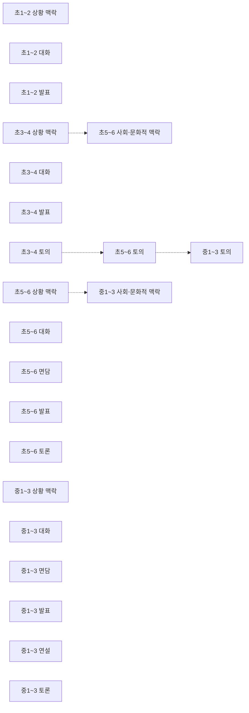
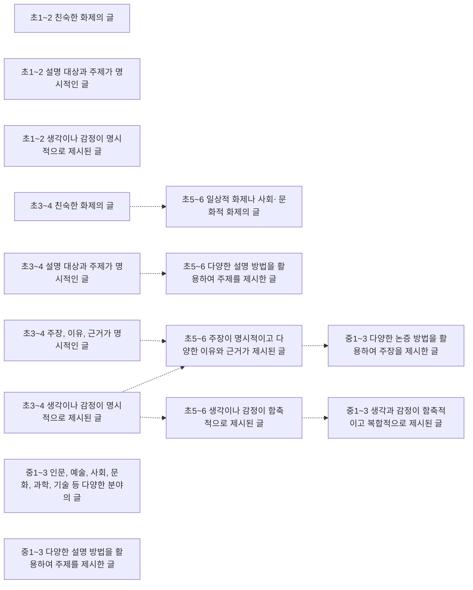
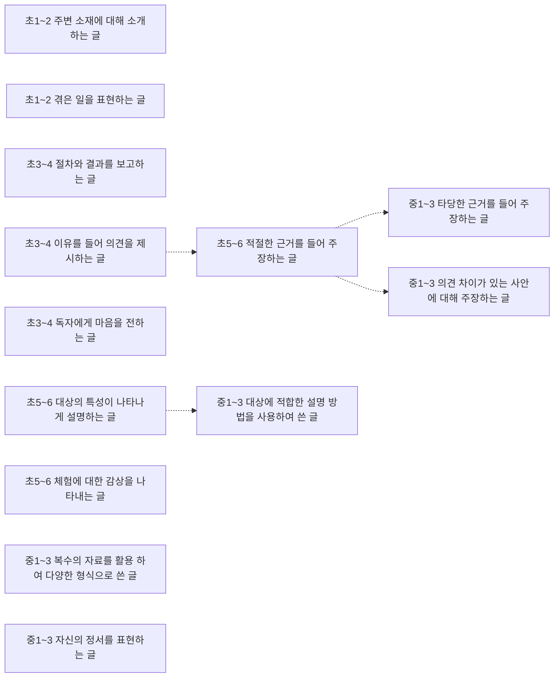
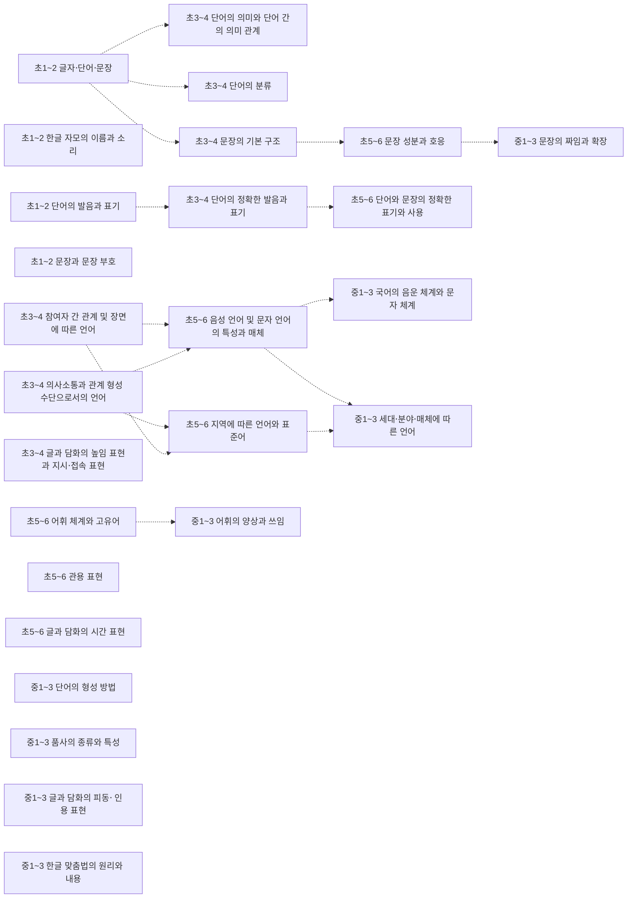
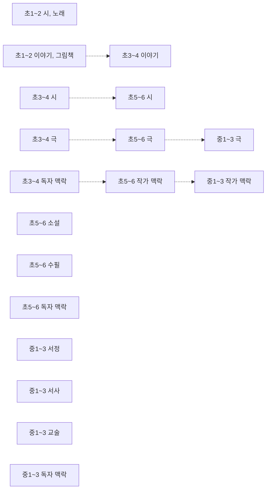
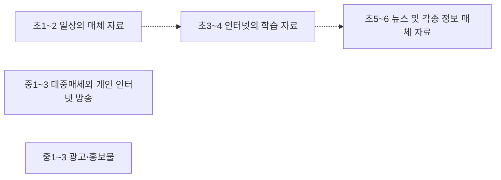

# 국어 개념 지도 (초1~고2~3)

개념 154개 = 고시문 「내용 체계」의 지식⋅이해 항목(원문 낱말 그대로). 선수관계 52개 — **구조 38** (내용 체계 같은 범주 행의 바로 앞 학년 칸 — 규칙으로 뽑아 Gemini 가 「타당」이라 한 것) · **단원 14** (고시문이 밝힌 단원 연계 안의 개념 쌍 — 규칙으로 뽑아 Gemini 가 「타당」이라 한 것). 원문이 아닌 간선은 그림에서 점선, 목록에서 표시.

> 각 교과 「내용 체계」는 범주를 학년(군)에 따라 위계적으로 배열한다 — 같은 범주 행의 앞 학년 칸이 「구조」 간선의 근거다. 고교 과목은 표가 과목마다 따로라 고시문 단원 연계(「…와 연계된다」) 위에서 「단원」 간선을 찾는다. 간선별 이유·심사 기록은 [concept_proposals.json](../data/kr/concept_proposals.json) · [concept_structure.json](../data/kr/concept_structure.json).

□ 셀프 체크는 그 개념 성취기준 문장을 물음으로만 바꾼 것이다. MCP 에서는 `concept_path` 로 묻고, 「예」인 개념은 `known` 에 넣는다. 먼저/이어서가 없는 개념은 교과 문서의 단원 연계를 본다.

목차: [듣기⋅말하기](#듣기-말하기) · [읽기](#읽기) · [쓰기](#쓰기) · [문법](#문법) · [문학](#문학) · [매체](#매체) · [고1 · 공통국어1 · 듣기⋅말하기](#고1-공통국어1-듣기-말하기) · [고1 · 공통국어1 · 읽기](#고1-공통국어1-읽기) · [고1 · 공통국어1 · 쓰기](#고1-공통국어1-쓰기) · [고1 · 공통국어1 · 문법](#고1-공통국어1-문법) · [고1 · 공통국어1 · 문학](#고1-공통국어1-문학) · [고1 · 공통국어1 · 매체](#고1-공통국어1-매체) · [고1 · 공통국어2 · 듣기⋅말하기](#고1-공통국어2-듣기-말하기) · [고1 · 공통국어2 · 읽기](#고1-공통국어2-읽기) · [고1 · 공통국어2 · 쓰기](#고1-공통국어2-쓰기) · [고1 · 공통국어2 · 문법](#고1-공통국어2-문법) · [고1 · 공통국어2 · 문학](#고1-공통국어2-문학) · [고1 · 공통국어2 · 매체](#고1-공통국어2-매체) · [고2~3 · 화법과 언어](#고2-3-화법과-언어) · [고2~3 · 독서와 작문](#고2-3-독서와-작문) · [고2~3 · 문학](#고2-3-문학) · [고2~3 · 주제 탐구 독서](#고2-3-주제-탐구-독서) · [고2~3 · 문학과 영상](#고2-3-문학과-영상) · [고2~3 · 직무 의사소통](#고2-3-직무-의사소통) · [고2~3 · 독서 토론과 글쓰기](#고2-3-독서-토론과-글쓰기) · [고2~3 · 매체 의사소통](#고2-3-매체-의사소통) · [고2~3 · 언어생활 탐구](#고2-3-언어생활-탐구)

## 듣기⋅말하기

### 초1~2 상황 맥락

듣기⋅말하기 맥락 · 성취기준 2국01-01, 2국01-02, 2국01-03, 2국01-04, 2국01-05  

- □ 중요한 내용이나 일이 일어난 순서를 고려하며 듣고 말한다.
- □ 바르고 고운 말로 서로의 감정을 나누며 듣고 말한다.
- □ 상대의 말을 집중하여 듣고 말차례를 지키며 대화한다.
- … 외 2개

### 초1~2 대화

담화 유형 · 성취기준 2국01-03  

- □ 상대의 말을 집중하여 듣고 말차례를 지키며 대화한다.

### 초1~2 발표

담화 유형 · 성취기준 2국01-04  

- □ 자신의 경험이나 생각을 바른 자세로 발표한다.

### 초3~4 상황 맥락

듣기⋅말하기 맥락 · 성취기준 4국01-03, 4국01-04  
➡️ 이어서: [초5~6 사회⋅문화적 맥락](#초5-6-사회-문화적-맥락)구조  

- □ 상황에 적절한 준언어⋅비언어적 표현을 활용하여 듣고 말한다.
- □ 상황과 상대의 입장을 이해하고 예의를 지키며 대화한다.

### 초3~4 대화

담화 유형 · 성취기준 4국01-04  

- □ 상황과 상대의 입장을 이해하고 예의를 지키며 대화한다.

### 초3~4 발표

담화 유형 · 성취기준 4국01-05  

- □ 목적과 주제에 알맞게 자료를 정리하여 자신감 있게 발표한다.

### 초3~4 토의

담화 유형 · 성취기준 4국01-06  
➡️ 이어서: [초5~6 토의](#초5-6-토의)구조  

- □ 주제에 적절한 의견과 이유를 제시하고 서로의 생각을 교환하며 토의한다.

### 초5~6 상황 맥락

듣기⋅말하기 맥락 · 성취기준 6국01-01, 6국01-02, 6국01-03, 6국01-04, 6국01-05, 6국01-06, 6국01-07  
➡️ 이어서: [중1~3 사회⋅문화적 맥락](#중1-3-사회-문화적-맥락)구조  

- □ 대화에서 생략된 내용을 추론하며 듣는다.
- □ 주장을 파악하고 이유나 근거가 타당한지 평가하며 듣는다.
- □ 주제와 관련하여 궁금한 내용을 질문하며 적극적으로 듣고 말한다.
- … 외 4개

### 초5~6 사회⋅문화적 맥락

듣기⋅말하기 맥락 · 성취기준 6국01-01, 6국01-02, 6국01-03, 6국01-04, 6국01-05, 6국01-06, 6국01-07  
⬅️ 먼저: [초3~4 상황 맥락](#초3-4-상황-맥락)구조  
➡️ 이어서: [고2~3 매체 의사소통 매체 자료의 사회⋅문화적 구성과 재현](#고2-3-매체-의사소통-매체-자료의-사회-문화적-구성과-재현)단원  

- □ 대화에서 생략된 내용을 추론하며 듣는다.
- □ 주장을 파악하고 이유나 근거가 타당한지 평가하며 듣는다.
- □ 주제와 관련하여 궁금한 내용을 질문하며 적극적으로 듣고 말한다.
- … 외 4개

### 초5~6 대화

담화 유형 · 성취기준 6국01-01  

- □ 대화에서 생략된 내용을 추론하며 듣는다.

### 초5~6 면담

담화 유형 · 성취기준 6국01-04  

- □ 면담의 절차를 이해하고 상대와 매체를 고려하여 면담한다.

### 초5~6 발표

담화 유형 · 성취기준 6국01-05  

- □ 자료를 선별하여 핵심 정보를 중심으로 내용을 구성하고 매체를 활용하여 발표한다.

### 초5~6 토의

담화 유형 · 성취기준 6국01-06  
⬅️ 먼저: [초3~4 토의](#초3-4-토의)구조  
➡️ 이어서: [중1~3 토의](#중1-3-토의)구조  

- □ 토의에 협력적으로 참여하며 서로의 의견을 비교하고 조정한다.

### 초5~6 토론

담화 유형 · 성취기준 6국01-07  

- □ 절차와 규칙을 지키고 타당한 이유와 근거를 제시하며 토론한다.

### 중1~3 상황 맥락

듣기⋅말하기 맥락 · 성취기준 9국01-01, 9국01-02, 9국01-03, 9국01-04, 9국01-05, 9국01-06, 9국01-07, 9국01-08, 9국01-09, 9국01-10, 9국01-11  

- □ 화자의 의도와 관점을 추론하며 듣는다.
- □ 설득 전략을 비판적으로 분석하며 듣는다.
- □ 담화 공동체에 따른 듣기⋅말하기 방식의 다양성을 고려하여 듣고 말한다.
- … 외 8개

### 중1~3 사회⋅문화적 맥락

듣기⋅말하기 맥락 · 성취기준 9국01-01, 9국01-02, 9국01-03, 9국01-04, 9국01-05, 9국01-06, 9국01-07, 9국01-08, 9국01-09, 9국01-10, 9국01-11  
⬅️ 먼저: [초5~6 상황 맥락](#초5-6-상황-맥락)구조  
➡️ 이어서: [고2~3 매체 의사소통 매체 자료의 사회⋅문화적 구성과 재현](#고2-3-매체-의사소통-매체-자료의-사회-문화적-구성과-재현)단원  

- □ 화자의 의도와 관점을 추론하며 듣는다.
- □ 설득 전략을 비판적으로 분석하며 듣는다.
- □ 담화 공동체에 따른 듣기⋅말하기 방식의 다양성을 고려하여 듣고 말한다.
- … 외 8개

### 중1~3 대화

담화 유형 · 성취기준 9국01-04  

- □ 상대의 말을 경청하고 상대의 감정과 입장에 공감하는 반응을 보이며 대화한다.

### 중1~3 면담

담화 유형 · 성취기준 9국01-05  

- □ 면담의 다양한 목적과 상대를 고려하여 질문을 점검하고 효과적으로 면담한다.

### 중1~3 발표

담화 유형 · 성취기준 9국01-06  

- □ 다양한 자료를 재구성하여 내용을 체계적으로 조직하고 청중이 이해하기 쉽게 발표한다.

### 중1~3 연설

담화 유형 · 성취기준 9국01-06  

- □ 다양한 자료를 재구성하여 내용을 체계적으로 조직하고 청중이 이해하기 쉽게 발표한다.

### 중1~3 토의

담화 유형 · 성취기준 9국01-07  
⬅️ 먼저: [초5~6 토의](#초5-6-토의)구조  

- □ 토의에서 다양한 의견을 교환하여 대안을 마련하고 문제를 해결한다.

### 중1~3 토론

담화 유형 · 성취기준 9국01-08  

- □ 토론에서 반론을 고려하여 타당한 논증을 구성하고 논리적으로 반박한다.

## 읽기

### 초1~2 친숙한 화제의 글

글의 유형 · 성취기준 2국02-01, 2국02-02, 2국02-03, 2국02-04, 2국02-05  

- □ 글자, 단어, 문장, 짧은 글을 정확하게 소리 내어 읽는다.
- □ 의미가 잘 드러나도록 문장과 짧은 글을 알맞게 띄어 읽는다.
- □ 글을 읽고 중심 내용을 확인한다.
- … 외 2개

### 초1~2 설명 대상과 주제가 명시적인 글

글의 유형 · 성취기준 2국02-01, 2국02-02, 2국02-03, 2국02-04, 2국02-05  

- □ 글자, 단어, 문장, 짧은 글을 정확하게 소리 내어 읽는다.
- □ 의미가 잘 드러나도록 문장과 짧은 글을 알맞게 띄어 읽는다.
- □ 글을 읽고 중심 내용을 확인한다.
- … 외 2개

### 초1~2 생각이나 감정이 명시적으로 제시된 글

글의 유형 · 성취기준 2국02-01, 2국02-02, 2국02-03, 2국02-04, 2국02-05  

- □ 글자, 단어, 문장, 짧은 글을 정확하게 소리 내어 읽는다.
- □ 의미가 잘 드러나도록 문장과 짧은 글을 알맞게 띄어 읽는다.
- □ 글을 읽고 중심 내용을 확인한다.
- … 외 2개

### 초3~4 친숙한 화제의 글

글의 유형 · 성취기준 4국02-01, 4국02-02, 4국02-03, 4국02-04, 4국02-05, 4국02-06  
➡️ 이어서: [초5~6 일상적 화제나 사회⋅ 문화적 화제의 글](#초5-6-일상적-화제나-사회-문화적-화제의-글)구조  

- □ 글의 의미를 파악하며 유창하게 글을 읽는다.
- □ 문단과 글에서 중심 생각을 파악하고 내용을 간추린다.
- □ 질문을 활용하여 글을 예측하며 읽고 자신의 읽기 과정을 점검한다.
- … 외 3개

### 초3~4 설명 대상과 주제가 명시적인 글

글의 유형 · 성취기준 4국02-01, 4국02-02, 4국02-03, 4국02-04, 4국02-05, 4국02-06  
➡️ 이어서: [초5~6 다양한 설명 방법을 활용하여 주제를 제시한 글](#초5-6-다양한-설명-방법을-활용하여-주제를-제시한-글)구조  

- □ 글의 의미를 파악하며 유창하게 글을 읽는다.
- □ 문단과 글에서 중심 생각을 파악하고 내용을 간추린다.
- □ 질문을 활용하여 글을 예측하며 읽고 자신의 읽기 과정을 점검한다.
- … 외 3개

### 초3~4 주장, 이유, 근거가 명시적인 글

글의 유형 · 성취기준 4국02-01, 4국02-02, 4국02-03, 4국02-04, 4국02-05, 4국02-06  
➡️ 이어서: [초5~6 주장이 명시적이고 다양한 이유와 근거가 제시된 글](#초5-6-주장이-명시적이고-다양한-이유와-근거가-제시된-글)구조  

- □ 글의 의미를 파악하며 유창하게 글을 읽는다.
- □ 문단과 글에서 중심 생각을 파악하고 내용을 간추린다.
- □ 질문을 활용하여 글을 예측하며 읽고 자신의 읽기 과정을 점검한다.
- … 외 3개

### 초3~4 생각이나 감정이 명시적으로 제시된 글

글의 유형 · 성취기준 4국02-01, 4국02-02, 4국02-03, 4국02-04, 4국02-05, 4국02-06  
➡️ 이어서: [초5~6 생각이나 감정이 함축적으로 제시된 글](#초5-6-생각이나-감정이-함축적으로-제시된-글)구조 · [초5~6 주장이 명시적이고 다양한 이유와 근거가 제시된 글](#초5-6-주장이-명시적이고-다양한-이유와-근거가-제시된-글)구조  

- □ 글의 의미를 파악하며 유창하게 글을 읽는다.
- □ 문단과 글에서 중심 생각을 파악하고 내용을 간추린다.
- □ 질문을 활용하여 글을 예측하며 읽고 자신의 읽기 과정을 점검한다.
- … 외 3개

### 초5~6 일상적 화제나 사회⋅ 문화적 화제의 글

글의 유형 · 성취기준 6국02-04  
⬅️ 먼저: [초3~4 친숙한 화제의 글](#초3-4-친숙한-화제의-글)구조  

- □ 문제 상황과 관련된 다양한 관점의 글을 읽고 이를 문제 해결에 활용한다.

### 초5~6 다양한 설명 방법을 활용하여 주제를 제시한 글

글의 유형 · 성취기준 6국02-04  
⬅️ 먼저: [초3~4 설명 대상과 주제가 명시적인 글](#초3-4-설명-대상과-주제가-명시적인-글)구조  

- □ 문제 상황과 관련된 다양한 관점의 글을 읽고 이를 문제 해결에 활용한다.

### 초5~6 주장이 명시적이고 다양한 이유와 근거가 제시된 글

글의 유형 · 성취기준 6국02-04  
⬅️ 먼저: [초3~4 주장, 이유, 근거가 명시적인 글](#초3-4-주장-이유-근거가-명시적인-글)구조 · [초3~4 생각이나 감정이 명시적으로 제시된 글](#초3-4-생각이나-감정이-명시적으로-제시된-글)구조  
➡️ 이어서: [중1~3 다양한 논증 방법을 활용하여 주장을 제시한 글](#중1-3-다양한-논증-방법을-활용하여-주장을-제시한-글)구조  

- □ 문제 상황과 관련된 다양한 관점의 글을 읽고 이를 문제 해결에 활용한다.

### 초5~6 생각이나 감정이 함축적으로 제시된 글

글의 유형 · 성취기준 6국02-04  
⬅️ 먼저: [초3~4 생각이나 감정이 명시적으로 제시된 글](#초3-4-생각이나-감정이-명시적으로-제시된-글)구조  
➡️ 이어서: [중1~3 생각과 감정이 함축적이고 복합적으로 제시된 글](#중1-3-생각과-감정이-함축적이고-복합적으로-제시된-글)구조  

- □ 문제 상황과 관련된 다양한 관점의 글을 읽고 이를 문제 해결에 활용한다.

### 중1~3 인문, 예술, 사회, 문화, 과학, 기술 등 다양한 분야의 글

글의 유형 · 성취기준 9국02-07  

- □ 진로나 관심 분야에 대한 다양한 책이나 자료를 스스로 찾아 읽는다.

### 중1~3 다양한 설명 방법을 활용하여 주제를 제시한 글

글의 유형 · 성취기준 9국02-05  

- □ 글에 사용된 다양한 설명 방법과 논증 방법을 파악하고, 그 타당성을 평가하며 읽는다.

### 중1~3 다양한 논증 방법을 활용하여 주장을 제시한 글

글의 유형 · 성취기준 9국02-05  
⬅️ 먼저: [초5~6 주장이 명시적이고 다양한 이유와 근거가 제시된 글](#초5-6-주장이-명시적이고-다양한-이유와-근거가-제시된-글)구조  

- □ 글에 사용된 다양한 설명 방법과 논증 방법을 파악하고, 그 타당성을 평가하며 읽는다.

### 중1~3 생각과 감정이 함축적이고 복합적으로 제시된 글

글의 유형 · 성취기준 9국02-05  
⬅️ 먼저: [초5~6 생각이나 감정이 함축적으로 제시된 글](#초5-6-생각이나-감정이-함축적으로-제시된-글)구조  

- □ 글에 사용된 다양한 설명 방법과 논증 방법을 파악하고, 그 타당성을 평가하며 읽는다.

## 쓰기

### 초1~2 주변 소재에 대해 소개하는 글

글의 유형 · 성취기준 2국03-03  

- □ 주변 소재에 대해 소개하는 글을 쓴다.

### 초1~2 겪은 일을 표현하는 글

글의 유형 · 성취기준 2국03-04  

- □ 겪은 일을 표현하는 글을 자유롭게 쓰고, 쓴 글을 함께 읽고 생각이나 느낌을 나눈다.

### 초3~4 절차와 결과를 보고하는 글

글의 유형 · 성취기준 4국03-02  

- □ 절차와 결과가 드러나게 정확한 표현으로 보고하는 글을 쓴다.

### 초3~4 이유를 들어 의견을 제시하는 글

글의 유형 · 성취기준 4국03-03  
➡️ 이어서: [초5~6 적절한 근거를 들어 주장하는 글](#초5-6-적절한-근거를-들어-주장하는-글)구조  

- □ 대상에 대한 자신의 의견과 그렇게 생각한 이유가 드러나게 글을 쓴다.

### 초3~4 독자에게 마음을 전하는 글

글의 유형 · 성취기준 4국03-04  

- □ 목적과 주제를 고려하여 독자에게 마음을 전하는 글을 쓴다.

### 초5~6 대상의 특성이 나타나게 설명하는 글

글의 유형 · 성취기준 6국03-01  
➡️ 이어서: [중1~3 대상에 적합한 설명 방법을 사용하여 쓴 글](#중1-3-대상에-적합한-설명-방법을-사용하여-쓴-글)구조  

- □ 알맞은 내용을 선정하여 대상의 특성이 나타나게 설명하는 글을 쓴다.

### 초5~6 적절한 근거를 들어 주장하는 글

글의 유형 · 성취기준 6국03-02  
⬅️ 먼저: [초3~4 이유를 들어 의견을 제시하는 글](#초3-4-이유를-들어-의견을-제시하는-글)구조  
➡️ 이어서: [중1~3 타당한 근거를 들어 주장하는 글](#중1-3-타당한-근거를-들어-주장하는-글)구조 · [중1~3 의견 차이가 있는 사안에 대해 주장하는 글](#중1-3-의견-차이가-있는-사안에-대해-주장하는-글)구조  

- □ 적절한 근거를 사용하고 인용의 출처를 밝히며 주장하는 글을 쓴다.

### 초5~6 체험에 대한 감상을 나타내는 글

글의 유형 · 성취기준 6국03-03  

- □ 체험한 일에 대한 감상을 나타내는 글을 쓴다.

### 중1~3 복수의 자료를 활용 하여 다양한 형식으로 쓴 글

글의 유형 · 성취기준 9국03-02  

- □ 복수의 자료를 활용하여 다양한 형식으로 정보를 전달하는 글을 쓴다.

### 중1~3 대상에 적합한 설명 방법을 사용하여 쓴 글

글의 유형 · 성취기준 9국03-01  
⬅️ 먼저: [초5~6 대상의 특성이 나타나게 설명하는 글](#초5-6-대상의-특성이-나타나게-설명하는-글)구조  
➡️ 이어서: [고2~3 직무 의사소통 목적, 맥락, 참여자 특성에 적합한 소통](#고2-3-직무-의사소통-목적-맥락-참여자-특성에-적합한-소통)단원  

- □ 대상의 특성에 적합한 설명 방법을 활용하여 글을 쓴다.

### 중1~3 타당한 근거를 들어 주장하는 글

글의 유형 · 성취기준 9국03-03  
⬅️ 먼저: [초5~6 적절한 근거를 들어 주장하는 글](#초5-6-적절한-근거를-들어-주장하는-글)구조  

- □ 주장을 뒷받침할 수 있는 타당한 근거를 들고 적절한 표현을 사용하여 주장하는 글을 쓴다.

### 중1~3 의견 차이가 있는 사안에 대해 주장하는 글

글의 유형 · 성취기준 9국03-04  
⬅️ 먼저: [초5~6 적절한 근거를 들어 주장하는 글](#초5-6-적절한-근거를-들어-주장하는-글)구조  

- □ 의견 차이가 있는 사안에 대해 자료를 수집하고 사회⋅문화적 맥락을 고려하며 주장하는 글을 쓴다.

### 중1~3 자신의 정서를 표현하는 글

글의 유형 · 성취기준 9국03-05  

- □ 자신의 삶과 경험을 바탕으로 정서를 진솔하게 표현하는 글을 쓴다.

## 문법

### 초1~2 글자⋅단어⋅문장

언어 단위 · 성취기준 2국04-02, 2국04-03  
➡️ 이어서: [초3~4 단어의 의미와 단어 간의 의미 관계](#초3-4-단어의-의미와-단어-간의-의미-관계)구조 · [초3~4 단어의 분류](#초3-4-단어의-분류)구조 · [초3~4 문장의 기본 구조](#초3-4-문장의-기본-구조)구조  

- □ 소리와 표기가 다를 수 있음을 알고 단어를 바르게 읽고 쓴다.
- □ 문장과 문장 부호를 알맞게 쓰고 한글에 호기심을 가진다.

### 초1~2 한글 자모의 이름과 소리

한글의 기초와 국어 규범 · 성취기준 2국04-01  

- □ 한글 자모의 이름과 소릿값을 알고 정확하게 발음하고 쓴다.

### 초1~2 단어의 발음과 표기

한글의 기초와 국어 규범 · 성취기준 2국04-02  
➡️ 이어서: [초3~4 단어의 정확한 발음과 표기](#초3-4-단어의-정확한-발음과-표기)구조  

- □ 소리와 표기가 다를 수 있음을 알고 단어를 바르게 읽고 쓴다.

### 초1~2 문장과 문장 부호

한글의 기초와 국어 규범 · 성취기준 2국04-03  

- □ 문장과 문장 부호를 알맞게 쓰고 한글에 호기심을 가진다.

### 초3~4 의사소통과 관계 형성 수단으로서의 언어

언어의 본질과 맥락 · 성취기준 4국04-05  
➡️ 이어서: [초5~6 음성 언어 및 문자 언어의 특성과 매체](#초5-6-음성-언어-및-문자-언어의-특성과-매체)구조 · [초5~6 지역에 따른 언어와 표준어](#초5-6-지역에-따른-언어와-표준어)구조  

- □ 언어가 의사소통과 관계 형성의 수단임을 이해하고 국어를 소중히 여기는 태도를 지닌다.

### 초3~4 참여자 간 관계 및 장면에 따른 언어

언어의 본질과 맥락 · 성취기준 4국04-05  
➡️ 이어서: [초5~6 지역에 따른 언어와 표준어](#초5-6-지역에-따른-언어와-표준어)구조 · [초5~6 음성 언어 및 문자 언어의 특성과 매체](#초5-6-음성-언어-및-문자-언어의-특성과-매체)구조  

- □ 언어가 의사소통과 관계 형성의 수단임을 이해하고 국어를 소중히 여기는 태도를 지닌다.

### 초3~4 단어의 의미와 단어 간의 의미 관계

언어 단위 · 성취기준 4국04-01  
⬅️ 먼저: [초1~2 글자⋅단어⋅문장](#초1-2-글자-단어-문장)구조  

- □ 단어와 단어 간의 의미 관계를 파악한다.

### 초3~4 단어의 분류

언어 단위 · 성취기준 4국04-02  
⬅️ 먼저: [초1~2 글자⋅단어⋅문장](#초1-2-글자-단어-문장)구조  

- □ 단어를 분류하고 국어사전을 활용하여 능동적인 국어 활동을 한다.

### 초3~4 문장의 기본 구조

언어 단위 · 성취기준 4국04-03  
⬅️ 먼저: [초1~2 글자⋅단어⋅문장](#초1-2-글자-단어-문장)구조  
➡️ 이어서: [초5~6 문장 성분과 호응](#초5-6-문장-성분과-호응)구조  

- □ 기본적인 문장의 짜임을 이해하고 적절하게 사용한다.

### 초3~4 글과 담화의 높임 표현과 지시⋅접속 표현

언어 단위 · 성취기준 4국04-04  

- □ 글과 담화에 쓰인 높임 표현과 지시⋅접속 표현을 이해하고 상황에 맞게 표현한다.

### 초3~4 단어의 정확한 발음과 표기

한글의 기초와 국어 규범 · 성취기준 4국04-01, 4국04-02  
⬅️ 먼저: [초1~2 단어의 발음과 표기](#초1-2-단어의-발음과-표기)구조  
➡️ 이어서: [초5~6 단어와 문장의 정확한 표기와 사용](#초5-6-단어와-문장의-정확한-표기와-사용)구조  

- □ 단어와 단어 간의 의미 관계를 파악한다.
- □ 단어를 분류하고 국어사전을 활용하여 능동적인 국어 활동을 한다.

### 초5~6 음성 언어 및 문자 언어의 특성과 매체

언어의 본질과 맥락 · 성취기준 6국04-01  
⬅️ 먼저: [초3~4 의사소통과 관계 형성 수단으로서의 언어](#초3-4-의사소통과-관계-형성-수단으로서의-언어)구조 · [초3~4 참여자 간 관계 및 장면에 따른 언어](#초3-4-참여자-간-관계-및-장면에-따른-언어)구조  
➡️ 이어서: [중1~3 세대⋅분야⋅매체에 따른 언어](#중1-3-세대-분야-매체에-따른-언어)구조 · [고2~3 매체 의사소통 매체의 유형과 특성](#고2-3-매체-의사소통-매체의-유형과-특성)단원 · [중1~3 국어의 음운 체계와 문자 체계](#중1-3-국어의-음운-체계와-문자-체계)구조  

- □ 음성 언어 및 문자 언어의 특성을 이해하고 다양한 매체 자료에서 표현 효과를 평가한다.

### 초5~6 지역에 따른 언어와 표준어

언어의 본질과 맥락 · 성취기준 6국04-02  
⬅️ 먼저: [초3~4 참여자 간 관계 및 장면에 따른 언어](#초3-4-참여자-간-관계-및-장면에-따른-언어)구조 · [초3~4 의사소통과 관계 형성 수단으로서의 언어](#초3-4-의사소통과-관계-형성-수단으로서의-언어)구조  
➡️ 이어서: [중1~3 세대⋅분야⋅매체에 따른 언어](#중1-3-세대-분야-매체에-따른-언어)구조  

- □ 표준어와 방언의 기능을 파악하고 언어 공동체와 국어생활과의 관계를 이해하고 있나요?

### 초5~6 어휘 체계와 고유어

언어 단위 · 성취기준 6국04-03  
➡️ 이어서: [중1~3 어휘의 양상과 쓰임](#중1-3-어휘의-양상과-쓰임)구조  

- □ 고유어와 관용 표현의 쓰임과 가치를 이해하고 상황에 맞게 표현한다.

### 초5~6 관용 표현

언어 단위 · 성취기준 6국04-03  

- □ 고유어와 관용 표현의 쓰임과 가치를 이해하고 상황에 맞게 표현한다.

### 초5~6 문장 성분과 호응

언어 단위 · 성취기준 6국04-04  
⬅️ 먼저: [초3~4 문장의 기본 구조](#초3-4-문장의-기본-구조)구조  
➡️ 이어서: [중1~3 문장의 짜임과 확장](#중1-3-문장의-짜임과-확장)구조  

- □ 문장 성분을 이해하고 호응 관계가 올바른 문장을 구성한다.

### 초5~6 글과 담화의 시간 표현

언어 단위 · 성취기준 6국04-05  

- □ 글과 담화에 쓰인 시간 표현을 이해하고 상황에 맞게 표현한다.

### 초5~6 단어와 문장의 정확한 표기와 사용

한글의 기초와 국어 규범 · 성취기준 6국04-06  
⬅️ 먼저: [초3~4 단어의 정확한 발음과 표기](#초3-4-단어의-정확한-발음과-표기)구조  

- □ 글과 담화에 쓰인 단어 및 문장, 띄어쓰기를 민감하게 살펴 바르게 고치는 태도를 지닌다.

### 중1~3 국어의 음운 체계와 문자 체계

언어의 본질과 맥락 · 성취기준 9국04-01  
⬅️ 먼저: [초5~6 음성 언어 및 문자 언어의 특성과 매체](#초5-6-음성-언어-및-문자-언어의-특성과-매체)구조  

- □ 국어의 음운 체계와 문자 체계를 이해하고 국어생활에 활용한다.

### 중1~3 세대⋅분야⋅매체에 따른 언어

언어의 본질과 맥락 · 성취기준 9국04-07  
⬅️ 먼저: [초5~6 지역에 따른 언어와 표준어](#초5-6-지역에-따른-언어와-표준어)구조 · [초5~6 음성 언어 및 문자 언어의 특성과 매체](#초5-6-음성-언어-및-문자-언어의-특성과-매체)구조  
➡️ 이어서: [고2~3 화법과 언어 맥락에 따른 언어 선택과 담화 관습](#고2-3-화법과-언어-맥락에-따른-언어-선택과-담화-관습)단원  

- □ 세대⋅분야⋅매체에 따른 어휘의 양상과 쓰임을 분석하고 다양한 집단과 사회의 언어에 관용적 태도를 지닌다.

### 중1~3 단어의 형성 방법

언어 단위 · 성취기준 9국04-02  

- □ 단어의 짜임을 분석하여 새말 형성의 원리를 이해하고 있나요?

### 중1~3 품사의 종류와 특성

언어 단위 · 성취기준 9국04-03  

- □ 품사의 종류와 특성을 이해하고 국어 자료를 분석한다.

### 중1~3 어휘의 양상과 쓰임

언어 단위 · 성취기준 9국04-07  
⬅️ 먼저: [초5~6 어휘 체계와 고유어](#초5-6-어휘-체계와-고유어)구조  

- □ 세대⋅분야⋅매체에 따른 어휘의 양상과 쓰임을 분석하고 다양한 집단과 사회의 언어에 관용적 태도를 지닌다.

### 중1~3 문장의 짜임과 확장

언어 단위 · 성취기준 9국04-04  
⬅️ 먼저: [초5~6 문장 성분과 호응](#초5-6-문장-성분과-호응)구조  

- □ 문장의 짜임을 이해하고 표현 효과를 고려하여 문장을 구성한다.

### 중1~3 글과 담화의 피동⋅ 인용 표현

언어 단위 · 성취기준 9국04-05  

- □ 피동 표현과 인용 표현의 의도와 효과를 분석하고 상황에 맞게 활용한다.

### 중1~3 한글 맞춤법의 원리와 내용

한글의 기초와 국어 규범 · 성취기준 9국04-06  

- □ 한글 맞춤법의 기본 원리와 내용을 이해하고 국어생활에 적용한다.

## 문학

### 초1~2 시, 노래

갈래 · 성취기준 2국05-03, 2국05-04  

- □ 작품 속 인물의 모습, 행동, 마음을 상상하여 시, 노래, 이야기, 그림 등으로 표현한다.
- □ 시나 노래, 이야기에 흥미를 가진다.

### 초1~2 이야기, 그림책

갈래 · 성취기준 2국05-03, 2국05-04  
➡️ 이어서: [초3~4 이야기](#초3-4-이야기)구조  

- □ 작품 속 인물의 모습, 행동, 마음을 상상하여 시, 노래, 이야기, 그림 등으로 표현한다.
- □ 시나 노래, 이야기에 흥미를 가진다.

### 초3~4 시

갈래 · 성취기준 4국05-01  
➡️ 이어서: [초5~6 시](#초5-6-시)구조  

- □ 인물과 이야기의 흐름을 중심으로 작품을 감상한다.

### 초3~4 이야기

갈래 · 성취기준 4국05-01  
⬅️ 먼저: [초1~2 이야기, 그림책](#초1-2-이야기-그림책)구조  

- □ 인물과 이야기의 흐름을 중심으로 작품을 감상한다.

### 초3~4 극

갈래 · 성취기준 4국05-01  
➡️ 이어서: [초5~6 극](#초5-6-극)구조  

- □ 인물과 이야기의 흐름을 중심으로 작품을 감상한다.

### 초3~4 독자 맥락

맥락 · 성취기준 4국05-01, 4국05-02, 4국05-03, 4국05-04, 4국05-05  
➡️ 이어서: [초5~6 작가 맥락](#초5-6-작가-맥락)구조  

- □ 인물과 이야기의 흐름을 중심으로 작품을 감상한다.
- □ 자신의 경험을 바탕으로 작품 속 세계와 현실 세계를 비교하여 작품을 감상한다.
- □ 작품을 듣거나 읽고 마음에 드는 작품을 소개한다.
- … 외 2개

### 초5~6 시

갈래 · 성취기준 6국05-05  
⬅️ 먼저: [초3~4 시](#초3-4-시)구조  

- □ 자신의 경험을 시, 소설, 극, 수필 등 적절한 갈래로 표현한다.

### 초5~6 소설

갈래 · 성취기준 6국05-03, 6국05-05  

- □ 소설이나 극을 읽고 인물, 사건, 배경을 파악한다.
- □ 자신의 경험을 시, 소설, 극, 수필 등 적절한 갈래로 표현한다.

### 초5~6 극

갈래 · 성취기준 6국05-03, 6국05-05  
⬅️ 먼저: [초3~4 극](#초3-4-극)구조  
➡️ 이어서: [중1~3 극](#중1-3-극)구조  

- □ 소설이나 극을 읽고 인물, 사건, 배경을 파악한다.
- □ 자신의 경험을 시, 소설, 극, 수필 등 적절한 갈래로 표현한다.

### 초5~6 수필

갈래 · 성취기준 6국05-05  

- □ 자신의 경험을 시, 소설, 극, 수필 등 적절한 갈래로 표현한다.

### 초5~6 작가 맥락

맥락 · 성취기준 6국05-01, 6국05-02, 6국05-03, 6국05-04, 6국05-05, 6국05-06  
⬅️ 먼저: [초3~4 독자 맥락](#초3-4-독자-맥락)구조  
➡️ 이어서: [중1~3 작가 맥락](#중1-3-작가-맥락)구조  

- □ 작가의 의도를 생각하며 작품을 읽는다.
- □ 비유적 표현의 효과에 유의하여 작품을 감상한다.
- □ 소설이나 극을 읽고 인물, 사건, 배경을 파악한다.
- … 외 3개

### 초5~6 독자 맥락

맥락 · 성취기준 6국05-01, 6국05-02, 6국05-03, 6국05-04, 6국05-05, 6국05-06  

- □ 작가의 의도를 생각하며 작품을 읽는다.
- □ 비유적 표현의 효과에 유의하여 작품을 감상한다.
- □ 소설이나 극을 읽고 인물, 사건, 배경을 파악한다.
- … 외 3개

### 중1~3 서정

갈래 · 성취기준 9국05-01, 9국05-02, 9국05-03, 9국05-04, 9국05-05, 9국05-06, 9국05-07, 9국05-08, 9국05-09  

- □ 운율, 비유, 상징의 특성과 효과에 유의하며 작품을 감상하고 창작한다.
- □ 갈등의 진행과 해결 과정을 파악하며 작품을 감상한다.
- □ 인간의 성장을 다룬 작품을 읽으며 문학의 가치를 내면화한다.
- … 외 6개

### 중1~3 서사

갈래 · 성취기준 9국05-01, 9국05-02, 9국05-03, 9국05-04, 9국05-05, 9국05-06, 9국05-07, 9국05-08, 9국05-09  

- □ 운율, 비유, 상징의 특성과 효과에 유의하며 작품을 감상하고 창작한다.
- □ 갈등의 진행과 해결 과정을 파악하며 작품을 감상한다.
- □ 인간의 성장을 다룬 작품을 읽으며 문학의 가치를 내면화한다.
- … 외 6개

### 중1~3 극

갈래 · 성취기준 9국05-01, 9국05-02, 9국05-03, 9국05-04, 9국05-05, 9국05-06, 9국05-07, 9국05-08, 9국05-09  
⬅️ 먼저: [초5~6 극](#초5-6-극)구조  

- □ 운율, 비유, 상징의 특성과 효과에 유의하며 작품을 감상하고 창작한다.
- □ 갈등의 진행과 해결 과정을 파악하며 작품을 감상한다.
- □ 인간의 성장을 다룬 작품을 읽으며 문학의 가치를 내면화한다.
- … 외 6개

### 중1~3 교술

갈래 · 성취기준 9국05-01, 9국05-02, 9국05-03, 9국05-04, 9국05-05, 9국05-06, 9국05-07, 9국05-08, 9국05-09  

- □ 운율, 비유, 상징의 특성과 효과에 유의하며 작품을 감상하고 창작한다.
- □ 갈등의 진행과 해결 과정을 파악하며 작품을 감상한다.
- □ 인간의 성장을 다룬 작품을 읽으며 문학의 가치를 내면화한다.
- … 외 6개

### 중1~3 작가 맥락

맥락 · 성취기준 9국05-01, 9국05-02, 9국05-03, 9국05-04, 9국05-05, 9국05-06, 9국05-07, 9국05-08, 9국05-09  
⬅️ 먼저: [초5~6 작가 맥락](#초5-6-작가-맥락)구조  

- □ 운율, 비유, 상징의 특성과 효과에 유의하며 작품을 감상하고 창작한다.
- □ 갈등의 진행과 해결 과정을 파악하며 작품을 감상한다.
- □ 인간의 성장을 다룬 작품을 읽으며 문학의 가치를 내면화한다.
- … 외 6개

### 중1~3 독자 맥락

맥락 · 성취기준 9국05-01, 9국05-02, 9국05-03, 9국05-04, 9국05-05, 9국05-06, 9국05-07, 9국05-08, 9국05-09  

- □ 운율, 비유, 상징의 특성과 효과에 유의하며 작품을 감상하고 창작한다.
- □ 갈등의 진행과 해결 과정을 파악하며 작품을 감상한다.
- □ 인간의 성장을 다룬 작품을 읽으며 문학의 가치를 내면화한다.
- … 외 6개

## 매체

### 초1~2 일상의 매체 자료

매체 자료 유형 · 성취기준 2국06-01  
➡️ 이어서: [초3~4 인터넷의 학습 자료](#초3-4-인터넷의-학습-자료)구조  

- □ 일상의 다양한 매체와 매체 자료에 흥미와 관심을 가진다.

### 초3~4 인터넷의 학습 자료

매체 자료 유형 · 성취기준 4국06-01  
⬅️ 먼저: [초1~2 일상의 매체 자료](#초1-2-일상의-매체-자료)구조  
➡️ 이어서: [초5~6 뉴스 및 각종 정보 매체 자료](#초5-6-뉴스-및-각종-정보-매체-자료)구조  

- □ 인터넷에서 학습에 필요한 다양한 자료를 탐색하고 목적에 맞게 자료를 선택한다.

### 초5~6 뉴스 및 각종 정보 매체 자료

매체 자료 유형 · 성취기준 6국06-02  
⬅️ 먼저: [초3~4 인터넷의 학습 자료](#초3-4-인터넷의-학습-자료)구조  

- □ 뉴스 및 각종 정보 매체 자료의 신뢰성을 평가한다.

### 중1~3 대중매체와 개인 인터넷 방송

매체 자료 유형 · 성취기준 9국06-01  

- □ 대중매체와 개인 인터넷 방송의 특성과 영향력을 비교한다.

### 중1~3 광고⋅홍보물

매체 자료 유형 · 성취기준 9국06-05  

- □ 매체 자료의 재현 방식을 이해하고 광고나 홍보물을 분석한다.

## 고1 · 공통국어1 · 듣기⋅말하기

### 고1 상황 맥락과 사회⋅문화적 맥락

성취기준 10공국1-01-01  
➡️ 이어서: [고2~3 매체 의사소통 매체 자료의 사회⋅문화적 구성과 재현](#고2-3-매체-의사소통-매체-자료의-사회-문화적-구성과-재현)단원  

- □ 대화의 원리를 고려하여 대화하고 자신의 듣기⋅말하기 과정과 공동체의 담화 관습을 성찰한다.

### 고1 대화

성취기준 10공국1-01-01  

- □ 대화의 원리를 고려하여 대화하고 자신의 듣기⋅말하기 과정과 공동체의 담화 관습을 성찰한다.

### 고1 토론

성취기준 10공국1-01-02  

- □ 논제의 필수 쟁점별로 논증을 구성하고 논증이 타당한지 평가하며 토론한다.

## 고1 · 공통국어1 · 읽기

### 고1 사회⋅문화적 맥락

성취기준 10공국1-02-02  
➡️ 이어서: [고2~3 매체 의사소통 매체 자료의 사회⋅문화적 구성과 재현](#고2-3-매체-의사소통-매체-자료의-사회-문화적-구성과-재현)단원  

- □ 자신의 진로나 관심 분야와 관련한 다양한 글이나 자료를 찾아 주제 통합적으로 읽고 읽은 결과를 공유한다.

### 고1 인문, 예술, 사회, 문화, 과학, 기술 등 다양한 분야의 글

성취기준 10공국1-02-02  

- □ 자신의 진로나 관심 분야와 관련한 다양한 글이나 자료를 찾아 주제 통합적으로 읽고 읽은 결과를 공유한다.

### 고1 다양한 설명 방법을 활용하여 주제를 제시한 글

성취기준 10공국1-02-02  

- □ 자신의 진로나 관심 분야와 관련한 다양한 글이나 자료를 찾아 주제 통합적으로 읽고 읽은 결과를 공유한다.

### 고1 다양한 논증 방법을 활용하여 주장을 제시한 글

성취기준 10공국1-02-01  

- □ 다양한 글이나 자료를 읽으며 논증의 타당성을 평가하고 자신의 관점을 바탕으로 논증을 재구성한다.

### 고1 생각과 감정이 함축적이고 복합적으로 제시된 글

성취기준 10공국1-02-01  

- □ 다양한 글이나 자료를 읽으며 논증의 타당성을 평가하고 자신의 관점을 바탕으로 논증을 재구성한다.

## 고1 · 공통국어1 · 쓰기

### 고1 사회적 쟁점에 대한 자신의 견해를 나타내는 글

성취기준 10공국1-03-01  

- □ 내용 전개의 일반적 원리를 고려하여 사회적 쟁점에 대한 자신의 견해를 정교하게 표현하는 글을 쓴다.

### 고1 개성이 드러나는 글

성취기준 10공국1-03-02  

- □ 다양한 언어 공동체의 특성을 고려하며 필자의 개성이 드러나는 글을 쓴다.

## 고1 · 공통국어1 · 문법

### 고1 언어 공동체의 다변화에 따른 언어

성취기준 10공국1-04-01  
➡️ 이어서: [고2~3 화법과 언어 맥락에 따른 언어 선택과 담화 관습](#고2-3-화법과-언어-맥락에-따른-언어-선택과-담화-관습)단원  

- □ 언어 공동체가 다변화함에 따라 다양해진 언어 실천 양상을 분석하고 언어 주체로서 책임감을 가지며 국어생활을 한다.

### 고1 음운 변동

성취기준 10공국1-04-02  

- □ 음운 변동을 탐구하여 발음과 표기에 올바르게 적용한다.

### 고1 글과 담화에 나타난 문법 요소 및 어휘의 특성과 사용

성취기준 10공국1-04-03  
➡️ 이어서: [고2~3 언어생활 탐구 글과 담화의 맥락과 언어적 특성](#고2-3-언어생활-탐구-글과-담화의-맥락과-언어적-특성)단원  

- □ 다양한 분야의 글과 담화에 나타난 문법 요소 및 어휘의 표현 효과를 평가하고 적절한 표현을 생성한다.

## 고1 · 공통국어1 · 문학

### 고1 서정, 서사, 극, 교술

성취기준 10공국1-05-03  

- □ 작품 구성 요소의 유기적 관계와 맥락에 유의하여 작품을 수용하고 생산한다.

### 고1 작가 맥락, 독자 맥락, 사회⋅문화적 맥락, 문학사적 맥락

성취기준 10공국1-05-03  

- □ 작품 구성 요소의 유기적 관계와 맥락에 유의하여 작품을 수용하고 생산한다.

## 고1 · 공통국어1 · 매체

### 고1 다양한 유형의 매체 자료

성취기준 10공국1-06-02  
➡️ 이어서: [고2~3 매체 의사소통 매체의 유형과 특성](#고2-3-매체-의사소통-매체의-유형과-특성)단원 · [고2~3 매체 의사소통 매체 자료의 사회⋅문화적 구성과 재현](#고2-3-매체-의사소통-매체-자료의-사회-문화적-구성과-재현)단원  

- □ 소통 맥락과 매체 특성을 고려하여 다양한 목적의 매체 자료를 제작한다.

## 고1 · 공통국어2 · 듣기⋅말하기

### 고1 상황 맥락과 사회⋅문화적 맥락

성취기준 10공국2-01-03  
➡️ 이어서: [고2~3 매체 의사소통 매체 자료의 사회⋅문화적 구성과 재현](#고2-3-매체-의사소통-매체-자료의-사회-문화적-구성과-재현)단원  

- □ 사회적 소통 과정에서 말의 영향력을 고려하여 책임감 있게 듣고 말한다.

### 고1 발표

성취기준 10공국2-01-01  

- □ 청중의 관심과 요구에 맞게 내용을 구성하여 발표하고 청중의 질문에 효과적으로 답변한다.

### 고1 협상

성취기준 10공국2-01-02  

- □ 쟁점과 이해관계를 고려하여 문제를 해결할 수 있는 대안을 탐색하며 협상한다.

## 고1 · 공통국어2 · 읽기

### 고1 사회⋅문화적 맥락

성취기준 10공국2-02-03  
➡️ 이어서: [고2~3 매체 의사소통 매체 자료의 사회⋅문화적 구성과 재현](#고2-3-매체-의사소통-매체-자료의-사회-문화적-구성과-재현)단원  

- □ 의미 있는 사회적 독서 활동에 참여함으로써 타인과 교류하고 다양한 지식이나 정보, 삶에 대한 가치관 등을 이해하는 태도를 지닌다.

### 고1 인문, 예술, 사회, 문화, 과학, 기술 등 다양한 분야의 글

성취기준 10공국2-02-03  

- □ 의미 있는 사회적 독서 활동에 참여함으로써 타인과 교류하고 다양한 지식이나 정보, 삶에 대한 가치관 등을 이해하는 태도를 지닌다.

### 고1 다양한 설명 방법을 활용하여 주제를 제시한 글

성취기준 10공국2-02-03  

- □ 의미 있는 사회적 독서 활동에 참여함으로써 타인과 교류하고 다양한 지식이나 정보, 삶에 대한 가치관 등을 이해하는 태도를 지닌다.

### 고1 다양한 논증 방법을 활용하여 주장을 제시한 글

성취기준 10공국2-02-03  

- □ 의미 있는 사회적 독서 활동에 참여함으로써 타인과 교류하고 다양한 지식이나 정보, 삶에 대한 가치관 등을 이해하는 태도를 지닌다.

### 고1 생각과 감정이 함축적이고 복합적으로 제시된 글

성취기준 10공국2-02-03  

- □ 의미 있는 사회적 독서 활동에 참여함으로써 타인과 교류하고 다양한 지식이나 정보, 삶에 대한 가치관 등을 이해하는 태도를 지닌다.

## 고1 · 공통국어2 · 쓰기

### 고1 공동 보고서

성취기준 10공국2-03-03  

- □ 신뢰할 수 있는 정보를 종합하여 복합양식 자료가 포함된 공동 보고서를 쓴다.

### 고1 논증이 효과적으로 나타나는 글

성취기준 10공국2-03-02  

- □ 논증 요소에 따른 분석을 바탕으로 효과적으로 내용을 조직하여 논증하는 글을 쓴다.

## 고1 · 공통국어2 · 문법

### 고1 시간의 흐름에 따른 언어

성취기준 10공국2-04-02  

- □ 한글 맞춤법의 원리를 적용하여 국어생활을 성찰하고 문제를 해결한다.

### 고1 한글 맞춤법과 국어 문제

성취기준 10공국2-04-02  

- □ 한글 맞춤법의 원리를 적용하여 국어생활을 성찰하고 문제를 해결한다.

## 고1 · 공통국어2 · 문학

### 고1 서정, 서사, 극, 교술

성취기준 10공국2-05-01, 10공국2-05-02  

- □ 한국 문학사의 흐름을 고려하여 작품을 수용한다.
- □ 주체적인 관점에서 작품을 해석하고 평가하며 문학을 생활화하는 태도를 지닌다.

### 고1 작가 맥락, 독자 맥락, 사회⋅문화적 맥락, 문학사적 맥락

성취기준 10공국2-05-01, 10공국2-05-02  

- □ 한국 문학사의 흐름을 고려하여 작품을 수용한다.
- □ 주체적인 관점에서 작품을 해석하고 평가하며 문학을 생활화하는 태도를 지닌다.

## 고1 · 공통국어2 · 매체

### 고1 소통 문화

성취기준 10공국2-06-02  

- □ 매체의 변화가 소통 문화에 끼치는 영향을 탐구한다.

### 고1 매체 비평 자료

성취기준 10공국2-06-01  
➡️ 이어서: [고2~3 매체 의사소통 매체 자료의 사회⋅문화적 구성과 재현](#고2-3-매체-의사소통-매체-자료의-사회-문화적-구성과-재현)단원  

- □ 매체 비평 자료를 비판적으로 수용하고 자신의 관점을 담아 매체 비평 자료를 제작한다.

## 고2~3 · 화법과 언어

### 고2~3 인간의 삶과 국어생활의 변화

성취기준 12화언01-01  

- □ 언어를 인간의 삶과 관련지어 이해하고, 국어와 국어생활이 시간의 흐름에 따라 변화하는 양상을 분석한다.

### 고2~3 기호를 활용한 사회적 행위로서의 의사소통

성취기준 12화언01-14  

- □ 기호를 활용한 사회적 행위로서의 국어생활을 성찰하고 문제점을 개선하는 태도를 지닌다.

### 고2~3 맥락에 따른 언어 선택과 담화 관습

성취기준 12화언01-05, 12화언01-15  
⬅️ 먼저: [중1~3 세대⋅분야⋅매체에 따른 언어](#중1-3-세대-분야-매체에-따른-언어)단원 · [고1 공통국어1 언어 공동체의 다변화에 따른 언어](#고1-공통국어1-언어-공동체의-다변화에-따른-언어)단원  

- □ 담화의 맥락에 적절한 어휘와 문법 요소를 선택하여 화자의 태도를 드러낸다.
- □ 언어 공동체의 담화 관습을 이해하고, 다양성을 존중하는 의사소통 문화 형성에 기여하는 태도를 지닌다.

## 고2~3 · 독서와 작문

### 고2~3 문어 의사소통의 방법

성취기준 12독작01-01  

- □ 독서와 작문의 의사소통 방법과 특성을 이해하고 문어 의사소통 생활을 주도적으로 실천하고 성찰한다.

### 고2~3 문어 의사소통의 구성 요소

성취기준 12독작01-01  

- □ 독서와 작문의 의사소통 방법과 특성을 이해하고 문어 의사소통 생활을 주도적으로 실천하고 성찰한다.

## 고2~3 · 문학

### 고2~3 문학의 본질과 기능

성취기준 12문학01-01, 12문학01-02, 12문학01-03, 12문학01-04, 12문학01-05, 12문학01-06, 12문학01-09, 12문학01-10, 12문학01-11, 12문학01-12  

- □ 문학이 인간과 세계에 대한 이해를 돕고, 삶의 의미를 깨닫게 하며, 정서적⋅미적으로 삶을 고양함을 이해하고 있나요?
- □ 문학의 여러 갈래들의 특성과 문학의 맥락에 대해 이해하고 있나요?
- □ 주요 작품을 중심으로 한국 문학의 범위와 갈래, 변화 양상을 탐구한다.
- … 외 7개

### 고2~3 한국 문학의 성격과 역사

성취기준 12문학01-04  

- □ 한국 문학에 반영된 시대 상황을 이해하고 문학과 역사의 상호 영향 관계를 탐구한다.

### 고2~3 한국 문학의 보편성과 특수성

성취기준 12문학01-05  

- □ 한국 작품과 외국 작품을 비교하며 읽고 한국 문학의 보편성과 특수성을 파악한다.

## 고2~3 · 주제 탐구 독서

### 고2~3 주제 탐구 독서의 의미

성취기준 12주탐01-01  

- □ 주제 탐구 독서의 의미를 이해하고 관심 있는 분야에서 탐구할 주제를 탐색한다.

### 고2~3 분야에 따른 책과 자료의 특성

성취기준 12주탐01-03  

- □ 관심 분야의 책과 자료가 지닌 특성을 파악하며 주제 탐구 독서를 한다.

## 고2~3 · 문학과 영상

### 고2~3 문학의 형상화 방법

성취기준 12문영01-01  

- □ 문학과 영상의 형상화 방법과 그 특성을 이해하고 있나요?

### 고2~3 영상의 형상화 방법

성취기준 12문영01-01  

- □ 문학과 영상의 형상화 방법과 그 특성을 이해하고 있나요?

### 고2~3 문학과 영상 관련 문화적 소양

성취기준 12문영01-07  

- □ 문학과 영상에 관련된 진로와 분야에서 요구하는 문화적 소양에 대해 탐구한다.

## 고2~3 · 직무 의사소통

### 고2~3 직무 의사소통의 맥락

성취기준 12직의01-01  

- □ 직무 의사소통의 목적과 맥락, 매체, 참여자 특성을 이해하고 적절한 표현을 사용하여 능동적으로 소통한다.

### 고2~3 목적, 맥락, 참여자 특성에 적합한 소통

성취기준 12직의01-01  
⬅️ 먼저: [중1~3 대상에 적합한 설명 방법을 사용하여 쓴 글](#중1-3-대상에-적합한-설명-방법을-사용하여-쓴-글)단원  

- □ 직무 의사소통의 목적과 맥락, 매체, 참여자 특성을 이해하고 적절한 표현을 사용하여 능동적으로 소통한다.

### 고2~3 직무 의사소통과 매체

성취기준 12직의01-01  

- □ 직무 의사소통의 목적과 맥락, 매체, 참여자 특성을 이해하고 적절한 표현을 사용하여 능동적으로 소통한다.

## 고2~3 · 독서 토론과 글쓰기

### 고2~3 독서 토론과 글쓰기의 특성

성취기준 12독토01-07  

- □ 독서 토론과 글쓰기의 특성을 이해하고 독서, 독서 토론, 글쓰기에 능동적으로 참여한다.

### 고2~3 독서 토론과 글쓰기의 맥락

성취기준 12독토01-07  

- □ 독서 토론과 글쓰기의 특성을 이해하고 독서, 독서 토론, 글쓰기에 능동적으로 참여한다.

## 고2~3 · 매체 의사소통

### 고2~3 매체의 유형과 특성

성취기준 12매의01-01, 12매의01-02, 12매의01-03, 12매의01-04, 12매의01-05, 12매의01-06, 12매의01-07  
⬅️ 먼저: [고1 공통국어1 다양한 유형의 매체 자료](#고1-공통국어1-다양한-유형의-매체-자료)단원 · [초5~6 음성 언어 및 문자 언어의 특성과 매체](#초5-6-음성-언어-및-문자-언어의-특성과-매체)단원  

- □ 매체의 기능과 역할에 대한 이해를 바탕으로 시대별 매체 환경과 소통 문화의 변화 과정을 탐색한다.
- □ 소셜 미디어나 온라인 동영상 플랫폼 등의 디지털 매체 환경에서 청소년 문화가 지닌 문제와 가능성을 탐구한다.
- □ 영화, 게임, 웹툰 등의 매체 자료가 현실을 재현하는 방식을 분석하며 생산자의 의도나 관점을 파악한다.
- … 외 4개

### 고2~3 디지털 기술과 매체 환경 변화

성취기준 12매의01-02, 12매의01-04  

- □ 소셜 미디어나 온라인 동영상 플랫폼 등의 디지털 매체 환경에서 청소년 문화가 지닌 문제와 가능성을 탐구한다.
- □ 디지털 매체 환경에서 매체 생산자의 관점을 파악하고 매체 자료의 신뢰성을 판단한다.

### 고2~3 매체 자료의 사회⋅문화적 구성과 재현

성취기준 12매의01-03, 12매의01-05, 12매의01-06, 12매의01-07  
⬅️ 먼저: [고1 공통국어1 다양한 유형의 매체 자료](#고1-공통국어1-다양한-유형의-매체-자료)단원 · [고1 공통국어2 매체 비평 자료](#고1-공통국어2-매체-비평-자료)단원 · [초5~6 사회⋅문화적 맥락](#초5-6-사회-문화적-맥락)단원 · [중1~3 사회⋅문화적 맥락](#중1-3-사회-문화적-맥락)단원 · [고1 공통국어1 상황 맥락과 사회⋅문화적 맥락](#고1-공통국어1-상황-맥락과-사회-문화적-맥락)단원 · [고1 공통국어1 사회⋅문화적 맥락](#고1-공통국어1-사회-문화적-맥락)단원 · [고1 공통국어2 상황 맥락과 사회⋅문화적 맥락](#고1-공통국어2-상황-맥락과-사회-문화적-맥락)단원 · [고1 공통국어2 사회⋅문화적 맥락](#고1-공통국어2-사회-문화적-맥락)단원  

- □ 영화, 게임, 웹툰 등의 매체 자료가 현실을 재현하는 방식을 분석하며 생산자의 의도나 관점을 파악한다.
- □ 사회적 규범과 규제가 매체 자료의 생산과 소통에 미치는 영향을 조사하고 그 의미를 탐구한다.
- □ 개인적⋅사회적 관심사에 대한 자신의 관점이 드러나는 주제를 선정하여 설득력 있는 매체 자료를 제작하고 공유한다.
- … 외 1개

## 고2~3 · 언어생활 탐구

### 고2~3 우리 삶에 작용하는 언어의 역할

성취기준 12언탐01-07  

- □ 언어가 우리 삶에서 담당하는 역할을 이해하고, 주체적⋅능동적으로 바람직한 언어문화를 실천한다.

### 고2~3 글과 담화의 맥락과 언어적 특성

성취기준 12언탐01-03  
⬅️ 먼저: [고1 공통국어1 글과 담화에 나타난 문법 요소 및 어휘의 특성과 사용](#고1-공통국어1-글과-담화에-나타난-문법-요소-및-어휘의-특성과-사용)단원  

- □ 글과 담화의 소통 맥락을 고려하여 다양한 분야 및 교과의 언어 자료에 나타난 표현 특성과 효과를 탐구한다.
