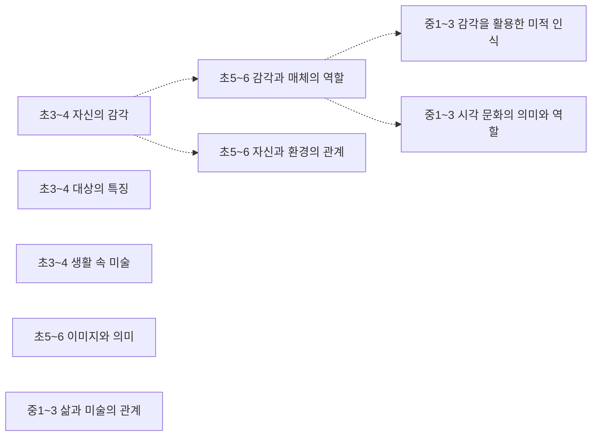
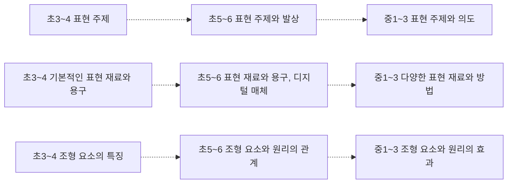
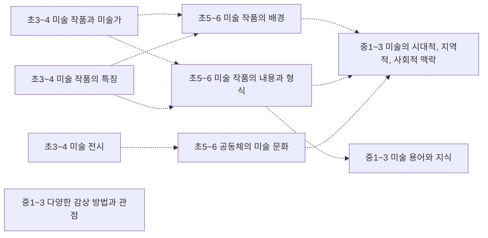

# 미술 개념 지도 (초3~고2~3)

개념 52개 = 고시문 「내용 체계」의 지식⋅이해 항목(원문 낱말 그대로). 선수관계 19개 — **구조 19** (내용 체계 같은 범주 행의 바로 앞 학년 칸 — 규칙으로 뽑아 Gemini 가 「타당」이라 한 것). 원문이 아닌 간선은 그림에서 점선, 목록에서 표시.

> 각 교과 「내용 체계」는 범주를 학년(군)에 따라 위계적으로 배열한다 — 같은 범주 행의 앞 학년 칸이 「구조」 간선의 근거다. 고교 과목은 표가 과목마다 따로라 고시문 단원 연계(「…와 연계된다」) 위에서 「단원」 간선을 찾는다. 간선별 이유·심사 기록은 [concept_proposals.json](../data/kr/concept_proposals.json) · [concept_structure.json](../data/kr/concept_structure.json).

□ 셀프 체크는 그 개념 성취기준 문장을 물음으로만 바꾼 것이다. MCP 에서는 `concept_path` 로 묻고, 「예」인 개념은 `known` 에 넣는다. 먼저/이어서가 없는 개념은 교과 문서의 단원 연계를 본다.

목차: [미적 체험](#미적-체험) · [표현](#표현) · [감상](#감상) · [고2~3 · 미술 · 미적 체험](#고2-3-미술-미적-체험) · [고2~3 · 미술 · 표현](#고2-3-미술-표현) · [고2~3 · 미술 · 감상](#고2-3-미술-감상) · [고2~3 · 미술 창작 · 설계와 창작](#고2-3-미술-창작-설계와-창작) · [고2~3 · 미술 창작 · 창작의 확장](#고2-3-미술-창작-창작의-확장) · [고2~3 · 미술 감상과 비평 · 미술 감상](#고2-3-미술-감상과-비평-미술-감상) · [고2~3 · 미술 감상과 비평 · 미술 비평](#고2-3-미술-감상과-비평-미술-비평) · [고2~3 · 미술과 매체 · 매체의 이해](#고2-3-미술과-매체-매체의-이해) · [고2~3 · 미술과 매체 · 매체의 활용](#고2-3-미술과-매체-매체의-활용)

## 미적 체험

### 초3~4 자신의 감각

성취기준 4미01-03  
➡️ 이어서: [초5~6 감각과 매체의 역할](#초5-6-감각과-매체의-역할)구조 · [초5~6 자신과 환경의 관계](#초5-6-자신과-환경의-관계)구조  

- □ 미적 탐색에 호기심을 갖고 참여하며 자신의 감각으로 대상의 특징을 이해할 수 있나요?

### 초3~4 대상의 특징

성취기준 4미01-03  

- □ 미적 탐색에 호기심을 갖고 참여하며 자신의 감각으로 대상의 특징을 이해할 수 있나요?

### 초3~4 생활 속 미술

성취기준 4미01-04  

- □ 생활 속에서 활용되는 미술에 관심을 가지고 미술의 특징과 역할을 발견할 수 있나요?

### 초5~6 감각과 매체의 역할

성취기준 6미01-01  
⬅️ 먼저: [초3~4 자신의 감각](#초3-4-자신의-감각)구조  
➡️ 이어서: [중1~3 감각을 활용한 미적 인식](#중1-3-감각을-활용한-미적-인식)구조 · [중1~3 시각 문화의 의미와 역할](#중1-3-시각-문화의-의미와-역할)구조  

- □ 다양한 감각과 매체를 활용하여 자신과 대상을 탐색할 수 있나요?

### 초5~6 자신과 환경의 관계

성취기준 6미01-02  
⬅️ 먼저: [초3~4 자신의 감각](#초3-4-자신의-감각)구조  

- □ 자신이나 주변 환경에서 찾은 감각적 특징, 느낌, 생각 등을 관련지어 나타낼 수 있나요?

### 초5~6 이미지와 의미

성취기준 6미01-04  

- □ 이미지가 나타내는 의미를 비판적으로 이해하고 느낌과 생각을 전달하는 데 활용할 수 있나요?

### 중1~3 감각을 활용한 미적 인식

성취기준 9미01-01  
⬅️ 먼저: [초5~6 감각과 매체의 역할](#초5-6-감각과-매체의-역할)구조  

- □ 감각을 활용하여 대상과 현상을 탐색하고 자신과 환경에 대한 감수성을 확장할 수 있나요?

### 중1~3 시각 문화의 의미와 역할

성취기준 9미01-02  
⬅️ 먼저: [초5~6 감각과 매체의 역할](#초5-6-감각과-매체의-역할)구조  

- □ 시각 문화의 의미와 역할을 알고 이미지를 비판적으로 해석할 수 있나요?

### 중1~3 삶과 미술의 관계

성취기준 9미01-04  

- □ 삶과 미술의 관계를 이해하고 다양한 분야와의 연결 방안을 모색할 수 있나요?

## 표현

### 초3~4 표현 주제

성취기준 4미02-01, 4미02-03, 4미02-05  
➡️ 이어서: [초5~6 표현 주제와 발상](#초5-6-표현-주제와-발상)구조  

- □ 관찰과 상상으로 아이디어를 떠올려 표현 주제를 구체화할 수 있나요?
- □ 조형 요소의 특징을 자유롭게 탐색하며 주제 표현에 알맞게 활용할 수 있나요?
- □ 미술과 타 교과를 관련지어 주제를 표현하는데 흥미를 가질 수 있나요?

### 초3~4 기본적인 표현 재료와 용구

성취기준 4미02-02  
➡️ 이어서: [초5~6 표현 재료와 용구, 디지털 매체](#초5-6-표현-재료와-용구-디지털-매체)구조  

- □ 기본적인 표현 재료와 용구의 특성을 이해하고 사용 방법을 익힐 수 있나요?

### 초3~4 조형 요소의 특징

성취기준 4미02-03  
➡️ 이어서: [초5~6 조형 요소와 원리의 관계](#초5-6-조형-요소와-원리의-관계)구조  

- □ 조형 요소의 특징을 자유롭게 탐색하며 주제 표현에 알맞게 활용할 수 있나요?

### 초5~6 표현 주제와 발상

성취기준 6미02-01, 6미02-03, 6미02-04  
⬅️ 먼저: [초3~4 표현 주제](#초3-4-표현-주제)구조  
➡️ 이어서: [중1~3 표현 주제와 의도](#중1-3-표현-주제와-의도)구조  

- □ 다양한 방법으로 아이디어를 연결하여 확장된 표현 주제로 발전시킬 수 있나요?
- □ 조형 요소의 어울림을 통해 조형 원리를 이해하고 주제 표현에 연결할 수 있나요?
- □ 주제 표현에 의지를 갖고 표현 과정을 돌아보며 작품을 발전시킬 수 있나요?

### 초5~6 표현 재료와 용구, 디지털 매체

성취기준 6미02-02  
⬅️ 먼저: [초3~4 기본적인 표현 재료와 용구](#초3-4-기본적인-표현-재료와-용구)구조  
➡️ 이어서: [중1~3 다양한 표현 재료와 방법](#중1-3-다양한-표현-재료와-방법)구조  

- □ 디지털 매체 등 다양한 표현 재료와 용구를 탐색하여 작품 제작에 활용할 수 있나요?

### 초5~6 조형 요소와 원리의 관계

성취기준 6미02-03  
⬅️ 먼저: [초3~4 조형 요소의 특징](#초3-4-조형-요소의-특징)구조  
➡️ 이어서: [중1~3 조형 요소와 원리의 효과](#중1-3-조형-요소와-원리의-효과)구조  

- □ 조형 요소의 어울림을 통해 조형 원리를 이해하고 주제 표현에 연결할 수 있나요?

### 중1~3 표현 주제와 의도

성취기준 9미02-01  
⬅️ 먼저: [초5~6 표현 주제와 발상](#초5-6-표현-주제와-발상)구조  

- □ 주제를 탐구하고 의도를 반영하여 적합한 표현을 계획할 수 있나요?

### 중1~3 다양한 표현 재료와 방법

성취기준 9미02-03  
⬅️ 먼저: [초5~6 표현 재료와 용구, 디지털 매체](#초5-6-표현-재료와-용구-디지털-매체)구조  

- □ 조형 요소와 원리, 표현 재료와 방법, 디지털 매체를 포함한 다양한 매체를 활용하여 주제를 효과적으로 표현할 수 있나요?

### 중1~3 조형 요소와 원리의 효과

성취기준 9미02-03  
⬅️ 먼저: [초5~6 조형 요소와 원리의 관계](#초5-6-조형-요소와-원리의-관계)구조  

- □ 조형 요소와 원리, 표현 재료와 방법, 디지털 매체를 포함한 다양한 매체를 활용하여 주제를 효과적으로 표현할 수 있나요?

## 감상

### 초3~4 미술 작품과 미술가

성취기준 4미03-01, 4미03-02  
➡️ 이어서: [초5~6 미술 작품의 배경](#초5-6-미술-작품의-배경)구조 · [초5~6 미술 작품의 내용과 형식](#초5-6-미술-작품의-내용과-형식)구조  

- □ 미술 작품을 자세히 보고 작품과 미술가에 관해 질문할 수 있나요?
- □ 미술 작품의 특징과 작품에 관한 자신의 느낌과 생각을 설명할 수 있나요?

### 초3~4 미술 작품의 특징

성취기준 4미03-02  
➡️ 이어서: [초5~6 미술 작품의 배경](#초5-6-미술-작품의-배경)구조 · [초5~6 미술 작품의 내용과 형식](#초5-6-미술-작품의-내용과-형식)구조  

- □ 미술 작품의 특징과 작품에 관한 자신의 느낌과 생각을 설명할 수 있나요?

### 초3~4 미술 전시

성취기준 4미03-03  
➡️ 이어서: [초5~6 공동체의 미술 문화](#초5-6-공동체의-미술-문화)구조  

- □ 미술 문화에 관심을 가지고 전시 및 행사에 참여할 수 있나요?

### 초5~6 미술 작품의 배경

성취기준 6미03-01  
⬅️ 먼저: [초3~4 미술 작품과 미술가](#초3-4-미술-작품과-미술가)구조 · [초3~4 미술 작품의 특징](#초3-4-미술-작품의-특징)구조  
➡️ 이어서: [중1~3 미술의 시대적, 지역적, 사회적 맥락](#중1-3-미술의-시대적-지역적-사회적-맥락)구조  

- □ 미술 작품을 작품이 만들어진 시대적, 지역적 배경 등과 연결하여 이해할 수 있나요?

### 초5~6 미술 작품의 내용과 형식

성취기준 6미03-02  
⬅️ 먼저: [초3~4 미술 작품과 미술가](#초3-4-미술-작품과-미술가)구조 · [초3~4 미술 작품의 특징](#초3-4-미술-작품의-특징)구조  
➡️ 이어서: [중1~3 미술의 시대적, 지역적, 사회적 맥락](#중1-3-미술의-시대적-지역적-사회적-맥락)구조 · [중1~3 미술 용어와 지식](#중1-3-미술-용어와-지식)구조  

- □ 미술 작품의 내용(소재, 주제 등)과 형식(재료와 용구, 표현 방법, 조형 요소와 원리 등)을 분석하여 작품의 특징을 설명할 수 있나요?

### 초5~6 공동체의 미술 문화

성취기준 6미03-03  
⬅️ 먼저: [초3~4 미술 전시](#초3-4-미술-전시)구조  
➡️ 이어서: [중1~3 미술의 시대적, 지역적, 사회적 맥락](#중1-3-미술의-시대적-지역적-사회적-맥락)구조  

- □ 공동체의 미술 문화 활동에 관심을 가지고 참여하며 경험을 공유할 수 있나요?

### 중1~3 미술의 시대적, 지역적, 사회적 맥락

성취기준 9미03-01  
⬅️ 먼저: [초5~6 미술 작품의 배경](#초5-6-미술-작품의-배경)구조 · [초5~6 미술 작품의 내용과 형식](#초5-6-미술-작품의-내용과-형식)구조 · [초5~6 공동체의 미술 문화](#초5-6-공동체의-미술-문화)구조  

- □ 미술의 시대적, 지역적, 사회적 맥락을 이해하고 설명할 수 있나요?

### 중1~3 미술 용어와 지식

성취기준 9미03-02  
⬅️ 먼저: [초5~6 미술 작품의 내용과 형식](#초5-6-미술-작품의-내용과-형식)구조  

- □ 작품의 내용과 형식을 분석하고 미술 용어와 지식을 활용하여 설명할 수 있나요?

### 중1~3 다양한 감상 방법과 관점

성취기준 9미03-03  

- □ 다양한 감상 방법과 관점을 활용하여 작품을 해석할 수 있나요?

## 고2~3 · 미술 · 미적 체험

### 고2~3 자신과 세계에 대한 미적 관점

성취기준 12미01-01  

- □ 자신과 세계를 지각하고 미적으로 인식하며, 대상과 현상의 미적 가치를 발견하고 분석할 수 있나요?

### 고2~3 시각 문화의 다양성과 의미 전달 방식

성취기준 12미01-02  

- □ 시각 문화의 다양성과 의미 전달 방식을 이해하여 시각 문화를 비판적으로 수용하고 향유할 수 있나요?

### 고2~3 삶과 연결된 미술

성취기준 12미01-04  

- □ 삶과 연결된 미술을 이해하여 공동체와 생태환경으로 확장할 수 있나요?

## 고2~3 · 미술 · 표현

### 고2~3 발상과 표현 주제 심화

성취기준 12미02-01  

- □ 다양한 발상으로 주제를 심화하여 작품을 계획할 수 있나요?

### 고2~3 적용과 융합을 위한 표현 방법

성취기준 12미02-02  

- □ 주제에 적합한 표현 매체와 방법을 실험하고 융합하는 과정에 집중할 수 있나요?

### 고2~3 주제에 적합한 표현 매체

성취기준 12미02-02  

- □ 주제에 적합한 표현 매체와 방법을 실험하고 융합하는 과정에 집중할 수 있나요?

## 고2~3 · 미술 · 감상

### 고2~3 미술의 시대적, 지역적, 사회⋅문화적 변천

성취기준 12미03-01  

- □ 미술의 시대적, 지역적, 사회⋅문화적 변천 과정을 이해하고 작품을 감상하며 자신의 견해를 논리적으로 표현할 수 있나요?

### 고2~3 미술 감상과 비평을 위한 관점과 방법

성취기준 12미03-02, 12미03-03  

- □ 비평 방법을 활용하여 미술과 시대, 사회, 환경과의 상호 관련성을 분석하고 가치를 판단할 수 있나요?
- □ 미술 작품 감상과 비평의 관점을 활용한 소통으로 미술 문화의 다원적 가치를 이해하고 존중할 수 있나요?

### 고2~3 전시의 목적과 유형

성취기준 12미03-04  

- □ 전시의 목적과 유형을 이해하여 전시를 기획하고 참여할 수 있나요?

## 고2~3 · 미술 창작 · 설계와 창작

### 고2~3 자신의 진로나 관심 분야와 연결된 주제

성취기준 12미창01-01  

- □ 다양한 정보를 수집하여 자신의 진로나 관심 분야와 연결된 주제를 탐색할 수 있나요?

### 고2~3 아이디어를 발상하는 방법

성취기준 12미창01-02  

- □ 창의적 발상 방법을 알고 아이디어를 시각화할 수 있나요?

### 고2~3 표현 기법과 매체의 종류

성취기준 12미창01-03  

- □ 표현 기법과 매체를 탐구하고 이해하여 발견된 문제를 해결할 수 있나요?

## 고2~3 · 미술 창작 · 창작의 확장

### 고2~3 표현 기법과 매체의 효과와 적용 방법

성취기준 12미창02-01  

- □ 표현 기법과 매체를 적극적으로 실험하고 융합하여 효과를 발견하고 작품에 적용할 수 있나요?

### 고2~3 작품 내용과 형식의 심화

성취기준 12미창02-02  

- □ 도전적 문제 해결 태도로 주제, 표현 기법, 매체 등 작품의 내용과 형식을 심화하여 창작할 수 있나요?

### 고2~3 전시 목적과 방법

성취기준 12미창02-03  

- □ 전시 목적과 방법에 따라 전시를 기획하고 구성하면서 서로 다른 미적 인식을 비판적으로 수용할 수 있나요?

## 고2~3 · 미술 감상과 비평 · 미술 감상

### 고2~3 미술의 변천 과정과 미술사적 의의

성취기준 12미감01-01  

- □ 미술의 역사, 정치, 경제, 사회적 변천 과정과 특징을 분석하여 작가와 작품의 미술사적 의의를 이해할 수 있나요?

### 고2~3 작가와 작품의 특징과 맥락적 이해

성취기준 12미감01-04  

- □ 작가와 작품의 특징을 맥락적으로 이해하는 과정에서 문화 다양성을 수용하고 공동체 의식을 함양할 수 있나요?

## 고2~3 · 미술 감상과 비평 · 미술 비평

### 고2~3 미술 작품의 의미

성취기준 12미감02-01  

- □ 미술 작품의 특징, 지식과 정보 등의 근거를 바탕으로 작품의 의미를 이해하고 설명할 수 있나요?

### 고2~3 비평 방법과 관점

성취기준 12미감02-02, 12미감02-03  

- □ 다양한 미술 비평 방법을 이해하고 활용하여 작품을 해석하고 평가할 수 있나요?
- □ 비평 관점에 따라 자신의 반응을 명료화하고 작품의 가치를 판단하며 미술 용어를 활용하여 논리적으로 표현할 수 있나요?

## 고2~3 · 미술과 매체 · 매체의 이해

### 고2~3 아날로그와 디지털 매체의 개념과 종류

성취기준 12미매01-03  

- □ 미술에 활용되는 아날로그와 디지털 매체의 개념과 종류를 이해하고 개방적 태도로 표현 매체를 선택할 수 있나요?

### 고2~3 시대별, 지역별 매체의 변화

성취기준 12미매01-01  

- □ 시대별, 지역별 매체의 변화를 비교하고 미술과 매체를 관련지을 수 있나요?

### 고2~3 매체의 특성과 표현 원리

성취기준 12미매01-04  

- □ 매체의 특성과 표현 원리를 실험하고 작품에 반영할 수 있나요?

## 고2~3 · 미술과 매체 · 매체의 활용

### 고2~3 아날로그 매체

성취기준 12미매02-01, 12미매02-02  

- □ 아날로그 매체와 디지털 매체를 창의적으로 활용하여 표현할 수 있나요?
- □ 아날로그와 디지털 매체를 타 분야와 연결하고 융합하며 매체의 가치를 공유할 수 있나요?

### 고2~3 디지털 매체

성취기준 12미매02-01, 12미매02-02  

- □ 아날로그 매체와 디지털 매체를 창의적으로 활용하여 표현할 수 있나요?
- □ 아날로그와 디지털 매체를 타 분야와 연결하고 융합하며 매체의 가치를 공유할 수 있나요?

### 고2~3 작품의 정교한 표현과 보존 방법

성취기준 12미매02-03  

- □ 작품의 정교한 표현과 보존 방법을 이해하고 다양한 매체로 표현한 작품을 전시할 수 있나요?
