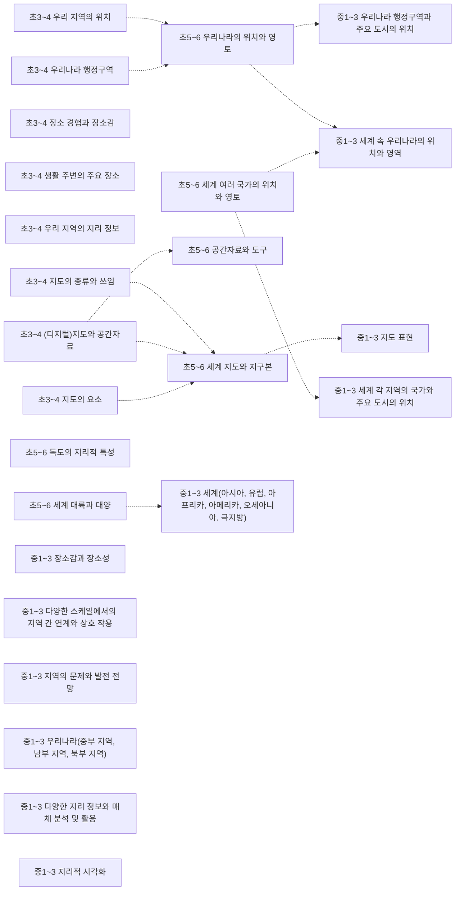
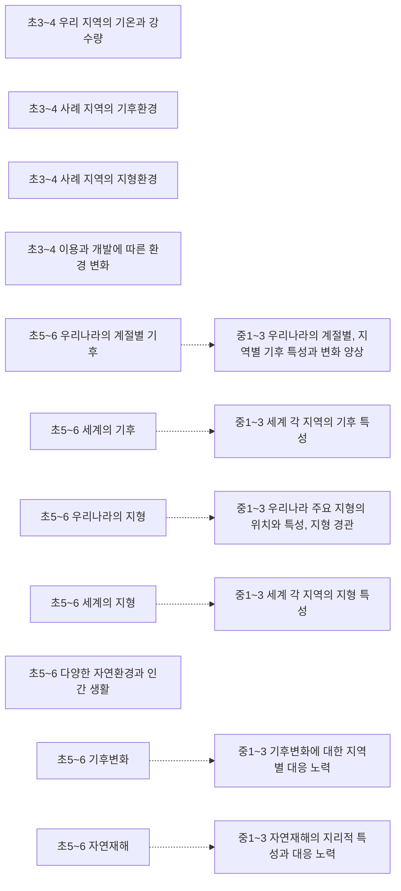
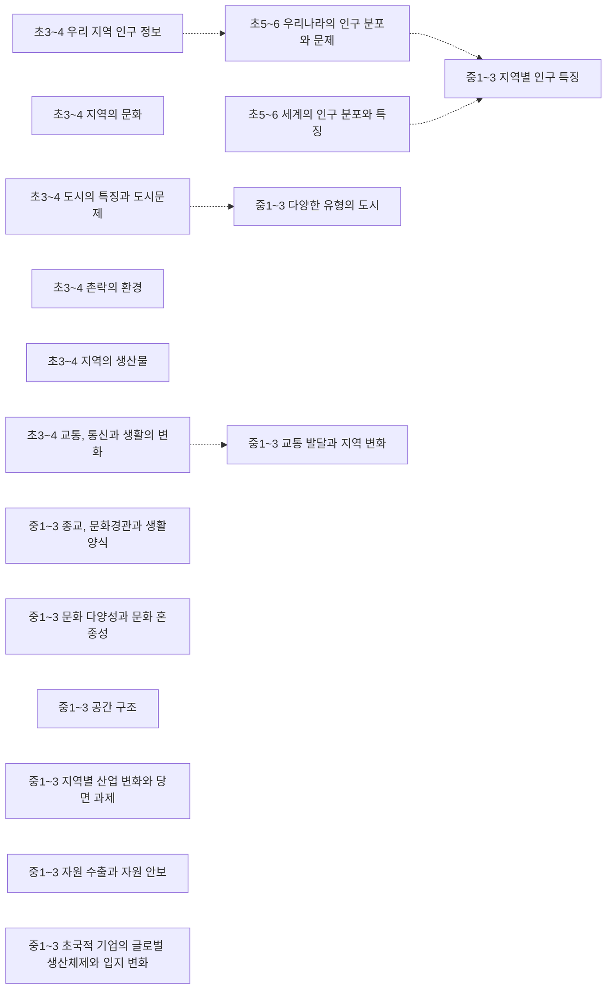
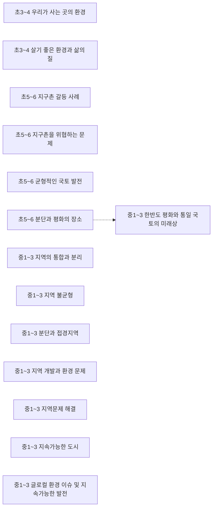
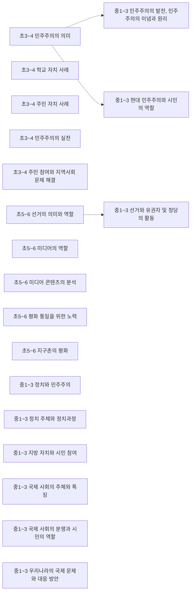
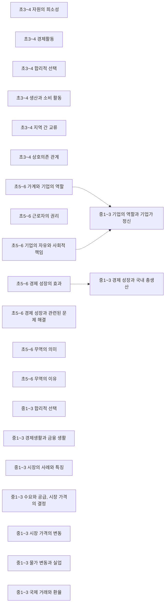
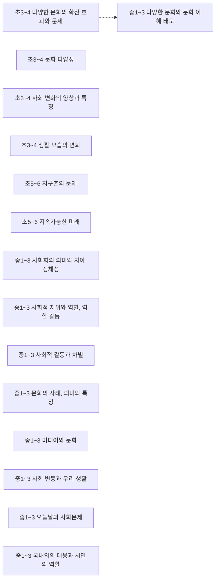
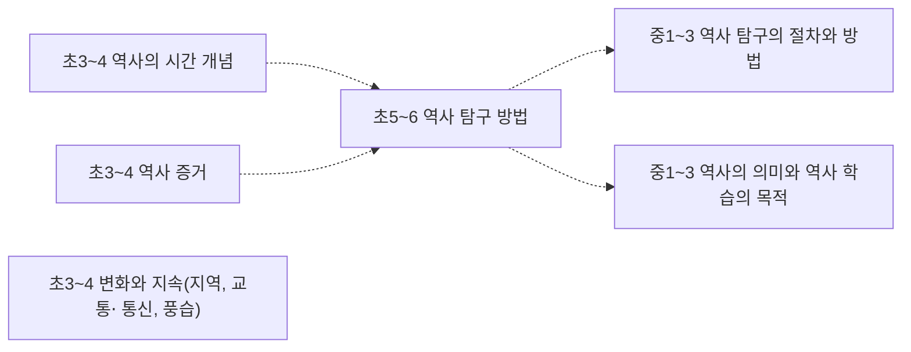
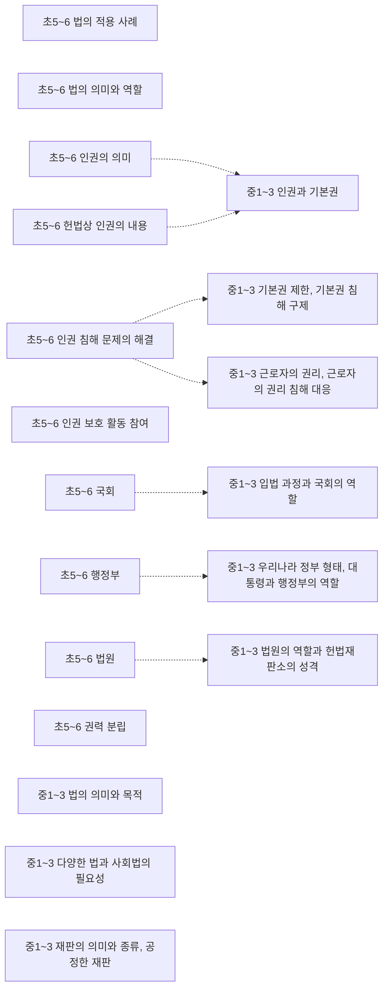
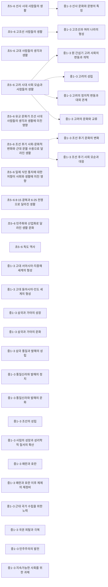

# 사회 개념 지도 (초3~고2~3)

개념 514개 = 고시문 「내용 체계」의 지식⋅이해 항목(원문 낱말 그대로). 선수관계 50개 — **구조 50** (내용 체계 같은 범주 행의 바로 앞 학년 칸 — 규칙으로 뽑아 Gemini 가 「타당」이라 한 것). 원문이 아닌 간선은 그림에서 점선, 목록에서 표시.

> 각 교과 「내용 체계」는 범주를 학년(군)에 따라 위계적으로 배열한다 — 같은 범주 행의 앞 학년 칸이 「구조」 간선의 근거다. 고교 과목은 표가 과목마다 따로라 고시문 단원 연계(「…와 연계된다」) 위에서 「단원」 간선을 찾는다. 간선별 이유·심사 기록은 [concept_proposals.json](../data/kr/concept_proposals.json) · [concept_structure.json](../data/kr/concept_structure.json).

□ 셀프 체크는 그 개념 성취기준 문장을 물음으로만 바꾼 것이다. MCP 에서는 `concept_path` 로 묻고, 「예」인 개념은 `known` 에 넣는다. 먼저/이어서가 없는 개념은 교과 문서의 단원 연계를 본다.

목차: [지리 인식](#지리-인식) · [자연환경과 인간생활](#자연환경과-인간생활) · [인문환경과 인간생활](#인문환경과-인간생활) · [지속가능한 세계](#지속가능한-세계) · [정치](#정치) · [경제](#경제) · [사회⋅문화](#사회-문화) · [역사 일반](#역사-일반) · [지역사](#지역사) · [법](#법) · [한국사](#한국사) · [중1~3 · 역사](#중1-3-역사) · [고1 · 한국사 1](#고1-한국사-1) · [고1 · 한국사 2](#고1-한국사-2) · [고1 · 통합사회 1](#고1-통합사회-1) · [고1 · 통합사회 2](#고1-통합사회-2) · [고2~3 · 세계시민과 지리](#고2-3-세계시민과-지리) · [고2~3 · 세계사](#고2-3-세계사) · [고2~3 · 사회와 문화](#고2-3-사회와-문화) · [고2~3 · 한국지리 탐구](#고2-3-한국지리-탐구) · [고2~3 · 도시의 미래 탐구](#고2-3-도시의-미래-탐구) · [고2~3 · 동아시아 역사 기행](#고2-3-동아시아-역사-기행) · [고2~3 · 정치](#고2-3-정치) · [고2~3 · 법과 사회](#고2-3-법과-사회) · [고2~3 · 경제](#고2-3-경제) · [고2~3 · 국제 관계의 이해](#고2-3-국제-관계의-이해) · [고2~3 · 여행지리](#고2-3-여행지리) · [고2~3 · 역사로 탐구하는 현대 세계](#고2-3-역사로-탐구하는-현대-세계) · [고2~3 · 사회문제 탐구](#고2-3-사회문제-탐구) · [고2~3 · 금융과 경제생활](#고2-3-금융과-경제생활) · [고2~3 · 기후변화와 지속가능한 세계](#고2-3-기후변화와-지속가능한-세계)

## 지리 인식

### 초3~4 우리 지역의 위치

위치와 영역 · 성취기준 4사05-02  
➡️ 이어서: [초5~6 우리나라의 위치와 영토](#초5-6-우리나라의-위치와-영토)구조  

- □ 지도에서 우리 지역의 위치를 파악하고, 우리 지역의 지리 정보를 탐색한다.

### 초3~4 우리나라 행정구역

위치와 영역 · 성취기준 4사05-02  
➡️ 이어서: [초5~6 우리나라의 위치와 영토](#초5-6-우리나라의-위치와-영토)구조  

- □ 지도에서 우리 지역의 위치를 파악하고, 우리 지역의 지리 정보를 탐색한다.

### 초3~4 장소 경험과 장소감

장소와 지역 · 성취기준 4사02-01  

- □ 일상 속에서 시간의 흐름을 경험할 수 있는 사례를 살펴보고, 이를 바탕으로 역사의 시간 개념을 이해하고 있나요?

### 초3~4 생활 주변의 주요 장소

장소와 지역 · 성취기준 4사09-01  

- □ 생활 주변에서 찾을 수 있는 여러 가지 문제를 파악하고, 그 문제를 합리적으로 해결하는 능력을 기른다.

### 초3~4 우리 지역의 지리 정보

장소와 지역 · 성취기준 4사05-02  

- □ 지도에서 우리 지역의 위치를 파악하고, 우리 지역의 지리 정보를 탐색한다.

### 초3~4 지도의 종류와 쓰임

공간 분석 · 성취기준 4사05-01  
➡️ 이어서: [초5~6 세계 지도와 지구본](#초5-6-세계-지도와-지구본)구조  

- □ 우리 지역을 표현한 다양한 종류의 지도를 찾아보고, 지도의 요소를 이해하고 있나요?

### 초3~4 (디지털)지도와 공간자료

공간 분석 · 성취기준 4사05-01  
➡️ 이어서: [초5~6 공간자료와 도구](#초5-6-공간자료와-도구)구조 · [초5~6 세계 지도와 지구본](#초5-6-세계-지도와-지구본)구조  

- □ 우리 지역을 표현한 다양한 종류의 지도를 찾아보고, 지도의 요소를 이해하고 있나요?

### 초3~4 지도의 요소

공간 분석 · 성취기준 4사05-01  
➡️ 이어서: [초5~6 세계 지도와 지구본](#초5-6-세계-지도와-지구본)구조  

- □ 우리 지역을 표현한 다양한 종류의 지도를 찾아보고, 지도의 요소를 이해하고 있나요?

### 초5~6 우리나라의 위치와 영토

위치와 영역 · 성취기준 6사09-02  
⬅️ 먼저: [초3~4 우리 지역의 위치](#초3-4-우리-지역의-위치)구조 · [초3~4 우리나라 행정구역](#초3-4-우리나라-행정구역)구조  
➡️ 이어서: [중1~3 우리나라 행정구역과 주요 도시의 위치](#중1-3-우리나라-행정구역과-주요-도시의-위치)구조 · [중1~3 세계 속 우리나라의 위치와 영역](#중1-3-세계-속-우리나라의-위치와-영역)구조  

- □ 세계 주요 대륙과 대양을 파악하고, 우리나라 및 세계 여러 국가의 위치와 영토의 특징을 이해하고 있나요?

### 초5~6 세계 여러 국가의 위치와 영토

위치와 영역 · 성취기준 6사09-02  
➡️ 이어서: [중1~3 세계 각 지역의 국가와 주요 도시의 위치](#중1-3-세계-각-지역의-국가와-주요-도시의-위치)구조 · [중1~3 세계 속 우리나라의 위치와 영역](#중1-3-세계-속-우리나라의-위치와-영역)구조  

- □ 세계 주요 대륙과 대양을 파악하고, 우리나라 및 세계 여러 국가의 위치와 영토의 특징을 이해하고 있나요?

### 초5~6 독도의 지리적 특성

장소와 지역 · 성취기준 6사01-02  

- □ 독도의 지리적 특성과 독도에 대한 역사 기록을 바탕으로 영토로서 독도의 중요성을 이해하고 있나요?

### 초5~6 세계 대륙과 대양

장소와 지역 · 성취기준 6사09-02  
➡️ 이어서: [중1~3 세계(아시아, 유럽, 아프리카, 아메리카, 오세아니아. 극지방)](#중1-3-세계-아시아-유럽-아프리카-아메리카-오세아니아-극지방)구조  

- □ 세계 주요 대륙과 대양을 파악하고, 우리나라 및 세계 여러 국가의 위치와 영토의 특징을 이해하고 있나요?

### 초5~6 공간자료와 도구

공간 분석 · 성취기준 6사09-01  
⬅️ 먼저: [초3~4 (디지털)지도와 공간자료](#초3-4-디지털-지도와-공간자료)구조  

- □ 세계를 표현하는 다양한 공간 자료의 특징을 이해하고, 지구본과 세계지도에서 위치를 표현하는 방법을 익힌다.

### 초5~6 세계 지도와 지구본

공간 분석 · 성취기준 6사09-01  
⬅️ 먼저: [초3~4 지도의 종류와 쓰임](#초3-4-지도의-종류와-쓰임)구조 · [초3~4 (디지털)지도와 공간자료](#초3-4-디지털-지도와-공간자료)구조 · [초3~4 지도의 요소](#초3-4-지도의-요소)구조  
➡️ 이어서: [중1~3 지도 표현](#중1-3-지도-표현)구조  

- □ 세계를 표현하는 다양한 공간 자료의 특징을 이해하고, 지구본과 세계지도에서 위치를 표현하는 방법을 익힌다.

### 중1~3 우리나라 행정구역과 주요 도시의 위치

위치와 영역 · 성취기준 9사(지리)07-02  
⬅️ 먼저: [초5~6 우리나라의 위치와 영토](#초5-6-우리나라의-위치와-영토)구조  

- □ 우리나라 행정구역과 주요 도시의 위치를 파악하고, 자신이 살고 있는 곳의 장소성과 장소감을 표현한다.

### 중1~3 세계 속 우리나라의 위치와 영역

위치와 영역 · 성취기준 9사(지리)07-01  
⬅️ 먼저: [초5~6 우리나라의 위치와 영토](#초5-6-우리나라의-위치와-영토)구조 · [초5~6 세계 여러 국가의 위치와 영토](#초5-6-세계-여러-국가의-위치와-영토)구조  

- □ 우리 국토의 위치와 영역에 대한 이해를 바탕으로 세계 속에서 우리나라의 위치를 지정학, 지경학적 측면에서 탐색한다.

### 중1~3 세계 각 지역의 국가와 주요 도시의 위치

위치와 영역 · 성취기준 9사(지리)06-01  
⬅️ 먼저: [초5~6 세계 여러 국가의 위치와 영토](#초5-6-세계-여러-국가의-위치와-영토)구조  

- □ 다양한 지리 정보와 매체를 활용하여 오세아니아의 국가와 주요 도시의 위치, 자연환경의 특성을 파악하고, 자원 수출을 중심으로 세계 다른 지역과의 상호연계성을 탐색한다.

### 중1~3 장소감과 장소성

장소와 지역 · 성취기준 9사(지리)07-02  

- □ 우리나라 행정구역과 주요 도시의 위치를 파악하고, 자신이 살고 있는 곳의 장소성과 장소감을 표현한다.

### 중1~3 다양한 스케일에서의 지역 간 연계와 상호 작용

장소와 지역 · 성취기준 9사(지리)01-02  

- □ 다양한 스케일에서 지역이 서로 연계되어 있음을 공간적 상호 작용의 사례를 통해 파악한다.

### 중1~3 지역의 문제와 발전 전망

장소와 지역 · 성취기준 9사(일사)04-03  

- □ 민주주의의 발전을 위한 지방 자치의 중요성을 설명하고, 지역사회의 문제를 해결하기 위한 시민 참여 활동을 계획한다.

### 중1~3 세계(아시아, 유럽, 아프리카, 아메리카, 오세아니아. 극지방)

장소와 지역 · 성취기준 9사(지리)04-01, 9사(지리)04-02, 9사(지리)04-03, 9사(지리)05-01, 9사(지리)05-02, 9사(지리)05-03  
⬅️ 먼저: [초5~6 세계 대륙과 대양](#초5-6-세계-대륙과-대양)구조  

- □ 다양한 지리 정보와 매체를 활용하여 아프리카의 국가와 주요 도시의 위치를 파악하고 자연환경의 특성을 지도로 표현한다.
- □ 아프리카의 지리적 특성에 기반한 다양한 문화와 지역 잠재력을 탐구하고, 아프리카에 대한 자신의 인식을 성찰한다.
- □ 지속가능한 발전을 위한 아프리카 각 지역의 노력과 세계 다양한 주체들의 협력 사례를 조사하고, 세계시민으로서 우리가 참여할 수 있는 방안을 모색한다.
- … 외 3개

### 중1~3 우리나라(중부 지역, 남부 지역, 북부 지역)

장소와 지역 · 성취기준 9사(지리)10-01, 9사(지리)10-02, 9사(지리)10-03, 9사(지리)11-01, 9사(지리)11-02, 9사(지리)11-03  

- □ 다양한 지리 정보와 매체를 활용하여 남부 지역의 지리적 특성 및 매력적인 여행 장소들을 탐색한다.
- □ 글로벌 경제와 우리나라 산업에서 영⋅호남 공업 지역의 위상을 파악하고, 영⋅호남 지역의 산업 변화와 당면 과제를 조사한다.
- □ 제주도의 지역 변화와 이를 둘러싼 다양한 가치를 살펴보고 이에 대한 자신과 상대방의 의견을 비판적으로 검토한다.
- … 외 3개

### 중1~3 다양한 지리 정보와 매체 분석 및 활용

공간 분석 · 성취기준 9사(지리)02-01, 9사(지리)03-01, 9사(지리)04-01, 9사(지리)05-01, 9사(지리)06-01, 9사(지리)07-03, 9사(지리)09-01, 9사(지리)10-01, 9사(지리)11-01  

- □ 다양한 지리 정보와 매체를 활용하여 아시아의 국가와 주요 도시의 위치를 파악하고 자연환경의 특성을 지도로 표현한다.
- □ 다양한 지리 정보와 매체를 활용하여 유럽의 국가와 주요 도시의 위치를 파악하고 자연환경의 특성을 지도로 표현한다.
- □ 다양한 지리 정보와 매체를 활용하여 아프리카의 국가와 주요 도시의 위치를 파악하고 자연환경의 특성을 지도로 표현한다.
- … 외 6개

### 중1~3 지도 표현

공간 분석 · 성취기준 9사(지리)02-01, 9사(지리)03-01, 9사(지리)04-01, 9사(지리)05-01, 9사(지리)09-04  
⬅️ 먼저: [초5~6 세계 지도와 지구본](#초5-6-세계-지도와-지구본)구조  

- □ 다양한 지리 정보와 매체를 활용하여 아시아의 국가와 주요 도시의 위치를 파악하고 자연환경의 특성을 지도로 표현한다.
- □ 다양한 지리 정보와 매체를 활용하여 유럽의 국가와 주요 도시의 위치를 파악하고 자연환경의 특성을 지도로 표현한다.
- □ 다양한 지리 정보와 매체를 활용하여 아프리카의 국가와 주요 도시의 위치를 파악하고 자연환경의 특성을 지도로 표현한다.
- … 외 2개

### 중1~3 지리적 시각화

공간 분석 · 성취기준 9사(지리)07-03  

- □ 다양한 지리 정보와 매체를 활용하여 우리 지역의 문제를 선정하고 지리적으로 시각화한다.

## 자연환경과 인간생활

### 초3~4 우리 지역의 기온과 강수량

기후 환경 · 성취기준 4사05-01, 4사05-02, 4사06-01, 4사06-02  

- □ 우리 지역을 표현한 다양한 종류의 지도를 찾아보고, 지도의 요소를 이해하고 있나요?
- □ 지도에서 우리 지역의 위치를 파악하고, 우리 지역의 지리 정보를 탐색한다.
- □ 지역의 문화유산을 통해 문화유산의 의미와 유형을 알아보고, 문화유산의 가치를 탐색한다.
- … 외 1개

### 초3~4 사례 지역의 기후환경

기후 환경 · 성취기준 4사07-02, 4사08-02  

- □ 생산과 소비 활동을 파악하고, 인적⋅물적 교류의 사례를 통해 각 지역 및 사람들이 상호의존 관계를 맺고 있음을 탐색한다.
- □ 지역에서 이루어지는 민주주의 사례를 통해 주민 자치와 주민 참여의 중요성을 파악하고, 지역사회의 문제 해결에 참여하는 태도를 기른다.

### 초3~4 사례 지역의 지형환경

지형 환경 · 성취기준 4사07-02, 4사08-02  

- □ 생산과 소비 활동을 파악하고, 인적⋅물적 교류의 사례를 통해 각 지역 및 사람들이 상호의존 관계를 맺고 있음을 탐색한다.
- □ 지역에서 이루어지는 민주주의 사례를 통해 주민 자치와 주민 참여의 중요성을 파악하고, 지역사회의 문제 해결에 참여하는 태도를 기른다.

### 초3~4 이용과 개발에 따른 환경 변화

자연- 인간의 상호 작용 · 성취기준 4사10-01  

- □ 여러 지역의 자연환경과 인문환경의 특징을 살펴보고, 환경의 이용과 개발에 따른 변화를 탐구한다.

### 초5~6 우리나라의 계절별 기후

기후 환경 · 성취기준 6사02-01  
➡️ 이어서: [중1~3 우리나라의 계절별, 지역별 기후 특성과 변화 양상](#중1-3-우리나라의-계절별-지역별-기후-특성과-변화-양상)구조  

- □ 우리나라의 계절별 기후 특징을 자료에서 탐구하고, 기후변화로 인한 자연재해의 심각성을 이해하고 있나요?

### 초5~6 세계의 기후

기후 환경 · 성취기준 6사10-02  
➡️ 이어서: [중1~3 세계 각 지역의 기후 특성](#중1-3-세계-각-지역의-기후-특성)구조  

- □ 세계의 다양한 기후를 알아보고 기후 환경과 인간생활 간의 관계를 탐구한다.

### 초5~6 우리나라의 지형

지형 환경 · 성취기준 6사01-01  
➡️ 이어서: [중1~3 우리나라 주요 지형의 위치와 특성, 지형 경관](#중1-3-우리나라-주요-지형의-위치와-특성-지형-경관)구조  

- □ 우리나라 산지, 하천, 해안 지형의 위치를 확인하고 지형의 분포 특징을 탐구한다.

### 초5~6 세계의 지형

지형 환경 · 성취기준 6사10-01  
➡️ 이어서: [중1~3 세계 각 지역의 지형 특성](#중1-3-세계-각-지역의-지형-특성)구조  

- □ 세계의 여러 지역의 지형 경관을 살펴보고, 이를 통해 다양한 삶의 모습을 이해하고 있나요?

### 초5~6 다양한 자연환경과 인간 생활

자연- 인간의 상호 작용 · 성취기준 6사10-02  

- □ 세계의 다양한 기후를 알아보고 기후 환경과 인간생활 간의 관계를 탐구한다.

### 초5~6 기후변화

자연- 인간의 상호 작용 · 성취기준 6사02-01  
➡️ 이어서: [중1~3 기후변화에 대한 지역별 대응 노력](#중1-3-기후변화에-대한-지역별-대응-노력)구조  

- □ 우리나라의 계절별 기후 특징을 자료에서 탐구하고, 기후변화로 인한 자연재해의 심각성을 이해하고 있나요?

### 초5~6 자연재해

자연- 인간의 상호 작용 · 성취기준 6사02-01  
➡️ 이어서: [중1~3 자연재해의 지리적 특성과 대응 노력](#중1-3-자연재해의-지리적-특성과-대응-노력)구조  

- □ 우리나라의 계절별 기후 특징을 자료에서 탐구하고, 기후변화로 인한 자연재해의 심각성을 이해하고 있나요?

### 중1~3 우리나라의 계절별, 지역별 기후 특성과 변화 양상

기후 환경 · 성취기준 9사(지리)08-02  
⬅️ 먼저: [초5~6 우리나라의 계절별 기후](#초5-6-우리나라의-계절별-기후)구조  

- □ 우리나라의 계절별, 지역별 기후 특성 및 변화 양상을 파악하고, 기후변화에 대한 지역별 대응 노력을 조사한다.

### 중1~3 세계 각 지역의 기후 특성

기후 환경 · 성취기준 9사(지리)01-01, 9사(지리)06-01, 9사(지리)08-02  
⬅️ 먼저: [초5~6 세계의 기후](#초5-6-세계의-기후)구조  

- □ 세계 여러 지역의 특성을 해당 지역의 위치와 자연⋅인문환경을 고려하여 추론한다.
- □ 다양한 지리 정보와 매체를 활용하여 오세아니아의 국가와 주요 도시의 위치, 자연환경의 특성을 파악하고, 자원 수출을 중심으로 세계 다른 지역과의 상호연계성을 탐색한다.
- □ 우리나라의 계절별, 지역별 기후 특성 및 변화 양상을 파악하고, 기후변화에 대한 지역별 대응 노력을 조사한다.

### 중1~3 우리나라 주요 지형의 위치와 특성, 지형 경관

지형 환경 · 성취기준 9사(지리)08-01  
⬅️ 먼저: [초5~6 우리나라의 지형](#초5-6-우리나라의-지형)구조  

- □ 우리나라 주요 산지⋅하천⋅해안 지형의 위치와 특성을 파악하고, 매력적인 지형 경관을 탐색하여 우리 국토의 아름다움을 느낀다.

### 중1~3 세계 각 지역의 지형 특성

지형 환경 · 성취기준 9사(지리)01-01, 9사(지리)06-01  
⬅️ 먼저: [초5~6 세계의 지형](#초5-6-세계의-지형)구조  

- □ 세계 여러 지역의 특성을 해당 지역의 위치와 자연⋅인문환경을 고려하여 추론한다.
- □ 다양한 지리 정보와 매체를 활용하여 오세아니아의 국가와 주요 도시의 위치, 자연환경의 특성을 파악하고, 자원 수출을 중심으로 세계 다른 지역과의 상호연계성을 탐색한다.

### 중1~3 기후변화에 대한 지역별 대응 노력

자연- 인간의 상호 작용 · 성취기준 9사(지리)08-02  
⬅️ 먼저: [초5~6 기후변화](#초5-6-기후변화)구조  

- □ 우리나라의 계절별, 지역별 기후 특성 및 변화 양상을 파악하고, 기후변화에 대한 지역별 대응 노력을 조사한다.

### 중1~3 자연재해의 지리적 특성과 대응 노력

자연- 인간의 상호 작용 · 성취기준 9사(지리)08-03  
⬅️ 먼저: [초5~6 자연재해](#초5-6-자연재해)구조  

- □ 우리나라 자연재해의 지리적 특성과 피해 최소화를 위한 노력을 파악하고, 일상생활 속 다양한 상황에서 자연재해 발생 시 자신의 대처 방안을 탐색한다.

## 인문환경과 인간생활

### 초3~4 우리 지역 인구 정보

인구 · 성취기준 4사05-02  
➡️ 이어서: [초5~6 우리나라의 인구 분포와 문제](#초5-6-우리나라의-인구-분포와-문제)구조  

- □ 지도에서 우리 지역의 위치를 파악하고, 우리 지역의 지리 정보를 탐색한다.

### 초3~4 지역의 문화

문화 · 성취기준 4사06-01, 4사06-02, 4사09-02  

- □ 지역의 문화유산을 통해 문화유산의 의미와 유형을 알아보고, 문화유산의 가치를 탐색한다.
- □ 지역의 박물관, 기념관, 유적지 등을 체험하고 지역의 역사를 이해하고 있나요?
- □ 지역의 자연환경, 역사, 문화, 생산물 등을 알리려는 지역사회의 노력을 알고 관심을 갖는다.

### 초3~4 도시의 특징과 도시문제

도시와 촌락 · 성취기준 4사10-02  
➡️ 이어서: [중1~3 다양한 유형의 도시](#중1-3-다양한-유형의-도시)구조  

- □ 사례에서 도시의 인구, 교통, 산업 등의 특징을 탐구하고, 도시에서의 삶의 모습을 이해하고 있나요?

### 초3~4 촌락의 환경

도시와 촌락 · 성취기준 4사09-02, 4사10-01, 4사10-02  

- □ 지역의 자연환경, 역사, 문화, 생산물 등을 알리려는 지역사회의 노력을 알고 관심을 갖는다.
- □ 여러 지역의 자연환경과 인문환경의 특징을 살펴보고, 환경의 이용과 개발에 따른 변화를 탐구한다.
- □ 사례에서 도시의 인구, 교통, 산업 등의 특징을 탐구하고, 도시에서의 삶의 모습을 이해하고 있나요?

### 초3~4 지역의 생산물

경제와 교통 · 성취기준 4사09-02  

- □ 지역의 자연환경, 역사, 문화, 생산물 등을 알리려는 지역사회의 노력을 알고 관심을 갖는다.

### 초3~4 교통, 통신과 생활의 변화

경제와 교통 · 성취기준 4사04-02, 4사04-03  
➡️ 이어서: [중1~3 교통 발달과 지역 변화](#중1-3-교통-발달과-지역-변화)구조  

- □ 옛날부터 오늘날까지 교통의 변화에 따른 이동과 생활 모습의 변화를 이해하고 있나요?
- □ 옛날부터 오늘날까지 통신수단의 변화에 따른 정보 교류와 의사소통 방식의 변화를 설명한다.

### 초5~6 우리나라의 인구 분포와 문제

인구 · 성취기준 6사02-02  
⬅️ 먼저: [초3~4 우리 지역 인구 정보](#초3-4-우리-지역-인구-정보)구조  
➡️ 이어서: [중1~3 지역별 인구 특징](#중1-3-지역별-인구-특징)구조  

- □ 우리나라의 지역별 인구 분포의 특징을 알아보고, 이에 따른 문제점과 해결 방안을 탐색한다.

### 초5~6 세계의 인구 분포와 특징

인구 · 성취기준 6사12-01  
➡️ 이어서: [중1~3 지역별 인구 특징](#중1-3-지역별-인구-특징)구조  

- □ 세계의 인구 분포를 파악하고 여러 국가의 인구 특징을 탐구한다.

### 중1~3 지역별 인구 특징

인구 · 성취기준 9사(지리)02-03  
⬅️ 먼저: [초5~6 우리나라의 인구 분포와 문제](#초5-6-우리나라의-인구-분포와-문제)구조 · [초5~6 세계의 인구 분포와 특징](#초5-6-세계의-인구-분포와-특징)구조  

- □ 아시아의 인구 특징을 파악하고 지역별 인구 구조 변화를 비교하여 지역 발전의 가능성 및 변화 모습을 추론한다.

### 중1~3 종교, 문화경관과 생활양식

문화 · 성취기준 9사(지리)02-02  

- □ 종교와 관련된 아시아의 다양한 문화경관과 생활양식을 파악하고, 세계시민으로서 문화 다양성에 대한 이해와 수용성을 높인다.

### 중1~3 문화 다양성과 문화 혼종성

문화 · 성취기준 9사(지리)02-02, 9사(지리)05-02  

- □ 종교와 관련된 아시아의 다양한 문화경관과 생활양식을 파악하고, 세계시민으로서 문화 다양성에 대한 이해와 수용성을 높인다.
- □ 다양한 민족(인종)으로 구성된 아메리카의 인구 특징을 살펴보고, 사례를 들어 아메리카의 문화 혼종성을 설명한다.

### 중1~3 다양한 유형의 도시

도시와 촌락 · 성취기준 9사(지리)03-02  
⬅️ 먼저: [초3~4 도시의 특징과 도시문제](#초3-4-도시의-특징과-도시문제)구조  

- □ 다양한 유형의 유럽 도시를 탐색하고, 기후위기에 대응하여 지속가능한 도시를 만들기 위한 노력을 조사한다.

### 중1~3 공간 구조

도시와 촌락 · 성취기준 9사(지리)09-02  

- □ 수도권의 공간 구조를 파악하고, 인구⋅문화⋅경제적 측면을 중심으로 수도권의 변화 양상을 탐색한다.

### 중1~3 지역별 산업 변화와 당면 과제

경제와 교통 · 성취기준 9사(지리)10-02  

- □ 글로벌 경제와 우리나라 산업에서 영⋅호남 공업 지역의 위상을 파악하고, 영⋅호남 지역의 산업 변화와 당면 과제를 조사한다.

### 중1~3 자원 수출과 자원 안보

경제와 교통 · 성취기준 9사(지리)06-01  

- □ 다양한 지리 정보와 매체를 활용하여 오세아니아의 국가와 주요 도시의 위치, 자연환경의 특성을 파악하고, 자원 수출을 중심으로 세계 다른 지역과의 상호연계성을 탐색한다.

### 중1~3 초국적 기업의 글로벌 생산체제와 입지 변화

경제와 교통 · 성취기준 9사(지리)05-03  

- □ 초국적 기업의 글로벌 생산체제에 대한 이해를 바탕으로, 초국적 기업의 아메리카 지역 내 입지와 해외 이전의 이유, 그에 따른 해당 지역의 변화를 분석한다.

### 중1~3 교통 발달과 지역 변화

경제와 교통 · 성취기준 9사(지리)09-03  
⬅️ 먼저: [초3~4 교통, 통신과 생활의 변화](#초3-4-교통-통신과-생활의-변화)구조  

- □ 강원⋅충청 지역의 변화를 교통 발달과 수도권과의 관계를 중심으로 파악하고, 강원⋅충청 지역의 산업 변화와 지역경제 활성화를 위한 노력을 조사한다.

## 지속가능한 세계

### 초3~4 우리가 사는 곳의 환경

지속 가능한 환경 · 성취기준 4사03-02, 4사05-01, 4사05-02, 4사06-01, 4사06-02, 4사09-02, 4사10-01, 4사10-02  

- □ 우리 사회에 다양한 문화가 확산되면서 나타나는 긍정적 효과와 문제를 분석하고, 나와 다른 사람이나 집단의 문화를 존중하는 태도를 기른다.
- □ 우리 지역을 표현한 다양한 종류의 지도를 찾아보고, 지도의 요소를 이해하고 있나요?
- □ 지도에서 우리 지역의 위치를 파악하고, 우리 지역의 지리 정보를 탐색한다.
- … 외 5개

### 초3~4 살기 좋은 환경과 삶의 질

지속 가능한 환경 · 성취기준 4사09-02, 4사10-01, 4사10-02  

- □ 지역의 자연환경, 역사, 문화, 생산물 등을 알리려는 지역사회의 노력을 알고 관심을 갖는다.
- □ 여러 지역의 자연환경과 인문환경의 특징을 살펴보고, 환경의 이용과 개발에 따른 변화를 탐구한다.
- □ 사례에서 도시의 인구, 교통, 산업 등의 특징을 탐구하고, 도시에서의 삶의 모습을 이해하고 있나요?

### 초5~6 지구촌 갈등 사례

갈등과 불균등의 세계 · 성취기준 6사12-01, 6사12-02  

- □ 세계의 인구 분포를 파악하고 여러 국가의 인구 특징을 탐구한다.
- □ 지구촌을 위협하는 다양한 문제들을 파악하고, 지속가능한 미래를 위한 해결 방안을 탐색한다.

### 초5~6 지구촌을 위협하는 문제

지속 가능한 환경 · 성취기준 6사12-02  

- □ 지구촌을 위협하는 다양한 문제들을 파악하고, 지속가능한 미래를 위한 해결 방안을 탐색한다.

### 초5~6 균형적인 국토 발전

공존의 세계 · 성취기준 6사01-01, 6사01-02  

- □ 우리나라 산지, 하천, 해안 지형의 위치를 확인하고 지형의 분포 특징을 탐구한다.
- □ 독도의 지리적 특성과 독도에 대한 역사 기록을 바탕으로 영토로서 독도의 중요성을 이해하고 있나요?

### 초5~6 분단과 평화의 장소

공존의 세계 · 성취기준 6사07-01  
➡️ 이어서: [중1~3 한반도 평화와 통일 국토의 미래상](#중1-3-한반도-평화와-통일-국토의-미래상)구조  

- □ 분단으로 나타난 문제점과 분단과 관련된 장소를 평화의 장소로 만들려는 노력 등을 알아보고, 평화 통일을 위해 우리가 할 수 있는 일을 탐색한다.

### 중1~3 지역의 통합과 분리

갈등과 불균등의 세계 · 성취기준 9사(지리)03-03  

- □ 지역 간 역학관계에 따른 유럽의 통합과 분리의 움직임이 유럽연합의 변화와 주민 생활에 미치는 영향을 탐색한다.

### 중1~3 지역 불균형

갈등과 불균등의 세계 · 성취기준 9사(지리)09-04  

- □ 수도권과 비수도권 간의 지역 불균형 실태를 지도로 표현하고, 지역 불균형을 완화하기 위한 방안들을 제안한다.

### 중1~3 분단과 접경지역

갈등과 불균등의 세계 · 성취기준 9사(지리)11-02  

- □ 분단이 우리의 일상생활에 미친 영향을 살펴보고, 분리와 연결의 공간으로서 접경지역의 다양한 모습을 세계 여러 지역의 사례를 통해 비교한다.

### 중1~3 지역 개발과 환경 문제

지속 가능한 환경 · 성취기준 9사(지리)06-02, 9사(지리)12-02  

- □ 태평양 지역이 겪고 있는 환경 문제를 조사하고 그 해결에 참여할 수 있는 방안을 제안한다.
- □ 지역 개발과 환경 보존을 둘러싼 글로컬 환경 이슈에 관심을 가지고 자신의 웰빙 및 공동체의 지속가능한 발전을 위해 참여하고 실천한다.

### 중1~3 지역문제 해결

지속 가능한 환경 · 성취기준 9사(지리)06-02, 9사(지리)12-03, 9사(일사)04-03  

- □ 태평양 지역이 겪고 있는 환경 문제를 조사하고 그 해결에 참여할 수 있는 방안을 제안한다.
- □ 더 나은 지역을 만들어 가는 사람들의 노력을 국내외 사례를 통해 살펴보고, 자신이 사는 지역의 문제를 해결하기 위한 방안을 모색하고 이를 실천한다.
- □ 민주주의의 발전을 위한 지방 자치의 중요성을 설명하고, 지역사회의 문제를 해결하기 위한 시민 참여 활동을 계획한다.

### 중1~3 지속가능한 도시

지속 가능한 환경 · 성취기준 9사(지리)03-02  

- □ 다양한 유형의 유럽 도시를 탐색하고, 기후위기에 대응하여 지속가능한 도시를 만들기 위한 노력을 조사한다.

### 중1~3 글로컬 환경 이슈 및 지속가능한 발전

지속 가능한 환경 · 성취기준 9사(지리)12-02  

- □ 지역 개발과 환경 보존을 둘러싼 글로컬 환경 이슈에 관심을 가지고 자신의 웰빙 및 공동체의 지속가능한 발전을 위해 참여하고 실천한다.

### 중1~3 한반도 평화와 통일 국토의 미래상

공존의 세계 · 성취기준 9사(지리)11-03  
⬅️ 먼저: [초5~6 분단과 평화의 장소](#초5-6-분단과-평화의-장소)구조  

- □ 세계시민의 관점에서 한반도 평화의 중요성을 논의하고, 한반도 평화와 통일 환경 속에서 우리의 삶과 국토의 미래를 구상한다.

## 정치

### 초3~4 민주주의의 의미

민주 주의 · 성취기준 4사08-01  
➡️ 이어서: [중1~3 민주주의의 발전, 민주주의의 이념과 원리](#중1-3-민주주의의-발전-민주주의의-이념과-원리)구조 · [중1~3 현대 민주주의와 시민의 역할](#중1-3-현대-민주주의와-시민의-역할)구조  

- □ 학교 자치 사례를 통하여 민주주의의 의미를 이해하고, 학교생활에서 민주주의를 실천하는 능력을 기른다.

### 초3~4 학교 자치 사례

민주 주의 · 성취기준 4사08-01  

- □ 학교 자치 사례를 통하여 민주주의의 의미를 이해하고, 학교생활에서 민주주의를 실천하는 능력을 기른다.

### 초3~4 주민 자치 사례

민주 주의 · 성취기준 4사08-02  

- □ 지역에서 이루어지는 민주주의 사례를 통해 주민 자치와 주민 참여의 중요성을 파악하고, 지역사회의 문제 해결에 참여하는 태도를 기른다.

### 초3~4 민주주의의 실천

정치 과정 · 성취기준 4사08-01  

- □ 학교 자치 사례를 통하여 민주주의의 의미를 이해하고, 학교생활에서 민주주의를 실천하는 능력을 기른다.

### 초3~4 주민 참여와 지역사회 문제 해결

정치 과정 · 성취기준 4사08-02  

- □ 지역에서 이루어지는 민주주의 사례를 통해 주민 자치와 주민 참여의 중요성을 파악하고, 지역사회의 문제 해결에 참여하는 태도를 기른다.

### 초5~6 선거의 의미와 역할

정치 과정 · 성취기준 6사08-01  
➡️ 이어서: [중1~3 선거와 유권자 및 정당의 활동](#중1-3-선거와-유권자-및-정당의-활동)구조  

- □ 민주주의에서 선거의 의미와 역할을 파악하고, 시민의 주권 행사를 위해 선거에 참여하는 태도를 기른다.

### 초5~6 미디어의 역할

정치 과정 · 성취기준 6사08-03  

- □ 민주주의에서 미디어의 의미와 역할을 이해하고, 여러 가지 미디어의 내용을 비판적으로 분석하여 올바르게 이용하는 태도를 기른다.

### 초5~6 미디어 콘텐츠의 분석

정치 과정 · 성취기준 6사08-03  

- □ 민주주의에서 미디어의 의미와 역할을 이해하고, 여러 가지 미디어의 내용을 비판적으로 분석하여 올바르게 이용하는 태도를 기른다.

### 초5~6 평화 통일을 위한 노력

국제 정치 · 성취기준 6사07-01, 6사07-02  

- □ 분단으로 나타난 문제점과 분단과 관련된 장소를 평화의 장소로 만들려는 노력 등을 알아보고, 평화 통일을 위해 우리가 할 수 있는 일을 탐색한다.
- □ 민주화와 산업화로 인해 달라진 생활 문화를 사례를 들어 이해하고 있나요?

### 초5~6 지구촌의 평화

국제 정치 · 성취기준 6사12-01, 6사12-02  

- □ 세계의 인구 분포를 파악하고 여러 국가의 인구 특징을 탐구한다.
- □ 지구촌을 위협하는 다양한 문제들을 파악하고, 지속가능한 미래를 위한 해결 방안을 탐색한다.

### 중1~3 정치와 민주주의

민주 주의 · 성취기준 9사(일사)03-01, 9사(일사)04-03  

- □ 공동체 생활에 필요한 정치의 역할을 탐색하고, 다양한 정치 사례를 통해 민주주의의 의미와 필요성을 도출한다.
- □ 민주주의의 발전을 위한 지방 자치의 중요성을 설명하고, 지역사회의 문제를 해결하기 위한 시민 참여 활동을 계획한다.

### 중1~3 민주주의의 발전, 민주주의의 이념과 원리

민주 주의 · 성취기준 9사(일사)03-02  
⬅️ 먼저: [초3~4 민주주의의 의미](#초3-4-민주주의의-의미)구조  

- □ 민주주의의 발전 과정을 검토하고, 이를 토대로 민주주의의 이념과 기본 원리를 도출한다.

### 중1~3 현대 민주주의와 시민의 역할

민주 주의 · 성취기준 9사(일사)03-03  
⬅️ 먼저: [초3~4 민주주의의 의미](#초3-4-민주주의의-의미)구조  

- □ 현대 민주주의의 특징과 과제를 검토하고, 우리나라 민주주의의 발전을 위한 제도적 방안과 시민의 역할에 대해 토의한다.

### 중1~3 선거와 유권자 및 정당의 활동

정치 과정 · 성취기준 9사(일사)04-01  
⬅️ 먼저: [초5~6 선거의 의미와 역할](#초5-6-선거의-의미와-역할)구조  

- □ 선거의 기능과 기본 원칙을 검토하고, 선거 과정에서 유권자와 정당이 수행하는 활동을 조사한다.

### 중1~3 정치 주체와 정치과정

정치 과정 · 성취기준 9사(일사)04-02  

- □ 정치활동에 참여하는 다양한 정치 주체의 역할을 탐색하고, 정치과정의 의미를 설명한다.

### 중1~3 지방 자치와 시민 참여

정치 과정 · 성취기준 9사(일사)04-03  

- □ 민주주의의 발전을 위한 지방 자치의 중요성을 설명하고, 지역사회의 문제를 해결하기 위한 시민 참여 활동을 계획한다.

### 중1~3 국제 사회의 주체와 특징

국제 정치 · 성취기준 9사(일사)11-01  

- □ 국제 사회를 구성하는 여러 행위 주체의 활동을 조사하고, 이를 토대로 국제 사회의 특징을 도출한다.

### 중1~3 국제 사회의 분쟁과 시민의 역할

국제 정치 · 성취기준 9사(일사)11-02  

- □ 국제 사회의 다양한 분쟁에 대해 조사하고, 지역, 국가, 세계의 시민으로서 우리의 역할에 대해 토의한다.

### 중1~3 우리나라의 국제 문제와 대응 방안

국제 정치 · 성취기준 9사(일사)11-03  

- □ 우리나라가 직면하고 있는 국제 문제에 대해 조사하고, 이러한 문제에 대응하기 위한 방안에 대해 토론한다.

## 경제

### 초3~4 자원의 희소성

경제 생활 · 성취기준 4사07-01  

- □ 자원의 희소성으로 인해 경제활동에서 선택의 문제가 발생함을 이해하고, 경제활동에서 합리적 선택의 방법을 탐색한다.

### 초3~4 경제활동

경제 생활 · 성취기준 4사07-01, 4사07-02  

- □ 자원의 희소성으로 인해 경제활동에서 선택의 문제가 발생함을 이해하고, 경제활동에서 합리적 선택의 방법을 탐색한다.
- □ 생산과 소비 활동을 파악하고, 인적⋅물적 교류의 사례를 통해 각 지역 및 사람들이 상호의존 관계를 맺고 있음을 탐색한다.

### 초3~4 합리적 선택

경제 생활 · 성취기준 4사07-01  

- □ 자원의 희소성으로 인해 경제활동에서 선택의 문제가 발생함을 이해하고, 경제활동에서 합리적 선택의 방법을 탐색한다.

### 초3~4 생산과 소비 활동

경제 생활 · 성취기준 4사07-02  

- □ 생산과 소비 활동을 파악하고, 인적⋅물적 교류의 사례를 통해 각 지역 및 사람들이 상호의존 관계를 맺고 있음을 탐색한다.

### 초3~4 지역 간 교류

국가 경제 · 성취기준 4사07-01, 4사07-02  

- □ 자원의 희소성으로 인해 경제활동에서 선택의 문제가 발생함을 이해하고, 경제활동에서 합리적 선택의 방법을 탐색한다.
- □ 생산과 소비 활동을 파악하고, 인적⋅물적 교류의 사례를 통해 각 지역 및 사람들이 상호의존 관계를 맺고 있음을 탐색한다.

### 초3~4 상호의존 관계

국가 경제 · 성취기준 4사07-02  

- □ 생산과 소비 활동을 파악하고, 인적⋅물적 교류의 사례를 통해 각 지역 및 사람들이 상호의존 관계를 맺고 있음을 탐색한다.

### 초5~6 가계와 기업의 역할

경제 생활 · 성취기준 6사11-01  
➡️ 이어서: [중1~3 기업의 역할과 기업가 정신](#중1-3-기업의-역할과-기업가-정신)구조  

- □ 시장경제에서 가계와 기업의 역할을 이해하고, 근로자의 권리와 기업의 자유 및 사회적 책임을 탐색한다.

### 초5~6 근로자의 권리

경제 생활 · 성취기준 6사11-01  

- □ 시장경제에서 가계와 기업의 역할을 이해하고, 근로자의 권리와 기업의 자유 및 사회적 책임을 탐색한다.

### 초5~6 기업의 자유와 사회적 책임

경제 생활 · 성취기준 6사11-01  
➡️ 이어서: [중1~3 기업의 역할과 기업가 정신](#중1-3-기업의-역할과-기업가-정신)구조  

- □ 시장경제에서 가계와 기업의 역할을 이해하고, 근로자의 권리와 기업의 자유 및 사회적 책임을 탐색한다.

### 초5~6 경제 성장의 효과

국가 경제 · 성취기준 6사11-02  
➡️ 이어서: [중1~3 경제 성장과 국내 총생산](#중1-3-경제-성장과-국내-총생산)구조  

- □ 경제성장이 우리 생활에 미치는 영향을 파악하고, 빠른 경제성장으로 발생한 문제의 해결 방안을 탐색한다.

### 초5~6 경제 성장과 관련된 문제 해결

국가 경제 · 성취기준 6사11-02  

- □ 경제성장이 우리 생활에 미치는 영향을 파악하고, 빠른 경제성장으로 발생한 문제의 해결 방안을 탐색한다.

### 초5~6 무역의 의미

국가 경제 · 성취기준 6사11-03  

- □ 사례를 통해 무역의 의미를 이해하고, 국가 간 무역이 발생하는 이유를 탐구한다.

### 초5~6 무역의 이유

국가 경제 · 성취기준 6사11-03  

- □ 사례를 통해 무역의 의미를 이해하고, 국가 간 무역이 발생하는 이유를 탐구한다.

### 중1~3 합리적 선택

경제 생활 · 성취기준 9사(일사)08-01  

- □ 경제생활에서 합리적 선택의 필요성에 대해 검토하고, 비용과 편익을 고려한 합리적 선택 방안을 탐색한다.

### 중1~3 경제생활과 금융 생활

경제 생활 · 성취기준 9사(일사)08-02  

- □ 일생 동안 이루어지는 경제생활을 분석하고, 안정적인 금융 생활을 위한 자산 및 신용 관리 방안을 계획한다.

### 중1~3 기업의 역할과 기업가 정신

경제 생활 · 성취기준 9사(일사)08-03  
⬅️ 먼저: [초5~6 가계와 기업의 역할](#초5-6-가계와-기업의-역할)구조 · [초5~6 기업의 자유와 사회적 책임](#초5-6-기업의-자유와-사회적-책임)구조  

- □ 시장경제에서 기업의 역할과 사회적 책임을 설명하고, 우리 사회에 필요한 기업가 정신에 대해 토의한다.

### 중1~3 시장의 사례와 특징

시장 경제 · 성취기준 9사(지리)05-02, 9사(일사)02-01, 9사(일사)05-01, 9사(일사)09-01, 9사(일사)09-02  

- □ 다양한 민족(인종)으로 구성된 아메리카의 인구 특징을 살펴보고, 사례를 들어 아메리카의 문화 혼종성을 설명한다.
- □ 일상생활에서 접하는 문화의 사례를 탐색하고, 이를 바탕으로 문화의 의미와 특징을 도출한다.
- □ 법의 의미와 특징을 설명하고, 일상생활에서 접하는 법의 사례를 통해 법의 목적을 도출한다.
- … 외 2개

### 중1~3 수요와 공급, 시장 가격의 결정

시장 경제 · 성취기준 9사(일사)09-02  

- □ 수요 법칙과 공급 법칙을 사례를 통해 도출하고, 이를 토대로 시장 가격이 결정되는 원리를 설명한다.

### 중1~3 시장 가격의 변동

시장 경제 · 성취기준 9사(일사)09-03  

- □ 시장경제에서 수요와 공급을 변화시키는 요인을 조사하고, 시장 가격의 변동에 대응하는 방안을 계획한다.

### 중1~3 경제 성장과 국내 총생산

국가 경제 · 성취기준 9사(일사)10-01  
⬅️ 먼저: [초5~6 경제 성장의 효과](#초5-6-경제-성장의-효과)구조  

- □ 우리나라의 경제 성장 전후 모습을 검토하고, 국내 총생산의 증가가 우리 생활에 미치는 영향에 대해 토의한다.

### 중1~3 물가 변동과 실업

국가 경제 · 성취기준 9사(일사)10-02  

- □ 물가 변동과 실업의 사례를 탐색하고 물가 변동과 실업이 우리 생활에 미치는 영향을 제시한다.

### 중1~3 국제 거래와 환율

국가 경제 · 성취기준 9사(일사)10-03  

- □ 세계화 시대에 국제 거래가 이루어지는 사례를 탐색하고, 환율 변동이 우리 생활에 미치는 영향을 조사한다.

## 사회⋅문화

### 초3~4 다양한 문화의 확산 효과와 문제

문화 이해 · 성취기준 4사03-02  
➡️ 이어서: [중1~3 다양한 문화와 문화 이해 태도](#중1-3-다양한-문화와-문화-이해-태도)구조  

- □ 우리 사회에 다양한 문화가 확산되면서 나타나는 긍정적 효과와 문제를 분석하고, 나와 다른 사람이나 집단의 문화를 존중하는 태도를 기른다.

### 초3~4 문화 다양성

문화 이해 · 성취기준 4사03-01, 4사03-02, 4사06-01, 4사06-02, 4사09-02  

- □ 최근 사회 변화의 양상과 특징을 파악하고, 그로 인해 나타난 생활모습의 변화를 탐색한다.
- □ 우리 사회에 다양한 문화가 확산되면서 나타나는 긍정적 효과와 문제를 분석하고, 나와 다른 사람이나 집단의 문화를 존중하는 태도를 기른다.
- □ 지역의 문화유산을 통해 문화유산의 의미와 유형을 알아보고, 문화유산의 가치를 탐색한다.
- … 외 2개

### 초3~4 사회 변화의 양상과 특징

사회 변동 · 성취기준 4사03-01  

- □ 최근 사회 변화의 양상과 특징을 파악하고, 그로 인해 나타난 생활모습의 변화를 탐색한다.

### 초3~4 생활 모습의 변화

사회 변동 · 성취기준 4사02-03, 4사03-01, 4사04-01, 4사04-02, 4사04-03  

- □ 지역의 변화상을 보여주는 역사 자료를 분석하여 지역 사람들의 달라진 생활 모습을 파악한다.
- □ 최근 사회 변화의 양상과 특징을 파악하고, 그로 인해 나타난 생활모습의 변화를 탐색한다.
- □ 옛날 풍습에 대해 알아보고, 오늘날과 비교하여 변화상을 파악한다.
- … 외 2개

### 초5~6 지구촌의 문제

사회 변동 · 성취기준 6사12-02  

- □ 지구촌을 위협하는 다양한 문제들을 파악하고, 지속가능한 미래를 위한 해결 방안을 탐색한다.

### 초5~6 지속가능한 미래

사회 변동 · 성취기준 6사12-02  

- □ 지구촌을 위협하는 다양한 문제들을 파악하고, 지속가능한 미래를 위한 해결 방안을 탐색한다.

### 중1~3 사회화의 의미와 자아 정체성

사회 생활 · 성취기준 9사(일사)01-01  

- □ 사회화의 의미를 일상생활의 사례를 들어 설명하고, 사회화 과정에서 형성되는 자아 정체성에 대해 성찰한다.

### 중1~3 사회적 지위와 역할, 역할 갈등

사회 생활 · 성취기준 9사(일사)01-02  

- □ 사회적 지위와 역할의 의미를 설명하고, 일상생활에서 나타나는 역할 갈등 사례와 대응 방안을 탐색한다.

### 중1~3 사회적 갈등과 차별

사회 생활 · 성취기준 9사(일사)01-02  

- □ 사회적 지위와 역할의 의미를 설명하고, 일상생활에서 나타나는 역할 갈등 사례와 대응 방안을 탐색한다.

### 중1~3 문화의 사례, 의미와 특징

문화 이해 · 성취기준 9사(일사)02-01  

- □ 일상생활에서 접하는 문화의 사례를 탐색하고, 이를 바탕으로 문화의 의미와 특징을 도출한다.

### 중1~3 미디어와 문화

문화 이해 · 성취기준 9사(일사)02-02  

- □ 우리 주변에서 활용되는 미디어들을 탐색하고, 미디어를 통해 경험하는 다양한 문화와 정보들을 비판적으로 검토한다.

### 중1~3 다양한 문화와 문화 이해 태도

문화 이해 · 성취기준 9사(일사)02-03  
⬅️ 먼저: [초3~4 다양한 문화의 확산 효과와 문제](#초3-4-다양한-문화의-확산-효과와-문제)구조  

- □ 여러 집단에서 나타나는 다양한 문화 사례들을 조사하고, 문화를 이해하는 바람직한 태도에 대하여 토의한다.

### 중1~3 사회 변동과 우리 생활

사회 변동 · 성취기준 9사(일사)12-01, 9사(일사)12-02  

- □ 오늘날 우리 사회가 겪는 사회 변동에 대해 조사하고, 이러한 사회 변동이 우리 생활에 미치는 영향을 분석한다.
- □ 오늘날의 주요한 사회문제를 조사하고, 이러한 사회문제가 우리 생활에 미치는 영향에 대해 토의한다.

### 중1~3 오늘날의 사회문제

사회 변동 · 성취기준 9사(일사)12-01, 9사(일사)12-02  

- □ 오늘날 우리 사회가 겪는 사회 변동에 대해 조사하고, 이러한 사회 변동이 우리 생활에 미치는 영향을 분석한다.
- □ 오늘날의 주요한 사회문제를 조사하고, 이러한 사회문제가 우리 생활에 미치는 영향에 대해 토의한다.

### 중1~3 국내외의 대응과 시민의 역할

사회 변동 · 성취기준 9사(일사)12-03  

- □ 사회 변동과 사회문제에 대응하는 국내외의 사례들을 검토하고, 시민으로서 지녀야 할 태도와 실천 방안에 대해 토의한다.

## 역사 일반

### 초3~4 역사의 시간 개념

역사 학습의 기초 · 성취기준 4사02-01  
➡️ 이어서: [초5~6 역사 탐구 방법](#초5-6-역사-탐구-방법)구조  

- □ 일상 속에서 시간의 흐름을 경험할 수 있는 사례를 살펴보고, 이를 바탕으로 역사의 시간 개념을 이해하고 있나요?

### 초3~4 역사 증거

역사 학습의 기초 · 성취기준 4사02-01, 4사02-03, 4사06-02, 4사08-02, 4사09-02  
➡️ 이어서: [초5~6 역사 탐구 방법](#초5-6-역사-탐구-방법)구조  

- □ 일상 속에서 시간의 흐름을 경험할 수 있는 사례를 살펴보고, 이를 바탕으로 역사의 시간 개념을 이해하고 있나요?
- □ 지역의 변화상을 보여주는 역사 자료를 분석하여 지역 사람들의 달라진 생활 모습을 파악한다.
- □ 지역의 박물관, 기념관, 유적지 등을 체험하고 지역의 역사를 이해하고 있나요?
- … 외 2개

### 초3~4 변화와 지속(지역, 교통⋅ 통신, 풍습)

역사 학습의 기초 · 성취기준 4사04-02, 4사04-03  

- □ 옛날부터 오늘날까지 교통의 변화에 따른 이동과 생활 모습의 변화를 이해하고 있나요?
- □ 옛날부터 오늘날까지 통신수단의 변화에 따른 정보 교류와 의사소통 방식의 변화를 설명한다.

### 초5~6 역사 탐구 방법

역사 학습의 기초 · 성취기준 6사01-01, 6사01-02, 6사02-01, 6사02-02, 6사04-02, 6사04-03, 6사09-01, 6사10-02, 6사11-03, 6사12-01  
⬅️ 먼저: [초3~4 역사의 시간 개념](#초3-4-역사의-시간-개념)구조 · [초3~4 역사 증거](#초3-4-역사-증거)구조  
➡️ 이어서: [중1~3 역사 탐구의 절차와 방법](#중1-3-역사-탐구의-절차와-방법)구조 · [중1~3 역사의 의미와 역사 학습의 목적](#중1-3-역사의-의미와-역사-학습의-목적)구조  

- □ 우리나라 산지, 하천, 해안 지형의 위치를 확인하고 지형의 분포 특징을 탐구한다.
- □ 독도의 지리적 특성과 독도에 대한 역사 기록을 바탕으로 영토로서 독도의 중요성을 이해하고 있나요?
- □ 우리나라의 계절별 기후 특징을 자료에서 탐구하고, 기후변화로 인한 자연재해의 심각성을 이해하고 있나요?
- … 외 7개

### 중1~3 역사의 의미와 역사 학습의 목적

역사 학습의 기초 · 성취기준 9사(일사)04-03, 9사(일사)05-01  
⬅️ 먼저: [초5~6 역사 탐구 방법](#초5-6-역사-탐구-방법)구조  

- □ 민주주의의 발전을 위한 지방 자치의 중요성을 설명하고, 지역사회의 문제를 해결하기 위한 시민 참여 활동을 계획한다.
- □ 법의 의미와 특징을 설명하고, 일상생활에서 접하는 법의 사례를 통해 법의 목적을 도출한다.

### 중1~3 역사 탐구의 절차와 방법

역사 학습의 기초 · 성취기준 9사(지리)04-02, 9사(일사)04-03, 9사(일사)06-02  
⬅️ 먼저: [초5~6 역사 탐구 방법](#초5-6-역사-탐구-방법)구조  

- □ 아프리카의 지리적 특성에 기반한 다양한 문화와 지역 잠재력을 탐구하고, 아프리카에 대한 자신의 인식을 성찰한다.
- □ 민주주의의 발전을 위한 지방 자치의 중요성을 설명하고, 지역사회의 문제를 해결하기 위한 시민 참여 활동을 계획한다.
- □ 기본권 제한의 요건과 한계가 헌법에 명시된 이유를 토의하고, 기본권 침해 시 구제 방법을 조사한다.

## 지역사

### 초3~4 지역의 문화유산 알아보기

지역사 · 성취기준 4사06-01, 4사06-02  

- □ 지역의 문화유산을 통해 문화유산의 의미와 유형을 알아보고, 문화유산의 가치를 탐색한다.
- □ 지역의 박물관, 기념관, 유적지 등을 체험하고 지역의 역사를 이해하고 있나요?

### 초3~4 지역의 역사 이해하기

지역사 · 성취기준 4사02-03, 4사06-02, 4사08-02, 4사09-02  

- □ 지역의 변화상을 보여주는 역사 자료를 분석하여 지역 사람들의 달라진 생활 모습을 파악한다.
- □ 지역의 박물관, 기념관, 유적지 등을 체험하고 지역의 역사를 이해하고 있나요?
- □ 지역에서 이루어지는 민주주의 사례를 통해 주민 자치와 주민 참여의 중요성을 파악하고, 지역사회의 문제 해결에 참여하는 태도를 기른다.
- … 외 1개

### 초3~4 지역의 역사적 문제 파악 하기

지역사 · 성취기준 4사08-02, 4사09-01  

- □ 지역에서 이루어지는 민주주의 사례를 통해 주민 자치와 주민 참여의 중요성을 파악하고, 지역사회의 문제 해결에 참여하는 태도를 기른다.
- □ 생활 주변에서 찾을 수 있는 여러 가지 문제를 파악하고, 그 문제를 합리적으로 해결하는 능력을 기른다.

## 법

### 초5~6 법의 적용 사례

법과 생활 · 성취기준 6사03-01, 6사03-02, 6사07-02, 6사11-03  

- □ 일상 사례에서 법의 의미와 역할을 이해하고, 헌법에 규정된 인권이 일상생활에서 구현되는 사례를 조사하여 인권 친화적 태도를 기른다.
- □ 일상생활에서 인권이 침해되는 사례를 찾아 그 해결 방안을 탐색하고, 인권을 보호하는 활동에 참여한다.
- □ 민주화와 산업화로 인해 달라진 생활 문화를 사례를 들어 이해하고 있나요?
- … 외 1개

### 초5~6 법의 의미와 역할

법과 생활 · 성취기준 6사03-01, 6사08-01, 6사08-03  

- □ 일상 사례에서 법의 의미와 역할을 이해하고, 헌법에 규정된 인권이 일상생활에서 구현되는 사례를 조사하여 인권 친화적 태도를 기른다.
- □ 민주주의에서 선거의 의미와 역할을 파악하고, 시민의 주권 행사를 위해 선거에 참여하는 태도를 기른다.
- □ 민주주의에서 미디어의 의미와 역할을 이해하고, 여러 가지 미디어의 내용을 비판적으로 분석하여 올바르게 이용하는 태도를 기른다.

### 초5~6 인권의 의미

인권과 기본권 · 성취기준 6사03-01  
➡️ 이어서: [중1~3 인권과 기본권](#중1-3-인권과-기본권)구조  

- □ 일상 사례에서 법의 의미와 역할을 이해하고, 헌법에 규정된 인권이 일상생활에서 구현되는 사례를 조사하여 인권 친화적 태도를 기른다.

### 초5~6 헌법상 인권의 내용

인권과 기본권 · 성취기준 6사03-01, 6사03-02, 6사08-03  
➡️ 이어서: [중1~3 인권과 기본권](#중1-3-인권과-기본권)구조  

- □ 일상 사례에서 법의 의미와 역할을 이해하고, 헌법에 규정된 인권이 일상생활에서 구현되는 사례를 조사하여 인권 친화적 태도를 기른다.
- □ 일상생활에서 인권이 침해되는 사례를 찾아 그 해결 방안을 탐색하고, 인권을 보호하는 활동에 참여한다.
- □ 민주주의에서 미디어의 의미와 역할을 이해하고, 여러 가지 미디어의 내용을 비판적으로 분석하여 올바르게 이용하는 태도를 기른다.

### 초5~6 인권 침해 문제의 해결

인권과 기본권 · 성취기준 6사03-02  
➡️ 이어서: [중1~3 기본권 제한, 기본권 침해 구제](#중1-3-기본권-제한-기본권-침해-구제)구조 · [중1~3 근로자의 권리, 근로자의 권리 침해 대응](#중1-3-근로자의-권리-근로자의-권리-침해-대응)구조  

- □ 일상생활에서 인권이 침해되는 사례를 찾아 그 해결 방안을 탐색하고, 인권을 보호하는 활동에 참여한다.

### 초5~6 인권 보호 활동 참여

인권과 기본권 · 성취기준 6사03-02  

- □ 일상생활에서 인권이 침해되는 사례를 찾아 그 해결 방안을 탐색하고, 인권을 보호하는 활동에 참여한다.

### 초5~6 국회

헌법과 국가 · 성취기준 6사08-02  
➡️ 이어서: [중1~3 입법 과정과 국회의 역할](#중1-3-입법-과정과-국회의-역할)구조  

- □ 민주 국가에서 국회, 행정부, 법원이 하는 일에 대해 이해하고, 각 국가기관의 권력을 분립하는 이유를 탐색한다.

### 초5~6 행정부

헌법과 국가 · 성취기준 6사08-02  
➡️ 이어서: [중1~3 우리나라 정부 형태, 대통령과 행정부의 역할](#중1-3-우리나라-정부-형태-대통령과-행정부의-역할)구조  

- □ 민주 국가에서 국회, 행정부, 법원이 하는 일에 대해 이해하고, 각 국가기관의 권력을 분립하는 이유를 탐색한다.

### 초5~6 법원

헌법과 국가 · 성취기준 6사08-02  
➡️ 이어서: [중1~3 법원의 역할과 헌법재판소의 성격](#중1-3-법원의-역할과-헌법재판소의-성격)구조  

- □ 민주 국가에서 국회, 행정부, 법원이 하는 일에 대해 이해하고, 각 국가기관의 권력을 분립하는 이유를 탐색한다.

### 초5~6 권력 분립

헌법과 국가 · 성취기준 6사08-02  

- □ 민주 국가에서 국회, 행정부, 법원이 하는 일에 대해 이해하고, 각 국가기관의 권력을 분립하는 이유를 탐색한다.

### 중1~3 법의 의미와 목적

법과 생활 · 성취기준 9사(일사)05-01  

- □ 법의 의미와 특징을 설명하고, 일상생활에서 접하는 법의 사례를 통해 법의 목적을 도출한다.

### 중1~3 다양한 법과 사회법의 필요성

법과 생활 · 성취기준 9사(일사)03-01, 9사(일사)05-02, 9사(일사)09-01  

- □ 공동체 생활에 필요한 정치의 역할을 탐색하고, 다양한 정치 사례를 통해 민주주의의 의미와 필요성을 도출한다.
- □ 우리의 일상을 규율하는 다양한 법을 탐색하고, 국내외 사례를 통해 사회법이 필요한 이유에 대해 토의한다.
- □ 일상생활에서 접하는 다양한 시장의 사례를 조사하고, 이를 토대로 시장의 의미와 필요성을 설명한다.

### 중1~3 재판의 의미와 종류, 공정한 재판

법과 생활 · 성취기준 9사(일사)05-03  

- □ 재판의 의미와 종류를 설명하고, 공정한 재판의 중요성에 대해 토의한다.

### 중1~3 인권과 기본권

인권과 기본권 · 성취기준 9사(일사)06-01, 9사(일사)06-02, 9사(일사)06-03  
⬅️ 먼저: [초5~6 인권의 의미](#초5-6-인권의-의미)구조 · [초5~6 헌법상 인권의 내용](#초5-6-헌법상-인권의-내용)구조  

- □ 일상생활에서 인권이 침해되는 사례를 조사하고, 우리 헌법에 보장된 기본권의 종류를 탐색한다.
- □ 기본권 제한의 요건과 한계가 헌법에 명시된 이유를 토의하고, 기본권 침해 시 구제 방법을 조사한다.
- □ 근로자에게 보장되는 권리를 조사하고, 이러한 권리의 침해에 대처하는 국가와 시민의 노력에 대해 토의한다.

### 중1~3 기본권 제한, 기본권 침해 구제

인권과 기본권 · 성취기준 9사(일사)06-02  
⬅️ 먼저: [초5~6 인권 침해 문제의 해결](#초5-6-인권-침해-문제의-해결)구조  

- □ 기본권 제한의 요건과 한계가 헌법에 명시된 이유를 토의하고, 기본권 침해 시 구제 방법을 조사한다.

### 중1~3 근로자의 권리, 근로자의 권리 침해 대응

인권과 기본권 · 성취기준 9사(일사)06-03  
⬅️ 먼저: [초5~6 인권 침해 문제의 해결](#초5-6-인권-침해-문제의-해결)구조  

- □ 근로자에게 보장되는 권리를 조사하고, 이러한 권리의 침해에 대처하는 국가와 시민의 노력에 대해 토의한다.

### 중1~3 우리나라 정부 형태, 대통령과 행정부의 역할

헌법과 국가 · 성취기준 9사(일사)07-01  
⬅️ 먼저: [초5~6 행정부](#초5-6-행정부)구조  

- □ 우리나라의 정부 형태를 설명하고, 대통령과 행정부의 역할을 탐색한다.

### 중1~3 입법 과정과 국회의 역할

헌법과 국가 · 성취기준 9사(일사)07-02  
⬅️ 먼저: [초5~6 국회](#초5-6-국회)구조  

- □ 국회에서 법률이 만들어지는 사례를 탐색하고, 입법기관으로서 국회의 역할을 조사한다.

### 중1~3 법원의 역할과 헌법재판소의 성격

헌법과 국가 · 성취기준 9사(일사)07-03  
⬅️ 먼저: [초5~6 법원](#초5-6-법원)구조  

- □ 사법기관으로서 법원의 역할을 검토하고, 헌법재판소의 성격에 대해 토의한다.

## 한국사

### 초5~6 선사 시대 사람들의 생활

문명의 발생과 고대 세계의 형성 · 성취기준 6사04-01  
➡️ 이어서: [중1~3 선사 문화와 문명의 특징](#중1-3-선사-문화와-문명의-특징)구조  

- □ 선사 시대와 고조선의 유적과 유물을 활용하여 당시 사람들의 생활을 추론한다.

### 초5~6 고조선 사람들의 생활

국가의 형성과 발전 · 성취기준 6사04-01  
➡️ 이어서: [중1~3 고조선과 여러 나라의 형성](#중1-3-고조선과-여러-나라의-형성)구조  

- □ 선사 시대와 고조선의 유적과 유물을 활용하여 당시 사람들의 생활을 추론한다.

### 초5~6 고대 사람들의 생각과 생활

국가의 형성과 발전 · 성취기준 6사04-02  

- □ 역사 기록이나 유적과 유물에 나타난 고대 사람들의 생각과 생활을 추론한다.

### 초5~6 고려 시대 사회 모습과 사람들의 생활

고려의 성립과 변천 · 성취기준 6사04-03  
➡️ 이어서: [중1~3 원 간섭기 고려 사회의 변동과 개혁](#중1-3-원-간섭기-고려-사회의-변동과-개혁)구조 · [중1~3 고려의 성립](#중1-3-고려의-성립)구조 · [중1~3 고려의 정치적 변동과 대외 관계](#중1-3-고려의-정치적-변동과-대외-관계)구조 · [중1~3 고려의 문화와 교류](#중1-3-고려의-문화와-교류)구조  

- □ 다양한 역사 자료를 활용하여 고려 시대 사회 모습과 사람들의 생활을 추론한다.

### 초5~6 유교 문화가 조선 시대 사람들의 생각과 생활에 미친 영향

조선의 성립과 발전 · 성취기준 6사05-01  

- □ 조선 시대 사람들의 생각과 생활에 유교 문화가 미친 영향을 파악한다.

### 초5~6 조선 후기 사회⋅문화적 변화와 근대 문물 수용으로 달라진 생활

조선 사회의 변동 · 성취기준 6사05-02  
➡️ 이어서: [중1~3 조선 후기 문화의 변화](#중1-3-조선-후기-문화의-변화)구조 · [중1~3 조선 후기 사회 모순과 대응](#중1-3-조선-후기-사회-모순과-대응)구조  

- □ 조선 후기 사회⋅문화적 변화와 개항기 근대 문물 수용 과정에서 달라진 사람들의 생활을 이해하고 있나요?

### 초5~6 일제 식민 통치에 대한 저항이 사회와 생활에 미친 영향

근⋅현대 사회로의 전환 · 성취기준 6사06-01  

- □ 일제의 식민 통치와 이에 대한 저항이 사회와 생활에 미친 영향을 이해하고 있나요?

### 초5~6 8⋅15 광복과 6⋅25 전쟁으로 달라진 생활

근⋅현대 사회로의 전환 · 성취기준 6사06-02  

- □ 8⋅15 광복과 6⋅25 전쟁이 사회와 생활에 미친 영향을 파악한다.

### 초5~6 민주화와 산업화로 달라진 생활 문화

근⋅현대 사회로의 전환 · 성취기준 6사07-02  

- □ 민주화와 산업화로 인해 달라진 생활 문화를 사례를 들어 이해하고 있나요?

### 초5~6 독도 역사

근⋅현대 사회로의 전환 · 성취기준 6사01-02  

- □ 독도의 지리적 특성과 독도에 대한 역사 기록을 바탕으로 영토로서 독도의 중요성을 이해하고 있나요?

### 중1~3 선사 문화와 문명의 특징

문명의 발생과 고대 세계의 형성 · 성취기준 9사(지리)05-02, 9사(일사)02-01  
⬅️ 먼저: [초5~6 선사 시대 사람들의 생활](#초5-6-선사-시대-사람들의-생활)구조  

- □ 다양한 민족(인종)으로 구성된 아메리카의 인구 특징을 살펴보고, 사례를 들어 아메리카의 문화 혼종성을 설명한다.
- □ 일상생활에서 접하는 문화의 사례를 탐색하고, 이를 바탕으로 문화의 의미와 특징을 도출한다.

### 중1~3 고대 서아시아⋅지중해 세계의 형성

문명의 발생과 고대 세계의 형성 · 성취기준 9사(지리)01-01, 9사(지리)01-02, 9사(지리)01-03, 9사(지리)02-02, 9사(지리)04-03, 9사(지리)06-01, 9사(지리)07-01, 9사(지리)11-02, 9사(지리)11-03, 9사(지리)12-01, 9사(지리)12-02, 9사(지리)12-03, 9사(일사)01-01, 9사(일사)10-01, 9사(일사)10-02, 9사(일사)10-03, 9사(일사)11-02  

- □ 세계 여러 지역의 특성을 해당 지역의 위치와 자연⋅인문환경을 고려하여 추론한다.
- □ 다양한 스케일에서 지역이 서로 연계되어 있음을 공간적 상호 작용의 사례를 통해 파악한다.
- □ 세계의 변화가 지역에 영향을 미치고 지역의 변화가 세계에 영향을 미치는 사례를 조사한다.
- … 외 14개

### 중1~3 고대 동아시아⋅인도 세계의 형성

문명의 발생과 고대 세계의 형성 · 성취기준 9사(지리)01-01, 9사(지리)01-02, 9사(지리)01-03, 9사(지리)02-02, 9사(지리)04-03, 9사(지리)06-01, 9사(지리)07-01, 9사(지리)11-02, 9사(지리)11-03, 9사(지리)12-01, 9사(지리)12-02, 9사(지리)12-03, 9사(일사)01-01, 9사(일사)10-01, 9사(일사)10-02, 9사(일사)10-03, 9사(일사)11-02  

- □ 세계 여러 지역의 특성을 해당 지역의 위치와 자연⋅인문환경을 고려하여 추론한다.
- □ 다양한 스케일에서 지역이 서로 연계되어 있음을 공간적 상호 작용의 사례를 통해 파악한다.
- □ 세계의 변화가 지역에 영향을 미치고 지역의 변화가 세계에 영향을 미치는 사례를 조사한다.
- … 외 14개

### 중1~3 고조선과 여러 나라의 형성

국가의 형성과 발전 · 성취기준 9사(지리)01-01, 9사(지리)02-04, 9사(지리)07-01, 9사(지리)07-02, 9사(지리)08-01, 9사(지리)08-02, 9사(지리)08-03, 9사(지리)10-02, 9사(지리)11-02, 9사(지리)12-01, 9사(일사)01-01, 9사(일사)02-03, 9사(일사)03-03, 9사(일사)07-01, 9사(일사)10-01, 9사(일사)10-02, 9사(일사)10-03, 9사(일사)11-01, 9사(일사)11-03  
⬅️ 먼저: [초5~6 고조선 사람들의 생활](#초5-6-고조선-사람들의-생활)구조  

- □ 세계 여러 지역의 특성을 해당 지역의 위치와 자연⋅인문환경을 고려하여 추론한다.
- □ 글로컬 관점에서 아시아의 산업 특징과 변화를 파악하고, 이것이 우리나라 산업에 미치는 영향을 탐색한다.
- □ 우리 국토의 위치와 영역에 대한 이해를 바탕으로 세계 속에서 우리나라의 위치를 지정학, 지경학적 측면에서 탐색한다.
- … 외 16개

### 중1~3 삼국과 가야의 성장

국가의 형성과 발전 · 성취기준 9사(일사)10-01  

- □ 우리나라의 경제 성장 전후 모습을 검토하고, 국내 총생산의 증가가 우리 생활에 미치는 영향에 대해 토의한다.

### 중1~3 삼국과 가야의 문화

국가의 형성과 발전 · 성취기준 9사(지리)02-02, 9사(지리)04-02, 9사(지리)05-02, 9사(지리)09-02, 9사(일사)02-01, 9사(일사)02-02, 9사(일사)02-03  

- □ 종교와 관련된 아시아의 다양한 문화경관과 생활양식을 파악하고, 세계시민으로서 문화 다양성에 대한 이해와 수용성을 높인다.
- □ 아프리카의 지리적 특성에 기반한 다양한 문화와 지역 잠재력을 탐구하고, 아프리카에 대한 자신의 인식을 성찰한다.
- □ 다양한 민족(인종)으로 구성된 아메리카의 인구 특징을 살펴보고, 사례를 들어 아메리카의 문화 혼종성을 설명한다.
- … 외 4개

### 중1~3 삼국 통일과 발해의 성립

통일신라와 발해 · 성취기준 9사(지리)11-03  

- □ 세계시민의 관점에서 한반도 평화의 중요성을 논의하고, 한반도 평화와 통일 환경 속에서 우리의 삶과 국토의 미래를 구상한다.

### 중1~3 통일신라와 발해의 정치

통일신라와 발해 · 성취기준 9사(일사)03-01, 9사(일사)04-01, 9사(일사)04-02, 9사(일사)04-03  

- □ 공동체 생활에 필요한 정치의 역할을 탐색하고, 다양한 정치 사례를 통해 민주주의의 의미와 필요성을 도출한다.
- □ 선거의 기능과 기본 원칙을 검토하고, 선거 과정에서 유권자와 정당이 수행하는 활동을 조사한다.
- □ 정치활동에 참여하는 다양한 정치 주체의 역할을 탐색하고, 정치과정의 의미를 설명한다.
- … 외 1개

### 중1~3 통일신라와 발해의 문화

통일신라와 발해 · 성취기준 9사(지리)02-02, 9사(지리)04-02, 9사(지리)05-02, 9사(지리)09-02, 9사(일사)02-01, 9사(일사)02-02, 9사(일사)02-03  

- □ 종교와 관련된 아시아의 다양한 문화경관과 생활양식을 파악하고, 세계시민으로서 문화 다양성에 대한 이해와 수용성을 높인다.
- □ 아프리카의 지리적 특성에 기반한 다양한 문화와 지역 잠재력을 탐구하고, 아프리카에 대한 자신의 인식을 성찰한다.
- □ 다양한 민족(인종)으로 구성된 아메리카의 인구 특징을 살펴보고, 사례를 들어 아메리카의 문화 혼종성을 설명한다.
- … 외 4개

### 중1~3 고려의 성립

고려의 성립과 변천 · 성취기준 9사(지리)01-01, 9사(일사)08-01  
⬅️ 먼저: [초5~6 고려 시대 사회 모습과 사람들의 생활](#초5-6-고려-시대-사회-모습과-사람들의-생활)구조  

- □ 세계 여러 지역의 특성을 해당 지역의 위치와 자연⋅인문환경을 고려하여 추론한다.
- □ 경제생활에서 합리적 선택의 필요성에 대해 검토하고, 비용과 편익을 고려한 합리적 선택 방안을 탐색한다.

### 중1~3 고려의 정치적 변동과 대외 관계

고려의 성립과 변천 · 성취기준 9사(지리)01-01, 9사(지리)03-03, 9사(지리)06-03, 9사(지리)09-03, 9사(일사)08-01, 9사(일사)09-03, 9사(일사)10-02, 9사(일사)10-03, 9사(일사)12-01, 9사(일사)12-02, 9사(일사)12-03  
⬅️ 먼저: [초5~6 고려 시대 사회 모습과 사람들의 생활](#초5-6-고려-시대-사회-모습과-사람들의-생활)구조  

- □ 세계 여러 지역의 특성을 해당 지역의 위치와 자연⋅인문환경을 고려하여 추론한다.
- □ 지역 간 역학관계에 따른 유럽의 통합과 분리의 움직임이 유럽연합의 변화와 주민 생활에 미치는 영향을 탐색한다.
- □ 극지방의 지리적 중요성과 지역 개발을 둘러싼 다양한 이해관계를 살펴보고, 이에 대한 자신과 상대방의 의견을 비판적으로 검토한다.
- … 외 8개

### 중1~3 원 간섭기 고려 사회의 변동과 개혁

고려의 성립과 변천 · 성취기준 9사(일사)12-01, 9사(일사)12-02, 9사(일사)12-03  
⬅️ 먼저: [초5~6 고려 시대 사회 모습과 사람들의 생활](#초5-6-고려-시대-사회-모습과-사람들의-생활)구조  

- □ 오늘날 우리 사회가 겪는 사회 변동에 대해 조사하고, 이러한 사회 변동이 우리 생활에 미치는 영향을 분석한다.
- □ 오늘날의 주요한 사회문제를 조사하고, 이러한 사회문제가 우리 생활에 미치는 영향에 대해 토의한다.
- □ 사회 변동과 사회문제에 대응하는 국내외의 사례들을 검토하고, 시민으로서 지녀야 할 태도와 실천 방안에 대해 토의한다.

### 중1~3 고려의 문화와 교류

고려의 성립과 변천 · 성취기준 9사(지리)01-01, 9사(지리)02-02, 9사(지리)04-02, 9사(지리)05-02, 9사(지리)09-02, 9사(일사)02-01, 9사(일사)02-02, 9사(일사)02-03, 9사(일사)08-01  
⬅️ 먼저: [초5~6 고려 시대 사회 모습과 사람들의 생활](#초5-6-고려-시대-사회-모습과-사람들의-생활)구조  

- □ 세계 여러 지역의 특성을 해당 지역의 위치와 자연⋅인문환경을 고려하여 추론한다.
- □ 종교와 관련된 아시아의 다양한 문화경관과 생활양식을 파악하고, 세계시민으로서 문화 다양성에 대한 이해와 수용성을 높인다.
- □ 아프리카의 지리적 특성에 기반한 다양한 문화와 지역 잠재력을 탐구하고, 아프리카에 대한 자신의 인식을 성찰한다.
- … 외 6개

### 중1~3 조선의 성립

조선의 성립과 발전 · 성취기준 9사(일사)10-01  

- □ 우리나라의 경제 성장 전후 모습을 검토하고, 국내 총생산의 증가가 우리 생활에 미치는 영향에 대해 토의한다.

### 중1~3 사림의 성장과 성리학적 질서의 확산

조선의 성립과 발전 · 성취기준 9사(일사)10-01  

- □ 우리나라의 경제 성장 전후 모습을 검토하고, 국내 총생산의 증가가 우리 생활에 미치는 영향에 대해 토의한다.

### 중1~3 왜란과 호란

조선의 성립과 발전 · 성취기준 9사(일사)10-01  

- □ 우리나라의 경제 성장 전후 모습을 검토하고, 국내 총생산의 증가가 우리 생활에 미치는 영향에 대해 토의한다.

### 중1~3 왜란과 호란 이후 체제의 재정비

조선 사회의 변동 · 성취기준 9사(지리)05-03  

- □ 초국적 기업의 글로벌 생산체제에 대한 이해를 바탕으로, 초국적 기업의 아메리카 지역 내 입지와 해외 이전의 이유, 그에 따른 해당 지역의 변화를 분석한다.

### 중1~3 조선 후기 문화의 변화

조선 사회의 변동 · 성취기준 9사(지리)09-02  
⬅️ 먼저: [초5~6 조선 후기 사회⋅문화적 변화와 근대 문물 수용으로 달라진 생활](#초5-6-조선-후기-사회-문화적-변화와-근대-문물-수용으로-달라진-생활)구조  

- □ 수도권의 공간 구조를 파악하고, 인구⋅문화⋅경제적 측면을 중심으로 수도권의 변화 양상을 탐색한다.

### 중1~3 조선 후기 사회 모순과 대응

조선 사회의 변동 · 성취기준 9사(일사)01-02, 9사(일사)11-03, 9사(일사)12-03  
⬅️ 먼저: [초5~6 조선 후기 사회⋅문화적 변화와 근대 문물 수용으로 달라진 생활](#초5-6-조선-후기-사회-문화적-변화와-근대-문물-수용으로-달라진-생활)구조  

- □ 사회적 지위와 역할의 의미를 설명하고, 일상생활에서 나타나는 역할 갈등 사례와 대응 방안을 탐색한다.
- □ 우리나라가 직면하고 있는 국제 문제에 대해 조사하고, 이러한 문제에 대응하기 위한 방안에 대해 토론한다.
- □ 사회 변동과 사회문제에 대응하는 국내외의 사례들을 검토하고, 시민으로서 지녀야 할 태도와 실천 방안에 대해 토의한다.

### 중1~3 근대 국가 수립을 위한 노력

근⋅현대 사회로의 전환 · 성취기준 9사(지리)03-02, 9사(지리)04-03, 9사(지리)08-03, 9사(지리)09-03, 9사(지리)12-03  

- □ 다양한 유형의 유럽 도시를 탐색하고, 기후위기에 대응하여 지속가능한 도시를 만들기 위한 노력을 조사한다.
- □ 지속가능한 발전을 위한 아프리카 각 지역의 노력과 세계 다양한 주체들의 협력 사례를 조사하고, 세계시민으로서 우리가 참여할 수 있는 방안을 모색한다.
- □ 우리나라 자연재해의 지리적 특성과 피해 최소화를 위한 노력을 파악하고, 일상생활 속 다양한 상황에서 자연재해 발생 시 자신의 대처 방안을 탐색한다.
- … 외 2개

### 중1~3 국권 피탈과 극복

근⋅현대 사회로의 전환 · 성취기준 9사(지리)03-02, 9사(지리)04-03, 9사(지리)08-03, 9사(지리)09-03, 9사(지리)12-03  

- □ 다양한 유형의 유럽 도시를 탐색하고, 기후위기에 대응하여 지속가능한 도시를 만들기 위한 노력을 조사한다.
- □ 지속가능한 발전을 위한 아프리카 각 지역의 노력과 세계 다양한 주체들의 협력 사례를 조사하고, 세계시민으로서 우리가 참여할 수 있는 방안을 모색한다.
- □ 우리나라 자연재해의 지리적 특성과 피해 최소화를 위한 노력을 파악하고, 일상생활 속 다양한 상황에서 자연재해 발생 시 자신의 대처 방안을 탐색한다.
- … 외 2개

### 중1~3 민주주의의 발전

근⋅현대 사회로의 전환 · 성취기준 9사(일사)03-02, 9사(일사)03-03, 9사(일사)04-03  

- □ 민주주의의 발전 과정을 검토하고, 이를 토대로 민주주의의 이념과 기본 원리를 도출한다.
- □ 현대 민주주의의 특징과 과제를 검토하고, 우리나라 민주주의의 발전을 위한 제도적 방안과 시민의 역할에 대해 토의한다.
- □ 민주주의의 발전을 위한 지방 자치의 중요성을 설명하고, 지역사회의 문제를 해결하기 위한 시민 참여 활동을 계획한다.

### 중1~3 지속가능한 사회를 위한 과제

근⋅현대 사회로의 전환 · 성취기준 9사(지리)03-02, 9사(지리)04-03, 9사(지리)12-03  

- □ 다양한 유형의 유럽 도시를 탐색하고, 기후위기에 대응하여 지속가능한 도시를 만들기 위한 노력을 조사한다.
- □ 지속가능한 발전을 위한 아프리카 각 지역의 노력과 세계 다양한 주체들의 협력 사례를 조사하고, 세계시민으로서 우리가 참여할 수 있는 방안을 모색한다.
- □ 더 나은 지역을 만들어 가는 사람들의 노력을 국내외 사례를 통해 살펴보고, 자신이 사는 지역의 문제를 해결하기 위한 방안을 모색하고 이를 실천한다.

## 중1~3 · 역사

### 중1~3 역사의 의미와 역사 학습의 목적

역사 학습의 기초 · 성취기준 9역01-01  

- □ 역사와 역사 탐구의 의미를 파악하고, 역사 학습의 목적을 다각도로 탐색한다.

### 중1~3 역사 탐구의 절차와 방법

역사 학습의 기초 · 성취기준 9역01-02  

- □ 다양한 자료와 사례를 통해 역사 탐구 방법을 익힌다.

### 중1~3 선사 문화와 문명의 특징

문명의 발생과 고대 세계의 형성 · 성취기준 9역02-01  

- □ 선사 문화 및 문명의 형성을 이해하고, 각 문명의 특징을 비교한다.

### 중1~3 고대 서아시아⋅지중해 세계의 형성

문명의 발생과 고대 세계의 형성 · 성취기준 9역02-02  

- □ 서아시아⋅지중해 세계에서 등장한 여러 정치체를 비교하고 종교 및 문화를 탐구한다.

### 중1~3 고대 동아시아⋅인도 세계의 형성

문명의 발생과 고대 세계의 형성 · 성취기준 9역02-03  

- □ 중국과 인도의 정치적 변화와 종교⋅사상 성립의 관계를 이해하고, 유라시아의 상호 교류를 탐색한다.

### 중1~3 동아시아 문화의 형성

세계 종교의 확산과 지역 문화의 발전 · 성취기준 9역03-01  

- □ 수⋅당 시기 동아시아 국제 질서의 특징을 이해하고, 동아시아 문화를 탐구한다.

### 중1~3 크리스트교와 이슬람교의 확산

세계 종교의 확산과 지역 문화의 발전 · 성취기준 9역03-03  

- □ 크리스트교 세계의 정치와 종교의 상관성을 이해하고, 이슬람 세계와 크리스트교 세계의 충돌 및 교류의 결과를 탐구한다.

### 중1~3 서아시아와 유럽의 교류와 갈등

세계 종교의 확산과 지역 문화의 발전 · 성취기준 9역02-02, 9역03-02, 9역04-03  

- □ 서아시아⋅지중해 세계에서 등장한 여러 정치체를 비교하고 종교 및 문화를 탐구한다.
- □ 인도, 서아시아, 지중해에서 진행된 정치적 변동 과정과 각 종교의 특징 및 영향을 파악한다.
- □ 오스만 제국의 성장과 유럽 사회의 근대적 변화를 조사한다.

### 중1~3 유라시아 교역 및 문화 교류의 확대

지역 세계의 교류와 변화 · 성취기준 9역04-01  

- □ 송과 몽골 제국 시기 유라시아⋅인도양 교역권의 성장을 경제⋅문화 자료를 통해 탐구한다.

### 중1~3 동아시아⋅인도 지역 질서의 변화

지역 세계의 교류와 변화 · 성취기준 9역03-01  

- □ 수⋅당 시기 동아시아 국제 질서의 특징을 이해하고, 동아시아 문화를 탐구한다.

### 중1~3 서아시아와 유럽 사회의 변화

지역 세계의 교류와 변화 · 성취기준 9역04-03  

- □ 오스만 제국의 성장과 유럽 사회의 근대적 변화를 조사한다.

### 중1~3 유럽과 아메리카의 국민 국가 체제

제국주의와 국민 국가 건설 운동 · 성취기준 9역04-03, 9역05-01, 9역05-02, 9역05-03, 9역09-02, 9역10-01, 9역11-01, 9역12-01  

- □ 오스만 제국의 성장과 유럽 사회의 근대적 변화를 조사한다.
- □ 시민 혁명을 국민 국가 형성과 연결하여 파악하고, 역사적 의의와 한계를 탐구한다.
- □ 서양의 산업화와 제국주의 정책을 이해하고, 사회와 생태환경에 미친 영향을 분석한다.
- … 외 5개

### 중1~3 유럽의 산업화와 제국주의

제국주의와 국민 국가 건설 운동 · 성취기준 9역05-02  

- □ 서양의 산업화와 제국주의 정책을 이해하고, 사회와 생태환경에 미친 영향을 분석한다.

### 중1~3 아시아의 국민 국가 건설 운동

제국주의와 국민 국가 건설 운동 · 성취기준 9역05-03  

- □ 제국주의 열강의 침략에 대한 아시아의 대응 및 국민 국가 건설 노력을 이해하고, 그 성과와 한계를 평가한다.

### 중1~3 세계 대전과 국제 정치 및 경제 질서의 변화

세계 대전과 사회 변동 · 성취기준 9역06-01, 9역07-01  

- □ 20세기 전반 세계 질서의 변화를 두 차례의 세계 대전을 중심으로 파악한다.
- □ 냉전의 전개와 제3 세계 등장의 상관관계를 이해하고, 냉전 이후 국제 질서의 변화를 분석한다.

### 중1~3 전쟁 범죄에 맞선 평화 유지 노력

세계 대전과 사회 변동 · 성취기준 9역06-02  

- □ 세계 대전 중의 전쟁 범죄를 탐구하고, 인권 회복과 평화 실현을 위한 노력을 조사한다.

### 중1~3 아시아⋅아프리카의 민족 운동

세계 대전과 사회 변동 · 성취기준 9역06-03  

- □ 아시아⋅아프리카 지역의 민족 운동을 이해하고, 그 특징을 비교한다.

### 중1~3 냉전 체제와 제3 세계의 형성

현대 세계의 전개와 과제 · 성취기준 9역07-01  

- □ 냉전의 전개와 제3 세계 등장의 상관관계를 이해하고, 냉전 이후 국제 질서의 변화를 분석한다.

### 중1~3 민주주의와 인권의 확산

현대 세계의 전개와 과제 · 성취기준 9역07-02  

- □ 20세기 후반 민주주의와 인권의 신장을 위한 노력에 관심을 갖는다.

### 중1~3 세계화와 지역 세계의 변화

현대 세계의 전개와 과제 · 성취기준 9역04-01, 9역04-02, 9역04-03  

- □ 송과 몽골 제국 시기 유라시아⋅인도양 교역권의 성장을 경제⋅문화 자료를 통해 탐구한다.
- □ 명⋅청, 에도 막부, 무굴 제국의 정치⋅사회 변화를 비교한다.
- □ 오스만 제국의 성장과 유럽 사회의 근대적 변화를 조사한다.

### 중1~3 고조선과 여러 나라의 형성

국가의 형성과 발전 · 성취기준 9역08-01  

- □ 고조선과 여러 나라의 형성 과정 및 사회 모습을 탐구한다.

### 중1~3 삼국과 가야의 성장

국가의 형성과 발전 · 성취기준 9역08-02  

- □ 삼국과 가야의 성장 과정을 파악한다.

### 중1~3 삼국과 가야의 문화

국가의 형성과 발전 · 성취기준 9역08-03  

- □ 삼국과 가야가 남긴 문화의 특징을 분석한다.

### 중1~3 삼국 통일과 발해의 성립

통일신라와 발해 · 성취기준 9역09-01  

- □ 삼국 통일의 과정을 동아시아 국제 정세의 맥락에서 이해하고, 통일신라와 발해 성립의 역사적 의의를 추론한다.

### 중1~3 통일신라와 발해의 정치

통일신라와 발해 · 성취기준 9역09-01, 9역09-02, 9역09-03  

- □ 삼국 통일의 과정을 동아시아 국제 정세의 맥락에서 이해하고, 통일신라와 발해 성립의 역사적 의의를 추론한다.
- □ 통일신라와 발해의 국가 체제 정비와 변동을 분석한다.
- □ 통일신라와 발해 문화의 특징을 파악한다.

### 중1~3 통일신라와 발해의 문화

통일신라와 발해 · 성취기준 9역09-03  

- □ 통일신라와 발해 문화의 특징을 파악한다.

### 중1~3 고려의 성립

고려의 성립과 변천 · 성취기준 9역10-01, 9역10-02, 9역10-03, 9역10-04  

- □ 후삼국 통일과 체제 정비 과정을 통해 고려 성립의 역사적 의미를 탐색한다.
- □ 고려의 정치적 변동을 파악하고 주변국과의 관계를 이해하고 있나요?
- □ 원 간섭기 고려 사회에 나타난 변화를 파악하고 개혁의 영향을 탐구한다.
- … 외 1개

### 중1~3 고려의 정치적 변동과 대외 관계

고려의 성립과 변천 · 성취기준 9역10-02  

- □ 고려의 정치적 변동을 파악하고 주변국과의 관계를 이해하고 있나요?

### 중1~3 원 간섭기 고려 사회의 변동과 개혁

고려의 성립과 변천 · 성취기준 9역10-03  

- □ 원 간섭기 고려 사회에 나타난 변화를 파악하고 개혁의 영향을 탐구한다.

### 중1~3 고려의 문화와 교류

고려의 성립과 변천 · 성취기준 9역10-04  

- □ 고려의 문화유산과 대외 교류의 사례를 조사하여 그 특징을 파악한다.

### 중1~3 조선의 성립

조선의 성립과 발전 · 성취기준 9역11-01, 9역11-02, 9역11-03  

- □ 조선 성립의 의의를 통치 체제의 특징을 통해 파악한다.
- □ 사림 세력의 성장이 성리학적 질서 확산에 끼친 영향을 추론한다.
- □ 왜란과 호란의 성격을 동아시아 국제 정세 속에서 분석한다.

### 중1~3 사림의 성장과 성리학적 질서의 확산

조선의 성립과 발전 · 성취기준 9역11-02  

- □ 사림 세력의 성장이 성리학적 질서 확산에 끼친 영향을 추론한다.

### 중1~3 왜란과 호란

조선의 성립과 발전 · 성취기준 9역11-03, 9역12-01  

- □ 왜란과 호란의 성격을 동아시아 국제 정세 속에서 분석한다.
- □ 왜란과 호란 이후 체제 재정비의 노력과 정치 변동의 모습을 파악한다.

### 중1~3 왜란과 호란 이후 체제의 재정비

조선 사회의 변동 · 성취기준 9역12-01  

- □ 왜란과 호란 이후 체제 재정비의 노력과 정치 변동의 모습을 파악한다.

### 중1~3 조선 후기 문화의 변화

조선 사회의 변동 · 성취기준 9역12-02  

- □ 조선 후기 문화에서 나타난 변화를 분석한다.

### 중1~3 조선 후기 사회 모순과 대응

조선 사회의 변동 · 성취기준 9역12-03  

- □ 조선 후기 사회적 모순에 대한 여러 세력의 대응을 탐구한다.

### 중1~3 근대 국가 수립을 위한 노력

근⋅현대 사회로의 전환 · 성취기준 9역13-01  

- □ 개항 이후 근대 국가를 건설하기 위한 노력을 파악한다.

### 중1~3 국권 피탈과 극복

근⋅현대 사회로의 전환 · 성취기준 9역13-02  

- □ 국권 피탈 이후 전개된 민족 운동을 세계사적 관점에서 이해하고 있나요?

### 중1~3 민주주의의 발전

근⋅현대 사회로의 전환 · 성취기준 9역07-02  

- □ 20세기 후반 민주주의와 인권의 신장을 위한 노력에 관심을 갖는다.

### 중1~3 지속가능한 사회를 위한 과제

근⋅현대 사회로의 전환 · 성취기준 9역13-04  

- □ 지속가능한 사회를 위한 과제를 역사적 맥락에서 탐구하고, 과제 해결에 참여하는 자세를 갖는다.

## 고1 · 한국사 1

### 고1 고대 국가의 성장

근대 이전 한국사의 이해 · 성취기준 10한사1-01-01  

- □ 고대 국가의 형성과 성장 과정을 파악한다.

### 고1 고려의 통치 체제와 정치 변동

근대 이전 한국사의 이해 · 성취기준 10한사1-01-02  

- □ 고려의 통치 체제와 지배 세력의 변화를 이해하고 있나요?

### 고1 조선 사회의 성립과 발전

근대 이전 한국사의 이해 · 성취기준 10한사1-01-03  

- □ 조선의 성립과 정치 운영의 변화를 파악한다.

### 고1 조선 후기의 새로운 흐름

근대 이전 한국사의 이해 · 성취기준 10한사1-01-04  

- □ 조선 후기에 등장한 새로운 변화 양상을 이해하고 있나요?

### 고1 국제 관계와 대외 교류

근대 이전 한국사의 탐구 · 성취기준 10한사1-02-01  

- □ 근대 이전 국제 관계와 대외 교류의 시대적 특징을 비교한다.

### 고1 수취 체제와 경제생활

근대 이전 한국사의 탐구 · 성취기준 10한사1-02-02  

- □ 근대 이전의 수취 체제 변화를 농업 중심의 경제생활과 관련하여 탐구한다.

### 고1 신분제와 사회 구조

근대 이전 한국사의 탐구 · 성취기준 10한사1-02-03  

- □ 근대 이전 사회 구조를 신분제를 중심으로 분석한다.

### 고1 사상과 문화

근대 이전 한국사의 탐구 · 성취기준 10한사1-02-04  

- □ 근대 이전의 사상과 문화를 국제 교류와 관련하여 탐구한다.

### 고1 근대 이전 한국사 주제 탐구

근대 이전 한국사의 탐구 · 성취기준 10한사1-02-05  

- □ 근대 이전 한국사 주제를 설정하여 탐구하고, 그 결과를 다양한 방법으로 표현한다.

### 고1 국제 질서의 변동과 개항

근대 국가 수립의 노력 · 성취기준 10한사1-03-01  

- □ 조선의 개항을 국제 질서의 변동과 연관하여 분석한다.

### 고1 근대 국가 수립을 위한 노력

근대 국가 수립의 노력 · 성취기준 10한사1-03-01, 10한사1-03-02, 10한사1-03-03, 10한사1-03-04  

- □ 조선의 개항을 국제 질서의 변동과 연관하여 분석한다.
- □ 여러 세력이 추진한 근대 국가 수립의 다양한 노력을 이해하고 있나요?
- □ 개항 이후 사회⋅경제 변화를 파악하고, 서구 문물의 도입이 문화에 미친 영향을 탐구한다.
- … 외 1개

### 고1 사회⋅경제 변화와 문화 변동

근대 국가 수립의 노력 · 성취기준 10한사1-03-03  

- □ 개항 이후 사회⋅경제 변화를 파악하고, 서구 문물의 도입이 문화에 미친 영향을 탐구한다.

### 고1 국권 침탈과 국권 수호 운동

근대 국가 수립의 노력 · 성취기준 10한사1-03-04  

- □ 일제의 국권 침탈 과정을 조사하고, 이에 맞선 국권 수호 운동의 흐름을 파악한다.

## 고1 · 한국사 2

### 고1 제국주의 질서와 일제의 식민 통치 정책

일제 식민 통치와 민족 운동 · 성취기준 10한사2-01-01  

- □ 일제의 식민 통치 정책을 제국주의 질서의 변동과 연관하여 이해하고 있나요?

### 고1 경제 구조의 변화와 경제생활

일제 식민 통치와 민족 운동 · 성취기준 10한사2-01-02  

- □ 일제의 식민 통치가 초래한 경제 구조의 변화와 그것이 경제생활에 미친 영향을 분석한다.

### 고1 민족 운동의 전개와 분화

일제 식민 통치와 민족 운동 · 성취기준 10한사2-01-03, 10한사2-01-05  

- □ 국내외에서 전개된 민족 운동의 흐름을 이해하고 있나요?
- □ 일제의 침략 전쟁에 맞서 전개된 독립 국가 건설 운동의 양상을 분석한다.

### 고1 사회⋅문화의 변화와 대중운동

일제 식민 통치와 민족 운동 · 성취기준 10한사2-01-04  

- □ 일제의 식민 통치로 인한 사회 및 문화의 변화와 대중운동의 양상을 파악한다.

### 고1 독립 국가 건설 노력

일제 식민 통치와 민족 운동 · 성취기준 10한사2-01-05  

- □ 일제의 침략 전쟁에 맞서 전개된 독립 국가 건설 운동의 양상을 분석한다.

### 고1 냉전 체제와 대한민국 정부 수립

대한민국의 발전 · 성취기준 10한사2-02-01  

- □ 냉전 체제가 한반도 정세에 미친 영향을 파악하고, 자유민주주의에 기초한 대한민국 정부 수립 과정을 탐색한다.

### 고1 6⋅25 전쟁과 남북 분단의 고착화

대한민국의 발전 · 성취기준 10한사2-02-02  

- □ 6⋅25 전쟁과 분단의 고착화 과정을 국내외의 정세 변화와 연관하여 이해하고 있나요?

### 고1 민주화를 위한 노력

대한민국의 발전 · 성취기준 10한사2-02-03, 10한사2-03-01  

- □ 4⋅19 혁명에서 6월 민주 항쟁에 이르는 민주화 과정을 탐구한다.
- □ 6월 민주 항쟁 이후 각 분야에서 전개된 민주화의 과정을 탐구한다.

### 고1 산업화의 성과와 사회⋅환경 문제

대한민국의 발전 · 성취기준 10한사2-02-04  

- □ 산업화의 성과를 파악하고, 그것이 사회 및 환경에 미친 영향을 인식한다.

### 고1 문화 변동과 일상생활

대한민국의 발전 · 성취기준 10한사2-02-05  

- □ 사회⋅경제의 변화에 따른 문화 변동과 일상생활의 변화 사례를 조사한다.

### 고1 6월 민주 항쟁 이후 민주화 과정

오늘날의 대한민국 · 성취기준 10한사2-03-01  

- □ 6월 민주 항쟁 이후 각 분야에서 전개된 민주화의 과정을 탐구한다.

### 고1 외환 위기의 극복과 사회⋅문화 변동

오늘날의 대한민국 · 성취기준 10한사2-03-02  

- □ 외환 위기의 극복 과정을 이해하고, 사회와 문화의 변동을 파악한다.

### 고1 한반도 분단 극복과 동아시아의 평화를 위한 노력

오늘날의 대한민국 · 성취기준 10한사2-03-03  

- □ 한반도 분단과 동아시아의 갈등을 극복하고 평화를 실현하기 위한 방안을 모색한다.

## 고1 · 통합사회 1

### 고1 통합적 관점

통합적 관점 · 성취기준 10통사1-01-01, 10통사1-01-02  

- □ 인간, 사회, 환경을 바라보는 시간적, 공간적, 사회적, 윤리적 관점의 의미와 특징을 사례를 통해 파악한다.
- □ 인간, 사회, 환경의 탐구에 통합적 관점이 요청되는 이유를 도출하고 이를 탐구에 적용한다.

### 고1 시간적 관점

통합적 관점 · 성취기준 10통사1-01-01  

- □ 인간, 사회, 환경을 바라보는 시간적, 공간적, 사회적, 윤리적 관점의 의미와 특징을 사례를 통해 파악한다.

### 고1 공간적 관점

통합적 관점 · 성취기준 10통사1-01-01  

- □ 인간, 사회, 환경을 바라보는 시간적, 공간적, 사회적, 윤리적 관점의 의미와 특징을 사례를 통해 파악한다.

### 고1 사회적 관점

통합적 관점 · 성취기준 10통사1-01-01  
➡️ 이어서: [도덕 고2~3 윤리문제 탐구 사회적 차별 표현을 바라보는 다양한 관점⋅사회적 차별 표현 문제의 해결 방안](%EB%8F%84%EB%8D%95-%EA%B0%9C%EB%85%90-%EC%A7%80%EB%8F%84.md#고2-3-윤리문제-탐구-사회적-차별-표현을-바라보는-다양한-관점-사회적-차별-표현-문제의-해결-방안)단원  

- □ 인간, 사회, 환경을 바라보는 시간적, 공간적, 사회적, 윤리적 관점의 의미와 특징을 사례를 통해 파악한다.

### 고1 윤리적 관점

통합적 관점 · 성취기준 10통사1-01-01  
➡️ 이어서: [도덕 고2~3 현대사회와 윤리 자연을 바라보는 동⋅서양의 관점⋅환경 문제에 대한 윤리적 쟁점](%EB%8F%84%EB%8D%95-%EA%B0%9C%EB%85%90-%EC%A7%80%EB%8F%84.md#고2-3-현대사회와-윤리-자연을-바라보는-동-서양의-관점-환경-문제에-대한-윤리적-쟁점)단원  

- □ 인간, 사회, 환경을 바라보는 시간적, 공간적, 사회적, 윤리적 관점의 의미와 특징을 사례를 통해 파악한다.

### 고1 행복의 의미

인간, 사회, 환경과 행복 · 성취기준 10통사1-02-01  
➡️ 이어서: [도덕 고2~3 윤리와 사상 2. 진정한 행복은 어떻게 달성할 수 있는가?](%EB%8F%84%EB%8D%95-%EA%B0%9C%EB%85%90-%EC%A7%80%EB%8F%84.md#고2-3-윤리와-사상-2-진정한-행복은-어떻게-달성할-수-있는가)단원 · [도덕 고2~3 윤리문제 탐구 행복의 의미와 뇌과학적 설명⋅윤리적 삶과 행복의 관계](%EB%8F%84%EB%8D%95-%EA%B0%9C%EB%85%90-%EC%A7%80%EB%8F%84.md#고2-3-윤리문제-탐구-행복의-의미와-뇌과학적-설명-윤리적-삶과-행복의-관계)단원  

- □ 시대와 지역에 따라 다르게 나타나는 행복의 기준을 사례를 통해 비교하여 평가하고, 삶의 목적으로서 행복의 의미를 성찰한다.

### 고1 행복의 조건

인간, 사회, 환경과 행복 · 성취기준 10통사1-02-02  

- □ 행복한 삶을 실현하기 위한 조건으로 질 높은 정주 환경의 조성, 경제적 안정, 민주주의 발전 및 도덕적 실천의 필요성에 관해 탐구한다.

### 고1 자연환경

자연 환경과 인간 · 성취기준 10통사1-03-01, 10통사1-03-02, 10통사1-03-03, 10통사1-04-01  

- □ 자연환경이 인간의 생활에 미치는 영향에 관한 과거와 현재의 사례를 조사하여 분석하고, 안전하고 쾌적한 환경에서 살아가는 것이 시민의 권리임을 주장한다.
- □ 자연에 대한 인간의 다양한 관점을 사례를 통해 비교하고, 인간과 자연의 바람직한 관계를 제안한다.
- □ 환경 문제 해결을 위한 정부, 시민사회, 기업 등의 다양한 노력을 조사하고, 생태시민으로서 실천 방안을 모색한다.
- … 외 1개

### 고1 자연관

자연 환경과 인간 · 성취기준 10통사1-03-01, 10통사1-03-02, 10통사1-03-03, 10통사1-04-01  

- □ 자연환경이 인간의 생활에 미치는 영향에 관한 과거와 현재의 사례를 조사하여 분석하고, 안전하고 쾌적한 환경에서 살아가는 것이 시민의 권리임을 주장한다.
- □ 자연에 대한 인간의 다양한 관점을 사례를 통해 비교하고, 인간과 자연의 바람직한 관계를 제안한다.
- □ 환경 문제 해결을 위한 정부, 시민사회, 기업 등의 다양한 노력을 조사하고, 생태시민으로서 실천 방안을 모색한다.
- … 외 1개

### 고1 환경문제

자연 환경과 인간 · 성취기준 10통사1-03-01, 10통사1-03-02, 10통사1-03-03, 10통사1-04-01  

- □ 자연환경이 인간의 생활에 미치는 영향에 관한 과거와 현재의 사례를 조사하여 분석하고, 안전하고 쾌적한 환경에서 살아가는 것이 시민의 권리임을 주장한다.
- □ 자연에 대한 인간의 다양한 관점을 사례를 통해 비교하고, 인간과 자연의 바람직한 관계를 제안한다.
- □ 환경 문제 해결을 위한 정부, 시민사회, 기업 등의 다양한 노력을 조사하고, 생태시민으로서 실천 방안을 모색한다.
- … 외 1개

### 고1 생태시민

자연 환경과 인간 · 성취기준 10통사1-03-03  

- □ 환경 문제 해결을 위한 정부, 시민사회, 기업 등의 다양한 노력을 조사하고, 생태시민으로서 실천 방안을 모색한다.

### 고1 문화권

문화와 다양성 · 성취기준 10통사1-04-01  

- □ 자연환경과 인문환경의 영향을 받아 형성된 다양한 문화권의 특징과 삶의 방식을 탐구한다.

### 고1 문화 변동

문화와 다양성 · 성취기준 10통사1-04-02  

- □ 문화 변동의 다양한 양상을 이해하고, 현대 사회에서 전통문화가 지니는 의의를 탐색한다.

### 고1 문화 상대주의와 보편윤리

문화와 다양성 · 성취기준 10통사1-04-03  
➡️ 이어서: [도덕 고2~3 윤리와 사상 상대주의와 보편윤리⋅영혼의 조화와 성품의 탁월성](%EB%8F%84%EB%8D%95-%EA%B0%9C%EB%85%90-%EC%A7%80%EB%8F%84.md#고2-3-윤리와-사상-상대주의와-보편윤리-영혼의-조화와-성품의-탁월성)단원 · [도덕 고2~3 현대사회와 윤리 3. 문화 다양성은 보편윤리와 어떻게 조화를 이룰 수 있는가?](%EB%8F%84%EB%8D%95-%EA%B0%9C%EB%85%90-%EC%A7%80%EB%8F%84.md#고2-3-현대사회와-윤리-3-문화-다양성은-보편윤리와-어떻게-조화를-이룰-수-있는가)단원  

- □ 문화적 차이에 대한 상대주의적 태도의 필요성을 이해하고, 보편 윤리의 차원에서 자문화와 타문화를 평가한다.

### 고1 다문화 사회

문화와 다양성 · 성취기준 10통사1-04-04  
➡️ 이어서: [도덕 고2~3 현대사회와 윤리 문화 다양성과 존중⋅다문화 윤리의 실천과 노력](%EB%8F%84%EB%8D%95-%EA%B0%9C%EB%85%90-%EC%A7%80%EB%8F%84.md#고2-3-현대사회와-윤리-문화-다양성과-존중-다문화-윤리의-실천과-노력)단원  

- □ 다문화 사회의 현황을 조사하고, 문화적 다양성을 존중하는 태도를 바탕으로 갈등 해결 방안을 모색한다.

### 고1 산업화와 도시화

생활 공간과 사회 · 성취기준 10통사1-05-01  

- □ 산업화, 도시화로 인해 나타난 생활공간과 생활양식의 변화 양상을 조사하고, 이에 따른 문제점의 해결 방안을 제안한다.

### 고1 교통⋅통신과 과학기술의 발달

생활 공간과 사회 · 성취기준 10통사1-05-02  

- □ 교통⋅통신 및 과학기술의 발달과 함께 나타난 생활공간과 생활양식의 변화 양상을 조사하고, 이에 따른 문제점의 해결 방안을 제안한다.

### 고1 생활공간과 생활양식

생활 공간과 사회 · 성취기준 10통사1-05-01, 10통사1-05-02  

- □ 산업화, 도시화로 인해 나타난 생활공간과 생활양식의 변화 양상을 조사하고, 이에 따른 문제점의 해결 방안을 제안한다.
- □ 교통⋅통신 및 과학기술의 발달과 함께 나타난 생활공간과 생활양식의 변화 양상을 조사하고, 이에 따른 문제점의 해결 방안을 제안한다.

### 고1 지역사회

생활 공간과 사회 · 성취기준 10통사1-05-03  

- □ 자신이 거주하는 지역을 사례로 공간 변화가 초래한 양상 및 문제점을 탐구하고, 공동체의 구성원으로서 지역사회의 변화를 위한 방안을 모색하고 이를 실천한다.

## 고1 · 통합사회 2

### 고1 시민혁명

인권 보장과 헌법 · 성취기준 10통사2-01-01, 10통사2-01-02, 10통사2-01-03  

- □ 근대 시민 혁명 등을 통해 확립되어 온 인권의 의미와 변화 양상을 이해하고, 현대 사회에서 주거, 안전, 환경, 문화 등 다양한 영역으로 인권이 확장되고 있는 사례를 조사한다.
- □ 인간 존엄성 실현과 인권 보장을 위한 헌법의 역할을 파악하고, 시민의 권익을 보호하기 위한 다양한 시민 참여의 방안을 탐구하고 이를 실천한다.
- □ 사회적 소수자 차별, 청소년의 노동권 등 국내 인권 문제와 인권지수를 통해 확인할 수 있는 세계 인권 문제의 양상을 조사하고, 이에 대한 해결 방안을 모색한다.

### 고1 인권

인권 보장과 헌법 · 성취기준 10통사2-01-01, 10통사2-01-02, 10통사2-01-03  

- □ 근대 시민 혁명 등을 통해 확립되어 온 인권의 의미와 변화 양상을 이해하고, 현대 사회에서 주거, 안전, 환경, 문화 등 다양한 영역으로 인권이 확장되고 있는 사례를 조사한다.
- □ 인간 존엄성 실현과 인권 보장을 위한 헌법의 역할을 파악하고, 시민의 권익을 보호하기 위한 다양한 시민 참여의 방안을 탐구하고 이를 실천한다.
- □ 사회적 소수자 차별, 청소년의 노동권 등 국내 인권 문제와 인권지수를 통해 확인할 수 있는 세계 인권 문제의 양상을 조사하고, 이에 대한 해결 방안을 모색한다.

### 고1 헌법

인권 보장과 헌법 · 성취기준 10통사2-01-01, 10통사2-01-02, 10통사2-01-03  

- □ 근대 시민 혁명 등을 통해 확립되어 온 인권의 의미와 변화 양상을 이해하고, 현대 사회에서 주거, 안전, 환경, 문화 등 다양한 영역으로 인권이 확장되고 있는 사례를 조사한다.
- □ 인간 존엄성 실현과 인권 보장을 위한 헌법의 역할을 파악하고, 시민의 권익을 보호하기 위한 다양한 시민 참여의 방안을 탐구하고 이를 실천한다.
- □ 사회적 소수자 차별, 청소년의 노동권 등 국내 인권 문제와 인권지수를 통해 확인할 수 있는 세계 인권 문제의 양상을 조사하고, 이에 대한 해결 방안을 모색한다.

### 고1 시민참여

인권 보장과 헌법 · 성취기준 10통사2-01-01, 10통사2-01-02, 10통사2-01-03  

- □ 근대 시민 혁명 등을 통해 확립되어 온 인권의 의미와 변화 양상을 이해하고, 현대 사회에서 주거, 안전, 환경, 문화 등 다양한 영역으로 인권이 확장되고 있는 사례를 조사한다.
- □ 인간 존엄성 실현과 인권 보장을 위한 헌법의 역할을 파악하고, 시민의 권익을 보호하기 위한 다양한 시민 참여의 방안을 탐구하고 이를 실천한다.
- □ 사회적 소수자 차별, 청소년의 노동권 등 국내 인권 문제와 인권지수를 통해 확인할 수 있는 세계 인권 문제의 양상을 조사하고, 이에 대한 해결 방안을 모색한다.

### 고1 정의의 실질적 기준

사회 정의와 불평등 · 성취기준 10통사2-02-01  
➡️ 이어서: [도덕 고2~3 현대사회와 윤리 분배 정의의 의미와 윤리적 쟁점들⋅교정적 정의의 의미와 윤리적 쟁점들](%EB%8F%84%EB%8D%95-%EA%B0%9C%EB%85%90-%EC%A7%80%EB%8F%84.md#고2-3-현대사회와-윤리-분배-정의의-의미와-윤리적-쟁점들-교정적-정의의-의미와-윤리적-쟁점들)단원  

- □ 정의의 의미와 정의가 요구되는 이유를 파악하고, 다양한 사례를 통해 정의의 실질적 기준을 탐구한다.

### 고1 정의관

사회 정의와 불평등 · 성취기준 10통사2-02-02  

- □ 개인과 공동체의 관계를 기준으로 다양한 정의관을 비교하고, 이를 구체적인 사례에 적용하여 설명한다.

### 고1 사회불평등

사회 정의와 불평등 · 성취기준 10통사2-02-02  

- □ 개인과 공동체의 관계를 기준으로 다양한 정의관을 비교하고, 이를 구체적인 사례에 적용하여 설명한다.

### 고1 공간불평등

사회 정의와 불평등 · 성취기준 10통사2-02-02  

- □ 개인과 공동체의 관계를 기준으로 다양한 정의관을 비교하고, 이를 구체적인 사례에 적용하여 설명한다.

### 고1 시장경제와 합리적 선택

시장 경제와 지속 가능 발전 · 성취기준 10통사2-03-02  

- □ 합리적 선택의 의미와 그 한계를 파악하고, 지속가능발전을 위해 요청되는 정부, 기업가, 노동자, 소비자의 바람직한 역할과 책임에 관해 탐구한다.

### 고1 경제 주체의 역할

시장 경제와 지속 가능 발전 · 성취기준 10통사2-03-02, 10통사2-04-02  

- □ 합리적 선택의 의미와 그 한계를 파악하고, 지속가능발전을 위해 요청되는 정부, 기업가, 노동자, 소비자의 바람직한 역할과 책임에 관해 탐구한다.
- □ 평화의 관점에서 국제 사회의 갈등과 협력의 사례를 조사하고, 세계 평화를 위한 행위 주체의 바람직한 역할을 탐색한다.

### 고1 국제 분업과 무역

시장 경제와 지속 가능 발전 · 성취기준 10통사2-03-04  

- □ 자원, 노동, 자본의 지역 분포에 따른 국제 분업과 무역의 필요성을 이해하고, 지속가능발전에 기여하는 국제무역의 방안을 탐색한다.

### 고1 금융 생활

시장 경제와 지속 가능 발전 · 성취기준 10통사2-03-03  

- □ 금융 자산의 특징과 자산 관리의 원칙을 토대로 금융 생활을 설계하고, 경제적, 사회적 환경의 변화가 금융과 관련한 의사 결정에 미치는 영향을 탐구한다.

### 고1 세계화

세계화와 평화 · 성취기준 10통사2-04-01, 10통사2-04-02, 10통사2-04-03  

- □ 세계화의 다양한 양상을 살펴보고, 세계화 시대의 문제점과 그에 대한 해결 방안을 제안한다.
- □ 평화의 관점에서 국제 사회의 갈등과 협력의 사례를 조사하고, 세계 평화를 위한 행위 주체의 바람직한 역할을 탐색한다.
- □ 남북 분단과 동아시아의 역사 갈등 상황을 분석하고, 이를 토대로 우리나라가 세계 평화에 기여할 수 있는 방안을 제안한다.

### 고1 국제분쟁

세계화와 평화 · 성취기준 10통사2-04-01, 10통사2-04-02, 10통사2-04-03  

- □ 세계화의 다양한 양상을 살펴보고, 세계화 시대의 문제점과 그에 대한 해결 방안을 제안한다.
- □ 평화의 관점에서 국제 사회의 갈등과 협력의 사례를 조사하고, 세계 평화를 위한 행위 주체의 바람직한 역할을 탐색한다.
- □ 남북 분단과 동아시아의 역사 갈등 상황을 분석하고, 이를 토대로 우리나라가 세계 평화에 기여할 수 있는 방안을 제안한다.

### 고1 평화

세계화와 평화 · 성취기준 10통사2-04-01, 10통사2-04-02, 10통사2-04-03  

- □ 세계화의 다양한 양상을 살펴보고, 세계화 시대의 문제점과 그에 대한 해결 방안을 제안한다.
- □ 평화의 관점에서 국제 사회의 갈등과 협력의 사례를 조사하고, 세계 평화를 위한 행위 주체의 바람직한 역할을 탐색한다.
- □ 남북 분단과 동아시아의 역사 갈등 상황을 분석하고, 이를 토대로 우리나라가 세계 평화에 기여할 수 있는 방안을 제안한다.

### 고1 세계시민

세계화와 평화 · 성취기준 10통사2-05-03  

- □ 미래 사회의 모습을 다양한 측면에서 예측하고, 이를 바탕으로 세계시민으로서 자신의 미래 삶의 방향을 설정한다.

### 고1 인구 문제

미래와 지속 가능한 삶 · 성취기준 10통사2-05-01  

- □ 세계의 인구 분포와 구조 등에 대한 이해를 토대로 현재와 미래의 인구 문제 양상을 파악하고, 그 해결 방안을 제안한다.

### 고1 자원 위기

미래와 지속 가능한 삶 · 성취기준 10통사2-03-04, 10통사2-05-02  

- □ 자원, 노동, 자본의 지역 분포에 따른 국제 분업과 무역의 필요성을 이해하고, 지속가능발전에 기여하는 국제무역의 방안을 탐색한다.
- □ 지구적 차원에서 에너지 자원의 분포와 소비 실태를 파악하고, 기후변화에 대한 대응과 지속가능한 발전을 위한 제도적 방안과 개인적 노력을 탐구한다.

### 고1 미래 삶의 방향

미래와 지속 가능한 삶 · 성취기준 10통사2-05-03  

- □ 미래 사회의 모습을 다양한 측면에서 예측하고, 이를 바탕으로 세계시민으로서 자신의 미래 삶의 방향을 설정한다.

### 고1 지속가능발전

미래와 지속 가능한 삶 · 성취기준 10통사2-03-01, 10통사2-03-02, 10통사2-03-03, 10통사2-03-04  

- □ 자본주의의 역사적 전개 과정과 그 특징을 조사하고, 시장과 정부의 관계를 중심으로 다양한 삶의 방식을 비교 평가한다.
- □ 합리적 선택의 의미와 그 한계를 파악하고, 지속가능발전을 위해 요청되는 정부, 기업가, 노동자, 소비자의 바람직한 역할과 책임에 관해 탐구한다.
- □ 금융 자산의 특징과 자산 관리의 원칙을 토대로 금융 생활을 설계하고, 경제적, 사회적 환경의 변화가 금융과 관련한 의사 결정에 미치는 영향을 탐구한다.
- … 외 1개

## 고2~3 · 세계시민과 지리

### 고2~3 세계화와 세계시민

세계시민, 세계화와 지역 이해 · 성취기준 12세지01-01, 12세지01-02, 12세지01-03  

- □ 세계화의 의미를 지리적 스케일에 따라 이해하고, 세계화와 지역화의 관계 속에서 세계시민의 역할을 탐색한다.
- □ 지역 통합과 분리 현상의 사례와 주요 원인을 탐구하고, 이를 바탕으로 지역 변화의 역동성을 파악한다.
- □ 지리정보기술이 세계시민의 삶과 연계되는 다양한 모습을 이해하고, 지리적 문제 해결 및 의사 결정에 활용되는 사례를 조사한다.

### 고2~3 지역 변화의 역동성

세계시민, 세계화와 지역 이해 · 성취기준 12세지01-02  

- □ 지역 통합과 분리 현상의 사례와 주요 원인을 탐구하고, 이를 바탕으로 지역 변화의 역동성을 파악한다.

### 고2~3 지리 정보와 지리정보기술의 활용

세계시민, 세계화와 지역 이해 · 성취기준 12세지01-03  

- □ 지리정보기술이 세계시민의 삶과 연계되는 다양한 모습을 이해하고, 지리적 문제 해결 및 의사 결정에 활용되는 사례를 조사한다.

### 고2~3 다양한 기후와 인간 생활

모자이크 세계, 세계의 다양한 자연환경과 문화 · 성취기준 12세지02-01  

- □ 세계의 다양한 기후에 대한 이해를 바탕으로 기후를 활용하거나 극복한 사례를 찾아 인간 생활과의 관계를 탐색한다.

### 고2~3 지형과 인간 생활 및 지형의 지속가능한 이용

모자이크 세계, 세계의 다양한 자연환경과 문화 · 성취기준 12세지02-02  

- □ 세계 주요 지형과 인간 생활의 상관성을 파악하고, 지형의 개발과 보존을 둘러싼 갈등 사례를 통해 지속가능한 이용 방안을 토론한다.

### 고2~3 세계 주요 종교 경관

모자이크 세계, 세계의 다양한 자연환경과 문화 · 성취기준 12세지02-03  

- □ 세계 주요 종교의 특징 및 종교 경관의 의미를 이해하고, 각 종교가 인간 생활에 미치는 영향을 탐구한다.

### 고2~3 다양한 음식과 축제의 지리적 의미

모자이크 세계, 세계의 다양한 자연환경과 문화 · 성취기준 12세지02-04  

- □ 세계의 다양한 음식과 축제를 지리적으로 설명하고, 문화 다양성을 보존하기 위한 방법을 모색한다.

### 고2~3 인구 분포 및 구조, 국제적 이주의 영향

네트워크 세계, 세계의 인구와 경제 공간 · 성취기준 12세지03-01  

- □ 세계 인구 분포 및 구조를 통해 세계 인구 문제를 이해하고, 국제적 이주가 인구 유출 지역과 유입 지역에 미치는 영향을 탐구한다.

### 고2~3 식량 자원의 생산과 소비

네트워크 세계, 세계의 인구와 경제 공간 · 성취기준 12세지03-02  

- □ 주요 식량 자원의 생산과 소비 양상을 통해 세계 식량 문제가 발생하는 구조적 원인을 파악하고, 식량의 안정적인 생산과 공급을 위한 각국의 대응 전략을 비교⋅분석한다.

### 고2~3 글로벌 경제와 공간적 불균등

네트워크 세계, 세계의 인구와 경제 공간 · 성취기준 12세지03-03  

- □ 초국적 기업을 중심으로 한 글로벌 경제 체제의 형성 과정을 탐색하고, 글로벌 경제에서의 공간적 불균등을 해소하기 위한 국제적 협력과 개인적 실천 방안에 대해 조사한다.

### 고2~3 세계의 에너지 문제와 대안

지속가능한 세계, 세계의 환경 문제와 평화 · 성취기준 12세지04-01  

- □ 세계 주요 에너지 자원의 생산과 소비 현황을 조사하고, 다양한 친환경 에너지원의 특징에 대한 이해를 바탕으로 지속가능한 에너지 생산 방안을 제시한다.

### 고2~3 세계의 환경 문제와 생태전환적 삶

지속가능한 세계, 세계의 환경 문제와 평화 · 성취기준 12세지04-02  

- □ 세계 주요 환경 문제의 유형과 실태를 설명하고, 생태전환적 삶에 비추어 현재의 생활방식을 비판적으로 점검한다.

### 고2~3 지정학적 분쟁과 평화를 위한 노력

지속가능한 세계, 세계의 환경 문제와 평화 · 성취기준 12세지04-03  

- □ 다양한 지정학적 분쟁을 국제 정세의 변화와 관련지어 조사하고, 세계 평화와 정의에 기여할 수 있는 방안을 찾아 실천한다.

## 고2~3 · 세계사

### 고2~3 현생 인류와 문명의 형성

지역 세계의 형성 · 성취기준 12세사01-01  

- □ 현생 인류의 삶과 문명의 형성을 생태환경과의 관계 속에서 파악한다.

### 고2~3 동아시아, 인도 세계의 문화와 종교⋅사상

지역 세계의 형성 · 성취기준 12세사01-02  

- □ 동아시아, 인도 세계의 형성을 문화의 상호 작용과 관련지어 이해하고 있나요?

### 고2~3 서아시아, 지중해, 유럽 세계의 문화와 종교

지역 세계의 형성 · 성취기준 12세사01-03  

- □ 서아시아, 지중해, 유럽 세계의 형성과 문화적 특징을 종교의 확산과 관련지어 분석한다.

### 고2~3 이슬람 세계와 몽골 제국

교역망의 확대 · 성취기준 12세사02-01  

- □ 이슬람 세계와 몽골 제국의 팽창에 따른 교류 양상을 파악한다.

### 고2~3 유럽의 신항로 개척과 재정⋅군사 국가

교역망의 확대 · 성취기준 12세사02-02  

- □ 유럽의 신항로 개척과 재정⋅군사 국가의 성립이 가져온 변화를 분석한다.

### 고2~3 세계적 상품 교역

교역망의 확대 · 성취기준 12세사02-03  

- □ 세계적 상품 교역이 가져온 사회적⋅경제적 변화를 이해하고 있나요?

### 고2~3 청, 무굴 제국, 오스만 제국

국민 국가의 형성 · 성취기준 12세사03-01  

- □ 청, 무굴 제국, 오스만 제국의 통치 정책과 사회, 문화의 변화를 이해하고 있나요?

### 고2~3 미국 혁명과 프랑스 혁명

국민 국가의 형성 · 성취기준 12세사03-02  

- □ 미국 혁명, 프랑스 혁명을 시민 사회 형성과 관련지어 파악한다.

### 고2~3 산업 혁명과 제국주의

국민 국가의 형성 · 성취기준 12세사03-03  

- □ 제1⋅2차 산업 혁명이 가져온 사회, 경제, 생태환경의 변화를 분석한다.

### 고2~3 국민 국가 건설 운동

국민 국가의 형성 · 성취기준 12세사03-04  

- □ 아시아와 아프리카 지역에서 전개된 국민 국가 건설 운동의 양상과 성격을 비교한다.

### 고2~3 제1⋅2차 세계 대전

현대 세계의 과제 · 성취기준 12세사04-01  

- □ 제1⋅2차 세계 대전을 인권, 과학 기술 문제와 관련지어 파악한다.

### 고2~3 냉전

현대 세계의 과제 · 성취기준 12세사04-02  

- □ 냉전의 전개 양상에 따라 나타난 사회, 문화의 변화를 분석한다.

### 고2~3 지구적 과제와 인류의 노력

현대 세계의 과제 · 성취기준 12세사04-03  

- □ 현대 세계의 과제를 해결하기 위해 인류가 기울여온 노력을 탐구한다.

## 고2~3 · 사회와 문화

### 고2~3 사회현상의 특징, 사회학적 상상력, 사회현상을 이해하는 관점

사회현상의 이해와 탐구 · 성취기준 12사문01-01  

- □ 사회현상의 탐구를 위해 사회현상의 특징에 대한 이해와 사회학적 상상력이 필요함을 인식하고, 사회현상에 대한 다양한 관점을 비교한다.

### 고2~3 양적 연구 방법과 질적 연구 방법의 특징 및 연구 절차

사회현상의 이해와 탐구 · 성취기준 12사문01-02  

- □ 사회현상에 대한 양적 연구 방법과 질적 연구 방법의 특징 및 연구 절차를 비교하고, 각 연구 방법을 활용한 연구 사례를 분석한다.

### 고2~3 다양한 자료 수집 방법

사회현상의 이해와 탐구 · 성취기준 12사문01-03  

- □ 사회현상에 대한 다양한 자료 수집 방법의 특징을 비교하고, 각 자료 수집 방법을 활용한 연구 사례를 분석한다.

### 고2~3 사회현상의 탐구, 연구자의 가치 중립과 연구 윤리

사회현상의 이해와 탐구 · 성취기준 12사문01-04  

- □ 사회현상의 탐구에서 발생하는 연구자의 가치 개입 및 연구 윤리 관련 쟁점을 토론하고, 연구 윤리를 준수하며 사회현상에 대한 탐구를 수행한다.

### 고2~3 사회 구조와 사회화, 사회화에 대한 관점

사회 구조와 사회 변동 · 성취기준 12사문02-01  

- □ 사회 구조와 개인의 관계에 대한 이해를 바탕으로 개인의 사회화 과정, 사회화 기관 및 유형을 설명하고, 사회화에 대한 서로 다른 이론적 관점을 비교한다.

### 고2~3 사회 집단과 사회 조직의 유형 및 변화

사회 구조와 사회 변동 · 성취기준 12사문02-02  

- □ 사회 집단 및 사회 조직의 유형과 변화 양상에 대한 이해를 바탕으로 사회 집단 및 사회 조직이 개인의 사회생활과 사회적 관계에 미치는 영향을 설명한다.

### 고2~3 일탈 행동과 일탈 이론, 사회 통제의 유형

사회 구조와 사회 변동 · 성취기준 12사문02-03  

- □ 일탈 행동의 발생 요인이나 특성을 설명하는 다양한 일탈 이론을 비교하고, 일탈 행동에 대한 사회 통제의 유형과 사회 통제의 필요성 및 문제점을 분석한다.

### 고2~3 사회 변동 요인과 현대 사회의 변동 양상, 사회 운동의 유형과 특징

사회 구조와 사회 변동 · 성취기준 12사문02-04  

- □ 사회 변동이 다양한 요인의 복합적인 상호 작용의 산물이라는 점을 설명하고, 현대 사회의 변동 과정에서 나타나는 다양한 사회 운동의 유형과 특징을 탐구한다.

### 고2~3 대중문화를 바라보는 관점

일상 문화와 문화 변동 · 성취기준 12사문03-01  

- □ 대중문화에 대한 다양한 관점을 비교하고, 일상적으로 접하는 사례를 중심으로 대중문화가 개인과 사회에 미치는 영향을 토의한다.

### 고2~3 미디어 효과 이론, 미디어 메시지의 분석과 생산

일상 문화와 문화 변동 · 성취기준 12사문03-02  

- □ 미디어의 효과에 대한 이해를 바탕으로 미디어가 생산하는 메시지를 비판적으로 분석하고 대안적 메시지 생산에 능동적으로 참여한다.

### 고2~3 주류 문화와 하위문화, 이주민 문화에 대한 관점, 다문화 사회와 문화 다양성

일상 문화와 문화 변동 · 성취기준 12사문03-03  

- □ 하위문화와 주류 문화의 관계에 대한 이해를 바탕으로 다문화 사회의 이주민 문화에 대한 서로 다른 관점을 비교하고, 이주민 문화가 갖는 의의에 기초하여 문화 다양성을 증진하기 위한 방안을 제시한다.

### 고2~3 문화 변동의 다양한 요인과 양상, 문화의 세계화

일상 문화와 문화 변동 · 성취기준 12사문03-04  

- □ 문화 변동의 다양한 요인과 양상, 문화 변동 과정에서 발생하는 문제점을 이해하고, 문화의 세계화로 인해 나타나는 쟁점에 대해 탐구한다.

### 고2~3 사회 불평등 현상을 이해하는 관점, 사회 이동과 사회 계층 구조의 유형 및 특징

사회 불평등과 사회 복지 · 성취기준 12사문04-01  

- □ 사회 불평등 현상을 이해하는 서로 다른 관점을 비교하고, 사회 이동과 사회 계층 구조의 유형 및 특징을 분석한다.

### 고2~3 다양한 사회 불평등 양상과 해결 방안

사회 불평등과 사회 복지 · 성취기준 12사문04-02  

- □ 현대 사회에서 나타나는 다양한 사회 불평등 양상을 분석하고, 차별받는 사람들의 입장에 대한 공감을 바탕으로 다양한 불평등 현상에 대한 해결 방안을 모색한다.

### 고2~3 복지 국가의 발전 과정, 사회 복지 제도의 유형과 특징, 현대 사회의 복지 관련 쟁점

사회 불평등과 사회 복지 · 성취기준 12사문04-03  

- □ 복지 국가의 발전 과정에 대한 이해를 바탕으로 사회 복지 제도의 유형과 특징을 비교하고, 현대 사회에서 나타나고 있는 사회 복지를 둘러싼 쟁점을 토론한다.

## 고2~3 · 한국지리 탐구

### 고2~3 지리적 질문과 지리탐구

공간정보와 지리탐구 · 성취기준 12한탐01-01  

- □ 다양한 현상에 대해 지리적 관점으로 질문을 던지고, 질문에 답을 하기 위한 탐구 계획을 수립한다.

### 고2~3 데이터, 야외조사와 지리정보기술

공간정보와 지리탐구 · 성취기준 12한탐01-02  

- □ 야외조사 및 지리정보기술을 활용한 데이터 수집방법을 연습하고, 탐구 질문에 맞춰 데이터를 수집, 분석, 시각화한다.

### 고2~3 식품과 상품사슬

생활 속 지리 탐구 · 성취기준 12한탐02-01  

- □ 식품의 생산, 유통, 소비과정을 조사함으로써 음식을 통한 생산자와 소비자, 상품, 장소의 연결성을 이해하고, 상품사슬을 조직하는 윤리적인 방식의 가능성과 한계를 파악한다.

### 고2~3 관광과 여가, 장소 정체성과 장소마케팅

생활 속 지리 탐구 · 성취기준 12한탐02-02  

- □ 핫 플레이스의 특징, 생성과정, 정체성 이슈를 조사하고, 지역 자원을 활용한 관광 활성화 방안을 제안한다.

### 고2~3 모빌리티와 공유서비스

생활 속 지리 탐구 · 성취기준 12한탐02-03  

- □ 모빌리티와 모바일, 빅 데이터, 플랫폼의 결합이 시⋅공간 활용에 미치는 영향을 설명하고, 모빌리티 공유서비스가 일상생활에 미친 영향과 문제점을 조사해 대안을 제시한다.

### 고2~3 저출생과 고령화, 외국인 이주자와 다문화

국토의 변화와 균형 발전 탐구 · 성취기준 12한탐03-01  

- □ 통계 자료를 활용해 우리나라 인구 및 가구구조의 변화를 시각화 및 분석하고, 저출생, 고령화, 다문화 가구의 증가에 대응하기 위한 방안을 모색한다.

### 고2~3 지속가능한 농업과 농촌

국토의 변화와 균형 발전 탐구 · 성취기준 12한탐03-02  

- □ 식생활 변화 및 세계화에 따른 우리나라 농업의 변화를 이해하고, 지속가능한 농업과 농촌을 위한 정책을 제안한다.

### 고2~3 산업구조의 전환과 지역 변화

국토의 변화와 균형 발전 탐구 · 성취기준 12한탐03-03  

- □ 산업구조의 전환이 지역 경제에 미치는 영향을 이해하고, 이를 바탕으로 최근 급속하게 성장한 지역과 위기의 징후가 나타나는 지역의 성격과 특징을 비교한다.

### 고2~3 수도권 집중과 지방소멸, 국가균형발전

국토의 변화와 균형 발전 탐구 · 성취기준 12한탐03-04  

- □ 수도권 집중에 따른 지방소멸과 국토 불균등 발전 문제에 대한 인식을 바탕으로 국가 및 지역 수준의 국토균형발전 방안을 제안하고 실현 가능성을 평가한다.

### 고2~3 세계유산과 자연경관

환경과 지속 가능성 탐구 · 성취기준 12한탐04-01  

- □ 세계유산으로 등재된 한반도 자연경관의 가치를 탁월성과 보편성의 측면에서 설명하고, 이를 토대로 등재 가능한 자연경관을 추천한다.

### 고2~3 환경의 개발과 변화, 보전

환경과 지속 가능성 탐구 · 성취기준 12한탐04-02  

- □ 도시화, 농업, 관광지 개발로 인한 산지, 하천, 해안지역의 변화를 조사하고, 환경과 개발에 대한 관점이 자연환경의 복원 및 지속가능한 활용에 미치는 영향을 파악한다.

### 고2~3 자연재해, 재난위험 경감

환경과 지속 가능성 탐구 · 성취기준 12한탐04-03  

- □ 우리나라 및 우리 지역에서 주로 발생하는 자연재해의 유형과 특징을 분석하고, 이를 토대로 자연재해의 경감 대책을 조사하고 평가한다.

### 고2~3 탄소중립과 에너지 정책

환경과 지속 가능성 탐구 · 성취기준 12한탐04-04  

- □ 우리나라의 에너지원별 발전에 관한 주요 쟁점을 조사하고, 탄소중립 달성을 위한 에너지 정책을 제안한다.

### 고2~3 북한의 당면과제와 남북협력

동아시아 갈등과 공존 탐구 · 성취기준 12한탐05-01  

- □ 북한의 지리적 특징과 당면과제에 대한 이해를 바탕으로 남북협력의 가능성을 모색한다.

### 고2~3 경계와 영역, 동아시아 지정학과 평화⋅공존

동아시아 갈등과 공존 탐구 · 성취기준 12한탐05-02  

- □ 한반도를 둘러싼 국가 간 경계와 접경지역을 분석하고, 동아시아 지역의 발전과 평화⋅공존을 위한 지정학적 전략을 토론한다.

## 고2~3 · 도시의 미래 탐구

### 고2~3 도시의 의미와 도시적 생활양식

삶의 공간, 도시 · 성취기준 12도탐01-01  

- □ 도시의 의미를 이해하고, 도시의 특성이 도시적 생활양식에 미치는 영향을 일상 공간을 사례로 탐구한다.

### 고2~3 도시의 발달과 도시의 유형

삶의 공간, 도시 · 성취기준 12도탐01-02  

- □ 도시의 발달과정에 대한 이해를 바탕으로 하여 다양한 유형의 도시를 비교하고, 내가 사는 도시의 발달과정을 탐구한다.

### 고2~3 살기 좋은 도시에 대한 다양한 관점

삶의 공간, 도시 · 성취기준 12도탐01-03  

- □ 살기 좋은 도시에 대한 다양한 관점을 비교하고, 살기 좋은 도시의 사례와 특징을 조사한다.

### 고2~3 도시 체계와 도시 공간 구조

변화하는 도시 · 성취기준 12도탐02-01  

- □ 도시 간의 상호 작용과 교류에 의해 형성되는 도시 체계를 이해하고, 도시 공간 구조는 고정되지 않고 지속해서 재구성됨을 인식한다.

### 고2~3 도시 브랜딩과 건축

변화하는 도시 · 성취기준 12도탐02-02  

- □ 문화 자산을 활용한 도시 브랜딩과 건축이 도시의 경관과 도시에 대한 인식 변화에 미친 영향을 탐구한다.

### 고2~3 도시 경제와 소비

변화하는 도시 · 성취기준 12도탐02-03  

- □ 서비스업의 성장과 소비주의 심화가 도시 경제와 도시의 경관, 생활양식 변화에 미친 영향을 분석한다.

### 고2~3 첨단 산업 및 모빌리티의 발달과 스마트 도시

변화하는 도시 · 성취기준 12도탐02-04  

- □ 첨단 산업과 모빌리티의 발달이 도시의 성장과 쇠퇴에 미치는 영향을 조사하고, 정보통신기술의 발달로 출현하고 있는 스마트 도시를 사례로 살고 싶은 도시의 미래 모습을 예측한다.

### 고2~3 도시의 환경 문제와 재난

도시 문제와 공간 정의 · 성취기준 12도탐03-01  

- □ 도시의 환경 문제와 재난은 자연적 요인과 사회적 요인이 복합적으로 작용하여 발생하고 있음을 사례를 통해 파악하고, 이를 공간 정의의 관점에서 분석하여 해결 방안을 탐색한다.

### 고2~3 도시의 부동산과 주거 문제

도시 문제와 공간 정의 · 성취기준 12도탐03-02  

- □ 부동산에 대한 인식 변화와 도시의 주거 문제 심화 사례를 조사하고, 이를 공간 정의의 관점에서 분석하여 해결 방안을 탐색한다.

### 고2~3 이주에 따른 도시 인구 구성과 도시 공간의 다양화

도시 문제와 공간 정의 · 성취기준 12도탐03-03  

- □ 국제 이주에 따라 도시의 인구 구성과 공간 구조가 변화하여 발생하는 문제를 조사하고, 도시 구성원들의 다양성과 차이를 존중하고 공존하는 방안을 모색한다.

### 고2~3 지속가능성과 회복력을 높이는 도시 계획과 도시 혁신

도시의 미래 · 성취기준 12도탐04-01  

- □ 지속가능성과 회복력이 높은 도시가 되기 위한 요건에 대해 토의하고 이와 관련한 도시 계획 및 도시 혁신 사례를 탐구한다.

### 고2~3 도시의 공공성과 도시 민주주의

도시의 미래 · 성취기준 12도탐04-02  

- □ 도시의 공공성을 높이기 위한 도시 정치의 중요성을 이해하고, 도시를 만들어가는 주체로서 시민이 가져야 할 바람직한 태도를 함양하여 도시 정치에 적극적으로 참여한다.

## 고2~3 · 동아시아 역사 기행

### 고2~3 역사 기행을 통한 동아시아 역사 탐구의 이해

동아시아로 떠나는 역사 기행 · 성취기준 12동역01-01  

- □ 역사 기행을 통한 탐구의 방법을 이해하고, 동아시아의 범위와 특징을 파악한다.

### 고2~3 동아시아의 생태환경과 동아시아 사람들의 생활

동아시아로 떠나는 역사 기행 · 성취기준 12동역01-02  

- □ 생태환경을 바탕으로 형성된 유목 세계, 농경 세계, 해양 세계의 삶을 이해하고 있나요?

### 고2~3 동아시아 지역 간 교류의 시작

교류와 갈등의 현장에서 만난 역사 · 성취기준 12동역02-01, 12동역02-02  

- □ 동아시아의 지역 간 교류를 보여주는 문화유산을 탐구한다.
- □ 종교와 사상을 중심으로 동아시아 각 지역 간 교류 양상을 파악한다.

### 고2~3 종교와 사상을 중심으로 한 지역 간 교류

교류와 갈등의 현장에서 만난 역사 · 성취기준 12동역02-02  

- □ 종교와 사상을 중심으로 동아시아 각 지역 간 교류 양상을 파악한다.

### 고2~3 몽골의 팽창과 17세기 전후 동아시아 전쟁

교류와 갈등의 현장에서 만난 역사 · 성취기준 12동역02-03  

- □ 몽골의 팽창 및 17세기 전후 동아시아 전쟁이 초래한 변화를 이해하고 있나요?

### 고2~3 동아시아 지역 내외 교류 양상의 다양화

교류와 갈등의 현장에서 만난 역사 · 성취기준 12동역02-02  

- □ 종교와 사상을 중심으로 동아시아 각 지역 간 교류 양상을 파악한다.

### 고2~3 동아시아 지역에서 전개된 제국주의 침략 전쟁

침략과 저항의 현장에서 만난 역사 · 성취기준 12동역03-01  

- □ 동아시아 지역에서 전개된 제국주의 열강의 침략 전쟁을 탐구한다.

### 고2~3 아시아⋅태평양 전쟁과 반제⋅반전을 위한 저항과 연대

침략과 저항의 현장에서 만난 역사 · 성취기준 12동역03-02  

- □ 아시아⋅태평양 전쟁과 이에 대한 저항과 연대의 움직임을 파악한다.

### 고2~3 침략과 전쟁 및 식민 지배로 인한 생태환경 변화

침략과 저항의 현장에서 만난 역사 · 성취기준 12동역03-03  

- □ 제국주의 열강의 침략과 전쟁이 지역 생활과 생태환경에 끼친 영향을 탐구한다.

### 고2~3 냉전 시기 동아시아의 전쟁과 정치⋅사회적 변화

평화와 공존의 현장에서 만난 역사 · 성취기준 12동역04-01  

- □ 냉전 시기 동아시아 지역에서 전개된 전쟁을 탐구하고, 각국의 정치⋅사회적 변화를 파악한다.

### 고2~3 지역 간 경제와 문화 교류 및 다문화 사회화

평화와 공존의 현장에서 만난 역사 · 성취기준 12동역04-02  

- □ 경제 및 대중문화 교류가 확대되는 모습을 이해하고, 다문화 사회의 현실을 파악하여 공존을 위한 노력을 모색한다.

### 고2~3 상호 공존의 지역 질서 형성을 위한 연대와 참여

평화와 공존의 현장에서 만난 역사 · 성취기준 12동역04-01, 12동역04-02  

- □ 냉전 시기 동아시아 지역에서 전개된 전쟁을 탐구하고, 각국의 정치⋅사회적 변화를 파악한다.
- □ 경제 및 대중문화 교류가 확대되는 모습을 이해하고, 다문화 사회의 현실을 파악하여 공존을 위한 노력을 모색한다.

## 고2~3 · 정치

### 고2~3 정치의 필요성, 일상생활과 정치

시민 생활과 정치 · 성취기준 12정치01-01, 12정치01-04  

- □ 정치의 의미와 공동체 유지 발전에 정치가 필요한 이유를 이해하고, 일상생활에서 나타나는 정치의 사례를 찾아 분석한다.
- □ 민주주의를 실현하기 위한 원리를 탐색하고, 이러한 원리를 일상생활에 적용한다.

### 고2~3 민주주의의 이념과 원리

시민 생활과 정치 · 성취기준 12정치01-02, 12정치01-04  

- □ 민주주의 이념을 이해하고, 이를 구현하기 위한 다양한 민주주의의 모델을 탐색한다.
- □ 민주주의를 실현하기 위한 원리를 탐색하고, 이러한 원리를 일상생활에 적용한다.

### 고2~3 다양한 민주주의의 모델

시민 생활과 정치 · 성취기준 12정치01-02  

- □ 민주주의 이념을 이해하고, 이를 구현하기 위한 다양한 민주주의의 모델을 탐색한다.

### 고2~3 민주 정치의 발전

시민 생활과 정치 · 성취기준 12정치01-03  

- □ 민주 정치의 역사적 발전 과정을 이해하고, 현대 민주 정치의 다양한 사상적 배경을 비교⋅분석한다.

### 고2~3 민주시민의 권리와 의무

정치과정과 참여 · 성취기준 12정치02-02  

- □ 민주 정치에서 정당의 의미와 역할을 탐구하고, 다양한 정치 참여의 방법을 비교, 분석한다.

### 고2~3 정당과 민주 정치

정치과정과 참여 · 성취기준 12정치02-02  

- □ 민주 정치에서 정당의 의미와 역할을 탐구하고, 다양한 정치 참여의 방법을 비교, 분석한다.

### 고2~3 선거

정치과정과 참여 · 성취기준 12정치02-03, 12정치02-04  

- □ 대의제에서 선거의 중요성과 선거 제도의 다양한 유형을 이해하고, 우리나라 선거 제도의 특징과 문제점을 분석한다.
- □ 미디어를 통한 정치 참여 방법의 특징과 문제점을 분석하고, 유권자이자 피선거권자로서 미디어를 비판적으로 활용하는 태도를 지닌다.

### 고2~3 미디어와 시민 참여

정치과정과 참여 · 성취기준 12정치02-04  

- □ 미디어를 통한 정치 참여 방법의 특징과 문제점을 분석하고, 유권자이자 피선거권자로서 미디어를 비판적으로 활용하는 태도를 지닌다.

### 고2~3 국가 권력의 구성 원리

민주 국가의 정부 형태 · 성취기준 12정치03-01, 12정치03-03  

- □ 정치권력의 의미와 특징을 이해하고, 근대 이후 국가 권력이 형성되는 원리를 이해하고 있나요?
- □ 입법부, 행정부, 사법부의 역할을 이해하고, 이들 간의 상호 관계를 권력 분립의 원리에 기초하여 분석한다.

### 고2~3 입법부, 행정부, 사법부

민주 국가의 정부 형태 · 성취기준 12정치03-03  

- □ 입법부, 행정부, 사법부의 역할을 이해하고, 이들 간의 상호 관계를 권력 분립의 원리에 기초하여 분석한다.

### 고2~3 대통령제와 의원 내각제

민주 국가의 정부 형태 · 성취기준 12정치03-02  

- □ 민주 국가의 정부 형태인 대통령제와 의원 내각제의 특징을 비교하여 이해하고, 우리나라 정부 형태의 특징을 헌법을 통해 분석한다.

### 고2~3 우리나라의 정부 형태

민주 국가의 정부 형태 · 성취기준 12정치03-02, 12정치03-04  

- □ 민주 국가의 정부 형태인 대통령제와 의원 내각제의 특징을 비교하여 이해하고, 우리나라 정부 형태의 특징을 헌법을 통해 분석한다.
- □ 중앙 정부와의 관계 속에서 지방 자치의 의의를 이해하고, 우리나라 지방 자치의 현실과 과제를 탐구한다.

### 고2~3 지방 자치

민주 국가의 정부 형태 · 성취기준 12정치03-04  

- □ 중앙 정부와의 관계 속에서 지방 자치의 의의를 이해하고, 우리나라 지방 자치의 현실과 과제를 탐구한다.

### 고2~3 국제 사회의 갈등과 협력, 현실주의, 자유주의

국제 사회와 정치 · 성취기준 12정치04-04  

- □ 국제 사회에서 발생하는 다양한 갈등의 원인을 분석하고 세계시민으로서 갈등을 해결하는 자세를 갖는다.

### 고2~3 국제 문제와 국제기구

국제 사회와 정치 · 성취기준 12정치04-02  

- □ 다양한 국제 문제의 원인을 분석하고, 이를 해결하기 위해 국가를 비롯한 여러 주체가 수행하는 활동을 분석한다.

### 고2~3 평화와 지속가능한 발전

국제 사회와 정치 · 성취기준 12정치01-01, 12정치01-03  

- □ 정치의 의미와 공동체 유지 발전에 정치가 필요한 이유를 이해하고, 일상생활에서 나타나는 정치의 사례를 찾아 분석한다.
- □ 민주 정치의 역사적 발전 과정을 이해하고, 현대 민주 정치의 다양한 사상적 배경을 비교⋅분석한다.

### 고2~3 전 지구적 문제와 세계시민의 역할

국제 사회와 정치 · 성취기준 12정치04-04  

- □ 국제 사회에서 발생하는 다양한 갈등의 원인을 분석하고 세계시민으로서 갈등을 해결하는 자세를 갖는다.

## 고2~3 · 법과 사회

### 고2~3 혼인, 출생, 상속

개인 생활과 법 · 성취기준 12법사01-01  

- □ 가족관계와 관련된 기본적인 내용인 혼인, 출생, 상속 등을 이해하고, 이를 일상생활의 사례에 적용한다.

### 고2~3 계약, 불법행위

개인 생활과 법 · 성취기준 12법사01-02  

- □ 채권 관계와 관련된 기본적인 내용인 계약, 불법행위 등과 사적 자치를 이해하고, 이를 일상생활의 사례에 적용한다.

### 고2~3 부동산, 동산

개인 생활과 법 · 성취기준 12법사01-03  

- □ 물권 관계와 관련된 기본적인 내용인 부동산⋅동산에 관한 권리의 기능과 특징, 권리와 의무로 구성되는 법(률)관계를 이해하고, 이를 일상생활의 사례에 적용하여 법적 문제를 해결한다.

### 고2~3 권리와 의무

개인 생활과 법 · 성취기준 12법사01-03, 12법사04-01  

- □ 물권 관계와 관련된 기본적인 내용인 부동산⋅동산에 관한 권리의 기능과 특징, 권리와 의무로 구성되는 법(률)관계를 이해하고, 이를 일상생활의 사례에 적용하여 법적 문제를 해결한다.
- □ 학생과 청소년이 누릴 수 있는 권리와 의무를 이해하고, 이를 학교와 일상생활의 사례에 적용한다.

### 고2~3 민주주의, 법치주의

국가 생활과 법 · 성취기준 12법사02-01  

- □ 민주주의와 법치주의의 발전 과정을 이해하고, 우리나라 권력 분립의 원리를 탐구한다.

### 고2~3 헌법의 기본 원리

국가 생활과 법 · 성취기준 12법사02-02  

- □ 우리나라 헌법의 기본 원리와 기본권 내용을 이해하고, 기본권 제한의 요건과 한계를 탐구한다.

### 고2~3 기본권 내용, 제한 요건, 한계

국가 생활과 법 · 성취기준 12법사02-02  

- □ 우리나라 헌법의 기본 원리와 기본권 내용을 이해하고, 기본권 제한의 요건과 한계를 탐구한다.

### 고2~3 형법, 죄형 법정주의

국가 생활과 법 · 성취기준 12법사02-03  

- □ 형법의 의의와 기능을 죄형 법정주의를 중심으로 이해하고, 범죄의 성립 요건과 형벌의 종류, 형사 절차를 탐구한다.

### 고2~3 범죄의 성립 요건, 형벌의 종류, 형사 절차

국가 생활과 법 · 성취기준 12법사02-03  

- □ 형법의 의의와 기능을 죄형 법정주의를 중심으로 이해하고, 범죄의 성립 요건과 형벌의 종류, 형사 절차를 탐구한다.

### 고2~3 법원, 헌법재판소

국가 생활과 법 · 성취기준 12법사02-04  

- □ 법원과 헌법재판소의 법적 문제 해결 과정을 탐구하고, 사법의 의미와 한계를 인식하여 입법론적 해결이 필요한 경우를 탐구한다.

### 고2~3 근로자의 권리

사회 생활과 법 · 성취기준 12법사03-01  

- □ 법으로 보장되는 근로자의 권리를 이해하고, 이를 일상생활의 사례에 적용한다.

### 고2~3 사회보장법

사회 생활과 법 · 성취기준 12법사03-01  

- □ 법으로 보장되는 근로자의 권리를 이해하고, 이를 일상생활의 사례에 적용한다.

### 고2~3 경제법

사회 생활과 법 · 성취기준 12법사03-01  

- □ 법으로 보장되는 근로자의 권리를 이해하고, 이를 일상생활의 사례에 적용한다.

### 고2~3 현대적 법(률)관계

사회 생활과 법 · 성취기준 12법사03-03  

- □ 현대적 법(률)관계의 특징과 지적 재산권의 의미를 이해하고, 이와 관련된 일상생활에서의 사례를 찾아보고 관련 쟁점을 토론한다.

### 고2~3 지적 재산권

사회 생활과 법 · 성취기준 12법사03-03  

- □ 현대적 법(률)관계의 특징과 지적 재산권의 의미를 이해하고, 이와 관련된 일상생활에서의 사례를 찾아보고 관련 쟁점을 토론한다.

### 고2~3 학생과 청소년의 법적 지위

학교 생활과 법 · 성취기준 12법사04-01  

- □ 학생과 청소년이 누릴 수 있는 권리와 의무를 이해하고, 이를 학교와 일상생활의 사례에 적용한다.

### 고2~3 학교폭력

학교 생활과 법 · 성취기준 12법사04-02  

- □ 학교폭력의 해결 과정을 살펴보며, 학교생활에서 발생하였거나 발생할 수 있는 법적 문제를 발견하고 그 해결 방안을 탐구한다.

### 고2~3 법, 조약, 판례, 입법자료

학교 생활과 법 · 성취기준 12법사04-03  

- □ 법적 문제를 해결하는데 필요한 법, 조약, 판례, 입법자료 등을 찾아보고, 민주시민으로서 나와 사회가 당면한 사회적 논의에 참여하는 태도를 가진다.

## 고2~3 · 경제

### 고2~3 경제학과 경제의 기본 문제

경제학과 경제 문제 · 성취기준 12경제01-02  

- □ 경제 문제를 해결하는 다양한 방식의 장단점을 비교하고, 시장경제의 기본 원리와 이를 뒷받침하는 제도를 파악한다.

### 고2~3 합리적 선택

경제학과 경제 문제 · 성취기준 12경제01-03  

- □ 인간은 경제적 유인에 반응함을 인식하고, 편익과 비용을 고려하여 합리적으로 선택하는 능력과 한계 분석을 이용한 의사 결정 능력을 계발한다.

### 고2~3 경제학적 사고방식

경제학과 경제 문제 · 성취기준 12경제01-03  

- □ 인간은 경제적 유인에 반응함을 인식하고, 편익과 비용을 고려하여 합리적으로 선택하는 능력과 한계 분석을 이용한 의사 결정 능력을 계발한다.

### 고2~3 시장의 수요와 공급

미시 경제 · 성취기준 12경제02-01  

- □ 수요와 공급에 의한 시장 균형의 결정과 변동 원리를 파악하고, 이를 다양한 시장에 적용한다.

### 고2~3 공공 부문의 조세와 공공재

미시 경제 · 성취기준 12경제02-02  

- □ 정부를 비롯한 공공 부문의 경제적 역할을 이해하고, 조세, 공공재 등과 같이 시장의 자원 배분에 개입하는 사례를 탐구한다.

### 고2~3 자원 배분의 효율성과 형평성

미시 경제 · 성취기준 12경제02-03  

- □ 시장 기능과 공공 부문의 활동을 비교하고, 자원 배분의 효율성과 형평성에 미치는 영향을 평가한다.

### 고2~3 거시 경제 변수

거시 경제 · 성취기준 12경제03-01  

- □ 여러 가지 거시 경제 변수를 탐색하고, 국가 경제 전반의 활동 수준을 파악한다.

### 고2~3 경제 성장과 정책

거시 경제 · 성취기준 12경제03-02, 12경제03-03, 12경제04-02  

- □ 경제 성장의 의미와 요인을 이해하고, 한국 경제의 변화와 경제적 성과를 균형 있는 시각에서 평가한다.
- □ 경기 변동의 의미와 요인을 이해하고, 경기 안정화 방안으로 재정 정책과 통화 정책을 분석한다.
- □ 비교 우위에 따른 특화와 교역을 중심으로 무역 원리를 이해하고, 자유 무역과 보호 무역 정책의 경제적 효과를 설명한다.

### 고2~3 경기 변동과 정책

거시 경제 · 성취기준 12경제03-03  

- □ 경기 변동의 의미와 요인을 이해하고, 경기 안정화 방안으로 재정 정책과 통화 정책을 분석한다.

### 고2~3 국제 거래와 무역 원리

국제 경제 · 성취기준 12경제04-02  

- □ 비교 우위에 따른 특화와 교역을 중심으로 무역 원리를 이해하고, 자유 무역과 보호 무역 정책의 경제적 효과를 설명한다.

### 고2~3 무역 정책

국제 경제 · 성취기준 12경제04-02  

- □ 비교 우위에 따른 특화와 교역을 중심으로 무역 원리를 이해하고, 자유 무역과 보호 무역 정책의 경제적 효과를 설명한다.

### 고2~3 외환 시장과 환율

국제 경제 · 성취기준 12경제04-03  

- □ 외환 시장에서 환율의 결정 원리를 이해하고, 환율 변동이 국가 경제와 개인의 경제생활에 미치는 영향을 탐구한다.

## 고2~3 · 국제 관계의 이해

### 고2~3 국제 관계의 변천

국제 관계의 특징 · 성취기준 12국관01-01, 12국관01-02, 12국관01-03, 12국관03-03  

- □ 근대 이후 국제 관계의 형성과 변화 과정을 파악한다.
- □ 국제 사회를 이해하는 주요 관점인 현실주의와 자유주의를 중심으로 구체적인 국제 관계의 사례를 분석하고, 대안적 관점들을 탐색한다.
- □ 국제 문제를 해결하기 위한 다양한 행위 주체의 활동을 탐색하고, 그 성과와 문제점에 대하여 토론한다.
- … 외 1개

### 고2~3 국제 사회를 바라보는 관점

국제 관계의 특징 · 성취기준 12국관01-02  

- □ 국제 사회를 이해하는 주요 관점인 현실주의와 자유주의를 중심으로 구체적인 국제 관계의 사례를 분석하고, 대안적 관점들을 탐색한다.

### 고2~3 국제 사회의 행위 주체

국제 관계의 특징 · 성취기준 12국관02-02  

- □ 공정 무역과 공적 개발 원조 등 국제 사회의 상생을 위한 노력을 조사하고, 다양한 행위 주체의 협력 방안을 탐색한다.

### 고2~3 국가 간 불평등

균형 발전과 상생 · 성취기준 12국관02-01, 12국관02-03  

- □ 국가 간 불평등의 원인을 파악하고, 이러한 불평등이 야기하는 갈등 상황을 분석한다.
- □ 국제 사회에서 우리나라의 위상을 파악하고, 국제 사회의 불평등 문제를 해결하기 위한 우리나라의 역할을 토론한다.

### 고2~3 공정 무역

균형 발전과 상생 · 성취기준 12국관02-02  

- □ 공정 무역과 공적 개발 원조 등 국제 사회의 상생을 위한 노력을 조사하고, 다양한 행위 주체의 협력 방안을 탐색한다.

### 고2~3 공적 개발 원조

균형 발전과 상생 · 성취기준 12국관02-02  

- □ 공정 무역과 공적 개발 원조 등 국제 사회의 상생을 위한 노력을 조사하고, 다양한 행위 주체의 협력 방안을 탐색한다.

### 고2~3 우리나라의 위상과 역할

균형 발전과 상생 · 성취기준 12국관02-03  

- □ 국제 사회에서 우리나라의 위상을 파악하고, 국제 사회의 불평등 문제를 해결하기 위한 우리나라의 역할을 토론한다.

### 고2~3 전쟁과 테러

평화와 안전의 보장 · 성취기준 12국관03-01, 12국관03-02, 12국관03-03  

- □ 인류가 직면한 평화와 안전의 상황을 다각적으로 조사한다.
- □ 개인, 국가, 국제 사회의 평화와 안전을 위협하는 요인을 정치, 경제, 사회, 문화의 다양한 영역에 걸쳐 파악하고, 이를 해결하기 위한 실천 방안을 탐색한다.
- □ 역동적인 국제 관계 속에서 우리나라가 당면한 평화와 안전의 문제를 파악하고, 평화와 안전을 도모할 수 있는 구체적인 방안에 대하여 토론한다.

### 고2~3 팬데믹과 보건

평화와 안전의 보장 · 성취기준 12국관03-01, 12국관03-02, 12국관03-03  

- □ 인류가 직면한 평화와 안전의 상황을 다각적으로 조사한다.
- □ 개인, 국가, 국제 사회의 평화와 안전을 위협하는 요인을 정치, 경제, 사회, 문화의 다양한 영역에 걸쳐 파악하고, 이를 해결하기 위한 실천 방안을 탐색한다.
- □ 역동적인 국제 관계 속에서 우리나라가 당면한 평화와 안전의 문제를 파악하고, 평화와 안전을 도모할 수 있는 구체적인 방안에 대하여 토론한다.

### 고2~3 감시와 통제

평화와 안전의 보장 · 성취기준 12국관03-01, 12국관03-02, 12국관03-03  

- □ 인류가 직면한 평화와 안전의 상황을 다각적으로 조사한다.
- □ 개인, 국가, 국제 사회의 평화와 안전을 위협하는 요인을 정치, 경제, 사회, 문화의 다양한 영역에 걸쳐 파악하고, 이를 해결하기 위한 실천 방안을 탐색한다.
- □ 역동적인 국제 관계 속에서 우리나라가 당면한 평화와 안전의 문제를 파악하고, 평화와 안전을 도모할 수 있는 구체적인 방안에 대하여 토론한다.

### 고2~3 한반도의 평화

평화와 안전의 보장 · 성취기준 12국관03-01, 12국관03-02, 12국관03-03  

- □ 인류가 직면한 평화와 안전의 상황을 다각적으로 조사한다.
- □ 개인, 국가, 국제 사회의 평화와 안전을 위협하는 요인을 정치, 경제, 사회, 문화의 다양한 영역에 걸쳐 파악하고, 이를 해결하기 위한 실천 방안을 탐색한다.
- □ 역동적인 국제 관계 속에서 우리나라가 당면한 평화와 안전의 문제를 파악하고, 평화와 안전을 도모할 수 있는 구체적인 방안에 대하여 토론한다.

### 고2~3 외교와 국제법

국제 분쟁의 해결 · 성취기준 12국관04-01  

- □ 국제 분쟁을 해결하기 위한 외교와 국제법의 필요성과 기능을 탐색한다.

### 고2~3 국제법의 법원(法源)

국제 분쟁의 해결 · 성취기준 12국관04-02  

- □ 국제법의 특징과 법원(法源)을 조사하고, 국제 사법 재판소의 역할과 한계를 파악한다.

### 고2~3 지역 통합, 지역 기구

국제 분쟁의 해결 · 성취기준 12국관04-03  

- □ 국제 사회에서 다양한 지역 통합이 이루어지는 현상과 그 이유를 확인하고, 지역 기구의 구성원으로서 우리나라의 역할을 토론한다.

### 고2~3 우리나라가 가입한 조약과 지역 기구

국제 분쟁의 해결 · 성취기준 12국관04-03  

- □ 국제 사회에서 다양한 지역 통합이 이루어지는 현상과 그 이유를 확인하고, 지역 기구의 구성원으로서 우리나라의 역할을 토론한다.

## 고2~3 · 여행지리

### 고2~3 여행의 의미와 영향

행복하고 안전한 여행 · 성취기준 12여지01-01  

- □ 다양한 여행 사례와 자신의 여행 경험을 통해 여행의 의미를 파악하고 여행이 삶과 세계 인식에 미치는 영향을 토의한다.

### 고2~3 장소의 의미와 중요성

행복하고 안전한 여행 · 성취기준 12여지01-01, 12여지01-02, 12여지02-02, 12여지03-03, 12여지03-04  

- □ 다양한 여행 사례와 자신의 여행 경험을 통해 여행의 의미를 파악하고 여행이 삶과 세계 인식에 미치는 영향을 토의한다.
- □ 모빌리티의 변화와 발전에 따라 여행자의 이동, 위치, 장소가 어떻게 연결되고 관계를 맺는지 살펴보고, 다양한 지도 및 지리정보기술을 활용하여 안전한 여행 계획을 수립한다.
- □ 다양한 문화 경관의 형성 배경과 의미를 이해하고, 감정이입과 공감의 자세로 여행지 주민을 배려하고 존중한다.
- … 외 2개

### 고2~3 모빌리티와 여행 계획

행복하고 안전한 여행 · 성취기준 12여지01-02  

- □ 모빌리티의 변화와 발전에 따라 여행자의 이동, 위치, 장소가 어떻게 연결되고 관계를 맺는지 살펴보고, 다양한 지도 및 지리정보기술을 활용하여 안전한 여행 계획을 수립한다.

### 고2~3 여행지로 향유하는 도시

문화와 자연을 찾아가는 여행 · 성취기준 12여지02-01  

- □ 인간의 정주공간으로서의 도시를 새로운 관점에서 낯설게 바라보고, 여행지로서의 향유 가능성을 탐색한다.

### 고2~3 문화경관

문화와 자연을 찾아가는 여행 · 성취기준 12여지02-01  

- □ 인간의 정주공간으로서의 도시를 새로운 관점에서 낯설게 바라보고, 여행지로서의 향유 가능성을 탐색한다.

### 고2~3 여행지의 기후와 장소

문화와 자연을 찾아가는 여행 · 성취기준 12여지02-03  

- □ 여행지의 기후 및 기후변화가 여행자와 여행지 주민에게 미치는 영향과 그 차이를 비교하고, 지리적 상상력을 동원한 간접여행을 통해 기후경관을 체험한다.

### 고2~3 지오투어리즘

문화와 자연을 찾아가는 여행 · 성취기준 12여지02-04  

- □ 지형 경관이 지닌 자연적 가치, 심미적인 조화, 인간과의 상호 작용과 같은 지오사이트의 선정기준을 조사하고, 지오투어리즘 프로그램을 제안한다.

### 고2~3 산업유산과 기념물 여행

성찰과 공존을 위한 여행 · 성취기준 12여지03-01  

- □ 인류의 물질적, 정신적 발전 과정을 성찰할 수 있는 산업유산 및 기념물을 조사하고 여행지의 가치를 평가한다.

### 고2~3 평화여행과 다크투어리즘

성찰과 공존을 위한 여행 · 성취기준 12여지03-01  

- □ 인류의 물질적, 정신적 발전 과정을 성찰할 수 있는 산업유산 및 기념물을 조사하고 여행지의 가치를 평가한다.

### 고2~3 새로운 여행 지역과 여행 콘텐츠

성찰과 공존을 위한 여행 · 성취기준 12여지03-03  

- □ 문화 창조, 첨단 기술과 같은 새로움을 지향하는 지역의 사례를 조사하고, 내가 살고 있는 지역의 로컬 큐레이터로서 다양한 여행 콘텐츠의 발굴과 모니터링을 통해 지역의 의미와 가치를 탐색한다.

### 고2~3 지속가능한 여행

성찰과 공존을 위한 여행 · 성취기준 12여지01-01, 12여지01-02, 12여지02-01, 12여지02-02, 12여지02-03, 12여지02-04, 12여지03-01, 12여지03-02, 12여지03-03, 12여지03-04, 12여지04-01, 12여지04-02  

- □ 다양한 여행 사례와 자신의 여행 경험을 통해 여행의 의미를 파악하고 여행이 삶과 세계 인식에 미치는 영향을 토의한다.
- □ 모빌리티의 변화와 발전에 따라 여행자의 이동, 위치, 장소가 어떻게 연결되고 관계를 맺는지 살펴보고, 다양한 지도 및 지리정보기술을 활용하여 안전한 여행 계획을 수립한다.
- □ 인간의 정주공간으로서의 도시를 새로운 관점에서 낯설게 바라보고, 여행지로서의 향유 가능성을 탐색한다.
- … 외 9개

### 고2~3 미래 여행과 미디어

미래 사회와 여행 · 성취기준 12여지04-01  

- □ 미디어와 여행의 상호관계를 통해 여행의 변화양상을 조사하고 미래 사회의 여행자와 여행의 모습을 예측한다.

### 고2~3 일상 속 다양한 여행

미래 사회와 여행 · 성취기준 12여지04-02  

- □ 여행이 주는 가치의 재발견을 통해 자신만의 여행 포트폴리오를 구성하고 나의 삶을 변화시키는 일상 속의 다양한 여행을 실천한다.

## 고2~3 · 역사로 탐구하는 현대 세계

### 고2~3 세계 대전 이후의 현대 세계

현대 세계와 역사 탐구 · 성취기준 12역현02-01, 12역현05-01  

- □ 제2차 세계 대전 이후 인권⋅평화를 위한 국제 사회의 노력과 한계를 파악한다.
- □ 경제의 세계화 이후 사회⋅경제적 변화를 국가, 지역, 세계적 차원에서 파악한다.

### 고2~3 청소년이 바라본 현대 세계의 과제

현대 세계와 역사 탐구 · 성취기준 12역현01-02  

- □ 학습자가 생각하는 현대 세계의 과제를 선정⋅조사하고 그 특징을 분석한다.

### 고2~3 전후 평화를 위한 국제적 노력과 좌절

냉전과 열전 · 성취기준 12역현02-01  

- □ 제2차 세계 대전 이후 인권⋅평화를 위한 국제 사회의 노력과 한계를 파악한다.

### 고2~3 냉전 시기 열전의 전개

냉전과 열전 · 성취기준 12역현02-02  

- □ 냉전 시기 열전의 전개 양상을 찾아보고, 전쟁 당사국의 전쟁 경험을 비교한다.

### 고2~3 기념 시설로 만나는 역사

냉전과 열전 · 성취기준 12역현01-01, 12역현01-02, 12역현02-03, 12역현04-01, 12역현04-02, 12역현04-03, 12역현05-02  

- □ 현대 세계를 전후 체제 형성의 역사를 중심으로 파악한다.
- □ 학습자가 생각하는 현대 세계의 과제를 선정⋅조사하고 그 특징을 분석한다.
- □ 세계 여러 지역의 전쟁 관련 기념 시설이 제시하는 기억 방식을 조사하여 분석한다.
- … 외 4개

### 고2~3 세계 경제의 성장과 기술 발전

성장의 풍요와 생태환경 · 성취기준 12역현03-01  

- □ 세계 경제의 성장과 기술 혁신의 변화 양상을 조사한다.

### 고2~3 대중 소비 사회와 생태환경의 문제

성장의 풍요와 생태환경 · 성취기준 12역현03-02  

- □ 대중 소비 사회의 형성과 생태환경의 문제 및 극복 노력을 사례 중심으로 탐구한다.

### 고2~3 기후변화 협약으로 만나는 역사

성장의 풍요와 생태환경 · 성취기준 12역현03-03  

- □ 기후변화와 관련된 협약 및 보고서를 조사하고, 그 의미를 추론한다.

### 고2~3 탈냉전 이후의 국제 분쟁과 무력 갈등

분쟁과 갈등, 화해의 역사 · 성취기준 12역현04-02  

- □ 탈냉전 이후 ‘제3 세계’ 국가의 권위주의 체제 변동에 따른 갈등 양상과 특징을 조사한다.

### 고2~3 권위주의 체제의 변동

분쟁과 갈등, 화해의 역사 · 성취기준 12역현04-02  

- □ 탈냉전 이후 ‘제3 세계’ 국가의 권위주의 체제 변동에 따른 갈등 양상과 특징을 조사한다.

### 고2~3 역사 정책으로 만나는 역사

분쟁과 갈등, 화해의 역사 · 성취기준 12역현01-01, 12역현01-02, 12역현04-01, 12역현04-02, 12역현04-03, 12역현05-02  

- □ 현대 세계를 전후 체제 형성의 역사를 중심으로 파악한다.
- □ 학습자가 생각하는 현대 세계의 과제를 선정⋅조사하고 그 특징을 분석한다.
- □ 국제 분쟁 및 무력 갈등의 원인과 전개 양상을 사례 중심으로 파악한다.
- … 외 3개

### 고2~3 경제의 세계화와 불평등의 심화

도전받는 현대 세계 · 성취기준 12역현05-01  

- □ 경제의 세계화 이후 사회⋅경제적 변화를 국가, 지역, 세계적 차원에서 파악한다.

### 고2~3 다문화 사회로의 진전과 갈등

도전받는 현대 세계 · 성취기준 12역현05-02  

- □ 다문화 사회의 갈등 문제를 역사적으로 파악하고, 이를 해결하기 위해 노력한 사례를 조사한다.

### 고2~3 국제 규범으로 만나는 역사

도전받는 현대 세계 · 성취기준 12역현04-01  

- □ 국제 분쟁 및 무력 갈등의 원인과 전개 양상을 사례 중심으로 파악한다.

## 고2~3 · 사회문제 탐구

### 고2~3 사회문제의 의미와 특징

사회문제의 이해와 탐구 · 성취기준 12사탐01-01  

- □ 사회문제의 의미와 특징을 이해하고, 사회문제를 바라보는 주요 관점을 비교한다.

### 고2~3 사회문제를 바라보는 관점

사회문제의 이해와 탐구 · 성취기준 12사탐01-01  

- □ 사회문제의 의미와 특징을 이해하고, 사회문제를 바라보는 주요 관점을 비교한다.

### 고2~3 사회문제 탐구 방법

사회문제의 이해와 탐구 · 성취기준 12사탐01-02, 12사탐01-03, 12사탐04-02  

- □ 사회문제에 대한 과학적 탐구의 필요성을 설명하고, 사회문제 탐구를 위한 연구 방법과 다양한 자료 수집 방법의 특징을 비교한다.
- □ 다양한 자료 수집 방법을 적용한 실제 사례를 활용하여 수집된 자료를 분석하고 해석하는 방법을 설명한다.
- □ 탐구 계획에 적합한 자료 수집 방법을 적용하여 자신이 선정한 사회문제에 관한 자료를 수집한다.

### 고2~3 사회문제 탐구와 연구 윤리

사회문제의 이해와 탐구 · 성취기준 12사탐01-04  

- □ 사회문제의 탐구 과정에서 요구되는 연구 윤리를 설명하고, 연구 윤리를 준수하며 사회문제를 탐구하는 태도를 가진다.

### 고2~3 성 불평등 문제

일상생활과 사회문제 · 성취기준 12사탐02-01  

- □ 일상생활에서 나타나는 성 불평등 문제의 실태를 조사하고, 원인과 해결 방안을 제시한다.

### 고2~3 미디어 이용 과정에서 나타나는 문제

일상생활과 사회문제 · 성취기준 12사탐02-02  

- □ 청소년의 미디어 이용 과정에서 나타나는 문제를 조사하고, 원인과 해결 방안을 제시한다.

### 고2~3 저출산⋅고령화 관련 사회문제

변화하는 세계와 사회문제 · 성취기준 12사탐03-01  

- □ 저출산⋅고령화로 인해 발생하는 다양한 사회문제의 실태를 조사하고, 해결 방안을 제시한다.

### 고2~3 인공지능의 발전과 사회문제

변화하는 세계와 사회문제 · 성취기준 12사탐03-02  

- □ 인공지능 발전 과정에서 나타날 수 있는 다양한 사회문제를 탐색하고, 대응 방안을 제시한다.

### 고2~3 사회문제 탐구 절차

사회문제 사례 연구 · 성취기준 12사탐01-01, 12사탐01-02, 12사탐01-03, 12사탐01-04, 12사탐04-01, 12사탐04-02, 12사탐04-04  

- □ 사회문제의 의미와 특징을 이해하고, 사회문제를 바라보는 주요 관점을 비교한다.
- □ 사회문제에 대한 과학적 탐구의 필요성을 설명하고, 사회문제 탐구를 위한 연구 방법과 다양한 자료 수집 방법의 특징을 비교한다.
- □ 다양한 자료 수집 방법을 적용한 실제 사례를 활용하여 수집된 자료를 분석하고 해석하는 방법을 설명한다.
- … 외 4개

### 고2~3 사회문제 탐구 계획 수립 방법

사회문제 사례 연구 · 성취기준 12사탐04-01, 12사탐04-02  

- □ 일상생활에서 경험하는 사회문제 중 하나를 선정하여 해당 문제에 대한 다양한 관점을 비교하고, 이를 바탕으로 문제 해결을 위한 탐구 계획을 수립한다.
- □ 탐구 계획에 적합한 자료 수집 방법을 적용하여 자신이 선정한 사회문제에 관한 자료를 수집한다.

### 고2~3 다양한 자료 수집 및 분석 방법

사회문제 사례 연구 · 성취기준 12사탐01-03  

- □ 다양한 자료 수집 방법을 적용한 실제 사례를 활용하여 수집된 자료를 분석하고 해석하는 방법을 설명한다.

## 고2~3 · 금융과 경제생활

### 고2~3 금융과 금융 생활

행복하고 안전한 금융 생활 · 성취기준 12금융01-01, 12금융01-02, 12금융01-03, 12금융02-03  

- □ 행복하고 안전한 금융 생활에 필요한 금융 정보를 탐색하고 평가하며, 단기와 장기의 관점을 고려하여 합리적인 금융 의사 결정을 한다.
- □ 디지털 금융 환경에서 나타난 금융 서비스의 변화된 특징을 이해하고 디지털 금융 서비스를 효과적으로 이용한다.
- □ 안전한 금융 거래를 위한 계약(약관)의 중요성을 인식하고, 금융 사기 예방과 피해 구제를 위해 마련된 주요 금융 소비자 보호 제도를 탐구한다.
- … 외 1개

### 고2~3 금융 의사 결정

행복하고 안전한 금융 생활 · 성취기준 12금융01-01  

- □ 행복하고 안전한 금융 생활에 필요한 금융 정보를 탐색하고 평가하며, 단기와 장기의 관점을 고려하여 합리적인 금융 의사 결정을 한다.

### 고2~3 디지털 금융 환경과 금융 서비스

행복하고 안전한 금융 생활 · 성취기준 12금융01-02  

- □ 디지털 금융 환경에서 나타난 금융 서비스의 변화된 특징을 이해하고 디지털 금융 서비스를 효과적으로 이용한다.

### 고2~3 금융 사기 예방 및 구제

행복하고 안전한 금융 생활 · 성취기준 12금융01-03  

- □ 안전한 금융 거래를 위한 계약(약관)의 중요성을 인식하고, 금융 사기 예방과 피해 구제를 위해 마련된 주요 금융 소비자 보호 제도를 탐구한다.

### 고2~3 금융 소비자 보호

행복하고 안전한 금융 생활 · 성취기준 12금융01-03  

- □ 안전한 금융 거래를 위한 계약(약관)의 중요성을 인식하고, 금융 사기 예방과 피해 구제를 위해 마련된 주요 금융 소비자 보호 제도를 탐구한다.

### 고2~3 금융 거래와 계약

행복하고 안전한 금융 생활 · 성취기준 12금융01-03  

- □ 안전한 금융 거래를 위한 계약(약관)의 중요성을 인식하고, 금융 사기 예방과 피해 구제를 위해 마련된 주요 금융 소비자 보호 제도를 탐구한다.

### 고2~3 수입과 소득

수입과 지출 · 성취기준 12금융02-01  

- □ 소득이 수입의 주요 원천임을 이해하고 소득에 영향을 미치는 다양한 요인을 탐구한다.

### 고2~3 소득 결정 요인

수입과 지출 · 성취기준 12금융02-01  

- □ 소득이 수입의 주요 원천임을 이해하고 소득에 영향을 미치는 다양한 요인을 탐구한다.

### 고2~3 지출과 소비

수입과 지출 · 성취기준 12금융02-02  

- □ 소비 지출과 비소비 지출을 구분하고 지출에 영향을 미치는 요인을 파악하여 합리적인 소비를 실천한다.

### 고2~3 지불 수단

수입과 지출 · 성취기준 12금융02-02  

- □ 소비 지출과 비소비 지출을 구분하고 지출에 영향을 미치는 요인을 파악하여 합리적인 소비를 실천한다.

### 고2~3 합리적 소비

수입과 지출 · 성취기준 12금융02-02  

- □ 소비 지출과 비소비 지출을 구분하고 지출에 영향을 미치는 요인을 파악하여 합리적인 소비를 실천한다.

### 고2~3 예산과 예산 관리

수입과 지출 · 성취기준 12금융02-03  

- □ 예산의 의미와 예산 관리 방법을 이해하고 자신의 금융 생활에서 예산을 수립⋅점검⋅평가한다.

### 고2~3 저축의 경제적 의의

저축과 투자 · 성취기준 12금융03-01  

- □ 저축의 경제적 의의와 다양한 저축 상품의 특징을 이해하고 저축에 영향을 미치는 요인을 탐구한다.

### 고2~3 저축에 영향을 주는 요인(이자, 세금, 물가 등)

저축과 투자 · 성취기준 12금융03-01, 12금융03-02  

- □ 저축의 경제적 의의와 다양한 저축 상품의 특징을 이해하고 저축에 영향을 미치는 요인을 탐구한다.
- □ 기본적인 금융 투자 상품의 종류와 특징을 이해하고 투자에 영향을 미치는 요인을 탐구한다.

### 고2~3 예금자 보호 제도

저축과 투자 · 성취기준 12금융03-03  

- □ 저축과 투자의 장단점을 고려하여 자기 책임의 원칙에 따라 저축과 투자를 결정하며, 활용할 수 있는 예금자 보호 제도와 투자자 보호 제도를 탐색한다.

### 고2~3 금융 투자 상품(주식, 채권, 펀드)

저축과 투자 · 성취기준 12금융03-02  

- □ 기본적인 금융 투자 상품의 종류와 특징을 이해하고 투자에 영향을 미치는 요인을 탐구한다.

### 고2~3 투자에 따른 위험과 자기 책임의 원칙

저축과 투자 · 성취기준 12금융03-03  

- □ 저축과 투자의 장단점을 고려하여 자기 책임의 원칙에 따라 저축과 투자를 결정하며, 활용할 수 있는 예금자 보호 제도와 투자자 보호 제도를 탐색한다.

### 고2~3 투자자 보호 제도

저축과 투자 · 성취기준 12금융03-03  

- □ 저축과 투자의 장단점을 고려하여 자기 책임의 원칙에 따라 저축과 투자를 결정하며, 활용할 수 있는 예금자 보호 제도와 투자자 보호 제도를 탐색한다.

### 고2~3 신용과 책임

신용과 위험 관리 · 성취기준 12금융04-01  

- □ 신용 사용의 결과를 고려한 책임감 있는 신용 관리 태도를 기르고, 신용에 영향을 미치는 요인을 파악하여 자신의 신용을 효과적으로 관리하는 방법을 탐구한다.

### 고2~3 신용 관리

신용과 위험 관리 · 성취기준 12금융04-01, 12금융04-02, 12금융04-03  

- □ 신용 사용의 결과를 고려한 책임감 있는 신용 관리 태도를 기르고, 신용에 영향을 미치는 요인을 파악하여 자신의 신용을 효과적으로 관리하는 방법을 탐구한다.
- □ 위험 관리의 필요성과 위험 관리 방법으로서 보험의 원리를 이해하고, 주요 보험 상품의 특징을 비교한다.
- □ 고령 사회에서 노후 설계의 필요성을 이해하고, 연금의 종류와 특징을 파악하여 안정적인 노후 대비 계획을 설계한다.

### 고2~3 신용 회복 지원 제도

신용과 위험 관리 · 성취기준 12금융01-03, 12금융03-03, 12금융04-01, 12금융04-02, 12금융04-03  

- □ 안전한 금융 거래를 위한 계약(약관)의 중요성을 인식하고, 금융 사기 예방과 피해 구제를 위해 마련된 주요 금융 소비자 보호 제도를 탐구한다.
- □ 저축과 투자의 장단점을 고려하여 자기 책임의 원칙에 따라 저축과 투자를 결정하며, 활용할 수 있는 예금자 보호 제도와 투자자 보호 제도를 탐색한다.
- □ 신용 사용의 결과를 고려한 책임감 있는 신용 관리 태도를 기르고, 신용에 영향을 미치는 요인을 파악하여 자신의 신용을 효과적으로 관리하는 방법을 탐구한다.
- … 외 2개

### 고2~3 일상생활 속 위험

신용과 위험 관리 · 성취기준 12금융04-01, 12금융04-02, 12금융04-03  

- □ 신용 사용의 결과를 고려한 책임감 있는 신용 관리 태도를 기르고, 신용에 영향을 미치는 요인을 파악하여 자신의 신용을 효과적으로 관리하는 방법을 탐구한다.
- □ 위험 관리의 필요성과 위험 관리 방법으로서 보험의 원리를 이해하고, 주요 보험 상품의 특징을 비교한다.
- □ 고령 사회에서 노후 설계의 필요성을 이해하고, 연금의 종류와 특징을 파악하여 안정적인 노후 대비 계획을 설계한다.

### 고2~3 보험의 원리

신용과 위험 관리 · 성취기준 12금융04-02  

- □ 위험 관리의 필요성과 위험 관리 방법으로서 보험의 원리를 이해하고, 주요 보험 상품의 특징을 비교한다.

### 고2~3 고령 사회와 연금

신용과 위험 관리 · 성취기준 12금융04-03  

- □ 고령 사회에서 노후 설계의 필요성을 이해하고, 연금의 종류와 특징을 파악하여 안정적인 노후 대비 계획을 설계한다.

## 고2~3 · 기후변화와 지속가능한 세계

### 고2~3 기후변화의 심각성에 대한 인식

인간과 기후변화 · 성취기준 12기지01-01  

- □ 지구적 차원에서 나타나는 기후변화의 심각성을 사례를 통해 파악하고, 기후변화를 바라보는 관점의 다양성을 이해하고 있나요?

### 고2~3 기후변화에 대한 다양한 관점

인간과 기후변화 · 성취기준 12기지02-03  

- □ 기후정의의 관점에서 기후변화에 따른 불평등 문제의 해결 방안을 모색하고, 기후변화에 대한 인간의 책임과 의무에 대해 성찰한다.

### 고2~3 기후변화의 원인

인간과 기후변화 · 성취기준 12기지01-01, 12기지01-02, 12기지02-02, 12기지02-03, 12기지03-01, 12기지03-02, 12기지03-04  

- □ 지구적 차원에서 나타나는 기후변화의 심각성을 사례를 통해 파악하고, 기후변화를 바라보는 관점의 다양성을 이해하고 있나요?
- □ 기후변화는 자연적 요인뿐만 아니라 인간의 다양한 활동 및 산업과 관련되어 있다는 점을 이해하고, 탄소중립을 위한 사회 변화의 방향을 탐구한다.
- □ 기후변화의 영향은 지리적 조건 및 사회적⋅경제적 조건에 따라 차별적으로 나타나고 있음을 이해하고, 이와 관련한 쟁점과 사례를 조사한다.
- … 외 4개

### 고2~3 세계 여러 지역에서 나타나는 기후재난의 실제

기후정의와 지역문제 · 성취기준 12기지02-01  

- □ 세계 여러 지역에서 발생하고 있는 기후재난의 실제를 파악하고, 이를 둘러싼 쟁점을 다양한 자료를 통하여 분석한다.

### 고2~3 지리적, 사회⋅경제적 조건에 따라 차별적으로 나타나는 기후변화의 영향

기후정의와 지역문제 · 성취기준 12기지02-02  

- □ 기후변화의 영향은 지리적 조건 및 사회적⋅경제적 조건에 따라 차별적으로 나타나고 있음을 이해하고, 이와 관련한 쟁점과 사례를 조사한다.

### 고2~3 기후정의의 관점에서 기후변화에 따른 불평등 문제의 이해와 해결 방안

기후정의와 지역문제 · 성취기준 12기지02-03  

- □ 기후정의의 관점에서 기후변화에 따른 불평등 문제의 해결 방안을 모색하고, 기후변화에 대한 인간의 책임과 의무에 대해 성찰한다.

### 고2~3 국제 및 시민사회의 기후변화 대응 및 협력

지속가능한 세계를 위한 생태전환 · 성취기준 12기지03-01  

- □ 기후변화 대응을 위한 국제 사회의 협력과 시민사회의 노력 사례를 조사하고 기후변화를 둘러싼 이해당사자들의 서로 다른 입장과 가치를 비교한다.

### 고2~3 이해당사자들의 기후변화 대응 노력

지속가능한 세계를 위한 생태전환 · 성취기준 12기지03-01  

- □ 기후변화 대응을 위한 국제 사회의 협력과 시민사회의 노력 사례를 조사하고 기후변화를 둘러싼 이해당사자들의 서로 다른 입장과 가치를 비교한다.

### 고2~3 기후변화 대응을 위한 국가 및 지역차원의 생태전환 노력

지속가능한 세계를 위한 생태전환 · 성취기준 12기지03-01  

- □ 기후변화 대응을 위한 국제 사회의 협력과 시민사회의 노력 사례를 조사하고 기후변화를 둘러싼 이해당사자들의 서로 다른 입장과 가치를 비교한다.

### 고2~3 적정기술, 순환경제의 중요성과 역할

지속가능한 세계를 위한 생태전환 · 성취기준 12기지03-04  

- □ 기후변화에 대응하기 위한 적정기술과 순환경제의 역할의 중요성을 파악하고, 에너지 전환의 중요성에 대한 이해를 바탕으로 지속가능한 세계의 모습을 제안한다.

### 고2~3 에너지 전환의 중요성 인식

지속가능한 세계를 위한 생태전환 · 성취기준 12기지03-04  

- □ 기후변화에 대응하기 위한 적정기술과 순환경제의 역할의 중요성을 파악하고, 에너지 전환의 중요성에 대한 이해를 바탕으로 지속가능한 세계의 모습을 제안한다.

### 고2~3 지속가능발전목표(SDGs)의 의미와 이행에 대한 이해

공존의 세계와 생태시민 · 성취기준 12기지04-01  

- □ 지속가능발전목표(SDGs)의 의미를 이해하고, 이의 실천과 관련한 지역 사례들을 조사하여 환경적, 경제적, 사회적 측면에서 통합적으로 분석한다.

### 고2~3 지속가능발전목표(SDGs)의 지역 사례 탐구

공존의 세계와 생태시민 · 성취기준 12기지04-01  

- □ 지속가능발전목표(SDGs)의 의미를 이해하고, 이의 실천과 관련한 지역 사례들을 조사하여 환경적, 경제적, 사회적 측면에서 통합적으로 분석한다.

### 고2~3 소비영역에서의 지속가능한 생활양식

공존의 세계와 생태시민 · 성취기준 12기지03-01, 12기지03-02, 12기지03-03, 12기지03-04, 12기지04-02  

- □ 기후변화 대응을 위한 국제 사회의 협력과 시민사회의 노력 사례를 조사하고 기후변화를 둘러싼 이해당사자들의 서로 다른 입장과 가치를 비교한다.
- □ 기후변화 문제와 관련하여 국가 차원의 대응으로서 정치, 사회, 경제 영역에서의 생태전환을 위한 실천 사례를 조사하고, 이를 분석 평가한다.
- □ 지역 공동체의 생태전환을 위한 다양한 노력 사례를 조사하고 지역의 지속가능한 사회⋅생태 체계를 탐색한다.
- … 외 2개

### 고2~3 공존의 세계를 위한 생태시민의 덕목에 대한 이해

공존의 세계와 생태시민 · 성취기준 12기지04-03  

- □ 정의, 책임 그리고 배려 등과 같은 생태시민의 덕목을 사례 탐구를 통해 이해하고, 인간 및 비인간이 함께 평화롭게 살아가는 공존의 세계를 위한 다층적 스케일에서의 실천 방안을 찾아 적극적으로 참여한다.
