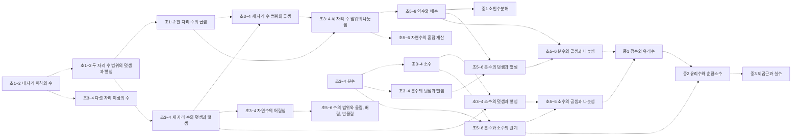
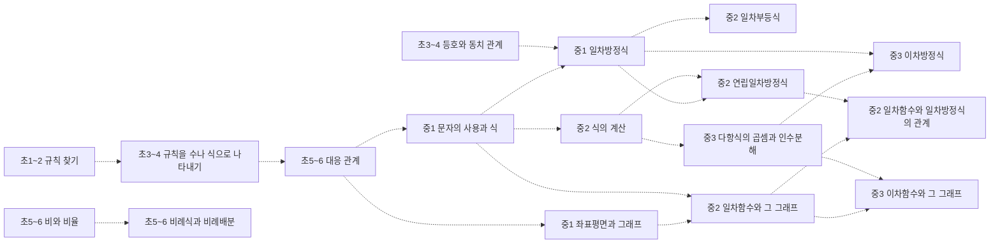
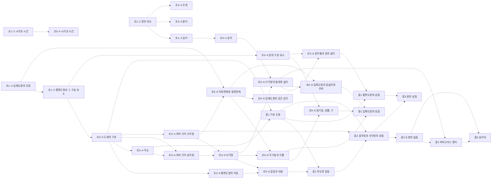
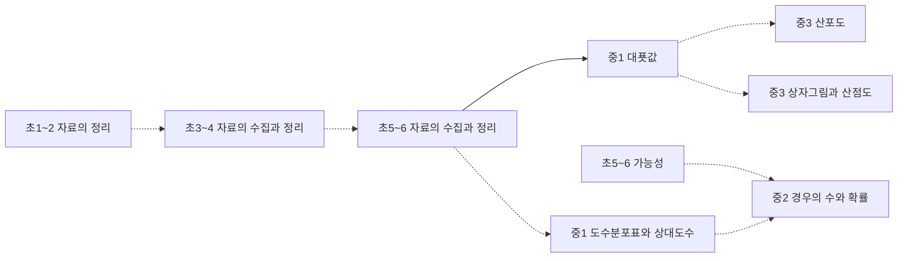

# 수학 개념 지도 (초1~고2~3)

개념 208개 = 고시문 「내용 체계」의 지식⋅이해 항목(원문 낱말 그대로). 선수관계 184개 — **원문 40** (고시문 문장이 밝힌 것, 실선) · **제안 144** (원문에 없어 Claude 가 제안하고 Gemini 가 반박 심사한 것). 원문이 아닌 간선은 그림에서 점선, 목록에서 표시.

> 「초⋅중학교의 지식⋅이해 범주는 학년(군)에 따라 위계성을 가지며, 영역 간에도 위계성을 고려하여 구성하였다.」 — 위계가 있다는 것은 원문이지만, 개념 사이 화살표 하나하나는 대부분 원문에 없다. 간선별 이유·심사 기록은 [concept_proposals.json](../data/kr/concept_proposals.json) · [concept_structure.json](../data/kr/concept_structure.json).

□ 셀프 체크는 그 개념 성취기준 문장을 물음으로만 바꾼 것이다. MCP 에서는 `concept_path` 로 묻고, 「예」인 개념은 `known` 에 넣는다. 먼저/이어서가 없는 개념은 교과 문서의 단원 연계를 본다.

목차: [수와 연산](#수와-연산) · [변화와 관계](#변화와-관계) · [도형과 측정](#도형과-측정) · [자료와 가능성](#자료와-가능성) · [고1 · 공통수학1 · 다항식](#고1-공통수학1-다항식) · [고1 · 공통수학1 · 방정식과 부등식](#고1-공통수학1-방정식과-부등식) · [고1 · 공통수학1 · 경우의 수](#고1-공통수학1-경우의-수) · [고1 · 공통수학1 · 행렬](#고1-공통수학1-행렬) · [고1 · 공통수학2 · 도형의 방정식](#고1-공통수학2-도형의-방정식) · [고1 · 공통수학2 · 집합과 명제](#고1-공통수학2-집합과-명제) · [고1 · 공통수학2 · 함수와 그래프](#고1-공통수학2-함수와-그래프) · [고1 · 기본수학1](#고1-기본수학1) · [고1 · 기본수학2](#고1-기본수학2) · [고2~3 · 대수](#고2-3-대수) · [고2~3 · 미적분Ⅰ](#고2-3-미적분Ⅰ) · [고2~3 · 확률과 통계](#고2-3-확률과-통계) · [고2~3 · 미적분Ⅱ](#고2-3-미적분Ⅱ) · [고2~3 · 기하](#고2-3-기하) · [고2~3 · 경제 수학](#고2-3-경제-수학) · [고2~3 · 인공지능 수학](#고2-3-인공지능-수학) · [고2~3 · 직무 수학](#고2-3-직무-수학) · [고2~3 · 수학과 문화](#고2-3-수학과-문화) · [고2~3 · 실용 통계](#고2-3-실용-통계) · [고2~3 · 수학과제 탐구](#고2-3-수학과제-탐구)

## 수와 연산

### 초1~2 네 자리 이하의 수

성취기준 2수01-01, 2수01-02, 2수01-03, 2수01-04  
➡️ 이어서: [초1~2 두 자리 수 범위의 덧셈과 뺄셈](#초1-2-두-자리-수-범위의-덧셈과-뺄셈)제안 · [초3~4 다섯 자리 이상의 수](#초3-4-다섯-자리-이상의-수)제안  

- □ 수의 필요성을 인식하면서 0과 100까지의 수 개념을 이해하고, 수를 세고 읽고 쓸 수 있나요?
- □ 일, 십, 백, 천의 자릿값과 위치적 기수법을 이해하고, 네 자리 이하의 수를 읽고 쓸 수 있나요?
- □ 네 자리 이하의 수의 범위에서 수의 계열을 이해하고, 수의 크기를 비교할 수 있나요?
- … 외 1개

### 초1~2 두 자리 수 범위의 덧셈과 뺄셈

성취기준 2수01-05, 2수01-06, 2수01-07, 2수01-08, 2수01-09  
⬅️ 먼저: [초1~2 네 자리 이하의 수](#초1-2-네-자리-이하의-수)제안  
➡️ 이어서: [초1~2 한 자리 수의 곱셈](#초1-2-한-자리-수의-곱셈)제안 · [초3~4 세 자리 수의 덧셈과 뺄셈](#초3-4-세-자리-수의-덧셈과-뺄셈)제안 · [초3~4 등호와 동치 관계](#초3-4-등호와-동치-관계)제안  

- □ 덧셈과 뺄셈이 이루어지는 실생활 상황과 연결하여 덧셈과 뺄셈의 의미를 이해하고 있나요?
- □ 두 자리 수의 범위에서 덧셈과 뺄셈의 계산 원리를 이해하고 그 계산을 할 수 있나요?
- □ 덧셈과 뺄셈의 관계를 이해하고 있나요?
- … 외 2개

### 초1~2 한 자리 수의 곱셈

성취기준 2수01-10, 2수01-11  
⬅️ 먼저: [초1~2 두 자리 수 범위의 덧셈과 뺄셈](#초1-2-두-자리-수-범위의-덧셈과-뺄셈)제안  
➡️ 이어서: [초3~4 세 자리 수 범위의 곱셈](#초3-4-세-자리-수-범위의-곱셈)제안 · [초3~4 세 자리 수 범위의 나눗셈](#초3-4-세-자리-수-범위의-나눗셈)제안  

- □ 곱셈이 이루어지는 실생활 상황과 연결하여 곱셈의 의미를 이해하고 있나요?
- □ 곱셈구구를 이해하고, 한 자리 수의 곱셈을 할 수 있나요?

### 초3~4 다섯 자리 이상의 수

성취기준 4수01-01, 4수01-02  
⬅️ 먼저: [초1~2 네 자리 이하의 수](#초1-2-네-자리-이하의-수)제안  

- □ 큰 수의 필요성을 인식하면서 10000 이상의 큰 수에 대한 자릿값과 위치적 기수법을 이해하고, 수를 읽고 쓸 수 있나요?
- □ 다섯 자리 이상의 수의 범위에서 수의 계열을 이해하고, 수의 크기를 비교하며 그 방법을 설명할 수 있나요?

### 초3~4 세 자리 수의 덧셈과 뺄셈

성취기준 4수01-03  
⬅️ 먼저: [초1~2 두 자리 수 범위의 덧셈과 뺄셈](#초1-2-두-자리-수-범위의-덧셈과-뺄셈)제안  
➡️ 이어서: [초3~4 세 자리 수 범위의 곱셈](#초3-4-세-자리-수-범위의-곱셈)제안 · [초3~4 자연수의 어림셈](#초3-4-자연수의-어림셈)제안 · [초3~4 소수의 덧셈과 뺄셈](#초3-4-소수의-덧셈과-뺄셈)제안 · [초3~4 시각과 시간](#초3-4-시각과-시간)제안  

- □ 세 자리 수의 덧셈과 뺄셈의 계산 원리를 이해하고 그 계산을 할 수 있나요?

### 초3~4 세 자리 수 범위의 곱셈

성취기준 4수01-04  
⬅️ 먼저: [초1~2 한 자리 수의 곱셈](#초1-2-한-자리-수의-곱셈)제안 · [초3~4 세 자리 수의 덧셈과 뺄셈](#초3-4-세-자리-수의-덧셈과-뺄셈)제안  
➡️ 이어서: [초3~4 세 자리 수 범위의 나눗셈](#초3-4-세-자리-수-범위의-나눗셈)제안 · [초5~6 다각형의 둘레와 넓이](#초5-6-다각형의-둘레와-넓이)제안  

- □ 곱하는 수가 한 자리 수 또는 두 자리 수인 곱셈의 계산 원리를 이해하고 그 계산을 할 수 있나요?

### 초3~4 세 자리 수 범위의 나눗셈

성취기준 4수01-05, 4수01-06, 4수01-07  
⬅️ 먼저: [초3~4 세 자리 수 범위의 곱셈](#초3-4-세-자리-수-범위의-곱셈)제안 · [초1~2 한 자리 수의 곱셈](#초1-2-한-자리-수의-곱셈)제안  
➡️ 이어서: [초5~6 약수와 배수](#초5-6-약수와-배수)제안 · [초5~6 자연수의 혼합 계산](#초5-6-자연수의-혼합-계산)제안  

- □ 나눗셈이 이루어지는 실생활 상황과 연결하여 나눗셈의 의미를 알고, 곱셈과 나눗셈의 관계를 이해하고 있나요?
- □ 나누는 수가 한 자리 수인 나눗셈의 계산 원리를 이해하고 그 계산을 할 수 있으며, 나눗셈에서 몫과 나머지의 의미를 안다.
- □ 나누는 수가 두 자리 수인 나눗셈의 계산 원리를 이해하고 그 계산을 할 수 있나요?

### 초3~4 자연수의 어림셈

성취기준 4수01-08  
⬅️ 먼저: [초3~4 세 자리 수의 덧셈과 뺄셈](#초3-4-세-자리-수의-덧셈과-뺄셈)제안  
➡️ 이어서: [초5~6 수의 범위와 올림, 버림, 반올림](#초5-6-수의-범위와-올림-버림-반올림)제안  

- □ 자연수의 덧셈, 뺄셈, 곱셈, 나눗셈과 관련한 여러 가지 상황에서 어림셈을 할 수 있나요?

### 초3~4 분수

성취기준 4수01-09, 4수01-10, 4수01-11  
➡️ 이어서: [초3~4 소수](#초3-4-소수)제안 · [초3~4 분수의 덧셈과 뺄셈](#초3-4-분수의-덧셈과-뺄셈)제안 · [초5~6 분수와 소수의 관계](#초5-6-분수와-소수의-관계)제안 · [초5~6 가능성](#초5-6-가능성)제안  

- □ 양의 등분할을 통하여 분수의 필요성을 인식하고, 분수를 이해하고 읽고 쓸 수 있나요?
- □ 단위분수, 진분수, 가분수, 대분수를 알고, 그 관계를 이해하고 있나요?
- □ 분모가 같은 분수끼리, 단위분수끼리 크기를 비교하고 그 방법을 설명할 수 있나요?

### 초3~4 소수

성취기준 4수01-12, 4수01-13, 4수01-14  
⬅️ 먼저: [초3~4 분수](#초3-4-분수)제안  
➡️ 이어서: [초3~4 소수의 덧셈과 뺄셈](#초3-4-소수의-덧셈과-뺄셈)제안 · [초5~6 분수와 소수의 관계](#초5-6-분수와-소수의-관계)제안  

- □ 분모가 10인 진분수와 연결하여 소수 한 자리 수를 이해하고 읽고 쓸 수 있나요?
- □ 자릿값의 원리를 바탕으로 소수 두 자리 수와 소수 세 자리 수를 이해하고 읽고 쓸 수 있나요?
- □ 소수의 크기를 비교하고 그 방법을 설명할 수 있나요?

### 초3~4 분수의 덧셈과 뺄셈

성취기준 4수01-15  
⬅️ 먼저: [초3~4 분수](#초3-4-분수)제안  
➡️ 이어서: [초5~6 분수의 덧셈과 뺄셈](#초5-6-분수의-덧셈과-뺄셈)제안  

- □ 분모가 같은 분수의 덧셈과 뺄셈의 계산 원리를 이해하고 그 계산을 할 수 있나요?

### 초3~4 소수의 덧셈과 뺄셈

성취기준 4수01-16  
⬅️ 먼저: [초3~4 소수](#초3-4-소수)제안 · [초3~4 세 자리 수의 덧셈과 뺄셈](#초3-4-세-자리-수의-덧셈과-뺄셈)제안  
➡️ 이어서: [초5~6 소수의 곱셈과 나눗셈](#초5-6-소수의-곱셈과-나눗셈)제안  

- □ 소수 두 자리 수의 범위에서 소수의 덧셈과 뺄셈의 계산 원리를 이해하고 그 계산을 할 수 있나요?

### 초5~6 분수의 덧셈과 뺄셈

성취기준 6수01-06, 6수01-07, 6수01-08  
⬅️ 먼저: [초3~4 분수의 덧셈과 뺄셈](#초3-4-분수의-덧셈과-뺄셈)제안 · [초5~6 약수와 배수](#초5-6-약수와-배수)제안  
➡️ 이어서: [초5~6 분수의 곱셈과 나눗셈](#초5-6-분수의-곱셈과-나눗셈)제안  

- □ 크기가 같은 분수를 만드는 방법을 이해하고, 분수를 약분, 통분할 수 있나요?
- □ 분모가 다른 분수의 크기를 비교하고 그 방법을 설명할 수 있나요?
- □ 분모가 다른 분수의 덧셈과 뺄셈의 계산 원리를 탐구하고 그 계산을 할 수 있나요?

### 초5~6 자연수의 혼합 계산

성취기준 6수01-01  
⬅️ 먼저: [초3~4 세 자리 수 범위의 나눗셈](#초3-4-세-자리-수-범위의-나눗셈)제안  

- □ 덧셈, 뺄셈, 곱셈, 나눗셈의 혼합 계산에서 계산하는 순서를 알고, 혼합 계산을 할 수 있나요?

### 초5~6 수의 범위와 올림, 버림, 반올림

성취기준 6수01-02, 6수01-03  
⬅️ 먼저: [초3~4 자연수의 어림셈](#초3-4-자연수의-어림셈)제안  

- □ 실생활과 연결하여 이상, 이하, 초과, 미만의 의미와 쓰임을 알고, 이를 활용하여 수의 범위를 나타낼 수 있나요?
- □ 어림값을 구하기 위한 방법으로 올림, 버림, 반올림의 의미와 필요성을 알고, 이를 실생활에 활용함으로써 수학의 유용성을 인식할 수 있나요?

### 초5~6 약수와 배수

성취기준 6수01-04, 6수01-05  
⬅️ 먼저: [초3~4 세 자리 수 범위의 나눗셈](#초3-4-세-자리-수-범위의-나눗셈)제안  
➡️ 이어서: [중1 소인수분해](#중1-소인수분해) · [초5~6 분수의 덧셈과 뺄셈](#초5-6-분수의-덧셈과-뺄셈)제안 · [초5~6 분수의 곱셈과 나눗셈](#초5-6-분수의-곱셈과-나눗셈)제안  

- □ 약수, 공약수, 최대공약수를 이해하고 구할 수 있나요?
- □ 배수, 공배수, 최소공배수를 이해하고 구할 수 있나요?

### 초5~6 분수의 곱셈과 나눗셈

성취기준 6수01-09, 6수01-10, 6수01-11  
⬅️ 먼저: [초5~6 분수의 덧셈과 뺄셈](#초5-6-분수의-덧셈과-뺄셈)제안 · [초5~6 약수와 배수](#초5-6-약수와-배수)제안  
➡️ 이어서: [중1 정수와 유리수](#중1-정수와-유리수)제안 · [초5~6 비례식과 비례배분](#초5-6-비례식과-비례배분)제안  

- □ 분수의 곱셈의 계산 원리를 탐구하고 그 계산을 할 수 있나요?
- □ ‘(자연수)÷(자연수)’에서 나눗셈의 몫을 분수로 나타낼 수 있나요?
- □ 분수의 나눗셈의 계산 원리를 탐구하고 그 계산을 할 수 있나요?

### 초5~6 분수와 소수의 관계

성취기준 6수01-12  
⬅️ 먼저: [초3~4 분수](#초3-4-분수)제안 · [초3~4 소수](#초3-4-소수)제안  
➡️ 이어서: [초5~6 소수의 곱셈과 나눗셈](#초5-6-소수의-곱셈과-나눗셈)제안 · [중2 유리수와 순환소수](#중2-유리수와-순환소수)제안 · [초5~6 비와 비율](#초5-6-비와-비율)제안  

- □ 분수와 소수의 관계를 이해하고 크기를 비교하며 그 방법을 설명할 수 있나요?

### 초5~6 소수의 곱셈과 나눗셈

성취기준 6수01-13, 6수01-14, 6수01-15  
⬅️ 먼저: [초3~4 소수의 덧셈과 뺄셈](#초3-4-소수의-덧셈과-뺄셈)제안 · [초5~6 분수와 소수의 관계](#초5-6-분수와-소수의-관계)제안  
➡️ 이어서: [중1 정수와 유리수](#중1-정수와-유리수)제안 · [초5~6 원주율과 원의 넓이](#초5-6-원주율과-원의-넓이)제안  

- □ 소수의 곱셈의 계산 원리를 탐구하고 그 계산을 할 수 있나요?
- □ ‘(자연수)÷(자연수)’에서 나눗셈의 몫을 소수로 나타낼 수 있나요?
- □ 소수의 나눗셈의 계산 원리를 탐구하고 그 계산을 할 수 있나요?

### 중1 소인수분해

성취기준 9수01-01, 9수01-02  
⬅️ 먼저: [초5~6 약수와 배수](#초5-6-약수와-배수)  

- □ 소인수분해의 뜻을 알고, 자연수를 소인수분해 할 수 있나요?
- □ 소인수분해를 이용하여 최대공약수와 최소공배수를 구할 수 있나요?

### 중1 정수와 유리수

성취기준 9수01-03, 9수01-04, 9수01-05  
⬅️ 먼저: [초5~6 분수의 곱셈과 나눗셈](#초5-6-분수의-곱셈과-나눗셈)제안 · [초5~6 소수의 곱셈과 나눗셈](#초5-6-소수의-곱셈과-나눗셈)제안  
➡️ 이어서: [중2 유리수와 순환소수](#중2-유리수와-순환소수)제안 · [중1 문자의 사용과 식](#중1-문자의-사용과-식)제안 · [중1 좌표평면과 그래프](#중1-좌표평면과-그래프)제안 · [고1 공통수학1 행렬과 그 연산](#고1-공통수학1-행렬과-그-연산)제안 · [중2 일차부등식](#중2-일차부등식)제안  

- □ 다양한 상황을 이용하여 음수의 필요성을 인식하고, 양수와 음수, 정수와 유리수의 개념을 이해하고 있나요?
- □ 정수와 유리수의 대소 관계를 판단할 수 있나요?
- □ 정수와 유리수의 사칙계산의 원리를 이해하고, 그 계산을 할 수 있나요?

### 중2 유리수와 순환소수

성취기준 9수01-06  
⬅️ 먼저: [중1 정수와 유리수](#중1-정수와-유리수)제안 · [초5~6 분수와 소수의 관계](#초5-6-분수와-소수의-관계)제안  
➡️ 이어서: [중3 제곱근과 실수](#중3-제곱근과-실수)제안  

- □ 순환소수의 뜻을 알고, 유리수와 순환소수의 관계를 설명할 수 있나요?

### 중3 제곱근과 실수

성취기준 9수01-07, 9수01-08, 9수01-09, 9수01-10  
⬅️ 먼저: [중2 유리수와 순환소수](#중2-유리수와-순환소수)제안  
➡️ 이어서: [고1 공통수학1 복소수와 이차방정식](#고1-공통수학1-복소수와-이차방정식) · [중3 이차방정식](#중3-이차방정식)제안 · [중3 삼각비](#중3-삼각비)제안 · [중3 산포도](#중3-산포도)제안 · [고1 공통수학2 유리함수와 무리함수](#고1-공통수학2-유리함수와-무리함수)제안  

- □ 제곱근의 뜻과 성질을 알고, 제곱근의 대소 관계를 판단할 수 있나요?
- □ 무리수의 개념을 이해하고, 무리수의 유용성을 인식할 수 있나요?
- □ 실수의 대소 관계를 판단하고 설명할 수 있나요?
- … 외 1개

## 변화와 관계

### 초1~2 규칙 찾기

성취기준 2수02-01, 2수02-02  
➡️ 이어서: [초3~4 규칙을 수나 식으로 나타내기](#초3-4-규칙을-수나-식으로-나타내기)제안  

- □ 물체, 무늬, 수 등의 배열에서 규칙을 찾아 여러 가지 방법으로 표현할 수 있나요?
- □ 자신이 정한 규칙에 따라 물체, 무늬, 수 등을 배열할 수 있나요?

### 초3~4 규칙을 수나 식으로 나타내기

성취기준 4수02-01, 4수02-02  
⬅️ 먼저: [초1~2 규칙 찾기](#초1-2-규칙-찾기)제안  
➡️ 이어서: [초5~6 대응 관계](#초5-6-대응-관계)제안  

- □ 다양한 변화 규칙을 찾아 설명하고, 그 규칙을 수나 식으로 나타낼 수 있나요?
- □ 계산식의 배열에서 규칙을 찾고, 계산 결과를 추측할 수 있나요?

### 초3~4 등호와 동치 관계

성취기준 4수02-03  
⬅️ 먼저: [초1~2 두 자리 수 범위의 덧셈과 뺄셈](#초1-2-두-자리-수-범위의-덧셈과-뺄셈)제안  
➡️ 이어서: [중1 일차방정식](#중1-일차방정식)제안  

- □ 등호를 사용하여 크기가 같은 두 양의 관계를 식으로 나타낼 수 있나요?

### 초5~6 대응 관계

성취기준 6수02-01  
⬅️ 먼저: [초3~4 규칙을 수나 식으로 나타내기](#초3-4-규칙을-수나-식으로-나타내기)제안  
➡️ 이어서: [중1 문자의 사용과 식](#중1-문자의-사용과-식)제안 · [중1 좌표평면과 그래프](#중1-좌표평면과-그래프)제안  

- □ 한 양이 변할 때 다른 양이 그에 종속하여 변하는 대응 관계를 나타낸 표에서 규칙을 찾아 설명하고, □, △ 등을 사용하여 식으로 나타낼 수 있나요?

### 초5~6 비와 비율

성취기준 6수02-02, 6수02-03  
⬅️ 먼저: [초5~6 분수와 소수의 관계](#초5-6-분수와-소수의-관계)제안  
➡️ 이어서: [초5~6 비례식과 비례배분](#초5-6-비례식과-비례배분)제안 · [초5~6 자료의 수집과 정리](#초5-6-자료의-수집과-정리)제안 · [중1 도수분포표와 상대도수](#중1-도수분포표와-상대도수)제안 · [과학 초5~6 속력](%EA%B3%BC%ED%95%99-%EA%B0%9C%EB%85%90-%EC%A7%80%EB%8F%84.md#초5-6-속력)제안 · [과학 중1~3 밀도, 용해도, 녹는점, 끓는점](%EA%B3%BC%ED%95%99-%EA%B0%9C%EB%85%90-%EC%A7%80%EB%8F%84.md#중1-3-밀도-용해도-녹는점-끓는점)제안  

- □ 두 양의 크기를 비교하는 상황을 통해 비의 개념을 이해하고, 두 양의 관계를 비로 나타낼 수 있나요?
- □ 비율을 이해하고, 비율을 분수, 소수, 백분율로 나타낼 수 있나요?

### 초5~6 비례식과 비례배분

성취기준 6수02-04, 6수02-05  
⬅️ 먼저: [초5~6 비와 비율](#초5-6-비와-비율)제안 · [초5~6 분수의 곱셈과 나눗셈](#초5-6-분수의-곱셈과-나눗셈)제안  
➡️ 이어서: [중2 도형의 닮음](#중2-도형의-닮음)제안  

- □ 비례식을 알고, 그 성질을 이해하며, 이를 활용하여 간단한 비례식을 풀 수 있나요?
- □ 비례배분을 알고, 주어진 양을 비례배분 할 수 있나요?

### 중1 문자의 사용과 식

성취기준 9수02-01, 9수02-02  
⬅️ 먼저: [초5~6 대응 관계](#초5-6-대응-관계)제안 · [중1 정수와 유리수](#중1-정수와-유리수)제안  
➡️ 이어서: [중1 일차방정식](#중1-일차방정식)제안 · [중2 식의 계산](#중2-식의-계산)제안 · [중2 일차함수와 그 그래프](#중2-일차함수와-그-그래프)제안  

- □ 다양한 상황을 문자를 사용한 식으로 나타내어 그 유용성을 인식하고, 식의 값을 구할 수 있나요?
- □ 일차식의 덧셈과 뺄셈의 원리를 이해하고, 그 계산을 할 수 있나요?

### 중1 일차방정식

성취기준 9수02-03, 9수02-04  
⬅️ 먼저: [중1 문자의 사용과 식](#중1-문자의-사용과-식)제안 · [초3~4 등호와 동치 관계](#초3-4-등호와-동치-관계)제안  
➡️ 이어서: [고1 기본수학1 이차방정식과 이차함수](#고1-기본수학1-이차방정식과-이차함수) · [고1 공통수학1 복소수와 이차방정식](#고1-공통수학1-복소수와-이차방정식) · [고1 공통수학1 이차방정식과 이차함수](#고1-공통수학1-이차방정식과-이차함수) · [고1 공통수학1 여러 가지 방정식과 부등식](#고1-공통수학1-여러-가지-방정식과-부등식) · [중2 일차부등식](#중2-일차부등식)제안 · [중2 연립일차방정식](#중2-연립일차방정식)제안 · [중3 이차방정식](#중3-이차방정식)제안  

- □ 방정식과 그 해의 뜻을 알고, 등식의 성질을 설명할 수 있나요?
- □ 일차방정식을 풀 수 있고, 이를 활용하여 문제를 해결할 수 있나요?

### 중1 좌표평면과 그래프

성취기준 9수02-05, 9수02-06, 9수02-07  
⬅️ 먼저: [중1 정수와 유리수](#중1-정수와-유리수)제안 · [초5~6 대응 관계](#초5-6-대응-관계)제안  
➡️ 이어서: [중2 일차함수와 그 그래프](#중2-일차함수와-그-그래프)제안 · [중3 상자그림과 산점도](#중3-상자그림과-산점도)제안 · [고1 공통수학2 평면좌표](#고1-공통수학2-평면좌표)제안 · [과학 중1~3 등속 운동](%EA%B3%BC%ED%95%99-%EA%B0%9C%EB%85%90-%EC%A7%80%EB%8F%84.md#중1-3-등속-운동)제안 · [과학 중1~3 옴의 법칙](%EA%B3%BC%ED%95%99-%EA%B0%9C%EB%85%90-%EC%A7%80%EB%8F%84.md#중1-3-옴의-법칙)제안 · [과학 중1~3 기체의 압력과 부피 관계](%EA%B3%BC%ED%95%99-%EA%B0%9C%EB%85%90-%EC%A7%80%EB%8F%84.md#중1-3-기체의-압력과-부피-관계)제안  

- □ 순서쌍과 좌표를 이해하고, 그 편리함을 인식할 수 있나요?
- □ 다양한 상황을 그래프로 나타내고, 주어진 그래프를 해석할 수 있나요?
- □ 정비례, 반비례 관계를 이해하고, 그 관계를 표, 식, 그래프로 나타낼 수 있나요?

### 중2 식의 계산

성취기준 9수02-08, 9수02-09, 9수02-10  
⬅️ 먼저: [중1 문자의 사용과 식](#중1-문자의-사용과-식)제안  
➡️ 이어서: [고1 기본수학1 다항식의 연산](#고1-기본수학1-다항식의-연산) · [중2 연립일차방정식](#중2-연립일차방정식)제안 · [중3 다항식의 곱셈과 인수분해](#중3-다항식의-곱셈과-인수분해)제안  

- □ 지수법칙을 이해하고, 이를 이용하여 식을 간단히 할 수 있나요?
- □ 다항식의 덧셈과 뺄셈의 원리를 이해하고, 그 계산을 할 수 있나요?
- □ ‘(단항식)×(다항식)’, ‘(다항식)÷(단항식)’과 같은 곱셈과 나눗셈의 원리를 이해하고, 그 계산을 할 수 있나요?

### 중2 일차부등식

성취기준 9수02-11, 9수02-12  
⬅️ 먼저: [중1 일차방정식](#중1-일차방정식)제안 · [중1 정수와 유리수](#중1-정수와-유리수)제안  
➡️ 이어서: [고1 공통수학1 여러 가지 방정식과 부등식](#고1-공통수학1-여러-가지-방정식과-부등식)  

- □ 부등식과 그 해의 뜻을 알고, 부등식의 성질을 설명할 수 있나요?
- □ 일차부등식을 풀 수 있고, 이를 활용하여 문제를 해결할 수 있나요?

### 중2 연립일차방정식

성취기준 9수02-13  
⬅️ 먼저: [중1 일차방정식](#중1-일차방정식)제안 · [중2 식의 계산](#중2-식의-계산)제안  
➡️ 이어서: [고1 공통수학1 여러 가지 방정식과 부등식](#고1-공통수학1-여러-가지-방정식과-부등식) · [고1 기본수학1 이차방정식과 이차함수](#고1-기본수학1-이차방정식과-이차함수) · [고1 기본수학1 부등식](#고1-기본수학1-부등식) · [고1 공통수학1 복소수와 이차방정식](#고1-공통수학1-복소수와-이차방정식) · [고1 공통수학1 이차방정식과 이차함수](#고1-공통수학1-이차방정식과-이차함수) · [중2 일차함수와 일차방정식의 관계](#중2-일차함수와-일차방정식의-관계)제안  

- □ 미지수가 2개인 연립일차방정식을 풀 수 있고, 이를 활용하여 문제를 해결할 수 있나요?

### 중2 일차함수와 그 그래프

성취기준 9수02-14, 9수02-15, 9수02-16  
⬅️ 먼저: [중1 좌표평면과 그래프](#중1-좌표평면과-그래프)제안 · [중1 문자의 사용과 식](#중1-문자의-사용과-식)제안  
➡️ 이어서: [고1 공통수학2 함수](#고1-공통수학2-함수) · [고1 기본수학2 함수](#고1-기본수학2-함수) · [고1 공통수학2 유리함수와 무리함수](#고1-공통수학2-유리함수와-무리함수) · [중2 일차함수와 일차방정식의 관계](#중2-일차함수와-일차방정식의-관계)제안 · [중3 이차함수와 그 그래프](#중3-이차함수와-그-그래프)제안 · [고1 공통수학2 직선의 방정식](#고1-공통수학2-직선의-방정식)제안  

- □ 함수의 개념을 이해하고, 함숫값을 구할 수 있나요?
- □ 일차함수의 개념을 이해하고, 그 그래프를 그릴 수 있나요?
- □ 일차함수의 그래프의 성질을 이해하고, 이를 활용하여 문제를 해결할 수 있나요?

### 중2 일차함수와 일차방정식의 관계

성취기준 9수02-17, 9수02-18  
⬅️ 먼저: [중2 일차함수와 그 그래프](#중2-일차함수와-그-그래프)제안 · [중2 연립일차방정식](#중2-연립일차방정식)제안  
➡️ 이어서: [고1 공통수학2 직선의 방정식](#고1-공통수학2-직선의-방정식) · [고1 공통수학2 함수](#고1-공통수학2-함수) · [고1 기본수학1 이차방정식과 이차함수](#고1-기본수학1-이차방정식과-이차함수) · [고1 기본수학2 직선의 방정식](#고1-기본수학2-직선의-방정식) · [고1 기본수학2 함수](#고1-기본수학2-함수) · [고1 공통수학1 복소수와 이차방정식](#고1-공통수학1-복소수와-이차방정식) · [고1 공통수학1 이차방정식과 이차함수](#고1-공통수학1-이차방정식과-이차함수) · [고1 공통수학1 여러 가지 방정식과 부등식](#고1-공통수학1-여러-가지-방정식과-부등식) · [고1 공통수학2 유리함수와 무리함수](#고1-공통수학2-유리함수와-무리함수)  

- □ 일차함수와 미지수가 2개인 일차방정식의 관계를 설명할 수 있나요?
- □ 두 일차함수의 그래프와 연립일차방정식의 관계를 설명할 수 있나요?

### 중3 다항식의 곱셈과 인수분해

성취기준 9수02-19  
⬅️ 먼저: [중2 식의 계산](#중2-식의-계산)제안  
➡️ 이어서: [고1 공통수학1 인수분해](#고1-공통수학1-인수분해) · [고1 기본수학1 인수분해](#고1-기본수학1-인수분해) · [고1 공통수학1 다항식의 연산](#고1-공통수학1-다항식의-연산) · [중3 이차방정식](#중3-이차방정식)제안 · [중3 이차함수와 그 그래프](#중3-이차함수와-그-그래프)제안  

- □ 다항식의 곱셈과 인수분해를 할 수 있나요?

### 중3 이차방정식

성취기준 9수02-20  
⬅️ 먼저: [중3 다항식의 곱셈과 인수분해](#중3-다항식의-곱셈과-인수분해)제안 · [중3 제곱근과 실수](#중3-제곱근과-실수)제안 · [중1 일차방정식](#중1-일차방정식)제안  
➡️ 이어서: [고1 공통수학1 복소수와 이차방정식](#고1-공통수학1-복소수와-이차방정식) · [고1 공통수학1 이차방정식과 이차함수](#고1-공통수학1-이차방정식과-이차함수) · [고1 공통수학1 여러 가지 방정식과 부등식](#고1-공통수학1-여러-가지-방정식과-부등식)  

- □ 이차방정식을 풀 수 있고, 이를 활용하여 문제를 해결할 수 있나요?

### 중3 이차함수와 그 그래프

성취기준 9수02-21, 9수02-22  
⬅️ 먼저: [중2 일차함수와 그 그래프](#중2-일차함수와-그-그래프)제안 · [중3 다항식의 곱셈과 인수분해](#중3-다항식의-곱셈과-인수분해)제안  
➡️ 이어서: [고1 공통수학2 함수](#고1-공통수학2-함수) · [고1 기본수학2 함수](#고1-기본수학2-함수) · [고1 공통수학2 유리함수와 무리함수](#고1-공통수학2-유리함수와-무리함수) · [고1 공통수학1 이차방정식과 이차함수](#고1-공통수학1-이차방정식과-이차함수)제안  

- □ 이차함수의 개념을 이해하고 있나요?
- □ 이차함수의 그래프를 그릴 수 있고, 그 성질을 설명할 수 있나요?

## 도형과 측정

### 초1~2 입체도형의 모양

성취기준 2수03-01, 2수03-02  
➡️ 이어서: [초1~2 평면도형과 그 구성 요소](#초1-2-평면도형과-그-구성-요소)제안 · [초5~6 직육면체와 정육면체](#초5-6-직육면체와-정육면체)제안  

- □ 교실 및 생활 주변에서 여러 가지 물건을 관찰하여 직육면체, 원기둥, 구의 모양을 찾고, 이를 이용하여 여러 가지 모양을 만들 수 있나요?
- □ 쌓기나무를 이용하여 여러 가지 입체도형의 모양을 만들고, 그 모양에 대해 위치나 방향을 이용하여 말할 수 있나요?

### 초1~2 평면도형과 그 구성 요소

성취기준 2수03-03, 2수03-04, 2수03-05  
⬅️ 먼저: [초1~2 입체도형의 모양](#초1-2-입체도형의-모양)제안  
➡️ 이어서: [초3~4 도형의 기초](#초3-4-도형의-기초)제안 · [초3~4 원의 구성 요소](#초3-4-원의-구성-요소)제안  

- □ 교실 및 생활 주변에서 여러 가지 물건을 관찰하여 삼각형, 사각형, 원의 모양을 찾고, 이를 이용하여 여러 가지 모양을 만들 수 있나요?
- □ 삼각형, 사각형, 원을 직관적으로 이해하고, 그 모양을 그릴 수 있나요?
- □ 삼각형, 사각형에서 각각의 공통점을 찾아 말할 수 있나요?

### 초1~2 양의 비교

성취기준 2수03-06  
➡️ 이어서: [초1~2 길이](#초1-2-길이)제안 · [초3~4 들이](#초3-4-들이)제안 · [초3~4 무게](#초3-4-무게)제안  

- □ 구체물의 길이, 들이, 무게, 넓이를 비교하여 각각 ‘길다, 짧다’, ‘많다, 적다’, ‘무겁다, 가볍다’, ‘넓다, 좁다’ 등을 구별하여 말할 수 있나요?

### 초1~2 시각과 시간

성취기준 2수03-07, 2수03-08, 2수03-09  
➡️ 이어서: [초3~4 시각과 시간](#초3-4-시각과-시간)제안  

- □ 시계를 보고 시각을 ‘몇 시 몇 분’까지 읽을 수 있나요?
- □ 1시간과 1분의 관계를 이해하고, 시간을 ‘시간’, ‘분’으로 표현할 수 있나요?
- □ 실생활 문제 상황과 연결하여 1분, 1시간, 1일, 1주일, 1개월, 1년 사이의 관계를 이해하고 있나요?

### 초1~2 길이

성취기준 2수03-10, 2수03-11, 2수03-12, 2수03-13  
⬅️ 먼저: [초1~2 양의 비교](#초1-2-양의-비교)제안  
➡️ 이어서: [초3~4 길이](#초3-4-길이)제안  

- □ 길이 단위 1cm와 1m를 알고, 이를 이용하여 주변 사물의 길이를 측정할 수 있나요?
- □ 1m와 1cm의 관계를 이해하고, 길이를 ‘몇 m 몇 cm’와 ‘몇 cm’로 표현할 수 있나요?
- □ 여러 가지 물건의 길이를 어림하고, 길이에 대한 양감을 기른다.
- … 외 1개

### 초3~4 시각과 시간

성취기준 4수03-13, 4수03-14  
⬅️ 먼저: [초1~2 시각과 시간](#초1-2-시각과-시간)제안 · [초3~4 세 자리 수의 덧셈과 뺄셈](#초3-4-세-자리-수의-덧셈과-뺄셈)제안  

- □ 1분과 1초의 관계를 이해하고, 초 단위까지 시각을 읽을 수 있나요?
- □ 실생활 문제 상황과 연결하여 초 단위까지의 시간의 덧셈과 뺄셈을 할 수 있나요?

### 초3~4 길이

성취기준 4수03-15, 4수03-16  
⬅️ 먼저: [초1~2 길이](#초1-2-길이)제안  
➡️ 이어서: [초5~6 다각형의 둘레와 넓이](#초5-6-다각형의-둘레와-넓이)제안  

- □ 길이 단위 1mm와 1km를 알고, 이를 이용하여 길이를 측정하고 어림하며 수학의 유용성을 인식할 수 있나요?
- □ 1cm와 1mm, 1km와 1m의 관계를 이해하고, 길이를 ‘몇 cm 몇 mm’와 ‘몇 mm’, ‘몇 km 몇 m’와 ‘몇 m’로 다양하게 표현할 수 있나요?

### 초3~4 도형의 기초

성취기준 4수03-01, 4수03-02, 4수03-03  
⬅️ 먼저: [초1~2 평면도형과 그 구성 요소](#초1-2-평면도형과-그-구성-요소)제안  
➡️ 이어서: [초3~4 평면도형의 이동](#초3-4-평면도형의-이동)제안 · [초3~4 각도](#초3-4-각도)제안 · [초3~4 여러 가지 삼각형](#초3-4-여러-가지-삼각형)제안 · [초3~4 여러 가지 사각형](#초3-4-여러-가지-사각형)제안 · [중1 기본 도형](#중1-기본-도형)제안  

- □ 직선, 선분, 반직선을 이해하고 구별할 수 있나요?
- □ 각과 직각을 이해하고, 직각과 비교하는 활동을 통하여 예각과 둔각을 구별할 수 있나요?
- □ 직선의 수직 관계와 평행 관계를 이해하고 있나요?

### 초3~4 평면도형의 이동

성취기준 4수03-04, 4수03-05  
⬅️ 먼저: [초3~4 도형의 기초](#초3-4-도형의-기초)제안  
➡️ 이어서: [초5~6 합동과 대칭](#초5-6-합동과-대칭)제안  

- □ 구체물이나 평면도형의 밀기, 뒤집기, 돌리기 활동을 통하여 그 변화를 이해하고 있나요?
- □ 평면에서 점의 이동에 대해 위치와 방향을 이용하여 설명할 수 있나요?

### 초3~4 원의 구성 요소

성취기준 4수03-06, 4수03-07  
⬅️ 먼저: [초1~2 평면도형과 그 구성 요소](#초1-2-평면도형과-그-구성-요소)제안  
➡️ 이어서: [초5~6 원기둥, 원뿔, 구](#초5-6-원기둥-원뿔-구)제안 · [초5~6 원주율과 원의 넓이](#초5-6-원주율과-원의-넓이)제안  

- □ 원의 중심, 반지름, 지름을 이해하고, 그 성질을 안다.
- □ 컴퍼스를 이용하여 여러 가지 크기의 원을 그릴 수 있나요?

### 초3~4 여러 가지 삼각형

성취기준 4수03-08, 4수03-09  
⬅️ 먼저: [초3~4 도형의 기초](#초3-4-도형의-기초)제안 · [초3~4 각도](#초3-4-각도)제안  
➡️ 이어서: [초3~4 다각형](#초3-4-다각형)제안  

- □ 여러 가지 모양의 삼각형에 대한 분류 활동을 통하여 이등변삼각형, 정삼각형을 이해하고, 그 성질을 탐구하고 설명할 수 있나요?
- □ 여러 가지 모양의 삼각형에 대한 분류 활동을 통하여 직각삼각형, 예각삼각형, 둔각삼각형을 이해하고 있나요?

### 초3~4 여러 가지 사각형

성취기준 4수03-10  
⬅️ 먼저: [초3~4 도형의 기초](#초3-4-도형의-기초)제안  
➡️ 이어서: [초3~4 다각형](#초3-4-다각형)제안 · [초5~6 직육면체와 정육면체](#초5-6-직육면체와-정육면체)제안 · [중2 삼각형과 사각형의 성질](#중2-삼각형과-사각형의-성질)제안  

- □ 여러 가지 모양의 사각형에 대한 분류 활동을 통하여 직사각형, 정사각형, 사다리꼴, 평행사변형, 마름모를 이해하고, 그 성질을 탐구하고 설명할 수 있나요?

### 초3~4 다각형

성취기준 4수03-11, 4수03-12  
⬅️ 먼저: [초3~4 여러 가지 사각형](#초3-4-여러-가지-사각형)제안 · [초3~4 여러 가지 삼각형](#초3-4-여러-가지-삼각형)제안  
➡️ 이어서: [초5~6 합동과 대칭](#초5-6-합동과-대칭)제안 · [초5~6 각기둥과 각뿔](#초5-6-각기둥과-각뿔)제안 · [초5~6 다각형의 둘레와 넓이](#초5-6-다각형의-둘레와-넓이)제안  

- □ 다각형과 정다각형을 이해하고 있나요?
- □ 주어진 도형을 이용하여 여러 가지 모양을 만들거나 채우고 설명할 수 있나요?

### 초3~4 들이

성취기준 4수03-17, 4수03-18, 4수03-19  
⬅️ 먼저: [초1~2 양의 비교](#초1-2-양의-비교)제안  

- □ 들이 단위 1L와 1mL를 알고, 이를 이용하여 들이를 측정하고 어림하며 수학의 유용성을 인식할 수 있나요?
- □ 1L와 1mL의 관계를 이해하고, 들이를 ‘몇 L 몇 mL’와 ‘몇 mL’로 표현할 수 있나요?
- □ 실생활 문제 상황과 연결하여 들이의 덧셈과 뺄셈을 할 수 있나요?

### 초3~4 무게

성취기준 4수03-20, 4수03-21, 4수03-22, 4수03-23  
⬅️ 먼저: [초1~2 양의 비교](#초1-2-양의-비교)제안  

- □ 실생활에서 무게를 나타낼 때 사용하는 단위 1g과 1kg을 알고, 이를 이용하여 무게를 측정하고 어림하며 수학의 유용성을 인식할 수 있나요?
- □ 1kg과 1g의 관계를 이해하고, 무게를 ‘몇 kg 몇 g’과 ‘몇 g’으로 표현할 수 있나요?
- □ 실생활에서 무게를 나타낼 때 사용하는 단위 1t을 알고, 1t과 1kg의 관계를 이해하고 있나요?
- … 외 1개

### 초3~4 각도

성취기준 4수03-24, 4수03-25  
⬅️ 먼저: [초3~4 도형의 기초](#초3-4-도형의-기초)제안  
➡️ 이어서: [초3~4 여러 가지 삼각형](#초3-4-여러-가지-삼각형)제안 · [중1 기본 도형](#중1-기본-도형)제안  

- □ 각의 크기의 단위인 1도(°)를 알고, 각도기를 이용하여 각의 크기를 측정하고 어림할 수 있나요?
- □ 여러 가지 방법으로 삼각형과 사각형의 내각의 크기의 합을 추론하고, 자신의 추론 과정을 설명할 수 있나요?

### 초5~6 합동과 대칭

성취기준 6수03-01, 6수03-02  
⬅️ 먼저: [초3~4 평면도형의 이동](#초3-4-평면도형의-이동)제안 · [초3~4 다각형](#초3-4-다각형)제안  
➡️ 이어서: [중1 작도와 합동](#중1-작도와-합동)제안  

- □ 도형의 합동을 이해하고, 합동인 도형의 성질을 탐구하고 설명할 수 있나요?
- □ 실생활과 연결하여 선대칭도형과 점대칭도형을 이해하고 그릴 수 있나요?

### 초5~6 직육면체와 정육면체

성취기준 6수03-03, 6수03-04  
⬅️ 먼저: [초1~2 입체도형의 모양](#초1-2-입체도형의-모양)제안 · [초3~4 여러 가지 사각형](#초3-4-여러-가지-사각형)제안  
➡️ 이어서: [초5~6 각기둥과 각뿔](#초5-6-각기둥과-각뿔)제안 · [초5~6 입체도형의 공간 감각](#초5-6-입체도형의-공간-감각)제안 · [초5~6 입체도형의 겉넓이와 부피](#초5-6-입체도형의-겉넓이와-부피)제안  

- □ 직육면체와 정육면체를 이해하고, 구성 요소와 성질을 탐구하고 설명할 수 있나요?
- □ 직육면체와 정육면체의 겨냥도와 전개도를 그릴 수 있나요?

### 초5~6 각기둥과 각뿔

성취기준 6수03-05, 6수03-06  
⬅️ 먼저: [초5~6 직육면체와 정육면체](#초5-6-직육면체와-정육면체)제안 · [초3~4 다각형](#초3-4-다각형)제안  
➡️ 이어서: [초5~6 원기둥, 원뿔, 구](#초5-6-원기둥-원뿔-구)제안 · [중1 입체도형의 성질](#중1-입체도형의-성질)제안  

- □ 각기둥과 각뿔을 이해하고, 구성 요소와 성질을 탐구하고 설명할 수 있나요?
- □ 각기둥의 전개도를 그릴 수 있나요?

### 초5~6 원기둥, 원뿔, 구

성취기준 6수03-07, 6수03-08  
⬅️ 먼저: [초5~6 각기둥과 각뿔](#초5-6-각기둥과-각뿔)제안 · [초3~4 원의 구성 요소](#초3-4-원의-구성-요소)제안  
➡️ 이어서: [중1 입체도형의 성질](#중1-입체도형의-성질)제안  

- □ 원기둥, 원뿔, 구를 이해하고, 구성 요소와 성질을 탐구하고 설명할 수 있나요?
- □ 원기둥의 전개도를 그릴 수 있나요?

### 초5~6 입체도형의 공간 감각

성취기준 6수03-09, 6수03-10  
⬅️ 먼저: [초5~6 직육면체와 정육면체](#초5-6-직육면체와-정육면체)제안  

- □ 쌓기나무로 만든 입체도형을 보고 사용된 쌓기나무의 개수를 구할 수 있나요?
- □ 쌓기나무로 만든 입체도형의 위, 앞, 옆에서 본 모양을 표현할 수 있고, 이러한 표현을 보고 입체도형의 모양을 추측할 수 있나요?

### 초5~6 다각형의 둘레와 넓이

성취기준 6수03-11, 6수03-12, 6수03-13, 6수03-14  
⬅️ 먼저: [초3~4 다각형](#초3-4-다각형)제안 · [초3~4 길이](#초3-4-길이)제안 · [초3~4 세 자리 수 범위의 곱셈](#초3-4-세-자리-수-범위의-곱셈)제안  
➡️ 이어서: [초5~6 원주율과 원의 넓이](#초5-6-원주율과-원의-넓이)제안 · [초5~6 입체도형의 겉넓이와 부피](#초5-6-입체도형의-겉넓이와-부피)제안 · [중2 피타고라스 정리](#중2-피타고라스-정리)제안  

- □ 평면도형의 둘레를 이해하고, 기본적인 평면도형의 둘레를 구할 수 있나요?
- □ 넓이 단위 1cm², 1m², 1km²를 알며, 그 관계를 이해하고 있나요?
- □ 직사각형과 정사각형의 넓이를 구하는 방법을 이해하고, 이를 구할 수 있나요?
- … 외 1개

### 초5~6 원주율과 원의 넓이

성취기준 6수03-15, 6수03-16  
⬅️ 먼저: [초5~6 다각형의 둘레와 넓이](#초5-6-다각형의-둘레와-넓이)제안 · [초3~4 원의 구성 요소](#초3-4-원의-구성-요소)제안 · [초5~6 소수의 곱셈과 나눗셈](#초5-6-소수의-곱셈과-나눗셈)제안  
➡️ 이어서: [중1 평면도형의 성질](#중1-평면도형의-성질)제안  

- □ 여러 가지 원 모양 물체의 원주와 지름을 측정하는 활동을 통하여, 원주율이 일정한 값임을 알고 그 근삿값을 사용할 수 있나요?
- □ 원주와 원의 넓이를 구하는 방법을 이해하고, 이를 구할 수 있나요?

### 초5~6 입체도형의 겉넓이와 부피

성취기준 6수03-17, 6수03-18, 6수03-19  
⬅️ 먼저: [초5~6 직육면체와 정육면체](#초5-6-직육면체와-정육면체)제안 · [초5~6 다각형의 둘레와 넓이](#초5-6-다각형의-둘레와-넓이)제안  
➡️ 이어서: [중1 입체도형의 성질](#중1-입체도형의-성질)제안  

- □ 직육면체와 정육면체의 겉넓이를 구하는 방법을 이해하고, 이를 구할 수 있나요?
- □ 부피 단위 1cm³, 1m³를 알며, 그 관계를 이해하고 있나요?
- □ 직육면체와 정육면체의 부피를 구하는 방법을 이해하고, 이를 구할 수 있나요?

### 중1 기본 도형

성취기준 9수03-01, 9수03-02  
⬅️ 먼저: [초3~4 도형의 기초](#초3-4-도형의-기초)제안 · [초3~4 각도](#초3-4-각도)제안  
➡️ 이어서: [중1 작도와 합동](#중1-작도와-합동)제안 · [중1 평면도형의 성질](#중1-평면도형의-성질)제안 · [중2 삼각형과 사각형의 성질](#중2-삼각형과-사각형의-성질)제안  

- □ 점, 선, 면, 각을 이해하고, 실생활 상황과 연결하여 점, 직선, 평면의 위치 관계를 설명할 수 있나요?
- □ 평행선에서 동위각과 엇각의 성질을 이해하고 설명할 수 있나요?

### 중1 작도와 합동

성취기준 9수03-03, 9수03-04  
⬅️ 먼저: [중1 기본 도형](#중1-기본-도형)제안 · [초5~6 합동과 대칭](#초5-6-합동과-대칭)제안  
➡️ 이어서: [중2 삼각형과 사각형의 성질](#중2-삼각형과-사각형의-성질)제안  

- □ 삼각형을 작도하고, 그 과정을 설명할 수 있나요?
- □ 삼각형의 합동 조건을 이해하고, 이를 이용하여 두 삼각형이 합동인지 판별할 수 있나요?

### 중1 평면도형의 성질

성취기준 9수03-05, 9수03-06  
⬅️ 먼저: [중1 기본 도형](#중1-기본-도형)제안 · [초5~6 원주율과 원의 넓이](#초5-6-원주율과-원의-넓이)제안  
➡️ 이어서: [중3 원의 성질](#중3-원의-성질)제안  

- □ 다각형의 성질을 이해하고 설명할 수 있나요?
- □ 부채꼴의 중심각과 호의 관계를 이해하고, 이를 이용하여 부채꼴의 호의 길이와 넓이를 구할 수 있나요?

### 중1 입체도형의 성질

성취기준 9수03-07, 9수03-08  
⬅️ 먼저: [초5~6 각기둥과 각뿔](#초5-6-각기둥과-각뿔)제안 · [초5~6 원기둥, 원뿔, 구](#초5-6-원기둥-원뿔-구)제안 · [초5~6 입체도형의 겉넓이와 부피](#초5-6-입체도형의-겉넓이와-부피)제안  

- □ 구체적인 모형이나 공학 도구를 이용하여 다면체와 회전체의 성질을 탐구하고, 이를 설명할 수 있나요?
- □ 입체도형의 겉넓이와 부피를 구할 수 있나요?

### 중2 삼각형과 사각형의 성질

성취기준 9수03-09, 9수03-10, 9수03-11  
⬅️ 먼저: [중1 작도와 합동](#중1-작도와-합동)제안 · [초3~4 여러 가지 사각형](#초3-4-여러-가지-사각형)제안 · [중1 기본 도형](#중1-기본-도형)제안  
➡️ 이어서: [중2 도형의 닮음](#중2-도형의-닮음)제안 · [중3 원의 성질](#중3-원의-성질)제안  

- □ 이등변삼각형의 성질을 이해하고 정당화할 수 있나요?
- □ 삼각형의 외심과 내심의 성질을 이해하고 정당화할 수 있나요?
- □ 사각형의 성질을 이해하고 정당화할 수 있나요?

### 중2 도형의 닮음

성취기준 9수03-12, 9수03-13, 9수03-14  
⬅️ 먼저: [중2 삼각형과 사각형의 성질](#중2-삼각형과-사각형의-성질)제안 · [초5~6 비례식과 비례배분](#초5-6-비례식과-비례배분)제안  
➡️ 이어서: [중2 피타고라스 정리](#중2-피타고라스-정리)제안 · [중3 삼각비](#중3-삼각비)제안  

- □ 도형의 닮음의 뜻과 닮은 도형의 성질을 이해하고, 닮음비를 구할 수 있나요?
- □ 삼각형의 닮음 조건을 이해하고, 이를 이용하여 두 삼각형이 닮음인지 판별할 수 있나요?
- □ 평행선 사이의 선분의 길이의 비를 구할 수 있나요?

### 중2 피타고라스 정리

성취기준 9수03-15  
⬅️ 먼저: [중2 도형의 닮음](#중2-도형의-닮음)제안 · [초5~6 다각형의 둘레와 넓이](#초5-6-다각형의-둘레와-넓이)제안  
➡️ 이어서: [중3 삼각비](#중3-삼각비)제안 · [고1 공통수학2 평면좌표](#고1-공통수학2-평면좌표)제안  

- □ 피타고라스 정리를 이해하고 정당화할 수 있나요?

### 중3 삼각비

성취기준 9수03-16, 9수03-17  
⬅️ 먼저: [중2 피타고라스 정리](#중2-피타고라스-정리)제안 · [중2 도형의 닮음](#중2-도형의-닮음)제안 · [중3 제곱근과 실수](#중3-제곱근과-실수)제안  
➡️ 이어서: [고2~3 대수 삼각함수](#고2-3-대수-삼각함수)  

- □ 삼각비의 뜻을 알고, 간단한 삼각비의 값을 구할 수 있나요?
- □ 삼각비를 활용하여 여러 가지 문제를 해결할 수 있나요?

### 중3 원의 성질

성취기준 9수03-18, 9수03-19  
⬅️ 먼저: [중1 평면도형의 성질](#중1-평면도형의-성질)제안 · [중2 삼각형과 사각형의 성질](#중2-삼각형과-사각형의-성질)제안  
➡️ 이어서: [고1 공통수학2 원의 방정식](#고1-공통수학2-원의-방정식)  

- □ 원의 현에 관한 성질과 접선에 관한 성질을 이해하고 정당화할 수 있나요?
- □ 원주각의 성질을 이해하고 정당화할 수 있나요?

## 자료와 가능성

### 초1~2 자료의 정리

성취기준 2수04-01, 2수04-02, 2수04-03  
➡️ 이어서: [초3~4 자료의 수집과 정리](#초3-4-자료의-수집과-정리)제안  

- □ 여러 가지 사물을 정해진 기준 또는 자신이 정한 기준으로 분류하여 개수를 세어 보고, 기준에 따른 결과를 말할 수 있나요?
- □ 자료를 분류하여 표로 나타내고, 자료를 표로 나타내면 편리한 점을 말할 수 있나요?
- □ 자료를 분류하여 ○, ×, / 등을 이용한 그래프로 나타내고, 자료를 그래프로 나타내면 편리한 점을 말할 수 있나요?

### 초3~4 자료의 수집과 정리

성취기준 4수04-01, 4수04-02, 4수04-03  
⬅️ 먼저: [초1~2 자료의 정리](#초1-2-자료의-정리)제안  
➡️ 이어서: [초5~6 자료의 수집과 정리](#초5-6-자료의-수집과-정리)제안  

- □ 자료를 수집하여 그림그래프나 막대그래프로 나타내고 해석할 수 있나요?
- □ 자료를 수집하여 꺾은선그래프로 나타내고 해석할 수 있나요?
- □ 탐구 문제를 해결하기 위해 자료를 수집, 정리하여 막대그래프나 꺾은선그래프로 나타내고 해석할 수 있나요?

### 초5~6 자료의 수집과 정리

성취기준 6수04-01, 6수04-02, 6수04-03  
⬅️ 먼저: [초3~4 자료의 수집과 정리](#초3-4-자료의-수집과-정리)제안 · [초5~6 비와 비율](#초5-6-비와-비율)제안  
➡️ 이어서: [중1 대푯값](#중1-대푯값) · [중1 도수분포표와 상대도수](#중1-도수분포표와-상대도수)제안  

- □ 평균의 의미를 알고, 자료를 수집하여 평균을 구하고 해석할 수 있나요?
- □ 자료를 수집하여 띠그래프나 원그래프로 나타내고 해석할 수 있나요?
- □ 탐구 문제를 설정하고, 그에 맞는 자료를 수집, 정리하여 적절한 그래프로 나타내고 해석할 수 있나요?

### 초5~6 가능성

성취기준 6수04-04, 6수04-05, 6수04-06  
⬅️ 먼저: [초3~4 분수](#초3-4-분수)제안  
➡️ 이어서: [중2 경우의 수와 확률](#중2-경우의-수와-확률)제안  

- □ 사건이 일어날 가능성을 말로 표현하고 비교할 수 있나요?
- □ 사건이 일어날 가능성을 수로 나타낼 수 있나요?
- □ 자료를 이용하여 가능성을 예상하고, 가능성에 근거하여 적절한 판단을 내릴 수 있나요?

### 중1 대푯값

성취기준 9수04-01  
⬅️ 먼저: [초5~6 자료의 수집과 정리](#초5-6-자료의-수집과-정리)  
➡️ 이어서: [중3 산포도](#중3-산포도)제안 · [중3 상자그림과 산점도](#중3-상자그림과-산점도)제안  

- □ 중앙값, 최빈값의 뜻을 알고, 자료의 특성에 따라 적절한 대푯값을 선택하여 구할 수 있나요?

### 중1 도수분포표와 상대도수

성취기준 9수04-02, 9수04-03, 9수04-04  
⬅️ 먼저: [초5~6 자료의 수집과 정리](#초5-6-자료의-수집과-정리)제안 · [초5~6 비와 비율](#초5-6-비와-비율)제안  
➡️ 이어서: [중2 경우의 수와 확률](#중2-경우의-수와-확률)제안  

- □ 자료를 줄기와 잎 그림, 도수분포표, 히스토그램, 도수분포다각형으로 나타내고 해석할 수 있나요?
- □ 상대도수를 구하고, 상대도수의 분포를 표나 그래프로 나타내고 해석할 수 있나요?
- □ 통계적 탐구 문제를 설정하고, 공학 도구를 이용하여 자료를 수집하여 분석하고, 그 결과를 해석할 수 있나요?

### 중2 경우의 수와 확률

성취기준 9수04-05, 9수04-06  
⬅️ 먼저: [초5~6 가능성](#초5-6-가능성)제안 · [중1 도수분포표와 상대도수](#중1-도수분포표와-상대도수)제안  
➡️ 이어서: [고1 공통수학1 합의 법칙과 곱의 법칙](#고1-공통수학1-합의-법칙과-곱의-법칙) · [고1 기본수학1 합의 법칙과 곱의 법칙](#고1-기본수학1-합의-법칙과-곱의-법칙) · [고2~3 확률과 통계 확률의 개념과 활용](#고2-3-확률과-통계-확률의-개념과-활용)  

- □ 경우의 수를 구할 수 있나요?
- □ 확률의 개념과 그 기본 성질을 이해하고, 확률을 구할 수 있나요?

### 중3 산포도

성취기준 9수04-07  
⬅️ 먼저: [중1 대푯값](#중1-대푯값)제안 · [중3 제곱근과 실수](#중3-제곱근과-실수)제안  

- □ 분산과 표준편차를 구하고 자료의 분포를 설명할 수 있나요?

### 중3 상자그림과 산점도

성취기준 9수04-08, 9수04-09  
⬅️ 먼저: [중1 대푯값](#중1-대푯값)제안 · [중1 좌표평면과 그래프](#중1-좌표평면과-그래프)제안  

- □ 공학 도구를 이용하여 자료를 상자그림으로 나타내고 분포를 비교할 수 있나요?
- □ 자료를 산점도로 나타내고 상관관계를 말할 수 있나요?

## 고1 · 공통수학1 · 다항식

### 고1 다항식의 연산

성취기준 10공수1-01-01  
⬅️ 먼저: [중3 다항식의 곱셈과 인수분해](#중3-다항식의-곱셈과-인수분해)  
➡️ 이어서: [고1 공통수학1 나머지정리](#고1-공통수학1-나머지정리)제안  

- □ 다항식의 사칙연산의 원리를 설명하고, 그 계산을 할 수 있나요?

### 고1 나머지정리

성취기준 10공수1-01-02  
⬅️ 먼저: [고1 공통수학1 다항식의 연산](#고1-공통수학1-다항식의-연산)제안  
➡️ 이어서: [고1 공통수학1 인수분해](#고1-공통수학1-인수분해)제안  

- □ 항등식의 성질과 나머지정리를 이해하고, 이를 활용하여 문제를 해결할 수 있나요?

### 고1 인수분해

성취기준 10공수1-01-03  
⬅️ 먼저: [중3 다항식의 곱셈과 인수분해](#중3-다항식의-곱셈과-인수분해) · [고1 공통수학1 나머지정리](#고1-공통수학1-나머지정리)제안  
➡️ 이어서: [고1 공통수학1 여러 가지 방정식과 부등식](#고1-공통수학1-여러-가지-방정식과-부등식)제안  

- □ 다항식의 인수분해를 할 수 있나요?

## 고1 · 공통수학1 · 방정식과 부등식

### 고1 복소수와 이차방정식

성취기준 10공수1-02-01, 10공수1-02-02, 10공수1-02-03, 10공수1-02-08  
⬅️ 먼저: [중3 제곱근과 실수](#중3-제곱근과-실수) · [중1 일차방정식](#중1-일차방정식) · [중2 연립일차방정식](#중2-연립일차방정식) · [중2 일차함수와 일차방정식의 관계](#중2-일차함수와-일차방정식의-관계) · [중3 이차방정식](#중3-이차방정식)  
➡️ 이어서: [고1 공통수학1 이차방정식과 이차함수](#고1-공통수학1-이차방정식과-이차함수)제안 · [고1 공통수학1 여러 가지 방정식과 부등식](#고1-공통수학1-여러-가지-방정식과-부등식)제안  

- □ 복소수의 뜻과 성질을 설명하고, 사칙연산을 수행할 수 있나요?
- □ 이차방정식의 실근과 허근을 이해하고, 판별식을 이용하여 이차방정식의 근을 판별할 수 있나요?
- □ 이차방정식의 근과 계수의 관계를 설명할 수 있나요?
- … 외 1개

### 고1 이차방정식과 이차함수

성취기준 10공수1-02-04, 10공수1-02-05, 10공수1-02-06, 10공수1-02-11  
⬅️ 먼저: [중1 일차방정식](#중1-일차방정식) · [중2 연립일차방정식](#중2-연립일차방정식) · [중2 일차함수와 일차방정식의 관계](#중2-일차함수와-일차방정식의-관계) · [중3 이차방정식](#중3-이차방정식) · [고1 공통수학1 복소수와 이차방정식](#고1-공통수학1-복소수와-이차방정식)제안 · [중3 이차함수와 그 그래프](#중3-이차함수와-그-그래프)제안  
➡️ 이어서: [고1 공통수학1 여러 가지 방정식과 부등식](#고1-공통수학1-여러-가지-방정식과-부등식)제안  

- □ 이차방정식과 이차함수를 연결하여 그 관계를 설명할 수 있나요?
- □ 이차함수의 그래프와 직선의 위치 관계를 판단할 수 있나요?
- □ 이차함수의 최대, 최소를 탐구하고, 이를 실생활과 연결하여 유용성을 인식할 수 있나요?
- … 외 1개

### 고1 여러 가지 방정식과 부등식

성취기준 10공수1-02-07, 10공수1-02-09, 10공수1-02-10  
⬅️ 먼저: [중2 연립일차방정식](#중2-연립일차방정식) · [중1 일차방정식](#중1-일차방정식) · [중2 일차함수와 일차방정식의 관계](#중2-일차함수와-일차방정식의-관계) · [중3 이차방정식](#중3-이차방정식) · [중2 일차부등식](#중2-일차부등식) · [고1 공통수학1 인수분해](#고1-공통수학1-인수분해)제안 · [고1 공통수학1 이차방정식과 이차함수](#고1-공통수학1-이차방정식과-이차함수)제안 · [고1 공통수학1 복소수와 이차방정식](#고1-공통수학1-복소수와-이차방정식)제안  

- □ 간단한 삼차방정식과 사차방정식을 풀 수 있나요?
- □ 미지수가 1개인 연립일차부등식을 풀 수 있나요?
- □ 절댓값을 포함한 일차부등식을 풀 수 있나요?

## 고1 · 공통수학1 · 경우의 수

### 고1 합의 법칙과 곱의 법칙

성취기준 10공수1-03-01  
⬅️ 먼저: [중2 경우의 수와 확률](#중2-경우의-수와-확률)  
➡️ 이어서: [고1 공통수학1 순열과 조합](#고1-공통수학1-순열과-조합)제안  

- □ 합의 법칙과 곱의 법칙을 이해하고, 적절한 전략을 사용하여 경우의 수와 관련된 문제를 해결할 수 있나요?

### 고1 순열과 조합

성취기준 10공수1-03-02, 10공수1-03-03  
⬅️ 먼저: [고1 공통수학1 합의 법칙과 곱의 법칙](#고1-공통수학1-합의-법칙과-곱의-법칙)제안  

- □ 순열의 개념을 이해하고, 순열의 수를 구하는 방법을 설명할 수 있나요?
- □ 조합의 개념을 이해하고, 조합의 수를 구하는 방법을 설명할 수 있나요?

## 고1 · 공통수학1 · 행렬

### 고1 행렬과 그 연산

성취기준 10공수1-04-01, 10공수1-04-02  
⬅️ 먼저: [중1 정수와 유리수](#중1-정수와-유리수)제안  

- □ 행렬의 뜻을 알고, 실생활 상황을 행렬로 표현할 수 있나요?
- □ 행렬의 연산을 수행하고, 관련된 문제를 해결할 수 있나요?

## 고1 · 공통수학2 · 도형의 방정식

### 고1 평면좌표

성취기준 10공수2-01-01  
⬅️ 먼저: [중1 좌표평면과 그래프](#중1-좌표평면과-그래프)제안 · [중2 피타고라스 정리](#중2-피타고라스-정리)제안  
➡️ 이어서: [고1 공통수학2 직선의 방정식](#고1-공통수학2-직선의-방정식)제안 · [고1 공통수학2 원의 방정식](#고1-공통수학2-원의-방정식)제안  

- □ 선분의 내분을 이해하고, 내분점의 좌표를 계산할 수 있나요?

### 고1 직선의 방정식

성취기준 10공수2-01-02, 10공수2-01-03, 10공수2-01-05  
⬅️ 먼저: [중2 일차함수와 일차방정식의 관계](#중2-일차함수와-일차방정식의-관계) · [고1 공통수학2 평면좌표](#고1-공통수학2-평면좌표)제안 · [중2 일차함수와 그 그래프](#중2-일차함수와-그-그래프)제안  
➡️ 이어서: [고1 공통수학2 원의 방정식](#고1-공통수학2-원의-방정식)제안 · [고1 공통수학2 도형의 이동](#고1-공통수학2-도형의-이동)제안  

- □ 두 직선의 평행 조건과 수직 조건을 탐구하고 이해하고 있나요?
- □ 점과 직선 사이의 거리를 구하고, 관련된 문제를 해결할 수 있나요?
- □ 좌표평면에서 원과 직선의 위치 관계를 판단하고, 이를 활용하여 문제를 해결할 수 있나요?

### 고1 원의 방정식

성취기준 10공수2-01-04  
⬅️ 먼저: [중3 원의 성질](#중3-원의-성질) · [고1 공통수학2 평면좌표](#고1-공통수학2-평면좌표)제안 · [고1 공통수학2 직선의 방정식](#고1-공통수학2-직선의-방정식)제안  
➡️ 이어서: [고1 공통수학2 도형의 이동](#고1-공통수학2-도형의-이동)제안  

- □ 원의 방정식을 구하고, 그래프를 그릴 수 있나요?

### 고1 도형의 이동

성취기준 10공수2-01-06, 10공수2-01-07  
⬅️ 먼저: [고1 공통수학2 직선의 방정식](#고1-공통수학2-직선의-방정식)제안 · [고1 공통수학2 원의 방정식](#고1-공통수학2-원의-방정식)제안  
➡️ 이어서: [고1 공통수학2 유리함수와 무리함수](#고1-공통수학2-유리함수와-무리함수)제안  

- □ 평행이동을 탐구하고, 실생활과 연결하여 문제를 해결할 수 있나요?
- □ 원점, x축, y축, 직선 y=x에 대한 대칭이동을 탐구하고, 실생활과 연결하여 문제를 해결할 수 있나요?

## 고1 · 공통수학2 · 집합과 명제

### 고1 집합

성취기준 10공수2-02-01, 10공수2-02-02, 10공수2-02-03  
➡️ 이어서: [고1 공통수학2 명제](#고1-공통수학2-명제)제안 · [고1 공통수학2 함수](#고1-공통수학2-함수)제안  

- □ 집합의 개념을 이해하고, 집합을 표현할 수 있나요?
- □ 두 집합 사이의 포함관계를 판단할 수 있나요?
- □ 집합의 연산을 수행하고, 벤 다이어그램을 이용하여 나타낼 수 있나요?

### 고1 명제

성취기준 10공수2-02-04, 10공수2-02-05, 10공수2-02-06, 10공수2-02-07, 10공수2-02-08  
⬅️ 먼저: [고1 공통수학2 집합](#고1-공통수학2-집합)제안  

- □ 명제와 조건의 뜻을 알고, ‘모든’, ‘어떤’을 포함한 명제를 이해하고 설명할 수 있나요?
- □ 명제의 역과 대우를 이해하고 설명할 수 있나요?
- □ 충분조건과 필요조건을 이해하고 판단할 수 있나요?
- … 외 2개

## 고1 · 공통수학2 · 함수와 그래프

### 고1 함수

성취기준 10공수2-03-01, 10공수2-03-02, 10공수2-03-03  
⬅️ 먼저: [중2 일차함수와 그 그래프](#중2-일차함수와-그-그래프) · [중2 일차함수와 일차방정식의 관계](#중2-일차함수와-일차방정식의-관계) · [중3 이차함수와 그 그래프](#중3-이차함수와-그-그래프) · [고1 공통수학2 집합](#고1-공통수학2-집합)제안  
➡️ 이어서: [고1 공통수학2 유리함수와 무리함수](#고1-공통수학2-유리함수와-무리함수)제안  

- □ 함수의 개념을 설명하고, 그 그래프를 이해하고 있나요?
- □ 함수의 합성을 설명하고, 합성함수를 구할 수 있나요?
- □ 역함수의 개념을 설명하고, 역함수를 구할 수 있나요?

### 고1 유리함수와 무리함수

성취기준 10공수2-03-04, 10공수2-03-05  
⬅️ 먼저: [중2 일차함수와 그 그래프](#중2-일차함수와-그-그래프) · [중2 일차함수와 일차방정식의 관계](#중2-일차함수와-일차방정식의-관계) · [중3 이차함수와 그 그래프](#중3-이차함수와-그-그래프) · [고1 공통수학2 함수](#고1-공통수학2-함수)제안 · [중3 제곱근과 실수](#중3-제곱근과-실수)제안 · [고1 공통수학2 도형의 이동](#고1-공통수학2-도형의-이동)제안  

- □ 유리함수 y=(ax+b)/(cx+d)의 그래프를 그릴 수 있고, 그 그래프의 성질을 탐구할 수 있나요?
- □ 무리함수 y=√(ax+b)+c의 그래프를 그릴 수 있고, 그 그래프의 성질을 탐구할 수 있나요?

## 고1 · 기본수학1

### 고1 다항식의 연산

다항식 · 성취기준 10기수1-01-01, 10기수1-01-02, 10기수1-01-03  
⬅️ 먼저: [중2 식의 계산](#중2-식의-계산)  

- □ 다항식의 덧셈과 뺄셈의 원리를 이해하고, 그 계산을 할 수 있나요?
- □ 다항식의 곱셈과 나눗셈의 원리를 이해하고, 그 계산을 할 수 있나요?
- □ 인수분해 공식을 이용하여 다항식의 인수분해를 할 수 있나요?

### 고1 인수분해

다항식 · 성취기준 10기수1-01-03  
⬅️ 먼저: [중3 다항식의 곱셈과 인수분해](#중3-다항식의-곱셈과-인수분해)  

- □ 인수분해 공식을 이용하여 다항식의 인수분해를 할 수 있나요?

### 고1 이차방정식과 이차함수

방정식과 부등식 · 성취기준 10기수1-02-04  
⬅️ 먼저: [중1 일차방정식](#중1-일차방정식) · [중2 연립일차방정식](#중2-연립일차방정식) · [중2 일차함수와 일차방정식의 관계](#중2-일차함수와-일차방정식의-관계)  

- □ 이차방정식과 이차함수를 연결하여 그 관계를 이해하고 있나요?

### 고1 부등식

방정식과 부등식 · 성취기준 10기수1-02-01, 10기수1-02-02, 10기수1-02-03, 10기수1-02-04, 10기수1-02-05, 10기수1-02-06, 10기수1-02-07, 10기수1-02-08, 10기수1-02-09  
⬅️ 먼저: [중2 연립일차방정식](#중2-연립일차방정식)  

- □ 간단한 이차방정식을 풀 수 있나요?
- □ 이차방정식에서 판별식을 이해하고, 근의 존재성을 판단할 수 있나요?
- □ 이차함수의 뜻을 알고, 이차함수의 그래프의 성질을 설명할 수 있나요?
- … 외 6개

### 고1 합의 법칙과 곱의 법칙

경우의 수 · 성취기준 10기수1-03-01  
⬅️ 먼저: [중2 경우의 수와 확률](#중2-경우의-수와-확률)  

- □ 합의 법칙과 곱의 법칙을 이해하고, 적절한 전략을 사용하여 경우의 수와 관련된 문제를 해결할 수 있나요?

### 고1 순열과 조합

경우의 수 · 성취기준 10기수1-03-02, 10기수1-03-03  

- □ 순열의 개념을 이해하고, 순열의 수를 구할 수 있나요?
- □ 조합의 개념을 이해하고, 조합의 수를 구할 수 있나요?

### 고1 행렬과 그 연산

행렬 · 성취기준 10기수1-04-02  

- □ 행렬의 연산을 수행하고, 간단한 문제를 해결할 수 있나요?

## 고1 · 기본수학2

### 고1 평면좌표

도형의 방정식 · 성취기준 10기수2-01-02, 10기수2-01-03, 10기수2-01-05, 10기수2-01-07  

- □ 직선의 방정식을 구하고, 그래프를 그릴 수 있나요?
- □ 두 직선의 평행 조건과 수직 조건을 이해하고, 관련된 문제를 해결할 수 있나요?
- □ 좌표평면에서 원과 직선의 위치 관계를 판단할 수 있나요?
- … 외 1개

### 고1 직선의 방정식

도형의 방정식 · 성취기준 10기수2-01-02, 10기수2-01-03, 10기수2-01-05, 10기수2-01-07  
⬅️ 먼저: [중2 일차함수와 일차방정식의 관계](#중2-일차함수와-일차방정식의-관계)  

- □ 직선의 방정식을 구하고, 그래프를 그릴 수 있나요?
- □ 두 직선의 평행 조건과 수직 조건을 이해하고, 관련된 문제를 해결할 수 있나요?
- □ 좌표평면에서 원과 직선의 위치 관계를 판단할 수 있나요?
- … 외 1개

### 고1 원의 방정식

도형의 방정식 · 성취기준 10기수2-01-01, 10기수2-01-02, 10기수2-01-03, 10기수2-01-04, 10기수2-01-05, 10기수2-01-06, 10기수2-01-07  

- □ 두 점 사이의 거리를 계산할 수 있나요?
- □ 직선의 방정식을 구하고, 그래프를 그릴 수 있나요?
- □ 두 직선의 평행 조건과 수직 조건을 이해하고, 관련된 문제를 해결할 수 있나요?
- … 외 4개

### 고1 도형의 이동

도형의 방정식 · 성취기준 10기수2-01-06, 10기수2-01-07  

- □ 평행이동을 이해하고, 실생활과 연결할 수 있나요?
- □ 원점, x축, y축, 직선 y=x에 대한 대칭이동을 이해하고, 실생활과 연결할 수 있나요?

### 고1 집합

집합과 명제 · 성취기준 10기수2-02-01, 10기수2-02-02, 10기수2-02-03, 10기수2-02-04, 10기수2-02-05  

- □ 집합의 개념을 이해하고, 집합을 표현할 수 있나요?
- □ 두 집합 사이의 포함관계를 판단할 수 있나요?
- □ 두 집합의 연산을 수행하고, 벤 다이어그램을 이용하여 나타낼 수 있나요?
- … 외 2개

### 고1 명제

집합과 명제 · 성취기준 10기수2-02-01, 10기수2-02-02, 10기수2-02-03, 10기수2-02-04, 10기수2-02-05  

- □ 집합의 개념을 이해하고, 집합을 표현할 수 있나요?
- □ 두 집합 사이의 포함관계를 판단할 수 있나요?
- □ 두 집합의 연산을 수행하고, 벤 다이어그램을 이용하여 나타낼 수 있나요?
- … 외 2개

### 고1 함수

함수와 그래프 · 성취기준 10기수2-03-01, 10기수2-03-02, 10기수2-03-03, 10기수2-03-04, 10기수2-03-05  
⬅️ 먼저: [중2 일차함수와 그 그래프](#중2-일차함수와-그-그래프) · [중2 일차함수와 일차방정식의 관계](#중2-일차함수와-일차방정식의-관계) · [중3 이차함수와 그 그래프](#중3-이차함수와-그-그래프)  

- □ 함수의 개념을 설명하고, 그 그래프를 이해하고 있나요?
- □ 함수의 합성을 이해하고, 합성함수를 구할 수 있나요?
- □ 역함수의 개념을 이해하고, 역함수를 구할 수 있나요?
- … 외 2개

### 고1 유리함수와 무리함수

함수와 그래프 · 성취기준 10기수2-03-04, 10기수2-03-05  

- □ 유리함수 y=k/x의 그래프를 그릴 수 있고, 그 그래프의 성질을 탐구할 수 있나요?
- □ 무리함수 y=√(kx)의 그래프를 그릴 수 있고, 그 그래프의 성질을 탐구할 수 있나요?

## 고2~3 · 대수

### 고2~3 지수와 로그

지수함수와 로그함수 · 성취기준 12대수01-01, 12대수01-02, 12대수01-03, 12대수01-04, 12대수01-05, 12대수01-06, 12대수01-07, 12대수01-08  

- □ 거듭제곱과 거듭제곱근의 뜻을 알고, 그 성질을 이용하여 계산할 수 있나요?
- □ 지수가 유리수, 실수까지 확장될 수 있음을 이해하고, 이를 설명할 수 있나요?
- □ 지수법칙을 이해하고, 이를 이용하여 식을 간단히 나타낼 수 있나요?
- … 외 5개

### 고2~3 지수함수와 로그함수

지수함수와 로그함수 · 성취기준 12대수01-01, 12대수01-02, 12대수01-03, 12대수01-04, 12대수01-05, 12대수01-06, 12대수01-07, 12대수01-08  

- □ 거듭제곱과 거듭제곱근의 뜻을 알고, 그 성질을 이용하여 계산할 수 있나요?
- □ 지수가 유리수, 실수까지 확장될 수 있음을 이해하고, 이를 설명할 수 있나요?
- □ 지수법칙을 이해하고, 이를 이용하여 식을 간단히 나타낼 수 있나요?
- … 외 5개

### 고2~3 삼각함수

삼각함수 · 성취기준 12대수02-01, 12대수02-02, 12대수02-03  
⬅️ 먼저: [중3 삼각비](#중3-삼각비)  

- □ 일반각과 호도법의 뜻을 알고, 그 관계를 설명할 수 있나요?
- □ 삼각함수의 개념을 이해하여 사인함수, 코사인함수, 탄젠트함수의 그래프를 그리고, 그 성질을 설명할 수 있나요?
- □ 사인법칙과 코사인법칙을 이해하고, 실생활 문제를 해결할 수 있나요?

### 고2~3 사인법칙과 코사인법칙

삼각함수 · 성취기준 12대수02-03  

- □ 사인법칙과 코사인법칙을 이해하고, 실생활 문제를 해결할 수 있나요?

### 고2~3 등차수열과 등비수열

수열 · 성취기준 12대수03-02, 12대수03-03  

- □ 등차수열의 뜻을 알고, 일반항, 첫째항부터 제n항까지의 합을 구할 수 있나요?
- □ 등비수열의 뜻을 알고, 일반항, 첫째항부터 제n항까지의 합을 구할 수 있나요?

### 고2~3 수열의 합

수열 · 성취기준 12대수03-01, 12대수03-02, 12대수03-03, 12대수03-04, 12대수03-05, 12대수03-06, 12대수03-07  

- □ 수열의 뜻을 설명할 수 있나요?
- □ 등차수열의 뜻을 알고, 일반항, 첫째항부터 제n항까지의 합을 구할 수 있나요?
- □ 등비수열의 뜻을 알고, 일반항, 첫째항부터 제n항까지의 합을 구할 수 있나요?
- … 외 4개

### 고2~3 수학적 귀납법

수열 · 성취기준 12대수03-07  

- □ 수학적 귀납법의 원리를 이해하고, 이를 이용하여 명제를 증명할 수 있나요?

## 고2~3 · 미적분Ⅰ

### 고2~3 함수의 극한

함수의 극한과 연속 · 성취기준 12미적Ⅰ-01-01, 12미적Ⅰ-01-02, 12미적Ⅰ-01-03, 12미적Ⅰ-01-04  

- □ 함수의 극한의 뜻을 알고, 이를 설명할 수 있나요?
- □ 함수의 극한에 대한 성질을 이해하고, 함수의 극한값을 구할 수 있나요?
- □ 함수의 연속을 극한으로 탐구하고 이해하고 있나요?
- … 외 1개

### 고2~3 함수의 연속

함수의 극한과 연속 · 성취기준 12미적Ⅰ-01-01, 12미적Ⅰ-01-02, 12미적Ⅰ-01-03, 12미적Ⅰ-01-04, 12미적Ⅰ-02-02  

- □ 함수의 극한의 뜻을 알고, 이를 설명할 수 있나요?
- □ 함수의 극한에 대한 성질을 이해하고, 함수의 극한값을 구할 수 있나요?
- □ 함수의 연속을 극한으로 탐구하고 이해하고 있나요?
- … 외 2개

### 고2~3 미분계수

미분 · 성취기준 12미적Ⅰ-02-01, 12미적Ⅰ-02-05  

- □ 미분계수를 이해하고, 이를 구할 수 있나요?
- □ 미분계수와 접선의 기울기의 관계를 이해하고, 접선의 방정식을 구할 수 있나요?

### 고2~3 도함수

미분 · 성취기준 12미적Ⅰ-02-03, 12미적Ⅰ-02-04  

- □ 함수 y=x^n(n은 양의 정수)의 도함수를 구할 수 있나요?
- □ 함수의 실수배, 합, 차, 곱의 미분법을 알고, 다항함수의 도함수를 구할 수 있나요?

### 고2~3 도함수의 활용

미분 · 성취기준 12미적Ⅰ-02-03, 12미적Ⅰ-02-04  

- □ 함수 y=x^n(n은 양의 정수)의 도함수를 구할 수 있나요?
- □ 함수의 실수배, 합, 차, 곱의 미분법을 알고, 다항함수의 도함수를 구할 수 있나요?

### 고2~3 부정적분

적분 · 성취기준 12미적Ⅰ-03-01, 12미적Ⅰ-03-02, 12미적Ⅰ-03-04  

- □ 부정적분의 뜻을 알고, 이를 설명할 수 있나요?
- □ 함수의 실수배, 합, 차의 부정적분을 알고, 다항함수의 부정적분을 구할 수 있나요?
- □ 부정적분과 정적분의 관계를 이해하고, 다항함수의 정적분을 구할 수 있나요?

### 고2~3 정적분

적분 · 성취기준 12미적Ⅰ-03-01, 12미적Ⅰ-03-02, 12미적Ⅰ-03-03, 12미적Ⅰ-03-04  

- □ 부정적분의 뜻을 알고, 이를 설명할 수 있나요?
- □ 함수의 실수배, 합, 차의 부정적분을 알고, 다항함수의 부정적분을 구할 수 있나요?
- □ 정적분의 개념을 탐구하고, 그 성질을 이해하고 있나요?
- … 외 1개

### 고2~3 정적분의 활용

적분 · 성취기준 12미적Ⅰ-03-01, 12미적Ⅰ-03-02, 12미적Ⅰ-03-03, 12미적Ⅰ-03-04  

- □ 부정적분의 뜻을 알고, 이를 설명할 수 있나요?
- □ 함수의 실수배, 합, 차의 부정적분을 알고, 다항함수의 부정적분을 구할 수 있나요?
- □ 정적분의 개념을 탐구하고, 그 성질을 이해하고 있나요?
- … 외 1개

## 고2~3 · 확률과 통계

### 고2~3 순열과 조합

경우의 수 · 성취기준 12확통01-01, 12확통01-02  

- □ 중복순열, 같은 것이 있는 순열을 이해하고, 그 순열의 수를 구하는 방법을 설명할 수 있나요?
- □ 중복조합을 이해하고, 중복조합의 수를 구하는 방법을 설명할 수 있나요?

### 고2~3 이항정리

경우의 수 · 성취기준 12확통01-03  

- □ 이항정리를 이해하고, 이를 활용하여 문제를 해결할 수 있나요?

### 고2~3 확률의 개념과 활용

확률 · 성취기준 12확통02-01, 12확통02-02, 12확통02-03, 12확통02-06  
⬅️ 먼저: [중2 경우의 수와 확률](#중2-경우의-수와-확률)  

- □ 확률의 개념을 이해하고 기본 성질을 설명할 수 있나요?
- □ 확률의 덧셈정리를 이해하고, 이를 활용하여 문제를 해결할 수 있나요?
- □ 여사건의 확률을 이해하고, 이를 활용하여 문제를 해결할 수 있나요?
- … 외 1개

### 고2~3 조건부확률

확률 · 성취기준 12확통02-04  

- □ 조건부확률을 이해하고, 이를 실생활과 연결하여 문제를 해결할 수 있나요?

### 고2~3 확률분포

통계 · 성취기준 12확통03-01  

- □ 확률변수와 확률분포의 뜻을 설명할 수 있나요?

### 고2~3 통계적 추정

통계 · 성취기준 12확통03-07  

- □ 공학 도구를 이용하여 모평균 및 모비율을 추정하고 그 결과를 해석할 수 있나요?

## 고2~3 · 미적분Ⅱ

### 고2~3 수열의 극한

수열의 극한 · 성취기준 12미적Ⅱ-01-01, 12미적Ⅱ-01-02, 12미적Ⅱ-01-03, 12미적Ⅱ-01-04, 12미적Ⅱ-01-05  

- □ 수열의 수렴, 발산의 뜻을 알고, 이를 판정할 수 있나요?
- □ 수열의 극한에 대한 성질을 이해하고, 이를 활용하여 극한값을 구하는 방법을 설명할 수 있나요?
- □ 등비수열의 수렴, 발산을 판정하고, 수렴하는 경우 그 극한값을 구할 수 있나요?
- … 외 2개

### 고2~3 급수

수열의 극한 · 성취기준 12미적Ⅱ-01-04, 12미적Ⅱ-01-05, 12미적Ⅱ-03-04  

- □ 급수의 수렴, 발산의 뜻을 알고, 이를 판정할 수 있나요?
- □ 등비급수의 합을 구하고, 이를 활용할 수 있나요?
- □ 정적분과 급수의 합 사이의 관계를 탐구하고 이해하고 있나요?

### 고2~3 여러 가지 함수의 미분

미분법 · 성취기준 12미적Ⅱ-02-01, 12미적Ⅱ-02-02, 12미적Ⅱ-02-03, 12미적Ⅱ-02-04, 12미적Ⅱ-02-05, 12미적Ⅱ-02-06, 12미적Ⅱ-02-07, 12미적Ⅱ-02-09  

- □ 지수함수와 로그함수의 극한을 구하고 미분할 수 있나요?
- □ 삼각함수의 덧셈정리를 설명하고, 이를 활용할 수 있나요?
- □ 삼각함수의 극한을 구하고, 사인함수와 코사인함수를 미분할 수 있나요?
- … 외 5개

### 고2~3 여러 가지 미분법

미분법 · 성취기준 12미적Ⅱ-02-01, 12미적Ⅱ-02-02, 12미적Ⅱ-02-03, 12미적Ⅱ-02-04, 12미적Ⅱ-02-05, 12미적Ⅱ-02-06, 12미적Ⅱ-02-07, 12미적Ⅱ-02-08, 12미적Ⅱ-02-09, 12미적Ⅱ-02-10, 12미적Ⅱ-02-11  

- □ 지수함수와 로그함수의 극한을 구하고 미분할 수 있나요?
- □ 삼각함수의 덧셈정리를 설명하고, 이를 활용할 수 있나요?
- □ 삼각함수의 극한을 구하고, 사인함수와 코사인함수를 미분할 수 있나요?
- … 외 8개

### 고2~3 도함수의 활용

미분법 · 성취기준 12미적Ⅱ-01-02, 12미적Ⅱ-01-05, 12미적Ⅱ-02-02, 12미적Ⅱ-02-11, 12미적Ⅱ-03-02, 12미적Ⅱ-03-03, 12미적Ⅱ-03-07  

- □ 수열의 극한에 대한 성질을 이해하고, 이를 활용하여 극한값을 구하는 방법을 설명할 수 있나요?
- □ 등비급수의 합을 구하고, 이를 활용할 수 있나요?
- □ 삼각함수의 덧셈정리를 설명하고, 이를 활용할 수 있나요?
- … 외 4개

### 고2~3 여러 가지 함수의 적분법

적분법 · 성취기준 12미적Ⅱ-03-01  

- □ y=x^n(n은 실수), 지수함수, 삼각함수의 부정적분과 정적분을 구할 수 있나요?

### 고2~3 정적분의 활용

적분법 · 성취기준 12미적Ⅱ-03-01, 12미적Ⅱ-03-04  

- □ y=x^n(n은 실수), 지수함수, 삼각함수의 부정적분과 정적분을 구할 수 있나요?
- □ 정적분과 급수의 합 사이의 관계를 탐구하고 이해하고 있나요?

## 고2~3 · 기하

### 고2~3 이차곡선

이차곡선 · 성취기준 12기하01-01, 12기하01-02, 12기하01-03, 12기하01-04  

- □ 포물선의 뜻을 알고, 포물선을 방정식으로 표현할 수 있나요?
- □ 타원의 뜻을 알고, 타원을 방정식으로 표현할 수 있나요?
- □ 쌍곡선의 뜻을 알고, 쌍곡선을 방정식으로 표현할 수 있나요?
- … 외 1개

### 고2~3 공간도형

공간도형과 공간좌표 · 성취기준 12기하02-01, 12기하02-02, 12기하02-03, 12기하02-04, 12기하02-05  

- □ 직선과 직선, 직선과 평면, 평면과 평면의 위치 관계에 대한 간단한 증명을 할 수 있나요?
- □ 삼수선 정리를 이해하고, 이를 활용하여 문제를 해결할 수 있나요?
- □ 도형의 정사영의 뜻을 알고, 도형과 정사영의 관계를 탐구할 수 있나요?
- … 외 2개

### 고2~3 공간좌표

공간도형과 공간좌표 · 성취기준 12기하02-01, 12기하02-02, 12기하02-03, 12기하02-04, 12기하02-05  

- □ 직선과 직선, 직선과 평면, 평면과 평면의 위치 관계에 대한 간단한 증명을 할 수 있나요?
- □ 삼수선 정리를 이해하고, 이를 활용하여 문제를 해결할 수 있나요?
- □ 도형의 정사영의 뜻을 알고, 도형과 정사영의 관계를 탐구할 수 있나요?
- … 외 2개

### 고2~3 벡터의 연산

벡터 · 성취기준 12기하03-01, 12기하03-02, 12기하03-03, 12기하03-04, 12기하03-05  

- □ 벡터의 뜻을 알고, 벡터의 덧셈, 뺄셈, 실수배를 할 수 있나요?
- □ 위치벡터의 뜻을 알고, 벡터와 좌표를 대응시켜 표현할 수 있나요?
- □ 내적의 뜻을 알고, 두 벡터의 내적을 구할 수 있나요?
- … 외 2개

### 고2~3 벡터의 성분과 내적

벡터 · 성취기준 12기하03-03  

- □ 내적의 뜻을 알고, 두 벡터의 내적을 구할 수 있나요?

### 고2~3 도형의 방정식

벡터 · 성취기준 12기하02-05  

- □ 구를 방정식으로 표현할 수 있나요?

## 고2~3 · 경제 수학

### 고2~3 수와 생활경제

수와 경제 · 성취기준 12경수01-01, 12경수01-02, 12경수01-03, 12경수01-04, 12경수01-05, 12경수02-01, 12경수02-02, 12경수02-03, 12경수02-04, 12경수02-05, 12경수02-06, 12경수03-01, 12경수03-02, 12경수03-03, 12경수04-01, 12경수04-02, 12경수04-03, 12경수04-04  

- □ 통계 자료를 활용하여 경제지표의 의미를 이해하고, 경제지표의 변화를 설명할 수 있나요?
- □ 환율과 관련된 실생활 문제를 해결할 수 있나요?
- □ 세금과 관련된 실생활 문제를 해결할 수 있나요?
- … 외 15개

### 고2~3 수열과 금융

수와 경제 · 성취기준 12경수01-01, 12경수01-02, 12경수01-03, 12경수01-04, 12경수01-05, 12경수02-01, 12경수02-02, 12경수02-03, 12경수02-04, 12경수02-05, 12경수02-06, 12경수03-01, 12경수03-02, 12경수03-03, 12경수04-01, 12경수04-02, 12경수04-03, 12경수04-04  

- □ 통계 자료를 활용하여 경제지표의 의미를 이해하고, 경제지표의 변화를 설명할 수 있나요?
- □ 환율과 관련된 실생활 문제를 해결할 수 있나요?
- □ 세금과 관련된 실생활 문제를 해결할 수 있나요?
- … 외 15개

### 고2~3 함수와 경제 현상

함수와 경제 · 성취기준 12경수02-01, 12경수02-04, 12경수02-06, 12경수04-01  

- □ 여러 가지 경제 현상을 함수로 나타낼 수 있나요?
- □ 수요와 공급의 상호 작용에 의해 균형가격이 결정되는 경제 현상을 설명할 수 있나요?
- □ 부등식의 영역의 개념을 이해하고, 이를 활용하여 경제 현상의 문제를 해결할 수 있나요?
- … 외 1개

### 고2~3 함수의 활용

함수와 경제 · 성취기준 12경수02-02, 12경수02-06  

- □ 함수와 그래프를 활용하여 수요곡선과 공급곡선의 의미를 탐구하고 이해하고 있나요?
- □ 부등식의 영역의 개념을 이해하고, 이를 활용하여 경제 현상의 문제를 해결할 수 있나요?

### 고2~3 행렬과 경제 현상

행렬과 경제 · 성취기준 12경수03-01, 12경수03-03  

- □ 여러 가지 경제 현상을 행렬로 나타내고, 연산할 수 있나요?
- □ 행렬의 연산과 역행렬을 활용하여 경제 현상의 문제를 해결할 수 있나요?

### 고2~3 행렬의 활용

행렬과 경제 · 성취기준 12경수03-03  

- □ 행렬의 연산과 역행렬을 활용하여 경제 현상의 문제를 해결할 수 있나요?

### 고2~3 미분과 경제 현상

미분과 경제 · 성취기준 12경수04-01, 12경수04-04  

- □ 미분의 개념을 이해하고 경제 현상을 나타내는 함수를 미분할 수 있나요?
- □ 미분을 활용하여 경제 현상의 최적화 문제를 해결할 수 있나요?

### 고2~3 미분의 활용

미분과 경제 · 성취기준 12경수04-03, 12경수04-04  

- □ 미분을 활용하여 탄력성의 의미를 탐구하고 이해하고 있나요?
- □ 미분을 활용하여 경제 현상의 최적화 문제를 해결할 수 있나요?

## 고2~3 · 인공지능 수학

### 고2~3 인공지능의 개념과 역사

인공지능과 빅데이터 · 성취기준 12인수01-01, 12인수01-02, 12인수01-03  

- □ 인공지능의 개념을 이해하고 학습 방식을 수학적으로 해석할 수 있나요?
- □ 인공지능에서 수학을 활용한 역사적 사례를 탐구하고 설명할 수 있나요?
- □ 빅데이터의 개념과 특성을 알고 인공지능에서 빅데이터를 활용한 사례를 찾을 수 있나요?

### 고2~3 빅데이터와 인공지능

인공지능과 빅데이터 · 성취기준 12인수01-01, 12인수01-02, 12인수01-03  

- □ 인공지능의 개념을 이해하고 학습 방식을 수학적으로 해석할 수 있나요?
- □ 인공지능에서 수학을 활용한 역사적 사례를 탐구하고 설명할 수 있나요?
- □ 빅데이터의 개념과 특성을 알고 인공지능에서 빅데이터를 활용한 사례를 찾을 수 있나요?

### 고2~3 텍스트 데이터 표현

텍스트 데이터 처리 · 성취기준 12인수02-01  

- □ 집합과 벡터를 이용하여 텍스트 데이터를 목적에 맞게 표현할 수 있나요?

### 고2~3 텍스트 데이터 분석

텍스트 데이터 처리 · 성취기준 12인수02-03  

- □ 인공지능이 텍스트를 특성에 따라 분석하는 수학적 방법을 설명할 수 있나요?

### 고2~3 이미지 데이터 표현

이미지 데이터 처리 · 성취기준 12인수03-01  

- □ 행렬을 이용하여 이미지 데이터를 목적에 맞게 표현할 수 있나요?

### 고2~3 이미지 데이터 분석

이미지 데이터 처리 · 성취기준 12인수03-01, 12인수03-02, 12인수03-03  

- □ 행렬을 이용하여 이미지 데이터를 목적에 맞게 표현할 수 있나요?
- □ 행렬의 연산을 이용하여 이미지 데이터를 다양하게 변환할 수 있나요?
- □ 인공지능이 이미지를 자동으로 분류하는 수학적 방법을 설명할 수 있나요?

### 고2~3 경향성과 예측

예측과 최적화 · 성취기준 12인수04-02  

- □ 공학 도구를 사용하여 데이터의 경향성을 추세선으로 나타내고 이를 예측에 이용할 수 있나요?

### 고2~3 최적화

예측과 최적화 · 성취기준 12인수04-01, 12인수04-02, 12인수04-03, 12인수04-04  

- □ 데이터를 분석하여 사건이 일어날 확률을 구하고 이를 예측에 이용할 수 있나요?
- □ 공학 도구를 사용하여 데이터의 경향성을 추세선으로 나타내고 이를 예측에 이용할 수 있나요?
- □ 손실함수를 이해하고 최적화된 추세선을 찾을 수 있나요?
- … 외 1개

### 고2~3 합리적 의사 결정

인공지능과 수학 탐구 · 성취기준 12인수05-01  

- □ 수학적 원리를 이용하여 인공지능이 실생활 문제를 합리적으로 해결하는 사례를 찾을 수 있나요?

### 고2~3 인공지능과 수학 탐구

인공지능과 수학 탐구 · 성취기준 12인수01-02, 12인수05-01, 12인수05-02  

- □ 인공지능에서 수학을 활용한 역사적 사례를 탐구하고 설명할 수 있나요?
- □ 수학적 원리를 이용하여 인공지능이 실생활 문제를 합리적으로 해결하는 사례를 찾을 수 있나요?
- □ 인공지능과 관련된 수학 주제를 선정하여 탐구할 수 있나요?

## 고2~3 · 직무 수학

### 고2~3 수와 사칙연산

수와 연산 · 성취기준 12직수01-01  

- □ 직무 상황에서 수 개념과 사칙연산의 문제를 해결하고 그 유용성을 인식할 수 있나요?

### 고2~3 단위 환산

수와 연산 · 성취기준 12직수01-03  

- □ 시간, 길이, 무게, 들이의 표준 단위를 알고, 단위를 환산할 수 있나요?

### 고2~3 비율과 백분율

변화와 관계 · 성취기준 12직수02-02  

- □ 비율을 백분율로 표현할 수 있고 직무 상황에 연결하여 적용할 수 있나요?

### 고2~3 규칙성과 변화

변화와 관계 · 성취기준 12직수02-01, 12직수02-02, 12직수02-03, 12직수02-04, 12직수02-05  

- □ 비의 개념을 직무 상황에 연결하여 적용할 수 있나요?
- □ 비율을 백분율로 표현할 수 있고 직무 상황에 연결하여 적용할 수 있나요?
- □ 두 양 사이의 대응 관계를 나타낸 표에서 규칙을 찾아 설명할 수 있나요?
- … 외 2개

### 고2~3 식과 문제해결

변화와 관계 · 성취기준 12직수02-01, 12직수02-02, 12직수02-03, 12직수02-04, 12직수02-05  

- □ 비의 개념을 직무 상황에 연결하여 적용할 수 있나요?
- □ 비율을 백분율로 표현할 수 있고 직무 상황에 연결하여 적용할 수 있나요?
- □ 두 양 사이의 대응 관계를 나타낸 표에서 규칙을 찾아 설명할 수 있나요?
- … 외 2개

### 고2~3 도형의 관찰과 표현

도형과 측정 · 성취기준 12직수03-02  

- □ 입체도형의 위, 앞, 옆에서 본 모양을 표현할 수 있고, 이러한 표현을 보고 입체도형의 모양을 판별할 수 있나요?

### 고2~3 도형의 측정

도형과 측정 · 성취기준 12직수03-01, 12직수03-02, 12직수03-03, 12직수03-04, 12직수03-05  

- □ 입체도형의 겨냥도와 전개도를 그릴 수 있고, 겨냥도와 전개도를 이용하여 입체도형의 모양을 만들 수 있나요?
- □ 입체도형의 위, 앞, 옆에서 본 모양을 표현할 수 있고, 이러한 표현을 보고 입체도형의 모양을 판별할 수 있나요?
- □ 도형의 이동, 합동과 닮음을 직무 상황에 연결하여 문제를 해결할 수 있나요?
- … 외 2개

### 고2~3 경우의 수와 가능성

자료와 가능성 · 성취기준 12직수04-01  

- □ 직무 상황에서 경우의 수를 구할 수 있나요?

### 고2~3 자료의 정리와 해석

자료와 가능성 · 성취기준 12직수04-03, 12직수04-04  

- □ 직무 상황의 자료를 목적에 맞게 표와 그래프로 정리할 수 있나요?
- □ 직무 상황의 다양한 표와 그래프를 해석할 수 있나요?

## 고2~3 · 수학과 문화

### 고2~3 음악과 수학

예술과 수학 · 성취기준 12수문01-01  

- □ 음악과 관련된 수학적 내용을 조사하고, 관련 활동을 수행할 수 있나요?

### 고2~3 미술과 수학

예술과 수학 · 성취기준 12수문01-02  

- □ 미술과 관련된 수학적 내용을 조사하고, 관련 활동을 수행할 수 있나요?

### 고2~3 문학과 수학

예술과 수학 · 성취기준 12수문01-03  

- □ 문학과 관련된 수학적 내용을 조사하고, 관련 활동을 수행할 수 있나요?

### 고2~3 영화와 수학

예술과 수학 · 성취기준 12수문01-04  

- □ 영화와 관련된 수학적 내용을 조사하고, 관련 활동을 수행할 수 있나요?

### 고2~3 스포츠와 수학

생활과 수학 · 성취기준 12수문02-01  

- □ 스포츠와 관련된 수학적 내용을 조사하여 그 유용성을 인식할 수 있나요?

### 고2~3 게임과 수학

생활과 수학 · 성취기준 12수문02-02  

- □ 게임과 관련된 수학적 내용을 조사하고 관련 활동을 수행할 수 있나요?

### 고2~3 디지털 기술과 수학

생활과 수학 · 성취기준 12수문02-03  

- □ 디지털 기술에 활용된 수학적 내용을 조사하여 설명할 수 있나요?

### 고2~3 투표와 수학

생활과 수학 · 성취기준 12수문02-04  

- □ 투표와 관련된 수학적 내용을 조사하고 이를 활용하여 합리적 의사 결정을 위한 방법을 제안할 수 있나요?

### 고2~3 민속 수학

사회와 수학 · 성취기준 12수문03-01  

- □ 민속 수학과 건축 양식 속에 나타난 수학적 원리에 대해 탐구하고 문화 다양성을 이해하고 있나요?

### 고2~3 점자표와 수학

사회와 수학 · 성취기준 12수문03-02  

- □ 점자표에 사용된 수학적 원리에 대해 탐구하고 이를 활용하여 산출물을 설계할 수 있나요?

### 고2~3 대중매체와 수학

사회와 수학 · 성취기준 12수문03-03  

- □ 대중매체로부터 얻은 데이터를 정리, 분석하여 그 의미와 가치를 해석할 수 있나요?

### 고2~3 가치소비와 수학

사회와 수학 · 성취기준 12수문03-04  

- □ 가치소비를 위한 의사 결정 방법을 탐구하고 실천 방법을 제시할 수 있나요?

### 고2~3 식생활과 수학

환경과 수학 · 성취기준 12수문04-01  

- □ 식생활과 관련된 문제를 수학적으로 분석하고 이를 개선하기 위한 방법을 제안할 수 있나요?

### 고2~3 대기 오염과 수학

환경과 수학 · 성취기준 12수문04-02  

- □ 대기 오염과 관련된 문제를 수학적으로 분석하고 이를 개선하기 위한 방법을 제안할 수 있나요?

### 고2~3 사막화와 수학

환경과 수학 · 성취기준 12수문04-03  

- □ 사막화 현상과 관련된 문제를 수학적으로 분석하고 이를 개선하기 위한 방법을 제안할 수 있나요?

### 고2~3 생명권과 수학

환경과 수학 · 성취기준 12수문04-04  

- □ 생물 다양성과 생명권 관련 자료를 수학적으로 분석하고 이를 통해 생태 감수성을 함양할 수 있나요?

## 고2~3 · 실용 통계

### 고2~3 통계와 통계적 문제해결

통계와 통계적 문제 · 성취기준 12실통01-02  

- □ 통계적 문제해결 과정을 이해하고 각 단계의 역할을 설명할 수 있나요?

### 고2~3 모집단과 표본

통계와 통계적 문제 · 성취기준 12실통01-03  

- □ 모집단과 표본의 뜻을 알고, 표본추출의 방법을 이해하여 문제 상황에 맞는 방법을 선택할 수 있나요?

### 고2~3 자료의 종류와 수집

자료의 수집과 정리 · 성취기준 12실통02-01, 12실통02-03, 12실통02-04  

- □ 자료의 종류를 알고 설명할 수 있나요?
- □ 그래프의 종류를 알고 자료의 특성을 나타내는 적절한 그래프를 그릴 수 있나요?
- □ 대푯값과 산포도의 종류를 알고 자료의 특성을 나타내는 값으로 요약할 수 있나요?

### 고2~3 자료의 표현과 요약

자료의 수집과 정리 · 성취기준 12실통02-04  

- □ 대푯값과 산포도의 종류를 알고 자료의 특성을 나타내는 값으로 요약할 수 있나요?

### 고2~3 통계적 추정

자료의 분석 · 성취기준 12실통01-01, 12실통01-02, 12실통01-03, 12실통04-01, 12실통04-02  

- □ 통계와 통계적 방법의 유용성과 필요성을 인식할 수 있나요?
- □ 통계적 문제해결 과정을 이해하고 각 단계의 역할을 설명할 수 있나요?
- □ 모집단과 표본의 뜻을 알고, 표본추출의 방법을 이해하여 문제 상황에 맞는 방법을 선택할 수 있나요?
- … 외 2개

### 고2~3 통계적 검정

자료의 분석 · 성취기준 12실통01-01, 12실통01-02, 12실통01-03, 12실통04-01, 12실통04-02  

- □ 통계와 통계적 방법의 유용성과 필요성을 인식할 수 있나요?
- □ 통계적 문제해결 과정을 이해하고 각 단계의 역할을 설명할 수 있나요?
- □ 모집단과 표본의 뜻을 알고, 표본추출의 방법을 이해하여 문제 상황에 맞는 방법을 선택할 수 있나요?
- … 외 2개

### 고2~3 통계적 탐구 활동

통계적 탐구 · 성취기준 12실통04-01, 12실통04-02  

- □ 실생활에서 통계적 탐구 과정에 따라 문제를 해결하고 합리적인 의사 결정을 할 수 있나요?
- □ 통계적 탐구 과정과 그 결과를 비판적으로 성찰할 수 있나요?

## 고2~3 · 수학과제 탐구

### 고2~3 수학과제 탐구의 의미와 필요성

과제 탐구의 이해 · 성취기준 12수과01-01  

- □ 수학과제 탐구의 의미와 필요성을 설명할 수 있나요?

### 고2~3 연구 윤리

과제 탐구의 이해 · 성취기준 12수과01-02  

- □ 올바른 연구 윤리를 이해하고, 탐구의 전 과정에서 이를 준수한다.

### 고2~3 문헌 연구

과제 탐구의 방법과 절차 · 성취기준 12수과01-02, 12수과02-01, 12수과02-04  

- □ 올바른 연구 윤리를 이해하고, 탐구의 전 과정에서 이를 준수한다.
- □ 문헌 조사를 통해 탐구하는 방법과 절차를 이해하고 설명할 수 있나요?
- □ 개발 연구를 통해 탐구하는 방법과 절차를 이해하고 설명할 수 있나요?

### 고2~3 사례 조사

과제 탐구의 방법과 절차 · 성취기준 12수과02-02  

- □ 사례 조사를 통해 탐구하는 방법과 절차를 이해하고 설명할 수 있나요?

### 고2~3 수학 실험

과제 탐구의 방법과 절차 · 성취기준 12수과02-03  

- □ 수학 실험을 통해 탐구하는 방법과 절차를 이해하고 설명할 수 있나요?

### 고2~3 개발 연구

과제 탐구의 방법과 절차 · 성취기준 12수과02-04  

- □ 개발 연구를 통해 탐구하는 방법과 절차를 이해하고 설명할 수 있나요?

### 고2~3 주제 선정 및 계획 수립

과제 탐구의 실행 및 평가 · 성취기준 12수과03-01  

- □ 여러 가지 현상에서 수학 탐구 주제를 선정하고 탐구 계획을 수립할 수 있나요?

### 고2~3 탐구 수행

과제 탐구의 실행 및 평가 · 성취기준 12수과03-02  

- □ 적절한 탐구 방법과 절차에 따라 탐구를 수행할 수 있나요?

### 고2~3 탐구 결과 정리 및 발표

과제 탐구의 실행 및 평가 · 성취기준 12수과03-03  

- □ 탐구 결과를 정리하여 산출물을 만들고 발표할 수 있나요?

### 고2~3 반성 및 평가

과제 탐구의 실행 및 평가 · 성취기준 12수과03-04  

- □ 탐구 과정과 결과를 반성하고 평가할 수 있나요?
