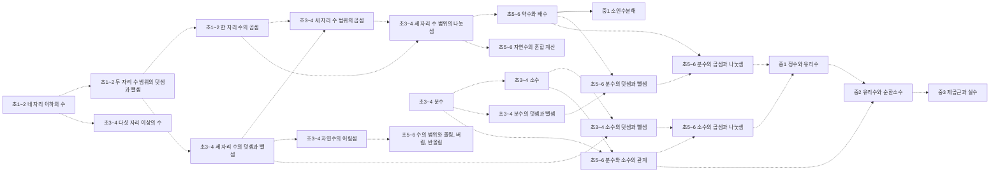
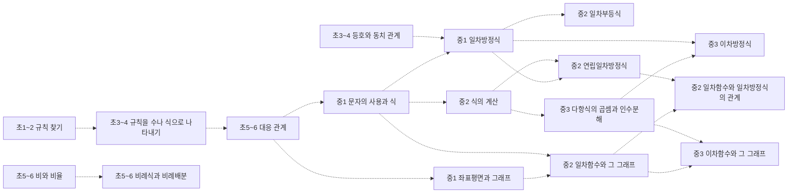
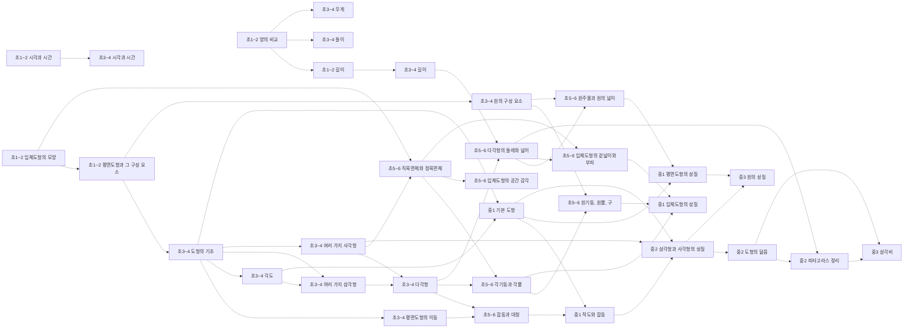
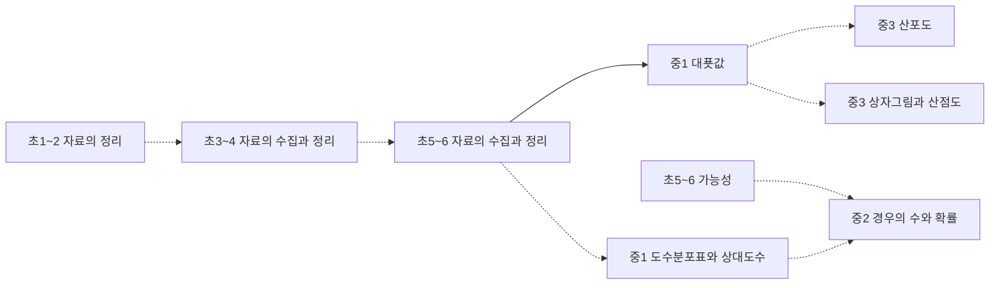

# 수학 개념 지도 (초1~고1)

개념 99개 = 고시문 수학과 「내용 체계」의 지식⋅이해 항목(원문 낱말 그대로). 선수관계 171개 — **원문 27** (고시문 문장이 밝힌 것, 실선) · **제안 144** (원문에 없어 Claude 가 제안하고 Gemini 가 반박 심사한 것, 점선 · 제안).

> 원문: 「초⋅중학교의 지식⋅이해 범주는 학년(군)에 따라 위계성을 가지며, 영역 간에도 위계성을 고려하여 구성하였다.」 — 위계가 있다는 것은 원문이지만, 개념 사이 화살표 하나하나는 대부분 원문에 없다. 제안 간선의 이유와 심사 기록은 [concept_proposals.json](../data/kr/concept_proposals.json).

MCP 에서는 `concept_path` 로 묻는다(예: 「분수 나눗셈을 다시 배우려면?」).

목차: [수와 연산](#수와-연산) · [변화와 관계](#변화와-관계) · [도형과 측정](#도형과-측정) · [자료와 가능성](#자료와-가능성) · [다항식](#다항식) · [방정식과 부등식](#방정식과-부등식) · [경우의 수](#경우의-수) · [행렬](#행렬) · [도형의 방정식](#도형의-방정식) · [집합과 명제](#집합과-명제) · [함수와 그래프](#함수와-그래프)

## 수와 연산

### 초1~2 네 자리 이하의 수

성취기준 2수01-01, 2수01-02, 2수01-03, 2수01-04  
➡️ 이어서: [초1~2 두 자리 수 범위의 덧셈과 뺄셈](#초1-2-두-자리-수-범위의-덧셈과-뺄셈)제안 · [초3~4 다섯 자리 이상의 수](#초3-4-다섯-자리-이상의-수)제안  

### 초1~2 두 자리 수 범위의 덧셈과 뺄셈

성취기준 2수01-05, 2수01-06, 2수01-07, 2수01-08, 2수01-09  
⬅️ 먼저: [초1~2 네 자리 이하의 수](#초1-2-네-자리-이하의-수)제안  
➡️ 이어서: [초1~2 한 자리 수의 곱셈](#초1-2-한-자리-수의-곱셈)제안 · [초3~4 세 자리 수의 덧셈과 뺄셈](#초3-4-세-자리-수의-덧셈과-뺄셈)제안 · [초3~4 등호와 동치 관계](#초3-4-등호와-동치-관계)제안  

### 초1~2 한 자리 수의 곱셈

성취기준 2수01-10, 2수01-11  
⬅️ 먼저: [초1~2 두 자리 수 범위의 덧셈과 뺄셈](#초1-2-두-자리-수-범위의-덧셈과-뺄셈)제안  
➡️ 이어서: [초3~4 세 자리 수 범위의 곱셈](#초3-4-세-자리-수-범위의-곱셈)제안 · [초3~4 세 자리 수 범위의 나눗셈](#초3-4-세-자리-수-범위의-나눗셈)제안  

### 초3~4 다섯 자리 이상의 수

성취기준 4수01-01, 4수01-02  
⬅️ 먼저: [초1~2 네 자리 이하의 수](#초1-2-네-자리-이하의-수)제안  

### 초3~4 세 자리 수의 덧셈과 뺄셈

성취기준 4수01-03  
⬅️ 먼저: [초1~2 두 자리 수 범위의 덧셈과 뺄셈](#초1-2-두-자리-수-범위의-덧셈과-뺄셈)제안  
➡️ 이어서: [초3~4 세 자리 수 범위의 곱셈](#초3-4-세-자리-수-범위의-곱셈)제안 · [초3~4 자연수의 어림셈](#초3-4-자연수의-어림셈)제안 · [초3~4 소수의 덧셈과 뺄셈](#초3-4-소수의-덧셈과-뺄셈)제안 · [초3~4 시각과 시간](#초3-4-시각과-시간)제안  

### 초3~4 세 자리 수 범위의 곱셈

성취기준 4수01-04  
⬅️ 먼저: [초1~2 한 자리 수의 곱셈](#초1-2-한-자리-수의-곱셈)제안 · [초3~4 세 자리 수의 덧셈과 뺄셈](#초3-4-세-자리-수의-덧셈과-뺄셈)제안  
➡️ 이어서: [초3~4 세 자리 수 범위의 나눗셈](#초3-4-세-자리-수-범위의-나눗셈)제안 · [초5~6 다각형의 둘레와 넓이](#초5-6-다각형의-둘레와-넓이)제안  

### 초3~4 세 자리 수 범위의 나눗셈

성취기준 4수01-05, 4수01-06, 4수01-07  
⬅️ 먼저: [초3~4 세 자리 수 범위의 곱셈](#초3-4-세-자리-수-범위의-곱셈)제안 · [초1~2 한 자리 수의 곱셈](#초1-2-한-자리-수의-곱셈)제안  
➡️ 이어서: [초5~6 약수와 배수](#초5-6-약수와-배수)제안 · [초5~6 자연수의 혼합 계산](#초5-6-자연수의-혼합-계산)제안  

### 초3~4 자연수의 어림셈

성취기준 4수01-08  
⬅️ 먼저: [초3~4 세 자리 수의 덧셈과 뺄셈](#초3-4-세-자리-수의-덧셈과-뺄셈)제안  
➡️ 이어서: [초5~6 수의 범위와 올림, 버림, 반올림](#초5-6-수의-범위와-올림-버림-반올림)제안  

### 초3~4 분수

성취기준 4수01-09, 4수01-10, 4수01-11  
➡️ 이어서: [초3~4 소수](#초3-4-소수)제안 · [초3~4 분수의 덧셈과 뺄셈](#초3-4-분수의-덧셈과-뺄셈)제안 · [초5~6 분수와 소수의 관계](#초5-6-분수와-소수의-관계)제안 · [초5~6 가능성](#초5-6-가능성)제안  

### 초3~4 소수

성취기준 4수01-12, 4수01-13, 4수01-14  
⬅️ 먼저: [초3~4 분수](#초3-4-분수)제안  
➡️ 이어서: [초3~4 소수의 덧셈과 뺄셈](#초3-4-소수의-덧셈과-뺄셈)제안 · [초5~6 분수와 소수의 관계](#초5-6-분수와-소수의-관계)제안  

### 초3~4 분수의 덧셈과 뺄셈

성취기준 4수01-15  
⬅️ 먼저: [초3~4 분수](#초3-4-분수)제안  
➡️ 이어서: [초5~6 분수의 덧셈과 뺄셈](#초5-6-분수의-덧셈과-뺄셈)제안  

### 초3~4 소수의 덧셈과 뺄셈

성취기준 4수01-16  
⬅️ 먼저: [초3~4 소수](#초3-4-소수)제안 · [초3~4 세 자리 수의 덧셈과 뺄셈](#초3-4-세-자리-수의-덧셈과-뺄셈)제안  
➡️ 이어서: [초5~6 소수의 곱셈과 나눗셈](#초5-6-소수의-곱셈과-나눗셈)제안  

### 초5~6 분수의 덧셈과 뺄셈

성취기준 6수01-06, 6수01-07, 6수01-08  
⬅️ 먼저: [초3~4 분수의 덧셈과 뺄셈](#초3-4-분수의-덧셈과-뺄셈)제안 · [초5~6 약수와 배수](#초5-6-약수와-배수)제안  
➡️ 이어서: [초5~6 분수의 곱셈과 나눗셈](#초5-6-분수의-곱셈과-나눗셈)제안  

### 초5~6 자연수의 혼합 계산

성취기준 6수01-01  
⬅️ 먼저: [초3~4 세 자리 수 범위의 나눗셈](#초3-4-세-자리-수-범위의-나눗셈)제안  

### 초5~6 수의 범위와 올림, 버림, 반올림

성취기준 6수01-02, 6수01-03  
⬅️ 먼저: [초3~4 자연수의 어림셈](#초3-4-자연수의-어림셈)제안  

### 초5~6 약수와 배수

성취기준 6수01-04, 6수01-05  
⬅️ 먼저: [초3~4 세 자리 수 범위의 나눗셈](#초3-4-세-자리-수-범위의-나눗셈)제안  
➡️ 이어서: [중1 소인수분해](#중1-소인수분해) · [초5~6 분수의 덧셈과 뺄셈](#초5-6-분수의-덧셈과-뺄셈)제안 · [초5~6 분수의 곱셈과 나눗셈](#초5-6-분수의-곱셈과-나눗셈)제안  

### 초5~6 분수의 곱셈과 나눗셈

성취기준 6수01-09, 6수01-10, 6수01-11  
⬅️ 먼저: [초5~6 분수의 덧셈과 뺄셈](#초5-6-분수의-덧셈과-뺄셈)제안 · [초5~6 약수와 배수](#초5-6-약수와-배수)제안  
➡️ 이어서: [중1 정수와 유리수](#중1-정수와-유리수)제안 · [초5~6 비례식과 비례배분](#초5-6-비례식과-비례배분)제안  

### 초5~6 분수와 소수의 관계

성취기준 6수01-12  
⬅️ 먼저: [초3~4 분수](#초3-4-분수)제안 · [초3~4 소수](#초3-4-소수)제안  
➡️ 이어서: [초5~6 소수의 곱셈과 나눗셈](#초5-6-소수의-곱셈과-나눗셈)제안 · [중2 유리수와 순환소수](#중2-유리수와-순환소수)제안 · [초5~6 비와 비율](#초5-6-비와-비율)제안  

### 초5~6 소수의 곱셈과 나눗셈

성취기준 6수01-13, 6수01-14, 6수01-15  
⬅️ 먼저: [초3~4 소수의 덧셈과 뺄셈](#초3-4-소수의-덧셈과-뺄셈)제안 · [초5~6 분수와 소수의 관계](#초5-6-분수와-소수의-관계)제안  
➡️ 이어서: [중1 정수와 유리수](#중1-정수와-유리수)제안 · [초5~6 원주율과 원의 넓이](#초5-6-원주율과-원의-넓이)제안  

### 중1 소인수분해

성취기준 9수01-01, 9수01-02  
⬅️ 먼저: [초5~6 약수와 배수](#초5-6-약수와-배수)  

### 중1 정수와 유리수

성취기준 9수01-03, 9수01-04, 9수01-05  
⬅️ 먼저: [초5~6 분수의 곱셈과 나눗셈](#초5-6-분수의-곱셈과-나눗셈)제안 · [초5~6 소수의 곱셈과 나눗셈](#초5-6-소수의-곱셈과-나눗셈)제안  
➡️ 이어서: [중2 유리수와 순환소수](#중2-유리수와-순환소수)제안 · [중1 문자의 사용과 식](#중1-문자의-사용과-식)제안 · [중1 좌표평면과 그래프](#중1-좌표평면과-그래프)제안 · [고1 행렬과 그 연산](#고1-행렬과-그-연산)제안 · [중2 일차부등식](#중2-일차부등식)제안  

### 중2 유리수와 순환소수

성취기준 9수01-06  
⬅️ 먼저: [중1 정수와 유리수](#중1-정수와-유리수)제안 · [초5~6 분수와 소수의 관계](#초5-6-분수와-소수의-관계)제안  
➡️ 이어서: [중3 제곱근과 실수](#중3-제곱근과-실수)제안  

### 중3 제곱근과 실수

성취기준 9수01-07, 9수01-08, 9수01-09, 9수01-10  
⬅️ 먼저: [중2 유리수와 순환소수](#중2-유리수와-순환소수)제안  
➡️ 이어서: [고1 복소수와 이차방정식](#고1-복소수와-이차방정식) · [중3 이차방정식](#중3-이차방정식)제안 · [중3 삼각비](#중3-삼각비)제안 · [중3 산포도](#중3-산포도)제안 · [고1 유리함수와 무리함수](#고1-유리함수와-무리함수)제안  

## 변화와 관계

### 초1~2 규칙 찾기

성취기준 2수02-01, 2수02-02  
➡️ 이어서: [초3~4 규칙을 수나 식으로 나타내기](#초3-4-규칙을-수나-식으로-나타내기)제안  

### 초3~4 규칙을 수나 식으로 나타내기

성취기준 4수02-01, 4수02-02  
⬅️ 먼저: [초1~2 규칙 찾기](#초1-2-규칙-찾기)제안  
➡️ 이어서: [초5~6 대응 관계](#초5-6-대응-관계)제안  

### 초3~4 등호와 동치 관계

성취기준 4수02-03  
⬅️ 먼저: [초1~2 두 자리 수 범위의 덧셈과 뺄셈](#초1-2-두-자리-수-범위의-덧셈과-뺄셈)제안  
➡️ 이어서: [중1 일차방정식](#중1-일차방정식)제안  

### 초5~6 대응 관계

성취기준 6수02-01  
⬅️ 먼저: [초3~4 규칙을 수나 식으로 나타내기](#초3-4-규칙을-수나-식으로-나타내기)제안  
➡️ 이어서: [중1 문자의 사용과 식](#중1-문자의-사용과-식)제안 · [중1 좌표평면과 그래프](#중1-좌표평면과-그래프)제안  

### 초5~6 비와 비율

성취기준 6수02-02, 6수02-03  
⬅️ 먼저: [초5~6 분수와 소수의 관계](#초5-6-분수와-소수의-관계)제안  
➡️ 이어서: [초5~6 비례식과 비례배분](#초5-6-비례식과-비례배분)제안 · [초5~6 자료의 수집과 정리](#초5-6-자료의-수집과-정리)제안 · [중1 도수분포표와 상대도수](#중1-도수분포표와-상대도수)제안  

### 초5~6 비례식과 비례배분

성취기준 6수02-04, 6수02-05  
⬅️ 먼저: [초5~6 비와 비율](#초5-6-비와-비율)제안 · [초5~6 분수의 곱셈과 나눗셈](#초5-6-분수의-곱셈과-나눗셈)제안  
➡️ 이어서: [중2 도형의 닮음](#중2-도형의-닮음)제안  

### 중1 문자의 사용과 식

성취기준 9수02-01, 9수02-02  
⬅️ 먼저: [초5~6 대응 관계](#초5-6-대응-관계)제안 · [중1 정수와 유리수](#중1-정수와-유리수)제안  
➡️ 이어서: [중1 일차방정식](#중1-일차방정식)제안 · [중2 식의 계산](#중2-식의-계산)제안 · [중2 일차함수와 그 그래프](#중2-일차함수와-그-그래프)제안  

### 중1 일차방정식

성취기준 9수02-03, 9수02-04  
⬅️ 먼저: [중1 문자의 사용과 식](#중1-문자의-사용과-식)제안 · [초3~4 등호와 동치 관계](#초3-4-등호와-동치-관계)제안  
➡️ 이어서: [고1 복소수와 이차방정식](#고1-복소수와-이차방정식) · [고1 이차방정식과 이차함수](#고1-이차방정식과-이차함수) · [고1 여러 가지 방정식과 부등식](#고1-여러-가지-방정식과-부등식) · [중2 일차부등식](#중2-일차부등식)제안 · [중2 연립일차방정식](#중2-연립일차방정식)제안 · [중3 이차방정식](#중3-이차방정식)제안  

### 중1 좌표평면과 그래프

성취기준 9수02-05, 9수02-06, 9수02-07  
⬅️ 먼저: [중1 정수와 유리수](#중1-정수와-유리수)제안 · [초5~6 대응 관계](#초5-6-대응-관계)제안  
➡️ 이어서: [중2 일차함수와 그 그래프](#중2-일차함수와-그-그래프)제안 · [중3 상자그림과 산점도](#중3-상자그림과-산점도)제안 · [고1 평면좌표](#고1-평면좌표)제안  

### 중2 식의 계산

성취기준 9수02-08, 9수02-09, 9수02-10  
⬅️ 먼저: [중1 문자의 사용과 식](#중1-문자의-사용과-식)제안  
➡️ 이어서: [중2 연립일차방정식](#중2-연립일차방정식)제안 · [중3 다항식의 곱셈과 인수분해](#중3-다항식의-곱셈과-인수분해)제안  

### 중2 일차부등식

성취기준 9수02-11, 9수02-12  
⬅️ 먼저: [중1 일차방정식](#중1-일차방정식)제안 · [중1 정수와 유리수](#중1-정수와-유리수)제안  
➡️ 이어서: [고1 여러 가지 방정식과 부등식](#고1-여러-가지-방정식과-부등식)  

### 중2 연립일차방정식

성취기준 9수02-13  
⬅️ 먼저: [중1 일차방정식](#중1-일차방정식)제안 · [중2 식의 계산](#중2-식의-계산)제안  
➡️ 이어서: [고1 여러 가지 방정식과 부등식](#고1-여러-가지-방정식과-부등식) · [고1 복소수와 이차방정식](#고1-복소수와-이차방정식) · [고1 이차방정식과 이차함수](#고1-이차방정식과-이차함수) · [중2 일차함수와 일차방정식의 관계](#중2-일차함수와-일차방정식의-관계)제안  

### 중2 일차함수와 그 그래프

성취기준 9수02-14, 9수02-15, 9수02-16  
⬅️ 먼저: [중1 좌표평면과 그래프](#중1-좌표평면과-그래프)제안 · [중1 문자의 사용과 식](#중1-문자의-사용과-식)제안  
➡️ 이어서: [고1 함수](#고1-함수) · [고1 유리함수와 무리함수](#고1-유리함수와-무리함수) · [중2 일차함수와 일차방정식의 관계](#중2-일차함수와-일차방정식의-관계)제안 · [중3 이차함수와 그 그래프](#중3-이차함수와-그-그래프)제안 · [고1 직선의 방정식](#고1-직선의-방정식)제안  

### 중2 일차함수와 일차방정식의 관계

성취기준 9수02-17, 9수02-18  
⬅️ 먼저: [중2 일차함수와 그 그래프](#중2-일차함수와-그-그래프)제안 · [중2 연립일차방정식](#중2-연립일차방정식)제안  
➡️ 이어서: [고1 직선의 방정식](#고1-직선의-방정식) · [고1 함수](#고1-함수) · [고1 복소수와 이차방정식](#고1-복소수와-이차방정식) · [고1 이차방정식과 이차함수](#고1-이차방정식과-이차함수) · [고1 여러 가지 방정식과 부등식](#고1-여러-가지-방정식과-부등식) · [고1 유리함수와 무리함수](#고1-유리함수와-무리함수)  

### 중3 다항식의 곱셈과 인수분해

성취기준 9수02-19  
⬅️ 먼저: [중2 식의 계산](#중2-식의-계산)제안  
➡️ 이어서: [고1 인수분해](#고1-인수분해) · [고1 다항식의 연산](#고1-다항식의-연산) · [중3 이차방정식](#중3-이차방정식)제안 · [중3 이차함수와 그 그래프](#중3-이차함수와-그-그래프)제안  

### 중3 이차방정식

성취기준 9수02-20  
⬅️ 먼저: [중3 다항식의 곱셈과 인수분해](#중3-다항식의-곱셈과-인수분해)제안 · [중3 제곱근과 실수](#중3-제곱근과-실수)제안 · [중1 일차방정식](#중1-일차방정식)제안  
➡️ 이어서: [고1 복소수와 이차방정식](#고1-복소수와-이차방정식) · [고1 이차방정식과 이차함수](#고1-이차방정식과-이차함수) · [고1 여러 가지 방정식과 부등식](#고1-여러-가지-방정식과-부등식)  

### 중3 이차함수와 그 그래프

성취기준 9수02-21, 9수02-22  
⬅️ 먼저: [중2 일차함수와 그 그래프](#중2-일차함수와-그-그래프)제안 · [중3 다항식의 곱셈과 인수분해](#중3-다항식의-곱셈과-인수분해)제안  
➡️ 이어서: [고1 함수](#고1-함수) · [고1 유리함수와 무리함수](#고1-유리함수와-무리함수) · [고1 이차방정식과 이차함수](#고1-이차방정식과-이차함수)제안  

## 도형과 측정

### 초1~2 입체도형의 모양

성취기준 2수03-01, 2수03-02  
➡️ 이어서: [초1~2 평면도형과 그 구성 요소](#초1-2-평면도형과-그-구성-요소)제안 · [초5~6 직육면체와 정육면체](#초5-6-직육면체와-정육면체)제안  

### 초1~2 평면도형과 그 구성 요소

성취기준 2수03-03, 2수03-04, 2수03-05  
⬅️ 먼저: [초1~2 입체도형의 모양](#초1-2-입체도형의-모양)제안  
➡️ 이어서: [초3~4 도형의 기초](#초3-4-도형의-기초)제안 · [초3~4 원의 구성 요소](#초3-4-원의-구성-요소)제안  

### 초1~2 양의 비교

성취기준 2수03-06  
➡️ 이어서: [초1~2 길이](#초1-2-길이)제안 · [초3~4 들이](#초3-4-들이)제안 · [초3~4 무게](#초3-4-무게)제안  

### 초1~2 시각과 시간

성취기준 2수03-07, 2수03-08, 2수03-09  
➡️ 이어서: [초3~4 시각과 시간](#초3-4-시각과-시간)제안  

### 초1~2 길이

성취기준 2수03-10, 2수03-11, 2수03-12, 2수03-13  
⬅️ 먼저: [초1~2 양의 비교](#초1-2-양의-비교)제안  
➡️ 이어서: [초3~4 길이](#초3-4-길이)제안  

### 초3~4 시각과 시간

성취기준 4수03-13, 4수03-14  
⬅️ 먼저: [초1~2 시각과 시간](#초1-2-시각과-시간)제안 · [초3~4 세 자리 수의 덧셈과 뺄셈](#초3-4-세-자리-수의-덧셈과-뺄셈)제안  

### 초3~4 길이

성취기준 4수03-15, 4수03-16  
⬅️ 먼저: [초1~2 길이](#초1-2-길이)제안  
➡️ 이어서: [초5~6 다각형의 둘레와 넓이](#초5-6-다각형의-둘레와-넓이)제안  

### 초3~4 도형의 기초

성취기준 4수03-01, 4수03-02, 4수03-03  
⬅️ 먼저: [초1~2 평면도형과 그 구성 요소](#초1-2-평면도형과-그-구성-요소)제안  
➡️ 이어서: [초3~4 평면도형의 이동](#초3-4-평면도형의-이동)제안 · [초3~4 각도](#초3-4-각도)제안 · [초3~4 여러 가지 삼각형](#초3-4-여러-가지-삼각형)제안 · [초3~4 여러 가지 사각형](#초3-4-여러-가지-사각형)제안 · [중1 기본 도형](#중1-기본-도형)제안  

### 초3~4 평면도형의 이동

성취기준 4수03-04, 4수03-05  
⬅️ 먼저: [초3~4 도형의 기초](#초3-4-도형의-기초)제안  
➡️ 이어서: [초5~6 합동과 대칭](#초5-6-합동과-대칭)제안  

### 초3~4 원의 구성 요소

성취기준 4수03-06, 4수03-07  
⬅️ 먼저: [초1~2 평면도형과 그 구성 요소](#초1-2-평면도형과-그-구성-요소)제안  
➡️ 이어서: [초5~6 원기둥, 원뿔, 구](#초5-6-원기둥-원뿔-구)제안 · [초5~6 원주율과 원의 넓이](#초5-6-원주율과-원의-넓이)제안  

### 초3~4 여러 가지 삼각형

성취기준 4수03-08, 4수03-09  
⬅️ 먼저: [초3~4 도형의 기초](#초3-4-도형의-기초)제안 · [초3~4 각도](#초3-4-각도)제안  
➡️ 이어서: [초3~4 다각형](#초3-4-다각형)제안  

### 초3~4 여러 가지 사각형

성취기준 4수03-10  
⬅️ 먼저: [초3~4 도형의 기초](#초3-4-도형의-기초)제안  
➡️ 이어서: [초3~4 다각형](#초3-4-다각형)제안 · [초5~6 직육면체와 정육면체](#초5-6-직육면체와-정육면체)제안 · [중2 삼각형과 사각형의 성질](#중2-삼각형과-사각형의-성질)제안  

### 초3~4 다각형

성취기준 4수03-11, 4수03-12  
⬅️ 먼저: [초3~4 여러 가지 사각형](#초3-4-여러-가지-사각형)제안 · [초3~4 여러 가지 삼각형](#초3-4-여러-가지-삼각형)제안  
➡️ 이어서: [초5~6 합동과 대칭](#초5-6-합동과-대칭)제안 · [초5~6 각기둥과 각뿔](#초5-6-각기둥과-각뿔)제안 · [초5~6 다각형의 둘레와 넓이](#초5-6-다각형의-둘레와-넓이)제안  

### 초3~4 들이

성취기준 4수03-17, 4수03-18, 4수03-19  
⬅️ 먼저: [초1~2 양의 비교](#초1-2-양의-비교)제안  

### 초3~4 무게

성취기준 4수03-20, 4수03-21, 4수03-22, 4수03-23  
⬅️ 먼저: [초1~2 양의 비교](#초1-2-양의-비교)제안  

### 초3~4 각도

성취기준 4수03-24, 4수03-25  
⬅️ 먼저: [초3~4 도형의 기초](#초3-4-도형의-기초)제안  
➡️ 이어서: [초3~4 여러 가지 삼각형](#초3-4-여러-가지-삼각형)제안 · [중1 기본 도형](#중1-기본-도형)제안  

### 초5~6 합동과 대칭

성취기준 6수03-01, 6수03-02  
⬅️ 먼저: [초3~4 평면도형의 이동](#초3-4-평면도형의-이동)제안 · [초3~4 다각형](#초3-4-다각형)제안  
➡️ 이어서: [중1 작도와 합동](#중1-작도와-합동)제안  

### 초5~6 직육면체와 정육면체

성취기준 6수03-03, 6수03-04  
⬅️ 먼저: [초1~2 입체도형의 모양](#초1-2-입체도형의-모양)제안 · [초3~4 여러 가지 사각형](#초3-4-여러-가지-사각형)제안  
➡️ 이어서: [초5~6 각기둥과 각뿔](#초5-6-각기둥과-각뿔)제안 · [초5~6 입체도형의 공간 감각](#초5-6-입체도형의-공간-감각)제안 · [초5~6 입체도형의 겉넓이와 부피](#초5-6-입체도형의-겉넓이와-부피)제안  

### 초5~6 각기둥과 각뿔

성취기준 6수03-05, 6수03-06  
⬅️ 먼저: [초5~6 직육면체와 정육면체](#초5-6-직육면체와-정육면체)제안 · [초3~4 다각형](#초3-4-다각형)제안  
➡️ 이어서: [초5~6 원기둥, 원뿔, 구](#초5-6-원기둥-원뿔-구)제안 · [중1 입체도형의 성질](#중1-입체도형의-성질)제안  

### 초5~6 원기둥, 원뿔, 구

성취기준 6수03-07, 6수03-08  
⬅️ 먼저: [초5~6 각기둥과 각뿔](#초5-6-각기둥과-각뿔)제안 · [초3~4 원의 구성 요소](#초3-4-원의-구성-요소)제안  
➡️ 이어서: [중1 입체도형의 성질](#중1-입체도형의-성질)제안  

### 초5~6 입체도형의 공간 감각

성취기준 6수03-09, 6수03-10  
⬅️ 먼저: [초5~6 직육면체와 정육면체](#초5-6-직육면체와-정육면체)제안  

### 초5~6 다각형의 둘레와 넓이

성취기준 6수03-11, 6수03-12, 6수03-13, 6수03-14  
⬅️ 먼저: [초3~4 다각형](#초3-4-다각형)제안 · [초3~4 길이](#초3-4-길이)제안 · [초3~4 세 자리 수 범위의 곱셈](#초3-4-세-자리-수-범위의-곱셈)제안  
➡️ 이어서: [초5~6 원주율과 원의 넓이](#초5-6-원주율과-원의-넓이)제안 · [초5~6 입체도형의 겉넓이와 부피](#초5-6-입체도형의-겉넓이와-부피)제안 · [중2 피타고라스 정리](#중2-피타고라스-정리)제안  

### 초5~6 원주율과 원의 넓이

성취기준 6수03-15, 6수03-16  
⬅️ 먼저: [초5~6 다각형의 둘레와 넓이](#초5-6-다각형의-둘레와-넓이)제안 · [초3~4 원의 구성 요소](#초3-4-원의-구성-요소)제안 · [초5~6 소수의 곱셈과 나눗셈](#초5-6-소수의-곱셈과-나눗셈)제안  
➡️ 이어서: [중1 평면도형의 성질](#중1-평면도형의-성질)제안  

### 초5~6 입체도형의 겉넓이와 부피

성취기준 6수03-17, 6수03-18, 6수03-19  
⬅️ 먼저: [초5~6 직육면체와 정육면체](#초5-6-직육면체와-정육면체)제안 · [초5~6 다각형의 둘레와 넓이](#초5-6-다각형의-둘레와-넓이)제안  
➡️ 이어서: [중1 입체도형의 성질](#중1-입체도형의-성질)제안  

### 중1 기본 도형

성취기준 9수03-01, 9수03-02  
⬅️ 먼저: [초3~4 도형의 기초](#초3-4-도형의-기초)제안 · [초3~4 각도](#초3-4-각도)제안  
➡️ 이어서: [중1 작도와 합동](#중1-작도와-합동)제안 · [중1 평면도형의 성질](#중1-평면도형의-성질)제안 · [중2 삼각형과 사각형의 성질](#중2-삼각형과-사각형의-성질)제안  

### 중1 작도와 합동

성취기준 9수03-03, 9수03-04  
⬅️ 먼저: [중1 기본 도형](#중1-기본-도형)제안 · [초5~6 합동과 대칭](#초5-6-합동과-대칭)제안  
➡️ 이어서: [중2 삼각형과 사각형의 성질](#중2-삼각형과-사각형의-성질)제안  

### 중1 평면도형의 성질

성취기준 9수03-05, 9수03-06  
⬅️ 먼저: [중1 기본 도형](#중1-기본-도형)제안 · [초5~6 원주율과 원의 넓이](#초5-6-원주율과-원의-넓이)제안  
➡️ 이어서: [중3 원의 성질](#중3-원의-성질)제안  

### 중1 입체도형의 성질

성취기준 9수03-07, 9수03-08  
⬅️ 먼저: [초5~6 각기둥과 각뿔](#초5-6-각기둥과-각뿔)제안 · [초5~6 원기둥, 원뿔, 구](#초5-6-원기둥-원뿔-구)제안 · [초5~6 입체도형의 겉넓이와 부피](#초5-6-입체도형의-겉넓이와-부피)제안  

### 중2 삼각형과 사각형의 성질

성취기준 9수03-09, 9수03-10, 9수03-11  
⬅️ 먼저: [중1 작도와 합동](#중1-작도와-합동)제안 · [초3~4 여러 가지 사각형](#초3-4-여러-가지-사각형)제안 · [중1 기본 도형](#중1-기본-도형)제안  
➡️ 이어서: [중2 도형의 닮음](#중2-도형의-닮음)제안 · [중3 원의 성질](#중3-원의-성질)제안  

### 중2 도형의 닮음

성취기준 9수03-12, 9수03-13, 9수03-14  
⬅️ 먼저: [중2 삼각형과 사각형의 성질](#중2-삼각형과-사각형의-성질)제안 · [초5~6 비례식과 비례배분](#초5-6-비례식과-비례배분)제안  
➡️ 이어서: [중2 피타고라스 정리](#중2-피타고라스-정리)제안 · [중3 삼각비](#중3-삼각비)제안  

### 중2 피타고라스 정리

성취기준 9수03-15  
⬅️ 먼저: [중2 도형의 닮음](#중2-도형의-닮음)제안 · [초5~6 다각형의 둘레와 넓이](#초5-6-다각형의-둘레와-넓이)제안  
➡️ 이어서: [중3 삼각비](#중3-삼각비)제안 · [고1 평면좌표](#고1-평면좌표)제안  

### 중3 삼각비

성취기준 9수03-16, 9수03-17  
⬅️ 먼저: [중2 피타고라스 정리](#중2-피타고라스-정리)제안 · [중2 도형의 닮음](#중2-도형의-닮음)제안 · [중3 제곱근과 실수](#중3-제곱근과-실수)제안  

### 중3 원의 성질

성취기준 9수03-18, 9수03-19  
⬅️ 먼저: [중1 평면도형의 성질](#중1-평면도형의-성질)제안 · [중2 삼각형과 사각형의 성질](#중2-삼각형과-사각형의-성질)제안  
➡️ 이어서: [고1 원의 방정식](#고1-원의-방정식)  

## 자료와 가능성

### 초1~2 자료의 정리

성취기준 2수04-01, 2수04-02, 2수04-03  
➡️ 이어서: [초3~4 자료의 수집과 정리](#초3-4-자료의-수집과-정리)제안  

### 초3~4 자료의 수집과 정리

성취기준 4수04-01, 4수04-02, 4수04-03  
⬅️ 먼저: [초1~2 자료의 정리](#초1-2-자료의-정리)제안  
➡️ 이어서: [초5~6 자료의 수집과 정리](#초5-6-자료의-수집과-정리)제안  

### 초5~6 자료의 수집과 정리

성취기준 6수04-01, 6수04-02, 6수04-03  
⬅️ 먼저: [초3~4 자료의 수집과 정리](#초3-4-자료의-수집과-정리)제안 · [초5~6 비와 비율](#초5-6-비와-비율)제안  
➡️ 이어서: [중1 대푯값](#중1-대푯값) · [중1 도수분포표와 상대도수](#중1-도수분포표와-상대도수)제안  

### 초5~6 가능성

성취기준 6수04-04, 6수04-05, 6수04-06  
⬅️ 먼저: [초3~4 분수](#초3-4-분수)제안  
➡️ 이어서: [중2 경우의 수와 확률](#중2-경우의-수와-확률)제안  

### 중1 대푯값

성취기준 9수04-01  
⬅️ 먼저: [초5~6 자료의 수집과 정리](#초5-6-자료의-수집과-정리)  
➡️ 이어서: [중3 산포도](#중3-산포도)제안 · [중3 상자그림과 산점도](#중3-상자그림과-산점도)제안  

### 중1 도수분포표와 상대도수

성취기준 9수04-02, 9수04-03, 9수04-04  
⬅️ 먼저: [초5~6 자료의 수집과 정리](#초5-6-자료의-수집과-정리)제안 · [초5~6 비와 비율](#초5-6-비와-비율)제안  
➡️ 이어서: [중2 경우의 수와 확률](#중2-경우의-수와-확률)제안  

### 중2 경우의 수와 확률

성취기준 9수04-05, 9수04-06  
⬅️ 먼저: [초5~6 가능성](#초5-6-가능성)제안 · [중1 도수분포표와 상대도수](#중1-도수분포표와-상대도수)제안  
➡️ 이어서: [고1 합의 법칙과 곱의 법칙](#고1-합의-법칙과-곱의-법칙)  

### 중3 산포도

성취기준 9수04-07  
⬅️ 먼저: [중1 대푯값](#중1-대푯값)제안 · [중3 제곱근과 실수](#중3-제곱근과-실수)제안  

### 중3 상자그림과 산점도

성취기준 9수04-08, 9수04-09  
⬅️ 먼저: [중1 대푯값](#중1-대푯값)제안 · [중1 좌표평면과 그래프](#중1-좌표평면과-그래프)제안  

## 다항식

### 고1 다항식의 연산

성취기준 10공수1-01-01  
⬅️ 먼저: [중3 다항식의 곱셈과 인수분해](#중3-다항식의-곱셈과-인수분해)  
➡️ 이어서: [고1 나머지정리](#고1-나머지정리)제안  

### 고1 나머지정리

성취기준 10공수1-01-02  
⬅️ 먼저: [고1 다항식의 연산](#고1-다항식의-연산)제안  
➡️ 이어서: [고1 인수분해](#고1-인수분해)제안  

### 고1 인수분해

성취기준 10공수1-01-03  
⬅️ 먼저: [중3 다항식의 곱셈과 인수분해](#중3-다항식의-곱셈과-인수분해) · [고1 나머지정리](#고1-나머지정리)제안  
➡️ 이어서: [고1 여러 가지 방정식과 부등식](#고1-여러-가지-방정식과-부등식)제안  

## 방정식과 부등식

### 고1 복소수와 이차방정식

성취기준 10공수1-02-01, 10공수1-02-02, 10공수1-02-03, 10공수1-02-08  
⬅️ 먼저: [중3 제곱근과 실수](#중3-제곱근과-실수) · [중1 일차방정식](#중1-일차방정식) · [중2 연립일차방정식](#중2-연립일차방정식) · [중2 일차함수와 일차방정식의 관계](#중2-일차함수와-일차방정식의-관계) · [중3 이차방정식](#중3-이차방정식)  
➡️ 이어서: [고1 이차방정식과 이차함수](#고1-이차방정식과-이차함수)제안 · [고1 여러 가지 방정식과 부등식](#고1-여러-가지-방정식과-부등식)제안  

### 고1 이차방정식과 이차함수

성취기준 10공수1-02-04, 10공수1-02-05, 10공수1-02-06, 10공수1-02-11  
⬅️ 먼저: [중1 일차방정식](#중1-일차방정식) · [중2 연립일차방정식](#중2-연립일차방정식) · [중2 일차함수와 일차방정식의 관계](#중2-일차함수와-일차방정식의-관계) · [중3 이차방정식](#중3-이차방정식) · [고1 복소수와 이차방정식](#고1-복소수와-이차방정식)제안 · [중3 이차함수와 그 그래프](#중3-이차함수와-그-그래프)제안  
➡️ 이어서: [고1 여러 가지 방정식과 부등식](#고1-여러-가지-방정식과-부등식)제안  

### 고1 여러 가지 방정식과 부등식

성취기준 10공수1-02-07, 10공수1-02-09, 10공수1-02-10  
⬅️ 먼저: [중2 연립일차방정식](#중2-연립일차방정식) · [중1 일차방정식](#중1-일차방정식) · [중2 일차함수와 일차방정식의 관계](#중2-일차함수와-일차방정식의-관계) · [중3 이차방정식](#중3-이차방정식) · [중2 일차부등식](#중2-일차부등식) · [고1 인수분해](#고1-인수분해)제안 · [고1 이차방정식과 이차함수](#고1-이차방정식과-이차함수)제안 · [고1 복소수와 이차방정식](#고1-복소수와-이차방정식)제안  

## 경우의 수

### 고1 합의 법칙과 곱의 법칙

성취기준 10공수1-03-01  
⬅️ 먼저: [중2 경우의 수와 확률](#중2-경우의-수와-확률)  
➡️ 이어서: [고1 순열과 조합](#고1-순열과-조합)제안  

### 고1 순열과 조합

성취기준 10공수1-03-02, 10공수1-03-03  
⬅️ 먼저: [고1 합의 법칙과 곱의 법칙](#고1-합의-법칙과-곱의-법칙)제안  

## 행렬

### 고1 행렬과 그 연산

성취기준 10공수1-04-01, 10공수1-04-02  
⬅️ 먼저: [중1 정수와 유리수](#중1-정수와-유리수)제안  

## 도형의 방정식

### 고1 평면좌표

성취기준 10공수2-01-01  
⬅️ 먼저: [중1 좌표평면과 그래프](#중1-좌표평면과-그래프)제안 · [중2 피타고라스 정리](#중2-피타고라스-정리)제안  
➡️ 이어서: [고1 직선의 방정식](#고1-직선의-방정식)제안 · [고1 원의 방정식](#고1-원의-방정식)제안  

### 고1 직선의 방정식

성취기준 10공수2-01-02, 10공수2-01-03, 10공수2-01-05  
⬅️ 먼저: [중2 일차함수와 일차방정식의 관계](#중2-일차함수와-일차방정식의-관계) · [고1 평면좌표](#고1-평면좌표)제안 · [중2 일차함수와 그 그래프](#중2-일차함수와-그-그래프)제안  
➡️ 이어서: [고1 원의 방정식](#고1-원의-방정식)제안 · [고1 도형의 이동](#고1-도형의-이동)제안  

### 고1 원의 방정식

성취기준 10공수2-01-04  
⬅️ 먼저: [중3 원의 성질](#중3-원의-성질) · [고1 평면좌표](#고1-평면좌표)제안 · [고1 직선의 방정식](#고1-직선의-방정식)제안  
➡️ 이어서: [고1 도형의 이동](#고1-도형의-이동)제안  

### 고1 도형의 이동

성취기준 10공수2-01-06, 10공수2-01-07  
⬅️ 먼저: [고1 직선의 방정식](#고1-직선의-방정식)제안 · [고1 원의 방정식](#고1-원의-방정식)제안  
➡️ 이어서: [고1 유리함수와 무리함수](#고1-유리함수와-무리함수)제안  

## 집합과 명제

### 고1 집합

성취기준 10공수2-02-01, 10공수2-02-02, 10공수2-02-03  
➡️ 이어서: [고1 명제](#고1-명제)제안 · [고1 함수](#고1-함수)제안  

### 고1 명제

성취기준 10공수2-02-04, 10공수2-02-05, 10공수2-02-06, 10공수2-02-07, 10공수2-02-08  
⬅️ 먼저: [고1 집합](#고1-집합)제안  

## 함수와 그래프

### 고1 함수

성취기준 10공수2-03-01, 10공수2-03-02, 10공수2-03-03  
⬅️ 먼저: [중2 일차함수와 그 그래프](#중2-일차함수와-그-그래프) · [중2 일차함수와 일차방정식의 관계](#중2-일차함수와-일차방정식의-관계) · [중3 이차함수와 그 그래프](#중3-이차함수와-그-그래프) · [고1 집합](#고1-집합)제안  
➡️ 이어서: [고1 유리함수와 무리함수](#고1-유리함수와-무리함수)제안  

### 고1 유리함수와 무리함수

성취기준 10공수2-03-04, 10공수2-03-05  
⬅️ 먼저: [중2 일차함수와 그 그래프](#중2-일차함수와-그-그래프) · [중2 일차함수와 일차방정식의 관계](#중2-일차함수와-일차방정식의-관계) · [중3 이차함수와 그 그래프](#중3-이차함수와-그-그래프) · [고1 함수](#고1-함수)제안 · [중3 제곱근과 실수](#중3-제곱근과-실수)제안 · [고1 도형의 이동](#고1-도형의-이동)제안  
