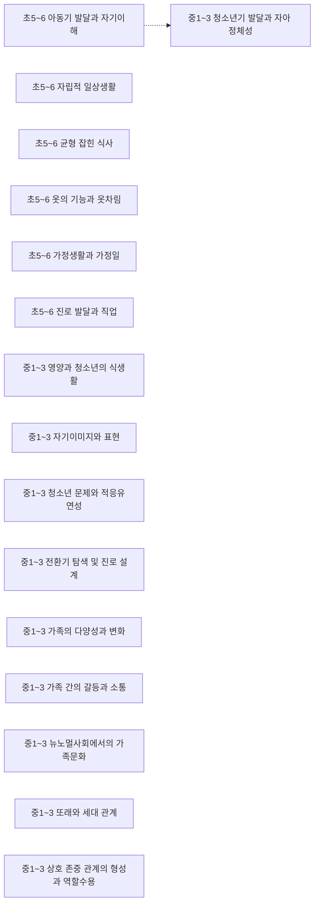
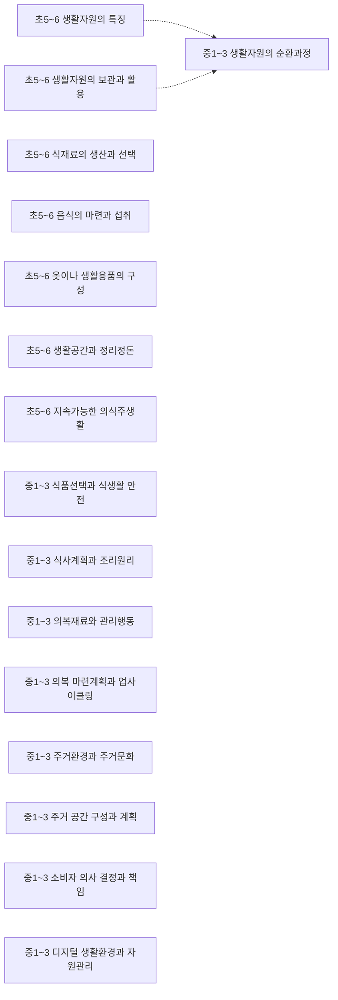
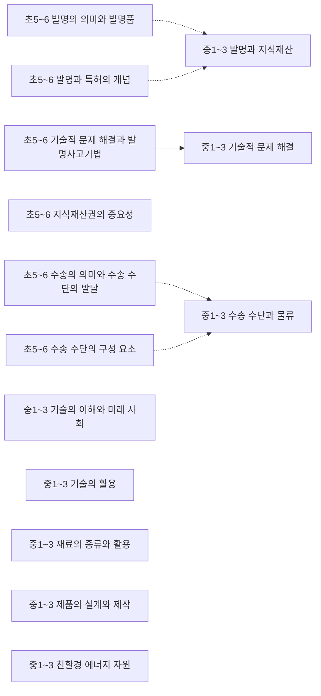
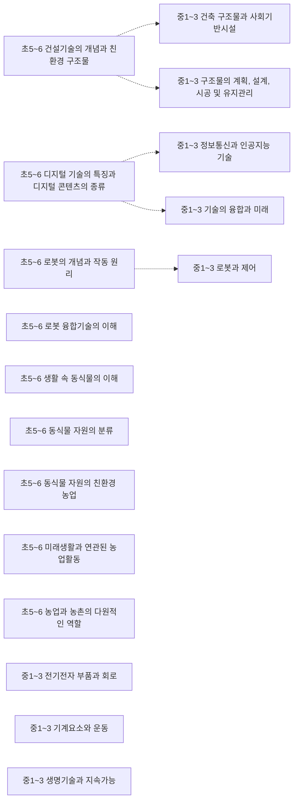

# 실과·기술가정·정보 개념 지도 (초5~고2~3)

개념 246개 = 고시문 「내용 체계」의 지식⋅이해 항목(원문 낱말 그대로). 선수관계 29개 — **구조 13** (내용 체계 같은 범주 행의 바로 앞 학년 칸 — 규칙으로 뽑아 Gemini 가 「타당」이라 한 것) · **단원 16** (고시문이 밝힌 단원 연계 안의 개념 쌍 — 규칙으로 뽑아 Gemini 가 「타당」이라 한 것). 원문이 아닌 간선은 그림에서 점선, 목록에서 표시.

> 각 교과 「내용 체계」는 범주를 학년(군)에 따라 위계적으로 배열한다 — 같은 범주 행의 앞 학년 칸이 「구조」 간선의 근거다. 고교 과목은 표가 과목마다 따로라 고시문 단원 연계(「…와 연계된다」) 위에서 「단원」 간선을 찾는다. 간선별 이유·심사 기록은 [concept_proposals.json](../data/kr/concept_proposals.json) · [concept_structure.json](../data/kr/concept_structure.json).

□ 셀프 체크는 그 개념 성취기준 문장을 물음으로만 바꾼 것이다. MCP 에서는 `concept_path` 로 묻고, 「예」인 개념은 `known` 에 넣는다. 먼저/이어서가 없는 개념은 교과 문서의 단원 연계를 본다.

목차: [인간 발달과 주도적 삶](#인간-발달과-주도적-삶) · [생활환경과 지속가능한 선택](#생활환경과-지속가능한-선택) · [기술적 문제해결과 혁신](#기술적-문제해결과-혁신) · [지속가능한 기술과 융합](#지속가능한-기술과-융합) · [디지털 사회와 인공지능](#디지털-사회와-인공지능) · [컴퓨팅 시스템](#컴퓨팅-시스템) · [데이터](#데이터) · [알고리즘과 프로그래밍](#알고리즘과-프로그래밍) · [인공지능](#인공지능) · [디지털 문화](#디지털-문화) · [고2~3 · 기술⋅가정 · 생활문화와 디지털 환경](#고2-3-기술-가정-생활문화와-디지털-환경) · [고2~3 · 기술⋅가정 · 소비자와 생활복지](#고2-3-기술-가정-소비자와-생활복지) · [고2~3 · 기술⋅가정 · 인간과 성장하는 관계](#고2-3-기술-가정-인간과-성장하는-관계) · [고2~3 · 기술⋅가정 · 공학의 기초](#고2-3-기술-가정-공학의-기초) · [고2~3 · 기술⋅가정 · 미래를 여는 공학 혁신](#고2-3-기술-가정-미래를-여는-공학-혁신) · [고2~3 · 기술⋅가정 · 지속가능한 융합 공학](#고2-3-기술-가정-지속가능한-융합-공학) · [고2~3 · 로봇과 공학세계 · 로봇의 이해](#고2-3-로봇과-공학세계-로봇의-이해) · [고2~3 · 로봇과 공학세계 · 공학 세계의 탐색과 로봇의 활용](#고2-3-로봇과-공학세계-공학-세계의-탐색과-로봇의-활용) · [고2~3 · 로봇과 공학세계 · 로봇공학 프로젝트](#고2-3-로봇과-공학세계-로봇공학-프로젝트) · [고2~3 · 생활과학 탐구 · 인간행동과 생활과학](#고2-3-생활과학-탐구-인간행동과-생활과학) · [고2~3 · 생활과학 탐구 · 생활환경과 생활과학](#고2-3-생활과학-탐구-생활환경과-생활과학) · [고2~3 · 생활과학 탐구 · 생활과학과 진로](#고2-3-생활과학-탐구-생활과학과-진로) · [고2~3 · 창의 공학 설계 · 창의 공학 설계의 이해](#고2-3-창의-공학-설계-창의-공학-설계의-이해) · [고2~3 · 창의 공학 설계 · 창의 공학 설계 프로젝트](#고2-3-창의-공학-설계-창의-공학-설계-프로젝트) · [고2~3 · 지식 재산 일반 · 지식재산의 이해](#고2-3-지식-재산-일반-지식재산의-이해) · [고2~3 · 지식 재산 일반 · 지식재산권의 보호와 활용](#고2-3-지식-재산-일반-지식재산권의-보호와-활용) · [고2~3 · 지식 재산 일반 · 지식재산권 창출 프로젝트](#고2-3-지식-재산-일반-지식재산권-창출-프로젝트) · [고2~3 · 아동발달과 부모 · 부모됨의 준비](#고2-3-아동발달과-부모-부모됨의-준비) · [고2~3 · 아동발달과 부모 · 아동발달과 돌봄](#고2-3-아동발달과-부모-아동발달과-돌봄) · [고2~3 · 생애 설계와 자립 · 사회⋅정서적 자립](#고2-3-생애-설계와-자립-사회-정서적-자립) · [고2~3 · 생애 설계와 자립 · 경제적 자립](#고2-3-생애-설계와-자립-경제적-자립) · [고2~3 · 생애 설계와 자립 · 일상생활 자립](#고2-3-생애-설계와-자립-일상생활-자립) · [고2~3 · 정보 · 컴퓨팅 시스템](#고2-3-정보-컴퓨팅-시스템) · [고2~3 · 정보 · 데이터](#고2-3-정보-데이터) · [고2~3 · 정보 · 알고리즘과 프로그래밍](#고2-3-정보-알고리즘과-프로그래밍) · [고2~3 · 정보 · 인공지능](#고2-3-정보-인공지능) · [고2~3 · 정보 · 디지털 문화](#고2-3-정보-디지털-문화) · [고2~3 · 인공지능 기초 · 인공지능의 이해](#고2-3-인공지능-기초-인공지능의-이해) · [고2~3 · 인공지능 기초 · 인공지능과 학습](#고2-3-인공지능-기초-인공지능과-학습) · [고2~3 · 인공지능 기초 · 인공지능의 사회적 영향](#고2-3-인공지능-기초-인공지능의-사회적-영향) · [고2~3 · 인공지능 기초 · 인공지능 프로젝트](#고2-3-인공지능-기초-인공지능-프로젝트) · [고2~3 · 데이터 과학 · 데이터 과학의 이해](#고2-3-데이터-과학-데이터-과학의-이해) · [고2~3 · 데이터 과학 · 데이터 준비와 분석](#고2-3-데이터-과학-데이터-준비와-분석) · [고2~3 · 데이터 과학 · 데이터 모델링과 평가](#고2-3-데이터-과학-데이터-모델링과-평가) · [고2~3 · 데이터 과학 · 데이터 과학 프로젝트](#고2-3-데이터-과학-데이터-과학-프로젝트) · [고2~3 · 소프트웨어와 생활 · 세상을 변화시키는 소프트웨어](#고2-3-소프트웨어와-생활-세상을-변화시키는-소프트웨어) · [고2~3 · 소프트웨어와 생활 · 창작을 지원하는 소프트웨어](#고2-3-소프트웨어와-생활-창작을-지원하는-소프트웨어) · [고2~3 · 소프트웨어와 생활 · 현상을 분석하는 소프트웨어](#고2-3-소프트웨어와-생활-현상을-분석하는-소프트웨어) · [고2~3 · 소프트웨어와 생활 · 모의 실험하는 소프트웨어](#고2-3-소프트웨어와-생활-모의-실험하는-소프트웨어) · [고2~3 · 소프트웨어와 생활 · 가치를 창출하는 소프트웨어](#고2-3-소프트웨어와-생활-가치를-창출하는-소프트웨어)

## 인간 발달과 주도적 삶

### 초5~6 아동기 발달과 자기이해

성취기준 6실01-01  
➡️ 이어서: [중1~3 청소년기 발달과 자아 정체성](#중1-3-청소년기-발달과-자아-정체성)구조  

- □ 아동기의 발달 특징을 이해하고 성장발달에 필요한 조건과 방법을 탐색한다.

### 초5~6 자립적 일상생활

성취기준 6실01-02  

- □ 건강한 발달을 위한 자기 관리 방법을 탐색하고, 일상생활 속에서 올바른 생활습관과 태도를 갖도록 계획하여 실천한다.

### 초5~6 균형 잡힌 식사

성취기준 6실01-04  
➡️ 이어서: [고2~3 생애 설계와 자립 1인 식사의 선택](#고2-3-생애-설계와-자립-1인-식사의-선택)단원  

- □ 균형 잡힌 식사의 중요성과 조건을 탐색하여 자신의 식습관을 검토해 보고 건강한 식습관 형성에 적용한다.

### 초5~6 옷의 기능과 옷차림

성취기준 6실01-05  

- □ 옷의 기능을 이해하여 평소 자신의 옷차림을 살펴보고 건강하고 적절한 옷 입기를 실천한다.

### 초5~6 가정생활과 가정일

성취기준 6실01-06  

- □ 가정일을 수행하는 과정에서 일의 가치와 중요성을 이해하고, 가정생활을 유지하는 데 필요한 가정일의 종류를 탐색한다.

### 초5~6 진로 발달과 직업

성취기준 6실01-07  

- □ 직업의 필요성을 이해하고 적성, 흥미, 성격에 따라 진로 발달 계획을 세우고 주도적으로 탐색한다.

### 중1~3 청소년기 발달과 자아 정체성

성취기준 9기가01-01  
⬅️ 먼저: [초5~6 아동기 발달과 자기이해](#초5-6-아동기-발달과-자기이해)구조  

- □ 자아 존중감을 향상시키고 긍정적인 자아 정체성을 형성하기 위해 청소년기의 발달 특징을 자신의 발달 특징과 연결 지어 자신을 총체적으로 이해하고 있나요?

### 중1~3 영양과 청소년의 식생활

성취기준 9기가01-03  

- □ 건강과 성장을 위한 청소년기 영양의 중요성을 이해하여 자신의 식생활을 평가하고, 식생활 문제를 개선하여 건강한 식생활을 실천한다.

### 중1~3 자기이미지와 표현

성취기준 9기가01-04  

- □ 의복디자인 요소를 고려한 자기이미지에 맞는 옷차림으로 자신을 긍정적으로 표현한다.

### 중1~3 청소년 문제와 적응유연성

성취기준 9기가01-03, 9기가01-05  

- □ 건강과 성장을 위한 청소년기 영양의 중요성을 이해하여 자신의 식생활을 평가하고, 식생활 문제를 개선하여 건강한 식생활을 실천한다.
- □ 청소년기의 건강한 발달을 위협하는 스트레스, 분노, 우울 등의 여러 가지 행동 및 심리 문제의 원인을 분석하고, 적응 유연성을 기를 수 있는 다양한 예방 및 해결방안을 탐색하여 적용한다.

### 중1~3 전환기 탐색 및 진로 설계

성취기준 9기가01-07  

- □ 자기 이해를 기반으로 전 생애적 관점에서 진로 설계의 중요성을 인식하고, 자기 적성에 맞는 진로를 설계한다.

### 중1~3 가족의 다양성과 변화

성취기준 9기가01-06, 9기가01-10  
➡️ 이어서: [고2~3 아동발달과 부모 가족의 형성](#고2-3-아동발달과-부모-가족의-형성)단원  

- □ 사회변화로 증가하는 여러 가지 청소년 중독의 유형을 탐색하여 이를 예방하고 대응할 수 있는 방안을 제안한다.
- □ 다양한 현대 가족에 내재된 가족생활의 보편성과 고유한 가치를 존중하는 동시에 가족에 대한 유연한 태도를 길러, 뉴노멀 사회에서의 새로운 가족문화를 탐색한다.

### 중1~3 가족 간의 갈등과 소통

성취기준 9기가01-11  

- □ 대인 관계에서 발생하는 갈등의 원인과 배경을 분석하고, 효과적인 의사소통을 통해 갈등을 해결하는 방안을 탐색하여 이를 적용한다.

### 중1~3 뉴노멀사회에서의 가족문화

성취기준 9기가01-10  

- □ 다양한 현대 가족에 내재된 가족생활의 보편성과 고유한 가치를 존중하는 동시에 가족에 대한 유연한 태도를 길러, 뉴노멀 사회에서의 새로운 가족문화를 탐색한다.

### 중1~3 또래와 세대 관계

성취기준 9기가01-09  

- □ 일상생활 및 가상공간에서 만나는 또래와 건강한 관계를 형성하고, 다양한 주변인들과 친밀한 세대 간 관계를 형성하는 방안을 탐색하여 실천한다.

### 중1~3 상호 존중 관계의 형성과 역할수용

성취기준 9기가01-08  
➡️ 이어서: [고2~3 아동발달과 부모 부모와 자녀 간의 긍정적 관계의 형성](#고2-3-아동발달과-부모-부모와-자녀-간의-긍정적-관계의-형성)단원  

- □ 성적 자기 결정권의 중요성을 이해하고, 성인지 감수성과 건강한 성 가치관을 함양하여 상호 존중의 관계를 실천할 수 있는 방안을 탐색한다.

## 생활환경과 지속가능한 선택

### 초5~6 생활자원의 특징

성취기준 6실02-01, 6실02-02, 6실02-03  
➡️ 이어서: [중1~3 생활자원의 순환과정](#중1-3-생활자원의-순환과정)구조  

- □ 시간이나 용돈과 같은 생활자원이 제한되어 있음을 이해하고, 생활자원의 사용가치를 높이는 방법을 탐색한다.
- □ 생활자원 관리의 필요성을 인식하고, 생활자원의 합리적인 보관과 활용방법을 익힌다.
- □ 생활자원의 올바른 사용이 가정과 환경에 도움이 됨을 이해하고 재활용, 재사용 등 환경을 고려한 관리 방법을 실천한다.

### 초5~6 생활자원의 보관과 활용

성취기준 6실02-02  
➡️ 이어서: [중1~3 생활자원의 순환과정](#중1-3-생활자원의-순환과정)구조  

- □ 생활자원 관리의 필요성을 인식하고, 생활자원의 합리적인 보관과 활용방법을 익힌다.

### 초5~6 식재료의 생산과 선택

성취기준 6실02-04  

- □ 식재료 생산과 선택의 중요성을 인식하고 여러 식재료의 고유하고 다양한 맛을 경험하여 자신의 식사에 적용한다.

### 초5~6 음식의 마련과 섭취

성취기준 6실02-05  

- □ 음식의 조리과정을 체험하여 자기 간식이나 식사를 스스로 마련하는 식생활을 실천한다.

### 초5~6 옷이나 생활용품의 구성

성취기준 6실02-07  

- □ 의생활 용품이 만들어지는 과정을 탐색하여 옷이나 생활용품이 어떻게 구성되는지를 설명한다.

### 초5~6 생활공간과 정리정돈

성취기준 6실02-10  

- □ 자신의 생활공간을 쾌적하고 위생적으로 관리하는 것의 중요성을 알고, 정리정돈과 청소 및 쓰레기 처리의 방법을 익혀 실천한다.

### 초5~6 지속가능한 의식주생활

성취기준 6실02-01, 6실02-02, 6실02-03, 6실02-04, 6실02-05, 6실02-06, 6실02-07, 6실02-08, 6실02-09, 6실02-10, 6실02-11  

- □ 시간이나 용돈과 같은 생활자원이 제한되어 있음을 이해하고, 생활자원의 사용가치를 높이는 방법을 탐색한다.
- □ 생활자원 관리의 필요성을 인식하고, 생활자원의 합리적인 보관과 활용방법을 익힌다.
- □ 생활자원의 올바른 사용이 가정과 환경에 도움이 됨을 이해하고 재활용, 재사용 등 환경을 고려한 관리 방법을 실천한다.
- … 외 8개

### 중1~3 생활자원의 순환과정

성취기준 9기가02-01  
⬅️ 먼저: [초5~6 생활자원의 특징](#초5-6-생활자원의-특징)구조 · [초5~6 생활자원의 보관과 활용](#초5-6-생활자원의-보관과-활용)구조  

- □ 생활자원의 종류와 특성 및 순환과정을 이해하고, 의식주 자원관리의 중요성을 인식한다.

### 중1~3 식품선택과 식생활 안전

성취기준 9기가02-08  

- □ 생활공간으로서 주거환경의 조건을 분석하고, 쾌적하고 안전한 주거 관리 방안을 탐색하여 실생활에 적용한다.

### 중1~3 식사계획과 조리원리

성취기준 9기가02-08  

- □ 생활공간으로서 주거환경의 조건을 분석하고, 쾌적하고 안전한 주거 관리 방안을 탐색하여 실생활에 적용한다.

### 중1~3 의복재료와 관리행동

성취기준 9기가02-08  

- □ 생활공간으로서 주거환경의 조건을 분석하고, 쾌적하고 안전한 주거 관리 방안을 탐색하여 실생활에 적용한다.

### 중1~3 의복 마련계획과 업사이클링

성취기준 9기가02-05, 9기가02-06  

- □ 의복 재료의 특성을 이해하고 건강과 환경을 고려한 의복의 세탁과 관리 방안을 탐색하여 실천한다.
- □ 지속가능성을 고려하여 의복 마련 계획을 세우고, 이를 창의적이고 친환경적인 의생활에 적용한다.

### 중1~3 주거환경과 주거문화

성취기준 9기가02-08  

- □ 생활공간으로서 주거환경의 조건을 분석하고, 쾌적하고 안전한 주거 관리 방안을 탐색하여 실생활에 적용한다.

### 중1~3 주거 공간 구성과 계획

성취기준 9기가02-09  

- □ 효율적인 주거 공간 구성 방안을 탐색하여 자신의 생활에 적합한 주거 공간 구성에 활용한다.

### 중1~3 소비자 의사 결정과 책임

성취기준 9기가02-12  

- □ 청소년 소비자의 특성을 이해하고 소비자 의사 결정 과정을 통한 합리적인 소비생활을 실천한다.

### 중1~3 디지털 생활환경과 자원관리

성취기준 9기가02-01  

- □ 생활자원의 종류와 특성 및 순환과정을 이해하고, 의식주 자원관리의 중요성을 인식한다.

## 기술적 문제해결과 혁신

### 초5~6 발명의 의미와 발명품

성취기준 6실03-01  
➡️ 이어서: [중1~3 발명과 지식재산](#중1-3-발명과-지식재산)구조  

- □ 발명의 의미를 이해하고, 일상생활을 바꾼 발명품을 탐색하여 발명과 기술에 대한 중요성과 가치를 인식한다.

### 초5~6 기술적 문제 해결과 발명사고기법

성취기준 6실03-02  
➡️ 이어서: [중1~3 기술적 문제 해결](#중1-3-기술적-문제-해결)구조 · [고2~3 창의 공학 설계 창의 공학 설계와 문제 해결 과정](#고2-3-창의-공학-설계-창의-공학-설계와-문제-해결-과정)단원  

- □ 발명사고기법과 기술적 문제 해결 과정을 이해하고, 다양한 재료를 활용하여 생활 속 문제를 해결할 수 있는 창의적인 제품을 구상하고 만들어 봄으로써 실천적 태도를 갖는다.

### 초5~6 발명과 특허의 개념

성취기준 6실03-03  
➡️ 이어서: [고2~3 지식 재산 일반 특허 정보 검색](#고2-3-지식-재산-일반-특허-정보-검색)단원 · [고2~3 지식 재산 일반 특허 명세서](#고2-3-지식-재산-일반-특허-명세서)단원 · [고2~3 지식 재산 일반 특허 도면](#고2-3-지식-재산-일반-특허-도면)단원 · [고2~3 지식 재산 일반 특허 출원](#고2-3-지식-재산-일반-특허-출원)단원 · [중1~3 발명과 지식재산](#중1-3-발명과-지식재산)구조  

- □ 발명과 특허의 관계를 이해하고, 특허 침해 사례를 통하여 지식재산권의 중요성을 인식하여 올바른 방법으로 활용한다.

### 초5~6 지식재산권의 중요성

성취기준 6실03-03  

- □ 발명과 특허의 관계를 이해하고, 특허 침해 사례를 통하여 지식재산권의 중요성을 인식하여 올바른 방법으로 활용한다.

### 초5~6 수송의 의미와 수송 수단의 발달

성취기준 6실03-04  
➡️ 이어서: [중1~3 수송 수단과 물류](#중1-3-수송-수단과-물류)구조  

- □ 수송의 의미와 수송 수단의 발달과정에 대한 이해를 바탕으로 생활 속 다양한 수송 수단을 탐색한다.

### 초5~6 수송 수단의 구성 요소

성취기준 6실03-05  
➡️ 이어서: [중1~3 수송 수단과 물류](#중1-3-수송-수단과-물류)구조  

- □ 수송 수단의 구성 요소를 이해하고, 친환경 에너지를 적용한 다양한 수송 수단의 시제품을 만들어 수송기술의 가치를 인식한다.

### 중1~3 기술의 이해와 미래 사회

성취기준 9기가03-01  

- □ 기술의 의미와 특성을 이해하고 기술의 발달에 따른 사회의 변화를 파악하며, 미래의 기술과 사회의 변화를 평가하고 예측함으로써 기술에 대한 가치를 인식한다.

### 중1~3 기술의 활용

성취기준 9기가03-02, 9기가03-06, 9기가03-10, 9기가03-12  

- □ 기술의 표준화, 적정 기술과 같은 기술 활용 사례를 탐구하고, 기술이 사회에 미치는 영향을 바르게 인식하여 기술 혁신과 사회 발전에 참여하는 태도를 갖는다.
- □ 지식재산권의 종류와 특징을 이해하고, 지식재산과 관련한 다양한 사례 조사 및 체험을 통해 지식재산권의 창출, 보호, 활용을 이해하고 실천한다.
- □ 친환경 에너지 자원의 특성을 이해하고, 종류와 활용 사례를 조사하여 친환경 에너지 개발의 중요성을 인식한다.
- … 외 1개

### 중1~3 기술적 문제 해결

성취기준 9기가03-01, 9기가03-02, 9기가03-03, 9기가03-04, 9기가03-05, 9기가03-06, 9기가03-07, 9기가03-08, 9기가03-09, 9기가03-10, 9기가03-11, 9기가03-12, 9기가03-13  
⬅️ 먼저: [초5~6 기술적 문제 해결과 발명사고기법](#초5-6-기술적-문제-해결과-발명사고기법)구조  
➡️ 이어서: [고2~3 창의 공학 설계 창의 공학 설계와 문제 해결 과정](#고2-3-창의-공학-설계-창의-공학-설계와-문제-해결-과정)단원  

- □ 기술의 의미와 특성을 이해하고 기술의 발달에 따른 사회의 변화를 파악하며, 미래의 기술과 사회의 변화를 평가하고 예측함으로써 기술에 대한 가치를 인식한다.
- □ 기술의 표준화, 적정 기술과 같은 기술 활용 사례를 탐구하고, 기술이 사회에 미치는 영향을 바르게 인식하여 기술 혁신과 사회 발전에 참여하는 태도를 갖는다.
- □ 기술적 문제 해결 과정의 이해를 바탕으로 문제를 확인하고, 정보를 수집하며, 확산적 사고와 수렴적 사고를 통해 해결방안을 탐색하고 대안을 선정한다.
- … 외 10개

### 중1~3 발명과 지식재산

성취기준 9기가03-06  
⬅️ 먼저: [초5~6 발명의 의미와 발명품](#초5-6-발명의-의미와-발명품)구조 · [초5~6 발명과 특허의 개념](#초5-6-발명과-특허의-개념)구조  
➡️ 이어서: [고2~3 지식 재산 일반 직무 발명 제도](#고2-3-지식-재산-일반-직무-발명-제도)단원 · [고2~3 지식 재산 일반 발명 문제해결 과정](#고2-3-지식-재산-일반-발명-문제해결-과정)단원  

- □ 지식재산권의 종류와 특징을 이해하고, 지식재산과 관련한 다양한 사례 조사 및 체험을 통해 지식재산권의 창출, 보호, 활용을 이해하고 실천한다.

### 중1~3 재료의 종류와 활용

성취기준 9기가03-06, 9기가03-07, 9기가03-10  

- □ 지식재산권의 종류와 특징을 이해하고, 지식재산과 관련한 다양한 사례 조사 및 체험을 통해 지식재산권의 창출, 보호, 활용을 이해하고 실천한다.
- □ 재료의 종류와 특성을 이해하며, 목적에 맞는 재료를 선택하고, 안전한 가공 방법을 실천한다.
- □ 친환경 에너지 자원의 특성을 이해하고, 종류와 활용 사례를 조사하여 친환경 에너지 개발의 중요성을 인식한다.

### 중1~3 제품의 설계와 제작

성취기준 9기가03-04, 9기가03-09  

- □ 기술적 문제 해결 방안을 시각화하고 도면을 작성하며, 올바른 도구를 선택하여 시제품 또는 모형을 제작 및 평가하는 과정에서 협업 능력, 공감 능력과 의사소통 능력을 기른다.
- □ 제품의 제작 순서를 이해하고 올바른 도구를 선택하여 제품을 안전하게 제작하고 평가한다.

### 중1~3 친환경 에너지 자원

성취기준 9기가03-10  

- □ 친환경 에너지 자원의 특성을 이해하고, 종류와 활용 사례를 조사하여 친환경 에너지 개발의 중요성을 인식한다.

### 중1~3 수송 수단과 물류

성취기준 9기가03-12, 9기가03-13  
⬅️ 먼저: [초5~6 수송의 의미와 수송 수단의 발달](#초5-6-수송의-의미와-수송-수단의-발달)구조 · [초5~6 수송 수단의 구성 요소](#초5-6-수송-수단의-구성-요소)구조  
➡️ 이어서: [고2~3 로봇과 공학세계 에너지⋅수송 분야 공학 세계의 이해](#고2-3-로봇과-공학세계-에너지-수송-분야-공학-세계의-이해)단원  

- □ 다양한 수송 수단과 물류 체제를 이해하고 발달과정 및 특징과 혁신적인 활용 사례를 조사하여 수송 분야의 발달을 전망한다.
- □ 수송 수단 및 물류 체제와 관련된 문제를 이해하고 해결방안을 탐색하여 실현하고 평가한다.

## 지속가능한 기술과 융합

### 초5~6 건설기술의 개념과 친환경 구조물

성취기준 6실04-01  
➡️ 이어서: [중1~3 건축 구조물과 사회기반시설](#중1-3-건축-구조물과-사회기반시설)구조 · [중1~3 구조물의 계획, 설계, 시공 및 유지관리](#중1-3-구조물의-계획-설계-시공-및-유지관리)구조  

- □ 친환경 건설 구조물을 이해하고, 생활 속 건설 구조물을 탐색하여 간단한 구조물을 체험하면서 건설기술에 대한 가치를 인식한다.

### 초5~6 디지털 기술의 특징과 디지털 콘텐츠의 종류

성취기준 6실04-02  
➡️ 이어서: [중1~3 정보통신과 인공지능 기술](#중1-3-정보통신과-인공지능-기술)구조 · [중1~3 기술의 융합과 미래](#중1-3-기술의-융합과-미래)구조  

- □ 생활 속 디지털 기술의 중요성을 이해하고, 디지털 기기와 디지털 콘텐츠 저작 도구를 사용하여 발표 자료를 만들어 보면서 디지털 기기의 활용 능력을 기른다.

### 초5~6 로봇의 개념과 작동 원리

성취기준 6실04-05  
➡️ 이어서: [중1~3 로봇과 제어](#중1-3-로봇과-제어)구조  

- □ 로봇의 종류와 활용 사례를 통해 작동 원리를 이해하고, 로봇에 대한 관심과 흥미를 가진다.

### 초5~6 로봇 융합기술의 이해

성취기준 6실04-04, 6실04-05, 6실04-06  

- □ 로봇의 개념과 구조를 이해하고, 생활 속 로봇 기능을 체험하여 로봇의 중요성을 인식한다.
- □ 로봇의 종류와 활용 사례를 통해 작동 원리를 이해하고, 로봇에 대한 관심과 흥미를 가진다.
- □ 로봇의 융합 기술을 이해하고, 간단한 로봇을 만들어 코딩과 프로그램을 적용하여 동작시키는 체험을 통해 융합 기술의 가치를 인식한다.

### 초5~6 생활 속 동식물의 이해

성취기준 6실04-07, 6실04-08  

- □ 생활 속 동식물 자원을 활용 목적에 따라 분류하고 이와 관련된 다양한 생명기술을 탐색한다.
- □ 생활 속 동식물을 기르고 가꾸는 방법을 알고, 동식물을 기르고 가꾸는 체험을 통해 생태 존중감을 가진다.

### 초5~6 동식물 자원의 분류

성취기준 6실04-07  

- □ 생활 속 동식물 자원을 활용 목적에 따라 분류하고 이와 관련된 다양한 생명기술을 탐색한다.

### 초5~6 동식물 자원의 친환경 농업

성취기준 6실04-09  

- □ 동식물 자원의 친환경 농업 사례를 통해 지속가능한 농업이 순환되고 있음을 인식하고 농업의 미래가치를 인식한다.

### 초5~6 미래생활과 연관된 농업활동

성취기준 6실04-10  

- □ 생활 속에서 농업활동과 관련된 모습을 분석하고 이에 따른 농업활동을 체험하여 농업에 대한 관심을 두고 이를 생활 속에서 실천한다.

### 초5~6 농업과 농촌의 다원적인 역할

성취기준 6실04-11  

- □ 농업과 농촌의 다원적인 역할과 가치를 이해하고 미래 농업과 관련된 다양한 직업 세계를 탐색한다.

### 중1~3 건축 구조물과 사회기반시설

성취기준 9기가04-01, 9기가04-02, 9기가04-03  
⬅️ 먼저: [초5~6 건설기술의 개념과 친환경 구조물](#초5-6-건설기술의-개념과-친환경-구조물)구조  

- □ 건설기술의 개념 및 발달과정, 건설 구조물의 종류와 특성을 이해하고, 건설 구조물의 혁신사례를 탐구함으로써 건설기술의 중요성을 인식한다.
- □ 건설 구조물의 종류에 따른 계획, 설계, 시공, 유지관리 방법을 탐구하고 건설과정의 중요성을 이해하며 건설 구조물의 가치를 인식한다.
- □ 사용자 요구 및 주어진 환경과 조건을 충족하는 지속가능한 건설 구조물의 모형을 설계⋅제작 및 평가한다.

### 중1~3 구조물의 계획, 설계, 시공 및 유지관리

성취기준 9기가04-02  
⬅️ 먼저: [초5~6 건설기술의 개념과 친환경 구조물](#초5-6-건설기술의-개념과-친환경-구조물)구조  

- □ 건설 구조물의 종류에 따른 계획, 설계, 시공, 유지관리 방법을 탐구하고 건설과정의 중요성을 이해하며 건설 구조물의 가치를 인식한다.

### 중1~3 전기전자 부품과 회로

성취기준 9기가04-04  

- □ 전기⋅전자 부품의 종류와 기능을 이해하고 기능에 맞는 부품을 선택하여 문제를 해결하기 위한 간단한 회로를 구성하고 제작 및 평가한다.

### 중1~3 정보통신과 인공지능 기술

성취기준 9기가04-05, 9기가04-06  
⬅️ 먼저: [초5~6 디지털 기술의 특징과 디지털 콘텐츠의 종류](#초5-6-디지털-기술의-특징과-디지털-콘텐츠의-종류)구조  
➡️ 이어서: [고2~3 로봇과 공학세계 정보통신 및 인공지능 기술 분야 공학 세계의 이해](#고2-3-로봇과-공학세계-정보통신-및-인공지능-기술-분야-공학-세계의-이해)단원 · [고2~3 로봇과 공학세계 로봇을 제어하는 소프트웨어 및 인공지능 기술 이해](#고2-3-로봇과-공학세계-로봇을-제어하는-소프트웨어-및-인공지능-기술-이해)단원  

- □ 정보통신과 인공지능 기술의 활용 사례를 탐구하고, 정보통신과 인공지능 기술이 우리 삶에 미치는 영향을 다양한 관점에서 평가한다.
- □ 정보통신과 인공지능 기술 관련 문제를 이해하고 해결 방안을 탐색, 실현, 평가함으로써 긍정적인 문제 해결 태도를 갖는다.

### 중1~3 기계요소와 운동

성취기준 9기가04-08  

- □ 다양한 기계요소와 동력 전달 방법을 활용하여 주어진 문제를 해결할 수 있는 운동 물체를 안전하게 제작하고 평가한다.

### 중1~3 로봇과 제어

성취기준 9기가04-09  
⬅️ 먼저: [초5~6 로봇의 개념과 작동 원리](#초5-6-로봇의-개념과-작동-원리)구조  
➡️ 이어서: [고2~3 로봇과 공학세계 로봇을 제어하는 소프트웨어 및 인공지능 기술 이해](#고2-3-로봇과-공학세계-로봇을-제어하는-소프트웨어-및-인공지능-기술-이해)단원  

- □ 로봇에 활용되고 있는 제어 및 자동화 기술 등을 탐구하여 간단한 로봇을 제작하고 평가함으로써 창조에 대한 자신감을 갖는다.

### 중1~3 생명기술과 지속가능

성취기준 9기가04-10, 9기가04-11  

- □ 인간의 건강과 생명 연장을 위해 의료 분야에서 활용되는 생명기술 사례를 조사하고, 생명기술이 개인과 사회에 미친 영향을 평가한다.
- □ 생명기술을 이해하며, 이와 관련된 문제의 해결 방안을 탐색, 실현, 평가하고, 생명 존중 및 윤리적 태도를 갖는다.

### 중1~3 기술의 융합과 미래

성취기준 9기가04-12  
⬅️ 먼저: [초5~6 디지털 기술의 특징과 디지털 콘텐츠의 종류](#초5-6-디지털-기술의-특징과-디지털-콘텐츠의-종류)구조  

- □ 기술적 문제에 대한 도전적 태도로 다양한 분야에 활용되고 있는 융합 기술의 사례를 탐구하고 미래의 기술 변화를 전망한다.

## 디지털 사회와 인공지능

### 초5~6 컴퓨터의 개념

성취기준 6실05-01, 6실05-02  

- □ 컴퓨터를 활용한 생활 속 문제해결 사례를 탐색하고 일상생활 속 문제를 해결하기 위한 알고리즘을 다양한 방법으로 표현한다.
- □ 컴퓨터에게 명령하는 방법을 체험하고, 주어진 문제를 해결하는 프로그램을 작성한다.

### 초5~6 문제 찾기와 문제 해결 절차

성취기준 6실05-01, 6실05-02, 6실05-03  
➡️ 이어서: [고2~3 창의 공학 설계 창의 공학 설계와 문제 해결 과정](#고2-3-창의-공학-설계-창의-공학-설계와-문제-해결-과정)단원  

- □ 컴퓨터를 활용한 생활 속 문제해결 사례를 탐색하고 일상생활 속 문제를 해결하기 위한 알고리즘을 다양한 방법으로 표현한다.
- □ 컴퓨터에게 명령하는 방법을 체험하고, 주어진 문제를 해결하는 프로그램을 작성한다.
- □ 실생활의 문제를 해결하는 프로그램을 협력하여 작성하고, 산출물을 타인과 공유한다.

### 초5~6 컴퓨터에게 명령하는 방법

성취기준 6실05-02  

- □ 컴퓨터에게 명령하는 방법을 체험하고, 주어진 문제를 해결하는 프로그램을 작성한다.

### 초5~6 데이터의 종류와 표현

성취기준 6실05-04  

- □ 디지털 데이터와 아날로그 데이터의 특징을 이해하고, 인공지능에 활용할 수 있는 데이터의 유형이나 형태를 탐색한다.

### 초5~6 생활 속 인공지능

성취기준 6실05-01, 6실05-03  

- □ 컴퓨터를 활용한 생활 속 문제해결 사례를 탐색하고 일상생활 속 문제를 해결하기 위한 알고리즘을 다양한 방법으로 표현한다.
- □ 실생활의 문제를 해결하는 프로그램을 협력하여 작성하고, 산출물을 타인과 공유한다.

## 컴퓨팅 시스템

### 중1~3 컴퓨팅 시스템의 동작 원리

성취기준 9정01-01  

- □ 컴퓨팅 시스템의 구성요소와 동작 원리를 이해하고, 운영 체제의 기능을 분석한다.

### 중1~3 운영 체제의 기능

성취기준 9정01-01  

- □ 컴퓨팅 시스템의 구성요소와 동작 원리를 이해하고, 운영 체제의 기능을 분석한다.

### 중1~3 피지컬 컴퓨팅의 개념

성취기준 9정01-02  

- □ 피지컬 컴퓨팅의 개념을 이해하고, 생활 속에서 적용된 사례 조사를 통해 컴퓨팅 시스템의 필요성과 가치를 판단한다.

## 데이터

### 중1~3 디지털 데이터 표현 방법

성취기준 9정02-01  

- □ 실생활의 데이터가 디지털 형태로 변환되어 활용되는 긍정적 가치를 탐색하고, 다양한 데이터를 디지털 형태로 표현한다.

### 중1~3 데이터 수집과 관리

성취기준 9정02-02  

- □ 문제 해결에 적합한 데이터를 수집하고, 목적에 맞게 구분하여 관리한다.

### 중1~3 데이터 구조화 및 해석

성취기준 9정02-03  

- □ 실생활의 데이터를 표, 다이어그램 등 다양한 형태로 구조화한다.

## 알고리즘과 프로그래밍

### 중1~3 문제 추상화

성취기준 9정03-02  

- □ 문제 해결을 위한 추상화의 중요성을 이해하고, 핵심요소를 중심으로 알고리즘을 표현한다.

### 중1~3 알고리즘 표현 방법

성취기준 9정03-02  

- □ 문제 해결을 위한 추상화의 중요성을 이해하고, 핵심요소를 중심으로 알고리즘을 표현한다.

### 중1~3 순차적인 데이터 저장

성취기준 9정03-05  

- □ 데이터를 순차적으로 저장할 수 있는 구조를 활용하여 문제 해결 프로그램을 작성한다.

### 중1~3 논리 연산

성취기준 9정03-06  

- □ 논리 연산과 중첩 제어 구조를 활용하여 문제를 해결하는 프로그램을 작성한다.

### 중1~3 중첩 제어 구조

성취기준 9정03-06  

- □ 논리 연산과 중첩 제어 구조를 활용하여 문제를 해결하는 프로그램을 작성한다.

### 중1~3 함수와 디버깅

성취기준 9정03-07  

- □ 프로그램 작성에서 함수를 활용하고, 프로그램 수행 결과를 디버거로 분석하여 오류를 수정한다.

## 인공지능

### 중1~3 인공지능의 개념과 특성

성취기준 9정04-01  

- □ 인공지능의 개념과 특성을 설명하고 인공지능 소프트웨어를 구별한다.

### 중1~3 인공지능 시스템

성취기준 9정04-03, 9정04-04  

- □ 다양한 데이터를 활용하여 인공지능 시스템을 구성하고 적용한다.
- □ 인공지능 시스템으로 해결 가능한 문제를 발견하고, 문제 해결에 적합한 인공지능 시스템을 적용한다.

## 디지털 문화

### 중1~3 디지털 사회와 직업

성취기준 9정05-01  

- □ 디지털 사회의 특성을 탐구하고, 사회 변화에 따른 직업의 변화를 탐구한다.

### 중1~3 디지털 윤리

성취기준 9정05-01, 9정05-02, 9정05-03  

- □ 디지털 사회의 특성을 탐구하고, 사회 변화에 따른 직업의 변화를 탐구한다.
- □ 디지털 사회의 구성원으로서 편리하고 안전한 생활을 위한 규칙에 대해 민주적으로 논의하고 실천 방안을 수립한다.
- □ 사례를 중심으로 디지털 공간에서 함께 살아가기 위해 개인 정보 및 권리와 저작권을 보호하는 실천 방법을 탐구한다.

### 중1~3 개인 정보와 저작권

성취기준 9정05-03  

- □ 사례를 중심으로 디지털 공간에서 함께 살아가기 위해 개인 정보 및 권리와 저작권을 보호하는 실천 방법을 탐구한다.

## 고2~3 · 기술⋅가정 · 생활문화와 디지털 환경

### 고2~3 일상생활과 생활문화의 형성

성취기준 12기가01-01  

- □ 지속되는 일상생활에서 가치 존중을 바탕으로 일상생활의 축적이 생활양식과 생활문화로 확장됨을 이해하고 새로운 생활문화를 제안한다.

### 고2~3 한국 의식주 생활문화의 독창성

성취기준 12기가01-02  

- □ 생활문화에 대한 문화감수성을 바탕으로 한국 의식주 생활문화의 독창적 요소를 탐색하고, 다른 나라의 생활문화를 비교⋅분석한다.

### 고2~3 의식주 생활과 문화다양성

성취기준 12기가01-02  

- □ 생활문화에 대한 문화감수성을 바탕으로 한국 의식주 생활문화의 독창적 요소를 탐색하고, 다른 나라의 생활문화를 비교⋅분석한다.

### 고2~3 미래 식생활과 푸드 테크

성취기준 12기가01-03  

- □ 식생활문화에 반영된 미래 변화의 요소를 발견하고 이를 비판적으로 수용하여 식생활 문제를 개선하고 건강한 식생활 문화를 실천한다.

### 고2~3 스마트 의류와 메타패션

성취기준 12기가01-03  

- □ 식생활문화에 반영된 미래 변화의 요소를 발견하고 이를 비판적으로 수용하여 식생활 문제를 개선하고 건강한 식생활 문화를 실천한다.

### 고2~3 유비쿼터스 주거와 가상공간

성취기준 12기가01-03  

- □ 식생활문화에 반영된 미래 변화의 요소를 발견하고 이를 비판적으로 수용하여 식생활 문제를 개선하고 건강한 식생활 문화를 실천한다.

## 고2~3 · 기술⋅가정 · 소비자와 생활복지

### 고2~3 저출생 고령사회에서의 생애 설계

성취기준 12기가02-01  

- □ 저출생⋅고령사회에서 생활 설계의 필요성을 인식하고, 전 생애에 걸친 안정적인 삶을 준비하기 위한 생활을 설계한다.

### 고2~3 자산 형성과 가계 재무

성취기준 12기가02-02  

- □ 경제적 자립의 태도를 갖추기 위해 개인과 가족의 상황에 맞는 가계 재무 설계의 필요성을 이해하고, 가정경제 관리 방안을 계획한다.

### 고2~3 소비자 안전과 소비자 시민성

성취기준 12기가02-03  

- □ 소비자의 안전을 위협하는 다양한 문제를 비판적으로 성찰하여 소비자 시민성을 반영한 소비생활을 실천한다.

### 고2~3 생활복지와 빅데이터

성취기준 12기가02-04  

- □ 생활복지서비스와 일상생활에서 생성되는 빅데이터 적용의 의미를 파악하고 이를 활용하여 생활에 적용할 수 있는 새로운 복지 방안을 제안한다.

### 고2~3 맞춤형 스마트복지

성취기준 12기가02-05  

- □ 개인 및 가족의 생애 주기에 따른 맞춤형 스마트 복지 현황을 파악하고 자신이 설정한 삶의 목표 실현에 적용할 수 있는 복지서비스 정책을 제안한다.

## 고2~3 · 기술⋅가정 · 인간과 성장하는 관계

### 고2~3 성과 사랑

성취기준 12기가03-01  

- □ 성년기의 성과 사랑에 관하여 탐구하고, 성인으로서의 독립과 자신과 타인을 보호하는 건강한 관계 맺기의 의미를 추론한다.

### 고2~3 성년기의 독립과 결혼

성취기준 12기가03-01  

- □ 성년기의 성과 사랑에 관하여 탐구하고, 성인으로서의 독립과 자신과 타인을 보호하는 건강한 관계 맺기의 의미를 추론한다.

### 고2~3 부모됨의 선택과 역할

성취기준 12기가03-02  

- □ 부모됨의 의미를 성찰하고 건강한 임신과 출산의 방안을 탐색하여 책임 있는 부모가 되기 위해 필요한 역량을 탐색한다.

### 고2~3 중년기 부모와 청소년기 자녀

성취기준 12기가03-03  

- □ 가족 내 소통과 협력의 태도를 기르기 위하여 중년기와 청소년기의 발달 특성을 인식하고 차이와 공통점을 탐구하여 자신과 가족의 생활에 적용한다.

### 고2~3 노년기 생활과 유니버설 디자인

성취기준 12기가03-04  

- □ 후반기 인생 설계의 중요성과 웰다잉의 의미 탐색을 위하여 노년기의 발달 특성을 이해하며 노년기 삶의 존중 및 나이듦에 대한 긍정적 인식을 함양하고, 유니버설디자인의 배경과 맥락을 파악하여 노년기 생활에 적용할 수 있는 방안을 탐구한다.

### 고2~3 디지털 시대의 관계 형성

성취기준 12기가03-01, 12기가03-02, 12기가03-03, 12기가03-04, 12기가03-05  

- □ 성년기의 성과 사랑에 관하여 탐구하고, 성인으로서의 독립과 자신과 타인을 보호하는 건강한 관계 맺기의 의미를 추론한다.
- □ 부모됨의 의미를 성찰하고 건강한 임신과 출산의 방안을 탐색하여 책임 있는 부모가 되기 위해 필요한 역량을 탐색한다.
- □ 가족 내 소통과 협력의 태도를 기르기 위하여 중년기와 청소년기의 발달 특성을 인식하고 차이와 공통점을 탐구하여 자신과 가족의 생활에 적용한다.
- … 외 2개

### 고2~3 회복탄력성과 성장

성취기준 12기가03-05  

- □ 가족생활에서 발생하는 다양한 위기의 회복과 치유 방안을 탐색하고 회복탄력성을 발휘하여 성장하는 방안을 추론한다.

## 고2~3 · 기술⋅가정 · 공학의 기초

### 고2~3 공학의 역사와 미래

성취기준 12기가04-01  

- □ 공학이 발달해 온 역사와 공학의 세계를 탐구하는 과정에서 공학의 가치를 인식하고, 미래 사회를 예측한다.

### 고2~3 공학의 개념과 설계 과정

성취기준 12기가04-02  

- □ 공학의 개념을 정의하고 공학의 설계 과정을 이해하며, 공학의 혁신 사례를 조사하여 공학의 가치를 인식한다.

### 고2~3 공학과 융합

성취기준 12기가04-03  

- □ 기술, 수학, 과학, 예술 등과 융합하여 공학이 발전된 사례를 분석하여 공학의 융합적 특성과 중요성을 이해하고 있나요?

### 고2~3 공학 소양

성취기준 12기가04-04  

- □ 공학적 문제해결 사례를 통해 창의성, 팀워크, 의사소통 역량과 같은 공학적 소양의 중요성과 필요성을 인식한다.

### 고2~3 다양한 공학 분야와 진로

성취기준 12기가04-05  

- □ 다양한 공학 분야를 탐색하여 공학자의 역할을 이해하고, 자신의 흥미, 적성, 능력에 맞는 공학 분야의 진로를 탐색한다.

## 고2~3 · 기술⋅가정 · 미래를 여는 공학 혁신

### 고2~3 디지털 기반 설계와 제조

성취기준 12기가05-02  

- □ 디지털 기반 설계 및 제조 과정을 이용해 공학적 문제를 해결할 수 있는 제품을 제작하고 산출물을 평가하는 과정에서 공학에 대한 도전적 태도를 기른다.

### 고2~3 로봇과 자동화

성취기준 12기가05-03  

- □ 로봇의 구성 및 활용 사례를 바탕으로, 자동화를 위한 제어 장치의 활용 방법을 탐구하고 로봇을 제작하여 인공 세계와 공학 제품에 대한 호기심을 갖는다.

### 고2~3 친환경 에너지와 에너지 전환

성취기준 12기가05-04  

- □ 친환경 에너지의 종류와 원리, 활용 사례를 탐구하며, 에너지 전환과 관련된 공학적 문제를 해결하는 과정에서 창의적 자신감과 태도를 갖는다.

### 고2~3 첨단 수송수단과 항공우주

성취기준 12기가05-05  

- □ 첨단 수송수단 및 항공우주 분야에 사용되는 공학적 지식을 분석하고, 발달 현황 및 미래의 방안을 토의하고 발표하며, 첨단 수송수단 및 항공우주와 관련된 공학 문제를 창의적으로 해결한다.

## 고2~3 · 기술⋅가정 · 지속가능한 융합 공학

### 고2~3 초연결사회와 정보통신 공학

성취기준 12기가06-02  

- □ 초연결사회와 정보통신 관련 공학 문제를 공학적 문제해결 과정을 통해 해결하고, 산출물 평가를 통해 공학적 의사소통의 중요성을 인식한다.

### 고2~3 스마트 도시와 건설공학

성취기준 12기가06-03  

- □ 스마트 도시 건설에 필요한 핵심 기술과 동향을 파악하며, 관련한 건설공학 문제를 창의적으로 해결하고 그 과정과 산출물을 평가한다.

### 고2~3 생명공학과 의공학

성취기준 12기가06-04  

- □ 생명공학이 인류의 식량자원 확보, 온실가스 배출감소, 생명 연장, 의공학의 발전에 기여할 수 있는 방안을 탐구하고, 생명공학과 관련된 문제를 창의적으로 해결하는 과정에서 공학의 가치를 인식한다.

### 고2~3 첨단 융합공학

성취기준 12기가06-04  

- □ 생명공학이 인류의 식량자원 확보, 온실가스 배출감소, 생명 연장, 의공학의 발전에 기여할 수 있는 방안을 탐구하고, 생명공학과 관련된 문제를 창의적으로 해결하는 과정에서 공학의 가치를 인식한다.

## 고2~3 · 로봇과 공학세계 · 로봇의 이해

### 고2~3 로봇의 개념과 특성

성취기준 12로봇01-01  

- □ 로봇의 공학적 특성과 구성을 이해하고, 융합공학으로서의 로봇을 탐구하여 로봇에 대한 가치를 인식한다.

### 고2~3 로봇의 하드웨어와 소프트웨어

성취기준 12로봇01-02  

- □ 로봇 하드웨어와 소프트웨어의 탐구를 통해 로봇의 작동 원리를 이해하고 간단한 로봇을 제작하여 로봇에 대한 흥미와 자신감 및 도전 의식을 갖는다.

### 고2~3 생활 속의 로봇 종류와 활용

성취기준 12로봇01-03  

- □ 로봇의 활용 분야를 이해하고 생활 속 다양한 로봇 활용 분야를 탐구하여 로봇 개발과 활용에 대한 긍정적인 사고를 함양한다.

### 고2~3 로봇 윤리

성취기준 12로봇01-04  

- □ 인공지능 기술을 활용한 로봇의 특징과 문제점을 조사⋅분석하고 이를 통해 로봇 개발 및 활용에 대한 바람직한 윤리의식을 함양한다.

## 고2~3 · 로봇과 공학세계 · 공학 세계의 탐색과 로봇의 활용

### 고2~3 제조 분야 공학 세계의 이해

성취기준 12로봇02-01  

- □ 제조 분야 공학의 개념과 특징을 이해하고 관련 진로를 탐색하며, 관련 분야의 로봇 활용의 가치를 인식한다.

### 고2~3 건설 분야 공학 세계의 이해

성취기준 12로봇02-02  

- □ 건설 분야 공학의 개념과 특징을 이해하고 관련 진로를 탐색하며, 관련 분야의 로봇 활용의 가치를 인식한다.

### 고2~3 생명⋅환경 분야 공학 세계의 이해

성취기준 12로봇02-03  

- □ 생명 및 환경 분야 공학의 개념과 특징을 이해하고 관련 진로를 탐색하며, 관련 분야의 로봇 활용의 가치를 인식한다.

### 고2~3 에너지⋅수송 분야 공학 세계의 이해

성취기준 12로봇02-04  
⬅️ 먼저: [중1~3 수송 수단과 물류](#중1-3-수송-수단과-물류)단원  

- □ 에너지 및 수송 분야 공학의 개념과 특징을 이해하고 관련 진로를 탐색하며, 관련 분야의 로봇 활용의 가치를 인식한다.

### 고2~3 정보통신 및 인공지능 기술 분야 공학 세계의 이해

성취기준 12로봇02-05  
⬅️ 먼저: [중1~3 정보통신과 인공지능 기술](#중1-3-정보통신과-인공지능-기술)단원  

- □ 정보통신 및 인공지능 기술 분야 공학의 개념과 특징을 이해하고 관련 진로를 탐색하며, 관련 분야의 로봇 활용의 가치를 인식한다.

### 고2~3 기타 공학 분야의 로봇 활용

성취기준 12로봇02-06  

- □ 기타 공학 분야의 개념과 특징을 이해하고 해당 분야에서 활용되는 로봇을 탐색하여 로봇 및 공학과 관련된 직업에 대한 흥미와 관심을 높인다.

### 고2~3 로봇의 활용 분야에 따른 진로 이해

성취기준 12로봇02-01, 12로봇02-02, 12로봇02-03, 12로봇02-04, 12로봇02-05  

- □ 제조 분야 공학의 개념과 특징을 이해하고 관련 진로를 탐색하며, 관련 분야의 로봇 활용의 가치를 인식한다.
- □ 건설 분야 공학의 개념과 특징을 이해하고 관련 진로를 탐색하며, 관련 분야의 로봇 활용의 가치를 인식한다.
- □ 생명 및 환경 분야 공학의 개념과 특징을 이해하고 관련 진로를 탐색하며, 관련 분야의 로봇 활용의 가치를 인식한다.
- … 외 2개

## 고2~3 · 로봇과 공학세계 · 로봇공학 프로젝트

### 고2~3 로봇공학 문제 이해

성취기준 12로봇03-03  

- □ 로봇공학 프로젝트 수행을 위하여 로봇 제어의 원리를 이해하고, 관련 문제해결을 위한 소프트웨어 알고리즘을 구상한다.

### 고2~3 로봇을 구성하는 하드웨어

성취기준 12로봇03-02  

- □ 로봇공학 프로젝트 수행 과정에서 로봇을 구성하는 하드웨어 및 관련 부품을 제어하는 소프트웨어의 특성을 이해하고, 정보를 수집하고 탐색한다.

### 고2~3 로봇을 제어하는 소프트웨어 및 인공지능 기술 이해

성취기준 12로봇03-02  
⬅️ 먼저: [중1~3 로봇과 제어](#중1-3-로봇과-제어)단원 · [중1~3 정보통신과 인공지능 기술](#중1-3-정보통신과-인공지능-기술)단원  

- □ 로봇공학 프로젝트 수행 과정에서 로봇을 구성하는 하드웨어 및 관련 부품을 제어하는 소프트웨어의 특성을 이해하고, 정보를 수집하고 탐색한다.

### 고2~3 로봇공학 문제해결

성취기준 12로봇03-03, 12로봇03-04, 12로봇03-06  

- □ 로봇공학 프로젝트 수행을 위하여 로봇 제어의 원리를 이해하고, 관련 문제해결을 위한 소프트웨어 알고리즘을 구상한다.
- □ 로봇공학 프로젝트 문제해결을 위한 대안 선정, 제작, 작동을 체험하며, 이를 통해 로봇 제작에 대한 흥미와 협력적 태도를 갖는다.
- □ 제작한 로봇을 시연 및 공유하며 로봇의 활용 분야를 제안하여 로봇에 대한 긍정적 사고와 문제해결에 대한 자신감을 갖는다.

## 고2~3 · 생활과학 탐구 · 인간행동과 생활과학

### 고2~3 인간 발달

성취기준 12생활01-01  

- □ 인간의 특성에 대한 긍정적 태도를 바탕으로 인간 발달에 대한 이론과 발달의 특성을 탐구한다.

### 고2~3 아동상담

성취기준 12생활01-02  

- □ 아동기까지의 삶의 질이 전 생애에 끼치는 장기적이며 결정적인 영향을 이해하여 아동상담의 필요성과 사례를 탐구하여, 관련 분야로의 진로를 탐색한다.

### 고2~3 가족복지

성취기준 12생활01-02  

- □ 아동기까지의 삶의 질이 전 생애에 끼치는 장기적이며 결정적인 영향을 이해하여 아동상담의 필요성과 사례를 탐구하여, 관련 분야로의 진로를 탐색한다.

### 고2~3 소비자와 소비 행동 심리

성취기준 12생활01-05  

- □ 소비자 심리를 이해하여 소비 행동을 예측해보며, 소비와 관련한 직업의 세계를 탐색하고 진로를 설계한다.

## 고2~3 · 생활과학 탐구 · 생활환경과 생활과학

### 고2~3 식품영양과 조리

성취기준 12생활02-03  

- □ 올바른 식재료를 선택하고 조리 과정 중에 일어나는 성분 등의 변화를 이해하여 과학적 원리를 적용한 음식을 만든다.

### 고2~3 식품가공과 외식산업

성취기준 12생활02-03  

- □ 올바른 식재료를 선택하고 조리 과정 중에 일어나는 성분 등의 변화를 이해하여 과학적 원리를 적용한 음식을 만든다.

### 고2~3 의류직물과 의복디자인

성취기준 12생활02-03  

- □ 올바른 식재료를 선택하고 조리 과정 중에 일어나는 성분 등의 변화를 이해하여 과학적 원리를 적용한 음식을 만든다.

### 고2~3 패션산업과 머천다이징

성취기준 12생활02-05  

- □ 패션디자인과 머천다이징에 대한 이해를 바탕으로 패션상품을 기획하고 디자인을 하며 하나의 브랜드를 기획한다.

### 고2~3 주거와 실내디자인

성취기준 12생활02-06, 12생활02-07  

- □ 정치⋅경제, 사회⋅문화의 변화에 따른 주거 트렌드를 탐구하고 인간다운 주거환경을 실현할 수 있는 주거복지 정책을 제안한다.
- □ 주거공간을 구성하고 있는 요소와 원리를 이해하여 라이프 스타일에 적합한 생활 공간을 기획하며, 관련된 분야의 진로를 탐색한다.

## 고2~3 · 생활과학 탐구 · 생활과학과 진로

### 고2~3 미래 사회의 변화와 생활과학

성취기준 12생활03-01  

- □ 생활과학 분야와 관련된 사회적 변화와 산업 추세를 분석하여 생할과학 분야의 다양한 진로를 탐색하고 요구하는 능력을 길러 체계적으로 진로를 설계한다.

### 고2~3 생활과학의 융합적 접근

성취기준 12생활03-01, 12생활03-02  

- □ 생활과학 분야와 관련된 사회적 변화와 산업 추세를 분석하여 생할과학 분야의 다양한 진로를 탐색하고 요구하는 능력을 길러 체계적으로 진로를 설계한다.
- □ 현재와 미래의 인간 삶의 기본이 되는 의식주 및 소비생활에 관련된 요구를 분석하여 체인지 메이커의 역할을 수행하며 창업의 아이디어를 제안한다.

### 고2~3 리빙 크리에이티브와 창업

성취기준 12생활03-02  

- □ 현재와 미래의 인간 삶의 기본이 되는 의식주 및 소비생활에 관련된 요구를 분석하여 체인지 메이커의 역할을 수행하며 창업의 아이디어를 제안한다.

### 고2~3 지역사회에 기여하는 생활과학

성취기준 12생활03-01, 12생활03-02  

- □ 생활과학 분야와 관련된 사회적 변화와 산업 추세를 분석하여 생할과학 분야의 다양한 진로를 탐색하고 요구하는 능력을 길러 체계적으로 진로를 설계한다.
- □ 현재와 미래의 인간 삶의 기본이 되는 의식주 및 소비생활에 관련된 요구를 분석하여 체인지 메이커의 역할을 수행하며 창업의 아이디어를 제안한다.

## 고2~3 · 창의 공학 설계 · 창의 공학 설계의 이해

### 고2~3 공학의 의미와 특성

성취기준 12창공01-01  

- □ 공학의 의미와 특성을 이해하고, 공학적 산출물에 대한 가치를 인식한다.

### 고2~3 인류 문명과 공학

성취기준 12창공01-02  

- □ 공학의 발달이 인류 문명에 미친 영향을 파악하고, 인류가 공존할 수 있는 지속가능한 미래공학을 전망한다.

### 고2~3 지속가능한 미래 공학

성취기준 12창공01-02  

- □ 공학의 발달이 인류 문명에 미친 영향을 파악하고, 인류가 공존할 수 있는 지속가능한 미래공학을 전망한다.

### 고2~3 공학과 창의성

성취기준 12창공01-04  

- □ 공학에서의 창의성 개념을 이해하고, 창의적 사고 기법과 창의 공학 설계 사례를 탐구하여 창의 공학 설계에 대한 흥미와 관심을 가진다.

### 고2~3 공학과 팀워크

성취기준 12창공01-05  

- □ 창의 공학 설계 과정에서의 팀워크와 의사소통의 중요성을 인식하고, 팀워크와 의사소통의 기본 역량을 탐구하고 팀 구성원으로서의 협력적 태도를 가진다.

### 고2~3 창의 공학 설계와 문제 해결 과정

성취기준 12창공01-03  
⬅️ 먼저: [초5~6 기술적 문제 해결과 발명사고기법](#초5-6-기술적-문제-해결과-발명사고기법)단원 · [초5~6 문제 찾기와 문제 해결 절차](#초5-6-문제-찾기와-문제-해결-절차)단원 · [중1~3 기술적 문제 해결](#중1-3-기술적-문제-해결)단원  

- □ 창의 공학 설계를 통한 문제해결 과정을 이해하고, 창의적인 해결방안에 대한 가치를 인식한다.

## 고2~3 · 창의 공학 설계 · 창의 공학 설계 프로젝트

### 고2~3 사용자 공감

성취기준 12창공02-03  

- □ 공학적 문제의 정의를 위해 사용자의 조사, 관찰, 체험 등의 사용자 공감 방법을 적용하여 사용자 요구 분석을 통해 문제를 정의한다.

### 고2~3 창의적 사고 기법

성취기준 12창공02-04, 12창공02-05  

- □ 공학적 문제 해결 방안 탐색을 위해 확산적 사고 기법을 활용하여 다양한 해결책을 창출하고 범주화한다.
- □ 수렴적 사고 기법을 적용하며 탐색 된 해결책들을 평가하여 최적의 대안을 선정하여 합리적인 해결책을 선정한다.

### 고2~3 아이디어 시각화 방법

성취기준 12창공02-06  

- □ 공학적 문제 해결 방안을 탐색하거나 선정 시 아이디어를 시각화하여 의사소통 한다.

### 고2~3 재료와 도구

성취기준 12창공02-09, 12창공02-10  

- □ 시제품 제작을 위한 다양한 도구의 종류와 특성을 이해하고 재료에 따른 올바른 도구를 선택 및 사용한다.
- □ 준비된 재료와 도구를 활용하여 안전하게 시제품을 제작하고, 제작 과정을 기록하고 공유한다.

### 고2~3 최적의 대안 선정 및 평가 기법

성취기준 12창공02-05  

- □ 수렴적 사고 기법을 적용하며 탐색 된 해결책들을 평가하여 최적의 대안을 선정하여 합리적인 해결책을 선정한다.

### 고2~3 제도의 기본 규칙

성취기준 12창공02-05  

- □ 수렴적 사고 기법을 적용하며 탐색 된 해결책들을 평가하여 최적의 대안을 선정하여 합리적인 해결책을 선정한다.

### 고2~3 디지털 기반 공학 설계 도구

성취기준 12창공02-07  

- □ 선정된 아이디어를 디지털 기반의 설계 도구를 이용하여 설계도를 그린다.

### 고2~3 시제품 제작 방법

성취기준 12창공02-08, 12창공02-09, 12창공02-10  

- □ 시제품 제작에 적합한 재료를 이해하고, 시제품 제작을 위해 재료의 특성을 비교 분석한다.
- □ 시제품 제작을 위한 다양한 도구의 종류와 특성을 이해하고 재료에 따른 올바른 도구를 선택 및 사용한다.
- □ 준비된 재료와 도구를 활용하여 안전하게 시제품을 제작하고, 제작 과정을 기록하고 공유한다.

### 고2~3 시제품 평가 방법

성취기준 12창공02-08, 12창공02-09, 12창공02-10, 12창공02-11  

- □ 시제품 제작에 적합한 재료를 이해하고, 시제품 제작을 위해 재료의 특성을 비교 분석한다.
- □ 시제품 제작을 위한 다양한 도구의 종류와 특성을 이해하고 재료에 따른 올바른 도구를 선택 및 사용한다.
- □ 준비된 재료와 도구를 활용하여 안전하게 시제품을 제작하고, 제작 과정을 기록하고 공유한다.
- … 외 1개

## 고2~3 · 지식 재산 일반 · 지식재산의 이해

### 고2~3 인류 문명과 발명의 역사

성취기준 12지재01-01  

- □ 역사적 발명 사례를 통하여 발명의 역사를 탐구하고, 지식재산의 가치와 중요성을 인식한다.

### 고2~3 지식재산권의 개념과 종류

성취기준 12지재01-02  

- □ 지식재산권의 개념을 이해하고 지식재산의 종류와 특성을 비교 분석한다.

### 고2~3 신지식재산권의 종류와 특징

성취기준 12지재01-03  

- □ 신지식재산권의 종류와 특징을 이해하고, 사례를 분석한다.

### 고2~3 산업재산권(특허권, 상표권, 디자인권)의 등록 요건

성취기준 12지재01-04  

- □ 상표권, 디자인권의 등록요건을 분석하며, 저작물을 분류해보고 저작물의 성립조건을 분석한다.

### 고2~3 저작물의 분류와 성립요건

성취기준 12지재01-04  

- □ 상표권, 디자인권의 등록요건을 분석하며, 저작물을 분류해보고 저작물의 성립조건을 분석한다.

## 고2~3 · 지식 재산 일반 · 지식재산권의 보호와 활용

### 고2~3 지식재산권 보호의 개념과 필요성

성취기준 12지재02-06  

- □ 직무 발명 제도의 사례를 통하여 지속가능한 발명 분위기 조성을 위한 직무 발명 보상 제도의 필요성을 이해하고 있나요?

### 고2~3 지식재산권의 침해와 대응

성취기준 12지재02-02  

- □ 지식재산권 침해에 따른 적절한 대응과 예방을 위한 방안을 제시한다.

### 고2~3 지식재산권 보호제도

성취기준 12지재02-01, 12지재02-02, 12지재02-03, 12지재02-04, 12지재02-05, 12지재02-06  

- □ 지식재산권의 종류에 따른 침해와 분쟁 사례 분석을 통하여 지식재산권 보호 개념과 중요성을 이해하고 있나요?
- □ 지식재산권 침해에 따른 적절한 대응과 예방을 위한 방안을 제시한다.
- □ 지식재산권 보호 제도를 탐구하고 지식재산권 보호와 활용의 윤리적 실천 방안을 탐색한다.
- … 외 3개

### 고2~3 기술 사업화와 지식재산권 가치 평가

성취기준 12지재02-04  

- □ 지식재산권의 가치를 활용한 기술 사업화 사례 탐구를 통해 지식재산 활용 방안을 제시한다.

### 고2~3 기술 창업과 기업가 정신

성취기준 12지재02-05  

- □ 기술 창업을 위해 기업가에게 필요한 역량을 탐색하고 지식재산 활용을 위한 윤리적 실천 능력을 기른다.

### 고2~3 직무 발명 제도

성취기준 12지재02-06  
⬅️ 먼저: [중1~3 발명과 지식재산](#중1-3-발명과-지식재산)단원  

- □ 직무 발명 제도의 사례를 통하여 지속가능한 발명 분위기 조성을 위한 직무 발명 보상 제도의 필요성을 이해하고 있나요?

## 고2~3 · 지식 재산 일반 · 지식재산권 창출 프로젝트

### 고2~3 발명 문제해결 과정

성취기준 12지재03-01  
⬅️ 먼저: [중1~3 발명과 지식재산](#중1-3-발명과-지식재산)단원  

- □ 사용자의 요구를 경청 및 공감을 통하여 발명 문제를 발견하고 정의하며, 해결방안 탐색 및 범주화 과정을 통하여 창의성과 도전 정신을 기른다.

### 고2~3 특허 정보 검색

성취기준 12지재03-02  
⬅️ 먼저: [초5~6 발명과 특허의 개념](#초5-6-발명과-특허의-개념)단원  

- □ 지식재산권 정보를 수집하고 관련 선행 기술을 조사하여 비판적 사고와 융합적 관점에서 특허, 디자인, 상표의 권리화 가능성을 높일 수 있는 최적의 해결 방안을 선정한다.

### 고2~3 특허 명세서

성취기준 12지재03-04, 12지재03-05  
⬅️ 먼저: [초5~6 발명과 특허의 개념](#초5-6-발명과-특허의-개념)단원  

- □ 특허 명세서의 구성과 작성 방법을 이해하고, 발명을 보호할 수 있도록 청구항의 범위를 설정하여 명세서를 작성한다.
- □ 특허 출원의 과정을 이해하고, 작성한 명세서를 출원 및 권리화하는 과정을 체험하며, 프로젝트를 평가하는 과정을 통해 지식재산 창업 정신을 기른다.

### 고2~3 특허 도면

성취기준 12지재03-02, 12지재03-03, 12지재03-04, 12지재03-05  
⬅️ 먼저: [초5~6 발명과 특허의 개념](#초5-6-발명과-특허의-개념)단원  

- □ 지식재산권 정보를 수집하고 관련 선행 기술을 조사하여 비판적 사고와 융합적 관점에서 특허, 디자인, 상표의 권리화 가능성을 높일 수 있는 최적의 해결 방안을 선정한다.
- □ 발명 아이디어를 스케치, 모델링, 도면 작성 등을 통하여 발명 문제 해결 방안을 시각적으로 구체화한다.
- □ 특허 명세서의 구성과 작성 방법을 이해하고, 발명을 보호할 수 있도록 청구항의 범위를 설정하여 명세서를 작성한다.
- … 외 1개

### 고2~3 특허 출원

성취기준 12지재03-05  
⬅️ 먼저: [초5~6 발명과 특허의 개념](#초5-6-발명과-특허의-개념)단원  

- □ 특허 출원의 과정을 이해하고, 작성한 명세서를 출원 및 권리화하는 과정을 체험하며, 프로젝트를 평가하는 과정을 통해 지식재산 창업 정신을 기른다.

## 고2~3 · 아동발달과 부모 · 부모됨의 준비

### 고2~3 나의 성장과 부모의 영향

성취기준 12아동01-01  

- □ 자신의 현재에 이르는 성장 과정을 되돌아보며 자신과 부모와의 상호 작용을 성찰한다.

### 고2~3 가족의 형성

성취기준 12아동01-03  
⬅️ 먼저: [중1~3 가족의 다양성과 변화](#중1-3-가족의-다양성과-변화)단원  

- □ 배우자 선택과 관련한 나와 사회의 고정 관념을 비판적으로 성찰하여 배우자 선택 기준을 제안하고 가족 형성의 개인적⋅사회적 의의를 탐색한다.

### 고2~3 부모됨의 의미

성취기준 12아동01-02, 12아동01-04  

- □ 성숙한 사랑의 의미와 친밀한 관계 형성이 가지는 심리적 의의를 추론하여, 상호 존중의 태도를 바탕으로 한 이성 관계를 형성하는 방안을 제안한다.
- □ 현대 사회의 결혼과 가족에 대한 변화된 인식을 반영하여 부모됨의 의미를 추론하고 건강한 부모됨의 중요성을 인식한다.

### 고2~3 임신과 출산

성취기준 12아동01-05  

- □ 임신과 출산의 과정이 부모 공동의 책임임을 인식하여 부부가 함께 준비하고 맞이하는 건강한 임신과 출산의 과정을 설계한다.

### 고2~3 부모와 개인으로서의 삶의 균형

성취기준 12아동01-06  

- □ 부부간의 성숙한 관계 지속을 방해하는 요인을 탐색해 보고 개인적 요구 및 부모로서의 삶의 균형의 맥락을 파악하고 실현을 위한 조건 및 방안 탐색하여 제안한다.

## 고2~3 · 아동발달과 부모 · 아동발달과 돌봄

### 고2~3 부모의 역할과 책임

성취기준 12아동02-01  

- □ 부모상에 대한 사회의 고정 관념을 성찰하고 책임 있는 부모로서의 역량을 키우는 방안을 탐색하며 자녀의 발달 단계별 부모의 역할을 추론한다.

### 고2~3 아동 발달의 기초

성취기준 12아동02-03  

- □ 발달의 개념 및 원리와 단계, 발달 영역 등 아동 발달의 기초를 인식하고 아동 돌봄의 각 단계에 적용하여 발달 특성을 분석한다.

### 고2~3 발달의 이론

성취기준 12아동02-04  

- □ 각기 다른 발달 이론의 아동 발달을 바라보는 관점을 파악하고 아동의 발달적 요구에 적용하여 다각적으로 분석한다.

### 고2~3 아동의 발달 단계에 따른 돌봄

성취기준 12아동02-06  

- □ 유아기, 아동기의 발달 특성을 인식하고 각각의 발달 단계에 따른 요구를 존중하는 돌보기 방법을 탐색하여 선택하고 제안한다.

### 고2~3 부모와 자녀 간의 긍정적 관계의 형성

성취기준 12아동02-01, 12아동02-02, 12아동02-07  
⬅️ 먼저: [중1~3 상호 존중 관계의 형성과 역할수용](#중1-3-상호-존중-관계의-형성과-역할수용)단원  

- □ 부모상에 대한 사회의 고정 관념을 성찰하고 책임 있는 부모로서의 역량을 키우는 방안을 탐색하며 자녀의 발달 단계별 부모의 역할을 추론한다.
- □ 부모가 자녀를 대하는 양육 태도가 자녀에게 미치는 영향을 인식하고 양육 태도를 비교 분석하여 바람직한 양육 태도를 선택한다.
- □ 자녀의 발달적 요구와 부모 개인의 요구가 충돌하는 배경과 맥락을 이해하고 자녀의 요구와 부모 개인의 요구 간 균형을 추구하는 방안을 제안한다.

### 고2~3 아동의 안전한 돌봄 환경

성취기준 12아동02-08  

- □ 아동의 안전한 돌봄 환경을 조성해야 하는 부모의 권리 및 의무를 인식하고 아동 학대 예방 및 아동 안전 확보 방안을 탐색한다.

### 고2~3 사회적 부모와 지역사회 돌봄의 의미

성취기준 12아동02-09  

- □ 아동의 건강한 성장을 지원하는 사회적 부모로서의 역할 수행의 의미를 인식하고 지역사회 돌봄 방안 및 부모 지원 정책을 탐색하여 사회적 돌봄 방안을 제안한다.

## 고2~3 · 생애 설계와 자립 · 사회⋅정서적 자립

### 고2~3 관계 맺기와 경계 세우기

성취기준 12자립01-01  

- □ 타인과 적절한 관계 맺기를 위해서는 자아 확립은 물론 관계에서의 경계 세우기가 중요하며, 개별성과 관계성의 균형을 이루기 위한 방안을 탐색하는 것이 필요하다.

### 고2~3 만남과 이별

성취기준 12자립01-02  

- □ 존중하는 만남과 이별의 과정에서 자신과 타인을 보호하는 방안을 제안하고, 다양한 정서적 지지 기반을 형성하여 정신적 건강을 유지하는 방안을 탐색한다.

### 고2~3 대인 관계와 관련된 이슈

성취기준 12자립01-05  

- □ 사회구성원으로서의 자립적 삶의 태도를 갖기 위해 대인 관계와 관련한 개인적⋅사회적 이슈의 배경과 맥락을 파악하고 비판적으로 성찰한다.

## 고2~3 · 생애 설계와 자립 · 경제적 자립

### 고2~3 수입과 금융거래

성취기준 12자립02-01  

- □ 경제적 자립을 위해 목표를 설정하고 다양한 수입 창출 방법을 비교 분석하여 자신의 생활양식에 맞는 방안을 설계한다.

### 고2~3 협력적 소비

성취기준 12자립02-03  

- □ 가정생활 자원의 나눔과 공유의 가치 실천을 위해 제한된 가정생활 자원을 최대한 활용할 수 있는 협력적 소비의 방안을 탐색한다.

### 고2~3 금융거래와 관련된 이슈

성취기준 12자립02-04  

- □ 청년기 신용관리의 중요성을 이해하고 금융과 관련된 이슈를 비판적으로 분석하여 미래의 금융 생활을 설계한다.

## 고2~3 · 생애 설계와 자립 · 일상생활 자립

### 고2~3 1인 식사의 선택

성취기준 12자립03-01  
⬅️ 먼저: [초5~6 균형 잡힌 식사](#초5-6-균형-잡힌-식사)단원  

- □ 자신만의 인생 음식을 만들 수 있는 능력을 기르고, 건강을 유지하는 1인 식사의 선택 방안을 탐색하여 실천한다.

### 고2~3 청년 주거복지와 정보

성취기준 12자립03-04  

- □ 청년자립을 돕고 건강한 일상생활을 유지할 수 있는 다양한 복지 서비스 정보를 탐색한다.

### 고2~3 독립적 생활설계

성취기준 12자립03-05  

- □ 행복을 추구하기 위해 나만의 삶의 가치를 반영한 독립적 생활을 설계한다.

## 고2~3 · 정보 · 컴퓨팅 시스템

### 고2~3 네트워크의 구성

성취기준 12정01-01  

- □ 유무선 네트워크의 특성을 이해하고, 컴퓨팅 시스템 간 공유, 협력, 소통을 위한 네트워크 환경을 구성한다.

### 고2~3 사물인터넷 시스템의 구성 및 동작 원리

성취기준 12정01-02  

- □ 사물인터넷의 구성과 동작 원리를 분석하고, 사물인터넷 기술로 인한 개인의 삶과 사회의 변화를 예측한다.

## 고2~3 · 정보 · 데이터

### 고2~3 디지털 데이터 압축과 암호화

성취기준 12정02-01  

- □ 디지털 데이터 압축의 개념과 필요성을 이해하고, 압축의 효율성을 분석하여 평가한다.

### 고2~3 빅데이터 개념과 분석

성취기준 12정02-03, 12정02-04  

- □ 빅데이터의 개념과 특징에 대한 이해를 바탕으로, 문제 해결에 적합한 데이터를 수집한다.
- □ 빅데이터 분석 도구를 활용하여 데이터를 시각화하고 그 의미와 가치를 해석한다.

## 고2~3 · 정보 · 알고리즘과 프로그래밍

### 고2~3 문제 분해와 모델링

성취기준 12정03-01  

- □ 복잡한 문제를 해결 가능한 작은 문제로 분해하고 모델링한다.

### 고2~3 정렬, 탐색 알고리즘

성취기준 12정03-02, 12정03-03  

- □ 데이터를 정렬하는 다양한 알고리즘의 특징과 효율을 비교⋅분석한다.
- □ 데이터를 탐색하는 다양한 알고리즘의 특징과 효율을 비교⋅분석한다.

### 고2~3 자료형

성취기준 12정03-04  

- □ 자료형의 종류와 특성을 알고, 적합한 자료형을 선택하여 프로그램을 작성한다.

### 고2~3 표준입출력과 파일입출력

성취기준 12정03-05  

- □ 표준입출력과 파일입출력을 활용한 프로그램을 작성한다.

### 고2~3 다차원 데이터 활용

성취기준 12정03-06  

- □ 다차원 데이터 구조를 활용한 프로그램을 작성한다.

### 고2~3 제어 구조의 응용

성취기준 12정03-07  

- □ 다양한 제어 구조를 복합적으로 활용한 프로그램을 작성한다.

### 고2~3 클래스와 인스턴스

성취기준 12정03-08  

- □ 객체를 구현하는 클래스와 인스턴스를 활용하여 프로그램을 작성한다.

## 고2~3 · 정보 · 인공지능

### 고2~3 지능 에이전트의 역할

성취기준 12정04-01  

- □ 지능 에이전트의 개념과 특성을 이해하고, 인간과 인공지능의 관계를 분석한다.

### 고2~3 기계학습의 개념과 유형

성취기준 12정04-02  

- □ 기계학습의 개념을 이해하고, 지도학습과 비지도학습의 차이를 비교⋅분석한다.

## 고2~3 · 정보 · 디지털 문화

### 고2~3 디지털 사회와 진로

성취기준 12정05-01  

- □ 디지털 기술이 사회에 미치는 영향력을 분석하고 발전 방향을 예측하여 진로를 설계한다.

### 고2~3 정보 보호와 보안

성취기준 12정05-02, 12정05-03  

- □ 보호해야 할 정보와 공유해야 할 정보를 구분하고, 올바른 정보 보호 방법을 실천한다.
- □ 정보보안의 필요성을 이해하고, 보안 기술을 활용하여 디지털 윤리를 실천한다.

## 고2~3 · 인공지능 기초 · 인공지능의 이해

### 고2~3 인공지능의 원리

성취기준 12인기01-03  

- □ 맹목적 탐색과 정보 이용 탐색의 차이를 중심으로 지능적 탐색의 원리를 파악한다.

### 고2~3 인공지능과 탐색

성취기준 12인기01-02, 12인기01-03, 12인기01-04  

- □ 인공지능에서 탐색의 중요성을 이해하고 문제 해결을 위한 탐색 과정을 설계한다.
- □ 맹목적 탐색과 정보 이용 탐색의 차이를 중심으로 지능적 탐색의 원리를 파악한다.
- □ 지능적 탐색이 필요한 문제를 찾아보고 문제 해결을 위해 정보 이용 탐색 알고리즘을 적용한다.

### 고2~3 지식의 표현과 추론

성취기준 12인기01-05  

- □ 규칙과 사실을 활용하여 지식을 표현하고, 새로운 지식을 추론하여 생성한다.

## 고2~3 · 인공지능 기초 · 인공지능과 학습

### 고2~3 기계학습과 데이터

성취기준 12인기02-01  

- □ 기계학습을 적용할 문제를 정의하고, 문제 해결에 필요한 데이터를 선정하여 수집한다.

### 고2~3 기계학습 알고리즘

성취기준 12인기02-03  

- □ 문제 해결에 적합한 기계학습의 유형과 알고리즘을 선정한다.

### 고2~3 인공신경망과 딥러닝

성취기준 12인기02-05  

- □ 인공신경망과 딥러닝의 특성에 대한 이해를 바탕으로 활용 분야를 탐색한다.

## 고2~3 · 인공지능 기초 · 인공지능의 사회적 영향

### 고2~3 인공지능의 발전과 사회 변화

성취기준 12인기03-01  

- □ 인공지능의 발전으로 인한 사회 변화를 살펴보고, 인공지능으로 해결할 수 있는 사회적 문제를 분석한다.

### 고2~3 인공지능과 진로

성취기준 12인기03-02  

- □ 인공지능에 의해 변화하는 인간의 삶과 직업의 양상에 대해 이해하고 진로를 탐색한다.

### 고2~3 인공지능과 윤리

성취기준 12인기03-04  

- □ 인공지능의 활용사례와 윤리적 딜레마 상황을 인공지능 윤리 관점에서 분석한다.

## 고2~3 · 인공지능 기초 · 인공지능 프로젝트

### 고2~3 인공지능과 지속가능발전목표

성취기준 12인기04-01  

- □ 지속가능발전목표를 해결하기 위해 인공지능을 적용할 수 있는 방안을 탐색하고, 인공지능 프로젝트 활동에 적합한 주제를 도출한다.

### 고2~3 인공지능 문제 해결 절차

성취기준 12인기04-02, 12인기04-03  

- □ 인공지능 문제 해결 과정에 기반하여 프로젝트 수행 계획을 구안한다.
- □ 인공지능 프로젝트를 수행하는 과정에서 협력적인 문제 해결 자세를 바탕으로 인공지능 소프트웨어를 개발한다.

## 고2~3 · 데이터 과학 · 데이터 과학의 이해

### 고2~3 데이터 과학의 개념

성취기준 12데과01-01  

- □ 데이터 과학의 개념을 이해하고, 문제 해결 사례를 데이터 기반 의사 결정 상황에 적용한다.

### 고2~3 데이터의 형태와 속성

성취기준 12데과01-02, 12데과01-03  

- □ 정형 데이터와 비정형 데이터를 구분하고, 데이터 속성에서 데이터의 잠재적 가치를 파악한다.
- □ 데이터셋의 집합인 데이터베이스를 이해하고, 서로 다른 데이터셋의 데이터를 분석이 가능한 형태로 통합하는 것의 의미를 파악한다.

### 고2~3 데이터셋과 데이터베이스

성취기준 12데과01-03  

- □ 데이터셋의 집합인 데이터베이스를 이해하고, 서로 다른 데이터셋의 데이터를 분석이 가능한 형태로 통합하는 것의 의미를 파악한다.

## 고2~3 · 데이터 과학 · 데이터 준비와 분석

### 고2~3 데이터 전처리

성취기준 12데과02-02  

- □ 이상치와 결측치 탐색 및 정규화를 통해 전처리하여 오류 가능성을 최소화하고, 데이터 분석을 위해 시각화한다.

### 고2~3 데이터 분석 방법

성취기준 12데과02-04  

- □ 동일한 데이터를 서로 다른 분석 방법을 적용하여 분석 결과를 비교한다.

## 고2~3 · 데이터 과학 · 데이터 모델링과 평가

### 고2~3 데이터 모델의 개념

성취기준 12데과03-01  

- □ 데이터 모델 개념을 이해하고 데이터 분석에 활용할 수 있는 도구를 탐색한다.

### 고2~3 회귀 분석

성취기준 12데과03-02  

- □ 동일한 데이터를 통계적 회귀모델과 기계학습을 통한 회귀모델로 분석하여 결과 해석 내용을 비교한다.

### 고2~3 군집 분석

성취기준 12데과03-03  

- □ 데이터의 속성에 대한 유사성을 측정하고 분석하여 군집을 형성하고, 군집 분석 결과의 의미를 해석한다.

### 고2~3 연관 분석

성취기준 12데과03-04  

- □ 데이터 간의 관계를 분석하고 상호 연관성을 파악하여 결과의 의미를 해석한다.

## 고2~3 · 데이터 과학 · 데이터 과학 프로젝트

### 고2~3 데이터 과학의 주제

성취기준 12데과04-01  

- □ 분야별 데이터 과학의 적용 사례를 조사하여 분석하고, 데이터로 해결 가능한 주제를 찾아 적합성을 판단한다.

### 고2~3 탐색적 데이터 분석

성취기준 12데과04-02  

- □ 수집된 데이터를 탐색적으로 분석하여 데이터 속 의미를 파악하고, 문제 해결을 위한 창의적인 방법을 구상한다.

### 고2~3 결과의 의미 해석

성취기준 12데과04-04  

- □ 복잡하고 어려운 문제라도 끝까지 해결하기 위한 자세를 갖추고 분석하여, 분석 결과에 대한 의미를 해석한다.

## 고2~3 · 소프트웨어와 생활 · 세상을 변화시키는 소프트웨어

### 고2~3 소프트웨어와 사회 변화

성취기준 12소생01-01, 12소생01-02  

- □ 소프트웨어가 세상을 변화시킨 사례를 탐색하고 소프트웨어가 사회 변화에 미치는 영향을 분석한다.
- □ 실세계의 문제와 현상을 소프트웨어의 관점으로 바라보고 소프트웨어 발전에 따른 미래 사회의 변화를 예측한다.

### 고2~3 소프트웨어 융합과 문제 해결

성취기준 12소생01-03  

- □ 소프트웨어 융합을 통한 문제 해결 사례를 바탕으로, 다양한 학문 분야에서 소프트웨어와의 융합을 통해 문제를 해결하는 방법을 비교⋅분석한다.

## 고2~3 · 소프트웨어와 생활 · 창작을 지원하는 소프트웨어

### 고2~3 피지컬 컴퓨팅 도구

성취기준 12소생02-01  

- □ 피지컬 컴퓨팅 도구로 구현된 작품의 구성 및 작동 원리를 분석한다.

### 고2~3 미디어 아트

성취기준 12소생02-03  

- □ 피지컬 컴퓨팅을 통해 미디어 아트 작품을 창작하고, 창작에 활용된 소프트웨어의 가치를 파악한다.

### 고2~3 웨어러블 장치

성취기준 12소생02-04  

- □ 웨어러블 장치 작품을 창작하고 공유하는 과정을 통해 소프트웨어의 가치를 확산한다.

## 고2~3 · 소프트웨어와 생활 · 현상을 분석하는 소프트웨어

### 고2~3 데이터 유형별 수집 방법

성취기준 12소생03-02  

- □ 데이터 유형에 따라 적합한 방법으로 데이터를 수집하고, 목적에 맞게 처리하고 관리한다.

### 고2~3 데이터 시각화와 분석

성취기준 12소생03-03  

- □ 데이터를 분석하고 시각화하여 다양한 사회 현상의 의미를 해석한다.

## 고2~3 · 소프트웨어와 생활 · 모의 실험하는 소프트웨어

### 고2~3 시뮬레이션의 개념과 구성요소

성취기준 12소생04-01  

- □ 시뮬레이션 프로그램의 개념과 구성요소를 이해하고 가치를 파악한다.

### 고2~3 시뮬레이션 활용 분야

성취기준 12소생04-02  

- □ 다양한 시뮬레이션 프로그램의 활용 분야를 탐색하고 활용 방안을 구상한다.

### 고2~3 시뮬레이션 모델

성취기준 12소생04-03, 12소생04-04  

- □ 시뮬레이션 프로그램 구성 방법에 따라 복잡한 문제나 현상의 원리를 시뮬레이션 모델로 표현한다.
- □ 소프트웨어를 적극적으로 활용하여 시뮬레이션 모델을 구현한다.

## 고2~3 · 소프트웨어와 생활 · 가치를 창출하는 소프트웨어

### 고2~3 소프트웨어 스타트업의 개념

성취기준 12소생05-01  

- □ 소프트웨어 스타트업의 개념을 이해하고 새로운 가치를 창출하는 소프트웨어 스타트업 사례를 분석한다.

### 고2~3 소프트웨어 스타트업 프로젝트

성취기준 12소생05-02, 12소생05-03  

- □ 소프트웨어 스타트업 프로젝트의 수행 과정을 이해하고, 사용자 요구를 분석하여 소프트웨어 스타트업 아이디어를 구안한다.
- □ 스타트업 프로젝트에 적합한 소프트웨어를 협력적으로 설계하고 구현한다.
