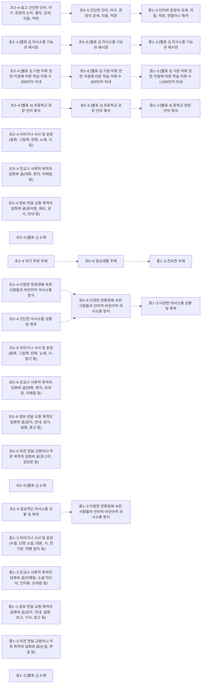

# 영어 개념 지도 (초3~고2~3)

개념 220개 = 고시문 「내용 체계」의 지식⋅이해 항목(원문 낱말 그대로). 선수관계 28개 — **구조 14** (내용 체계 같은 범주 행의 바로 앞 학년 칸 — 규칙으로 뽑아 Gemini 가 「타당」이라 한 것) · **단원 14** (고시문이 밝힌 단원 연계 안의 개념 쌍 — 규칙으로 뽑아 Gemini 가 「타당」이라 한 것). 원문이 아닌 간선은 그림에서 점선, 목록에서 표시.

> 각 교과 「내용 체계」는 범주를 학년(군)에 따라 위계적으로 배열한다 — 같은 범주 행의 앞 학년 칸이 「구조」 간선의 근거다. 고교 과목은 표가 과목마다 따로라 고시문 단원 연계(「…와 연계된다」) 위에서 「단원」 간선을 찾는다. 간선별 이유·심사 기록은 [concept_proposals.json](../data/kr/concept_proposals.json) · [concept_structure.json](../data/kr/concept_structure.json).

□ 셀프 체크는 그 개념 성취기준 문장을 물음으로만 바꾼 것이다. MCP 에서는 `concept_path` 로 묻고, 「예」인 개념은 `known` 에 넣는다. 먼저/이어서가 없는 개념은 교과 문서의 단원 연계를 본다.

목차: [이해(reception)](#이해-reception) · [표현(production)](#표현-production) · [고1 · 공통영어 1 · 이해(reception)](#고1-공통영어-1-이해-reception) · [고1 · 공통영어 1 · 표현(production)](#고1-공통영어-1-표현-production) · [고1 · 공통영어 2 · 이해(reception)](#고1-공통영어-2-이해-reception) · [고1 · 공통영어 2 · 표현(production)](#고1-공통영어-2-표현-production) · [고1 · 기본영어 1 · 이해(reception)](#고1-기본영어-1-이해-reception) · [고1 · 기본영어 2 · 이해(reception)](#고1-기본영어-2-이해-reception) · [고2~3 · 영어 I · 이해(reception)](#고2-3-영어-I-이해-reception) · [고2~3 · 영어 Ⅱ · 이해(reception)](#고2-3-영어-Ⅱ-이해-reception) · [고2~3 · 영어 독해와 작문 · 독해](#고2-3-영어-독해와-작문-독해) · [고2~3 · 직무 영어](#고2-3-직무-영어) · [고2~3 · 영어 발표와 토론 · 발표](#고2-3-영어-발표와-토론-발표) · [고2~3 · 영어 발표와 토론 · 토론](#고2-3-영어-발표와-토론-토론) · [고2~3 · 심화 영어 · 이해(reception)](#고2-3-심화-영어-이해-reception) · [고2~3 · 영미 문학 읽기](#고2-3-영미-문학-읽기) · [고2~3 · 심화 영어 독해와 작문 · 독해](#고2-3-심화-영어-독해와-작문-독해) · [고2~3 · 실생활 영어 회화](#고2-3-실생활-영어-회화) · [고2~3 · 미디어 영어](#고2-3-미디어-영어) · [고2~3 · 세계 문화와 영어](#고2-3-세계-문화와-영어)

## 이해(reception)

### 초3~4 쉽고 간단한 단어, 어구, 문장의 소리, 철자, 강세, 리듬, 억양

언어 · 성취기준 4영01-03, 4영02-01  
➡️ 이어서: [초5~6 간단한 단어, 어구, 문장의 강세, 리듬, 억양](#초5-6-간단한-단어-어구-문장의-강세-리듬-억양)구조  

- □ 쉽고 간단한 단어, 어구, 문장을 듣고 강세, 리듬, 억양을 식별한다.
- □ 쉽고 간단한 단어, 어구, 문장을 강세, 리듬, 억양에 맞게 따라 말한다.

### 초3~4 [별표 2] 의사소통 기능과 예시문

언어 · 성취기준 4영02-10  
➡️ 이어서: [초5~6 [별표 2] 의사소통 기능과 예시문](#초5-6-별표-2-의사소통-기능과-예시문)구조  

- □ 의사소통 활동에 흥미와 자신감을 가지고 대화 예절을 지키며 참여한다.

### 초3~4 [별표 3] 기본 어휘 관련 지침에 따른 학습 어휘 수 300단어 이내

언어 · 성취기준 4영02-10  
➡️ 이어서: [초5~6 [별표 3] 기본 어휘 관련 지침에 따른 학습 어휘 수 300단어 이내](#초5-6-별표-3-기본-어휘-관련-지침에-따른-학습-어휘-수-300단어-이내)구조  

- □ 의사소통 활동에 흥미와 자신감을 가지고 대화 예절을 지키며 참여한다.

### 초3~4 [별표 4] 초등학교 권장 언어 형식

언어 · 성취기준 4영02-10  
➡️ 이어서: [초5~6 [별표 4] 초등학교 권장 언어 형식](#초5-6-별표-4-초등학교-권장-언어-형식)구조  

- □ 의사소통 활동에 흥미와 자신감을 가지고 대화 예절을 지키며 참여한다.

### 초3~4 이야기나 서사 및 운문(동화, 그림책, 만화, 노래, 시 등)

언어 · 성취기준 4영01-09  

- □ 시, 노래, 이야기를 공감하며 듣는다.

### 초3~4 친교나 사회적 목적의 담화와 글(대화, 편지, 이메일 등)

언어 · 성취기준 4영01-06, 4영01-07, 4영01-08, 4영01-10, 4영02-08  

- □ 자기 주변 주제에 관한 담화의 주요 정보를 파악한다.
- □ 적절한 전략을 활용하여 담화나 문장을 듣거나 읽는다.
- □ 다양한 매체로 표현된 담화나 문장을 흥미를 가지고 듣거나 읽는다.
- … 외 2개

### 초3~4 정보 전달⋅교환 목적의 담화와 글(표지판, 메모, 묘사, 안내 등)

언어 · 성취기준 4영01-06, 4영02-08  

- □ 자기 주변 주제에 관한 담화의 주요 정보를 파악한다.
- □ 자기 주변 주제에 관한 담화의 주요 정보를 묻거나 답한다.

### 초3~4 [별표 1] 소재

맥락 · 성취기준 4영01-06, 4영01-10, 4영02-08  

- □ 자기 주변 주제에 관한 담화의 주요 정보를 파악한다.
- □ 자기 주변 주제나 문화에 관한 담화나 문장을 존중의 태도로 듣거나 읽는다.
- □ 자기 주변 주제에 관한 담화의 주요 정보를 묻거나 답한다.

### 초3~4 자기 주변 주제

맥락 · 성취기준 4영01-06, 4영01-10, 4영02-08  
➡️ 이어서: [초5~6 일상생활 주제](#초5-6-일상생활-주제)구조  

- □ 자기 주변 주제에 관한 담화의 주요 정보를 파악한다.
- □ 자기 주변 주제나 문화에 관한 담화나 문장을 존중의 태도로 듣거나 읽는다.
- □ 자기 주변 주제에 관한 담화의 주요 정보를 묻거나 답한다.

### 초3~4 간단한 의사소통 상황 및 목적

맥락 · 성취기준 4영02-10  
➡️ 이어서: [초5~6 다양한 문화권에 속한 사람들의 언어적⋅비언어적 의사소통 방식](#초5-6-다양한-문화권에-속한-사람들의-언어적-비언어적-의사소통-방식)구조  

- □ 의사소통 활동에 흥미와 자신감을 가지고 대화 예절을 지키며 참여한다.

### 초3~4 다양한 문화권에 속한 사람들의 비언어적 의사소통 방식

맥락 · 성취기준 4영02-10  
➡️ 이어서: [초5~6 다양한 문화권에 속한 사람들의 언어적⋅비언어적 의사소통 방식](#초5-6-다양한-문화권에-속한-사람들의-언어적-비언어적-의사소통-방식)구조  

- □ 의사소통 활동에 흥미와 자신감을 가지고 대화 예절을 지키며 참여한다.

### 초5~6 간단한 단어, 어구, 문장의 강세, 리듬, 억양

언어 · 성취기준 6영01-01, 6영01-02, 6영02-01  
⬅️ 먼저: [초3~4 쉽고 간단한 단어, 어구, 문장의 소리, 철자, 강세, 리듬, 억양](#초3-4-쉽고-간단한-단어-어구-문장의-소리-철자-강세-리듬-억양)구조  
➡️ 이어서: [중1~3 단어와 문장의 강세, 리듬, 억양, 연음이나 축약](#중1-3-단어와-문장의-강세-리듬-억양-연음이나-축약)구조  

- □ 간단한 단어, 어구, 문장을 듣고 강세, 리듬, 억양을 식별한다.
- □ 간단한 단어, 어구, 문장을 강세, 리듬, 억양에 맞게 소리 내어 읽는다.
- □ 간단한 단어, 어구, 문장을 강세, 리듬, 억양에 맞게 말한다.

### 초5~6 [별표 2] 의사소통 기능과 예시문

언어 · 성취기준 6영02-10  
⬅️ 먼저: [초3~4 [별표 2] 의사소통 기능과 예시문](#초3-4-별표-2-의사소통-기능과-예시문)구조  
➡️ 이어서: [중1~3 [별표 2] 의사소통 기능과 예시문](#중1-3-별표-2-의사소통-기능과-예시문)구조  

- □ 의사소통 활동에 흥미와 자신감을 가지고 참여하여 협력적으로 수행한다.

### 초5~6 [별표 3] 기본 어휘 관련 지침에 따른 학습 어휘 수 300단어 이내

언어 · 성취기준 6영02-10  
⬅️ 먼저: [초3~4 [별표 3] 기본 어휘 관련 지침에 따른 학습 어휘 수 300단어 이내](#초3-4-별표-3-기본-어휘-관련-지침에-따른-학습-어휘-수-300단어-이내)구조  
➡️ 이어서: [중1~3 [별표 3] 기본 어휘 관련 지침에 따른 학습 어휘 수 1,500단어 이내](#중1-3-별표-3-기본-어휘-관련-지침에-따른-학습-어휘-수-1-500단어-이내)구조  

- □ 의사소통 활동에 흥미와 자신감을 가지고 참여하여 협력적으로 수행한다.

### 초5~6 [별표 4] 초등학교 권장 언어 형식

언어 · 성취기준 6영02-10  
⬅️ 먼저: [초3~4 [별표 4] 초등학교 권장 언어 형식](#초3-4-별표-4-초등학교-권장-언어-형식)구조  
➡️ 이어서: [중1~3 [별표 4] 중학교 권장 언어 형식](#중1-3-별표-4-중학교-권장-언어-형식)구조  

- □ 의사소통 활동에 흥미와 자신감을 가지고 참여하여 협력적으로 수행한다.

### 초5~6 이야기나 서사 및 운문(동화, 그림책, 만화, 노래, 시, 일기 등)

언어 · 성취기준 6영01-09  

- □ 시, 노래, 이야기를 공감하며 듣거나 읽는다.

### 초5~6 친교나 사회적 목적의 담화와 글(대화, 편지, 초대장, 이메일 등)

언어 · 성취기준 6영01-04, 6영01-05, 6영01-06, 6영01-07, 6영01-08, 6영01-10, 6영02-07, 6영02-08  

- □ 일상생활 주제에 관한 담화나 글의 세부 정보를 파악한다.
- □ 일상생활 주제에 관한 담화나 글의 중심 내용을 파악한다.
- □ 일상생활 주제에 관한 담화나 글에서 일이나 사건의 순서를 파악한다.
- … 외 5개

### 초5~6 정보 전달⋅교환 목적의 담화와 글(공지, 안내, 묘사, 설명, 광고 등)

언어 · 성취기준 6영01-04, 6영02-07  

- □ 일상생활 주제에 관한 담화나 글의 세부 정보를 파악한다.
- □ 일상생활 주제에 관한 담화나 글의 세부 정보를 간단한 문장으로 묻거나 답한다.

### 초5~6 의견 전달⋅교환이나 주장 목적의 담화와 글(포스터, 감상문 등)

언어 · 성취기준 6영01-04, 6영01-05, 6영01-06, 6영01-07, 6영01-08, 6영01-10, 6영02-06, 6영02-07, 6영02-08  

- □ 일상생활 주제에 관한 담화나 글의 세부 정보를 파악한다.
- □ 일상생활 주제에 관한 담화나 글의 중심 내용을 파악한다.
- □ 일상생활 주제에 관한 담화나 글에서 일이나 사건의 순서를 파악한다.
- … 외 6개

### 초5~6 [별표 1] 소재

맥락 · 성취기준 6영01-04, 6영01-05, 6영01-06, 6영01-07, 6영01-10, 6영02-07  

- □ 일상생활 주제에 관한 담화나 글의 세부 정보를 파악한다.
- □ 일상생활 주제에 관한 담화나 글의 중심 내용을 파악한다.
- □ 일상생활 주제에 관한 담화나 글에서 일이나 사건의 순서를 파악한다.
- … 외 3개

### 초5~6 일상생활 주제

맥락 · 성취기준 6영01-04, 6영01-05, 6영01-06, 6영01-07, 6영01-10, 6영02-07  
⬅️ 먼저: [초3~4 자기 주변 주제](#초3-4-자기-주변-주제)구조  
➡️ 이어서: [중1~3 친숙한 주제](#중1-3-친숙한-주제)구조  

- □ 일상생활 주제에 관한 담화나 글의 세부 정보를 파악한다.
- □ 일상생활 주제에 관한 담화나 글의 중심 내용을 파악한다.
- □ 일상생활 주제에 관한 담화나 글에서 일이나 사건의 순서를 파악한다.
- … 외 3개

### 초5~6 일상적인 의사소통 상황 및 목적

맥락 · 성취기준 6영02-10  
➡️ 이어서: [중1~3 다양한 문화권에 속한 사람들의 언어적⋅비언어적 의사소통 방식](#중1-3-다양한-문화권에-속한-사람들의-언어적-비언어적-의사소통-방식)구조  

- □ 의사소통 활동에 흥미와 자신감을 가지고 참여하여 협력적으로 수행한다.

### 초5~6 다양한 문화권에 속한 사람들의 언어적⋅비언어적 의사소통 방식

맥락 · 성취기준 6영02-10  
⬅️ 먼저: [초3~4 다양한 문화권에 속한 사람들의 비언어적 의사소통 방식](#초3-4-다양한-문화권에-속한-사람들의-비언어적-의사소통-방식)구조 · [초3~4 간단한 의사소통 상황 및 목적](#초3-4-간단한-의사소통-상황-및-목적)구조  
➡️ 이어서: [중1~3 다양한 의사소통 상황 및 목적](#중1-3-다양한-의사소통-상황-및-목적)구조  

- □ 의사소통 활동에 흥미와 자신감을 가지고 참여하여 협력적으로 수행한다.

### 중1~3 단어와 문장의 강세, 리듬, 억양, 연음이나 축약

언어 · 성취기준 9영01-01, 9영02-01  
⬅️ 먼저: [초5~6 간단한 단어, 어구, 문장의 강세, 리듬, 억양](#초5-6-간단한-단어-어구-문장의-강세-리듬-억양)구조  

- □ 단어, 어구, 문장을 듣고 연음이나 축약된 소리를 식별한다.
- □ 연음이나 축약된 소리를 활용하여 단어, 어구, 문장을 말한다.

### 중1~3 [별표 2] 의사소통 기능과 예시문

언어 · 성취기준 9영01-01, 9영02-01  
⬅️ 먼저: [초5~6 [별표 2] 의사소통 기능과 예시문](#초5-6-별표-2-의사소통-기능과-예시문)구조  

- □ 단어, 어구, 문장을 듣고 연음이나 축약된 소리를 식별한다.
- □ 연음이나 축약된 소리를 활용하여 단어, 어구, 문장을 말한다.

### 중1~3 [별표 3] 기본 어휘 관련 지침에 따른 학습 어휘 수 1,500단어 이내

언어 · 성취기준 9영01-01, 9영02-01  
⬅️ 먼저: [초5~6 [별표 3] 기본 어휘 관련 지침에 따른 학습 어휘 수 300단어 이내](#초5-6-별표-3-기본-어휘-관련-지침에-따른-학습-어휘-수-300단어-이내)구조  

- □ 단어, 어구, 문장을 듣고 연음이나 축약된 소리를 식별한다.
- □ 연음이나 축약된 소리를 활용하여 단어, 어구, 문장을 말한다.

### 중1~3 [별표 4] 중학교 권장 언어 형식

언어 · 성취기준 9영01-01, 9영02-01  
⬅️ 먼저: [초5~6 [별표 4] 초등학교 권장 언어 형식](#초5-6-별표-4-초등학교-권장-언어-형식)구조  

- □ 단어, 어구, 문장을 듣고 연음이나 축약된 소리를 식별한다.
- □ 연음이나 축약된 소리를 활용하여 단어, 어구, 문장을 말한다.

### 중1~3 이야기나 서사 및 운문(수필, 단편 소설, 대본, 시, 전기문, 여행 일지 등)

언어 · 성취기준 9영01-01, 9영02-01  

- □ 단어, 어구, 문장을 듣고 연음이나 축약된 소리를 식별한다.
- □ 연음이나 축약된 소리를 활용하여 단어, 어구, 문장을 말한다.

### 중1~3 친교나 사회적 목적의 담화와 글(이메일, 소셜 미디어, 인터뷰, 초대장 등)

언어 · 성취기준 9영01-06  

- □ 친숙한 주제에 관한 담화나 글에서 화자나 필자의 의도나 목적을 추론한다.

### 중1~3 정보 전달⋅교환 목적의 담화와 글(공지, 안내, 설명, 보고, 기사, 광고 등)

언어 · 성취기준 9영01-02, 9영01-06, 9영02-03  

- □ 친숙한 주제에 관한 담화나 글에서 세부 정보를 파악한다.
- □ 친숙한 주제에 관한 담화나 글에서 화자나 필자의 의도나 목적을 추론한다.
- □ 친숙한 주제에 관해 사실적 정보를 설명한다.

### 중1~3 의견 전달⋅교환이나 주장 목적의 담화와 글(논설, 연설 등)

언어 · 성취기준 9영01-06, 9영02-06  

- □ 친숙한 주제에 관한 담화나 글에서 화자나 필자의 의도나 목적을 추론한다.
- □ 친숙한 주제에 관해 자신의 의견을 주장한다.

### 중1~3 [별표 1] 소재

맥락 · 성취기준 9영01-02, 9영01-03, 9영01-04, 9영01-05, 9영01-06, 9영02-03, 9영02-04, 9영02-05, 9영02-06, 9영02-07  

- □ 친숙한 주제에 관한 담화나 글에서 세부 정보를 파악한다.
- □ 친숙한 주제에 관한 담화나 글의 중심 내용을 파악한다.
- □ 친숙한 주제에 관한 담화나 글에서 일이나 사건의 논리적 관계를 파악한다.
- … 외 7개

### 중1~3 친숙한 주제

맥락 · 성취기준 9영01-02, 9영01-03, 9영01-04, 9영01-05, 9영01-06, 9영02-03, 9영02-04, 9영02-05, 9영02-06, 9영02-07  
⬅️ 먼저: [초5~6 일상생활 주제](#초5-6-일상생활-주제)구조  

- □ 친숙한 주제에 관한 담화나 글에서 세부 정보를 파악한다.
- □ 친숙한 주제에 관한 담화나 글의 중심 내용을 파악한다.
- □ 친숙한 주제에 관한 담화나 글에서 일이나 사건의 논리적 관계를 파악한다.
- … 외 7개

### 중1~3 다양한 의사소통 상황 및 목적

맥락 · 성취기준 9영02-10  
⬅️ 먼저: [초5~6 다양한 문화권에 속한 사람들의 언어적⋅비언어적 의사소통 방식](#초5-6-다양한-문화권에-속한-사람들의-언어적-비언어적-의사소통-방식)구조  

- □ 적절한 전략을 활용하여 상황이나 목적에 맞게 말하거나 쓴다.

### 중1~3 다양한 문화권에 속한 사람들의 언어적⋅비언어적 의사소통 방식

맥락 · 성취기준 9영01-08, 9영01-09, 9영01-10  
⬅️ 먼저: [초5~6 일상적인 의사소통 상황 및 목적](#초5-6-일상적인-의사소통-상황-및-목적)구조  

- □ 적절한 전략을 활용하여 다양한 매체로 표현된 담화나 글을 듣거나 읽는다.
- □ 다양한 관점을 존중하는 태도로 듣거나 읽는다.
- □ 자신의 관심사에 관한 다양한 담화나 글을 선택하여 적극적으로 듣거나 읽는다.

## 표현(production)

### 중1~3 이야기나 서사 및 운문(일기, 수필, 기행문, 소설, 대본, 노래 가사, 시 등)

언어 · 성취기준 9영01-06  

- □ 친숙한 주제에 관한 담화나 글에서 화자나 필자의 의도나 목적을 추론한다.

### 중1~3 친교나 사회적 목적의 담화와 글(편지, 이메일, 소셜 미디어 등)

언어 · 성취기준 9영01-06  

- □ 친숙한 주제에 관한 담화나 글에서 화자나 필자의 의도나 목적을 추론한다.

### 중1~3 의견 전달⋅교환이나 주장 목적의 담화와 글(사설, 논설, 연설 등)

언어 · 성취기준 9영01-06, 9영02-06  

- □ 친숙한 주제에 관한 담화나 글에서 화자나 필자의 의도나 목적을 추론한다.
- □ 친숙한 주제에 관해 자신의 의견을 주장한다.

## 고1 · 공통영어 1 · 이해(reception)

### 고1 다양한 단어나 어구

언어 · 성취기준 10공영1-01-08, 10공영1-02-07  

- □ 말이나 글에 나타난 다양한 관점이나 의견을 포용적인 태도로 분석한다.
- □ 적절한 전략과 다양한 매체를 활용하여 상황과 목적에 맞게 말하거나 쓴다.

### 고1 다소 복잡하고 다양한 구조의 문장

언어 · 성취기준 10공영1-01-08, 10공영1-02-07  

- □ 말이나 글에 나타난 다양한 관점이나 의견을 포용적인 태도로 분석한다.
- □ 적절한 전략과 다양한 매체를 활용하여 상황과 목적에 맞게 말하거나 쓴다.

### 고1 [별표 2] 의사소통 기능과 예시문

언어 · 성취기준 10공영1-01-08, 10공영1-02-07  
➡️ 이어서: [고2~3 영어 Ⅱ [별표 2] 의사소통 기능과 예시문](#고2-3-영어-Ⅱ-별표-2-의사소통-기능과-예시문)단원  

- □ 말이나 글에 나타난 다양한 관점이나 의견을 포용적인 태도로 분석한다.
- □ 적절한 전략과 다양한 매체를 활용하여 상황과 목적에 맞게 말하거나 쓴다.

### 고1 [별표 3] 기본 어휘 관련 지침에 따른 학습 어휘 수 1,800단어 이내

언어 · 성취기준 10공영1-02-06  
➡️ 이어서: [고2~3 영어 Ⅱ [별표 3] 기본 어휘 관련 지침에 따른 학습 어휘 수 2,500단어 이내](#고2-3-영어-Ⅱ-별표-3-기본-어휘-관련-지침에-따른-학습-어휘-수-2-500단어-이내)단원  

- □ 어휘나 표현을 점검하여 내용을 명확하게 전달한다.

### 고1 [별표 4] 고등학교 권장 언어 형식

언어 · 성취기준 10공영1-02-08  
➡️ 이어서: [고2~3 영어 Ⅱ [별표 4] 고등학교 권장 언어 형식](#고2-3-영어-Ⅱ-별표-4-고등학교-권장-언어-형식)단원  

- □ 상대방의 생각이나 관점을 존중하고 언어 예절을 갖추어 표현한다.

### 고1 이야기나 서사 및 운문

언어 · 성취기준 10공영1-02-08  

- □ 상대방의 생각이나 관점을 존중하고 언어 예절을 갖추어 표현한다.

### 고1 친교나 사회적 목적의 말이나 글

언어 · 성취기준 10공영1-01-01, 10공영1-01-02, 10공영1-01-03, 10공영1-01-04, 10공영1-01-05, 10공영1-01-06, 10공영1-01-07, 10공영1-01-08, 10공영1-02-02  

- □ 말이나 글에 포함된 세부 정보를 파악한다.
- □ 말이나 글의 주제나 요지를 파악한다.
- □ 말이나 글의 분위기나 화자나 인물의 심정 및 의도 등을 추론한다.
- … 외 6개

### 고1 정보 전달⋅교환 목적의 말이나 글

언어 · 성취기준 10공영1-02-02  

- □ 사실적 정보나 지식을 말이나 글로 전달한다.

### 고1 의견 전달⋅교환이나 주장 목적의 말이나 글

언어 · 성취기준 10공영1-01-08, 10공영1-02-02  

- □ 말이나 글에 나타난 다양한 관점이나 의견을 포용적인 태도로 분석한다.
- □ 사실적 정보나 지식을 말이나 글로 전달한다.

### 고1 [별표 1] 소재

맥락 · 성취기준 10공영1-01-01, 10공영1-01-02, 10공영1-02-02  

- □ 말이나 글에 포함된 세부 정보를 파악한다.
- □ 말이나 글의 주제나 요지를 파악한다.
- □ 사실적 정보나 지식을 말이나 글로 전달한다.

### 고1 일상생활 및 기본적 지식이나 정보 등의 친숙한 일반적 주제

맥락 · 성취기준 10공영1-01-01, 10공영1-01-02, 10공영1-02-02  

- □ 말이나 글에 포함된 세부 정보를 파악한다.
- □ 말이나 글의 주제나 요지를 파악한다.
- □ 사실적 정보나 지식을 말이나 글로 전달한다.

### 고1 우리 문화와 타 문화의 생활 양식이나 문화 예술

맥락 · 성취기준 10공영1-01-01, 10공영1-01-02, 10공영1-02-02  

- □ 말이나 글에 포함된 세부 정보를 파악한다.
- □ 말이나 글의 주제나 요지를 파악한다.
- □ 사실적 정보나 지식을 말이나 글로 전달한다.

## 고1 · 공통영어 1 · 표현(production)

### 고1 일상생활 및 기본적인 지식이나 정보 등의 친숙한 일반적 주제

맥락 · 성취기준 10공영1-01-01, 10공영1-01-02, 10공영1-02-02  

- □ 말이나 글에 포함된 세부 정보를 파악한다.
- □ 말이나 글의 주제나 요지를 파악한다.
- □ 사실적 정보나 지식을 말이나 글로 전달한다.

## 고1 · 공통영어 2 · 이해(reception)

### 고1 다양한 단어나 어구

언어 · 성취기준 10공영2-01-07, 10공영2-02-06, 10공영2-02-08  

- □ 다양한 매체의 말이나 글을 비판적으로 이해하고 있나요?
- □ 다양한 소통의 목적에 맞게 말하거나 글로 표현한다.
- □ 적절한 전략과 다양한 매체를 활용하여 상황과 목적에 맞게 말하거나 쓴다.

### 고1 다소 복잡하고 다양한 구조의 문장

언어 · 성취기준 10공영2-01-07, 10공영2-02-06, 10공영2-02-08  

- □ 다양한 매체의 말이나 글을 비판적으로 이해하고 있나요?
- □ 다양한 소통의 목적에 맞게 말하거나 글로 표현한다.
- □ 적절한 전략과 다양한 매체를 활용하여 상황과 목적에 맞게 말하거나 쓴다.

### 고1 [별표 2] 의사소통 기능과 예시문

언어 · 성취기준 10공영2-01-07, 10공영2-02-06, 10공영2-02-08  
➡️ 이어서: [고2~3 영어 Ⅱ [별표 2] 의사소통 기능과 예시문](#고2-3-영어-Ⅱ-별표-2-의사소통-기능과-예시문)단원  

- □ 다양한 매체의 말이나 글을 비판적으로 이해하고 있나요?
- □ 다양한 소통의 목적에 맞게 말하거나 글로 표현한다.
- □ 적절한 전략과 다양한 매체를 활용하여 상황과 목적에 맞게 말하거나 쓴다.

### 고1 [별표 3] 기본 어휘 관련 지침에 따른 학습 어휘 수 1,800단어 이내

언어 · 성취기준 10공영2-02-07  
➡️ 이어서: [고2~3 영어 Ⅱ [별표 3] 기본 어휘 관련 지침에 따른 학습 어휘 수 2,500단어 이내](#고2-3-영어-Ⅱ-별표-3-기본-어휘-관련-지침에-따른-학습-어휘-수-2-500단어-이내)단원  

- □ 어휘나 표현을 점검하여 내용을 명확하게 전달한다.

### 고1 [별표 4] 고등학교 권장 언어 형식

언어 · 성취기준 10공영2-02-07  
➡️ 이어서: [고2~3 영어 Ⅱ [별표 4] 고등학교 권장 언어 형식](#고2-3-영어-Ⅱ-별표-4-고등학교-권장-언어-형식)단원  

- □ 어휘나 표현을 점검하여 내용을 명확하게 전달한다.

### 고1 이야기나 서사 및 운문

언어 · 성취기준 10공영2-02-07  

- □ 어휘나 표현을 점검하여 내용을 명확하게 전달한다.

### 고1 친교나 사회적 목적의 말이나 글

언어 · 성취기준 10공영2-01-01, 10공영2-01-02, 10공영2-01-03, 10공영2-01-04, 10공영2-01-05, 10공영2-01-06, 10공영2-01-07, 10공영2-01-08, 10공영2-02-02  

- □ 말이나 글에 포함된 세부 정보를 파악한다.
- □ 말이나 글의 주제나 요지를 파악한다.
- □ 말이나 글의 분위기나 등장인물의 심정 및 의도 등을 추론한다.
- … 외 6개

### 고1 정보 전달⋅교환 목적의 말이나 글

언어 · 성취기준 10공영2-02-02  

- □ 사실적 정보나 지식을 말이나 글로 전달한다.

### 고1 의견 전달⋅교환이나 주장 목적의 말이나 글

언어 · 성취기준 10공영2-02-02  

- □ 사실적 정보나 지식을 말이나 글로 전달한다.

### 고1 [별표 1] 소재

맥락 · 성취기준 10공영2-01-01, 10공영2-01-02, 10공영2-02-02  

- □ 말이나 글에 포함된 세부 정보를 파악한다.
- □ 말이나 글의 주제나 요지를 파악한다.
- □ 사실적 정보나 지식을 말이나 글로 전달한다.

### 고1 일상생활 및 기본적 지식이나 정보 등의 친숙한 일반적 주제

맥락 · 성취기준 10공영2-01-01, 10공영2-01-02, 10공영2-02-02  

- □ 말이나 글에 포함된 세부 정보를 파악한다.
- □ 말이나 글의 주제나 요지를 파악한다.
- □ 사실적 정보나 지식을 말이나 글로 전달한다.

### 고1 우리 문화와 타 문화의 생활 양식이나 문화 예술

맥락 · 성취기준 10공영2-01-01, 10공영2-01-02, 10공영2-02-02  

- □ 말이나 글에 포함된 세부 정보를 파악한다.
- □ 말이나 글의 주제나 요지를 파악한다.
- □ 사실적 정보나 지식을 말이나 글로 전달한다.

## 고1 · 공통영어 2 · 표현(production)

### 고1 일상생활 및 기본적인 지식이나 정보 등의 친숙한 일반적 주제

맥락 · 성취기준 10공영2-01-01, 10공영2-01-02, 10공영2-02-02  

- □ 말이나 글에 포함된 세부 정보를 파악한다.
- □ 말이나 글의 주제나 요지를 파악한다.
- □ 사실적 정보나 지식을 말이나 글로 전달한다.

## 고1 · 기본영어 1 · 이해(reception)

### 고1 실생활에서 자주 사용되는 단어나 어구

언어 · 성취기준 10기영1-01-08  

- □ 다양한 매체로 듣거나 읽으며 학습 동기를 형성한다.

### 고1 다양한 구조의 문장

언어 · 성취기준 10기영1-01-08  

- □ 다양한 매체로 듣거나 읽으며 학습 동기를 형성한다.

### 고1 [별표 2] 의사소통 기능과 예시문

언어 · 성취기준 10기영1-02-08  

- □ 의사소통 활동에 흥미와 자신감을 가지고 능동적으로 참여한다.

### 고1 [별표 3] 기본 어휘 관련 지침에 따른 학습 어휘 수 1,600단어 이내

언어 · 성취기준 10기영1-01-08  

- □ 다양한 매체로 듣거나 읽으며 학습 동기를 형성한다.

### 고1 [별표 4] 고등학교 권장 언어 형식

언어 · 성취기준 10기영1-01-08  

- □ 다양한 매체로 듣거나 읽으며 학습 동기를 형성한다.

### 고1 이야기나 서사 및 운문

언어 · 성취기준 10기영1-01-08  

- □ 다양한 매체로 듣거나 읽으며 학습 동기를 형성한다.

### 고1 친교나 사회적 목적의 말이나 글

언어 · 성취기준 10기영1-02-06  

- □ 말이나 글의 목적에 맞게 내용이나 표현을 점검하여 고쳐 쓴다.

### 고1 정보 전달⋅교환 목적의 말이나 글

언어 · 성취기준 10기영1-02-04  

- □ 목적에 적합한 매체를 활용하여 정보를 전달한다.

### 고1 의견 전달⋅교환이나 주장 목적의 말이나 글

언어 · 성취기준 10기영1-02-06  

- □ 말이나 글의 목적에 맞게 내용이나 표현을 점검하여 고쳐 쓴다.

### 고1 [별표 1] 소재

맥락 · 성취기준 10기영1-01-02  

- □ 말이나 글의 주제나 요지를 파악한다.

### 고1 실생활 관련 친숙한 주제

맥락 · 성취기준 10기영1-01-02  

- □ 말이나 글의 주제나 요지를 파악한다.

### 고1 우리 문화나 타 문화의 생활 양식, 사고방식, 의사소통 방식

맥락 · 성취기준 10기영1-02-08  

- □ 의사소통 활동에 흥미와 자신감을 가지고 능동적으로 참여한다.

## 고1 · 기본영어 2 · 이해(reception)

### 고1 실생활에서 자주 사용되는 단어나 어구

언어 · 성취기준 10기영2-01-08  

- □ 다양한 매체로 듣거나 읽으며 학습 동기를 형성한다.

### 고1 다양한 구조의 문장

언어 · 성취기준 10기영2-01-08  

- □ 다양한 매체로 듣거나 읽으며 학습 동기를 형성한다.

### 고1 [별표 2] 의사소통 기능과 예시문

언어 · 성취기준 10기영2-02-08  

- □ 의사소통 활동에 흥미와 자신감을 가지고 능동적으로 참여한다.

### 고1 [별표 3] 기본 어휘 관련 지침에 따른 학습 어휘 수 1,600단어 이내

언어 · 성취기준 10기영2-01-08  

- □ 다양한 매체로 듣거나 읽으며 학습 동기를 형성한다.

### 고1 [별표 4] 고등학교 권장 언어 형식

언어 · 성취기준 10기영2-01-08  

- □ 다양한 매체로 듣거나 읽으며 학습 동기를 형성한다.

### 고1 이야기나 서사 및 운문

언어 · 성취기준 10기영2-01-08  

- □ 다양한 매체로 듣거나 읽으며 학습 동기를 형성한다.

### 고1 친교나 사회적 목적의 말이나 글

언어 · 성취기준 10기영2-02-06  

- □ 말이나 글의 목적에 맞게 내용이나 표현을 점검하여 고쳐 쓴다.

### 고1 정보 전달⋅교환 목적의 말이나 글

언어 · 성취기준 10기영2-02-04  

- □ 목적에 적합한 매체를 활용하여 정보를 전달한다.

### 고1 의견 전달⋅교환이나 주장 목적의 말이나 글

언어 · 성취기준 10기영2-02-06  

- □ 말이나 글의 목적에 맞게 내용이나 표현을 점검하여 고쳐 쓴다.

### 고1 [별표 1] 소재

맥락 · 성취기준 10기영2-01-02  

- □ 말이나 글의 주제나 요지를 파악한다.

### 고1 실생활 관련 친숙한 주제

맥락 · 성취기준 10기영2-01-02  

- □ 말이나 글의 주제나 요지를 파악한다.

### 고1 우리 문화나 타 문화의 생활 양식, 사고방식, 의사소통 방식

맥락 · 성취기준 10기영2-02-08  

- □ 의사소통 활동에 흥미와 자신감을 가지고 능동적으로 참여한다.

## 고2~3 · 영어 I · 이해(reception)

### 고2~3 다양한 단어나 어구

언어 · 성취기준 12영Ⅰ-01-07, 12영Ⅰ-01-08, 12영Ⅰ-02-07  

- □ 적절한 전략을 활용하여 다양한 매체로 된 말이나 글의 의미를 파악한다.
- □ 우리 문화 및 타 문화의 다양한 관점에 대해 포용하고 공감하는 태도를 가진다.
- □ 다양한 매체와 적절한 전략을 활용하여 정보를 창의적으로 전달한다.

### 고2~3 다양한 구조의 문장

언어 · 성취기준 12영Ⅰ-01-07, 12영Ⅰ-01-08, 12영Ⅰ-02-07  

- □ 적절한 전략을 활용하여 다양한 매체로 된 말이나 글의 의미를 파악한다.
- □ 우리 문화 및 타 문화의 다양한 관점에 대해 포용하고 공감하는 태도를 가진다.
- □ 다양한 매체와 적절한 전략을 활용하여 정보를 창의적으로 전달한다.

### 고2~3 [별표 2] 의사소통 기능과 예시문

언어 · 성취기준 12영Ⅰ-01-07, 12영Ⅰ-01-08, 12영Ⅰ-02-07  
➡️ 이어서: [고2~3 심화 영어 [별표 2] 의사소통 기능과 예시문](#고2-3-심화-영어-별표-2-의사소통-기능과-예시문)단원  

- □ 적절한 전략을 활용하여 다양한 매체로 된 말이나 글의 의미를 파악한다.
- □ 우리 문화 및 타 문화의 다양한 관점에 대해 포용하고 공감하는 태도를 가진다.
- □ 다양한 매체와 적절한 전략을 활용하여 정보를 창의적으로 전달한다.

### 고2~3 [별표 3] 기본 어휘 관련 지침에 따른 학습 어휘 수 2,000단어 이내

언어 · 성취기준 12영Ⅰ-01-07, 12영Ⅰ-01-08, 12영Ⅰ-02-07  
➡️ 이어서: [고2~3 심화 영어 [별표 3] 기본 어휘 관련 지침에 따른 학습 어휘 수 2,800단어 내외](#고2-3-심화-영어-별표-3-기본-어휘-관련-지침에-따른-학습-어휘-수-2-800단어-내외)단원  

- □ 적절한 전략을 활용하여 다양한 매체로 된 말이나 글의 의미를 파악한다.
- □ 우리 문화 및 타 문화의 다양한 관점에 대해 포용하고 공감하는 태도를 가진다.
- □ 다양한 매체와 적절한 전략을 활용하여 정보를 창의적으로 전달한다.

### 고2~3 [별표 4] 고등학교 권장 언어 형식

언어 · 성취기준 12영Ⅰ-01-07, 12영Ⅰ-01-08, 12영Ⅰ-02-07  
➡️ 이어서: [고2~3 심화 영어 [별표 4] 고등학교 권장 언어 형식](#고2-3-심화-영어-별표-4-고등학교-권장-언어-형식)단원  

- □ 적절한 전략을 활용하여 다양한 매체로 된 말이나 글의 의미를 파악한다.
- □ 우리 문화 및 타 문화의 다양한 관점에 대해 포용하고 공감하는 태도를 가진다.
- □ 다양한 매체와 적절한 전략을 활용하여 정보를 창의적으로 전달한다.

### 고2~3 이야기나 서사 및 운문

언어 · 성취기준 12영Ⅰ-01-07, 12영Ⅰ-01-08, 12영Ⅰ-02-07  

- □ 적절한 전략을 활용하여 다양한 매체로 된 말이나 글의 의미를 파악한다.
- □ 우리 문화 및 타 문화의 다양한 관점에 대해 포용하고 공감하는 태도를 가진다.
- □ 다양한 매체와 적절한 전략을 활용하여 정보를 창의적으로 전달한다.

### 고2~3 친교나 사회적 목적의 말이나 글

언어 · 성취기준 12영Ⅰ-01-01, 12영Ⅰ-01-02, 12영Ⅰ-01-04, 12영Ⅰ-01-05, 12영Ⅰ-01-06, 12영Ⅰ-01-07, 12영Ⅰ-02-01, 12영Ⅰ-02-02, 12영Ⅰ-02-04  

- □ 말이나 글의 세부 정보를 파악한다.
- □ 말이나 글의 주제나 요지를 파악한다.
- □ 말이나 글에서 일이나 사건의 논리적 관계를 파악한다.
- … 외 6개

### 고2~3 정보 전달⋅교환 목적의 말이나 글

언어 · 성취기준 12영Ⅰ-01-01, 12영Ⅰ-02-01  

- □ 말이나 글의 세부 정보를 파악한다.
- □ 사실적 정보를 말이나 글로 설명한다.

### 고2~3 의견 전달⋅교환이나 주장 목적의 말이나 글

언어 · 성취기준 12영Ⅰ-01-01, 12영Ⅰ-01-02, 12영Ⅰ-01-04, 12영Ⅰ-01-05, 12영Ⅰ-01-06, 12영Ⅰ-01-07, 12영Ⅰ-02-01, 12영Ⅰ-02-02, 12영Ⅰ-02-04  

- □ 말이나 글의 세부 정보를 파악한다.
- □ 말이나 글의 주제나 요지를 파악한다.
- □ 말이나 글에서 일이나 사건의 논리적 관계를 파악한다.
- … 외 6개

### 고2~3 [별표 1] 소재

맥락 · 성취기준 12영Ⅰ-01-02  

- □ 말이나 글의 주제나 요지를 파악한다.

### 고2~3 사회생활이나 학업 관련 등 일반적 주제

맥락 · 성취기준 12영Ⅰ-01-02  

- □ 말이나 글의 주제나 요지를 파악한다.

### 고2~3 우리 문화 및 타 문화의 생활 양식, 사고방식, 의사소통 방식

맥락 · 성취기준 12영Ⅰ-01-08  

- □ 우리 문화 및 타 문화의 다양한 관점에 대해 포용하고 공감하는 태도를 가진다.

## 고2~3 · 영어 Ⅱ · 이해(reception)

### 고2~3 다양한 단어나 어구

언어 · 성취기준 12영Ⅱ-01-01, 12영Ⅱ-01-06, 12영Ⅱ-01-07, 12영Ⅱ-01-08, 12영Ⅱ-02-01, 12영Ⅱ-02-04, 12영Ⅱ-02-08  

- □ 다양한 주제에 대한 말이나 글의 세부 정보를 파악한다.
- □ 다양한 유형의 말이나 글의 전개 방식이나 구조를 파악한다.
- □ 적절한 전략을 적용하여 다양한 매체 자료의 말이나 글을 이해하고 있나요?
- … 외 4개

### 고2~3 다양한 구조의 문장

언어 · 성취기준 12영Ⅱ-01-06  

- □ 다양한 유형의 말이나 글의 전개 방식이나 구조를 파악한다.

### 고2~3 [별표 2] 의사소통 기능과 예시문

언어 · 성취기준 12영Ⅱ-02-09  
⬅️ 먼저: [고1 공통영어 1 [별표 2] 의사소통 기능과 예시문](#고1-공통영어-1-별표-2-의사소통-기능과-예시문)단원 · [고1 공통영어 2 [별표 2] 의사소통 기능과 예시문](#고1-공통영어-2-별표-2-의사소통-기능과-예시문)단원  

- □ 원활한 의견 교환을 위해 협력적이고 능동적으로 의사소통 활동에 참여한다.

### 고2~3 [별표 3] 기본 어휘 관련 지침에 따른 학습 어휘 수 2,500단어 이내

언어 · 성취기준 12영Ⅱ-02-09  
⬅️ 먼저: [고1 공통영어 1 [별표 3] 기본 어휘 관련 지침에 따른 학습 어휘 수 1,800단어 이내](#고1-공통영어-1-별표-3-기본-어휘-관련-지침에-따른-학습-어휘-수-1-800단어-이내)단원 · [고1 공통영어 2 [별표 3] 기본 어휘 관련 지침에 따른 학습 어휘 수 1,800단어 이내](#고1-공통영어-2-별표-3-기본-어휘-관련-지침에-따른-학습-어휘-수-1-800단어-이내)단원  

- □ 원활한 의견 교환을 위해 협력적이고 능동적으로 의사소통 활동에 참여한다.

### 고2~3 [별표 4] 고등학교 권장 언어 형식

언어 · 성취기준 12영Ⅱ-02-07  
⬅️ 먼저: [고1 공통영어 1 [별표 4] 고등학교 권장 언어 형식](#고1-공통영어-1-별표-4-고등학교-권장-언어-형식)단원 · [고1 공통영어 2 [별표 4] 고등학교 권장 언어 형식](#고1-공통영어-2-별표-4-고등학교-권장-언어-형식)단원  

- □ 글을 쓰는 과정에서 글의 내용과 형식을 점검하고 쓰기 윤리를 준수하여 고쳐 쓴다.

### 고2~3 이야기나 서사 및 운문

언어 · 성취기준 12영Ⅱ-02-07  

- □ 글을 쓰는 과정에서 글의 내용과 형식을 점검하고 쓰기 윤리를 준수하여 고쳐 쓴다.

### 고2~3 친교나 사회적 목적의 말이나 글

언어 · 성취기준 12영Ⅱ-01-01, 12영Ⅱ-01-02, 12영Ⅱ-01-03, 12영Ⅱ-01-04, 12영Ⅱ-01-05, 12영Ⅱ-01-06, 12영Ⅱ-01-07, 12영Ⅱ-02-01  

- □ 다양한 주제에 대한 말이나 글의 세부 정보를 파악한다.
- □ 말이나 글의 주제나 요지를 파악한다.
- □ 말이나 글에 나타난 화자, 필자, 인물 등의 심정이나 의도를 추론한다.
- … 외 5개

### 고2~3 정보 전달⋅교환 목적의 말이나 글

언어 · 성취기준 12영Ⅱ-01-01, 12영Ⅱ-02-01  

- □ 다양한 주제에 대한 말이나 글의 세부 정보를 파악한다.
- □ 다양한 주제에 대한 사실적 정보를 말이나 글로 설명한다.

### 고2~3 의견 전달⋅교환이나 주장 목적의 말이나 글

언어 · 성취기준 12영Ⅱ-02-03  

- □ 상대방을 배려하고 존중하는 태도로 자신의 의견이나 주장을 제시한다.

### 고2~3 [별표 1] 소재

맥락 · 성취기준 12영Ⅱ-01-01, 12영Ⅱ-02-01, 12영Ⅱ-02-04  

- □ 다양한 주제에 대한 말이나 글의 세부 정보를 파악한다.
- □ 다양한 주제에 대한 사실적 정보를 말이나 글로 설명한다.
- □ 다양한 주제에 대해 듣거나 읽은 내용을 재구성하여 요약한다.

### 고2~3 사회생활이나 학업 및 지역⋅세계 공동체 관련 등 다양한 주제

맥락 · 성취기준 12영Ⅱ-01-01, 12영Ⅱ-02-01, 12영Ⅱ-02-04  
➡️ 이어서: [고2~3 심화 영어 다양한 주제 및 기초 학문 분야 주제](#고2-3-심화-영어-다양한-주제-및-기초-학문-분야-주제)단원  

- □ 다양한 주제에 대한 말이나 글의 세부 정보를 파악한다.
- □ 다양한 주제에 대한 사실적 정보를 말이나 글로 설명한다.
- □ 다양한 주제에 대해 듣거나 읽은 내용을 재구성하여 요약한다.

### 고2~3 우리 문화 및 타 문화의 생활 양식, 사고방식, 의사소통 방식

맥락 · 성취기준 12영Ⅱ-01-08, 12영Ⅱ-02-09  

- □ 다양한 문화와 관점에 대해 포용하고 공감하는 태도를 가진다.
- □ 원활한 의견 교환을 위해 협력적이고 능동적으로 의사소통 활동에 참여한다.

## 고2~3 · 영어 독해와 작문 · 독해

### 고2~3 다양한 단어나 어구

언어 · 성취기준 12영독01-07, 12영독01-08  
➡️ 이어서: [고2~3 심화 영어 독해와 작문 다양한 단어, 어구, 문장](#고2-3-심화-영어-독해와-작문-다양한-단어-어구-문장)단원  

- □ 다양한 매체로 표현된 정보를 파악한다.
- □ 다양한 의견과 문화에 대한 공감적 이해와 포용적 태도를 가진다.

### 고2~3 다양한 구조의 문장

언어 · 성취기준 12영독01-07, 12영독01-08  
➡️ 이어서: [고2~3 심화 영어 독해와 작문 다양하고 복잡한 구조의 문장](#고2-3-심화-영어-독해와-작문-다양하고-복잡한-구조의-문장)단원  

- □ 다양한 매체로 표현된 정보를 파악한다.
- □ 다양한 의견과 문화에 대한 공감적 이해와 포용적 태도를 가진다.

### 고2~3 [별표 2] 의사소통 기능과 예시문

언어 · 성취기준 12영독01-07, 12영독01-08  

- □ 다양한 매체로 표현된 정보를 파악한다.
- □ 다양한 의견과 문화에 대한 공감적 이해와 포용적 태도를 가진다.

### 고2~3 [별표 3] 기본 어휘 관련 지침에 따른 학습 어휘 수 2,200단어 이내

언어 · 성취기준 12영독01-07, 12영독01-08  
➡️ 이어서: [고2~3 심화 영어 독해와 작문 [별표 3] 기본 어휘 관련 지침에 따른 학습 어휘 수 3,500단어 이내](#고2-3-심화-영어-독해와-작문-별표-3-기본-어휘-관련-지침에-따른-학습-어휘-수-3-500단어-이내)단원  

- □ 다양한 매체로 표현된 정보를 파악한다.
- □ 다양한 의견과 문화에 대한 공감적 이해와 포용적 태도를 가진다.

### 고2~3 [별표 4] 고등학교 권장 언어 형식

언어 · 성취기준 12영독01-07, 12영독01-08  

- □ 다양한 매체로 표현된 정보를 파악한다.
- □ 다양한 의견과 문화에 대한 공감적 이해와 포용적 태도를 가진다.

### 고2~3 이야기나 서사 및 운문

언어 · 성취기준 12영독01-07, 12영독01-08  

- □ 다양한 매체로 표현된 정보를 파악한다.
- □ 다양한 의견과 문화에 대한 공감적 이해와 포용적 태도를 가진다.

### 고2~3 친교나 사회적 목적의 글

언어 · 성취기준 12영독01-07, 12영독01-08  

- □ 다양한 매체로 표현된 정보를 파악한다.
- □ 다양한 의견과 문화에 대한 공감적 이해와 포용적 태도를 가진다.

### 고2~3 정보 전달⋅교환 목적의 글

언어 · 성취기준 12영독01-01, 12영독01-07  

- □ 글의 세부 정보를 파악한다.
- □ 다양한 매체로 표현된 정보를 파악한다.

### 고2~3 의견 전달⋅교환이나 주장 목적의 글

언어 · 성취기준 12영독01-08  

- □ 다양한 의견과 문화에 대한 공감적 이해와 포용적 태도를 가진다.

### 고2~3 [별표 1] 소재

맥락 · 성취기준 12영독01-07, 12영독01-08  

- □ 다양한 매체로 표현된 정보를 파악한다.
- □ 다양한 의견과 문화에 대한 공감적 이해와 포용적 태도를 가진다.

### 고2~3 사회생활이나 학업 관련 등 다양한 주제

맥락 · 성취기준 12영독01-07, 12영독01-08  
➡️ 이어서: [고2~3 심화 영어 독해와 작문 다양한 분야의 기초 학문 주제](#고2-3-심화-영어-독해와-작문-다양한-분야의-기초-학문-주제)단원  

- □ 다양한 매체로 표현된 정보를 파악한다.
- □ 다양한 의견과 문화에 대한 공감적 이해와 포용적 태도를 가진다.

### 고2~3 우리 문화 및 타 문화의 생활 양식, 사고방식, 의사소통 방식

맥락 · 성취기준 12영독01-08  

- □ 다양한 의견과 문화에 대한 공감적 이해와 포용적 태도를 가진다.

## 고2~3 · 직무 영어

### 고2~3 다양한 단어나 어구

언어 · 성취기준 12직영01-05  

- □ 직무 수행과 관련된 사실적 정보를 다양한 매체를 활용하여 재구성하여 전달한다.

### 고2~3 다양한 구조의 문장

언어 · 성취기준 12직영01-05  

- □ 직무 수행과 관련된 사실적 정보를 다양한 매체를 활용하여 재구성하여 전달한다.

### 고2~3 진로 및 직무 관련 어휘 및 표현

언어 · 성취기준 12직영01-01, 12직영01-03  

- □ 진로 및 직무 관련 주제에 관하여 주요 내용을 파악한다.
- □ 진로 탐색 및 직무 수행과 관련된 일이나 사건의 절차나 순서를 파악한다.

### 고2~3 [별표 2] 의사소통 기능과 예시문

언어 · 성취기준 12직영01-04, 12직영01-08  

- □ 직무 수행과 관련된 정보에 대해 적절한 의사소통 전략을 적용하여 묻고 답한다.
- □ 직무 의사소통과 관련하여 개인의 권리와 정보 보안에 대한 책무성을 인식한다.

### 고2~3 [별표 3] 기본 어휘 관련 지침에 따른 학습 어휘 수 2,000단어 이내

언어 · 성취기준 12직영01-01, 12직영01-02, 12직영01-03, 12직영01-04, 12직영01-05, 12직영01-07, 12직영01-08  

- □ 진로 및 직무 관련 주제에 관하여 주요 내용을 파악한다.
- □ 직무 수행과 관련된 말이나 대화를 듣고 상황 및 화자 간의 관계를 파악한다.
- □ 진로 탐색 및 직무 수행과 관련된 일이나 사건의 절차나 순서를 파악한다.
- … 외 4개

### 고2~3 [별표 4] 고등학교 권장 언어 형식

언어 · 성취기준 12직영01-01, 12직영01-02, 12직영01-03, 12직영01-04, 12직영01-05, 12직영01-07, 12직영01-08  

- □ 진로 및 직무 관련 주제에 관하여 주요 내용을 파악한다.
- □ 직무 수행과 관련된 말이나 대화를 듣고 상황 및 화자 간의 관계를 파악한다.
- □ 진로 탐색 및 직무 수행과 관련된 일이나 사건의 절차나 순서를 파악한다.
- … 외 4개

### 고2~3 사회적 목적의 말이나 글

언어 · 성취기준 12직영01-02  

- □ 직무 수행과 관련된 말이나 대화를 듣고 상황 및 화자 간의 관계를 파악한다.

### 고2~3 진로 탐색과 관련된 말이나 글

언어 · 성취기준 12직영01-03  

- □ 진로 탐색 및 직무 수행과 관련된 일이나 사건의 절차나 순서를 파악한다.

### 고2~3 직무 수행과 관련된 말이나 글

언어 · 성취기준 12직영01-02  

- □ 직무 수행과 관련된 말이나 대화를 듣고 상황 및 화자 간의 관계를 파악한다.

### 고2~3 [별표 1] 소재

맥락 · 성취기준 12직영01-01  

- □ 진로 및 직무 관련 주제에 관하여 주요 내용을 파악한다.

### 고2~3 다양한 진로 및 직무 관련 주제

맥락 · 성취기준 12직영01-01  

- □ 진로 및 직무 관련 주제에 관하여 주요 내용을 파악한다.

### 고2~3 우리 문화 및 타 문화의 생활 양식, 사고방식, 의사소통 방식

맥락 · 성취기준 12직영01-04, 12직영01-07, 12직영01-08  

- □ 직무 수행과 관련된 정보에 대해 적절한 의사소통 전략을 적용하여 묻고 답한다.
- □ 직무와 관련된 문화의 다양성에 대해 공감하며 협력적으로 소통하는 태도를 가진다.
- □ 직무 의사소통과 관련하여 개인의 권리와 정보 보안에 대한 책무성을 인식한다.

## 고2~3 · 영어 발표와 토론 · 발표

### 고2~3 발표를 위한 표현 및 기법

언어 · 성취기준 12영발01-07  

- □ 적절한 발표 기법 및 의사소통 전략을 적용한다.

### 고2~3 발표의 구조와 유형

언어 · 성취기준 12영발01-02  

- □ 자신이 경험한 일화나 듣거나 읽은 이야기를 이야기 구조에 맞게 소개한다.

### 고2~3 [별표 2] 의사소통 기능과 예시문

언어 · 성취기준 12영발01-06, 12영발01-07  

- □ 문화 간 다양한 언어적⋅비언어적 의사소통 방식을 이해하고 적용한다.
- □ 적절한 발표 기법 및 의사소통 전략을 적용한다.

### 고2~3 [별표 3] 기본 어휘 관련 지침에 따른 학습 어휘 수 2,500단어 이내

언어 · 성취기준 12영발01-06, 12영발01-07  

- □ 문화 간 다양한 언어적⋅비언어적 의사소통 방식을 이해하고 적용한다.
- □ 적절한 발표 기법 및 의사소통 전략을 적용한다.

### 고2~3 [별표 4] 고등학교 권장 언어 형식

언어 · 성취기준 12영발01-06  

- □ 문화 간 다양한 언어적⋅비언어적 의사소통 방식을 이해하고 적용한다.

### 고2~3 발표와 관련된 담화

언어 · 성취기준 12영발01-01, 12영발01-02, 12영발01-03, 12영발01-04, 12영발01-05, 12영발01-06, 12영발01-07, 12영발01-08  

- □ 발표의 목적과 맥락에 맞게 정보를 수집하고 발표 개요를 준비한다.
- □ 자신이 경험한 일화나 듣거나 읽은 이야기를 이야기 구조에 맞게 소개한다.
- □ 사물, 개념, 방법, 절차, 통계 자료 등에 대한 사실적 정보를 설명한다.
- … 외 5개

### 고2~3 [별표 1] 소재

맥락 · 성취기준 12영발01-06  

- □ 문화 간 다양한 언어적⋅비언어적 의사소통 방식을 이해하고 적용한다.

### 고2~3 기초 학문 분야 주제 및 사회적 이슈

맥락 · 성취기준 12영발01-06  

- □ 문화 간 다양한 언어적⋅비언어적 의사소통 방식을 이해하고 적용한다.

### 고2~3 다양한 문화권에 속한 사람들의 언어적⋅비언어적 의사소통 방식

맥락 · 성취기준 12영발01-06  

- □ 문화 간 다양한 언어적⋅비언어적 의사소통 방식을 이해하고 적용한다.

## 고2~3 · 영어 발표와 토론 · 토론

### 고2~3 토론을 위한 표현 및 기법

언어 · 성취기준 12영발02-07  

- □ 적절한 토론 기법 및 의사소통 전략을 적용한다.

### 고2~3 토론의 구조와 방식

언어 · 성취기준 12영발02-06  

- □ 문화 간 다양한 언어적⋅비언어적 의사소통 방식을 이해하고 적용한다.

### 고2~3 토론과 관련된 담화

언어 · 성취기준 12영발02-01, 12영발02-02, 12영발02-03, 12영발02-04, 12영발02-05, 12영발02-06, 12영발02-07, 12영발02-08  

- □ 토론의 목적과 맥락에 맞게 정보를 수집하고 토론 개요를 준비한다.
- □ 학술 자료, 통계, 사례 등 주장에 대한 근거를 설명한다.
- □ 토론 논제에 대한 자신의 관점을 설득력 있게 전달한다.
- … 외 5개

## 고2~3 · 심화 영어 · 이해(reception)

### 고2~3 다양한 단어나 어구

언어 · 성취기준 12심영01-01, 12심영01-02, 12심영01-03, 12심영01-06, 12심영01-08, 12심영02-02, 12심영02-06, 12심영02-08  

- □ 다양한 주제나 기초 학문 분야 주제의 말이나 글의 주요 내용을 파악한다.
- □ 다양한 장르의 말이나 글에서 화자, 필자, 등장인물 등의 심정이나 의도를 추론한다.
- □ 다양한 장르의 말이나 글을 듣거나 읽고 이어질 내용을 예측한다.
- … 외 5개

### 고2~3 다양한 구조의 문장

언어 · 성취기준 12심영01-01, 12심영01-02, 12심영01-03, 12심영01-06, 12심영01-08, 12심영02-02, 12심영02-06, 12심영02-08  

- □ 다양한 주제나 기초 학문 분야 주제의 말이나 글의 주요 내용을 파악한다.
- □ 다양한 장르의 말이나 글에서 화자, 필자, 등장인물 등의 심정이나 의도를 추론한다.
- □ 다양한 장르의 말이나 글을 듣거나 읽고 이어질 내용을 예측한다.
- … 외 5개

### 고2~3 [별표 2] 의사소통 기능과 예시문

언어 · 성취기준 12심영01-07, 12심영02-03  
⬅️ 먼저: [고2~3 영어 I [별표 2] 의사소통 기능과 예시문](#고2-3-영어-I-별표-2-의사소통-기능과-예시문)단원  

- □ 우리 문화 및 타 문화의 생활 양식, 사고방식, 의사소통 방식에 관한 말이나 글을 듣거나 읽고 문화의 다양성에 대한 포용적인 태도를 기른다.
- □ 상대방의 의사소통 방식을 고려하여 의견을 조정하며 토의한다.

### 고2~3 [별표 3] 기본 어휘 관련 지침에 따른 학습 어휘 수 2,800단어 내외

언어 · 성취기준 12심영01-05  
⬅️ 먼저: [고2~3 영어 I [별표 3] 기본 어휘 관련 지침에 따른 학습 어휘 수 2,000단어 이내](#고2-3-영어-I-별표-3-기본-어휘-관련-지침에-따른-학습-어휘-수-2-000단어-이내)단원  

- □ 말이나 글로 표현된 어휘, 어구, 문장의 함축적 의미를 맥락에 맞게 추론한다.

### 고2~3 [별표 4] 고등학교 권장 언어 형식

언어 · 성취기준 12심영02-07, 12심영02-08  
⬅️ 먼저: [고2~3 영어 I [별표 4] 고등학교 권장 언어 형식](#고2-3-영어-I-별표-4-고등학교-권장-언어-형식)단원  

- □ 글의 내용과 형식을 점검하여 정보 윤리에 맞게 고쳐 쓴다.
- □ 적절한 전략을 적용하여 다양한 언어⋅문화적 배경을 가진 영어 사용자와 공감하며 소통하는 태도를 가진다.

### 고2~3 이야기나 서사 및 운문

언어 · 성취기준 12심영02-07, 12심영02-08  

- □ 글의 내용과 형식을 점검하여 정보 윤리에 맞게 고쳐 쓴다.
- □ 적절한 전략을 적용하여 다양한 언어⋅문화적 배경을 가진 영어 사용자와 공감하며 소통하는 태도를 가진다.

### 고2~3 친교나 사회적 목적의 말이나 글

언어 · 성취기준 12심영01-01, 12심영01-02, 12심영01-03, 12심영01-04, 12심영01-05, 12심영01-06, 12심영01-07, 12심영01-08, 12심영02-04, 12심영02-05  

- □ 다양한 주제나 기초 학문 분야 주제의 말이나 글의 주요 내용을 파악한다.
- □ 다양한 장르의 말이나 글에서 화자, 필자, 등장인물 등의 심정이나 의도를 추론한다.
- □ 다양한 장르의 말이나 글을 듣거나 읽고 이어질 내용을 예측한다.
- … 외 7개

### 고2~3 정보 전달⋅교환 목적의 말이나 글

언어 · 성취기준 12심영01-01, 12심영01-02, 12심영01-03, 12심영01-04, 12심영01-05, 12심영01-06, 12심영01-07, 12심영01-08, 12심영02-04, 12심영02-05  

- □ 다양한 주제나 기초 학문 분야 주제의 말이나 글의 주요 내용을 파악한다.
- □ 다양한 장르의 말이나 글에서 화자, 필자, 등장인물 등의 심정이나 의도를 추론한다.
- □ 다양한 장르의 말이나 글을 듣거나 읽고 이어질 내용을 예측한다.
- … 외 7개

### 고2~3 의견 전달⋅교환이나 주장 목적의 말이나 글

언어 · 성취기준 12심영01-06  

- □ 다양한 매체의 말이나 글에 표현된 의견이나 주장을 비판적으로 평가한다.

### 고2~3 [별표 1] 소재

맥락 · 성취기준 12심영01-01  

- □ 다양한 주제나 기초 학문 분야 주제의 말이나 글의 주요 내용을 파악한다.

### 고2~3 다양한 주제 및 기초 학문 분야 주제

맥락 · 성취기준 12심영01-01  
⬅️ 먼저: [고2~3 영어 Ⅱ 사회생활이나 학업 및 지역⋅세계 공동체 관련 등 다양한 주제](#고2-3-영어-Ⅱ-사회생활이나-학업-및-지역-세계-공동체-관련-등-다양한-주제)단원  

- □ 다양한 주제나 기초 학문 분야 주제의 말이나 글의 주요 내용을 파악한다.

### 고2~3 우리 문화 및 타 문화의 생활 양식, 사고방식, 의사소통 방식

맥락 · 성취기준 12심영01-07  

- □ 우리 문화 및 타 문화의 생활 양식, 사고방식, 의사소통 방식에 관한 말이나 글을 듣거나 읽고 문화의 다양성에 대한 포용적인 태도를 기른다.

## 고2~3 · 영미 문학 읽기

### 고2~3 시의 운율, 이미지, 비유

언어 · 성취기준 12영문01-05  

- □ 시를 읽고 운율, 이미지, 은유, 상징 등의 문학적 비유 표현과 의미를 파악하고, 창의적인 말이나 글의 형태로 표현한다.

### 고2~3 이야기 구조

언어 · 성취기준 12영문01-04  

- □ 이야기나 희곡을 읽고 작품의 구조를 분석하여 구성 요소를 설명한다.

### 고2~3 희곡의 구성 요소

언어 · 성취기준 12영문01-04  

- □ 이야기나 희곡을 읽고 작품의 구조를 분석하여 구성 요소를 설명한다.

### 고2~3 [별표 2] 의사소통 기능과 예시문

언어 · 성취기준 12영문01-07  

- □ 문학 작품을 읽고 우리 문화와 타 문화의 생활 양식, 사고방식, 의사소통 방식의 차이와 다양성에 대해 비교⋅분석한다.

### 고2~3 [별표 3] 기본 어휘 관련 지침에 따른 학습 어휘 수 3,000단어 이내

언어 · 성취기준 12영문01-07  

- □ 문학 작품을 읽고 우리 문화와 타 문화의 생활 양식, 사고방식, 의사소통 방식의 차이와 다양성에 대해 비교⋅분석한다.

### 고2~3 [별표 4] 고등학교 권장 언어 형식

언어 · 성취기준 12영문01-07  

- □ 문학 작품을 읽고 우리 문화와 타 문화의 생활 양식, 사고방식, 의사소통 방식의 차이와 다양성에 대해 비교⋅분석한다.

### 고2~3 시(동요, 동시 등), 희곡(동극), 이야기(동화, 우화, 신화 등), 소설, 수필

언어 · 성취기준 12영문01-07  

- □ 문학 작품을 읽고 우리 문화와 타 문화의 생활 양식, 사고방식, 의사소통 방식의 차이와 다양성에 대해 비교⋅분석한다.

### 고2~3 [별표 1] 소재

맥락 · 성취기준 12영문01-01  

- □ 다양한 장르와 주제의 문학 작품을 읽고 주요 내용을 요약한다.

### 고2~3 다양한 문학 장르와 주제

맥락 · 성취기준 12영문01-01  

- □ 다양한 장르와 주제의 문학 작품을 읽고 주요 내용을 요약한다.

### 고2~3 우리 문화 및 타 문화의 생활 양식, 사고방식, 의사소통 방식

맥락 · 성취기준 12영문01-07  

- □ 문학 작품을 읽고 우리 문화와 타 문화의 생활 양식, 사고방식, 의사소통 방식의 차이와 다양성에 대해 비교⋅분석한다.

## 고2~3 · 심화 영어 독해와 작문 · 독해

### 고2~3 다양한 단어, 어구, 문장

언어 · 성취기준 12심독01-01, 12심독01-05, 12심독01-06, 12심독01-07  
⬅️ 먼저: [고2~3 영어 독해와 작문 다양한 단어나 어구](#고2-3-영어-독해와-작문-다양한-단어나-어구)단원  

- □ 다양한 분야의 기초 학문 주제에 관한 글을 읽고 주요 내용을 파악한다.
- □ 다양한 문학 작품을 읽고 문학적 표현과 의미를 파악한다.
- □ 다양한 유형의 글의 구조와 형식을 비교⋅분석한다.
- … 외 1개

### 고2~3 다양하고 복잡한 구조의 문장

언어 · 성취기준 12심독01-06  
⬅️ 먼저: [고2~3 영어 독해와 작문 다양한 구조의 문장](#고2-3-영어-독해와-작문-다양한-구조의-문장)단원  

- □ 다양한 유형의 글의 구조와 형식을 비교⋅분석한다.

### 고2~3 [별표 2] 의사소통 기능과 예시문

언어 · 성취기준 12심독01-08  

- □ 우리 문화 및 타 문화의 생활 양식, 사고방식, 의사소통 방식에 관한 글을 읽고 문화 간 차이에 대해 포용적인 태도를 갖춘다.

### 고2~3 [별표 3] 기본 어휘 관련 지침에 따른 학습 어휘 수 3,500단어 이내

언어 · 성취기준 12심독01-08  
⬅️ 먼저: [고2~3 영어 독해와 작문 [별표 3] 기본 어휘 관련 지침에 따른 학습 어휘 수 2,200단어 이내](#고2-3-영어-독해와-작문-별표-3-기본-어휘-관련-지침에-따른-학습-어휘-수-2-200단어-이내)단원  

- □ 우리 문화 및 타 문화의 생활 양식, 사고방식, 의사소통 방식에 관한 글을 읽고 문화 간 차이에 대해 포용적인 태도를 갖춘다.

### 고2~3 [별표 4] 고등학교 권장 언어 형식

언어 · 성취기준 12심독01-06  

- □ 다양한 유형의 글의 구조와 형식을 비교⋅분석한다.

### 고2~3 이야기나 서사 및 운문

언어 · 성취기준 12심독01-02  

- □ 이야기나 서사 및 운문을 읽고 필자나 등장인물의 심정이나 의도를 추론한다.

### 고2~3 정보 전달⋅교환 목적의 글

언어 · 성취기준 12심독01-02  

- □ 이야기나 서사 및 운문을 읽고 필자나 등장인물의 심정이나 의도를 추론한다.

### 고2~3 의견 전달⋅교환이나 주장 목적의 글

언어 · 성취기준 12심독01-02  

- □ 이야기나 서사 및 운문을 읽고 필자나 등장인물의 심정이나 의도를 추론한다.

### 고2~3 [별표 1] 소재

맥락 · 성취기준 12심독01-01  

- □ 다양한 분야의 기초 학문 주제에 관한 글을 읽고 주요 내용을 파악한다.

### 고2~3 다양한 분야의 기초 학문 주제

맥락 · 성취기준 12심독01-01  
⬅️ 먼저: [고2~3 영어 독해와 작문 사회생활이나 학업 관련 등 다양한 주제](#고2-3-영어-독해와-작문-사회생활이나-학업-관련-등-다양한-주제)단원  

- □ 다양한 분야의 기초 학문 주제에 관한 글을 읽고 주요 내용을 파악한다.

### 고2~3 우리 문화 및 타 문화의 생활 양식, 사고방식, 의사소통 방식

맥락 · 성취기준 12심독01-08  

- □ 우리 문화 및 타 문화의 생활 양식, 사고방식, 의사소통 방식에 관한 글을 읽고 문화 간 차이에 대해 포용적인 태도를 갖춘다.

## 고2~3 · 실생활 영어 회화

### 고2~3 다양한 단어나 어구, 억양, 리듬, 문장 강세

언어 · 성취기준 12실영01-04, 12실영01-08  

- □ 존중과 배려의 자세로 상대방의 말을 경청하고 자신의 의견이나 감정을 표현한다.
- □ 의사소통 상황이나 목적에 맞게 언어적⋅비언어적 표현을 사용하여 반응한다.

### 고2~3 다양한 구조의 문장, 관용적 표현

언어 · 성취기준 12실영01-04, 12실영01-08  

- □ 존중과 배려의 자세로 상대방의 말을 경청하고 자신의 의견이나 감정을 표현한다.
- □ 의사소통 상황이나 목적에 맞게 언어적⋅비언어적 표현을 사용하여 반응한다.

### 고2~3 비언어적 단서

언어 · 성취기준 12실영01-08  

- □ 의사소통 상황이나 목적에 맞게 언어적⋅비언어적 표현을 사용하여 반응한다.

### 고2~3 [별표 2] 의사소통 기능과 예시문

언어 · 성취기준 12실영01-08, 12실영01-09  

- □ 의사소통 상황이나 목적에 맞게 언어적⋅비언어적 표현을 사용하여 반응한다.
- □ 의사소통 상황이나 목적에 맞게 적절한 전략을 적용하여 대화에 참여한다.

### 고2~3 [별표 3] 기본 어휘 관련 지침에 따른 학습 어휘 수 1,500단어 이내

언어 · 성취기준 12실영01-08, 12실영01-09  

- □ 의사소통 상황이나 목적에 맞게 언어적⋅비언어적 표현을 사용하여 반응한다.
- □ 의사소통 상황이나 목적에 맞게 적절한 전략을 적용하여 대화에 참여한다.

### 고2~3 [별표 4] 고등학교 권장 언어 형식

언어 · 성취기준 12실영01-08  

- □ 의사소통 상황이나 목적에 맞게 언어적⋅비언어적 표현을 사용하여 반응한다.

### 고2~3 실생활 관련 이야기

언어 · 성취기준 12실영01-01, 12실영01-02, 12실영01-05, 12실영01-06, 12실영01-07  

- □ 실생활에 관한 말이나 대화를 듣고 핵심 정보를 파악한다.
- □ 실생활에 관한 말이나 대화를 듣고 화자의 의도나 목적을 추론한다.
- □ 실생활에 관한 경험이나 사건 또는 간단한 시각 자료를 묘사한다.
- … 외 2개

### 고2~3 대인 관계 유지 목적의 담화

언어 · 성취기준 12실영01-02, 12실영01-07, 12실영01-08, 12실영01-09  

- □ 실생활에 관한 말이나 대화를 듣고 화자의 의도나 목적을 추론한다.
- □ 실생활에서 상황이나 목적에 맞게 대화를 이어 간다.
- □ 의사소통 상황이나 목적에 맞게 언어적⋅비언어적 표현을 사용하여 반응한다.
- … 외 1개

### 고2~3 사실이나 정보 전달⋅교환 목적의 담화

언어 · 성취기준 12실영01-01, 12실영01-02, 12실영01-07, 12실영01-08, 12실영01-09  

- □ 실생활에 관한 말이나 대화를 듣고 핵심 정보를 파악한다.
- □ 실생활에 관한 말이나 대화를 듣고 화자의 의도나 목적을 추론한다.
- □ 실생활에서 상황이나 목적에 맞게 대화를 이어 간다.
- … 외 2개

### 고2~3 [별표 1] 소재

맥락 · 성취기준 12실영01-01, 12실영01-02, 12실영01-05, 12실영01-06, 12실영01-07  

- □ 실생활에 관한 말이나 대화를 듣고 핵심 정보를 파악한다.
- □ 실생활에 관한 말이나 대화를 듣고 화자의 의도나 목적을 추론한다.
- □ 실생활에 관한 경험이나 사건 또는 간단한 시각 자료를 묘사한다.
- … 외 2개

### 고2~3 실생활 관련 친숙한 주제

맥락 · 성취기준 12실영01-01, 12실영01-02, 12실영01-05, 12실영01-06, 12실영01-07  

- □ 실생활에 관한 말이나 대화를 듣고 핵심 정보를 파악한다.
- □ 실생활에 관한 말이나 대화를 듣고 화자의 의도나 목적을 추론한다.
- □ 실생활에 관한 경험이나 사건 또는 간단한 시각 자료를 묘사한다.
- … 외 2개

### 고2~3 대인 관계와 사회생활에 관한 일반적 주제

맥락 · 성취기준 12실영01-01, 12실영01-02, 12실영01-05  

- □ 실생활에 관한 말이나 대화를 듣고 핵심 정보를 파악한다.
- □ 실생활에 관한 말이나 대화를 듣고 화자의 의도나 목적을 추론한다.
- □ 실생활에 관한 경험이나 사건 또는 간단한 시각 자료를 묘사한다.

### 고2~3 언어 예절

맥락 · 성취기준 12실영01-08  

- □ 의사소통 상황이나 목적에 맞게 언어적⋅비언어적 표현을 사용하여 반응한다.

## 고2~3 · 미디어 영어

### 고2~3 다양한 단어나 어구, 또는 문장

언어 · 성취기준 12미영01-02, 12미영01-07, 12미영01-08  

- □ 다양한 주제에 대한 창의적 문제 해결을 위해 미디어를 활용하여 협업한다.
- □ 미디어에서 접하는 다양한 시청각 단서를 이해하거나 적절하게 표현한다.
- □ 미디어에 제시된 작품을 감상하고 다양한 관점에서 평가한다.

### 고2~3 미디어의 정보 전달 구조

언어 · 성취기준 12미영01-03, 12미영01-04, 12미영01-05, 12미영01-06, 12미영01-09  

- □ 미디어 정보에서 핵심어를 추출하여 내용을 요약하거나 재구성한다.
- □ 미디어 정보를 비판적 태도로 검색, 선정, 비교 및 분석한다.
- □ 목적이나 대상에 적합한 미디어를 활용하여 의견이나 정보를 공유한다.
- … 외 2개

### 고2~3 다양한 미디어와 관련된 용어나 표현

언어 · 성취기준 12미영01-07  

- □ 미디어에서 접하는 다양한 시청각 단서를 이해하거나 적절하게 표현한다.

### 고2~3 [별표 2] 의사소통 기능과 예시문

언어 · 성취기준 12미영01-07  

- □ 미디어에서 접하는 다양한 시청각 단서를 이해하거나 적절하게 표현한다.

### 고2~3 [별표 3] 기본 어휘 관련 지침에 따른 학습 어휘 수 2,000단어 이내

언어 · 성취기준 12미영01-07  

- □ 미디어에서 접하는 다양한 시청각 단서를 이해하거나 적절하게 표현한다.

### 고2~3 [별표 4] 고등학교 권장 언어 형식

언어 · 성취기준 12미영01-07  

- □ 미디어에서 접하는 다양한 시청각 단서를 이해하거나 적절하게 표현한다.

### 고2~3 책, 신문, 잡지, 만화

언어 · 성취기준 12미영01-07  

- □ 미디어에서 접하는 다양한 시청각 단서를 이해하거나 적절하게 표현한다.

### 고2~3 방송, 드라마, 영화, 팝송

언어 · 성취기준 12미영01-07  

- □ 미디어에서 접하는 다양한 시청각 단서를 이해하거나 적절하게 표현한다.

### 고2~3 인터넷, 소셜 미디어, 원격 플랫폼, 동영상 플랫폼, 게임과 웹툰, 가상⋅증강⋅혼합 현실 미디어 등

언어 · 성취기준 12미영01-02, 12미영01-03, 12미영01-04, 12미영01-05, 12미영01-06, 12미영01-07, 12미영01-08, 12미영01-09  

- □ 다양한 주제에 대한 창의적 문제 해결을 위해 미디어를 활용하여 협업한다.
- □ 미디어 정보에서 핵심어를 추출하여 내용을 요약하거나 재구성한다.
- □ 미디어 정보를 비판적 태도로 검색, 선정, 비교 및 분석한다.
- … 외 5개

### 고2~3 [별표 1] 소재

맥락 · 성취기준 12미영01-02, 12미영01-07, 12미영01-08  

- □ 다양한 주제에 대한 창의적 문제 해결을 위해 미디어를 활용하여 협업한다.
- □ 미디어에서 접하는 다양한 시청각 단서를 이해하거나 적절하게 표현한다.
- □ 미디어에 제시된 작품을 감상하고 다양한 관점에서 평가한다.

### 고2~3 사회 전반의 다양한 주제(정치, 경제, 사회, 과학, 문화, 예술 등)

맥락 · 성취기준 12미영01-02, 12미영01-07, 12미영01-08  

- □ 다양한 주제에 대한 창의적 문제 해결을 위해 미디어를 활용하여 협업한다.
- □ 미디어에서 접하는 다양한 시청각 단서를 이해하거나 적절하게 표현한다.
- □ 미디어에 제시된 작품을 감상하고 다양한 관점에서 평가한다.

### 고2~3 다양한 유형의 미디어

맥락 · 성취기준 12미영01-02, 12미영01-07, 12미영01-08  

- □ 다양한 주제에 대한 창의적 문제 해결을 위해 미디어를 활용하여 협업한다.
- □ 미디어에서 접하는 다양한 시청각 단서를 이해하거나 적절하게 표현한다.
- □ 미디어에 제시된 작품을 감상하고 다양한 관점에서 평가한다.

### 고2~3 영어 미디어 활용 방식(영어 이모티콘, 글로벌 검색 엔진, 워드 클라우드, 사회 관계망 서비스(SNS), 짧은 영어 표현, 영어 오류 수정을 위한 디지털 도구 등)

맥락 · 성취기준 12미영01-01  

- □ 영어 검색 엔진을 활용하여 필요한 정보를 찾아낸다.

## 고2~3 · 세계 문화와 영어

### 고2~3 문화의 정의 및 속성, 문화 관련 주요 개념

언어 · 성취기준 12세영01-02  

- □ 문화 관련 주요 개념을 적용하여 문화 현상을 분석하고 새로운 관점으로 설명한다.

### 고2~3 세계 영어(World Englishes)의 의의, 종류, 특성

언어 · 성취기준 12세영01-08  

- □ 세계 영어에 대한 이해를 바탕으로 적절한 전략과 태도를 갖추어 의사소통에 참여한다.

### 고2~3 세계 문화 관련 어휘 및 표현

언어 · 성취기준 12세영01-02, 12세영01-03, 12세영01-07  

- □ 문화 관련 주요 개념을 적용하여 문화 현상을 분석하고 새로운 관점으로 설명한다.
- □ 타 문화 및 언어에 대한 존중을 바탕으로 문화 정보를 수용하고 자신의 의견을 표현한다.
- □ 자발적⋅지속적 관심과 흥미를 가지고 다양한 문화적 산물을 감상하고 표현한다.

### 고2~3 [별표 2] 의사소통 기능과 예시문

언어 · 성취기준 12세영01-06, 12세영01-08  

- □ 다른 문화권의 관습, 규범, 가치, 사고방식, 행동 양식 또는 의사소통 방식을 이해하고 자신의 문화 인식 및 관점을 비판적으로 성찰한다.
- □ 세계 영어에 대한 이해를 바탕으로 적절한 전략과 태도를 갖추어 의사소통에 참여한다.

### 고2~3 [별표 3] 기본 어휘 관련 지침에 따른 학습 어휘 수 2,200단어 이내

언어 · 성취기준 12세영01-02  

- □ 문화 관련 주요 개념을 적용하여 문화 현상을 분석하고 새로운 관점으로 설명한다.

### 고2~3 [별표 4] 고등학교 권장 언어 형식

언어 · 성취기준 12세영01-03  

- □ 타 문화 및 언어에 대한 존중을 바탕으로 문화 정보를 수용하고 자신의 의견을 표현한다.

### 고2~3 인쇄물: 책, 신문, 잡지, 만화, 광고, 문서나 기록물, 전단지나 안내 책자, 대본 등

언어 · 성취기준 12세영01-03  

- □ 타 문화 및 언어에 대한 존중을 바탕으로 문화 정보를 수용하고 자신의 의견을 표현한다.

### 고2~3 공연물: 라디오나 텔레비전 프로그램, 영화, 뮤지컬, 노래 등

언어 · 성취기준 12세영01-03  

- □ 타 문화 및 언어에 대한 존중을 바탕으로 문화 정보를 수용하고 자신의 의견을 표현한다.

### 고2~3 인터넷 자료: 이메일, 웹사이트, 사회 관계망 서비스(SNS), 동영상 플랫폼, 웹툰 등

언어 · 성취기준 12세영01-03  

- □ 타 문화 및 언어에 대한 존중을 바탕으로 문화 정보를 수용하고 자신의 의견을 표현한다.

### 고2~3 [별표 1] 소재

맥락 · 성취기준 12세영01-01, 12세영01-07, 12세영01-09, 12세영01-10  

- □ 적절한 전략을 사용하여 다양한 장르와 매체의 문화 정보나 문화적 산물의 핵심 내용을 파악한다.
- □ 자발적⋅지속적 관심과 흥미를 가지고 다양한 문화적 산물을 감상하고 표현한다.
- □ 다양한 장르와 매체에서 검색⋅수집한 문화 정보를 요약하거나 목적에 맞게 재구성한다.
- … 외 1개

### 고2~3 세계 문화에 관한 다양한 주제(의식주, 명절과 축제, 종교, 언어, 문학, 음악, 예술, 대중문화, 여행 및 관광지, 건축물, 전통, 지리, 역사, 인물, 스포츠, 관혼상제 등)

맥락 · 성취기준 12세영01-01, 12세영01-07, 12세영01-09, 12세영01-10  

- □ 적절한 전략을 사용하여 다양한 장르와 매체의 문화 정보나 문화적 산물의 핵심 내용을 파악한다.
- □ 자발적⋅지속적 관심과 흥미를 가지고 다양한 문화적 산물을 감상하고 표현한다.
- □ 다양한 장르와 매체에서 검색⋅수집한 문화 정보를 요약하거나 목적에 맞게 재구성한다.
- … 외 1개

### 고2~3 다양한 문화권의 관습, 규범, 가치, 사고방식, 행동 양식, 의사소통 방식

맥락 · 성취기준 12세영01-06  

- □ 다른 문화권의 관습, 규범, 가치, 사고방식, 행동 양식 또는 의사소통 방식을 이해하고 자신의 문화 인식 및 관점을 비판적으로 성찰한다.

### 고2~3 다양한 장르와 매체의 문화 정보와 문화적 산물

맥락 · 성취기준 12세영01-01  

- □ 적절한 전략을 사용하여 다양한 장르와 매체의 문화 정보나 문화적 산물의 핵심 내용을 파악한다.
