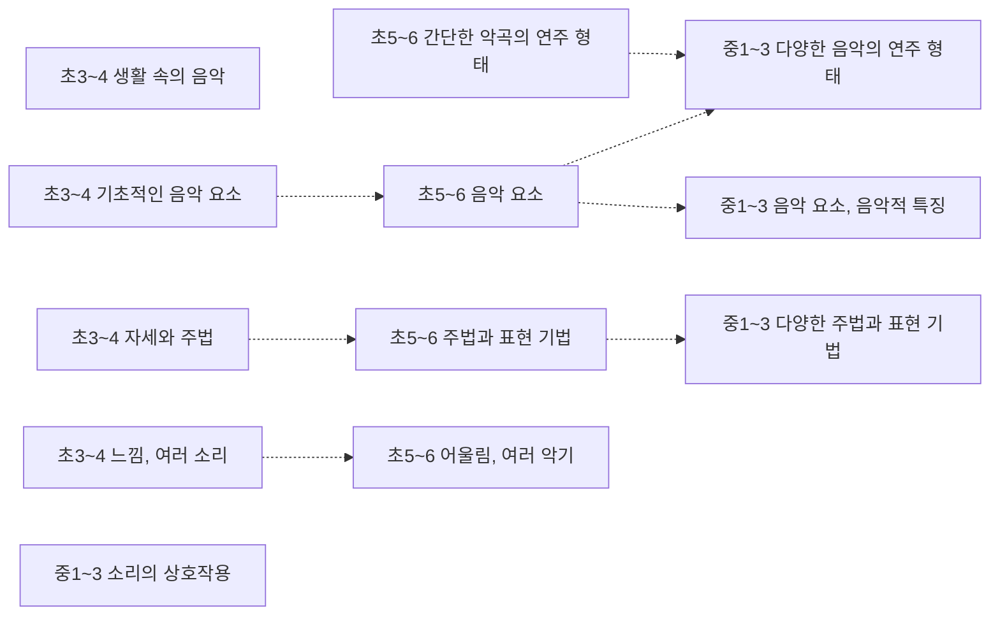
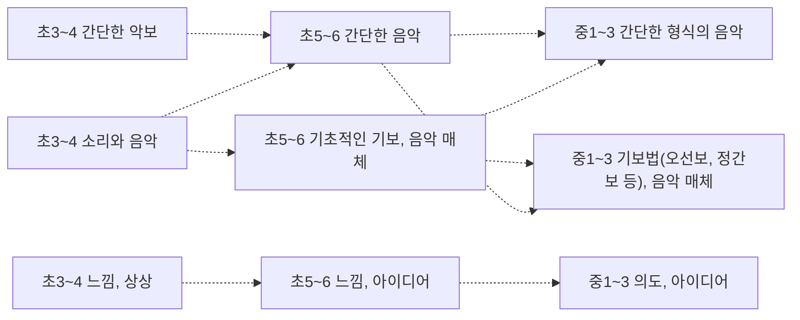

# 음악 개념 지도 (초3~고2~3)

개념 58개 = 고시문 「내용 체계」의 지식⋅이해 항목(원문 낱말 그대로). 선수관계 30개 — **구조 30** (내용 체계 같은 범주 행의 바로 앞 학년 칸 — 규칙으로 뽑아 Gemini 가 「타당」이라 한 것). 원문이 아닌 간선은 그림에서 점선, 목록에서 표시.

> 각 교과 「내용 체계」는 범주를 학년(군)에 따라 위계적으로 배열한다 — 같은 범주 행의 앞 학년 칸이 「구조」 간선의 근거다. 고교 과목은 표가 과목마다 따로라 고시문 단원 연계(「…와 연계된다」) 위에서 「단원」 간선을 찾는다. 간선별 이유·심사 기록은 [concept_proposals.json](../data/kr/concept_proposals.json) · [concept_structure.json](../data/kr/concept_structure.json).

□ 셀프 체크는 그 개념 성취기준 문장을 물음으로만 바꾼 것이다. MCP 에서는 `concept_path` 로 묻고, 「예」인 개념은 `known` 에 넣는다. 먼저/이어서가 없는 개념은 교과 문서의 단원 연계를 본다.

목차: [연주](#연주) · [감상](#감상) · [창작](#창작) · [고2~3 · 음악 · 연주](#고2-3-음악-연주) · [고2~3 · 음악 · 감상](#고2-3-음악-감상) · [고2~3 · 음악 · 창작](#고2-3-음악-창작) · [고2~3 · 음악 연주와 창작 · 표현과 창작](#고2-3-음악-연주와-창작-표현과-창작) · [고2~3 · 음악 연주와 창작 · 실천과 소통](#고2-3-음악-연주와-창작-실천과-소통) · [고2~3 · 음악 감상과 비평 · 감상과 반응](#고2-3-음악-감상과-비평-감상과-반응) · [고2~3 · 음악 감상과 비평 · 비평과 활용](#고2-3-음악-감상과-비평-비평과-활용) · [고2~3 · 음악과 미디어 · 미디어 탐구](#고2-3-음악과-미디어-미디어-탐구) · [고2~3 · 음악과 미디어 · 실용적 연계](#고2-3-음악과-미디어-실용적-연계)

## 연주

### 초3~4 생활 속의 음악

성취기준 4음01-04  

- □ 생활 속에서 음악을 경험하며 연주에 관심을 가지고 참여한다.

### 초3~4 기초적인 음악 요소

성취기준 4음01-02  
➡️ 이어서: [초5~6 음악 요소](#초5-6-음악-요소)구조  

- □ 기초적인 음악 요소를 살려 노래 부르거나 악기로 연주하고 느낌을 이야기한다.

### 초3~4 자세와 주법

성취기준 4음01-01  
➡️ 이어서: [초5~6 주법과 표현 기법](#초5-6-주법과-표현-기법)구조  

- □ 바른 자세와 주법을 익혀 노래 부르거나 악기로 연주한다.

### 초3~4 느낌, 여러 소리

성취기준 4음01-02  
➡️ 이어서: [초5~6 어울림, 여러 악기](#초5-6-어울림-여러-악기)구조  

- □ 기초적인 음악 요소를 살려 노래 부르거나 악기로 연주하고 느낌을 이야기한다.

### 초5~6 간단한 악곡의 연주 형태

성취기준 6음01-04  
➡️ 이어서: [중1~3 다양한 음악의 연주 형태](#중1-3-다양한-음악의-연주-형태)구조  

- □ 간단한 형태의 연주를 준비하여 생활 속 음악 활동에 참여한다.

### 초5~6 음악 요소

성취기준 6음01-02  
⬅️ 먼저: [초3~4 기초적인 음악 요소](#초3-4-기초적인-음악-요소)구조  
➡️ 이어서: [중1~3 음악 요소, 음악적 특징](#중1-3-음악-요소-음악적-특징)구조 · [중1~3 다양한 음악의 연주 형태](#중1-3-다양한-음악의-연주-형태)구조  

- □ 음악 요소를 살려 노래나 악기로 발표하고 과정을 돌아본다.

### 초5~6 주법과 표현 기법

성취기준 6음01-01  
⬅️ 먼저: [초3~4 자세와 주법](#초3-4-자세와-주법)구조  
➡️ 이어서: [중1~3 다양한 주법과 표현 기법](#중1-3-다양한-주법과-표현-기법)구조  

- □ 바른 주법과 표현 기법을 익혀 노래나 악기로 느낌을 담아 연주한다.

### 초5~6 어울림, 여러 악기

성취기준 6음01-03  
⬅️ 먼저: [초3~4 느낌, 여러 소리](#초3-4-느낌-여러-소리)구조  

- □ 소리의 어울림을 생각하며 다양한 방법으로 함께 표현한다.

### 중1~3 다양한 음악의 연주 형태

성취기준 9음01-04  
⬅️ 먼저: [초5~6 간단한 악곡의 연주 형태](#초5-6-간단한-악곡의-연주-형태)구조 · [초5~6 음악 요소](#초5-6-음악-요소)구조  

- □ 생활 속 다양한 형태의 연주에 참여하고 전통과 현대의 연주 문화 다양성을 인식한다.

### 중1~3 음악 요소, 음악적 특징

성취기준 9음01-02  
⬅️ 먼저: [초5~6 음악 요소](#초5-6-음악-요소)구조  

- □ 음악 요소와 음악적 특징을 살려 노래나 악기로 발표하고 평한다.

### 중1~3 다양한 주법과 표현 기법

성취기준 9음01-01  
⬅️ 먼저: [초5~6 주법과 표현 기법](#초5-6-주법과-표현-기법)구조  

- □ 다양한 주법과 표현 기법을 향상시켜 노래나 악기로 개성 있게 연주한다.

### 중1~3 소리의 상호작용

성취기준 9음01-03  

- □ 소리의 상호작용을 인식하고 매체를 활용하여 함께 표현한다.

## 감상

```mermaid
flowchart LR
  n0["초3~4 다양한 종류의 음악"]
  n1["초3~4 지역의 음악 문화유산"]
  n2["초3~4 음악적 특징"]
  n3["초3~4 느낌, 분위기, 쓰임"]
  n4["초5~6 다양한 종류와 문화권의 음악"]
  n5["초5~6 우리나라 음악 문화유산"]
  n6["초5~6 음악적 특징, 음악의 간단한 구성"]
  n7["초5~6 느낌, 배경, 활용"]
  n8["중1~3 다양한 시대⋅사회⋅문화권의 음악"]
  n9["중1~3 유네스코에 등재된 우리 음악문화유산"]
  n10["중1~3 음악 요소"]
  n11["중1~3 음악적 특징, 음악의 구성"]
  n12["중1~3 감성, 다양성, 배경, 역할"]
  n6 -.-> n11
  n4 -.-> n8
  n1 -.-> n5
  n0 -.-> n4
  n3 -.-> n7
  n7 -.-> n12
  n2 -.-> n6
  n1 -.-> n4
  n5 -.-> n8
  n6 -.-> n8
  n0 -.-> n6
  n6 -.-> n10
  n4 -.-> n11
  n5 -.-> n11
```

### 초3~4 다양한 종류의 음악

성취기준 4음02-03  
➡️ 이어서: [초5~6 다양한 종류와 문화권의 음악](#초5-6-다양한-종류와-문화권의-음악)구조 · [초5~6 음악적 특징, 음악의 간단한 구성](#초5-6-음악적-특징-음악의-간단한-구성)구조  

- □ 다양한 종류의 음악을 듣고 음악의 분위기를 묘사하거나 쓰임을 이야기한다.

### 초3~4 지역의 음악 문화유산

성취기준 4음02-05  
➡️ 이어서: [초5~6 우리나라 음악 문화유산](#초5-6-우리나라-음악-문화유산)구조 · [초5~6 다양한 종류와 문화권의 음악](#초5-6-다양한-종류와-문화권의-음악)구조  

- □ 우리 지역의 음악 문화유산을 찾아 듣고 국악을 즐기는 태도를 갖는다.

### 초3~4 음악적 특징

성취기준 4음02-02  
➡️ 이어서: [초5~6 음악적 특징, 음악의 간단한 구성](#초5-6-음악적-특징-음악의-간단한-구성)구조  

- □ 다양한 음악을 듣고 음악적 특징을 발견한다.

### 초3~4 느낌, 분위기, 쓰임

성취기준 4음02-03  
➡️ 이어서: [초5~6 느낌, 배경, 활용](#초5-6-느낌-배경-활용)구조  

- □ 다양한 종류의 음악을 듣고 음악의 분위기를 묘사하거나 쓰임을 이야기한다.

### 초5~6 다양한 종류와 문화권의 음악

성취기준 6음02-02  
⬅️ 먼저: [초3~4 다양한 종류의 음악](#초3-4-다양한-종류의-음악)구조 · [초3~4 지역의 음악 문화유산](#초3-4-지역의-음악-문화유산)구조  
➡️ 이어서: [중1~3 다양한 시대⋅사회⋅문화권의 음악](#중1-3-다양한-시대-사회-문화권의-음악)구조 · [중1~3 음악적 특징, 음악의 구성](#중1-3-음악적-특징-음악의-구성)구조  

- □ 다양한 문화권의 음악을 듣고 음악적 특징과 음악의 간단한 구성을 인식한다.

### 초5~6 우리나라 음악 문화유산

성취기준 6음02-05  
⬅️ 먼저: [초3~4 지역의 음악 문화유산](#초3-4-지역의-음악-문화유산)구조  
➡️ 이어서: [중1~3 다양한 시대⋅사회⋅문화권의 음악](#중1-3-다양한-시대-사회-문화권의-음악)구조 · [중1~3 음악적 특징, 음악의 구성](#중1-3-음악적-특징-음악의-구성)구조  

- □ 우리나라 음악 문화유산을 찾아 듣고 국악의 가치를 인식한다.

### 초5~6 음악적 특징, 음악의 간단한 구성

성취기준 6음02-02  
⬅️ 먼저: [초3~4 음악적 특징](#초3-4-음악적-특징)구조 · [초3~4 다양한 종류의 음악](#초3-4-다양한-종류의-음악)구조  
➡️ 이어서: [중1~3 음악적 특징, 음악의 구성](#중1-3-음악적-특징-음악의-구성)구조 · [중1~3 다양한 시대⋅사회⋅문화권의 음악](#중1-3-다양한-시대-사회-문화권의-음악)구조 · [중1~3 음악 요소](#중1-3-음악-요소)구조  

- □ 다양한 문화권의 음악을 듣고 음악적 특징과 음악의 간단한 구성을 인식한다.

### 초5~6 느낌, 배경, 활용

성취기준 6음02-03  
⬅️ 먼저: [초3~4 느낌, 분위기, 쓰임](#초3-4-느낌-분위기-쓰임)구조  
➡️ 이어서: [중1~3 감성, 다양성, 배경, 역할](#중1-3-감성-다양성-배경-역할)구조  

- □ 다양한 종류의 음악을 듣고 음악의 배경과 활용을 설명한다.

### 중1~3 다양한 시대⋅사회⋅문화권의 음악

성취기준 9음02-03  
⬅️ 먼저: [초5~6 다양한 종류와 문화권의 음악](#초5-6-다양한-종류와-문화권의-음악)구조 · [초5~6 우리나라 음악 문화유산](#초5-6-우리나라-음악-문화유산)구조 · [초5~6 음악적 특징, 음악의 간단한 구성](#초5-6-음악적-특징-음악의-간단한-구성)구조  

- □ 다양한 시대⋅사회⋅문화권의 음악을 듣고 음악의 배경과 역할을 비교한다.

### 중1~3 유네스코에 등재된 우리 음악문화유산

성취기준 9음02-05  

- □ 유네스코에 등재된 우리나라의 음악 문화유산을 찾아 듣고, 세계 속 국악의 위상과 문화적 가치를 인식한다.

### 중1~3 음악 요소

성취기준 9음02-01  
⬅️ 먼저: [초5~6 음악적 특징, 음악의 간단한 구성](#초5-6-음악적-특징-음악의-간단한-구성)구조  

- □ 음악을 듣고 다양한 음악 요소에 집중하여 분석한다.

### 중1~3 음악적 특징, 음악의 구성

성취기준 9음02-02  
⬅️ 먼저: [초5~6 음악적 특징, 음악의 간단한 구성](#초5-6-음악적-특징-음악의-간단한-구성)구조 · [초5~6 다양한 종류와 문화권의 음악](#초5-6-다양한-종류와-문화권의-음악)구조 · [초5~6 우리나라 음악 문화유산](#초5-6-우리나라-음악-문화유산)구조  

- □ 다양한 시대와 문화권의 음악을 듣고 음악적 특징과 음악의 구성을 파악한다.

### 중1~3 감성, 다양성, 배경, 역할

성취기준 9음02-03  
⬅️ 먼저: [초5~6 느낌, 배경, 활용](#초5-6-느낌-배경-활용)구조  

- □ 다양한 시대⋅사회⋅문화권의 음악을 듣고 음악의 배경과 역할을 비교한다.

## 창작

### 초3~4 소리와 음악

성취기준 4음03-03, 4음03-04  
➡️ 이어서: [초5~6 간단한 음악](#초5-6-간단한-음악)구조 · [초5~6 기초적인 기보, 음악 매체](#초5-6-기초적인-기보-음악-매체)구조  

- □ 기초적인 음악 요소를 활용하여 소리나 음악으로 표현한다.
- □ 생활 주변의 소리나 장면을 모방하며 음악의 새로움을 즐기는 태도를 갖는다.

### 초3~4 간단한 악보

성취기준 4음03-02  
➡️ 이어서: [초5~6 간단한 음악](#초5-6-간단한-음악)구조  

- □ 악곡의 일부를 바꾸어 표현하고 간단한 악보로 나타낸다.

### 초3~4 느낌, 상상

성취기준 4음03-01  
➡️ 이어서: [초5~6 느낌, 아이디어](#초5-6-느낌-아이디어)구조  

- □ 느낌과 상상을 즉흥적으로 표현하며 음악에 대한 흥미를 갖는다.

### 초5~6 간단한 음악

성취기준 6음03-03  
⬅️ 먼저: [초3~4 간단한 악보](#초3-4-간단한-악보)구조 · [초3~4 소리와 음악](#초3-4-소리와-음악)구조  
➡️ 이어서: [중1~3 간단한 형식의 음악](#중1-3-간단한-형식의-음악)구조 · [중1~3 기보법(오선보, 정간보 등), 음악 매체](#중1-3-기보법-오선보-정간보-등-음악-매체)구조  

- □ 음악의 요소를 활용하여 간단한 음악을 만든다.

### 초5~6 기초적인 기보, 음악 매체

성취기준 6음03-02  
⬅️ 먼저: [초3~4 소리와 음악](#초3-4-소리와-음악)구조  
➡️ 이어서: [중1~3 기보법(오선보, 정간보 등), 음악 매체](#중1-3-기보법-오선보-정간보-등-음악-매체)구조 · [중1~3 간단한 형식의 음악](#중1-3-간단한-형식의-음악)구조  

- □ 기초적인 기보를 활용하여 간단한 조건에 따라 악곡의 일부를 바꾼다.

### 초5~6 느낌, 아이디어

성취기준 6음03-01  
⬅️ 먼저: [초3~4 느낌, 상상](#초3-4-느낌-상상)구조  
➡️ 이어서: [중1~3 의도, 아이디어](#중1-3-의도-아이디어)구조  

- □ 느낌과 아이디어를 떠올려 여러 매체나 방법으로 자신감 있게 표현한다.

### 중1~3 간단한 형식의 음악

성취기준 9음03-03  
⬅️ 먼저: [초5~6 간단한 음악](#초5-6-간단한-음악)구조 · [초5~6 기초적인 기보, 음악 매체](#초5-6-기초적인-기보-음악-매체)구조  

- □ 음악의 요소와 특징을 활용하여 간단한 형식의 음악을 만든다.

### 중1~3 기보법(오선보, 정간보 등), 음악 매체

성취기준 9음03-01  
⬅️ 먼저: [초5~6 기초적인 기보, 음악 매체](#초5-6-기초적인-기보-음악-매체)구조 · [초5~6 간단한 음악](#초5-6-간단한-음악)구조  

- □ 음악적 의도나 아이디어를 여러 매체나 방법에 적용하여 자기 주도적으로 창작한다.

### 중1~3 의도, 아이디어

성취기준 9음03-01  
⬅️ 먼저: [초5~6 느낌, 아이디어](#초5-6-느낌-아이디어)구조  

- □ 음악적 의도나 아이디어를 여러 매체나 방법에 적용하여 자기 주도적으로 창작한다.

## 고2~3 · 음악 · 연주

### 고2~3 소리의 상호작용

⋅다양한 연주 형태의 음악 ⋅다양한 매체의 음악 · 성취기준 12음01-03  

- □ 소리의 상호작용을 인식하고 다양한 매체를 적용하여 표현하며 연주로 소통한다.

### 고2~3 연주 상황과 맥락

⋅다양한 연주 형태의 음악 ⋅다양한 매체의 음악 · 성취기준 12음01-04  

- □ 다양한 상황과 맥락을 고려하여 연주를 생활 속에서 실천하며 서로 다른 연주 문화를 존중한다.

## 고2~3 · 음악 · 감상

### 고2~3 감성, 정체성

⋅다양한 시대⋅사회⋅문화권의 음악 · 성취기준 12음02-04  

- □ 생활 속에서 음악을 들으며 감성, 정체성, 가치를 내면화하고 향유한다.

### 고2~3 맥락, 기능, 기여

⋅다양한 시대⋅사회⋅문화권의 음악 · 성취기준 12음02-03  

- □ 다양한 시대⋅사회⋅문화권의 음악을 듣고 맥락, 기능, 기여의 관점에서 비평한다.

## 고2~3 · 음악 · 창작

### 고2~3 의도, 아이디어

⋅다양한 형식의 음악 · 성취기준 12음03-01  

- □ 다양한 맥락과 연계되는 음악적 의도나 아이디어를 여러 매체나 방법에 적용하여 창작하고 성찰한다.

### 고2~3 창작에서의 맥락

⋅다양한 형식의 음악 · 성취기준 12음03-01  

- □ 다양한 맥락과 연계되는 음악적 의도나 아이디어를 여러 매체나 방법에 적용하여 창작하고 성찰한다.

## 고2~3 · 음악 연주와 창작 · 표현과 창작

### 고2~3 다양한 연주 형태, 형식, 장르, 양식의 악곡

성취기준 12연창01-01  

- □ 다양한 연주 형태, 형식, 장르, 양식의 악곡을 자신의 해석을 담아 바른 발성과 주법으로 연주한다.

### 고2~3 발성⋅주법, 기보법 및 매체, 창작 의도

성취기준 12연창01-02  

- □ 음악적 의도를 음악 요소와 구조에 반영하고 적합한 기보법이나 매체를 활용하여 창작한다.

### 고2~3 음악 요소, 악곡의 구조와 특징, 음악적 표현

성취기준 12연창01-02  

- □ 음악적 의도를 음악 요소와 구조에 반영하고 적합한 기보법이나 매체를 활용하여 창작한다.

## 고2~3 · 음악 연주와 창작 · 실천과 소통

### 고2~3 다양한 사회, 문화 속 연주⋅창작 활동 양상과 실제

성취기준 12연창02-01  

- □ 다양한 사회와 문화 속의 음악을 듣고, 연주와 창작 활동 양상을 해석하며 비평한다.

### 고2~3 다양한 소리와 매체, 음악적 아이디어의 상호작용과 활용

성취기준 12연창02-03  

- □ 다양한 소리와 매체, 음악적 아이디어를 연계하고 활용하여 공동체에 기여할 수 있는 공연을 기획한다.

### 고2~3 음악의 가치와 역할, 사회⋅문화적 역할과 공헌

성취기준 12연창02-02  

- □ 음악의 가치와 역할을 이해하여 연주 및 창작 활동에 능동적으로 참여한다.

## 고2~3 · 음악 감상과 비평 · 감상과 반응

### 고2~3 음악 요소, 구성, 원리, 특징과 변화⋅발전 양상

성취기준 12감비01-01  

- □ 음악 요소와 악곡 구성의 원리를 이해하며 음악을 듣고 특징을 비교⋅분석하여 설명한다.

### 고2~3 다양한 시대, 지역, 사회, 문화, 공동체의 악곡

성취기준 12감비01-02  

- □ 다양한 시대, 지역, 문화, 공동체의 음악을 집중하여 듣고 변화와 발전 양상을 파악한다.

### 고2~3 미적 특성, 음악적 취향

성취기준 12감비01-04  

- □ 생활 속에서 음악을 찾아 들으며 자신의 음악적 취향을 발견하고, 감상 경험을 공유하며 상호 존중하는 태도를 갖는다.

## 고2~3 · 음악 감상과 비평 · 비평과 활용

### 고2~3 다양한 사회, 문화, 산업 속 음악

성취기준 12감비02-02  

- □ 사회, 문화, 산업 속의 음악을 듣고 음악의 역할과 필요성에 관해 토의하거나 토론한다.

### 고2~3 사회⋅문화⋅시대적 의미, 음악적 특징, 맥락

성취기준 12감비02-01  

- □ 사회⋅문화⋅시대적 의미, 음악적 특징, 맥락 등의 관점에서 음악을 듣고 비평한다.

### 고2~3 역할, 필요성, 가치, 영향력

성취기준 12감비02-02, 12감비02-03  

- □ 사회, 문화, 산업 속의 음악을 듣고 음악의 역할과 필요성에 관해 토의하거나 토론한다.
- □ 생활 속 음악의 가치와 영향력을 이해하고 여러 분야와 연계하여 음악을 활용한다.

## 고2~3 · 음악과 미디어 · 미디어 탐구

### 고2~3 음악과 미디어의 관계, 의미와 역할

성취기준 12음미01-02  

- □ 음악과 미디어의 관계를 분석하고 음악에 활용되는 미디어의 의미와 역할에 대해 토의하거나 토론한다.

### 고2~3 음악에서 미디어의 종류와 특징, 변화와 발전

성취기준 12음미01-01  

- □ 음악에 활용되는 미디어의 종류와 특징을 조사하고 변화와 발전과정을 파악한다.

### 고2~3 미디어 음악과 음악 산업

성취기준 12음미01-04  

- □ 미디어가 음악 산업에 미치는 영향을 비판적으로 분석하고 균형적 시각을 갖는다.

## 고2~3 · 음악과 미디어 · 실용적 연계

### 고2~3 음악에서 활용되는 미디어, 디지털 기술

성취기준 12음미02-04  

- □ 다양한 미디어와 디지털 기술의 음악적 활용에 대하여 올바른 윤리의식을 갖는다.

### 고2~3 다양한 소리⋅악기⋅아이디어와 미디어의 상호작용

성취기준 12음미02-01  

- □ 소리⋅악기⋅아이디어와 미디어 사이의 상호작용을 탐색하고 다양한 상황에 적용하여 표현한다.

### 고2~3 다양한 미디어, 타 분야와의 연계, 확장

성취기준 12음미02-03  

- □ 미디어를 활용하여 다양한 분야와 연계⋅융합한 창의적인 음악 작품을 기획한다.
