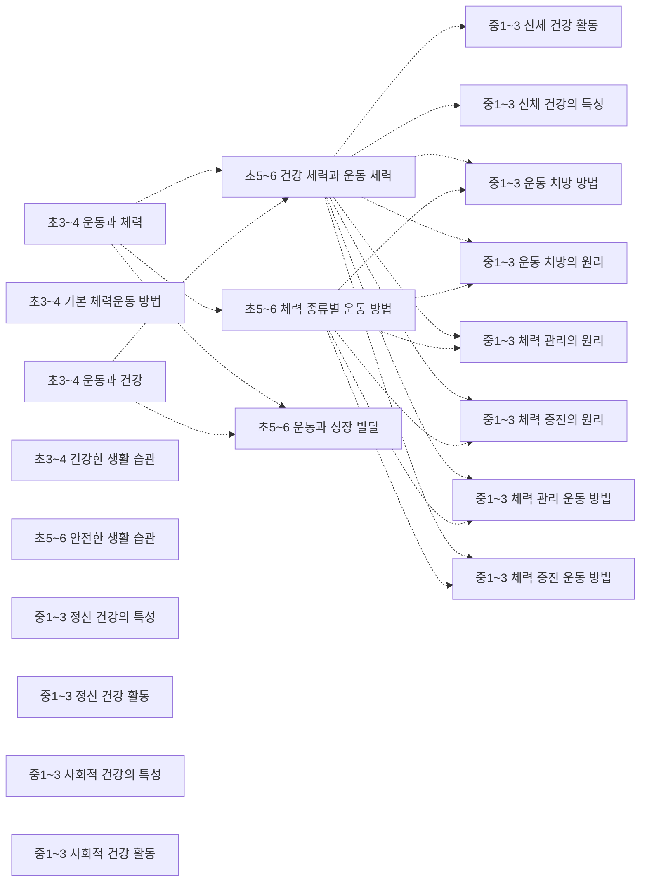
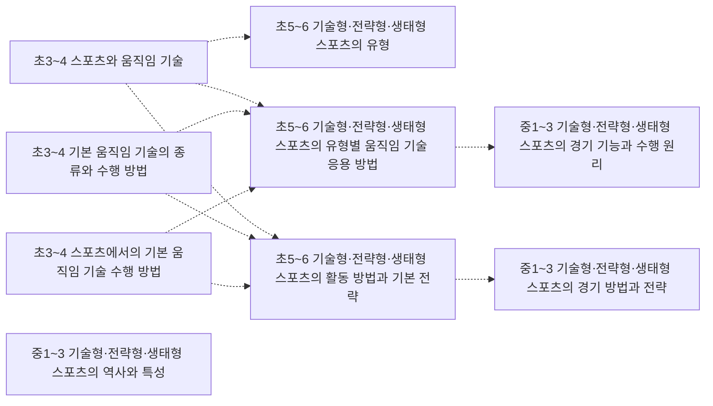
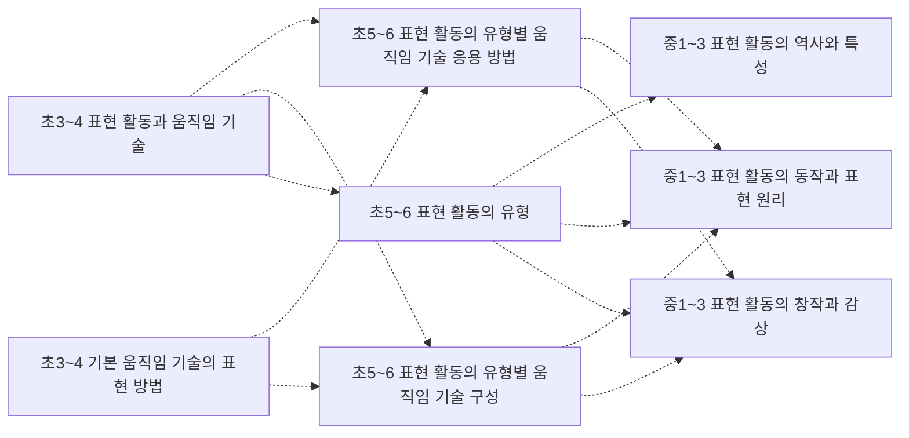

# 체육 개념 지도 (초3~고2~3)

개념 59개 = 고시문 「내용 체계」의 지식⋅이해 항목(원문 낱말 그대로). 선수관계 40개 — **구조 40** (내용 체계 같은 범주 행의 바로 앞 학년 칸 — 규칙으로 뽑아 Gemini 가 「타당」이라 한 것). 원문이 아닌 간선은 그림에서 점선, 목록에서 표시.

> 각 교과 「내용 체계」는 범주를 학년(군)에 따라 위계적으로 배열한다 — 같은 범주 행의 앞 학년 칸이 「구조」 간선의 근거다. 고교 과목은 표가 과목마다 따로라 고시문 단원 연계(「…와 연계된다」) 위에서 「단원」 간선을 찾는다. 간선별 이유·심사 기록은 [concept_proposals.json](../data/kr/concept_proposals.json) · [concept_structure.json](../data/kr/concept_structure.json).

□ 셀프 체크는 그 개념 성취기준 문장을 물음으로만 바꾼 것이다. MCP 에서는 `concept_path` 로 묻고, 「예」인 개념은 `known` 에 넣는다. 먼저/이어서가 없는 개념은 교과 문서의 단원 연계를 본다.

목차: [운동](#운동) · [스포츠](#스포츠) · [표현](#표현) · [고2~3 · 체육1](#고2-3-체육1) · [고2~3 · 체육2](#고2-3-체육2) · [고2~3 · 운동과 건강](#고2-3-운동과-건강) · [고2~3 · 스포츠 문화](#고2-3-스포츠-문화) · [고2~3 · 스포츠 과학](#고2-3-스포츠-과학) · [고2~3 · 스포츠 생활1](#고2-3-스포츠-생활1) · [고2~3 · 스포츠 생활2](#고2-3-스포츠-생활2)

## 운동

### 초3~4 운동과 체력

성취기준 4체01-01, 4체01-02  
➡️ 이어서: [초5~6 건강 체력과 운동 체력](#초5-6-건강-체력과-운동-체력)구조 · [초5~6 체력 종류별 운동 방법](#초5-6-체력-종류별-운동-방법)구조 · [초5~6 운동과 성장 발달](#초5-6-운동과-성장-발달)구조  

- □ 운동과 체력의 의미를 이해하고 관계를 파악한다.
- □ 기본 체력운동의 방법과 절차를 익히며 자신의 수준에 맞는 운동을 시도한다.

### 초3~4 기본 체력운동 방법

성취기준 4체01-02  

- □ 기본 체력운동의 방법과 절차를 익히며 자신의 수준에 맞는 운동을 시도한다.

### 초3~4 운동과 건강

성취기준 4체01-03, 4체01-04, 4체01-06  
➡️ 이어서: [초5~6 건강 체력과 운동 체력](#초5-6-건강-체력과-운동-체력)구조 · [초5~6 운동과 성장 발달](#초5-6-운동과-성장-발달)구조  

- □ 운동과 건강의 의미를 이해하고 관계를 파악한다.
- □ 건강을 위한 바른 생활 습관을 이해하고 생활 속에서 규칙적으로 실천한다.
- □ 운동과 건강한 생활 습관 형성에 관심을 갖고 적극적으로 실천한다.

### 초3~4 건강한 생활 습관

성취기준 4체01-06  

- □ 운동과 건강한 생활 습관 형성에 관심을 갖고 적극적으로 실천한다.

### 초5~6 건강 체력과 운동 체력

성취기준 6체01-01, 6체01-02  
⬅️ 먼저: [초3~4 운동과 체력](#초3-4-운동과-체력)구조 · [초3~4 운동과 건강](#초3-4-운동과-건강)구조  
➡️ 이어서: [중1~3 체력 증진 운동 방법](#중1-3-체력-증진-운동-방법)구조 · [중1~3 체력 관리 운동 방법](#중1-3-체력-관리-운동-방법)구조 · [중1~3 체력 증진의 원리](#중1-3-체력-증진의-원리)구조 · [중1~3 체력 관리의 원리](#중1-3-체력-관리의-원리)구조 · [중1~3 신체 건강의 특성](#중1-3-신체-건강의-특성)구조 · [중1~3 신체 건강 활동](#중1-3-신체-건강-활동)구조 · [중1~3 운동 처방의 원리](#중1-3-운동-처방의-원리)구조 · [중1~3 운동 처방 방법](#중1-3-운동-처방-방법)구조  

- □ 건강 체력과 운동 체력의 의미와 요소를 파악하고 다양한 운동 방법을 탐색한다.
- □ 건강 체력과 운동 체력을 측정하고 자신의 체력 수준에 맞는 운동을 시도한다.

### 초5~6 체력 종류별 운동 방법

성취기준 6체01-01  
⬅️ 먼저: [초3~4 운동과 체력](#초3-4-운동과-체력)구조  
➡️ 이어서: [중1~3 체력 증진 운동 방법](#중1-3-체력-증진-운동-방법)구조 · [중1~3 체력 관리 운동 방법](#중1-3-체력-관리-운동-방법)구조 · [중1~3 체력 증진의 원리](#중1-3-체력-증진의-원리)구조 · [중1~3 체력 관리의 원리](#중1-3-체력-관리의-원리)구조 · [중1~3 운동 처방의 원리](#중1-3-운동-처방의-원리)구조 · [중1~3 운동 처방 방법](#중1-3-운동-처방-방법)구조  

- □ 건강 체력과 운동 체력의 의미와 요소를 파악하고 다양한 운동 방법을 탐색한다.

### 초5~6 운동과 성장 발달

성취기준 6체01-03, 6체01-04, 6체01-06  
⬅️ 먼저: [초3~4 운동과 체력](#초3-4-운동과-체력)구조 · [초3~4 운동과 건강](#초3-4-운동과-건강)구조  

- □ 성장 발달의 의미와 특성을 이해하고 운동과의 관계를 파악한다.
- □ 운동 및 생활 속 위험 상황, 성장 발달을 저해하는 생활 방식의 문제점을 파악하고 예방 및 대처 방법을 익혀 안전하게 활동한다.
- □ 성장과 발달 과정에서 나타나는 신체적, 정서적, 사회적 특성과 차이를 공감하고 위험 상황에 침착하게 대처한다.

### 초5~6 안전한 생활 습관

성취기준 6체01-04  

- □ 운동 및 생활 속 위험 상황, 성장 발달을 저해하는 생활 방식의 문제점을 파악하고 예방 및 대처 방법을 익혀 안전하게 활동한다.

### 중1~3 체력 증진의 원리

성취기준 9체01-01  
⬅️ 먼저: [초5~6 건강 체력과 운동 체력](#초5-6-건강-체력과-운동-체력)구조 · [초5~6 체력 종류별 운동 방법](#초5-6-체력-종류별-운동-방법)구조  

- □ 체력 증진의 의미를 이해하고 원리를 분석한다.

### 중1~3 체력 증진 운동 방법

성취기준 9체01-01, 9체01-02, 9체01-04  
⬅️ 먼저: [초5~6 건강 체력과 운동 체력](#초5-6-건강-체력과-운동-체력)구조 · [초5~6 체력 종류별 운동 방법](#초5-6-체력-종류별-운동-방법)구조  

- □ 체력 증진의 의미를 이해하고 원리를 분석한다.
- □ 자신의 체력 수준에 맞는 체력 증진 운동을 실천한다.
- □ 자신의 체력을 진단하고 적합한 체력 관리 방법을 실천한다.

### 중1~3 체력 관리의 원리

성취기준 9체01-03  
⬅️ 먼저: [초5~6 건강 체력과 운동 체력](#초5-6-건강-체력과-운동-체력)구조 · [초5~6 체력 종류별 운동 방법](#초5-6-체력-종류별-운동-방법)구조  

- □ 체력 관리의 의미를 이해하고 원리를 분석한다.

### 중1~3 체력 관리 운동 방법

성취기준 9체01-04  
⬅️ 먼저: [초5~6 건강 체력과 운동 체력](#초5-6-건강-체력과-운동-체력)구조 · [초5~6 체력 종류별 운동 방법](#초5-6-체력-종류별-운동-방법)구조  

- □ 자신의 체력을 진단하고 적합한 체력 관리 방법을 실천한다.

### 중1~3 운동 처방의 원리

성취기준 9체01-05  
⬅️ 먼저: [초5~6 건강 체력과 운동 체력](#초5-6-건강-체력과-운동-체력)구조 · [초5~6 체력 종류별 운동 방법](#초5-6-체력-종류별-운동-방법)구조  

- □ 운동 처방의 의미를 이해하고 원리를 분석한다.

### 중1~3 운동 처방 방법

성취기준 9체01-04, 9체01-05, 9체01-06, 9체01-08, 9체01-10, 9체01-12  
⬅️ 먼저: [초5~6 건강 체력과 운동 체력](#초5-6-건강-체력과-운동-체력)구조 · [초5~6 체력 종류별 운동 방법](#초5-6-체력-종류별-운동-방법)구조  

- □ 자신의 체력을 진단하고 적합한 체력 관리 방법을 실천한다.
- □ 운동 처방의 의미를 이해하고 원리를 분석한다.
- □ 자신의 신체 조건이나 체력에 맞게 운동 처방 계획을 수립하고 안전하게 실천한다.
- … 외 3개

### 중1~3 신체 건강의 특성

성취기준 9체01-07  
⬅️ 먼저: [초5~6 건강 체력과 운동 체력](#초5-6-건강-체력과-운동-체력)구조  

- □ 신체 건강의 의미를 이해하고 신체 건강 활동의 종류와 특성을 분석한다.

### 중1~3 신체 건강 활동

성취기준 9체01-07, 9체01-08  
⬅️ 먼저: [초5~6 건강 체력과 운동 체력](#초5-6-건강-체력과-운동-체력)구조  

- □ 신체 건강의 의미를 이해하고 신체 건강 활동의 종류와 특성을 분석한다.
- □ 자신에게 적합한 신체 건강 활동 방법을 실천한다.

### 중1~3 정신 건강의 특성

성취기준 9체01-09  

- □ 정신 건강의 의미를 이해하고 정신 건강 활동의 종류와 특성을 분석한다.

### 중1~3 정신 건강 활동

성취기준 9체01-09, 9체01-10  

- □ 정신 건강의 의미를 이해하고 정신 건강 활동의 종류와 특성을 분석한다.
- □ 자신에게 적합한 정신 건강 활동 방법을 실천한다.

### 중1~3 사회적 건강의 특성

성취기준 9체01-11  

- □ 사회적 건강의 의미를 이해하고 사회적 건강을 위한 활동의 종류와 특성을 분석한다.

### 중1~3 사회적 건강 활동

성취기준 9체01-11, 9체01-12  

- □ 사회적 건강의 의미를 이해하고 사회적 건강을 위한 활동의 종류와 특성을 분석한다.
- □ 사회적으로 적합한 건강 활동 방법을 실천한다.

## 스포츠

### 초3~4 스포츠와 움직임 기술

성취기준 4체02-02, 4체02-03, 4체02-04, 4체02-05, 4체02-06, 4체02-07, 4체02-08  
➡️ 이어서: [초5~6 기술형⋅전략형⋅생태형 스포츠의 유형별 움직임 기술 응용 방법](#초5-6-기술형-전략형-생태형-스포츠의-유형별-움직임-기술-응용-방법)구조 · [초5~6 기술형⋅전략형⋅생태형 스포츠의 유형](#초5-6-기술형-전략형-생태형-스포츠의-유형)구조 · [초5~6 기술형⋅전략형⋅생태형 스포츠의 활동 방법과 기본 전략](#초5-6-기술형-전략형-생태형-스포츠의-활동-방법과-기본-전략)구조  

- □ 기본 움직임 기술의 의미와 종류를 이해하고 스포츠와의 관계를 파악한다.
- □ 움직임 요소에 따른 기본 움직임 기술의 수행 방법을 파악하고 시도한다.
- □ 기본 움직임 기술을 연결한 복합적인 움직임 기술을 파악하고 시도한다.
- … 외 4개

### 초3~4 기본 움직임 기술의 종류와 수행 방법

성취기준 4체02-03  
➡️ 이어서: [초5~6 기술형⋅전략형⋅생태형 스포츠의 유형별 움직임 기술 응용 방법](#초5-6-기술형-전략형-생태형-스포츠의-유형별-움직임-기술-응용-방법)구조 · [초5~6 기술형⋅전략형⋅생태형 스포츠의 활동 방법과 기본 전략](#초5-6-기술형-전략형-생태형-스포츠의-활동-방법과-기본-전략)구조  

- □ 움직임 요소에 따른 기본 움직임 기술의 수행 방법을 파악하고 시도한다.

### 초3~4 스포츠에서의 기본 움직임 기술 수행 방법

성취기준 4체02-03  
➡️ 이어서: [초5~6 기술형⋅전략형⋅생태형 스포츠의 유형별 움직임 기술 응용 방법](#초5-6-기술형-전략형-생태형-스포츠의-유형별-움직임-기술-응용-방법)구조 · [초5~6 기술형⋅전략형⋅생태형 스포츠의 활동 방법과 기본 전략](#초5-6-기술형-전략형-생태형-스포츠의-활동-방법과-기본-전략)구조  

- □ 움직임 요소에 따른 기본 움직임 기술의 수행 방법을 파악하고 시도한다.

### 초5~6 기술형⋅전략형⋅생태형 스포츠의 유형

성취기준 6체02-01, 6체02-02, 6체02-03, 6체02-04, 6체02-05, 6체02-06, 6체02-07, 6체02-08, 6체02-09  
⬅️ 먼저: [초3~4 스포츠와 움직임 기술](#초3-4-스포츠와-움직임-기술)구조  

- □ 기술형 스포츠의 의미와 유형을 파악한다.
- □ 기술형 스포츠 유형별로 기본 움직임 기술을 응용한 기본 기능을 파악하고 수행한다.
- □ 기술형 스포츠 유형별 활동 방법을 파악하고 기본 전략을 게임 활동에서 수행한다.
- … 외 6개

### 초5~6 기술형⋅전략형⋅생태형 스포츠의 유형별 움직임 기술 응용 방법

성취기준 6체02-02, 6체02-05, 6체02-08  
⬅️ 먼저: [초3~4 스포츠와 움직임 기술](#초3-4-스포츠와-움직임-기술)구조 · [초3~4 기본 움직임 기술의 종류와 수행 방법](#초3-4-기본-움직임-기술의-종류와-수행-방법)구조 · [초3~4 스포츠에서의 기본 움직임 기술 수행 방법](#초3-4-스포츠에서의-기본-움직임-기술-수행-방법)구조  
➡️ 이어서: [중1~3 기술형⋅전략형⋅생태형 스포츠의 경기 기능과 수행 원리](#중1-3-기술형-전략형-생태형-스포츠의-경기-기능과-수행-원리)구조  

- □ 기술형 스포츠 유형별로 기본 움직임 기술을 응용한 기본 기능을 파악하고 수행한다.
- □ 전략형 스포츠 유형별로 기본 움직임 기술을 응용한 기본 기능을 파악하고 수행한다.
- □ 생태형 스포츠 유형별로 기본 움직임 기술을 응용한 기본 기능을 파악하고 수행한다.

### 초5~6 기술형⋅전략형⋅생태형 스포츠의 활동 방법과 기본 전략

성취기준 6체02-03, 6체02-06, 6체02-09  
⬅️ 먼저: [초3~4 스포츠와 움직임 기술](#초3-4-스포츠와-움직임-기술)구조 · [초3~4 기본 움직임 기술의 종류와 수행 방법](#초3-4-기본-움직임-기술의-종류와-수행-방법)구조 · [초3~4 스포츠에서의 기본 움직임 기술 수행 방법](#초3-4-스포츠에서의-기본-움직임-기술-수행-방법)구조  
➡️ 이어서: [중1~3 기술형⋅전략형⋅생태형 스포츠의 경기 방법과 전략](#중1-3-기술형-전략형-생태형-스포츠의-경기-방법과-전략)구조  

- □ 기술형 스포츠 유형별 활동 방법을 파악하고 기본 전략을 게임 활동에서 수행한다.
- □ 전략형 스포츠 유형별 활동 방법을 파악하고 기본 전략을 게임 활동에서 수행한다.
- □ 생태형 스포츠 유형별 활동 방법을 파악하고 기본 전략을 게임 활동에서 수행한다.

### 중1~3 기술형⋅전략형⋅생태형 스포츠의 역사와 특성

성취기준 9체02-01, 9체02-04, 9체02-07, 9체02-10, 9체02-13, 9체02-16, 9체02-19, 9체02-22  

- □ 동작형 스포츠의 역사와 특성을 탐색하고 비교한다.
- □ 기록형 스포츠의 역사와 특성을 탐색하고 비교한다.
- □ 투기형 스포츠의 역사와 특성을 탐색하고 비교한다.
- … 외 5개

### 중1~3 기술형⋅전략형⋅생태형 스포츠의 경기 기능과 수행 원리

성취기준 9체02-02, 9체02-05, 9체02-08, 9체02-11, 9체02-14, 9체02-17  
⬅️ 먼저: [초5~6 기술형⋅전략형⋅생태형 스포츠의 유형별 움직임 기술 응용 방법](#초5-6-기술형-전략형-생태형-스포츠의-유형별-움직임-기술-응용-방법)구조  

- □ 동작형 스포츠의 수행 원리를 적용하여 경기 기능을 수련하고 향상한다.
- □ 기록형 스포츠의 수행 원리를 적용하여 경기 기능을 수련하고 향상한다.
- □ 투기형 스포츠의 수행 원리를 적용하여 경기 기능을 수련하고 향상한다.
- … 외 3개

### 중1~3 기술형⋅전략형⋅생태형 스포츠의 경기 방법과 전략

성취기준 9체02-03, 9체02-06, 9체02-09, 9체02-12, 9체02-15, 9체02-18, 9체02-21, 9체02-24  
⬅️ 먼저: [초5~6 기술형⋅전략형⋅생태형 스포츠의 활동 방법과 기본 전략](#초5-6-기술형-전략형-생태형-스포츠의-활동-방법과-기본-전략)구조  

- □ 동작형 스포츠의 경기 방법을 이해하고 경기 전략을 상황에 맞게 활용하며 안전하게 경기한다.
- □ 기록형 스포츠의 경기 방법을 이해하고 경기 전략을 상황에 맞게 활용하며 안전하게 경기한다.
- □ 투기형 스포츠의 경기 방법을 이해하고 경기 전략을 상황에 맞게 활용하며 안전하게 경기한다.
- … 외 5개

## 표현

### 초3~4 표현 활동과 움직임 기술

성취기준 4체03-01  
➡️ 이어서: [초5~6 표현 활동의 유형별 움직임 기술 응용 방법](#초5-6-표현-활동의-유형별-움직임-기술-응용-방법)구조 · [초5~6 표현 활동의 유형별 움직임 기술 구성](#초5-6-표현-활동의-유형별-움직임-기술-구성)구조 · [초5~6 표현 활동의 유형](#초5-6-표현-활동의-유형)구조  

- □ 표현 활동의 의미와 기본 움직임 기술과의 관계를 파악한다.

### 초3~4 기본 움직임 기술의 표현 방법

성취기준 4체03-02  
➡️ 이어서: [초5~6 표현 활동의 유형별 움직임 기술 응용 방법](#초5-6-표현-활동의-유형별-움직임-기술-응용-방법)구조 · [초5~6 표현 활동의 유형별 움직임 기술 구성](#초5-6-표현-활동의-유형별-움직임-기술-구성)구조  

- □ 움직임 요소에 따른 기본 움직임 기술의 표현 방법을 파악하고 시도한다.

### 초5~6 표현 활동의 유형

성취기준 6체03-01, 6체03-08  
⬅️ 먼저: [초3~4 표현 활동과 움직임 기술](#초3-4-표현-활동과-움직임-기술)구조  
➡️ 이어서: [중1~3 표현 활동의 역사와 특성](#중1-3-표현-활동의-역사와-특성)구조 · [중1~3 표현 활동의 동작과 표현 원리](#중1-3-표현-활동의-동작과-표현-원리)구조 · [중1~3 표현 활동의 창작과 감상](#중1-3-표현-활동의-창작과-감상)구조  

- □ 표현 활동의 의미와 유형을 파악한다.
- □ 다양한 표현 활동 유형을 수용하고, 움직임 표현의 아름다움을 추구한다.

### 초5~6 표현 활동의 유형별 움직임 기술 응용 방법

성취기준 6체03-02, 6체03-04, 6체03-06  
⬅️ 먼저: [초3~4 표현 활동과 움직임 기술](#초3-4-표현-활동과-움직임-기술)구조 · [초3~4 기본 움직임 기술의 표현 방법](#초3-4-기본-움직임-기술의-표현-방법)구조  
➡️ 이어서: [중1~3 표현 활동의 동작과 표현 원리](#중1-3-표현-활동의-동작과-표현-원리)구조 · [중1~3 표현 활동의 창작과 감상](#중1-3-표현-활동의-창작과-감상)구조  

- □ 스포츠 표현에서 움직임 기술을 응용한 기본 동작을 파악하고 표현한다.
- □ 전통 표현에서 움직임 기술을 응용한 기본 동작을 파악하고 표현한다.
- □ 현대 표현에서 움직임 기술을 응용한 기본 동작을 파악하고 표현한다.

### 초5~6 표현 활동의 유형별 움직임 기술 구성

성취기준 6체03-02, 6체03-04, 6체03-06, 6체03-08  
⬅️ 먼저: [초3~4 표현 활동과 움직임 기술](#초3-4-표현-활동과-움직임-기술)구조 · [초3~4 기본 움직임 기술의 표현 방법](#초3-4-기본-움직임-기술의-표현-방법)구조  
➡️ 이어서: [중1~3 표현 활동의 동작과 표현 원리](#중1-3-표현-활동의-동작과-표현-원리)구조 · [중1~3 표현 활동의 창작과 감상](#중1-3-표현-활동의-창작과-감상)구조  

- □ 스포츠 표현에서 움직임 기술을 응용한 기본 동작을 파악하고 표현한다.
- □ 전통 표현에서 움직임 기술을 응용한 기본 동작을 파악하고 표현한다.
- □ 현대 표현에서 움직임 기술을 응용한 기본 동작을 파악하고 표현한다.
- … 외 1개

### 중1~3 표현 활동의 역사와 특성

성취기준 9체03-01, 9체03-04, 9체03-07  
⬅️ 먼저: [초5~6 표현 활동의 유형](#초5-6-표현-활동의-유형)구조  

- □ 스포츠 표현의 역사와 특성을 탐색하고 비교한다.
- □ 전통 표현의 역사와 특성을 탐색하고 비교한다.
- □ 현대 표현의 역사와 특성을 탐색하고 비교한다.

### 중1~3 표현 활동의 동작과 표현 원리

성취기준 9체03-02, 9체03-05, 9체03-08  
⬅️ 먼저: [초5~6 표현 활동의 유형](#초5-6-표현-활동의-유형)구조 · [초5~6 표현 활동의 유형별 움직임 기술 응용 방법](#초5-6-표현-활동의-유형별-움직임-기술-응용-방법)구조 · [초5~6 표현 활동의 유형별 움직임 기술 구성](#초5-6-표현-활동의-유형별-움직임-기술-구성)구조  

- □ 스포츠 표현의 원리를 적용하여 동작을 심미적으로 표현한다.
- □ 전통 표현의 원리를 적용하여 동작을 심미적으로 표현한다.
- □ 현대 표현의 원리를 적용하여 동작을 심미적으로 표현한다.

### 중1~3 표현 활동의 창작과 감상

성취기준 9체03-03, 9체03-06, 9체03-09, 9체03-10  
⬅️ 먼저: [초5~6 표현 활동의 유형](#초5-6-표현-활동의-유형)구조 · [초5~6 표현 활동의 유형별 움직임 기술 응용 방법](#초5-6-표현-활동의-유형별-움직임-기술-응용-방법)구조 · [초5~6 표현 활동의 유형별 움직임 기술 구성](#초5-6-표현-활동의-유형별-움직임-기술-구성)구조  

- □ 스포츠 표현의 특성과 원리를 반영한 작품을 창작하고 표현 요소를 고려하여 감상한다.
- □ 전통 표현의 특성과 원리를 반영한 작품을 창작하고 표현 요소를 고려하여 감상한다.
- □ 현대 표현의 특성과 원리를 반영한 작품을 창작하고 표현 요소를 고려하여 감상한다.
- … 외 1개

## 고2~3 · 체육1

### 고2~3 생태형 스포츠의 문화

∙ 신체활동의 효과 ∙ 생애주기별 건강 관리 방법 ∙ 건강 관리와 안전 · 성취기준 12체육1-03-01  

- □ 생태형 스포츠 문화의 개념과 특성을 탐색하고, 스포츠 환경에 대한 생태 감수성을 실천한다.

### 고2~3 생태형 스포츠의 경기 기능과 과학적 원리

∙ 신체활동의 효과 ∙ 생애주기별 건강 관리 방법 ∙ 건강 관리와 안전 · 성취기준 12체육1-03-02  

- □ 생태형 스포츠의 경기 기능을 과학적 원리에 따라 분석하고, 적극적으로 개선한다.

### 고2~3 생태형 스포츠의 경기 방법 및 전략

∙ 신체활동의 효과 ∙ 생애주기별 건강 관리 방법 ∙ 건강 관리와 안전 · 성취기준 12체육1-03-03  

- □ 생태형 스포츠의 경기 방법 및 전략을 이해하고, 경기 상황에 맞게 응용한다.

## 고2~3 · 체육2

### 고2~3 표현 활동의 문화

∙ 체력 증진의 과학적 원리와 특성 ∙ 체력의 종합적 관리 방법 ∙ 체력 증진 운동과 안전 · 성취기준 12체육2-03-01  

- □ 표현 활동 문화의 유형, 개념, 특성을 이해하고, 다양한 표현 활동 문화를 탐색한다.

### 고2~3 표현 활동의 동작과 미적 원리

∙ 체력 증진의 과학적 원리와 특성 ∙ 체력의 종합적 관리 방법 ∙ 체력 증진 운동과 안전 · 성취기준 12체육2-03-02  

- □ 표현 활동의 미적 원리를 이해하고, 표현 동작을 심층적으로 분석하여 창의적으로 동작을 수행한다.

### 고2~3 표현 활동의 창작과 비평

∙ 체력 증진의 과학적 원리와 특성 ∙ 체력의 종합적 관리 방법 ∙ 체력 증진 운동과 안전 · 성취기준 12체육2-03-03  

- □ 표현 주제에 맞게 창의적으로 작품을 창작하고 감상⋅비평함으로써 심미적 안목을 갖는다.

## 고2~3 · 운동과 건강

### 고2~3 트레이닝의 종류와 방법

∙ 운동과 건강 관리 ∙ 기술형 스포츠와 건강 ∙ 표현 활동과 건강 · 성취기준 12운건02-01  

- □ 운동 처방에 따른 트레이닝의 종류와 방법을 이해하여 체력 증진을 위한 트레이닝 프로그램을 계획하고 체력 운동에 적용하며 자기 주도적으로 체력을 관리한다.

### 고2~3 체력 증진 트레이닝 프로그램

∙ 운동과 건강 관리 ∙ 기술형 스포츠와 건강 ∙ 표현 활동과 건강 · 성취기준 12운건02-01  

- □ 운동 처방에 따른 트레이닝의 종류와 방법을 이해하여 체력 증진을 위한 트레이닝 프로그램을 계획하고 체력 운동에 적용하며 자기 주도적으로 체력을 관리한다.

### 고2~3 운동 손상과 재활

∙ 운동과 건강 관리 ∙ 기술형 스포츠와 건강 ∙ 표현 활동과 건강 · 성취기준 12운건02-02  

- □ 운동 손상의 원인과 기전을 이해하고, 적절한 응급처치와 재활 운동을 통해 운동 손상을 관리한다.

## 고2~3 · 스포츠 문화

### 고2~3 스포츠 경기 문화의 개념 및 특성

∙ 스포츠 인문 문화의 개념 및 특성 ∙ 스포츠의 역사와 철학 ∙ 스포츠의 문학과 예술 · 성취기준 12스문02-01  

- □ 스포츠 경기 문화의 개념 및 특성을 이해하고, 스포츠 대회에 다양한 역할로 참여한다.

### 고2~3 스포츠 경기 문화의 구성 체계 및 방법

∙ 스포츠 인문 문화의 개념 및 특성 ∙ 스포츠의 역사와 철학 ∙ 스포츠의 문학과 예술 · 성취기준 12스문02-02  

- □ 스포츠 경기 문화의 구성 체계 및 방법에 따라 스포츠 대회를 기획하고 운영하며, 스포츠 경기 문화 분야 진로를 설계한다.

## 고2~3 · 스포츠 과학

### 고2~3 스포츠와 자연과학의 관계

∙ 스포츠와 사회과학의 관계 ∙ 스포츠 심리⋅사회학적 현상과 원리 ∙ 스포츠 경기 활동 · 성취기준 12스과02-01  

- □ 스포츠와 자연과학의 관계를 이해하고, 스포츠 현상을 분석한 생리⋅역학적 이론을 탐구하며, 스포츠 자연과학 분야의 진로를 설계한다.

### 고2~3 스포츠 생리⋅역학적 현상과 원리

∙ 스포츠와 사회과학의 관계 ∙ 스포츠 심리⋅사회학적 현상과 원리 ∙ 스포츠 경기 활동 · 성취기준 12스과02-01  

- □ 스포츠와 자연과학의 관계를 이해하고, 스포츠 현상을 분석한 생리⋅역학적 이론을 탐구하며, 스포츠 자연과학 분야의 진로를 설계한다.

### 고2~3 스포츠 경기 활동

∙ 스포츠와 사회과학의 관계 ∙ 스포츠 심리⋅사회학적 현상과 원리 ∙ 스포츠 경기 활동 · 성취기준 12스과01-02, 12스과02-02  

- □ 스포츠 경기 활동에 참여하며, 심리⋅사회학적 이론의 적용 가능성을 탐색하고 경기 상황에 적용한다.
- □ 스포츠 경기 활동에 참여하여 생리⋅역학적 이론의 적용 가능성을 탐색하고 경기 상황에 적용한다.

## 고2~3 · 스포츠 생활1

### 고2~3 생활⋅자연환경형 스포츠의 문화

∙ 영역형 스포츠의 문화 ∙ 영역형 스포츠와 체력 ∙ 영역형 스포츠의 경기 기능과 과학적 원리 ∙ 영역형 스포츠의 창의적 경기 전략 · 성취기준 12스생1-02-01  

- □ 생활⋅자연환경형 스포츠의 문화를 이해하고 존중하며, 환경친화적 태도를 실천한다.

### 고2~3 생활⋅자연환경형 스포츠와 체력

∙ 영역형 스포츠의 문화 ∙ 영역형 스포츠와 체력 ∙ 영역형 스포츠의 경기 기능과 과학적 원리 ∙ 영역형 스포츠의 창의적 경기 전략 · 성취기준 12스생1-02-02  

- □ 생활⋅자연환경형 스포츠에 필요한 체력을 강화하고, 경기 기능을 과학적으로 분석하여 발전시켜 다른 기능에 전이한다.

### 고2~3 생활⋅자연환경형 스포츠의 경기 기능과 과학적 원리

∙ 영역형 스포츠의 문화 ∙ 영역형 스포츠와 체력 ∙ 영역형 스포츠의 경기 기능과 과학적 원리 ∙ 영역형 스포츠의 창의적 경기 전략 · 성취기준 12스생1-02-02  

- □ 생활⋅자연환경형 스포츠에 필요한 체력을 강화하고, 경기 기능을 과학적으로 분석하여 발전시켜 다른 기능에 전이한다.

### 고2~3 생활⋅자연환경형 스포츠의 창의적 경기 전략

∙ 영역형 스포츠의 문화 ∙ 영역형 스포츠와 체력 ∙ 영역형 스포츠의 경기 기능과 과학적 원리 ∙ 영역형 스포츠의 창의적 경기 전략 · 성취기준 12스생1-02-03  

- □ 생활⋅자연환경형 스포츠의 경기 수행 능력을 고도화하여 스포츠 수행에 대한 유능감을 높이고, 경기 전략을 창의적으로 발전시킨다.

## 고2~3 · 스포츠 생활2

### 고2~3 필드형 스포츠의 문화

∙ 네트형 스포츠의 문화 ∙ 네트형 스포츠와 체력 ∙ 네트형 스포츠의 경기 기능과 과학적 원리 ∙ 네트형 스포츠의 창의적 경기 전략 · 성취기준 12스생2-02-01  

- □ 필드형 스포츠의 문화를 이해하고 존중하며, 스포츠퍼슨십을 실천한다.

### 고2~3 필드형 스포츠와 체력

∙ 네트형 스포츠의 문화 ∙ 네트형 스포츠와 체력 ∙ 네트형 스포츠의 경기 기능과 과학적 원리 ∙ 네트형 스포츠의 창의적 경기 전략 · 성취기준 12스생2-02-02  

- □ 필드형 스포츠에 필요한 체력을 강화하고, 경기 기능을 과학적으로 분석하여 발전시켜 다른 기능에 전이한다.

### 고2~3 필드형 스포츠의 경기 기능과 과학적 원리

∙ 네트형 스포츠의 문화 ∙ 네트형 스포츠와 체력 ∙ 네트형 스포츠의 경기 기능과 과학적 원리 ∙ 네트형 스포츠의 창의적 경기 전략 · 성취기준 12스생2-02-02  

- □ 필드형 스포츠에 필요한 체력을 강화하고, 경기 기능을 과학적으로 분석하여 발전시켜 다른 기능에 전이한다.

### 고2~3 필드형 스포츠의 창의적 경기 전략

∙ 네트형 스포츠의 문화 ∙ 네트형 스포츠와 체력 ∙ 네트형 스포츠의 경기 기능과 과학적 원리 ∙ 네트형 스포츠의 창의적 경기 전략 · 성취기준 12스생2-02-03  

- □ 필드형 스포츠의 경기 수행 능력을 고도화하여 스포츠 수행에 대한 유능감을 높이고, 경기 전략을 창의적으로 발전시킨다.
